<div align="center">
  

  <h1>Tisty — Memoria de trabajo compartida para ti y tu agente de IA</h1>

  <p><strong>Tú ves el conjunto. Tu agente, cada detalle. Una sola memoria.<br/>
  Con tu agente, es la memoria que comparten. Solo para ti, es tu lugar para
  notas, documentos y tareas.<br/>
  Una app gratis y de código abierto: tareas que guardan cómo se resolvió cada
  cosa y documentos que guardan lo que sabes, en Markdown, en tu disco, para
  Windows y macOS — y un servidor MCP local para que GitHub Copilot, Claude Code,
  Codex, Cursor o cualquier asistente retome donde quedó, una sección a la
  vez.<br/>Sin cuentas. Sin suscripciones. Sin telemetría. Sin
  servidor.</strong></p>

  <p>Software por convicción, no por suscripción.</p>

  <p>
    <a href="README.md">English</a> ·
    <strong>Español</strong>
  </p>

  <p>
    <a href="https://github.com/rgdevment/Tisty/releases">
      
    </a>
    <a href="#servidor-mcp">
      
    </a>
    
    <a href="#licencia">
      
    </a>
    <a href="https://github.com/sponsors/rgdevment">
      
    </a>
    <a href="https://buymeacoffee.com/rgdevment">
      
    </a>
  </p>

[](https://m8ven.ai/mcp/rgdevment-tisty-15kwqt?s=readme)

  <p>
    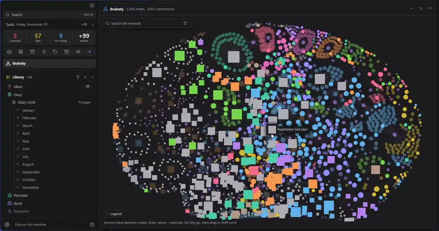
  </p>

  <p><strong>Descargar Tisty</strong></p>

  <p>
    <a href="https://apps.microsoft.com/detail/9PGVWXD8X93N">
      
    </a>
    <a href="#instalación">
      
    </a>
    <a href="#instalación">
      
    </a>
  </p>

  <p>
    <sub>¿Prefieres la descarga directa?
    <a href="https://github.com/rgdevment/Tisty/releases/latest">GitHub
    Releases</a> lleva los instaladores firmados — Windows (.exe) · macOS
    (.dmg, uno por chip)</sub>
  </p>

  <p>
    <sub>Sitio y ayuda:
    <a href="https://www.tisty.app/es/">www.tisty.app/es</a></sub>
  </p>

</div>

---

Comencé a desarrollar Tisty para resolver un problema personal, y fui viendo que
ese problema no era solo mío: a todos les pasaba, y cada uno lo resolvía a su
manera.

**Ni tú vuelves a explicar, ni él vuelve a empezar.** Tu agente de IA conoce el
detalle mejor que nadie, y lo olvida en cuanto termina la sesión. Cada quien lo
parcha a su manera: un `NOTES.md` escondido detrás de `.gitignore`, un Markdown
por sesión, un `TASKS.md` que nadie mantiene al día, un `AGENTS.md` que solo
crece. Se desactualizan, se acumulan, se pierden entre ramas, equipos y
proyectos — y el agente los relee enteros, en cada sesión. No ves los tokens,
pero los pagas: en tiempo, en límites que llegan antes de tiempo, en trabajo
repetido.

**Tisty es una memoria de trabajo que compartes con tu agente.** Tú ves el
conjunto: en qué va cada proyecto, qué falta y qué se decidió. Tu agente ve cada
detalle: la tarea en la que estaba, lo que probó y lo que descartó. Pregunta qué
cambió desde la última vez, abre la tarea en la que estaba y lee solo la sección
que necesita; trabaja, anota lo que hizo y te dice cuando algo está listo. Tú lo
revisas y lo cierras: nada se cierra sin ti. Todo en tu propio disco, visual y
fácil de leer para ti, y para tu agente un **servidor MCP local** que le da
primero el índice y después solo la sección que necesita.

Y si prefieres trabajar de una forma más personal, sin agente, Tisty te sirve
igual: tus tareas, tus documentos, tus ideas y tu diario, a la vista y unidos
en Brainsty. El agente es una forma de usarlo, no una condición.

Es de código abierto: puedes leerlo, compilarlo, probarlo o descargar las
versiones firmadas que ya están publicadas. No hay nada oculto: todo es
auditable.

No soy una empresa: soy un desarrollador que hace lo que necesita y lo comparte.
Quiero que Tisty siga siendo pequeño y útil, no que crezca con mil funciones que
nadie usa. Sin anuncios, sin telemetría, sin cuentas, sin suscripciones: una
**herramienta de productividad local** que vive en tu equipo y en ninguna otra
parte.

**Por qué alguien elige Tisty:**

- **Tú ves el conjunto, tu agente cada detalle** — tareas con sus pasos y una
  bitácora con fechas, documentos uno por tema: amenos de leer para ti, y para
  tu agente un índice y una sección a la vez.
- **Memoria que dura más que la sesión** — tu agente parte de lo que cambió, de
  la tarea en la que estaba y de lo que anotó ayer, no de un chat en blanco.
- **Nada se cierra sin ti** — tu agente dice cuándo una tarea o un paso está
  listo, y espera en *Por confirmar* hasta que tú la terminas o la devuelves. No
  puede cerrar ni borrar una tarea, ni borrar un documento o una idea.
- **Hecho para agentes tanto como para personas** — un índice cuesta unos
  cientos de tokens, una lectura trae una sección, y retomar trae solo lo que
  cambió: una fracción de lo que cuesta releer tus archivos Markdown.
- **Terminar lo conserva todo** — una tarea cerrada va entera al archivo, y la
  búsqueda responde «¿cómo resolvimos esto?» con la línea que lo dice.
- **100% local** — tus tareas, tu bitácora y tus documentos viven en tu equipo
  y solo van adonde tú los mandes. Sin servidor mío, sin cuenta. Si
  sincronizas dos equipos, puedes pedirle a Tisty que deje los adjuntos más
  grandes en esa carpeta compartida en vez de llevarlos a cada disco; nunca lo
  hace si tú no lo eliges.
- **Documentos que hacen más que texto** — libros en páginas, diagramas,
  fórmulas, código, widgets y adjuntos, todo en Markdown corriente que cualquier
  otro editor sigue abriendo.
- **Gratis de verdad** — sin versión de pago, sin funciones bajo llave, sin
  período de prueba. AGPL v3.
- **Tus datos duran más que la aplicación** — texto plano y Markdown en tu
  propio disco, que se lee con `cat` y se busca con `grep`.
- **Rápido y nativo** — un núcleo en Rust dentro de una ventana Tauri: arranca
  rápido, ocupa poco y parece parte de los dos sistemas.

**Brainsty, el cerebro de Tisty.** Todo lo que guardas, con lo que lo une,
dibujado como una sola red: un mapa de lejos para ti y, para tu agente, un
índice que le dice dónde mirar sin leerlo todo. Además muestra, aparte, lo que
Tisty cree que se parece, sin IA. [Más abajo](#brainsty-todo-unido).

> Uso Tisty todos los días en macOS y en Windows. Si algo no encaja,
> [abre un issue](https://github.com/rgdevment/Tisty/issues) — este proyecto
> mejora porque alguien lo usa de verdad. Las preguntas, las ideas y cómo lo
> usas van a [Discussions](https://github.com/rgdevment/Tisty/discussions).
>
> **Cada persona tiene su propio Tisty, a propósito.** Un desarrollador, una PM
> y un QA tienen cada uno sus tareas, sus documentos y lo que aprendieron, y su
> propio agente trabajando con eso. Cuando alguien necesita lo que sabes, le
> entregas el documento con [Folio](#comparte-lo-que-sabes-con-folio). Sin
> responsables, sin permisos, sin tableros: si necesitas llevar un equipo, Tisty
> no va a sostener eso.

## Contenido

- [Brainsty: todo unido](#brainsty-todo-unido)
- [Problemas reales, soluciones reales](#problemas-reales-soluciones-reales)
- [Tareas y documentos, para ti y tu agente](#tareas-y-documentos-para-ti-y-tu-agente)
- [Un día con tu agente](#un-día-con-tu-agente)
- [Lo que le cuesta a tu agente](#lo-que-le-cuesta-a-tu-agente)
- [Comparte lo que sabes con Folio](#comparte-lo-que-sabes-con-folio)
- [Servidor MCP](#servidor-mcp)
- [Herramientas](#herramientas)
- [Por qué lo hice](#por-qué-lo-hice)
- [Qué es, y qué no es](#qué-es-y-qué-no-es)
- [Qué lo hace distinto](#qué-lo-hace-distinto)
- [Documentos](#documentos)
- [Para quién es](#para-quién-es)
- [La idea sobre la que está construido](#la-idea-sobre-la-que-está-construido)
- [Instalación](#instalación)
- [Qué hace](#qué-hace)
- [Tus datos y tu privacidad](#tus-datos-y-tu-privacidad)
- [Dos equipos, si tienes dos](#dos-equipos-si-tienes-dos)
- [Tu agente de IA](#tu-agente-de-ia)
- [Qué no hace](#qué-no-hace)
- [Preguntas frecuentes](#preguntas-frecuentes)
- [Alternativas a Obsidian, Notion y Todoist](#alternativas-a-obsidian-notion-y-todoist)
- [Idiomas](#idiomas)
- [Otras herramientas del mismo autor](#otras-herramientas-del-mismo-autor)
- [Apoyar el proyecto](#apoyar-el-proyecto)
- [Sobre hombros ajenos](#sobre-hombros-ajenos)
- [Contribuir](#contribuir)
- [Licencia](#licencia)
- [Salud del proyecto](#salud-del-proyecto)

## Brainsty: todo unido

Lo que guardas ya estaba unido: un documento cita otro, una tarea nació de un
acta, un libro tiene páginas. **Brainsty**, bajo las vistas de tareas en la
barra lateral, lo dibuja todo como una sola red, en el panel de contenido,
junto a tus listas.

- **Unido mientras escribes** — `[[` enlaza un documento con otro, el menú `/`
  cita una tarea como una tarjeta viva, y el panel junto a un documento dice
  quién lo enlaza.
- **Un mapa de lejos, el detalle de cerca** — los documentos como cuadrados, las
  tareas como círculos del color de su lista, las etiquetas y los archivos; las
  carpetas y las listas dan el color y tiñen su zona. Lo que alguien escribió —
  una cita, una mención, una parte — es lo que más acerca y más se ve. De cerca,
  cada título, cada tipo de línea y cada nodo dibujado como su propio ícono. Una
  leyenda plegada dice qué significa cada forma, cada color y cada línea.
- **Una ficha, no el texto** — un clic en un nodo y su ficha dice qué es, sus
  fechas, su estado, lo que apunta a él y su enlace para copiar; **Abrir** te
  lleva ahí, y un archivo se abre con el programa de tu sistema.
- **Parecidos, sin IA** — una curva ámbar une lo que nadie unió pero Tisty cree
  que se parece, y dice por qué: dos palabras poco comunes en común, un error de
  tipeo (*impresora ≈ imrpesora*), o una tarea en español y su gemela en inglés
  (*pagar ≈ pay*), con una lista fija de palabras hecha por lingüistas. Solo lee
  la prosa que escribiste, nunca el código ni los archivos de tus agentes, y
  todo corre en tu equipo.
- **Lo que apartas queda aparte** — una tarea oculta o descartada, sus páginas y
  tu Diario no están en la red, y los archivos de tus agentes esperan tras
  **Mostrar AGENTS**.
- **Viva, si la quieres** — la red gira despacio como un globo mientras unos
  viajeros recorren sus líneas, y se queda quieta mientras miras de cerca; dos
  interruptores en la leyenda la dejan quieta del todo.
- **La misma red para tu agente** — con una sola herramienta, `brain`, busca en
  el archivo junto a lo demás, lee la ficha de un documento sin leerlo entero y
  recibe los parecidos aparte, así que nunca los confunde con enlaces que
  alguien escribió.

[La red de Brainsty](https://www.tisty.app/es/ayuda/red-de-brainsty/), en la
ayuda, lo cuenta todo.

## Problemas reales, soluciones reales

Lo que de verdad le pasa a quien trabaja meses con un asistente de IA, y lo que
pasa en cambio cuando la memoria vive en Tisty.

| El problema | Con Tisty |
| --- | --- |
| **Desarrollo:** en cada sesión nueva le vuelves a explicar el proyecto a tu agente | Pregunta qué cambió desde la última vez, abre la tarea *Migrar pagos a v2* con sus pasos marcados y lee lo que anotó ayer: *el webhook falla con firmas viejas; reintentar, descartado*. Sigue desde ahí. |
| **Desarrollo:** tu `NOTES.md` llegó a 256 KB y el agente lo relee cada vez | Vive como documentos separados por tema, en páginas. El agente lee el índice y la única sección que necesita: cerca de un 97 % menos que el archivo entero. |
| **Cualquiera:** resolviste esto hace ocho meses y no recuerdas cómo | Buscar *timeouts al guardar* trae la tarea archivada tal como quedó: sus pasos, su bitácora y la línea que dice que la causa era un índice que faltaba. |
| **PM:** un mes después alguien pregunta «¿por qué decidimos esto?» | Un documento vivo por tema, *Decisiones de checkout*, con cada decisión fechada y su porqué. El agente lo encuentra y lo cita en vez de reabrir el debate. |
| **QA:** la misma pantalla vuelve a fallar y nadie recuerda los casos de la vez anterior | La tarea de regresión archivada guarda los casos como pasos, con lo que se vio en cada uno. |
| **Traspaso** entre PM y PO, o entre desarrollo y QA, pegado en un chat | Entregas el documento con Folio: se cifra en tu equipo antes de salir, va firmado por ti y se va solo tras los días sin uso. |
| **Reglas de negocio** que no pueden terminar en la base de datos de otro | Tisty las guarda en tu disco y no las manda a ninguna parte. Lo que lee tu agente va adonde va ese agente, así que úsalo con uno que tu empresa permita. |
| **En casa:** el trámite del banco que vuelve cada año | El año siguiente, la tarea archivada te dice cómo lo hiciste la vez anterior. |

## Tareas y documentos, para ti y tu agente

Tisty guarda dos clases de cosas, y las mismas dos te sirven a ti y a tu agente.
Lo que vas a hacer es una tarea. Lo que vas a volver a leer es un documento.
Una idea, un pensamiento atrapado al vuelo antes de saber cuál de las dos es,
espera en Ideas.

### Documentos: lo que sabes, uno por tema

- **Un documento vivo por tema** — abre con lo que rige hoy, después el tema, lo
  que queda fuera de alcance, las decisiones fechadas con su porqué (la
  reemplazada queda tachada, no borrada) y su historia.
- **Se corrige en su lugar** — se reescribe el pasaje que cambió; no se apila
  una segunda copia junto a la primera.
- **Páginas para lo largo** — un runbook, un anexo, un libro por capítulos — con
  carpetas, idiomas, tablas, diagramas, fórmulas y un PDF propio.
- **Versiones anteriores, en cada equipo** — cuando tu agente reescribe un
  documento, o borras un párrafo que necesitas una semana después, **Ver el
  historial** muestra lo que decía antes, **Qué cambió** lo marca en rojo y
  verde, y **Volver a esta versión** lo trae de vuelta. Cada equipo guarda las
  suyas, 30 días por defecto.

<picture>
  <source
    media="(prefers-color-scheme: dark)"
    srcset="assets/screens/app/es-diagrama-dark.webp"/>
  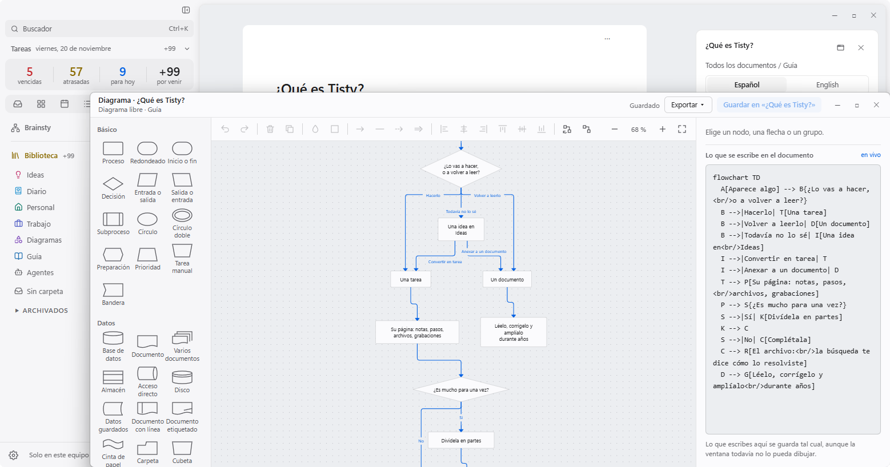
</picture>

### Ideas: una lluvia de ideas a mano

- **Anotada en cuanto llega** — la captura rápida pasa de tarea a idea y a hoy
  en el Diario con `Tab`, y las ideas tienen su propio atajo: hasta 140
  caracteres cada una, con fecha, sin abrir la ventana.
- **Notas adhesivas que siguen siendo Markdown** — esperan como notas de
  colores en Ideas, un documento fijo arriba de la biblioteca, con una
  ampolleta, y las reordenas arrastrándolas.
- **Las ordenas después** — cada idea se convierte en tarea o va al documento
  que le corresponde, y la biblioteca cuenta las que siguen esperando.
- **Una idea en cualquier documento** — la misma nota adhesiva, con su fecha y
  su color, cabe en cualquier documento desde el menú `/`, y anexar una idea la
  lleva entera.
- **También con tu agente de IA** — pídele una lluvia de ideas y anota las que
  te quedas; pídele que las ordene y las agrupa, convierte una en tarea o la
  anexa a su documento, y a las viejas solo las marca, para que tú las borres.

<picture>
  <source
    media="(prefers-color-scheme: dark)"
    srcset="assets/screens/app/es-ideas-dark.webp"/>
  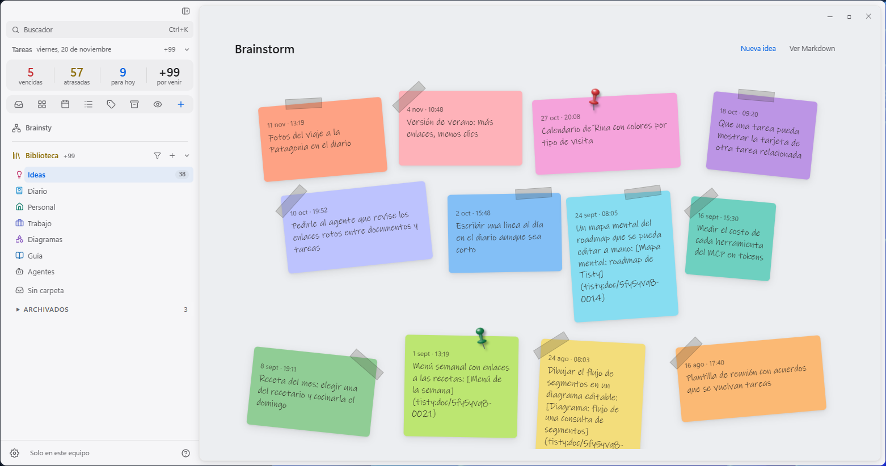
</picture>

### Diario: lo que pasó hoy

- **Un libro por año** — *Diario 2026*, con una página por mes y una sección por
  día, en el idioma de la app; un día en el que no escribiste nunca aparece.
- **Se escribe desde cualquier parte** — el cuadro de arriba, «¿Qué pasó hoy?»,
  o el tercer modo de la captura rápida, **Diario**, a dos `Tab` de una tarea,
  sin abrir la ventana; al anexar una idea desde Ideas, **Diario de
  hoy** es la primera opción.
- **Solo tuyo** — ningún agente lo ve hasta que pulsas **Solo tú** y dice
  **Abierto a los agentes**; abierto, un agente lo lee y solo añade al final de
  hoy, con su firma, cuando se lo pides. **Diario** lo empieza solo cuando todos
  los equipos que sincronizan usan Tisty 1.48 o más nuevo, y uno anterior deja
  de sincronizar antes de recibirlo. Nunca se comparte por Folio.
- **Sigue siendo Markdown** — un libro con `diary: on` en sus propiedades, cuyas
  páginas son los meses.

<picture>
  <source
    media="(prefers-color-scheme: dark)"
    srcset="assets/screens/app/es-diario-dark.webp"/>
  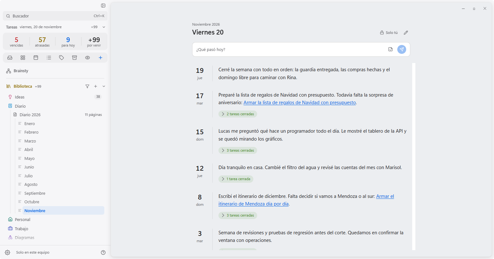
</picture>

### Tareas: qué hacer, quién lo hace y cómo se resolvió

- **Prioridad, por su nombre** — la matriz de Eisenhower: *hacer*,
  *planificar*, *delegar*, *prescindible*. La fecha y el plazo van por
  separado: un día planeado que se pasó deja la tarea atrasada, y solo un plazo
  cumplido la deja vencida. Listas, etiquetas y un recordatorio para lo que no
  puede esperar.
- **Pasos y partes** — un trabajo grande se reparte en partes, cada una con sus
  pasos y su día.
- **Trabajo compartido, dueños claros** — lo que anota tu agente es suyo para
  mantenerlo al día: lo describe, planifica los pasos, marca cada uno al
  terminarlo y anota lo que aprende. En lo que escribiste tú trabaja como en un
  documento — la descripción, la página, los pasos abiertos, el título y la
  lista —, pero un paso que da por listo espera a que lo marques, el día sigue
  siendo tuyo y cerrar siempre es tuyo, y cada entrada dice qué agente la
  escribió.
- **Una bitácora** — notas con fecha que nunca se reescriben: lo que se
  decidió, lo que se descartó y por qué. Una nota que deja sin efecto otra lo
  dice, y la vieja queda marcada como reemplazada.
- **Un estado por tarea** — lo hecho, lo que falta y las decisiones vigentes,
  escrito entero en la página de la tarea en la misma llamada que marca sus
  pasos, y lo primero que se lee la vez siguiente. Tisty avisa si después
  cambiaron los pasos o llegaron notas.
- **Una página por tarea** — *Descripción*, *Para estar lista*, *Pasos*,
  *Notas* y *Al cerrarla*: el agente sabe cuándo termina antes de empezar.
- **Un ticket, una tarea** — anotada con su origen, un ticket o un hilo, el
  mismo trabajo nunca se anota dos veces.
- **El archivo** — una tarea cerrada se guarda entera, y la búsqueda responde
  «¿cómo resolvimos esto?» con la línea que lo dice.

<picture>
  <source
    media="(prefers-color-scheme: dark)"
    srcset="assets/screens/app/es-pagina-de-tarea-dark.webp"/>
  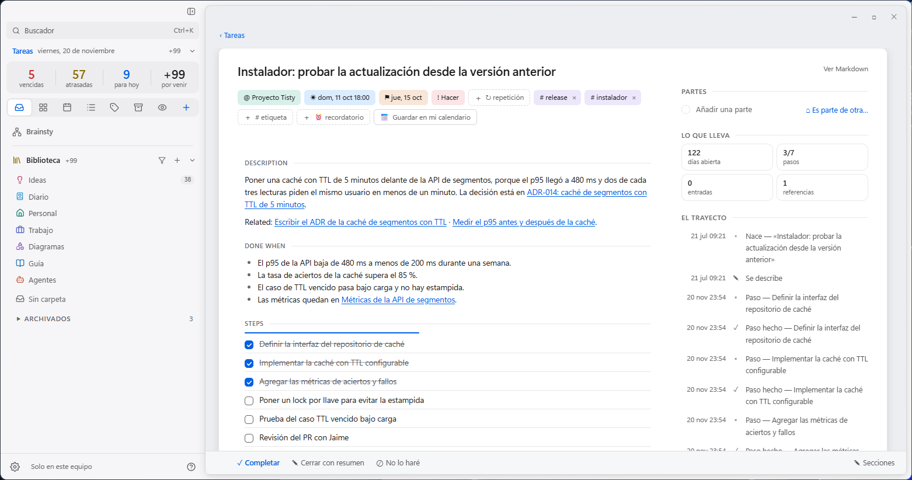
</picture>

<picture>
  <source
    media="(prefers-color-scheme: dark)"
    srcset="assets/screens/app/es-prioridades-dark.webp"/>
  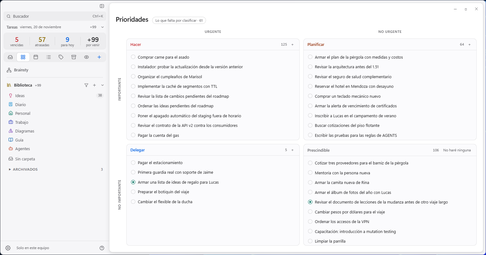
</picture>

### Revisión semanal: la semana en orden

Lo que capturas se acumula sin decidir si no miras atrás de vez en cuando. La
**Revisión semanal**, en la fila de vistas de la barra lateral, junta en una
página lo que vale la pena mirar una vez por semana, en tres paradas, y cada
una muestra ✓ cuando ya no espera nada.

- **Por decidir** — las tareas sin lista, para darles una lista o un día,
  terminarlas o descartarlas, y las ideas que siguen esperando en Ideas.
- **Marcados como pasados** — los documentos que un agente marcó como viejos,
  con su razón, para que los archives, los borres o les quites la marca.
- **Hace tiempo que no abres** — lo que no abriste en este equipo ni escribiste
  en 60 días, para abrirlo o archivarlo.
- **Cada semana, si quieres** — **Avisarme cada semana** anota una tarea
  común que se repite y suena a la hora que eliges, aunque Tisty esté cerrado.
  Tu agente puede recorrerla contigo, pero nunca archiva, borra ni cierra nada
  por su cuenta.

<picture>
  <source
    media="(prefers-color-scheme: dark)"
    srcset="assets/screens/app/es-revision-semanal-dark.webp"/>
  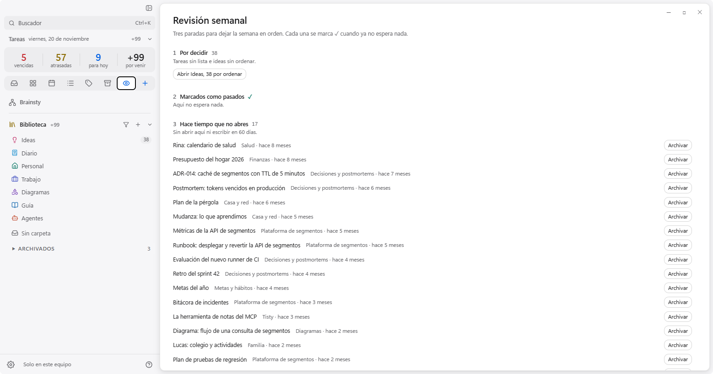
</picture>

### El archivo: cómo se resolvió

Una tarea terminada no se tira. Va al archivo entera —su página con lo que
leíste, probaste y descartaste, sus pasos, su bitácora y sus archivos—, y lo
mismo una que descartaste.

- **El buscador es la entrada** — una palabra que recuerdes la trae de vuelta,
  aunque hayan pasado dos años: «¿cómo resolvimos las subidas a OneDrive?»
  encuentra el spike y la línea que lo dice.
- **Tres capas** — *Historias*, las tareas que enseñaron algo, con todo su
  trayecto; *Rutinas*, con sus cuentas, sus rachas y la hora a la que sueles
  hacerlas; y *Rastro*, lo que se cerró sin dejar casi nada escrito, aparte
  pero al alcance del buscador.
- **Tu agente también lo lee** — antes de proponer nada, busca en el archivo el
  mismo trabajo y parte de cómo salió la vez anterior.

<picture>
  <source
    media="(prefers-color-scheme: dark)"
    srcset="assets/screens/app/es-archivo-dark.webp"/>
  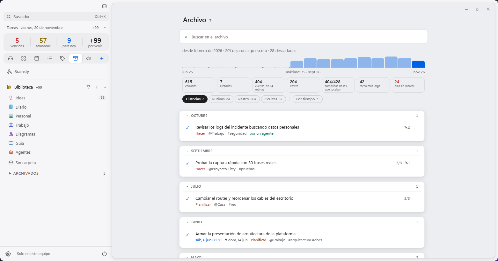
</picture>

### Agentes: las reglas de tus agentes, en un solo lugar

Cada agente lee sus reglas de un archivo propio: Claude Code de `CLAUDE.md`,
Codex de `AGENTS.md`, Gemini de `GEMINI.md`, Copilot de
`copilot-instructions.md`. La carpeta **Agentes**, arriba en la Biblioteca, los
junta en Tisty como documentos, con sus skills y su memoria.

<picture>
  <source
    media="(prefers-color-scheme: dark)"
    srcset="assets/screens/app/es-agentes-primera-vez-dark.webp"/>
  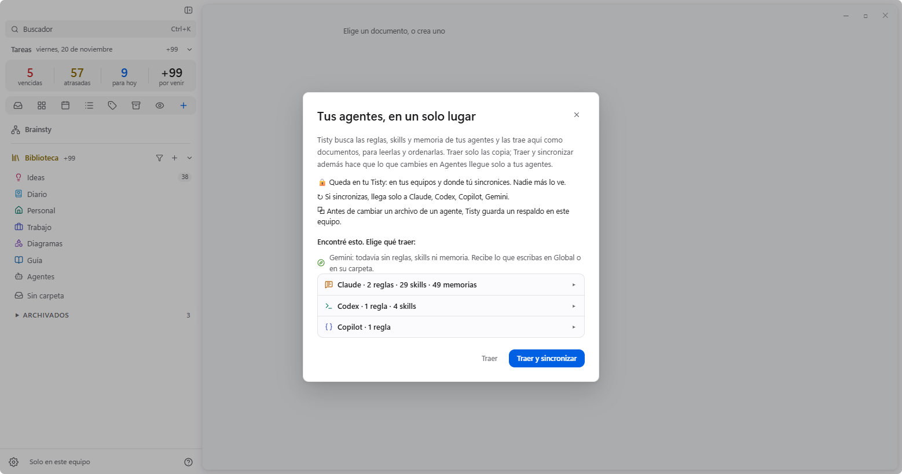
</picture>

- **Traer o sincronizar** — **Traer** copia los archivos que marcas, para
  leerlos y ordenarlos, sin escribir nada en ellos; **Traer y sincronizar**
  además escribe la regla que cambias una vez en el archivo de cada agente, con
  un respaldo antes de cada sobrescritura.
- **Una regla para todos** — un documento en **Global** llega a cada asistente
  del equipo; uno en **Claude**, solo a Claude.
- **Tu agente propone, tú apruebas** — un agente lee tus reglas como cualquier
  documento, pero un cambio suyo espera en la ficha, junto a lo que aprobaste,
  hasta que dices que sí.
- **Cada equipo decide** — una regla escrita en otro equipo espera **Aplicar
  aquí**, y un cambio hecho por fuera de Tisty nunca se pisa: lo traes o te
  quedas con el de Tisty.
- **Nada que no deba tocar** — ajustes, credenciales, enlaces y lo que parece un
  secreto nunca entran, y no se lee nada hasta que haces clic en la carpeta.

<picture>
  <source
    media="(prefers-color-scheme: dark)"
    srcset="assets/screens/app/es-agentes-regla-dark.webp"/>
  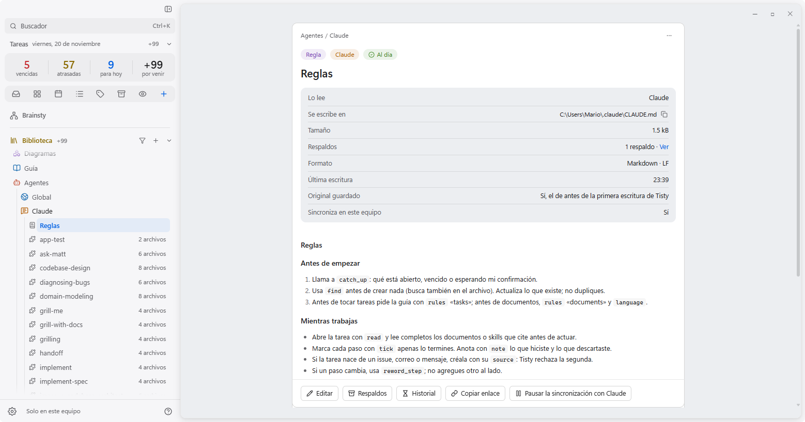
</picture>

[La carpeta Agentes](https://www.tisty.app/es/ayuda/carpeta-agents/), en la
ayuda, cuenta cada paso.

## Un día con tu agente

Lo que hace con todo eso un agente conectado a Tisty, en un trabajo real:

1. **Pregunta qué cambió** desde su última sesión, y quién lo cambió, en vez
   de releerlo todo.
2. **Abre la tarea en la que estaba**, que Tisty le nombra. Primero le llega
   su estado, con las notas escritas después de él; *Para estar lista* le dice
   cuándo termina, y los pasos sin marcar, qué falta.
3. **Busca en el archivo antes de proponer nada.** Si ya se resolvió, parte de
   ahí.
4. **Lee el documento del módulo por su índice**, después solo la sección que
   necesita, y respeta las decisiones y lo que está fuera de alcance: no reabre
   debates cerrados ni se desvía.
5. **Marca cada paso al terminarlo y deja el estado de la tarea en la misma
   llamada**, y anota lo que decidió o descartó, así la próxima sesión, u otro
   agente, no repite el intento fallido.
6. **Cuando la página de una tarea crece, compacta las notas de los asistentes**
   en un resumen fechado de lo que sigue vigente, sin quitar una línea tuya.
   La bitácora queda entera, y si le pides devolver las notas, vuelven como
   estaban, aunque después hayas marcado pasos.
7. **Termina diciendo qué hizo y cómo sabe que se sostiene.** Tú lo revisas y
   la cierras.
8. **Después de leer un documento largo, deja un resumen** para que el próximo
   agente elija con él. Si el documento cambia, el resumen queda marcado como
   desactualizado.

Tus tareas le dicen a tu agente qué falta y hasta dónde puede llegar; tus
documentos, qué ya se decidió. Lo que aprende queda escrito para la próxima vez.

## Lo que le cuesta a tu agente

La mayoría de los servidores MCP le hablan a tu agente sin pausa. Tisty sabe lo
que cuesta cada respuesta, y lo sigue recortando. Medido sobre una bitácora de
trabajo de 256 KB en Markdown, frente a un agente que relee el archivo entero en
cada sesión:

| El agente… | Gasta, con Tisty | Ahorro |
| --- | --- | --- |
| Retoma el trabajo, sin novedades | cerca de un 1 % | 99 % menos |
| Retoma y abre la tarea en la que estaba | menos de un 3 % | más de un 97 % menos |
| Busca algo resuelto hace meses | cerca de un 3 % | 97 % menos |
| Consulta un tema: el índice y una sección | cerca de un 3 %, 12 % en el peor caso | 88–97 % menos |

De dónde sale el ahorro:

- **Ninguna escritura lleva más de 64 000 caracteres**, así que una bitácora
  larga queda en temas y páginas, nunca como un muro de texto.
- **Ninguna lectura trae más de unos 12 000 caracteres**: pasado eso, un
  documento pedido entero vuelve como su índice. La excepción es un documento
  pedido entero en Markdown estándar para llevarlo a otra parte, hasta 40 000
  caracteres.
- **La página de una tarea llega entera solo mientras es corta**, unos 4000
  caracteres. Pasado eso llegan sus secciones, el resumen que abre las notas
  del agente y su última nota. Primero llega su estado, y la bitácora solo
  desde ahí: las notas posteriores al estado, hasta unos 3000 caracteres, y
  entera si se pide; una nota tiene como máximo 4000.
- **El índice dice cuánto pesa cada sección** antes de abrir nada.
- **Retomar trae solo lo que cambió** desde la última vez.
- **Lo terminado se archiva**, y no cuesta nada hasta que alguien lo busca.
- **Una búsqueda trae diez tareas y diez documentos por vez**, cada uno con la
  línea que lo dice recortada a 120 caracteres alrededor de la palabra, o solo
  los títulos cuando al agente le basta con eso.
- **El índice señala temas y títulos repetidos**, para consolidarlos en vez de
  leerlos dos veces.

Conectarse también cuesta: la descripción de las herramientas de Tisty pesa
cerca de una sexta parte de esa bitácora, un tercio menos que antes, y un test
impide que vuelva a crecer. Un asistente que carga las herramientas solo a
medida que las usa no la paga entera; uno que las carga todas en cada sesión
ahorra entre un 72 y un 83 %, y con menos de unos 50 KB de notas un archivo
plano sale más barato. Se cuentan caracteres, incluido el JSON que acompaña
cada respuesta, y los tokens los siguen de cerca.

## Comparte lo que sabes con Folio

Cuando otra persona necesita lo que sabes — tu PO, el QA que llega al proyecto,
otro equipo — le entregas el documento con
[Folio by Tisty](https://github.com/rgdevment/Folio-by-Tisty). Se cifra en tu
equipo antes de salir, la llave viaja en el enlace donde ningún servidor la ve,
cada versión va firmada por ti, y el enlace deja de funcionar solo después de
los días sin uso que elijas. Se lee en cualquier navegador y sin cuenta, o se
edita en su propio Tisty. Tu memoria se queda en tu disco; Folio solo lleva una
copia. Más en [Tus datos y tu privacidad](#tus-datos-y-tu-privacidad).

## Servidor MCP

Tisty también es un **servidor MCP local de tareas, pendientes y notas**. Con
él, un asistente crea tareas con pasos, fechas y recordatorios, escribe y edita
documentos en Markdown y busca en lo abierto y en el archivo — en tu propio
disco, sin cuenta, sin clave de API y sin mandar nada por la red. Necesita la
app de Tisty, que se instala como dice [Instalación](#instalación), y Node.js
18 o posterior para el lanzador.

Lo más fácil es **Configuración › Asistentes** en Tisty: encuentra los
asistentes de este equipo y conecta el que elijas. A mano, cualquier asistente
que arranca un servidor por comando toma de npm el lanzador `tisty-mcp`, que
busca el Tisty instalado aquí y arranca su propio servidor:

```json
{
  "mcpServers": {
    "tisty": {
      "command": "npx",
      "args": ["-y", "tisty-mcp"]
    }
  }
}
```

| Asistente | Cómo agregar Tisty |
| --- | --- |
| Claude Code | `/plugin install tisty --marketplace rgdevment/mcp-plugins` |
| Claude Desktop | Settings › Developer › Edit Config, y agrega el JSON de arriba |
| Cursor | [Cursor Directory](https://cursor.directory/plugins), o el JSON de arriba en `~/.cursor/mcp.json` |
| GitHub Copilot en VS Code | `code --add-mcp '{"name":"tisty","command":"npx","args":["-y","tisty-mcp"]}'` |
| Gemini CLI | `gemini extensions install https://github.com/rgdevment/mcp-plugins` |
| Codex | `codex mcp add tisty -- npx -y tisty-mcp` |

Conéctalo de una sola forma, no de las dos, para que el asistente no arranque
Tisty dos veces, y reinicia el asistente después. Más en
[Asistentes y MCP](https://www.tisty.app/es/ayuda/asistentes-y-mcp/).

Cosas que puedes pedirle una vez conectado:

- "Agrega una tarea para renovar el pasaporte antes de marzo, con sus pasos."
- "¿Qué tengo pendiente esta semana y qué está vencido?"
- "¿Cómo arreglé los timeouts al guardar el año pasado? Busca en el archivo."
- "Escribe un documento con mis notas de la llamada de hoy y guárdalo en la
  carpeta Clientes."
- "Planifica el lanzamiento en tareas con pasos y márcalos a medida que
  avanzas."
- "Recuérdame el dentista la noche anterior, a las 8."

## Herramientas

Lo que `tisty mcp` le ofrece a un asistente, según sobre qué trabaja. Nunca
cierra ni borra: `say_done` deja la tarea para que tú la confirmes, y
`flag_doc` marca un documento para que tú lo borres, lo archives o lo
conserves. Cada herramienta se describe en
[Herramientas MCP](https://www.tisty.app/es/ayuda/herramientas-mcp/).

- **Tareas** — crear una con pasos y fecha, planificar y marcar sus pasos,
  decir cuándo suena, mover su día, decir que está lista: `propose`,
  `describe`, `plan`, `tick`, `untick`, `reword_step`, `unplan`, `rename`,
  `move`, `remind`, `reschedule`, `say_done`, `say_not_doing`, `read`
- **La bitácora y los archivos de una tarea** — `note`, `reword_note`, `attach`
- **Documentos** — escribir uno, agregarle, cambiar un pasaje o una tabla, leer
  solo la parte que necesita: `write_doc`, `append_doc`, `edit_doc`,
  `edit_table`, `read`, `sum_up`, `restore_doc`, `import_doc`,
  `export_doc`, `archive_doc`, `flag_doc`
- **Carpetas, páginas e idiomas** — `folder`, `file_doc`, `page_doc`,
  `tongue_doc`
- **Encontrar cosas** — lo abierto y lo archivado, la ficha de un documento,
  las partes de un proyecto, las listas, carpetas y etiquetas: `brain`,
  `catch_up`
- **Cómo trabajar aquí** — `rules`, `language`, `help`

Además de las herramientas, ofrece ocho pedidos listos que tu asistente
muestra como comandos (`pick_up`, `leave_off`, `plan_task`, `solved_before`,
`keep_decision`, `brainstorm`, `sort_ideas`, `consolidate`), y tus
documentos para mencionar con `@`, uno largo como su índice.

## Por qué lo hice

Organizar tu día es más difícil de lo que una lista aparenta. Hay más piezas de
las que caben en la cabeza, los planes se mueven solos, y algo que creías
pequeño resulta que no lo era. Por eso terminarlo se siente bien.

Pero fíjate en lo que esa tarea fue juntando por el camino. Los pasos que de
verdad hubo que dar. Las notas que escribiste mientras lo resolvías. Lo que
consultaste, con qué terminó conectando, los documentos en los que te apoyaste.
Ahí es donde se fue el esfuerzo.

La mía se llamaba *«arreglar los timeouts intermitentes al guardar»*. Cuando
estuvo lista ya llevaba encima el ticket, el commit y dos párrafos explicando
que la causa real era un índice que faltaba en una tabla que nadie miraba.

Ocho meses después pasó lo mismo en otra parte. Me acordaba de haberlo resuelto.
No me acordaba de cómo — y la nota que tenía la respuesta se había ido con el
tache.

**Esa es toda la razón por la que Tisty existe.** Una tarea no es una línea que
se tacha. Es un árbol: los pasos, la bitácora, los archivos y los documentos que
crecieron a su alrededor mientras trabajabas. Terminarla no debería podarlo.

También quería que siguiera siendo mío. En mi disco, en archivos que puedo abrir
sin pedirle permiso a nadie. Así que hice lo que quería tener, lo usé hasta que
dejó de molestarme, y lo dejé acá por si resulta ser lo que tú querías.

## Qué es, y qué no es

**Es** una memoria de trabajo que compartes con tu agente de IA, y un gestor de
tareas personal donde terminar algo es el comienzo de su vida útil. Las tareas
llevan descripción, bitácora, pasos y adjuntos; al completar una pasa al
archivo, y la búsqueda llega a todo, documentos incluidos.

**Es también un lugar para escribir.** Los documentos no son un campo de notas
pegado a las tareas: son archivos Markdown que crecen hasta ser libros, con
diagramas, fórmulas, código y su propio PDF.

**¿Tarea o documento?** Una tarea es algo por hacer: termina, muchas veces
pronto, y después se queda, para que meses más tarde consultes cómo lo
resolviste. Un documento es algo para guardar y volver a leer —un manual, una
receta, las notas de un cliente— que crece y dura años. Lo que vas a hacer es
una tarea; lo que vas a volver a consultar es un documento. Un spike es el caso
más claro: una tarea cuya página reúne lo que averiguaste —notas, grabaciones,
análisis de código—, dividida en partes que se van completando, que luego se
completa y se archiva, y un año después una búsqueda todavía trae cómo se
resolvió, paso por paso. Por eso una tarea tiene página: también es un
documento, uno que termina.

**¿Y una idea?** Una idea es un pensamiento atrapado al vuelo, antes de saber si
es algo que hacer o algo que guardar: pocas palabras, 140 como máximo, con
fecha, en la hoja Ideas. Espera a que la ordenes: se vuelve tarea, va
al documento de su tema o se aparta. Una nota es otra cosa: la línea fechada en
la bitácora de una tarea.

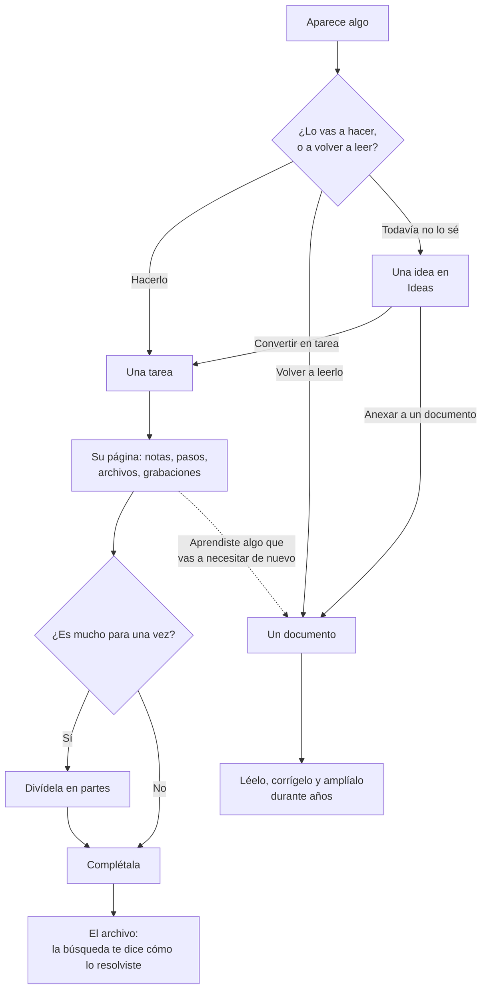

**Es de una persona.** Cada quien tiene su propio Tisty, con su propio agente
trabajando con él, y le entrega un documento a otra persona con
[Folio](#comparte-lo-que-sabes-con-folio). Sin responsables, sin permisos, sin
tableros. Si necesitas llevar un equipo, Tisty no va a sostener eso, y mereces
saberlo antes de instalarlo y no después.

**No es algo que venda.** Nada está bloqueado, nada caduca, y no existe una
versión de esto con más cosas dentro. Es un programa que escribí para mí y
regalé.

**Tus datos son archivos.** Texto plano en tu propio disco, que se lee con `cat`
y se busca con `grep`. Si Tisty desapareciera mañana, todo lo que escribiste
seguiría ahí y seguiría teniendo sentido.

## Qué lo hace distinto

Si buscas un **lugar libre, de código abierto y sin conexión para tus
documentos y tareas, sin cuenta, sin suscripción y sin inteligencia artificial
dentro — y una memoria que tu propio agente de IA lee por MCP**, esto es Tisty:

| | |
|---|---|
| Tus tareas viven | en archivos de texto, en tu propio disco |
| Cuenta | ninguna, nunca |
| Suscripción | ninguna. No hay plan de pago ni mejora |
| Sin conexión | siempre. Solo lo que mandas afuera necesita conexión: un documento compartido por link, tu propia nube, una tarea guardada en un calendario en línea |
| Con IA dentro | **ninguna**, y eso no va a cambiar |
| Tu propio asistente | sí, por **MCP**, por una puerta que cierras cuando quieras |
| Memoria para tu agente | lo que cambió desde la última vez, primero el índice y una sección a la vez |
| Prioridades | la **matriz de Eisenhower**, con su nombre |
| Clasificación | listas, etiquetas, pasos y bitácora en cada tarea |
| Documentos | archivos Markdown con páginas, diagramas, fórmulas, código, widgets y su propio PDF |
| Un documento con páginas | un libro, con sus capítulos en el orden en que el texto los nombra y un índice |
| Un diario | un libro por año, una página por mes, una sección por día: solo tuyo hasta que lo abres a los agentes, y nunca se comparte |
| Diagramas y fórmulas | dibujados con unas pocas líneas de texto, claros u oscuros según la ventana |
| Widgets | vistas fijas de HTML y CSS con los colores de Tisty, que no ejecutan ni alcanzan nada |
| PDF | propio: A4, Carta u Oficio, con sus imágenes dentro |
| Cualquier archivo `.md` | se abre para leer en un visor propio, hasta 1 MB, sin entrar a tu almacén |
| Adjuntos | se guardan con la tarea, tal como son |
| Lo terminado | un **archivo que conserva lo que cada tarea te enseñó** |
| Dos equipos | tu Google Drive, OneDrive o servidor WebDAV, directo, o una carpeta que ya sincronizas. Sin servidor mío |
| Tu nube, cifrada | si quieres, con una frase de 24 palabras que solo tú conoces |
| Lenguaje natural | fechas, límites y repeticiones, interpretados en tu equipo |
| Cuándo hacerlo | un reparto de días donde repartes el trabajo, y un mes para mirar |
| Recordatorios | una hora que eliges, que suena en tus equipos, aunque Tisty esté cerrado, y en ningún otro lado |
| Código | abierto, auditable, tuyo para bifurcar |

**Documentos que crecen hasta ser libros.** Casi todos los gestores de tareas te
dan un campo de notas. Aquí un documento es un archivo propio, escrito sobre una
hoja iluminada, que lleva páginas como capítulos, dibuja el diagrama que
describes, compone la fórmula, colorea el código y hace su propio PDF — y sigue
siendo Markdown que GitHub, cualquier editor o `cat` leen igual. Una tarea puede
apuntar a él, y la búsqueda encuentra a los dos.

**La matriz de Eisenhower, no prioridades numeradas.** Una tarea es urgente,
importante, las dos o ninguna — *hacer*, *planificar*, *delegar*,
*prescindible*. Eso nombra la decisión en vez de esconderla tras un número, y es
la diferencia entre una lista que ordena y una lista que te ayuda a elegir.
Alrededor: listas para dónde va el trabajo, etiquetas para lo que lo cruza,
pasos para las partes, y una bitácora para lo que aprendes por el camino.

**Terminar es donde empieza.** Casi todos los gestores tratan una tarea cumplida
como basura que esconder. Aquí pasa a un archivo que se lee en tres capas: las
que enseñaron algo vienen con su trayecto entero —qué cambió, cuándo, y lo que
escribiste—, las rutinas vienen con sus cuentas y sus rachas, y el resto es el
rastro. La búsqueda alcanza todo, documentos incluidos. Al año, ese archivo es
la parte que echarías de menos.

**Tu asistente, no uno mío.** Tisty no lleva IA dentro. El lenguaje natural
que convierte "llamar al banco a las 3" en una tarea son reglas corriendo en tu
equipo, sin modelo y sin nube. Pero habla [MCP](https://modelcontextprotocol.io),
así que un asistente que ya uses puede anotar trabajo aquí — con sus pasos, su
fecha y la lista que le toca, en este equipo, sin cuenta y sin nada por la red.
Esa puerta viene abierta, y la cierras cuando quieras con **Quitarle la voz**.

**Dos equipos, sin intermediario.** Tisty habla directo con tu propio Google
Drive, OneDrive o servidor WebDAV, o viaja por una carpeta que ya sincronizas.
No hay servidor mío en medio, no hay que registrarse, y no hay nada que deje
de funcionar el día que una empresa cambie de idea. Y lo que guarda en esa nube
se puede cifrar con una frase que solo tú conoces.

**Gratis no es un plan aquí.** No hay mejora de pago, ni cuenta de puestos, ni
función guardada para más adelante. La razón no es generosidad: un programa que
guarda tu trabajo en tu disco y nunca llama a casa no tiene casi nada que cobrar,
y pedirlo lo empeoraría.

## Documentos

La otra mitad de Tisty, y para mucha gente la más grande. Un documento es un
archivo Markdown en tu propio disco, el mismo que abre cualquier otro editor, y
lo escribes sobre la página misma. Lleva páginas como capítulos, un mismo texto
en varios idiomas, diagramas de unas pocas líneas, fórmulas, código, tablas que
se suman solas, widgets, etiquetas y adjuntos, y hace su propio PDF. Donde
Markdown no tiene palabra para algo, Tisty agrega unas pocas palabras cortas
propias, nunca HTML, así que el archivo sobrevive sin Tisty. Un `.md` de
cualquier parte
[se abre para leer](https://www.tisty.app/es/ayuda/documentos/#abrir-un-archivo-markdown-de-afuera),
y cada documento sale entero: Markdown estándar, una página web, un archivo
Word o un paquete `.tistyx` firmado con tu llave.

Por ejemplo, guardas a *Rina* como un libro, una página por año con sus visitas
al veterinario: la tarea de su próxima vacuna lo cita, y una sola búsqueda
encuentra los dos.

- [Documentos](https://www.tisty.app/es/ayuda/documentos/) y
  [El editor Markdown](https://www.tisty.app/es/ayuda/editor-markdown/)
- [Páginas y PDF](https://www.tisty.app/es/ayuda/paginas-y-pdf/),
  [Diagramas](https://www.tisty.app/es/ayuda/diagramas/) y
  [Widgets](https://www.tisty.app/es/ayuda/widgets-en-documentos/)
- [Convertir a y desde Markdown](https://www.tisty.app/es/ayuda/convertir-a-y-desde-markdown/)
- [La guía de Markdown de Tisty](https://markdown.tisty.app/es/): cómo se
  escribe cada marca

## Para quién es

Para cualquiera que trabaja con un agente de IA y quiere que los dos recuerden:
tú el conjunto, tu agente el detalle. Quien desarrolla y salta entre
sesiones, ramas y decenas de proyectos. La PM que guarda las decisiones y su
porqué. El QA que guarda los casos que fallaron la vez anterior. El líder
técnico que guarda los runbooks. Administradores de sistemas, independientes,
gente que investiga, quien estudia — cualquiera que haya resuelto dos veces el
mismo problema y lo haya sabido la segunda vez.

Cada quien tiene su propio Tisty: lo que aprende una persona no es lo que
necesita otra, y sus agentes trabajan con memorias distintas.

Y para quien escribe cosas que duran: un manual, las actas de un año, los
apuntes de un curso, la documentación de un sistema, un libro por capítulos — y
lo quiere en archivos propios y no en la base de datos de otro.

Si lo que quieres es una lista para tachar y no volver a abrir, Tisty te va a
parecer más de lo que pediste. Es un motivo razonable para dejarlo pasar.

## La idea sobre la que está construido

**Una tarea completada no está terminada. Está archivada.**

Deja de ser un recordatorio de qué hacer y pasa a ser el registro de cómo se
resolvió algo. De ahí salen tres cosas, y esas moldearon todo lo demás:

- **La búsqueda es la entrada principal al archivo**, no una función lateral.
- **Borrar es la excepción.** El final normal es completar, que conserva. Solo
  se borra de verdad lo que está cerrado y se lee como rastro; una historia solo
  se oculta, y convertirla en rastro es el paso deliberado que la deja ir.
- **Capturar tiene que seguir siendo instantáneo**, porque la mayoría de las
  tareas no son así. La llamada que tienes que hacer mañana nace y muere en un
  día y no deja nada que guardar — y anotarla no puede costar más de una línea.

**Un documento es un archivo que guardas, no una fila en la base de datos de
otro.** Dibuje Tisty lo que dibuje encima —páginas, diagramas, widgets, un PDF—,
el archivo de abajo sigue siendo Markdown que otro lector abre igual, así que
dejar Tisty nunca significa dejar atrás lo que escribiste.

## Instalación

**Windows** — desde la
[Microsoft Store](https://apps.microsoft.com/detail/9PGVWXD8X93N), que además se
encarga de mantenerla al día. Si prefieres no esperar, Acerca de se la pide en
el momento. O con el gestor de paquetes de Windows, que toma el instalador
firmado de la página de releases y después se aparta, porque Tisty se mantiene
al día sola:

```console
> winget install rgdevment.Tisty
```

**macOS** — con [Homebrew](https://brew.sh). El tap se agrega y se marca como
confiable una sola vez y no se vuelve a tocar; Homebrew carga un tap que no es
suyo solo cuando confías en él. Desde ahí Tisty se mantiene al día sola, y
Homebrew se aparta:

```console
$ brew tap rgdevment/tap
$ brew trust rgdevment/tap
$ brew install --cask tisty
```

O toma la imagen de disco y el instalador directamente de
[Releases](https://github.com/rgdevment/Tisty/releases), en cualquiera de los
dos sistemas. En macOS hay dos imágenes: `aarch64` para Apple Silicon y
`x86_64` para Intel — menú Apple › *Acerca de este Mac* dice cuál es la tuya.
Homebrew elige sola.

## Qué hace

**La primera vez que se abre**, Tisty te pregunta en qué idioma, dónde dejar tus
copias y, si quieres, cómo llamarte; después te escribe una guía y la abre. Todo
lo demás tiene una respuesta obvia que cambias después en Configuración.

**Lee lo que escribes.** Escribes una frase, Tisty saca la fecha y te muestra lo
que entendió *antes* de guardar nada, como fichas que corriges con un clic:

```text
"desplegar mañana a las 10"             →  mañana 10:00
"entregar el informe antes del viernes" →  límite vie
"reservar vuelos @viaje #urgente"       →  @viaje · #urgente
```

Alrededor de eso: tres columnas como máximo, los cuatro cuadrantes de la matriz
de Eisenhower, un reparto de días donde repartes el trabajo, recordatorios que
suenan aunque Tisty esté cerrado, un calendario que entra como tareas, tareas
que se repiten y cuentan lo que se debía, y un archivo que se lee en tres capas.
Toda la ventana funciona con el teclado.

- [Instalación](https://www.tisty.app/es/ayuda/instalacion/) y
  [Configuración](https://www.tisty.app/es/ayuda/configuracion/)
- [Tareas](https://www.tisty.app/es/ayuda/tareas/) y
  [Lenguaje natural](https://www.tisty.app/es/ayuda/lenguaje-natural/)
- [El reparto y los recordatorios](https://www.tisty.app/es/ayuda/reparto-y-recordatorios/)
- [El archivo](https://www.tisty.app/es/ayuda/el-archivo/)

## Tus datos y tu privacidad

Todo vive en una carpeta de tu disco: un registro de lo que pasó al que solo se
le agrega, tus documentos como archivos `.md`, y tus adjuntos tal como son. Nada
está ofuscado ni en un formato que solo Tisty pueda leer.

**Nada de tu disco está cifrado en reposo**, y es una decisión, no un descuido:
la protección son los permisos de tu sistema operativo, y así los archivos
siguen siendo legibles con las herramientas que ya tienes. Lo que Tisty guarda
en una nube con la que habla directo es otra cosa: eso lo puedes cifrar con una
frase que solo tú conoces, como cuenta [la sección siguiente](#dos-equipos-si-tienes-dos).
Las dos cosas están explicadas en [PRIVACY.md](PRIVACY.md) y
[SECURITY.md](SECURITY.md), incluidas las partes que no son tranquilizadoras.

Tisty hace **una** revisión sin que se la pidas —al abrirse, y una vez al día
mientras siga en marcha—: descarga un archivo pequeño y su firma para ver si
existe una versión más nueva. No envía nada. Si existe y presionas el botón que
te la ofrece, vienen dos peticiones más — el archivo que nombra la versión y el
instalador — y Tisty se niega a instalar nada que no esté firmado con una clave
compilada dentro de la copia que ya tienes.
Hay unas pocas más, listadas en [PRIVACY.md](PRIVACY.md).

**Folio by Tisty** es un servicio aparte para compartir un documento con un
enlace sin cuenta y cifrado de punta a punta, con sus propios términos y
políticas en
[su propio repositorio](https://github.com/rgdevment/Folio-by-Tisty). El panel
de un documento muestra una fila **Compartido** —Ideas y tu Diario
nunca se comparten—, y al presionar **Compartir** Tisty lee
un archivo pequeño y firmado para saber si Folio ya abrió y, mientras no abra,
te lo dice, con un enlace a [tisty.cl](https://tisty.cl). Nada de
tu documento sale hasta que Folio esté abierto, aceptes sus términos y lo
confirmes.
[PRIVACY.md](PRIVACY.md#sharing-by-link) dice qué envía cada paso.

## Dos equipos, si tienes dos

Dile a Tisty dónde dejar las copias, en Configuración › *Sincronización*, y lo
demás lo hace solo: **tu Google Drive, tu OneDrive o tu propio servidor
WebDAV**, directamente, o **una carpeta** que otro programa mantiene al día:
iCloud, Dropbox, un NAS, un disco que conectas los viernes. No hay nada mío en
medio: ni cuenta, ni servidor, ni demonio.

Un equipo nuevo que todavía no tiene nada tuyo se une solo, después de guardar
un respaldo; uno que sí tiene te pregunta primero. Dos equipos que escriben el
mismo documento a la vez se combinan bloque por bloque, y solo un choque real se
vuelve pregunta. Cada equipo firma lo que escribe. Si quieres, **Cifrar mi
nube…** cifra lo que Tisty guarda en tu nube con una frase de 24 palabras que
solo tú conoces.

Por ejemplo, escribes el acta en el trabajo el martes: esa tarde, en casa, ahí
está, y también la tarea que te dejó.

- [Sincronizar y respaldar](https://www.tisty.app/es/ayuda/sincronizar-y-respaldar/):
  cada forma, los adjuntos grandes y los respaldos
- [Cifrar tu nube](https://www.tisty.app/es/ayuda/sincronizar-y-respaldar/#cifrar-tu-nube)
- [Cambié algo en un equipo y no aparece en el otro](https://www.tisty.app/es/ayuda/sincronizar-y-respaldar/#cambié-algo-en-un-equipo-y-no-aparece-en-el-otro)

## Tu agente de IA

**Tisty no es inteligencia artificial ni la lleva dentro.** El lenguaje natural
que convierte "llamar al banco a las 3" en una tarea es un puñado de reglas
corriendo en tu equipo: sin modelo, sin petición, sin nube. Eso no va a cambiar.

Pero el asistente con el que trabajas es donde ocurre el detalle, y olvida en
cuanto termina la sesión. Así que Tisty le deja una puerta, y tú decides si la
abres. Por ella, un agente planifica en documentos y trabaja en tareas: escribe
lo que encontró y decidió, marca cada paso a medida que avanza y dice cuándo
terminó. Quien cierra eres tú.

**Configuración › Asistentes** conecta el que elijas, como muestra
[Servidor MCP](#servidor-mcp). La puerta viene abierta en una instalación nueva;
**Quitarle la voz** la cierra, y mientras está cerrada todo lo que un asistente
intenta se rechaza y la ventana dice quién tocó. Lo que puede hacer es pequeño a
propósito: nunca cierra ni borra una tarea, nunca borra un documento, nunca
mueve un día que pusiste tú, y ve tu Diario solo cuando lo abres a los agentes.
Lo que escribe va firmado con su nombre, y lee primero la ficha de un documento
y después solo la parte que necesita. Por ejemplo, retoma *Migrar pagos a v2*:
pregunta qué cambió, abre esa tarea y lee lo que anotó ayer.

- [Asistentes y MCP](https://www.tisty.app/es/ayuda/asistentes-y-mcp/): la
  puerta, la firma y cada asistente que Tisty conoce
- [Qué puede hacer un asistente](https://www.tisty.app/es/ayuda/que-puede-hacer-un-asistente/)
- [Cómo trabaja un agente](https://www.tisty.app/es/ayuda/como-trabaja-un-agente/)
- [Herramientas MCP](https://www.tisty.app/es/ayuda/herramientas-mcp/)

## Qué no hace

Tan importante como lo que hace. Fuera de alcance por ahora: trabajo
colaborativo en tiempo real, tableros kanban, diagramas de Gantt, control de
horas, métricas de productividad, bases de datos que relacionen tablas entre
documentos y fórmulas en las celdas. Las columnas de una tabla pueden decir qué
guardan y sumarse, pero cada tabla vive en su propio documento.

La IA no está en esa lista, porque no es cuestión de tiempo: Tisty no es IA ni
la lleva dentro, el lenguaje natural se queda determinista y local, y **Tisty
nunca envía nada a un modelo** — ni una tarea, ni una palabra. Mientras la
puerta de [Tu agente de IA](#tu-agente-de-ia) esté abierta, lo que tu asistente
lea viaja adonde viaje ese asistente: Tisty sigue sin enviar nada, quien lleva
es el asistente, y cerrar la puerta es cosa tuya.

## Preguntas frecuentes

### ¿Tisty es gratis?

Sí, Tisty es gratis y lo seguirá siendo, bajo la licencia AGPL-3.0. Sin cuentas
ni telemetría, y en constante desarrollo y mejora.

### ¿Necesito un agente de IA?

No. Tisty está completo sin uno: las notas, los documentos y las tareas, la
revisión semanal, el diario y Brainsty funcionan igual. Con tu agente, es la
memoria que comparten. Por ejemplo, guardas las visitas de Rina al veterinario
en un documento y su próxima vacuna como una tarea que suena la tarde anterior:
ningún agente ve nada de eso hasta que conectes uno, el día que quieras.

### ¿Necesita una cuenta o conexión?

Ninguna de las dos. No hay a qué suscribirse, y solo lo que mandas afuera
necesita conexión: un documento compartido por link, tu propia nube, una tarea
guardada en un calendario en línea.
Tisty hace una sola petición de red que no le pediste —al abrirse, y una vez al
día después— para ver si existe una versión más nueva, y no envía nada para
preguntarlo. Cuando sincronizas con una nube o compartes un documento, además
lee unos pocos archivos pequeños, que lista [PRIVACY.md](PRIVACY.md).
Desconecta el equipo de la red y todo lo demás sigue igual.

### ¿Dónde quedan mis datos?

En una carpeta de tu propio disco: un registro que solo crece con lo que pasó,
tus documentos como archivos `.md` y tus adjuntos tal cual son. Configuración ›
*Almacenamiento* escribe la ruta y *Mostrar carpeta* la abre. Nada está ofuscado
y nada queda en un formato que solo Tisty sepa leer.

### ¿Qué pasa con mis notas si Tisty desaparece?

Se quedan donde están. Markdown y texto plano, que se lee con `cat`, se busca
con `grep` y se abre en cualquier editor que ya tengas. Para eso está el
formato.

### ¿Tisty usa IA?

No. Tisty no es IA ni la lleva dentro. Eso no va a cambiar. El lenguaje natural
que convierte «llamar al banco a las 3» en una tarea son reglas corriendo en tu
equipo: sin modelo, sin petición, sin nube. Lo que Brainsty cree que se parece
sale de palabras en común, de un error de tipeo o de una lista fija de palabras
español–inglés, nunca de un modelo. Si ya usas un asistente tuyo, Tisty deja una
puerta [MCP](https://modelcontextprotocol.io): viene abierta, la cierras cuando
quieras, y mientras está cerrada todo lo que intente se rechaza.

### ¿Cómo le doy a mi agente de IA una memoria entre sesiones?

Conecta Tisty por MCP, como muestra [Servidor MCP](#servidor-mcp):
Configuración › Asistentes conecta GitHub Copilot, Claude Code, Codex, Cursor…
y [cada uno de los otros que conoce](https://www.tisty.app/es/ayuda/asistentes-y-mcp/#conectar-un-asistente).
Desde ahí, el agente empieza cada sesión preguntando qué cambió desde la
anterior, anota su trabajo como tareas con pasos y bitácora, y guarda lo que
aprende en documentos. La próxima sesión, en cualquier proyecto, parte de ahí y
no de un chat en blanco.

### ¿Reemplaza a CLAUDE.md, AGENTS.md o una carpeta memory-bank?

Para lo que cambia, sí; para lo que no, no. Las instrucciones que casi no se
mueven — cómo compilar, las convenciones — van en los archivos que tu
repositorio ya le entrega al asistente. Lo que se mueve — el avance, las
decisiones, lo descartado, lo que falta — va en Tisty, donde queda fechado,
buscable, se lee una sección a la vez y no se pierde entre ramas, equipos ni
proyectos.

Los archivos de tu carpeta personal, como `~/.claude/CLAUDE.md` o
`~/.codex/AGENTS.md`, son otra cosa: la carpeta **Agentes** los trae a Tisty
como documentos y, si la sincronizas, escribe tus cambios en ellos, con un
respaldo antes. [Agentes](#agentes-las-reglas-de-tus-agentes-en-un-solo-lugar)
cuenta cómo.

### ¿Puedo usarlo en dos equipos?

Sí, de dos formas. Conecta tu propio Google
Drive, OneDrive o servidor WebDAV en la ventana y Tisty habla con él directo,
guardando sus copias en un lugar propio ahí y sin ver nada más; cifradas con una
frase que solo tú conoces, si quieres. O usa una carpeta que ya sincronizas:
Google Drive, OneDrive, iCloud, Dropbox, un NAS, un disco que enchufas los
viernes. En los dos casos no hay ningún servidor mío en medio, ni cuenta mía, y
puedes mudarte de una a otra cuando quieras.

### ¿Hay aplicación para el teléfono?

No. Tisty es un programa de escritorio para Windows y macOS. Tus documentos son
Markdown en una carpeta, así que un teléfono que llegue a esa carpeta los lee y
los edita con la aplicación que prefieras, pero la ventana, el reparto y el
archivo son del escritorio.

### ¿Funciona en Linux?

No. Tisty es un programa de escritorio para Windows y macOS. Un asistente que
corre en Linux dentro de Windows, con WSL, llega a él igual: Configuración ›
Asistentes › *Conectados* lo conecta.

### ¿Mis datos están cifrados?

En tu disco no, y es una decisión, no un descuido: los permisos de tu sistema
operativo son la protección, y los archivos siguen legibles con herramientas que
ya tienes. En una nube con la que Tisty habla directo, sí pueden estarlo:
Configuración › *Seguridad* los cifra con una frase de 24 palabras que solo tú
conoces. [PRIVACY.md](PRIVACY.md) y [SECURITY.md](SECURITY.md) lo dejan escrito,
incluidas las partes que no tranquilizan.

### ¿Sirve para mi equipo de trabajo?

No como un tablero compartido. Tisty es de una persona por diseño —sin
responsables, sin permisos, sin una base de datos compartida— y mereces saberlo
antes de instalarlo y no después. Lo que sí tiene un equipo: cada persona
guarda sus propias tareas, documentos y agente, y cuando alguien necesita lo que
sabes, le entregas el documento con
[Folio](#comparte-lo-que-sabes-con-folio), cifrado y firmado.

### ¿Puedo traer mis notas desde otra aplicación?

Los documentos sí: *Importar un documento* en el árbol toma un archivo `.md`,
`.markdown`, `.txt`, `.html` o de Word (`.docx`) y lo trae como Markdown, de uno
en uno —de Word a Markdown, de HTML a Markdown, de Obsidian a Markdown—, y pegar
desde Word, Google Docs o una página web lo convierte igual. Un `.tistyx` de otro
equipo con Tisty se desempaqueta entero. Las tareas hay que escribirlas. No hay
importador para la lista de tareas de otro programa, y uno que adivinara te
costaría más que teclearlas.

### ¿Las descargas están firmadas?

Sí. Las imágenes de disco de macOS van firmadas y notarizadas por Apple, y el
instalador de Windows también va firmado — una copia de la Microsoft Store o de
Homebrew ya lo trae. Tisty además se niega a instalar una actualización que no
esté firmada con una clave compilada dentro de la copia que estás usando.

### ¿Funciona con un lector de pantalla?

Que se sepa, no, y vale decirlo claro: la ventana entera funciona con el teclado
y ese camino está probado, pero nada se ha probado nunca con un lector de
pantalla real. Si usas uno, una incidencia que diga dónde se rompe sería lo más
útil que alguien pueda mandar.

### ¿En qué se diferencia de Obsidian, Notion o Todoist?

Tisty guarda tareas y documentos en un mismo almacén y una misma búsqueda, y
terminar una tarea conserva todo lo que reunió en vez de esconderlo. La tabla de
abajo dice en qué es más fuerte cada uno de ellos.

## Alternativas a Obsidian, Notion y Todoist

Otros sitios donde guardar notas y tareas, para que elijas el que te sirva.
Plataforma, almacenamiento y licencia comprobados contra cada proyecto en
septiembre de 2026; todo lo demás cambia, así que ve y mira.

| Proyecto | Plataformas | Dónde viven tus datos | Licencia |
| :-- | :-- | :-- | :-- |
| **Tisty** | Windows, macOS | Tu disco, sin cuenta | AGPL-3.0 |
| [Obsidian](https://obsidian.md) | Windows, macOS, Linux, iOS, Android | Tu disco; sincronizar se paga aparte | Código cerrado, gratis para uso personal |
| [Logseq](https://github.com/logseq/logseq) | Windows, macOS, Linux, iOS | Tu disco | AGPL-3.0 |
| [Joplin](https://github.com/laurent22/joplin) | Windows, macOS, Linux, Android, iOS | Tu disco; sincroniza por el servicio que elijas | AGPL-3.0 |
| [AppFlowy](https://github.com/AppFlowy-IO/AppFlowy) | Windows, macOS, Linux, Android, iOS | Tu disco, o un servidor que elijas | AGPL-3.0 |
| [Anytype](https://github.com/anyproto/anytype-ts) | Windows, macOS, Linux | Tu disco, sincronizado y cifrado | Any Source Available 1.0 |
| [SilverBullet](https://github.com/silverbulletmd/silverbullet) | Autoalojado, en el navegador | Un servidor tuyo | MIT |
| [Super Productivity](https://github.com/johannesjo/super-productivity) | Windows, macOS, Linux, móvil | Tu disco; sincroniza por el servicio que elijas | MIT |
| [Taskwarrior](https://github.com/GothenburgBitFactory/taskwarrior) | Línea de comandos | Tu disco | MIT |
| [Things 3](https://culturedcode.com/things/) | macOS, iOS | Tu equipo; su nube para sincronizar | De pago, código cerrado |
| [Craft](https://www.craft.do) | macOS, iOS, Windows, Android, web | Su nube; en carpeta local pierdes compartir | Freemium, código cerrado |
| [Todoist](https://todoist.com) | En todas partes | Sus servidores, y una cuenta | Freemium, código cerrado |
| [Notion](https://www.notion.com) | En todas partes | Sus servidores, y una cuenta | Freemium, código cerrado |

Lo que hace Tisty y casi ninguno de ellos hace: tareas y documentos en un mismo
almacén y una misma búsqueda, un archivo que conserva entera la tarea terminada
en vez de esconderla, la matriz de Eisenhower por su nombre en lugar de un
número del uno al cuatro, y una puerta para el asistente que ya usas sin IA
dentro del programa.

Cada uno de ellos es mejor que Tisty en algo. Obsidian y Logseq son cuadernos
con diez años de complementos, y las tareas son cosa de uno de esos
complementos. Craft hace el documento más bonito de todos, y te pide guardarlo
en su nube para que compartir funcione. Notion modela cualquier cosa que sepas
describir, una vez que tú y tus datos tienen una cuenta ahí. Todoist y Things
capturan una tarea más rápido que nada de esta lista, y cuando esa tarea
termina, lo que resolviste por el camino no tiene dónde quedarse. Joplin y
AppFlowy son los más parecidos en espíritu a este, y cualquiera de los dos vale
tu tiempo si el teléfono te importa más que el archivo.

## Idiomas

La ventana, la guía, la bienvenida y el lenguaje natural hablan el idioma que
elegiste la primera vez que abriste Tisty, y Configuración › *Aspecto y
ventana* lo cambia cuando quieras.

| Idioma | Etiqueta | Estado |
| :-- | :-: | :-: |
| Inglés | en | Completo |
| Español | es | Completo |

¿Quieres el tuyo ahí?
[Abre una incidencia](https://github.com/rgdevment/Tisty/issues) y dilo: los
textos de la ventana viven en un solo archivo, `app/src/locales.ts`, y el resto
sale de ahí.

## Otras herramientas del mismo autor

Misma idea, mismos términos: gratis, código abierto, sin anuncios, sin
telemetría, todo local.

<table>
  <tr>
    <td width="96" align="center">
      <a href="https://www.copanda.app/"></a>
    </td>
    <td><strong><a
      href="https://www.copanda.app/">CoPanda</a></strong>, antes
      CopyPaste — un gestor de portapapeles que guarda todo en tu equipo,
      con un historial que se busca y que ignora lo que viene de un gestor
      de contraseñas. Windows y macOS.</td>
  </tr>
  <tr>
    <td width="96" align="center">
      <a href="https://www.linkunbound.app/"></a>
    </td>
    <td><strong><a href="https://www.linkunbound.app/">LinkUnbound</a></strong>
      — un selector de navegadores que pregunta cuál debe abrir un enlace
      en vez de suponerlo. Si está instalado, los enlaces web que abres
      desde Tisty pasan por él. Windows y macOS.</td>
  </tr>
</table>

## Apoyar el proyecto

**Software por convicción, no por suscripción.** Tisty es gratis: sin anuncios,
sin versión premium, sin muro de pago. Si te ahorra
tiempo y quieres que siga manteniéndose:

<p>
  <a href="https://github.com/sponsors/rgdevment">
    
  </a>
  <a href="https://buymeacoffee.com/rgdevment">
    
  </a>
</p>

Y si prefieres no pagar nada, está perfectamente bien. Dale una estrella al
repositorio para que otro lo encuentre, cuéntaselo a alguien, o abre una
incidencia cuando algo falle. Vale lo mismo.

## Sobre hombros ajenos

Tisty es pequeño porque el trabajo pesado lo hace la gente que escribió esto.

**El núcleo, en Rust** — [Tauri](https://tauri.app) le pone una ventana nativa
sin cargar con un navegador; [serde](https://serde.rs) lee y escribe cada línea
del registro; [jiff](https://github.com/BurntSushi/jiff) hace las fechas y las
zonas horarias, que es la parte que nadie debería escribir dos veces;
[SQLite](https://sqlite.org), a través de
[rusqlite](https://github.com/rusqlite/rusqlite), guarda la caché de lectura;
[ULID](https://github.com/dylanhart/ulid-rs) le da a cada tarea un identificador
que ordena por tiempo y no necesita coordinación.

**La ventana** — [React](https://react.dev) la dibuja y
[Tailwind CSS](https://tailwindcss.com) la viste;
[Solid](https://www.solidjs.com) dibuja el visor liviano, que tiene su propia
compilación;
[CodeMirror](https://codemirror.net) es la vista Markdown de un documento, con
todas las marcas a la vista, mientras
[pulldown-cmark](https://github.com/pulldown-cmark/pulldown-cmark)
lee el Markdown en el núcleo, que dibuja la página donde escribes, y
[ammonia](https://github.com/rust-ammonia/ammonia)
deja inofensivo el HTML que traiga; [Mermaid](https://mermaid.js.org) dibuja los
diagramas que describe un bloque de código, [React Flow](https://reactflow.dev)
es el lienzo donde se dibujan a mano y [KaTeX](https://katex.org) compone
sus fórmulas; [lowlight](https://github.com/wooorm/lowlight) y
[highlight.js](https://highlightjs.org) colorean el código;
[webview2-com](https://github.com/wravery/webview2-rs) llega al motor que arma
el PDF en Windows; [Vite](https://vite.dev) la construye y
[Vitest](https://vitest.dev) la prueba.

La lista completa, con versiones y licencias, está en
[THIRD-PARTY-BUNDLED.md](THIRD-PARTY-BUNDLED.md), y los textos de licencia que
llevan las crates, en [THIRD-PARTY-LICENSES.md](THIRD-PARTY-LICENSES.md); la
pantalla Acerca de muestra los dos.

## Contribuir

Lee [CONTRIBUTING.md](CONTRIBUTING.md). Abre un issue antes de escribir código
para cualquier cosa que no sea un arreglo: Tisty es deliberadamente mínimo, y una
función bien escrita se puede rechazar igual — normalmente porque convertiría la
herramienta en otra cosa.

Quien participe —en issues, pull requests o discusiones— sigue el
[código de conducta](CODE_OF_CONDUCT.md), que está en inglés.

## Licencia

[AGPL-3.0](LICENSE). El uso de Tisty se rige por unos
[términos de uso](TERMS.md) breves, en inglés, que no le quitan nada.

El contrato de `contracts/` también es AGPL-3.0, con un
[permiso adicional](contracts/ADDITIONAL-PERMISSION.md), en inglés, para que
Folio pueda incluirlo bajo su propia licencia.

### Otros términos

Hay [términos comerciales](docs/COMMERCIAL.md) para organizaciones que no
puedan cumplir la AGPL.

Las compilaciones firmadas de las tiendas llevan sus propios términos, porque las
tiendas no aceptan la AGPL — [DISTRIBUTION.md](docs/DISTRIBUTION.md) dice
cuál aplica a lo que tengas, y por qué. En ningún caso se retiene nada del código.

## Salud del proyecto

<p>
  <a href="https://github.com/rgdevment/Tisty/actions/workflows/ci.yml">
    
  </a>
  <a href="https://github.com/rgdevment/Tisty/actions/workflows/mutants.yml">
    
  </a>
  <a href="https://dashboard.stryker-mutator.io/reports/github.com/rgdevment/Tisty/main">
    
  </a>
  <a href="https://sonarcloud.io/summary/overall?id=rgdevment_Tisty">
    
  </a>
  <a href="https://sonarcloud.io/component_measures?id=rgdevment_Tisty&metric=coverage">
    
  </a>
  <a href="https://github.com/rgdevment/Tisty/actions/workflows/codeql.yml">
    
  </a>
</p>
