<div align="center">
  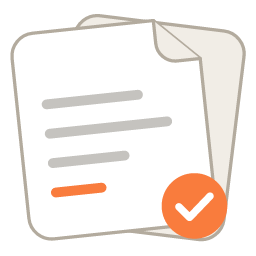

  <h1>Tisty — Local Memory and Context for You and Your AI Agent</h1>

  <p><strong>The working memory that stays yours: tasks, documents and notes in
  Markdown on your own disk, for Windows and macOS.<br/>Tasks that keep how each
  thing was solved, documents that keep what you know — one per subject — and an
  MCP server that lets GitHub Copilot, Claude Code, Codex, Cursor or any
  assistant pick up where it left off, reading a section at a time instead of
  every file.<br/>No accounts. No subscriptions. No telemetry. No
  server.</strong></p>

  <p>Software out of conviction, not subscription.</p>

  <p>
    <strong>English</strong> ·
    <a href="LEEME.md">Español</a>
  </p>

  <p>
    <a href="https://github.com/rgdevment/Tisty/releases">
      
    </a>
    <a href="#mcp-server">
      
    </a>
    
    <a href="#licence">
      
    </a>
    <a href="https://github.com/sponsors/rgdevment">
      
    </a>
    <a href="https://buymeacoffee.com/rgdevment">
      
    </a>
  </p>

[](https://m8ven.ai/mcp/rgdevment-tisty-15kwqt?s=readme)

  <p>
    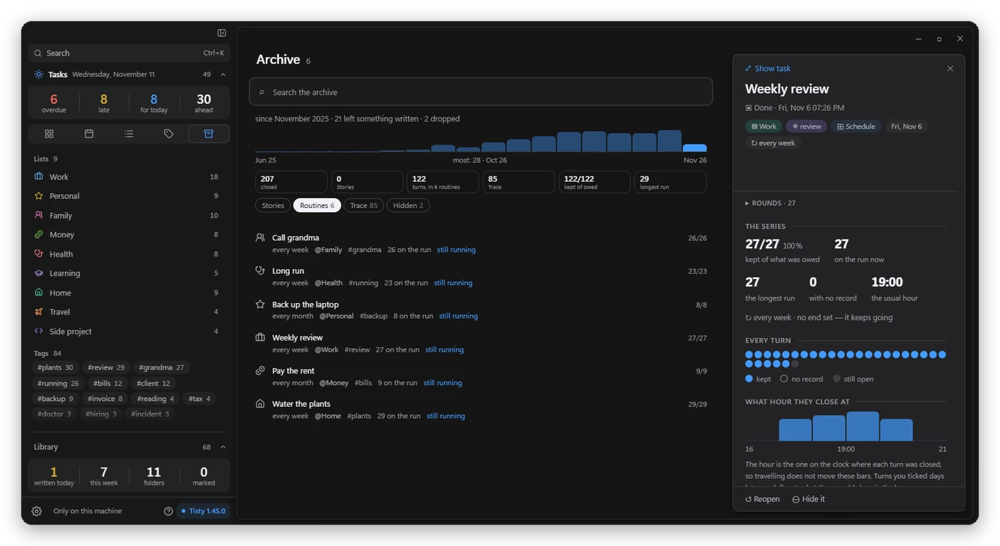
  </p>

  <h4>Download Tisty</h4>

  <p>
    <a href="https://apps.microsoft.com/detail/9PGVWXD8X93N">
      
    </a>
    <a href="#getting-started">
      
    </a>
    <a href="#getting-started">
      
    </a>
  </p>

  <p>
    <sub>Prefer a direct download?
    <a href="https://github.com/rgdevment/Tisty/releases/latest">GitHub
    Releases</a> carries the signed installers — Windows (.exe) · macOS
    (.dmg, one per chip)</sub>
  </p>

  <p>
    <sub>Site and docs:
    <a href="https://www.tisty.app/">www.tisty.app</a></sub>
  </p>

</div>

---

**An ordinary task list forgets the moment you tick the box. Your AI agent
forgets the moment the session ends.**

Everybody patches that in their own way: a `NOTES.md` hidden behind
`.gitignore`, a Markdown file per session, a `TASKS.md` nobody keeps up to date.
They go stale, they pile up, they get lost between branches, machines and
projects — and the agent rereads all of it, every session, at full price. The
assistant is brilliant at the file in front of it and forgets the picture: why
something was decided six months ago, what failed last time, what is still left.

**Tisty is the memory underneath.** Tasks that keep how each thing was solved,
with their steps and a dated journal. Documents that keep what you know, one
per subject, corrected in place instead of piled up. All of it on your own disk:
visual and comfortable for you, and for your agent a **local MCP server** that
says what moved since last time and reads an outline first, then only the
section it needs.

It is open source: read it, build it, run it, or take one of the signed
releases already out there. Nothing is hidden and all of it can be audited.

I am not a company. I am a developer who kept solving the same problem twice, so
I built the **notes, documents and task manager** I wanted and gave it away. It
is meant to stay small and useful, not to grow a thousand features nobody uses.
No ads, no telemetry, no accounts, no subscriptions — a **local-first
productivity tool** that lives on your machine and nowhere else.

**Why people choose Tisty:**

- **Memory that outlasts the session** — your agent starts from what moved, the
  task it was on and what it noted yesterday, not from a blank chat.
- **Made for agents as much as for people** — an outline costs a few hundred
  tokens, a read brings one section, and picking up again brings only what
  changed: a fraction of rereading your Markdown files.
- **Finishing keeps everything** — a closed task goes to the archive whole, and
  a search answers «how did we solve this?» with the line that says it.
- **100% local** — your tasks, your journal and your documents live on your
  computer and go only where you send them. No server of ours, no account. If
  you sync two machines, you can ask Tisty to leave the largest attachments in
  that shared folder instead of carrying them onto every disk; it never does
  that unless you choose it.
- **Documents that do more than text** — books in pages, diagrams, formulas,
  code, widgets and attachments, all of it plain Markdown any other editor
  still opens.
- **Truly free** — no premium tier, no feature gates, no trial. AGPL v3.
- **Your data outlives the app** — plain text and Markdown on your own disk,
  readable with `cat` and searchable with `grep`.
- **Fast and native** — a Rust core inside a Tauri window: it starts quickly,
  stays small, and looks like it belongs on both systems.

> I use Tisty every day on macOS and Windows. If something feels off,
> [open an issue](https://github.com/rgdevment/Tisty/issues) — this project
> keeps improving because of real-world use. Questions, ideas and how you use
> it go to [Discussions](https://github.com/rgdevment/Tisty/discussions).
>
> **Each person keeps their own Tisty, by design.** A developer, a PM and a QA
> each have their own tasks, documents and lessons, and their own agent working
> from them. When someone needs what you know, you hand them the document
> through [Folio](#share-what-you-know-with-folio). No assignees, no
> permissions, no boards: if you need to run a team, Tisty will not carry that.

## Table of Contents

- [Real Problems, Real Fixes](#real-problems-real-fixes)
- [Tasks and Documents, for You and Your Agent](#tasks-and-documents-for-you-and-your-agent)
- [A Day With Your Agent](#a-day-with-your-agent)
- [What It Costs Your Agent](#what-it-costs-your-agent)
- [Share What You Know With Folio](#share-what-you-know-with-folio)
- [MCP Server](#mcp-server)
- [Tools](#tools)
- [Why I Built This](#why-i-built-this)
- [What It Is / What It Isn't](#what-it-is--what-it-isnt)
- [What Makes It Different](#what-makes-it-different)
- [Documents](#documents)
- [Who Is This For?](#who-is-this-for)
- [The Idea It Is Built On](#the-idea-it-is-built-on)
- [Getting Started](#getting-started)
- [What It Does](#what-it-does)
- [Your Data and Privacy](#your-data-and-privacy)
- [Two Machines, If You Have Two](#two-machines-if-you-have-two)
- [An Assistant, If You Use One](#an-assistant-if-you-use-one)
- [What It Does Not Do](#what-it-does-not-do)
- [FAQ](#faq)
- [Alternatives to Obsidian, Notion and Todoist](#alternatives-to-obsidian-notion-and-todoist)
- [Localization](#localization)
- [Other Tools by the Same Author](#other-tools-by-the-same-author)
- [Support the Project](#support-the-project)
- [Standing On](#standing-on)
- [Contributing](#contributing)
- [Licence](#licence)
- [Project health](#project-health)

## Real Problems, Real Fixes

What people actually run into when they work with an AI assistant for months,
and what happens instead when the memory lives in Tisty.

| The problem | With Tisty |
| --- | --- |
| **Developer:** every new session you explain the project to your agent again | It asks what moved since last time, opens the task *Move payments to v2* with its ticked steps, and reads what it noted yesterday: *the webhook fails on old signatures; retrying ruled out*. It carries on from there. |
| **Developer:** your `NOTES.md` grew to 256 KB and the agent rereads it every time | It lives as documents split by subject, in pages. The agent reads the outline and the one section it needs — about 94% less than the whole file. |
| **Anyone:** you solved this eight months ago and cannot remember how | A search for *timeouts on save* brings back the archived task as it was left: its steps, its journal, and the line saying the cause was a missing index. |
| **PM:** a month later somebody asks «why did we decide this?» | One living document per subject, *Checkout decisions*, each decision dated with its why. The agent finds it and quotes it instead of reopening the debate. |
| **QA:** the same screen breaks again and nobody remembers last time's cases | The archived regression task keeps its cases as steps, with what was seen in each. |
| **Handover** between PM and PO, or developer and QA, pasted into a chat | You hand over the document through Folio: encrypted on your machine before it leaves, signed by you, gone on its own after days unused. |
| **Business rules** that must not land in somebody else's database | Tisty keeps them on your disk and sends them nowhere. What your agent reads goes where that agent goes, so pair it with one your company allows. |
| **At home:** the bank paperwork that comes back every year | Next year, the archived task tells you how you did it last time. |

## Tasks and Documents, for You and Your Agent

Tisty keeps two kinds of things, and the same two serve you and your agent.
Something you will do is a task. Something you will come back to is a document.
An idea, a thought caught on the fly before you know which of the two it is,
waits in Brainstorm.

### Documents: what you know, one per subject

- **One living document per subject** — it opens with what holds today, then
  the subject, what is out of scope, the decisions dated with their why (a
  replaced one is struck through, not erased) and its history.
- **Corrected in place** — the passage that changed is rewritten; no second
  copy is piled beside the first.
- **Pages for what is long** — a runbook, an annex, a book in chapters — with
  folders, languages, tables, diagrams, formulas and a PDF of its own.

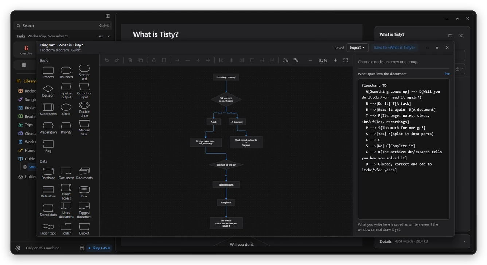

### Ideas: a brainstorm at hand

- **Caught the moment it comes** — the quick capture switches between a task
  and an idea with `Tab`, and ideas have a shortcut of their own: up to 140
  characters each, dated, without opening the window.
- **Sticky notes that stay Markdown** — they wait as coloured notes in
  Brainstorm, a document pinned atop the Library, and you reorder them by
  dragging.
- **Sorted out later** — each idea becomes a task or goes into the document it
  belongs to, and the Library counts the ones still waiting.
- **With your AI agent too** — ask it to brainstorm with you and it jots the
  ideas you keep; ask it to sort them and it groups them, turns one into a task
  or files it in its document, and only marks the old ones, for you to delete.

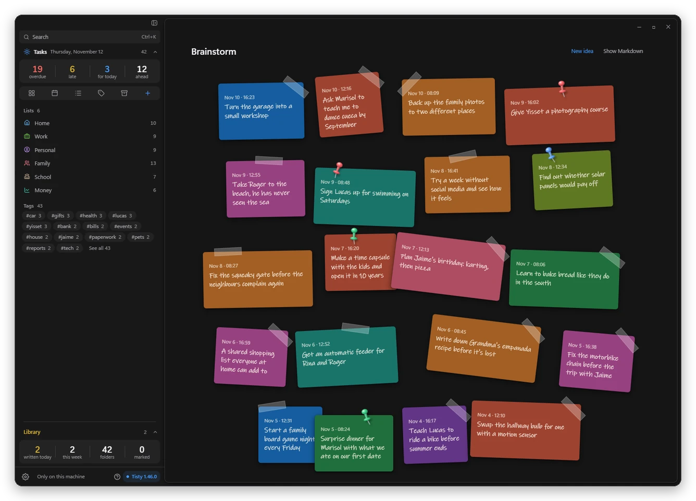

### Tasks: what to do, who does it, how it was solved

- **Priority, by its name** — the Eisenhower matrix: *do*, *decide*,
  *delegate*, *drop*. A date and a deadline are kept apart, so a planned day
  that slipped is late and only a deadline that passed is overdue. Lists, tags,
  and a reminder for what cannot wait.
- **Steps and parts** — a big job splits into parts, each with its own steps
  and its own day.
- **Shared work, clear ownership** — what your agent files is its own to keep
  true: it describes it, plans the steps, ticks each one when it is done and
  notes what it learns. What you wrote stays yours: the agent only adds — a
  journal entry, a reminder, a file — and gives its word that a step or the
  whole task is done, for you to confirm. Closing is always yours, and every
  entry says which agent wrote it.
- **A journal** — dated notes that are never rewritten: what was tried, what
  was ruled out, and why.
- **A page per task** — *Description*, *Done when*, *Steps*, *Notes* and *When
  it closes*: the agent knows when it is finished before it starts.
- **One ticket, one task** — filed with its source, a ticket or a thread, the
  same work is never filed twice.
- **The archive** — a closed task is kept whole, and a search answers «how did
  we solve this?» with the line that says it.

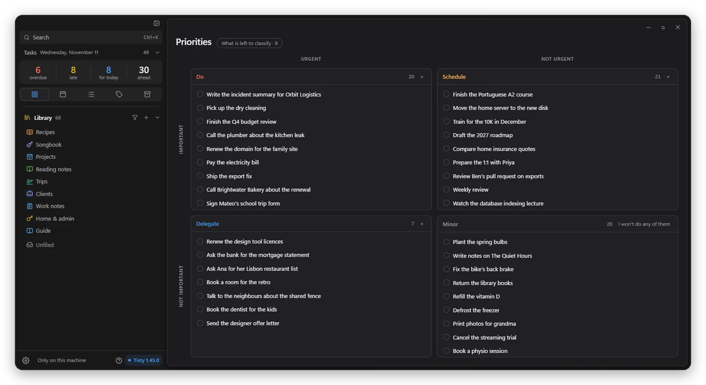

## A Day With Your Agent

What an agent connected to Tisty does with all that, on a real piece of work:

1. **It asks what moved** since its last session, and who moved it, instead
   of rereading everything.
2. **It opens the task it was on**, which Tisty names for it. *Done when* says
   when it is finished, and
   the unticked steps say what is left.
3. **It searches the archive before proposing anything.** If it was solved
   before, it starts from there.
4. **It reads the module's document by its outline**, then only the section it
   needs, and keeps to the decisions and to what is out of scope — so it does
   not reopen settled debates or wander off.
5. **It ticks each step when it is done and notes what it ruled out**, so the
   next session, or another agent, does not repeat the failed attempt.
6. **When a task's page grows long, it compacts the assistants' notes on it**
   into one dated digest — state, decisions, what was ruled out — keeping any
   line you wrote. The journal stays whole, and asking it to put the notes back
   brings them as they were, even after later ticks.
7. **It ends by saying what it did and how it knows it holds.** You review it
   and close it.
8. **After reading a long document, it leaves a summary** for the next agent
   to choose by. When the document changes, the summary is marked stale.

Your tasks tell your agent what is left and how far it may go; your documents
tell it what was already decided. What it learns stays written down for next
time.

## What It Costs Your Agent

Most MCP servers talk to your agent without pause. Tisty knows what each answer
costs, and keeps cutting it. Measured on a 256 KB Markdown work log, against an
agent that rereads the whole file every session:

| The agent… | Spends, with Tisty | Saving |
| --- | --- | --- |
| Picks up the work, with nothing new | about 1% | 99% less |
| Picks up and opens the task it was on | under 3% | over 97% less |
| Looks for something solved months ago | about 3% | 97% less |
| Looks up one subject: the outline and one section | about 6%, 12% at worst | 88–94% less |

Where the saving comes from:

- **No document holds more than 64,000 characters**, so a log that size is kept
  as subjects in pages, never as one wall of text.
- **No read brings more than about 12,000 characters.** Past that, a document
  asked for whole comes back as its outline.
- **A task's page comes whole only while it is short**, about 4,000 characters.
  Past that come its sections, the digest that opens the agent's notes and its
  latest note; its journal comes by size, the latest notes up to about 3,000
  characters, and a note holds at most 4,000.
- **The outline says what each section weighs** before anything is opened.
- **Picking up again brings only what moved** since the last time.
- **What is finished is archived**, and costs nothing until it is searched.
- **The outline points at repeated subjects and headings**, so they can be
  consolidated rather than read twice.

Connecting costs something too: the description of Tisty's tools weighs about a
sixth of that log, a third less than it did, and a test keeps it from growing.
An assistant that loads tools only as it uses them does not pay it whole; one
that loads every tool each session saves 72–83%, and below some 50 KB of notes
a plain file is cheaper. The counts are characters, with the JSON each answer
carries included, and tokens follow them closely.

## Share What You Know With Folio

When somebody else needs what you know — your PO, the QA joining the project,
another team — you hand them the document through
[Folio by Tisty](https://github.com/rgdevment/Folio-by-Tisty). It is encrypted
on your machine before it leaves, the key travels in the link where no server
sees it, every version is signed by you, and the link stops working on its own
after the days without use you choose. They read it in any browser with no
account, or edit it in their own Tisty. Your memory stays on your disk; Folio
only carries a copy. More in [Your Data and Privacy](#your-data-and-privacy).

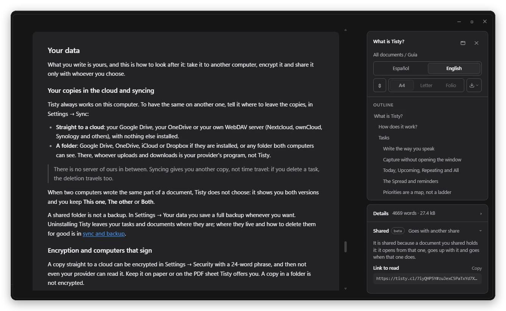

## MCP Server

Tisty is also a **local MCP server for tasks, todos and notes**. Through it an
assistant files tasks with steps, dates and reminders, writes and edits
Markdown documents, and searches open and archived work — on your own disk,
with no account, no API key and nothing sent over the network. It needs the
Tisty app, from [Getting Started](#getting-started), and Node.js 18 or later
for the launcher.

The easiest way is **Settings › Assistants** in Tisty: it finds the assistants
on this computer and connects the one you pick. By hand, any assistant that
starts a server by command takes the `tisty-mcp` launcher from npm, which finds
the Tisty installed here and starts its own server:

```json
{
  "mcpServers": {
    "tisty": {
      "command": "npx",
      "args": ["-y", "tisty-mcp"]
    }
  }
}
```

| Assistant | Add Tisty |
| --- | --- |
| Claude Code | `/plugin install tisty --marketplace rgdevment/mcp-plugins` |
| Claude Desktop | Settings › Developer › Edit Config, and add the JSON above |
| Cursor | [Cursor Directory](https://cursor.directory/plugins), or the JSON above in `~/.cursor/mcp.json` |
| GitHub Copilot in VS Code | `code --add-mcp '{"name":"tisty","command":"npx","args":["-y","tisty-mcp"]}'` |
| Gemini CLI | `gemini extensions install https://github.com/rgdevment/mcp-plugins` |
| Codex | `codex mcp add tisty -- npx -y tisty-mcp` |

Connect it one way, not both, so the assistant does not start Tisty twice, and
restart the assistant afterwards. More in
[Assistants and MCP](https://www.tisty.app/docs/assistants-and-mcp/).

Things to ask once it is connected:

- "Add a task to renew my passport before March, with the steps it takes."
- "What is on my todo list this week, and what is overdue?"
- "How did I fix the timeouts on save last year? Look in the archive too."
- "Write a document with my notes from today's call and file it in Clients."
- "Plan the release as tasks with steps, and tick them off as you go."
- "Remind me of the dentist the evening before, at 8."

## Tools

What `tisty mcp` offers an assistant, by what it works on. It never closes or
deletes: `say_done` leaves a task for you to confirm, and `flag_doc` marks a
document for you to delete, put away or keep. Each tool is described in
[MCP tools](https://www.tisty.app/docs/mcp-tools/).

- **Tasks** — file one with steps and a date, plan and tick its steps, set
  when it rings, move its day, say it is done: `propose`, `describe`, `plan`,
  `tick`, `untick`, `reword_step`, `unplan`, `rename`, `move`, `remind`,
  `reschedule`, `say_done`, `say_not_doing`, `read`
- **A task's journal and files** — `note`, `reword_note`, `attach`
- **Documents** — write one, add to it, change a passage or a table, read only
  the part it needs: `write_doc`, `append_doc`, `edit_doc`, `edit_table`,
  `read_doc`, `outline_doc`, `sum_up`, `restore_doc`, `import_doc`,
  `export_doc`, `archive_doc`, `flag_doc`
- **Folders, pages and languages** — `docs`, `folder`, `file_doc`, `page_doc`,
  `tongue_doc`
- **Finding things** — open and archived work, lists and tags: `find`,
  `catch_up`
- **How to work here** — `rules`, `language`, `help`

Beside the tools, it offers seven ready-made requests your assistant shows as
commands (`pick_up`, `leave_off`, `plan_task`, `solved_before`,
`keep_decision`, `brainstorm`, `sort_ideas`), and your documents to mention
with `@`, a long one as its outline.

## Why I Built This

Organising your day is harder than a list makes it look. There are more moving
parts than fit in your head, plans shift under you, and something you thought
was small turns out not to be. Which is why finishing it feels good.

But look at what the task gathered on the way. The steps it actually took. The
notes you wrote while working it out. What you looked up, what it turned out to
connect to, the documents you leaned on. That is where the effort went.

Mine looked like *"fix the intermittent timeouts on save"*. By the time it was
done it had collected the ticket, the commit, and two paragraphs explaining that
the real cause was a missing index on a table nobody was looking at.

Eight months later the same thing happened somewhere else. I remembered solving
it. I could not remember how — and the note that held the answer had gone with
the tick.

**That is the whole reason Tisty exists.** A task is not a line you cross out.
It is a tree: the steps, the journal, the files and the documents that grew
around it while you worked. Finishing it should not prune it.

I wanted it to stay mine, too. On my disk, in files I can open without asking
anyone. So I built the thing I wanted, used it until it stopped annoying me, and
put it here in case it is the thing you wanted too.

## What It Is / What It Isn't

**It is** a personal task manager where finishing something is the beginning of
its useful life. Tasks carry a description, a journal, steps and attachments;
when you complete one it moves to the archive, and search reaches all of it,
documents included.

**It is a place to write**, too. Documents are not a notes field bolted onto the
tasks: they are Markdown files that grow into books, with diagrams, formulas,
code and their own PDF.

**A task or a document?** A task is something to do: it ends, often soon, and
then it stays, so that months later you can look up how you solved it. A
document is something to keep and read again — a manual, a recipe, the notes on
a client — that grows and lasts for years. Something you will do is a task;
something you will come back to is a document. A spike is the clearest case: a
task whose page gathers what you found out — notes, recordings, code analysis —
split into parts that each get done, then completed and archived — and a year
later a search still brings back how it was solved, every step of it. That is
why a task has a page: it is also a document, one with an end.

**And an idea?** An idea is a thought caught on the fly, before you know whether
it is something to do or something to keep: a few words, 140 at most, dated, on
the Brainstorm sheet. It waits for you to sort it out: it becomes a task, goes
into the document on its subject, or is set aside. A note is something else: the
dated line in a task's journal.

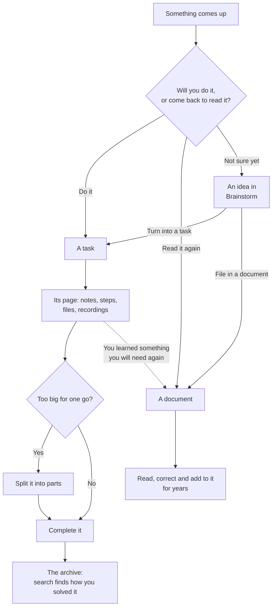

**It is one person's.** Each person keeps their own Tisty, with their own
agent working from it, and hands a document to somebody else through
[Folio](#share-what-you-know-with-folio). No assignees, no permissions, no
boards. If you need to run a team, Tisty will not carry that, and you deserve to
know before you install it rather than after.

**It is not something I sell.** Nothing is locked, nothing expires, and there is
no version of this with more in it. It is a program I wrote for myself and gave
away.

**Your data is files.** Plain text on your own disk, readable with `cat` and
searchable with `grep`. If Tisty disappeared tomorrow, everything you wrote
would still be there and still make sense.

## What Makes It Different

If you are looking for a **free, open-source, offline place for your documents
and tasks, with no account, no subscription and no AI inside — and a memory
your own AI agent reads over MCP**, this is what Tisty is:

| | |
|---|---|
| Your tasks live | in plain files on your own disk |
| Account | none, ever |
| Subscription | none. There is no paid tier and no upgrade |
| Offline | always. Only sharing a document by link needs a connection |
| AI inside | **none**, and none is coming |
| Your own assistant | yes, over **MCP**, through a door one click closes |
| Memory for your agent | what moved since last time, outlines first and one section at a time |
| Priorities | the **Eisenhower matrix**, by its name |
| Sorting | lists, tags, steps and a journal on every task |
| Documents | Markdown files with pages, diagrams, formulas, code, widgets and their own PDF |
| A document with pages | a book, with its chapters in the order the text names them and an index |
| Diagrams and formulas | drawn from a few lines of text, light or dark with the window |
| Widgets | fixed views of HTML and CSS in Tisty's colours, which run nothing and reach nothing |
| PDF | its own: A4, Letter or Folio, with its pictures inside |
| Any `.md` file | opens to read in a viewer of its own, up to 1 MB, without coming into your store |
| Attachments | kept with the task, as themselves |
| Finished work | an **archive that keeps what each task taught you** |
| Two machines | your Google Drive, OneDrive or WebDAV server, reached directly, or a folder you already sync. No server of ours |
| Your cloud, encrypted | if you want it, with a 24-word phrase only you know |
| Natural language | dates, deadlines and repeats, parsed on your machine |
| When to do it | a spread of days you deal work onto, and a month for looking |
| Reminders | an hour you choose, that rings on this machine and nowhere else |
| Source | open, auditable, yours to fork |

**Documents that grow into books.** Most task managers give you a notes field.
Here a document is a file of its own, written on a lit page, that holds pages
like chapters, draws the diagram you describe, sets the formula, colours the code
and makes its own PDF — and it stays Markdown that GitHub, any editor or `cat`
read the same. A task can point at it, and search finds both.

**The Eisenhower matrix, not numbered priorities.** A task is urgent, important,
both or neither — *do*, *decide*, *delegate*, *drop*. That names the decision
instead of hiding it behind a number, and it is the difference between a list
that sorts and a list that helps you choose. Around it: lists for where work
belongs, tags for what cuts across, steps for the parts, and a journal for what
you learn on the way.

**Finishing is where it starts.** Most task managers treat a completed task as
rubbish to hide. Here it moves to an archive read in three layers: the ones that
taught something come with their whole trail — what changed, when, and what you
wrote — the routines come with their tallies and their streaks, and the rest is
the trace. Search reaches all of it, documents included. A year in, that archive
is the part you would miss.

**Your assistant, not one of ours.** Tisty has no AI in it. The natural language
that turns "call the bank at 3" into a task is rules running on your machine, no
model and no cloud. But it speaks [MCP](https://modelcontextprotocol.io), so an
assistant you already use can file work into it — with its steps, its date and
the list it belongs in, on this machine, with no account and nothing over the
network. That door comes open, and one click closes it.

**Two machines, no middleman.** Tisty talks straight to your own Google Drive,
OneDrive or WebDAV server, or travels through a folder you already sync. There
is no server of ours in between, nothing to sign up for, and nothing that stops
working the day a company changes its mind. And what it keeps in that cloud can
be encrypted with a phrase only you know.

**Free is not a tier here.** There is no upgrade, no seat count, no feature held
back for later. The reason is not generosity: a program that keeps your work on
your disk and never phones home has almost nothing to charge for, and asking
would make it worse.

## Documents

The other half of Tisty, and for many people the larger one. A document is a
Markdown file on your own disk — the same file any other editor opens — and in
Tisty it holds a good deal more than text:

- **A book in pages.** A year of minutes, a manual by chapters, a dog's life told
  year by year: one document holding its pages, in the order the text names
  them, with an index at the end and arrows from one to the next.
- **One document in several languages.** Each language is a file of its own,
  and Tisty shows them as one row, opened in the app's language, with a switch
  that takes you to another language at the same section. Moving, archiving
  and deleting act on every language at once.
- **Diagrams from a few lines.** A block that says `mermaid` draws flowcharts,
  sequences, pies, timelines, mind maps, Gantt charts and more with the official
  Mermaid, light or dark with the window and legible at any width. A double
  click opens it in a window of its own, where a mind map, a database schema, a
  freeform diagram or a class diagram is also drawn by hand, with a palette of
  every Mermaid shape, saved back as Mermaid, drawn on the page as in the window
  and exported as PNG, JPG or SVG.
- **Formulas** set from a `math` block, **code** coloured by its language and
  named after its file, and **tables** that keep how their columns lean and how
  wide you drew them, whose columns can say what they hold — money, dates,
  choices, ratings, yes or no — and add themselves up at the foot, written on
  the page cell by cell.
- **Widgets**: a fixed view of HTML and CSS in Tisty's colours, which runs
  nothing and names nothing outside itself.
- **Callouts, highlights and icons** — the callouts GitHub reads, pens in
  several colours, an icon looked up by what it draws — and boxes you tick.
- **Attachments that travel with it**: pictures, PDFs, sound and film, kept
  inside Tisty rather than linked to a folder that moves. A click on a picture
  or a diagram opens it large, to zoom in and go to the next one.
- **A PDF of its own**, A4, Letter or Folio, with its pictures inside,
  shown to you before you export it.

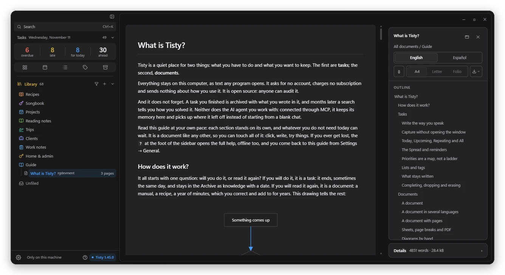

The guide Tisty writes the first time it opens carries a page with one of each,
so you can see all of it before you write a line.

**Documents** live beside the tasks, for reference material that has no date and
never gets ticked. They are Markdown files you edit as documents — tables,
checklists, code, images — and search reads them too. A task can point at a
document; a document never creates tasks.

**The tree opens quiet and closes whole.** Every folder starts folded, so a store
with hundreds of documents is a handful of rows until you go looking, and the
Library's filter keeps only what matches, with the folders above it open. When
work is over you archive the folder itself, not its documents one by one: it
drops to the shelf at the foot of the tree with its icon, its subfolders and its
pages exactly as you left them, closed to writing and to anything new coming in.
Bring it back and it returns the same — including whichever documents you had
archived by hand in there, which stay archived because nobody said otherwise.

**A page is put away on its own without leaving its document.** A long thing in
parts — a year of minutes, a book by chapters — is one document holding pages,
and a chapter that no longer applies goes to the archive where it lives: dimmed,
with the icon of the archive, read but not written. Put the whole document away
and every page goes with it; bring it back and each one returns as it was, the
one you had set apart still apart.

**A document takes tags the way a task does** — you write `#contract` in the
middle of a sentence and the document is filed under it. The tag lives in the
sentence rather than in a hidden header, so carrying the file to another editor
carries the tag with it. Tags is where they meet: one screen, the tasks under a
tag and the documents beneath them, and pressing a tag inside a document opens
exactly that. Accents come off and case is folded, so `#camion` and `#camión`
are one word however you typed them that day. A bare number is not a tag —
`#1234` is the ticket somebody wrote down, not a subject — and neither is a
single letter: two characters, one of them a letter.

Text can be highlighted in a few colours and set apart as an aside — a plain
quote, or a callout GitHub reads too, written as `> [!WARNING]`. Tables keep how
their columns lean and how wide you drew them, and a column can carry its type
in braces at the end of its head, `Price {money USD sum}`: Tisty shows, sorts and
adds up its cells as that, while the file stays a table any reader opens. A code
block says what language it is and is coloured for it, with its lines numbered
beside the text rather than in it, so copying takes the code and nothing else.
A block can carry a name; one whose language is `mermaid` draws the diagram it
describes
underneath — redrawn when you turn the light on or off — and one that says
`math` sets the formula it holds. One that says `widget` is drawn as a fixed
view, HTML and CSS and nothing else, the same wherever the document is read. An
`.html` file attached to a document is only a file: Tisty never runs it.

**A web link on a line of its own is drawn as a card**, made from the address
itself — the site's name and the words you wrote. Nothing is fetched to draw it.
Press **Bring the preview** and Tisty asks that page once for its title, its
description and the picture it offers, keeps the answer here so it never asks
again, and reads no more of it than it needs: a page cannot decide how much of
your machine it takes.

**It stays Markdown**, and that is the point rather than a detail: everything
above is syntax another reader already understands, so the file survives without
Tisty — a block's name is what Markdown keeps after the language, and a column's
width rides in how long its rule is drawn, which every other reader ignores and
draws the same. Where Markdown has no word for a thing, Tisty adds a few short
ones of its own, never HTML: `==words==` is a highlight and `==words=={green}`
one in another colour, `++words++` is underlined, `::star::` is an icon, and an
attachment is named by its own name, ``. The editor
writes the file a block at a time with its marks out of sight until you ask for
them, and `Ctrl`/`⌘` + `E` opens the whole of it as text, so what is on disk is
always yours to read. **Copy as Markdown** and taking a document out say
those few words the way any other reader understands them, and an older file, an
import or an assistant writing in plain Markdown is turned into them on the way
in.

The writing sits on a lit page, and the first line with words in it is both the
name of the document and its title — reading past a fence or an alert's marker to
find it. When the window is wide enough a column opens beside it
with what the document is, the formatting the `/` menu used to hide, and its
outline. **Tisty makes its own PDF** — A4, Letter or Folio, with its
own margins and its pictures carried inside — and shows it to you before you
export it.

**A Markdown file from anywhere opens to read.** Pick Tisty under *Open with*
for a `.md` file, or follow a `tisty://open?path=…` link, and it opens
read-only in a light viewer of its own, up to 1 MB, without coming into your
store and without setting anything up first: its contents at the side, what the
file is, a search, and its Markdown a press away. It reads the file the way its
writer meant, so a paragraph cut at 80 columns is one paragraph and `#ff0000` is
a colour rather than a tag. Pictures beside it come straight in, and those on
the internet wait until you ask. **Edit** makes a copy in your store and leaves
the original where it was. A document of yours opens from its panel, *Open in a
window of its own*, read-only with the width of the page and the PDF it would
make, and that PDF is signed unless you untick **Signed**. A widget opens apart
too, at phone, tablet or desktop width. More in [the help](https://www.tisty.app/docs/documents/#opening-a-markdown-file-from-outside).

**And they leave whole.** A document copies as standard Markdown, the way
GitHub and CommonMark read it, writes out into a folder with its pages and
attachments beside it, leaves as one web page or a Word file with its pictures
inside (Markdown to HTML, Markdown to Word), or is exported for Tisty into a
`.tistyx` file that also carries what Markdown cannot say: folders with their order,
icon and colour, which document each page hangs from, what is archived, and the
alias it was signed with. It carries a `README.txt` as well, so whoever you hand
it to can read the documents without Tisty and knows where to find it if they
want the rest. Exporting all of them asks who they
are for: open, to hand to somebody, or locked with six digits for another
machine of your own, so nobody else can read it. Once you have your identity,
the parcel goes out signed with your key: another Tisty of yours takes it as
yours, anybody else's as your writing with your fingerprint, and a parcel
changed on the way lands as a stranger's. Either way, not one line of the
history travels inside.
Write an alias — optional, and yours to choose — and every document is signed
with it, while whatever arrives from somebody else keeps theirs.

## Who Is This For?

Anyone whose work leaves a trail worth keeping, and who wants their AI agent to
remember it too. A developer who jumps between sessions, branches and dozens of
projects. A PM who keeps the decisions and the why behind them. A QA who keeps
the cases that broke last time. A tech lead who keeps the runbooks. Sysadmins,
freelancers, researchers, students — anyone who has ever solved the same problem
twice and known it the second time.

Each of them keeps their own Tisty: what one learns is not the same as what
another needs, and their agents work from different memories.

And anyone who writes things that last: a manual, the minutes of a year, notes
for a course, the documentation of a system, a book in chapters — and wants it
in files of their own rather than in somebody else's database.

If what you want is a list to cross out and never open again, Tisty will feel
like more than you asked for. That is a fair reason to walk away.

## The Idea It Is Built On

**A completed task is not finished. It is archived.**

It stops being a reminder of what to do and becomes the record of how something
got solved. Three things follow from that, and they shaped everything else:

- **Search is the main way into the archive**, not a side feature.
- **Deleting is the exception.** The normal ending is completing, which keeps
  it. Erasing something for good is only for what is closed and reads as a
  trace; a story is only hidden, and converting it to a trace is the deliberate
  step that lets it go.
- **Capture has to stay instant**, because most tasks are not like that at all.
  The call you have to make tomorrow is born and dies within a day and leaves
  nothing worth keeping — and writing it down must not cost more than one line.

**A document is a file you keep, not a row in somebody's database.** Whatever
Tisty draws on top of it — pages, diagrams, widgets, a PDF — the file underneath
stays Markdown another reader opens the same, so leaving Tisty never means
leaving your writing behind.

## Getting Started

**Windows** — from the
[Microsoft Store](https://apps.microsoft.com/detail/9PGVWXD8X93N), which keeps
it updated for you. About asks the Store for one on the spot when you would
rather not wait. Or with the Windows Package Manager, which takes the signed
installer from the releases page and then stands aside, because Tisty keeps
itself up to date:

```console
> winget install rgdevment.Tisty
```

**macOS** — with [Homebrew](https://brew.sh). The tap is added and trusted
once and never again; Homebrew loads a tap that is not its own only once you
trust it. After that Tisty keeps itself up to date, so Homebrew stands aside:

```console
$ brew tap rgdevment/tap
$ brew trust rgdevment/tap
$ brew install --cask tisty
```

Or take the disk image and the installer straight from
[Releases](https://github.com/rgdevment/Tisty/releases), on either system.
On macOS there are two images: `aarch64` for Apple Silicon and `x86_64` for
Intel — Apple menu › *About This Mac* says which one yours is. Homebrew picks
by itself.

## What It Does

**The first time it opens**, Tisty asks two things — which language, and where
your copies should go — and then writes you a guide and opens it, unless the
place you chose already holds your Tisty: then it brings that instead. Everything
else it decides for you and lets you change later: it starts with the computer
and waits out of the way, because those were questions with an obvious answer.
The guide is a document in your own store, in a folder of its own: yours to
read, edit, or throw away like anything else you wrote.

**Settings takes over the sidebar with its sections.** *General* is how Tisty
behaves towards you — language, light or dark, start-up, the quick capture,
notices, and the one thing that happens outside the window: the welcome. *Sync*
is where your copies go, which computers are yours and where the big
attachments live. *Security* holds your 24-word phrase and the encrypted cloud.
*Your data* is your folder, backups, what you take out or bring in, and a guide
that leaves a computer clean if you want Tisty off it. *Assistants* and
*Maintenance* are what they say, and *About* comes last: the notice of an update
shows only when there is one, and takes you straight there.

**Three columns at most:** what you are looking at, the list, and the task you
opened. Nothing else on screen.

**The list stands where it stands.** It does not drift to the middle of whatever
room is left, so opening a task moves nothing. Where the window is wide enough,
the space that opens up is not left blank: a column tells you the day — what is
overdue, what is late, what is for today, what is ahead, the four quadrants with
their counts, the lists holding something and the tags in use. All of it counts
your whole store rather than the slice on screen, and every figure is a way in.
Narrow the window and it steps aside; a task always wins the room over it.

**It reads what you write.** You type a sentence and Tisty takes the date out of
it, leaves the sentence readable, and shows you what it understood *before*
anything is saved — as chips you can correct with one click.

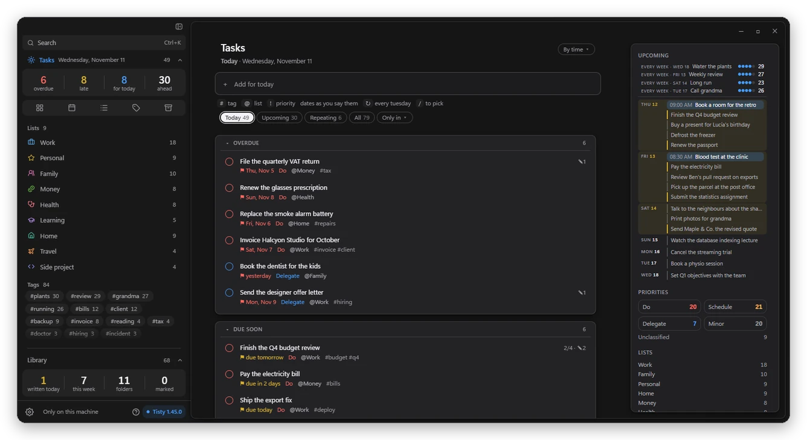

```text
"ship the release tomorrow at 10"   →  tomorrow 10:00
"file the report before friday"     →  due fri
"book the flights @travel #urgent"  →  @travel · #urgent
```

A day, a time, or both. Names, distances, plain dates. What it cannot read it
leaves alone rather than guess. A deadline is a different thing from a plan, and
four words open one: **before**, **by**, **due**, **until**.

**A task opens beside the list**, not on top of it: dates, list, tags and
priority above, and below them its own page, a Markdown document like any other,
with sections to fill in and a grey hint in each. Every box on that page is one
of its steps; press **↗** on one and it becomes a part of the task, its card left
where the step was. Completing it puts its page away with it, readable and
untouched, and reopening brings it back. Opened to the whole page it gains a
column of its own trail — how long it has been open, how much of it is done, and
every change it has been through.

**Priorities are a matrix, not a ladder.** Tisty borrows the four quadrants
of the Eisenhower matrix — the method President Dwight D. Eisenhower is
credited with, popularised by Stephen Covey in *The 7 Habits of Highly
Effective People*: sort what you have by urgent against important, and each
quadrant tells you what to do with it. **Do** what is urgent and important,
**Schedule** what matters and is not urgent, **Delegate** what is urgent and is
not yours, and leave in **Minor** whatever you could live without — when you are
sure, one button drops the lot.

Drag a task into its quadrant, or type it: `!do`, `!schedule`, `!delegate`.
`!decide` still works, because it is what the quadrant used to be called. Each
quadrant has a **+** that opens the quick capture with that quadrant already
set, and whatever nobody has placed waits in a tray that opens the way you
left it.

**The spread deals your days, one row at a time.** Priorities sort what matters;
the spread decides when. It runs as a river of days you scroll through rather
than a week you page: every day is a row, and the row grows with what it carries,
so a heavy Friday is tall and a free Tuesday is a line. What you wrote with no
day waits in a tray on the left, and you drag it onto a day — or drag it back to
take the day away again. Drop one onto a day that already carries two and
Tisty says so, and offers the next day that is free; it never insists.

A **month** button is there for looking, not for dealing: press it and the same
days lay out as a grid, press a day and you land on it in the river. Nothing is
dropped there on purpose. Tisty cannot see the calendar you keep somewhere else,
so a square with nothing written on it is only a square with nothing written on
it — never a promise that the day is yours.

**Tisto keeps you company.** Tisty's beaver peeks over the bar while you write a
task. It never covers anything, and Settings turns it off. Finishing a task
shows a notice with **Undo**, in case it was a mistake.

**A global shortcut** opens a small field over whatever you are doing, so a task
that occurs to you mid-something does not cost you the something.

**When Windows closes Tisty for an update**, what you just typed is kept first,
and Tisty comes back by itself: in view if it was in view, hidden if it was
hidden. A shutdown keeps what you typed too. A crash or a hang does not bring it
back.

**A calendar comes in as tasks.** Drop an `.ics` on the window, or open one with
Tisty: it shows each event and to-do with when, where, how it repeats and its
reminder, and makes the ones you pick into tasks — time zones, Outlook's
included, and simple repeats kept, and a file opened twice brings nothing twice.

**Repeating tasks** come back one occurrence at a time, so the archive shows you
did it twelve times — and it counts what was owed rather than only what you
closed, so a routine reads 26 of 30 with four dates that have no record. Marking
one days late offers those dates back instead of calling them forgotten: tick the
ones you did and the gap closes. **Reminders** arrive as a system notification and
a short sound you can turn off. The whole window works from the keyboard.

**The archive is read in three layers.** The ones that taught something — a task
you came back to and added to more than three times — come with their whole
trail: what changed, when, and what you wrote along the way. The
routines come with their tallies, their streaks and the hour you usually keep
them. The rest is the trace: what left little or nothing written, listed dense
and out of the way, because it still happened and search still reaches it. You
decide which layer each one reads in: a story that was only noise goes to the
trace, and a trace worth keeping is kept as a story. The trace is the only layer
that can be erased, and both erasing and hiding are one task at a time; a story
is only ever hidden.

## Your Data and Privacy

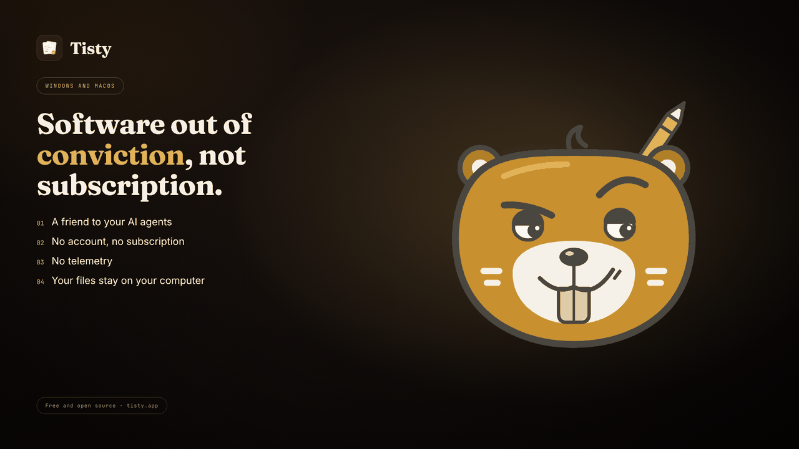

Everything lives in one folder on your disk: an append-only log of what
happened, your documents as `.md` files, and your attachments as themselves.
Nothing is obfuscated and nothing is in a format only Tisty can read.

**Nothing on your disk is encrypted at rest**, and that is a decision rather
than an oversight — your operating system's permissions are the protection, and
the files stay readable with tools you already have. What Tisty keeps in a cloud
it reaches directly is another matter: that you can encrypt with a phrase only
you know, as [the section below](#two-machines-if-you-have-two) tells. Both are
written out in [PRIVACY.md](PRIVACY.md) and [SECURITY.md](SECURITY.md),
including the parts that are not reassuring.

Tisty makes **one** check unasked — when it opens, and once a day after that:
it downloads a small file and its signature to see whether a newer version
exists. It sends nothing. If one does exist and you press the button that
offers it, two more requests follow — the file naming the release, and the
installer — and Tisty refuses to install anything not signed with a key
compiled into the copy you already have. There are a few more, listed in
[PRIVACY.md](PRIVACY.md).

**Folio by Tisty** is a separate service for sharing a document by a link with
no account, end-to-end encrypted, with its own terms and policies in
[its own repository](https://github.com/rgdevment/Folio-by-Tisty). Every document
shows a **Shared** row; pressing **Share** reads a small signed file to learn
whether Folio has opened and, while it has not, tells you so, with a link to
[tisty.cl](https://tisty.cl). Nothing of your document leaves until
Folio is open, you accept its terms and you confirm.
[PRIVACY.md](PRIVACY.md#sharing-by-link) says what each step sends.

## Two Machines, If You Have Two

Tell Tisty where to leave the copies, in Settings › *Sync*. There are two
ways — a cloud Tisty talks to directly, or a folder something else keeps in
step — and the rest it does on its own.

**Your Google Drive, directly.** Choose *Your cloud service* and **Connect**:
your browser opens, you sign in to Google, and Google asks whether Tisty may
keep its copies there. They live in a hidden space of your Drive that only
Tisty opens — it sees nothing else in your Drive, and they do not show up among
your files — and you do not need Google's desktop program installed or running.
Disconnecting keeps them there, in Tisty and in Drive alike; to take them out,
move to a folder from Tisty. In Google Drive › Settings › Manage apps, only
*Delete hidden app data* deletes them. The first
time, everything you already have goes up — or, if your Drive already holds
your Tisty, it comes down instead; after that only
what is new travels, and a dropped connection carries on where it left off.
Attachments stay on the computer they were added on and come down on another
one when you open them there; *Free up space* lets go of the ones you have not
opened in a while. Each computer has a daily allowance, so no single copy can
spend the quota Google grants the project: when it runs out, what you write
stays safe here and syncing carries on the next day. Connecting happens only in
the window.

**Your OneDrive, directly.** The same, with Microsoft: you sign in on
Microsoft's page and Tisty keeps its copies in *Apps › Tisty* in your OneDrive.
That folder is one you can see there; leave it to Tisty, since what you change
by hand reads as a change from another computer.

**Your own server, over WebDAV.** Nextcloud, ownCloud, Synology and others:
you type the server's address, your user and a password in Settings, and Tisty
checks the server before connecting — no browser opens. The password stays on
this computer, kept by the system; an app password from your server is better
than your main one, since you can remove it there whenever you like. Tisty keeps
its copies in a *Tisty* folder on the server and touches nothing beside it;
leave that folder to Tisty too. Your server sets the limit and the pace, and
attachments always stay on this computer as well.

Before you connect, and before a move to the cloud, Tisty checks that the
provider answers, with one request that carries nothing of yours. If a proxy, a
filter at work or an antivirus stands in the way, it says so in plain words —
there, and on the card once syncing keeps failing: a second round in a row, or
two minutes after the first. A single failed round, or a connection cut halfway,
is only tried again. It never goes around what stands in the way: what you write
stays here and goes up once the way is clear. A round that runs long says for
how long, so it never looks frozen.

**A folder.** Google Drive, OneDrive, iCloud and Dropbox's own folders —
whichever it finds installed, folder already worked out — or any other folder
both computers reach, a NAS, a drive you plug in on Fridays. Dropbox travels
this way, through its own program.

There is nothing of mine in the middle: no account, no server, no daemon. Who
runs that folder or that cloud is your business, not Tisty's. If you sync
nothing, it never opens a connection for it at all. Changing your mind later is
a move, not a switch: *Move to another place…* takes your copies between this
machine, a folder and your cloud in two steps — first it brings home what
lived only in the place you leave, then it takes everything to the new one —
counting the files left, says so when the provider asks for a pause, lets you hide
it and keep working, and tells your other machines where you went so each one
follows.

**A new computer joins on its own.** If it holds nothing of yours yet, it
takes what the folder or your Drive already holds, after keeping a backup —
connecting Drive there says *Your Google Drive already holds your Tisty* and
offers **Sync** instead of a first upload. It brings it with a moving bar and
counts as things arrive, and **Keep working while it arrives** lets you into
the app while the round goes on; the foot of the sidebar keeps counting and
says if it could not finish. One that does hold your work asks first, naming
the place: merge the two, keep this machine, or take what the place has. If
your cloud is encrypted, a new computer is let in first, as told below.

Two machines can genuinely write the same document at once, and there Tisty
merges them **block by block** — you edit the introduction on one, someone edits
the closing paragraph on the other, and both land with nothing to answer. Only a
real overlap becomes a question.

**An older Tisty does not write over a newer one.** A computer still on Tisty
1.30 to 1.33 that reaches your cloud or your folder stops and asks you to update
it instead of carrying on. Until you do, that computer does not sync, but
nothing is lost: what it holds stays where it was and catches up once it is
updated.

**Each machine signs what it writes**, and one nobody here has answered for
waits at the door: its card in Settings › *Sync*, under *Your computers*, shows
the code it signs with, you compare it with the one that machine shows for
itself, and confirm it. Until then nothing it writes comes in; from then on,
whatever does not answer to that key is turned away, and Tisty says so.

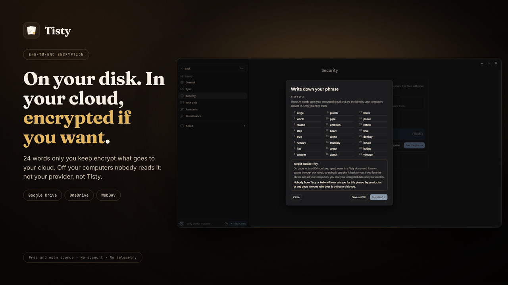

**Your cloud, encrypted, if you want it.** In Settings › *Security*, **Encrypt
my cloud…** encrypts what Tisty keeps in your Google Drive, your OneDrive or
your WebDAV server with a key that comes from a 24-word phrase only you know.
Whoever sees those files, your provider included, can no longer read your tasks
or documents, and what is on your computers does not change. It is for a cloud
Tisty reaches directly; a folder kept in step by another program stays as it
is.

Before it starts it checks three things: that your phrase is written down —
**Save as PDF** gives you a sheet to keep, and three of its words confirm you did
— that the cloud has room, since it takes twice as much until the old copy goes,
and that every one of your computers runs a Tisty that knows an encrypted cloud.
Then it shows the progress. You can keep working, close Tisty and have it carry
on where it was, or cancel: until the last step, what was there stays as it was.
Once it is done the old unencrypted copy stays in the cloud until you press
**Delete the unencrypted copy**, and **Decrypt my cloud**, in the same place,
turns it back to plain; your other computers notice and keep syncing without
you doing anything on each one.

**Your computers get the key on their own.** One that already synced with you
waits a moment and takes the key from another of yours that has Tisty open, and
meanwhile it writes nothing unencrypted. A new computer is let in from one that
already reads the encrypted cloud: on the new one, **Let in from another
computer** shows twenty digits, and you type them on the other under Settings ›
*Security* › **Let a new computer in**; then **It took them** on the new one
says you did. Or type your 24 words on the new one
with **Type my phrase**: only the cloud's key stays there, never the phrase.
Whichever history you then keep, the computer that took the twenty digits does
not ask for it again; each of your other computers asks you to confirm its code
once, as with any new computer, since the key alone does not say which computer
is yours.

**What it does not hide.** Your provider keeps earlier unencrypted versions for
a while, in its history and its bin, and the names and sizes of the files and
how many computers you have stay visible. The phrase never passes through
anybody's hands, so nobody can give it back to you: without it or one of your
computers, nobody can open your cloud, not even Tisty.

**And back up by hand, shared folder or not.** One zip with your whole history,
kept wherever you like, and restored from the same place in *Your data*.

**Where the big ones live is yours to say.** By default every machine carries
every attachment, which is why any of them can open anything with the network
off. For anything above 25 MB, Settings offers two other ways: keep only what
this machine attached and fetch the rest when you open it, or leave them in the
shared folder and nowhere else. That last one trades the copy on your disk for the
space it took: the file is there when your provider or your NAS is, and Tisty
says so plainly when it is not. A copy is only ever let go of after the one in
the shared folder is found to hash the same.

And because what uploads a folder is your provider's program and not Tisty, if
you ever change something on one machine and it does not turn up on the other,
[the help](https://www.tisty.app/docs/sync-and-backup/#something-changed-on-one-machine-and-is-not-on-the-other)
lists the causes worth checking, in order — and what each message about Google
Drive means, from *Reconnect* to a full Drive or
[something blocking the way](https://www.tisty.app/docs/sync-and-backup/#when-something-stands-in-the-way-of-google).

## An Assistant, If You Use One

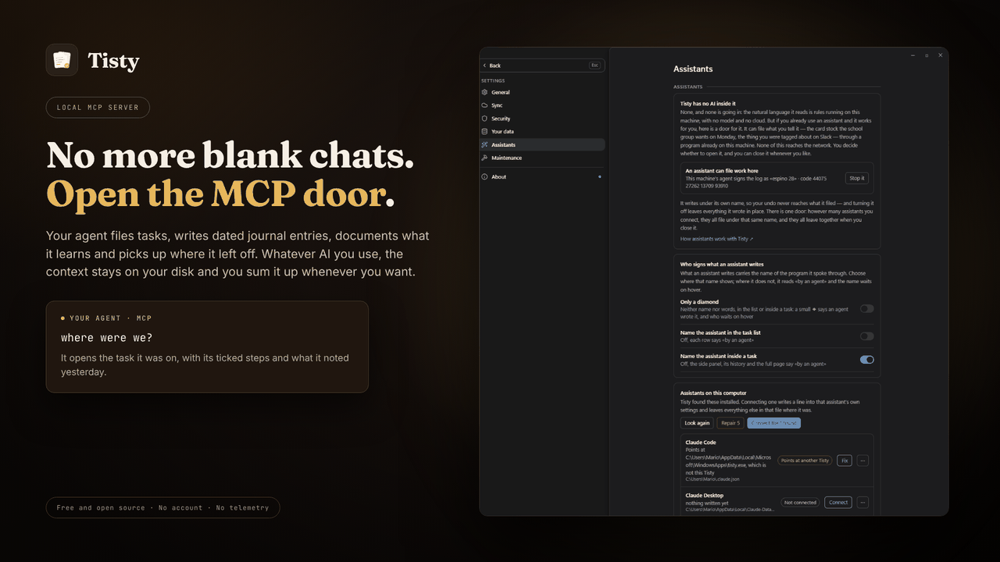

**Tisty is not AI and has none inside.** The natural language that turns "call
the bank at 3" into a task is rules running on your machine: no model, no
request, no cloud. That is not going to change.

But if you already use an assistant, you are probably telling it things worth
keeping — the school group says card stock on Monday, the invoice is due on the
30th. So Tisty leaves a door, and you decide whether to use it.

**Your agents' work, in the open.** Through Tisty, an agent plans in
documents and works in tasks: it writes the plan, what it found and what it
decided as Markdown, breaks the work into tasks with steps and ticks them off as
it goes. Nothing stays buried in a chat: every stage lands in Tisty, on your
computer, where you can follow it as it happens and audit it later. When it says
a task is done, you are the one who closes it.

Settings › Assistants lists the assistants already installed on this computer and
connects the one you pick: it writes a single line into that assistant's own
settings, leaves the rest of that file where it was, and keeps a copy of it as
it was before. For one it does not know, a line does it, and the tab shows it
with where the `tisty` that came with the app sits on this computer:

```console
$ <your-assistant> mcp add tisty -- <path-to-tisty> mcp
```

Where `<your-assistant>` is whatever yours is called. That `tisty` is not a
command line any more: it opens only the assistant's door. It speaks
[MCP](https://modelcontextprotocol.io) on the same machine: no
account, no token, nothing over the network. **You hold the door.** It comes
open on its own until you choose — on a new install, and on an update if you
never closed it — so an assistant you connect can work right away, and Settings
› Assistants closes it with one click. While it is closed, everything an
assistant tries is refused, and the window says who knocked — «Claude Code
tried to come in» — with **Let it in** right there. Letting an assistant in and
throwing it out are events in your log; that you chose to keep the door closed
is kept in this computer's settings.

While assistants have a voice, a stable Tisty also answers to the name `tisty`
on your PATH — the Store and Homebrew put it there, and the installer's copy
adds its own folder — so a plugin can start it by name. Taking the voice away
takes that folder off the PATH again. Restart an assistant that was already
open so it sees the change.

What it may do is deliberately small: file a task with its steps and its date,
set an hour for it to ring at, move the day of a task it filed itself, say that
a task is done, yours too — which marks it for you to confirm and closes nothing
— add to the journal, work any task the way it works a document, write a
document, add to one that is already there — at the end or under a heading —
correct a passage of one, write one again whole, file documents into folders,
make one document a page of another and say the order its pages are read in,
which writes and moves the lines naming them in your document's text and nothing
else, mark a document that had its day, for you to delete, put away or unmark,
keep a copy of a file you point it at — on a task or inside a document, which
takes the larger file of the two — and read what is already there. What it may
not do: close a task or delete one, tick a step of yours or finish a task of
yours, move a day you set, delete a document, rename or empty a folder, reach a
task you folded away, take files from anywhere but Downloads, Documents,
Pictures, the desktop and the temporary folder, or file the same thing twice. A
task you closed is history to it: it comes with a notice saying so, reads as it
ended, takes no note, no new day, no bell and no file, and if the same work
comes back the assistant proposes a new one that says how the last one ended.

A task you wrote is written on the way a document is: an assistant may describe
it, rename it, move it to another list or under another task, plan, reword or
take off its open steps, correct a note and write its page. What settles it
stays yours: it may say it is done, or that it should not be done, or that a
step of it is done, and each waits for you to confirm it; its day is yours to
move, and a step you ticked is never its to reword or take off. What an
assistant writes is signed with the name of the program it spoke through: a row
says «by an agent» and names it on hover, while the side panel, the full page
and the journal say «by Claude Code», «by Codex». Settings › Assistants counts
what each one wrote and lets you choose where the name shows, or keep only a
small ◆.

It also reads sparingly, which is your business as much as its own. Tisty keeps
a small card for each document — its headings, how long it is, what it leans
on — worked out from the text itself, on this machine, and never sent anywhere.
An
assistant reads that to pick which document it needs, then asks for the part it
wants, or changes that part without having read the rest. A long document is not
poured into somebody's model because an assistant wanted one paragraph of it.
Having read one, it can leave a summary for the next one — kept on this machine,
never synced, and not part of what you wrote.
To correct a passage it has to name it exactly as you wrote it, and if that text
is not there or is there twice, nothing is written at all. To write a whole body
again it has to send back the print the document read at when it last looked: if
you have written in it since, the write is refused and it has to read again, so
what you typed while it was thinking cannot be lost. A document you archived it
can still read, and it is told that you archived it; it cannot write in it
until you bring it back, or ask it to.

Whatever it reads travels wherever that assistant travels. That is between you
and it — which is precisely why the door, open on a new install, closes with
one click, and why opening or closing it is written into your log.

## What It Does Not Do

As important as the list above. Out of scope for now: real-time
collaboration, kanban boards, Gantt charts, time tracking, productivity metrics,
databases that relate tables across documents, formulas in cells, and AI
anywhere in the critical path. A table's columns can say what they hold and add
themselves up, but each table lives in its own document.

The natural language stays deterministic and local, and **Tisty never sends
anything to a model** — not a task, not a word. While the door in the section
above is open, whatever your assistant reads travels wherever that assistant
travels: Tisty still sends nothing, the assistant is the one carrying, and the
door is yours to close.

## FAQ

### Is Tisty free?

Yes, and it stays free. AGPL-3.0, no paid tier, no feature held back for a
later version, no trial that runs out.

### Does it need an account or a connection?

Neither. There is nothing to sign up for, and only sharing a document by link
needs a connection. Tisty makes one network request you did not ask for — when
it opens, and once a day after that — to see whether a newer version exists, and
it sends nothing in order to ask. Take the machine off the network and
everything else works the same.

### Where is my data kept?

In one folder on your own disk: an append-only log of what happened, your
documents as `.md` files, and your attachments as themselves. Settings › *Your
data* prints the path and *Show folder* opens it. Nothing is obfuscated and
nothing is in a format only Tisty can read.

### What happens to my notes if Tisty disappears?

They stay where they are. Markdown and plain text, readable with `cat`,
searchable with `grep`, openable in any editor you already have. That is what
the format is for.

### Does Tisty use AI?

No, and none is coming. The natural language that turns "call the bank at 3"
into a task is rules running on your machine: no model, no request, no cloud.
If you already use an assistant of your own, Tisty leaves an
[MCP](https://modelcontextprotocol.io) door — it comes open, one click closes
it, and while it is closed everything it tries is refused.

### How do I give my AI agent a memory between sessions?

Connect Tisty over MCP, as [MCP Server](#mcp-server) shows — GitHub Copilot
in VS Code, Claude Code, Codex, Cursor and Gemini CLI take one line. From then
on the agent starts a session by asking what moved since the last one, files
its work as tasks with steps and a journal, and keeps what it learns in
documents. The next session, on any project, starts from there instead of from
a blank chat.

### Does it replace CLAUDE.md, AGENTS.md or a memory-bank folder?

For what changes, yes; for what does not, no. Instructions that rarely move —
how to build, the conventions — belong in the files your repository already
hands the assistant. What moves — progress, decisions, what was ruled out, what
is left — belongs in Tisty, where it is dated, searchable, read a section at a
time, and never lost between branches, machines or projects.

### Can I use it on two computers?

Yes, two ways. Connect your own Google Drive,
OneDrive or WebDAV server in the window, and Tisty talks to it directly, keeping
its copies in a place of its own there and seeing nothing else — encrypted with
a phrase only you know, if you want. Or use a folder you already sync: Google
Drive, OneDrive, iCloud, Dropbox, a NAS, a drive you plug in on Fridays. Either
way there is no server of mine in between, no account of mine, and you can move
from one to the other whenever you like.

### Is there a mobile app?

No. Tisty is a desktop program for Windows and macOS. Your documents are
Markdown in a folder, so a phone that reaches that folder reads and edits them
with whatever app you like — but the window, the spread and the archive are the
desktop's.

### Does it run on Linux?

No. Tisty is a desktop program for Windows and macOS. An assistant that runs
on Linux inside Windows, under WSL, reaches it all the same: Settings ›
Assistants connects it.

### Is my data encrypted?

On your disk, no, and that is a decision rather than an oversight: your
operating system's permissions are the protection, and the files stay readable
with tools you already have. In a cloud Tisty reaches directly, it can be:
Settings › *Security* encrypts it with a 24-word phrase only you know.
[PRIVACY.md](PRIVACY.md) and [SECURITY.md](SECURITY.md) write it out, including
the parts that are not reassuring.

### Can I use it with my team?

Not as a shared board. Tisty is one person's by design — no assignees, no
permissions, no shared database — and you deserve to know that before you
install it rather than after. What a team does get: each person keeps their own
tasks, documents and agent, and when somebody needs what you know, you hand
them the document through [Folio](#share-what-you-know-with-folio), encrypted
and signed.

### Can I bring my notes over from another app?

Documents, yes: *Import a document* in the tree takes a `.md`, `.markdown`,
`.txt`, `.html` or Word `.docx` file and brings it in one at a time as
Markdown — Word to Markdown, HTML to Markdown, Obsidian to Markdown — and pasting
from Word, Google Docs or a web page converts the same way. A `.tistyx` from
another Tisty machine unpacks whole. Tasks have to be typed. There is no importer
for another program's task list, and one that guessed would cost you more than
the typing.

### Are the downloads signed?

Yes. The macOS disk images are signed and notarised by Apple, and the Windows
installer is signed too — a copy from the Microsoft Store or from Homebrew
carries that already. Tisty also refuses to install an update that is not
signed with a key compiled into the copy you are running.

### Does it work with a screen reader?

Not as far as anybody knows, and that is worth saying plainly: the whole window
works from the keyboard and that path is tested, but nothing has ever been
tried with a real screen reader. If you use one, an issue saying where it falls
apart would be the most useful thing anyone could send.

### How is it different from Obsidian, Notion or Todoist?

Tisty keeps tasks and documents in one store and one search, and finishing a
task keeps everything it gathered instead of hiding it. The table below says
where each of those is stronger.

## Alternatives to Obsidian, Notion and Todoist

Other places to keep notes and tasks, so you can pick the one that fits.
Platform, storage and licence checked against each project in September 2026;
everything else changes, so go and look.

| Project | Platform | Where your data lives | Licence |
| :-- | :-- | :-- | :-- |
| **Tisty** | Windows, macOS | Your disk, no account | AGPL-3.0 |
| [Obsidian](https://obsidian.md) | Windows, macOS, Linux, iOS, Android | Your disk; syncing is a paid extra | Closed source, free for personal use |
| [Logseq](https://github.com/logseq/logseq) | Windows, macOS, Linux, iOS | Your disk | AGPL-3.0 |
| [Joplin](https://github.com/laurent22/joplin) | Windows, macOS, Linux, Android, iOS | Your disk; syncing through a service you pick | AGPL-3.0 |
| [AppFlowy](https://github.com/AppFlowy-IO/AppFlowy) | Windows, macOS, Linux, Android, iOS | Your disk, or a server you pick | AGPL-3.0 |
| [Anytype](https://github.com/anyproto/anytype-ts) | Windows, macOS, Linux | Your disk, synced encrypted | Any Source Available 1.0 |
| [SilverBullet](https://github.com/silverbulletmd/silverbullet) | Self-hosted, in a browser | A server you run | MIT |
| [Super Productivity](https://github.com/johannesjo/super-productivity) | Windows, macOS, Linux, mobile | Your disk; syncing through a service you pick | MIT |
| [Taskwarrior](https://github.com/GothenburgBitFactory/taskwarrior) | Command line | Your disk | MIT |
| [Things 3](https://culturedcode.com/things/) | macOS, iOS | Your device; their cloud to sync | Paid, closed source |
| [Craft](https://www.craft.do) | macOS, iOS, Windows, Android, web | Their cloud; a local folder gives up sharing | Freemium, closed source |
| [Todoist](https://todoist.com) | Everywhere | Their servers, and an account | Freemium, closed source |
| [Notion](https://www.notion.com) | Everywhere | Their servers, and an account | Freemium, closed source |

What Tisty does that most of these do not: tasks and documents in one store and
one search, an archive that keeps a finished task whole instead of hiding it,
the Eisenhower matrix by its name rather than a number from one to four, and a
door for the assistant you already use with no AI inside the program itself.

Each of them is better than Tisty at something. Obsidian and Logseq are
notebooks with a decade of plugins, and tasks are one of those plugins' job.
Craft makes the handsomest document of the lot, and asks you to keep it in its
cloud for the sharing to work. Notion models anything you can describe, once
you and your data have an account there. Todoist and Things are quicker at
catching a task than anything here — and when that task is done, what you
worked out on the way has nowhere to stay. Joplin and AppFlowy are the closest
in spirit to this one, and either is worth your time if a phone matters to you
more than an archive.

## Localization

The window, the guide, the welcome and the natural language all speak the
language you chose the first time Tisty opened, and Settings changes it
whenever you like.

| Language | Tag | Status |
| :-- | :-: | :-: |
| English | en | Complete |
| Spanish | es | Complete |

Want yours in there? [Open an issue](https://github.com/rgdevment/Tisty/issues)
and say so — the window's strings live in one file, `app/src/locales.ts`, and
the rest follows from it.

## Other Tools by the Same Author

Same idea, same terms: free, open source, no ads, no telemetry, everything
local.

<table>
  <tr>
    <td width="96" align="center">
      <a href="https://www.copanda.app/"></a>
    </td>
    <td><strong><a
      href="https://www.copanda.app/">CoPanda</a></strong>, formerly
      CopyPaste — a local-first clipboard manager that keeps a searchable
      history and ignores what comes from a password manager. Windows and
      macOS.</td>
  </tr>
  <tr>
    <td width="96" align="center">
      <a href="https://www.linkunbound.app/"></a>
    </td>
    <td><strong><a href="https://www.linkunbound.app/">LinkUnbound</a></strong>
      — a browser selector that asks which browser should open a link
      instead of assuming. If it is installed, the web links you open from
      Tisty go through it. Windows and macOS.</td>
  </tr>
</table>

## Support the Project

**Software out of conviction, not subscription.** Tisty is free and will stay
free: no ads, no premium tier, no paywall. If it saves you time and you would
like it to keep being maintained:

<p>
  <a href="https://github.com/sponsors/rgdevment">
    
  </a>
  <a href="https://buymeacoffee.com/rgdevment">
    
  </a>
</p>

And if you would rather not pay for anything, that is entirely fine. Star the
repository so somebody else finds it, tell one person it exists, or open an
issue when something is wrong. That is worth as much.

## Standing On

Tisty is small because other people's work does the heavy lifting.

**The core, in Rust** — [Tauri](https://tauri.app) puts a native window around
it without shipping a browser; [serde](https://serde.rs) reads and writes every
line of the log; [jiff](https://github.com/BurntSushi/jiff) does the dates and
the time zones, which is the part nobody should write twice;
[SQLite](https://sqlite.org), through
[rusqlite](https://github.com/rusqlite/rusqlite), holds the read cache;
[ULID](https://github.com/dylanhart/ulid-rs) gives every task an identifier that
sorts by time and needs no coordination.

**The window** — [React](https://react.dev) draws it and
[Tailwind CSS](https://tailwindcss.com) styles it;
[Solid](https://www.solidjs.com) draws the light viewer, which has a build of
its own;
[CodeMirror](https://codemirror.net) is where a document is written, a block at
a time, while [pulldown-cmark](https://github.com/pulldown-cmark/pulldown-cmark)
reads the Markdown in the core and [ammonia](https://github.com/rust-ammonia/ammonia)
keeps any HTML in it harmless;
[Mermaid](https://mermaid.js.org) draws the diagrams a code block describes,
[React Flow](https://reactflow.dev) is the canvas they are drawn on by hand, and
[KaTeX](https://katex.org) sets its formulas;
[lowlight](https://github.com/wooorm/lowlight) and
[highlight.js](https://highlightjs.org) colour the code;
[webview2-com](https://github.com/wravery/webview2-rs) reaches the engine that
lays the PDF out on Windows; [Vite](https://vite.dev) builds it and
[Vitest](https://vitest.dev) tests it.

The full list, with versions and licences, is in
[THIRD-PARTY-BUNDLED.md](THIRD-PARTY-BUNDLED.md), and the licence texts the
crates carry are in [THIRD-PARTY-LICENSES.md](THIRD-PARTY-LICENSES.md); the
About screen shows both.

## Contributing

Read [CONTRIBUTING.md](CONTRIBUTING.md). Open an issue before writing code for
anything beyond a fix: Tisty is deliberately minimal, and a well-written feature
can still be declined — usually because it would make the tool something other
than what it is.

Everyone taking part — in issues, pull requests or discussions — follows the
[Code of Conduct](CODE_OF_CONDUCT.md).

## Licence

[AGPL-3.0](LICENSE). Using Tisty is covered by short [terms of use](TERMS.md)
that take nothing away from it.

The contract in `contracts/` is AGPL-3.0 too, with an
[additional permission](contracts/ADDITIONAL-PERMISSION.md) so Folio can
include it under its own licence.

### Other terms

[Commercial terms](docs/COMMERCIAL.md) exist for organisations that cannot
comply with the AGPL.

The signed builds in the app stores carry their own terms, because the stores'
do not accept the AGPL — [DISTRIBUTION.md](docs/DISTRIBUTION.md) says which
applies to what you have, and why. Nothing is withheld from the source either way.

## Project health

<p>
  <a href="https://github.com/rgdevment/Tisty/actions/workflows/ci.yml">
    
  </a>
  <a href="https://github.com/rgdevment/Tisty/actions/workflows/mutants.yml">
    
  </a>
  <a href="https://dashboard.stryker-mutator.io/reports/github.com/rgdevment/Tisty/main">
    
  </a>
  <a href="https://sonarcloud.io/summary/overall?id=rgdevment_Tisty">
    
  </a>
  <a href="https://sonarcloud.io/component_measures?id=rgdevment_Tisty&metric=coverage">
    
  </a>
</p>
