<div align="center">
  

  <h1>Tisty — Shared Working Memory for You and Your AI Agent</h1>

  <p><strong>You see the whole. Your agent, every detail. One shared memory.<br/>
  With your agent, it is the memory you share. On your own, it is your place for
  notes, documents and tasks.<br/>
  A free, open source app: tasks that keep how each thing was solved and
  documents that keep what you know, in Markdown on your own disk, for Windows
  and macOS — and a local MCP server that lets GitHub Copilot, Claude Code,
  Codex, Cursor or any assistant pick up where it left off, a section at a
  time.<br/>No accounts. No subscriptions. No telemetry. No server.</strong></p>

  <p>Software out of conviction, not subscription.</p>

  <p>
    <strong>English</strong> ·
    <a href="LEEME.md">Español</a>
  </p>

  <p>
    <a href="https://github.com/rgdevment/Tisty/releases">
      
    </a>
    <a href="#mcp-server">
      
    </a>
    
    <a href="#licence">
      
    </a>
    <a href="https://github.com/sponsors/rgdevment">
      
    </a>
    <a href="https://buymeacoffee.com/rgdevment">
      
    </a>
  </p>

[](https://m8ven.ai/mcp/rgdevment-tisty-15kwqt?s=readme)

  <p>
    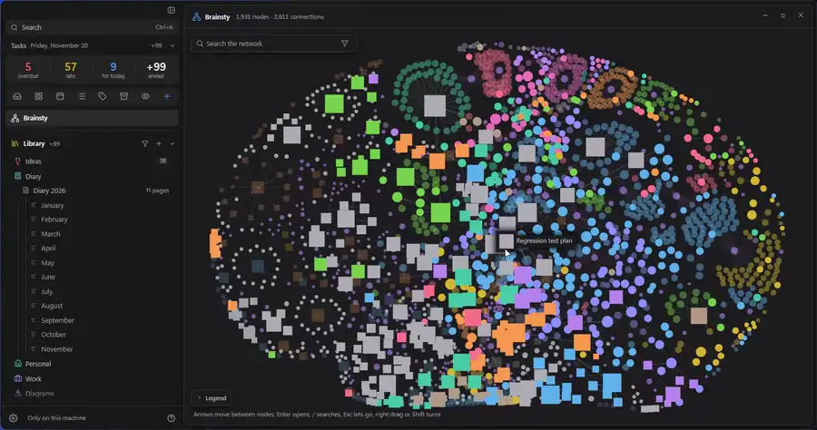
  </p>

  <p><strong>Download Tisty</strong></p>

  <p>
    <a href="https://apps.microsoft.com/detail/9PGVWXD8X93N">
      
    </a>
    <a href="#getting-started">
      
    </a>
    <a href="#getting-started">
      
    </a>
  </p>

  <p>
    <sub>Prefer a direct download?
    <a href="https://github.com/rgdevment/Tisty/releases/latest">GitHub
    Releases</a> carries the signed installers — Windows (.exe) · macOS
    (.dmg, one per chip)</sub>
  </p>

  <p>
    <sub>Site and docs:
    <a href="https://www.tisty.app/">www.tisty.app</a></sub>
  </p>

</div>

---

I started building Tisty to solve a problem of my own, and little by little I saw
it was not only mine: everyone ran into it, and each solved it their own way.

**You stop explaining. It stops starting over.** Your AI agent knows the details
better than anyone, and forgets them the moment the session ends. Everybody
patches that in their own way: a `NOTES.md` hidden behind `.gitignore`, a
Markdown file per session, a `TASKS.md` nobody keeps up to date, an `AGENTS.md`
that only grows. They go stale, they pile up, they get lost between branches,
machines and projects — and the agent rereads all of it, every session. You
never see the tokens, but you pay for them: in time, in limits that come too
soon, in work done twice.

**Tisty is a working memory you share with your agent.** You see the whole:
where each project stands, what is left and what was decided. Your agent sees
every detail: the task it was on, what it tried and what it ruled out. It asks
what moved since last time, opens the task it was on and reads only the section
it needs; it works, notes what it did and tells you when something is done. You
review it and close it: nothing closes without you. All of it on your own disk,
visual and easy for you to read, and for your agent a **local MCP server** that
hands it an outline first, then only the section it needs.

And if you would rather work in a more personal way, with no agent, Tisty serves
you just the same: your tasks, your documents, your ideas and your diary, in
sight and joined in Brainsty. The agent is one way to use it, not a condition.

It is open source: read it, build it, run it, or take one of the signed
releases already out there. Nothing is hidden and all of it can be audited.

I am not a company: I am a developer who builds what I need and shares it. Tisty
is meant to stay small and useful, not to grow a thousand features nobody uses.
No ads, no telemetry, no accounts, no subscriptions — a **local-first
productivity tool** that lives on your machine and nowhere else.

**Why people choose Tisty:**

- **You see the whole, your agent every detail** — tasks with their steps and a
  dated journal, documents one per subject: pleasant for you to read, and for
  your agent an outline and one section at a time.
- **Memory that outlasts the session** — your agent starts from what moved, the
  task it was on and what it noted yesterday, not from a blank chat.
- **Nothing closes without you** — your agent says when a task or a step is
  done, and it waits in *To confirm* until you finish it or send it back. It
  cannot close or delete a task, or delete a document or an idea.
- **Made for agents as much as for people** — an outline costs a few hundred
  tokens, a read brings one section, and picking up again brings only what
  changed: a fraction of rereading your Markdown files.
- **Finishing keeps everything** — a closed task goes to the archive whole, and
  a search answers «how did we solve this?» with the line that says it.
- **100% local** — your tasks, your journal and your documents live on your
  computer and go only where you send them. No server of mine, no account. If
  you sync two machines, you can ask Tisty to leave the largest attachments in
  that shared folder instead of carrying them onto every disk; it never does
  that unless you choose it.
- **Documents that do more than text** — books in pages, diagrams, formulas,
  code, widgets and attachments, all of it plain Markdown any other editor
  still opens.
- **Truly free** — no premium tier, no feature gates, no trial. AGPL v3.
- **Your data outlives the app** — plain text and Markdown on your own disk,
  readable with `cat` and searchable with `grep`.
- **Fast and native** — a Rust core inside a Tauri window: it starts quickly,
  stays small, and looks like it belongs on both systems.

**Brainsty, Tisty's brain.** Everything you keep, with what joins it, drawn as
one network: a map from afar for you, and, for your agent, an index that tells
it where to look without reading everything. It also shows, apart, what Tisty
thinks is alike, with no AI. [More below](#brainsty-everything-joined).

> I use Tisty every day on macOS and Windows. If something feels off,
> [open an issue](https://github.com/rgdevment/Tisty/issues) — this project
> keeps improving because of real-world use. Questions, ideas and how you use
> it go to [Discussions](https://github.com/rgdevment/Tisty/discussions).
>
> **Each person keeps their own Tisty, by design.** A developer, a PM and a QA
> each have their own tasks, documents and lessons, and their own agent working
> from them. When someone needs what you know, you hand them the document
> through [Folio](#share-what-you-know-with-folio). No assignees, no
> permissions, no boards: if you need to run a team, Tisty will not carry that.

## Table of Contents

- [Brainsty: everything joined](#brainsty-everything-joined)
- [Real Problems, Real Fixes](#real-problems-real-fixes)
- [Tasks and Documents, for You and Your Agent](#tasks-and-documents-for-you-and-your-agent)
- [A Day With Your Agent](#a-day-with-your-agent)
- [What It Costs Your Agent](#what-it-costs-your-agent)
- [Share What You Know With Folio](#share-what-you-know-with-folio)
- [MCP Server](#mcp-server)
- [Tools](#tools)
- [Why I Built This](#why-i-built-this)
- [What It Is / What It Isn't](#what-it-is--what-it-isnt)
- [What Makes It Different](#what-makes-it-different)
- [Documents](#documents)
- [Who Is This For?](#who-is-this-for)
- [The Idea It Is Built On](#the-idea-it-is-built-on)
- [Getting Started](#getting-started)
- [What It Does](#what-it-does)
- [Your Data and Privacy](#your-data-and-privacy)
- [Two Machines, If You Have Two](#two-machines-if-you-have-two)
- [Your AI Agent](#your-ai-agent)
- [What It Does Not Do](#what-it-does-not-do)
- [FAQ](#faq)
- [Alternatives to Obsidian, Notion and Todoist](#alternatives-to-obsidian-notion-and-todoist)
- [Localization](#localization)
- [Other Tools by the Same Author](#other-tools-by-the-same-author)
- [Support the Project](#support-the-project)
- [Standing On](#standing-on)
- [Contributing](#contributing)
- [Licence](#licence)
- [Project health](#project-health)

## Brainsty: everything joined

What you keep was already joined: a document cites another, a task was born in
some minutes, a book has pages. **Brainsty**, under the task views in the
sidebar, draws all of it as one network, in the content panel beside your lists.

- **Joined as you write** — `[[` links a document to another, the `/` menu cites
  a task as a live card, and the panel beside a document lists who links to it.
- **A map from afar, the detail up close** — documents as squares, tasks as
  circles in their list's colour, tags and files; folders and lists give the
  colour and tint their zone. What someone wrote — a citation, a mention, a part
  — pulls hardest and shows most. Up close, every title, each kind of line, and
  each node drawn as its own icon. A folded legend says what each shape, colour
  and line means.
- **A card, not the text** — click a node and its card says what it is, its
  dates, its state, what points at it and its link to copy; **Open** takes you
  there, and a file opens with your system's program.
- **Alike, with no AI** — an amber curve joins what nobody tied but Tisty thinks
  is alike, and says why: two uncommon words in common, a typo (*impresora ≈
  imrpesora*), or a task in Spanish and its twin in English (*pagar ≈ pay*),
  from a fixed list of words made by linguists. It reads only the prose you
  wrote, never code or your agents' files, and it all runs on your computer.
- **What you put away stays away** — a hidden or dropped task, its pages and
  your Diary are not in the network, and your agents' files wait behind **Show
  AGENTS**.
- **Alive, if you want it** — the network turns slowly like a globe while
  travellers walk its lines, and holds still while you look up close; two
  switches in the legend make it still for good.
- **The same network for your agent** — with one tool, `brain`, it searches the
  archive with the rest, reads a document's card without reading it whole, and
  gets the alike pairs apart, so it never takes them for links someone wrote.

[The Brainsty network](https://www.tisty.app/docs/brainsty-network/), in the
help, tells all of it.

## Real Problems, Real Fixes

What people actually run into when they work with an AI assistant for months,
and what happens instead when the memory lives in Tisty.

| The problem | With Tisty |
| --- | --- |
| **Developer:** every new session you explain the project to your agent again | It asks what moved since last time, opens the task *Move payments to v2* with its ticked steps, and reads what it noted yesterday: *the webhook fails on old signatures; retrying ruled out*. It carries on from there. |
| **Developer:** your `NOTES.md` grew to 256 KB and the agent rereads it every time | It lives as documents split by subject, in pages. The agent reads the outline and the one section it needs — about 97% less than the whole file. |
| **Anyone:** you solved this eight months ago and cannot remember how | A search for *timeouts on save* brings back the archived task as it was left: its steps, its journal, and the line saying the cause was a missing index. |
| **PM:** a month later somebody asks «why did we decide this?» | One living document per subject, *Checkout decisions*, each decision dated with its why. The agent finds it and quotes it instead of reopening the debate. |
| **QA:** the same screen breaks again and nobody remembers last time's cases | The archived regression task keeps its cases as steps, with what was seen in each. |
| **Handover** between PM and PO, or developer and QA, pasted into a chat | You hand over the document through Folio: encrypted on your machine before it leaves, signed by you, gone on its own after days unused. |
| **Business rules** that must not land in somebody else's database | Tisty keeps them on your disk and sends them nowhere. What your agent reads goes where that agent goes, so pair it with one your company allows. |
| **At home:** the bank paperwork that comes back every year | Next year, the archived task tells you how you did it last time. |

## Tasks and Documents, for You and Your Agent

Tisty keeps two kinds of things, and the same two serve you and your agent.
Something you will do is a task. Something you will come back to is a document.
An idea, a thought caught on the fly before you know which of the two it is,
waits in Ideas.

### Documents: what you know, one per subject

- **One living document per subject** — it opens with what holds today, then
  the subject, what is out of scope, the decisions dated with their why (a
  replaced one is struck through, not erased) and its history.
- **Corrected in place** — the passage that changed is rewritten; no second
  copy is piled beside the first.
- **Pages for what is long** — a runbook, an annex, a book in chapters — with
  folders, languages, tables, diagrams, formulas and a PDF of its own.
- **Earlier versions, on each computer** — when your agent rewrites a document,
  or you delete a paragraph you need a week later, **See the history** shows
  what it said before, **What changed** marks it in red and green, and **Go back
  to this version** brings it back. Each computer keeps its own, 30 days by
  default.

<picture>
  <source
    media="(prefers-color-scheme: dark)"
    srcset="assets/screens/app/en-diagram-dark.webp"/>
  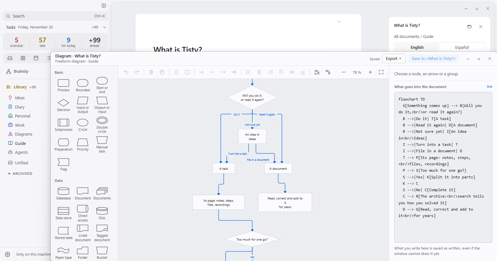
</picture>

### Ideas: a brainstorm at hand

- **Caught the moment it comes** — the quick capture goes from a task to an idea
  to today's diary with `Tab`, and ideas have a shortcut of their own: up to 140
  characters each, dated, without opening the window.
- **Sticky notes that stay Markdown** — they wait as coloured notes in
  Ideas, a document pinned atop the Library with a light bulb, and you
  reorder them by dragging.
- **Sorted out later** — each idea becomes a task or goes into the document it
  belongs to, and the Library counts the ones still waiting.
- **An idea in any document** — the same sticky note, with its date and colour,
  fits in any document from the `/` menu, and filing an idea carries it there
  whole.
- **With your AI agent too** — ask it to brainstorm with you and it jots the
  ideas you keep; ask it to sort them and it groups them, turns one into a task
  or files it in its document, and only marks the old ones, for you to delete.

<picture>
  <source
    media="(prefers-color-scheme: dark)"
    srcset="assets/screens/app/en-ideas-dark.webp"/>
  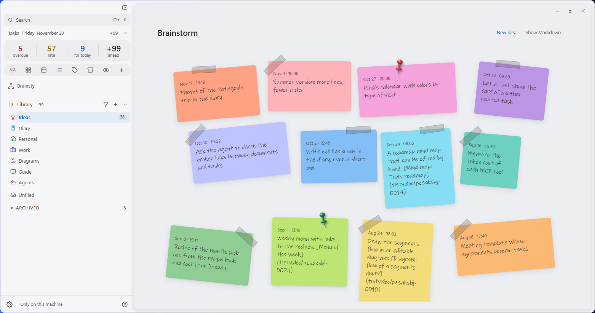
</picture>

### Diary: what happened today

- **One book a year** — *Diary 2026*, with a page a month and a section a day,
  in the app's language; a day you did not write never appears.
- **Written from anywhere** — the box on top, «What happened today?», or the
  quick capture's third mode, **Diary**, two `Tab`s from a task, without
  opening the window; filing an idea from Ideas offers **Today's diary**
  first.
- **Only yours** — no agent sees it until you press **Only you** and it reads
  **Open to agents**; open, an agent reads it and only adds to the end of today,
  signed, when you ask. **Diary** starts it only once every computer that syncs
  runs Tisty 1.48 or later, and an older one stops syncing before it receives
  it. It is never shared through Folio.
- **Still Markdown** — a book with `diary: on` in its properties, whose pages
  are the months.

<picture>
  <source
    media="(prefers-color-scheme: dark)"
    srcset="assets/screens/app/en-diary-dark.webp"/>
  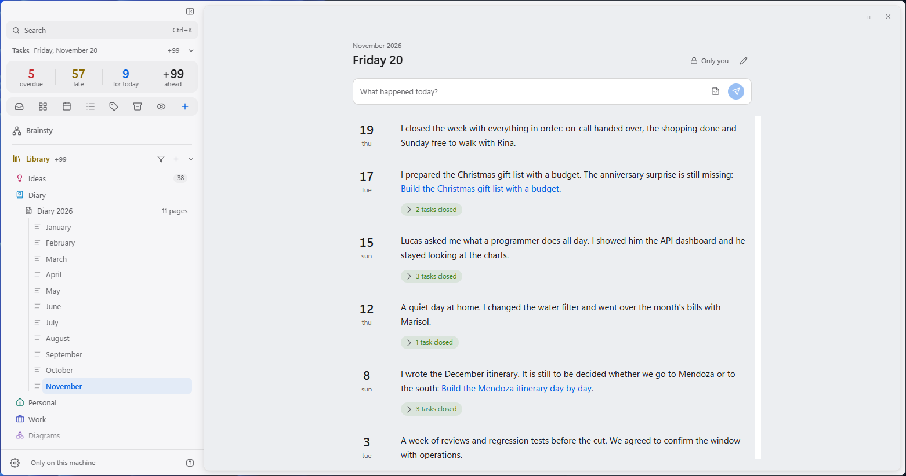
</picture>

### Tasks: what to do, who does it, how it was solved

- **Priority, by its name** — the Eisenhower matrix: *do*, *schedule*,
  *delegate*, *minor*. A date and a deadline are kept apart, so a planned day
  that slipped is late and only a deadline that passed is overdue. Lists, tags,
  and a reminder for what cannot wait.
- **Steps and parts** — a big job splits into parts, each with its own steps
  and its own day.
- **Shared work, clear ownership** — what your agent files is its own to keep
  true: it describes it, plans the steps, ticks each one when it is done and
  notes what it learns. On what you wrote it works as in a document — the
  description, the page, the open steps, the title and the list — but a step it
  calls done waits for you to tick it, the day stays yours and closing is always
  yours, and every entry says which agent wrote it.
- **A journal** — dated notes that are never rewritten: what was decided,
  what was ruled out, and why. A note that undoes an earlier one says so, and
  the old one stays, marked as replaced.
- **A state per task** — what is done, what is left and the decisions in force,
  written whole on the task's page in the same call that ticks its steps, and
  read first next time. Tisty says when steps or notes came after it.
- **A page per task** — *Description*, *Done when*, *Steps*, *Notes* and *When
  it closes*: the agent knows when it is finished before it starts.
- **One ticket, one task** — filed with its source, a ticket or a thread, the
  same work is never filed twice.
- **The archive** — a closed task is kept whole, and a search answers «how did
  we solve this?» with the line that says it.

<picture>
  <source
    media="(prefers-color-scheme: dark)"
    srcset="assets/screens/app/en-task-page-dark.webp"/>
  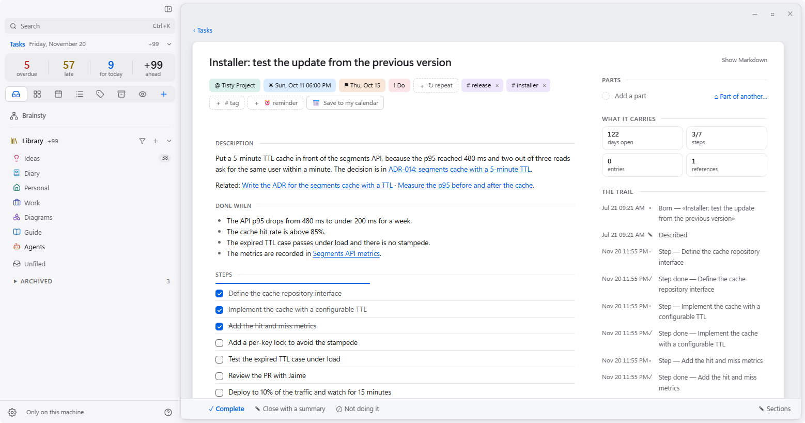
</picture>

<picture>
  <source
    media="(prefers-color-scheme: dark)"
    srcset="assets/screens/app/en-priorities-dark.webp"/>
  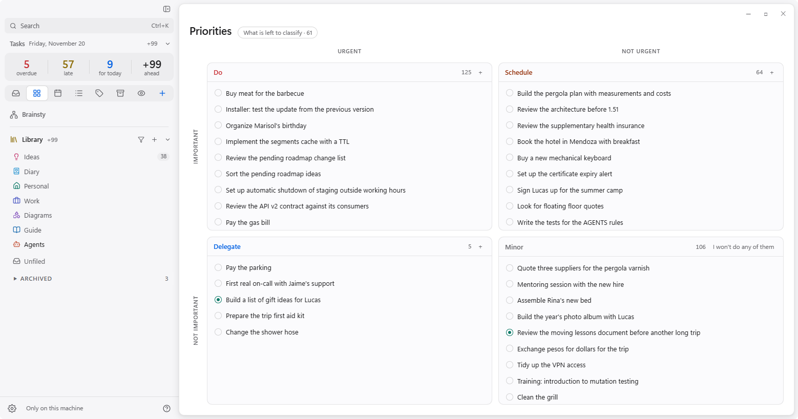
</picture>

### Weekly review: the week in order

What you capture piles up undecided unless you look back now and then.
**Weekly review**, in the sidebar's row of views, gathers on one page what is
worth a look once a week, in three stops, and each one shows ✓ once nothing
waits in it.

- **To decide** — tasks with no list, to give them a list or a day, complete
  them or drop them, and the ideas still waiting in Ideas.
- **Marked as past** — documents an agent marked as old, with its reason, for
  you to archive, delete or unmark.
- **Not opened in a while** — what you have not opened on this computer nor
  written in 60 days, to open or archive.
- **Every week, if you want** — **Remind me every week** files an ordinary task
  that repeats and rings at the hour you choose, even with Tisty closed. Your
  agent can walk it with you, but it never archives, deletes or closes anything
  on its own.

<picture>
  <source
    media="(prefers-color-scheme: dark)"
    srcset="assets/screens/app/en-weekly-review-dark.webp"/>
  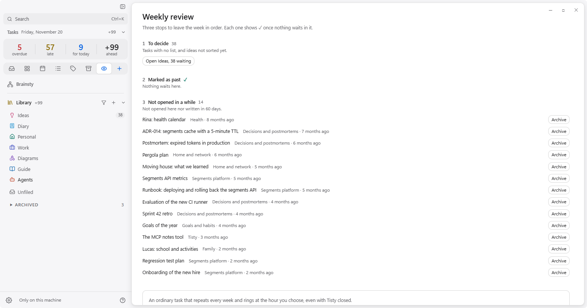
</picture>

### The archive: how it was solved

A finished task is not thrown away. It goes to the archive whole — its page with
what you read, tried and ruled out, its steps, its journal and its files — and
so does one you dropped.

- **Search is the way in** — a word you remember brings it back, even two years
  later: «how did we solve the OneDrive uploads?» finds the spike and the line
  that says it.
- **Three layers** — *Stories*, the tasks that taught something, with their
  whole trail; *Routines*, with their tallies, their streaks and the hour you
  usually keep them; and *Trace*, what closed leaving next to nothing written,
  out of the way but still found by search.
- **Your agent reads it too** — before proposing anything, it searches the
  archive for the same work, and starts from how it went last time.

<picture>
  <source
    media="(prefers-color-scheme: dark)"
    srcset="assets/screens/app/en-archive-dark.webp"/>
  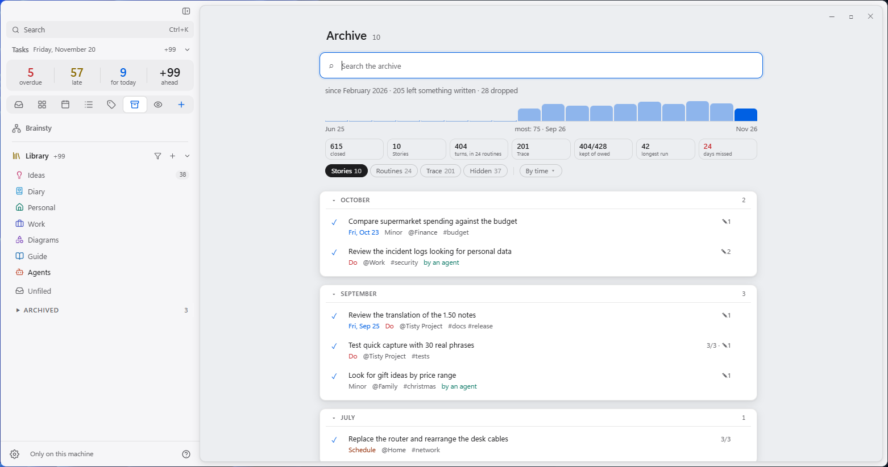
</picture>

### Agents: your agents' rules, in one place

Each agent reads its rules from a file of its own: Claude Code from `CLAUDE.md`,
Codex from `AGENTS.md`, Gemini from `GEMINI.md`, Copilot from
`copilot-instructions.md`. The **Agents** folder, at the top of the Library,
gathers them in Tisty as documents, with their skills and memory.

<picture>
  <source
    media="(prefers-color-scheme: dark)"
    srcset="assets/screens/app/en-agents-first-time-dark.webp"/>
  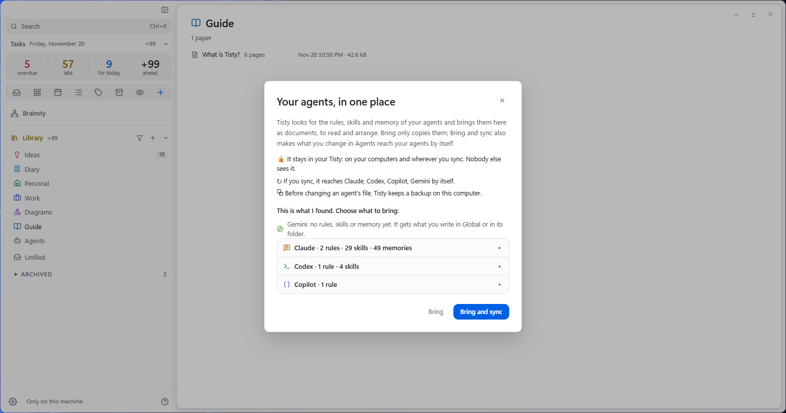
</picture>

- **Bring or sync** — **Bring** copies the files you tick, to read and arrange
  them, and writes nothing back; **Bring and sync** also writes a rule you
  change once into each agent's file, with a backup before every overwrite.
- **One rule for all of them** — a document in **Global** reaches every
  assistant on the computer; one in **Claude** only Claude.
- **Your agent proposes, you approve** — an agent reads your rules like any
  document, but a change of its own waits on the card, beside what you approved,
  until you say yes.
- **Each computer decides** — a rule written on another computer waits for
  **Apply here**, and a change made outside Tisty is never written over: you
  bring it in or keep Tisty's.
- **Nothing it should not touch** — settings, credentials, links and anything
  shaped like a secret are never brought in, and nothing is read until you click
  the folder.

<picture>
  <source
    media="(prefers-color-scheme: dark)"
    srcset="assets/screens/app/en-agents-rule-dark.webp"/>
  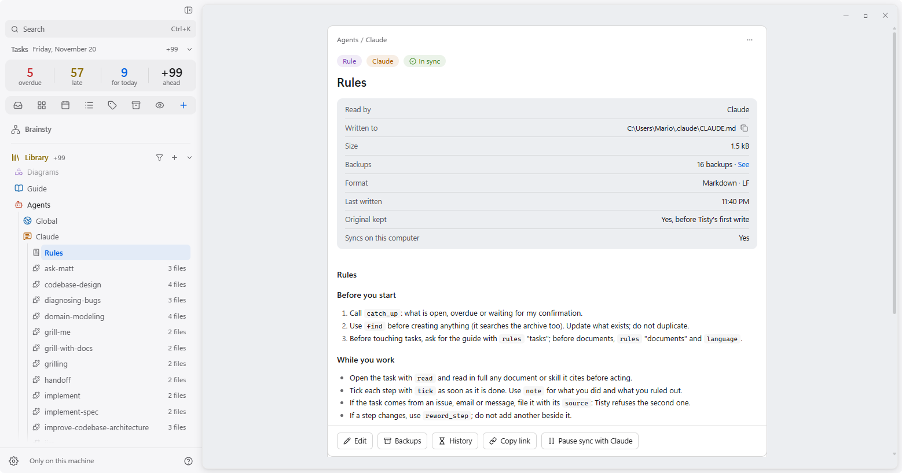
</picture>

[The Agents folder](https://www.tisty.app/docs/agents-folder/), in the help,
tells each step.

## A Day With Your Agent

What an agent connected to Tisty does with all that, on a real piece of work:

1. **It asks what moved** since its last session, and who moved it, instead
   of rereading everything.
2. **It opens the task it was on**, which Tisty names for it. Its state comes
   first, with the notes written after it; *Done when* says when it is
   finished, and the unticked steps say what is left.
3. **It searches the archive before proposing anything.** If it was solved
   before, it starts from there.
4. **It reads the module's document by its outline**, then only the section it
   needs, and keeps to the decisions and to what is out of scope — so it does
   not reopen settled debates or wander off.
5. **It ticks each step when it is done and leaves the task's state in the
   same call**, and notes what it decided or ruled out, so the next session, or
   another agent, does not repeat the failed attempt.
6. **When a task's page grows long, it compacts the assistants' notes on it**
   into one dated digest of what still holds, keeping any line you wrote. The
   journal stays whole, and asking it to put the notes back brings them as
   they were, even after later ticks.
7. **It ends by saying what it did and how it knows it holds.** You review it
   and close it.
8. **After reading a long document, it leaves a summary** for the next agent
   to choose by. When the document changes, the summary is marked stale.

Your tasks tell your agent what is left and how far it may go; your documents
tell it what was already decided. What it learns stays written down for next
time.

## What It Costs Your Agent

Most MCP servers talk to your agent without pause. Tisty knows what each answer
costs, and keeps cutting it. Measured on a 256 KB Markdown work log, against an
agent that rereads the whole file every session:

| The agent… | Spends, with Tisty | Saving |
| --- | --- | --- |
| Picks up the work, with nothing new | about 1% | 99% less |
| Picks up and opens the task it was on | under 3% | over 97% less |
| Looks for something solved months ago | about 3% | 97% less |
| Looks up one subject: the outline and one section | about 3%, 12% at worst | 88–97% less |

Where the saving comes from:

- **No single write carries more than 64,000 characters**, so a long log is kept
  as subjects in pages, never as one wall of text.
- **No read brings more than about 12,000 characters**: past that, a document
  asked for whole comes back as its outline. The exception is a document asked
  for whole in standard Markdown to carry elsewhere, up to 40,000 characters.
- **A task's page comes whole only while it is short**, about 4,000 characters.
  Past that come its sections, the digest that opens the agent's notes and its
  latest note. Its state comes first, and its journal only from there: the
  notes after the state, up to about 3,000 characters, the whole log when
  asked; a note holds at most 4,000.
- **The outline says what each section weighs** before anything is opened.
- **Picking up again brings only what moved** since the last time.
- **What is finished is archived**, and costs nothing until it is searched.
- **A search brings ten tasks and ten documents at a time**, each with the line
  that says it cut to 120 characters around the word, or titles alone when that
  is all the agent needs.
- **The outline points at repeated subjects and headings**, so they can be
  consolidated rather than read twice.

Connecting costs something too: the description of Tisty's tools weighs about a
sixth of that log, a third less than it did, and a test keeps it from growing.
An assistant that loads tools only as it uses them does not pay it whole; one
that loads every tool each session saves 72–83%, and below some 50 KB of notes
a plain file is cheaper. The counts are characters, with the JSON each answer
carries included, and tokens follow them closely.

## Share What You Know With Folio

When somebody else needs what you know — your PO, the QA joining the project,
another team — you hand them the document through
[Folio by Tisty](https://github.com/rgdevment/Folio-by-Tisty). It is encrypted
on your machine before it leaves, the key travels in the link where no server
sees it, every version is signed by you, and the link stops working on its own
after the days without use you choose. They read it in any browser with no
account, or edit it in their own Tisty. Your memory stays on your disk; Folio
only carries a copy. More in [Your Data and Privacy](#your-data-and-privacy).

## MCP Server

Tisty is also a **local MCP server for tasks, todos and notes**. Through it an
assistant files tasks with steps, dates and reminders, writes and edits
Markdown documents, and searches open and archived work — on your own disk,
with no account, no API key and nothing sent over the network. It needs the
Tisty app, from [Getting Started](#getting-started), and Node.js 18 or later
for the launcher.

The easiest way is **Settings › Assistants** in Tisty: it finds the assistants
on this computer and connects the one you pick. By hand, any assistant that
starts a server by command takes the `tisty-mcp` launcher from npm, which finds
the Tisty installed here and starts its own server:

```json
{
  "mcpServers": {
    "tisty": {
      "command": "npx",
      "args": ["-y", "tisty-mcp"]
    }
  }
}
```

| Assistant | Add Tisty |
| --- | --- |
| Claude Code | `/plugin install tisty --marketplace rgdevment/mcp-plugins` |
| Claude Desktop | Settings › Developer › Edit Config, and add the JSON above |
| Cursor | [Cursor Directory](https://cursor.directory/plugins), or the JSON above in `~/.cursor/mcp.json` |
| GitHub Copilot in VS Code | `code --add-mcp '{"name":"tisty","command":"npx","args":["-y","tisty-mcp"]}'` |
| Gemini CLI | `gemini extensions install https://github.com/rgdevment/mcp-plugins` |
| Codex | `codex mcp add tisty -- npx -y tisty-mcp` |

Connect it one way, not both, so the assistant does not start Tisty twice, and
restart the assistant afterwards. More in
[Assistants and MCP](https://www.tisty.app/docs/assistants-and-mcp/).

Things to ask once it is connected:

- "Add a task to renew my passport before March, with the steps it takes."
- "What is on my todo list this week, and what is overdue?"
- "How did I fix the timeouts on save last year? Look in the archive too."
- "Write a document with my notes from today's call and file it in Clients."
- "Plan the release as tasks with steps, and tick them off as you go."
- "Remind me of the dentist the evening before, at 8."

## Tools

What `tisty mcp` offers an assistant, by what it works on. It never closes or
deletes: `say_done` leaves a task for you to confirm, and `flag_doc` marks a
document for you to delete, put away or keep. Each tool is described in
[MCP tools](https://www.tisty.app/docs/mcp-tools/).

- **Tasks** — file one with steps and a date, plan and tick its steps, set
  when it rings, move its day, say it is done: `propose`, `describe`, `plan`,
  `tick`, `untick`, `reword_step`, `unplan`, `rename`, `move`, `remind`,
  `reschedule`, `say_done`, `say_not_doing`, `read`
- **A task's journal and files** — `note`, `reword_note`, `attach`
- **Documents** — write one, add to it, change a passage or a table, read only
  the part it needs: `write_doc`, `append_doc`, `edit_doc`, `edit_table`,
  `read`, `sum_up`, `restore_doc`, `import_doc`, `export_doc`,
  `archive_doc`, `flag_doc`
- **Folders, pages and languages** — `folder`, `file_doc`, `page_doc`,
  `tongue_doc`
- **Finding things** — open and archived work, a document's card, a project's
  parts, lists, folders and tags: `brain`, `catch_up`
- **How to work here** — `rules`, `language`, `help`

Beside the tools, it offers eight ready-made requests your assistant shows as
commands (`pick_up`, `leave_off`, `plan_task`, `solved_before`,
`keep_decision`, `brainstorm`, `sort_ideas`, `consolidate`), and your
documents to mention with `@`, a long one as its outline.

## Why I Built This

Organising your day is harder than a list makes it look. There are more moving
parts than fit in your head, plans shift under you, and something you thought
was small turns out not to be. Which is why finishing it feels good.

But look at what the task gathered on the way. The steps it actually took. The
notes you wrote while working it out. What you looked up, what it turned out to
connect to, the documents you leaned on. That is where the effort went.

Mine looked like *"fix the intermittent timeouts on save"*. By the time it was
done it had collected the ticket, the commit, and two paragraphs explaining that
the real cause was a missing index on a table nobody was looking at.

Eight months later the same thing happened somewhere else. I remembered solving
it. I could not remember how — and the note that held the answer had gone with
the tick.

**That is the whole reason Tisty exists.** A task is not a line you cross out.
It is a tree: the steps, the journal, the files and the documents that grew
around it while you worked. Finishing it should not prune it.

I wanted it to stay mine, too. On my disk, in files I can open without asking
anyone. So I built the thing I wanted, used it until it stopped annoying me, and
put it here in case it is the thing you wanted too.

## What It Is / What It Isn't

**It is** a working memory you share with your AI agent, and a personal task
manager where finishing something is the beginning of its useful life. Tasks
carry a description, a journal, steps and attachments; when you complete one it
moves to the archive, and search reaches all of it, documents included.

**It is a place to write**, too. Documents are not a notes field bolted onto the
tasks: they are Markdown files that grow into books, with diagrams, formulas,
code and their own PDF.

**A task or a document?** A task is something to do: it ends, often soon, and
then it stays, so that months later you can look up how you solved it. A
document is something to keep and read again — a manual, a recipe, the notes on
a client — that grows and lasts for years. Something you will do is a task;
something you will come back to is a document. A spike is the clearest case: a
task whose page gathers what you found out — notes, recordings, code analysis —
split into parts that each get done, then completed and archived — and a year
later a search still brings back how it was solved, every step of it. That is
why a task has a page: it is also a document, one with an end.

**And an idea?** An idea is a thought caught on the fly, before you know whether
it is something to do or something to keep: a few words, 140 at most, dated, on
the Ideas sheet. It waits for you to sort it out: it becomes a task, goes
into the document on its subject, or is set aside. A note is something else: the
dated line in a task's journal.

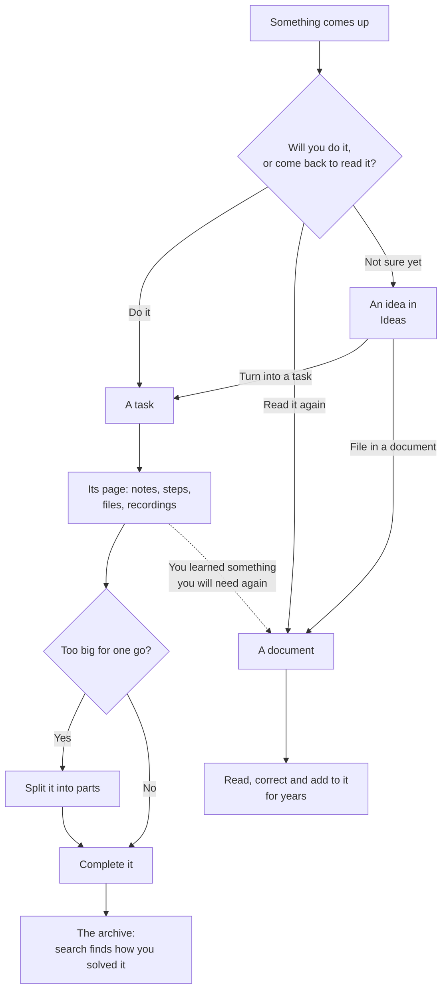

**It is one person's.** Each person keeps their own Tisty, with their own
agent working from it, and hands a document to somebody else through
[Folio](#share-what-you-know-with-folio). No assignees, no permissions, no
boards. If you need to run a team, Tisty will not carry that, and you deserve to
know before you install it rather than after.

**It is not something I sell.** Nothing is locked, nothing expires, and there is
no version of this with more in it. It is a program I wrote for myself and gave
away.

**Your data is files.** Plain text on your own disk, readable with `cat` and
searchable with `grep`. If Tisty disappeared tomorrow, everything you wrote
would still be there and still make sense.

## What Makes It Different

If you are looking for a **free, open-source, offline place for your documents
and tasks, with no account, no subscription and no AI inside — and a memory
your own AI agent reads over MCP**, this is what Tisty is:

| | |
|---|---|
| Your tasks live | in plain files on your own disk |
| Account | none, ever |
| Subscription | none. There is no paid tier and no upgrade |
| Offline | always. Only what you send out needs a connection: a document shared by link, your own cloud, a task saved to an online calendar |
| AI inside | **none**, and that is not going to change |
| Your own assistant | yes, over **MCP**, through a door you close whenever you like |
| Memory for your agent | what moved since last time, outlines first and one section at a time |
| Priorities | the **Eisenhower matrix**, by its name |
| Sorting | lists, tags, steps and a journal on every task |
| Documents | Markdown files with pages, diagrams, formulas, code, widgets and their own PDF |
| A document with pages | a book, with its chapters in the order the text names them and an index |
| A diary | a book a year, a page a month, a section a day: only yours until you open it to agents, and never shared |
| Diagrams and formulas | drawn from a few lines of text, light or dark with the window |
| Widgets | fixed views of HTML and CSS in Tisty's colours, which run nothing and reach nothing |
| PDF | its own: A4, Letter or Folio, with its pictures inside |
| Any `.md` file | opens to read in a viewer of its own, up to 1 MB, without coming into your store |
| Attachments | kept with the task, as themselves |
| Finished work | an **archive that keeps what each task taught you** |
| Two machines | your Google Drive, OneDrive or WebDAV server, reached directly, or a folder you already sync. No server of mine |
| Your cloud, encrypted | if you want it, with a 24-word phrase only you know |
| Natural language | dates, deadlines and repeats, parsed on your machine |
| When to do it | a spread of days you deal work onto, and a month for looking |
| Reminders | an hour you choose, that rings on your computers, even with Tisty closed, and nowhere else |
| Source | open, auditable, yours to fork |

**Documents that grow into books.** Most task managers give you a notes field.
Here a document is a file of its own, written on a lit page, that holds pages
like chapters, draws the diagram you describe, sets the formula, colours the code
and makes its own PDF — and it stays Markdown that GitHub, any editor or `cat`
read the same. A task can point at it, and search finds both.

**The Eisenhower matrix, not numbered priorities.** A task is urgent, important,
both or neither — *do*, *schedule*, *delegate*, *minor*. That names the decision
instead of hiding it behind a number, and it is the difference between a list
that sorts and a list that helps you choose. Around it: lists for where work
belongs, tags for what cuts across, steps for the parts, and a journal for what
you learn on the way.

**Finishing is where it starts.** Most task managers treat a completed task as
rubbish to hide. Here it moves to an archive read in three layers: the ones that
taught something come with their whole trail — what changed, when, and what you
wrote — the routines come with their tallies and their streaks, and the rest is
the trace. Search reaches all of it, documents included. A year in, that archive
is the part you would miss.

**Your assistant, not one of mine.** Tisty has no AI in it. The natural language
that turns "call the bank at 3" into a task is rules running on your machine, no
model and no cloud. But it speaks [MCP](https://modelcontextprotocol.io), so an
assistant you already use can file work into it — with its steps, its date and
the list it belongs in, on this machine, with no account and nothing over the
network. That door comes open, and **Stop it** closes it whenever you like.

**Two machines, no middleman.** Tisty talks straight to your own Google Drive,
OneDrive or WebDAV server, or travels through a folder you already sync. There
is no server of mine in between, nothing to sign up for, and nothing that stops
working the day a company changes its mind. And what it keeps in that cloud can
be encrypted with a phrase only you know.

**Free is not a tier here.** There is no upgrade, no seat count, no feature held
back for later. The reason is not generosity: a program that keeps your work on
your disk and never phones home has almost nothing to charge for, and asking
would make it worse.

## Documents

The other half of Tisty, and for many people the larger one. A document is a
Markdown file on your own disk, the same file any other editor opens, and you
write it on the page itself. It holds pages like chapters, one text in several
languages, diagrams from a few lines, formulas, code, tables that add themselves
up, widgets, tags and attachments, and it makes its own PDF. Where Markdown has
no word for something, Tisty adds a few short ones of its own, never HTML, so
the file survives without Tisty. A `.md` from anywhere
[opens to read](https://www.tisty.app/docs/documents/#opening-a-markdown-file-from-outside),
and every document leaves whole: standard Markdown, a web page, a Word file or a
`.tistyx` parcel signed with your key.

Say you keep *Rina* as one book, a page a year with her vet visits: the task for
her next vaccine cites it, and one search finds both.

- [Documents](https://www.tisty.app/docs/documents/) and
  [The Markdown editor](https://www.tisty.app/docs/markdown-editor/)
- [Pages and PDF](https://www.tisty.app/docs/pages-and-pdf/),
  [Diagrams](https://www.tisty.app/docs/diagrams/) and
  [Widgets](https://www.tisty.app/docs/widgets/)
- [Convert to and from Markdown](https://www.tisty.app/docs/convert-to-and-from-markdown/)
- [The Tisty Markdown guide](https://markdown.tisty.app) — how each mark is
  written

## Who Is This For?

Anyone who works with an AI agent and wants both of them to remember: you the
whole, your agent the detail. A developer who jumps between sessions, branches
and dozens of projects. A PM who keeps the decisions and the why behind them. A
QA who keeps the cases that broke last time. A tech lead who keeps the
runbooks. Sysadmins, freelancers, researchers, students — anyone who has ever
solved the same problem twice and known it the second time.

Each of them keeps their own Tisty: what one learns is not the same as what
another needs, and their agents work from different memories.

And anyone who writes things that last: a manual, the minutes of a year, notes
for a course, the documentation of a system, a book in chapters — and wants it
in files of their own rather than in somebody else's database.

If what you want is a list to cross out and never open again, Tisty will feel
like more than you asked for. That is a fair reason to walk away.

## The Idea It Is Built On

**A completed task is not finished. It is archived.**

It stops being a reminder of what to do and becomes the record of how something
got solved. Three things follow from that, and they shaped everything else:

- **Search is the main way into the archive**, not a side feature.
- **Deleting is the exception.** The normal ending is completing, which keeps
  it. Erasing something for good is only for what is closed and reads as a
  trace; a story is only hidden, and converting it to a trace is the deliberate
  step that lets it go.
- **Capture has to stay instant**, because most tasks are not like that at all.
  The call you have to make tomorrow is born and dies within a day and leaves
  nothing worth keeping — and writing it down must not cost more than one line.

**A document is a file you keep, not a row in somebody's database.** Whatever
Tisty draws on top of it — pages, diagrams, widgets, a PDF — the file underneath
stays Markdown another reader opens the same, so leaving Tisty never means
leaving your writing behind.

## Getting Started

**Windows** — from the
[Microsoft Store](https://apps.microsoft.com/detail/9PGVWXD8X93N), which keeps
it updated for you. About asks the Store for one on the spot when you would
rather not wait. Or with the Windows Package Manager, which takes the signed
installer from the releases page and then stands aside, because Tisty keeps
itself up to date:

```console
> winget install rgdevment.Tisty
```

**macOS** — with [Homebrew](https://brew.sh). The tap is added and trusted
once and never again; Homebrew loads a tap that is not its own only once you
trust it. After that Tisty keeps itself up to date, so Homebrew stands aside:

```console
$ brew tap rgdevment/tap
$ brew trust rgdevment/tap
$ brew install --cask tisty
```

Or take the disk image and the installer straight from
[Releases](https://github.com/rgdevment/Tisty/releases), on either system.
On macOS there are two images: `aarch64` for Apple Silicon and `x86_64` for
Intel — Apple menu › *About This Mac* says which one yours is. Homebrew picks
by itself.

## What It Does

**The first time it opens**, Tisty asks which language, where your copies should
go and, if you like, what to call you; then it writes you a guide and opens it.
Everything else has an obvious default you change later in Settings.

**It reads what you write.** You type a sentence, Tisty takes the date out of
it and shows you what it understood *before* anything is saved, as chips you
correct with one click:

```text
"ship the release tomorrow at 10"   →  tomorrow 10:00
"file the report before friday"     →  due fri
"book the flights @travel #urgent"  →  @travel · #urgent
```

Around that: three columns at most, the four quadrants of the Eisenhower matrix,
a spread of days you deal work onto, reminders that ring even with Tisty closed,
a calendar that comes in as tasks, repeating tasks that count what was owed, and
an archive read in three layers. The whole window works from the keyboard.

- [Installation](https://www.tisty.app/docs/installation/) and
  [Settings](https://www.tisty.app/docs/settings/)
- [Tasks](https://www.tisty.app/docs/tasks/) and
  [Natural language](https://www.tisty.app/docs/natural-language/)
- [The spread and reminders](https://www.tisty.app/docs/spread-and-reminders/)
- [The archive](https://www.tisty.app/docs/archive/)

## Your Data and Privacy

Everything lives in one folder on your disk: an append-only log of what
happened, your documents as `.md` files, and your attachments as themselves.
Nothing is obfuscated and nothing is in a format only Tisty can read.

**Nothing on your disk is encrypted at rest**, and that is a decision rather
than an oversight — your operating system's permissions are the protection, and
the files stay readable with tools you already have. What Tisty keeps in a cloud
it reaches directly is another matter: that you can encrypt with a phrase only
you know, as [the section below](#two-machines-if-you-have-two) tells. Both are
written out in [PRIVACY.md](PRIVACY.md) and [SECURITY.md](SECURITY.md),
including the parts that are not reassuring.

Tisty makes **one** check unasked — when it opens, and once a day after that:
it downloads a small file and its signature to see whether a newer version
exists. It sends nothing. If one does exist and you press the button that
offers it, two more requests follow — the file naming the release, and the
installer — and Tisty refuses to install anything not signed with a key
compiled into the copy you already have. There are a few more, listed in
[PRIVACY.md](PRIVACY.md).

**Folio by Tisty** is a separate service for sharing a document by a link with
no account, end-to-end encrypted, with its own terms and policies in
[its own repository](https://github.com/rgdevment/Folio-by-Tisty). A document's
panel shows a **Shared** row — Ideas and your Diary are never shared — and
pressing **Share** reads a small signed file to learn
whether Folio has opened and, while it has not, tells you so, with a link to
[tisty.cl](https://tisty.cl). Nothing of your document leaves until
Folio is open, you accept its terms and you confirm.
[PRIVACY.md](PRIVACY.md#sharing-by-link) says what each step sends.

## Two Machines, If You Have Two

Tell Tisty where to leave the copies, in Settings › *Sync*, and the rest it does
on its own: **your Google Drive, your OneDrive or your own WebDAV server**,
reached directly, or **a folder** something else keeps in step — iCloud,
Dropbox, a NAS, a drive you plug in on Fridays. There is nothing of mine in the
middle: no account, no server, no daemon.

A new computer that holds nothing of yours yet joins on its own, after keeping a
backup; one that does asks first. Two machines that write the same document at
once are merged block by block, and only a real overlap becomes a question.
Each machine signs what it writes. If you want it, **Encrypt my cloud…**
encrypts what Tisty keeps in your cloud with a 24-word phrase only you know.

Say you write the minutes at work on Tuesday: that evening, at home, they are
there, and so is the task they gave you.

- [Sync and backup](https://www.tisty.app/docs/sync-and-backup/) — each way,
  large attachments and backups
- [Encrypting your cloud](https://www.tisty.app/docs/sync-and-backup/#encrypting-your-cloud)
- [Something changed on one machine and is not on the other](https://www.tisty.app/docs/sync-and-backup/#something-changed-on-one-machine-and-is-not-on-the-other)

## Your AI Agent

**Tisty is not AI and has none inside.** The natural language that turns "call
the bank at 3" into a task is rules running on your machine: no model, no
request, no cloud. That is not going to change.

But the assistant you work with is where the detail happens, and it forgets
when the session ends. So Tisty leaves it a door, and you decide whether to open
it. Through it, an agent plans in documents and works in tasks: it writes what
it found and decided, ticks each step as it goes and says when it is done. You
are the one who closes.

**Settings › Assistants** connects the one you pick, as
[MCP Server](#mcp-server) shows. The door comes open on a new install; **Stop
it** closes it, and while it is closed everything an assistant tries is refused
and the window says who knocked. What it may do is deliberately small: it never
closes or deletes a task, never deletes a document, never moves a day you set,
and sees your Diary only once you open it to agents. What it writes is signed
with its name, and it reads a document's card first, then only the part it
needs. Say it picks up *Move payments to v2*: it asks what moved, opens that
task and reads what it noted yesterday.

- [Assistants and MCP](https://www.tisty.app/docs/assistants-and-mcp/) — the
  door, the signature and every assistant Tisty knows
- [What an assistant may do](https://www.tisty.app/docs/mcp-permissions/)
- [How an agent works](https://www.tisty.app/docs/how-an-agent-works/)
- [MCP tools](https://www.tisty.app/docs/mcp-tools/)

## What It Does Not Do

As important as what it does. Out of scope for now: real-time collaboration,
kanban boards, Gantt charts, time tracking, productivity metrics, databases that
relate tables across documents and formulas in cells. A table's columns can say
what they hold and add themselves up, but each table lives in its own document.

AI is not on that list, because it is not a matter of time: Tisty is not AI and
has none inside, the natural language stays deterministic and local, and
**Tisty never sends anything to a model** — not a task, not a word. While the
door in [Your AI Agent](#your-ai-agent) is open, whatever your assistant reads
travels wherever that assistant travels: Tisty still sends nothing, the
assistant is the one carrying, and the door is yours to close.

## FAQ

### Is Tisty free?

Yes, Tisty is free and will stay free, under the AGPL-3.0 licence. No accounts,
no telemetry, and it keeps being developed and improved.

### Do I need an AI agent?

No. Tisty is complete without one: notes, documents and tasks, the weekly
review, the diary and Brainsty all work the same. With your agent, it is the
memory you share. Say you keep Rina's vet visits in a document and her next
vaccine as a task that rings the evening before: no agent sees any of it until
you connect one, whenever you like.

### Does it need an account or a connection?

Neither. There is nothing to sign up for, and only what you send out needs a
connection: a document shared by link, your own cloud, a task saved to an online
calendar. Tisty makes one network request you did not ask for — when
it opens, and once a day after that — to see whether a newer version exists, and
it sends nothing in order to ask. Once you sync with a cloud or share a
document, it also reads a few small files, which [PRIVACY.md](PRIVACY.md)
lists. Take the machine off the network and everything else works the same.

### Where is my data kept?

In one folder on your own disk: an append-only log of what happened, your
documents as `.md` files, and your attachments as themselves. Settings › *Storage*
prints the path and *Show folder* opens it. Nothing is obfuscated and
nothing is in a format only Tisty can read.

### What happens to my notes if Tisty disappears?

They stay where they are. Markdown and plain text, readable with `cat`,
searchable with `grep`, openable in any editor you already have. That is what
the format is for.

### Does Tisty use AI?

No. Tisty is not AI and has none inside, and that is not going to change. The
natural language that turns "call the bank at 3"
into a task is rules running on your machine: no model, no request, no cloud.
What Brainsty thinks is alike comes from shared words, a typo or a fixed
Spanish–English word list, never from a model. If you already use an assistant
of your own, Tisty leaves an
[MCP](https://modelcontextprotocol.io) door — it comes open, you close it
whenever you like, and while it is closed everything it tries is refused.

### How do I give my AI agent a memory between sessions?

Connect Tisty over MCP, as [MCP Server](#mcp-server) shows: Settings ›
Assistants connects GitHub Copilot, Claude Code, Codex, Cursor… and
[every other one it knows](https://www.tisty.app/docs/assistants-and-mcp/#connecting-an-assistant).
From then
on the agent starts a session by asking what moved since the last one, files
its work as tasks with steps and a journal, and keeps what it learns in
documents. The next session, on any project, starts from there instead of from
a blank chat.

### Does it replace CLAUDE.md, AGENTS.md or a memory-bank folder?

For what changes, yes; for what does not, no. Instructions that rarely move —
how to build, the conventions — belong in the files your repository already
hands the assistant. What moves — progress, decisions, what was ruled out, what
is left — belongs in Tisty, where it is dated, searchable, read a section at a
time, and never lost between branches, machines or projects.

The files in your home folder, like `~/.claude/CLAUDE.md` or
`~/.codex/AGENTS.md`, are another matter: the **Agents** folder brings them into
Tisty as documents and, if you sync it, writes your changes back, with a backup
first. [Agents](#agents-your-agents-rules-in-one-place) tells how.

### Can I use it on two computers?

Yes, two ways. Connect your own Google Drive,
OneDrive or WebDAV server in the window, and Tisty talks to it directly, keeping
its copies in a place of its own there and seeing nothing else — encrypted with
a phrase only you know, if you want. Or use a folder you already sync: Google
Drive, OneDrive, iCloud, Dropbox, a NAS, a drive you plug in on Fridays. Either
way there is no server of mine in between, no account of mine, and you can move
from one to the other whenever you like.

### Is there a mobile app?

No. Tisty is a desktop program for Windows and macOS. Your documents are
Markdown in a folder, so a phone that reaches that folder reads and edits them
with whatever app you like — but the window, the spread and the archive are the
desktop's.

### Does it run on Linux?

No. Tisty is a desktop program for Windows and macOS. An assistant that runs
on Linux inside Windows, under WSL, reaches it all the same: Settings ›
Assistants › *Connected* connects it.

### Is my data encrypted?

On your disk, no, and that is a decision rather than an oversight: your
operating system's permissions are the protection, and the files stay readable
with tools you already have. In a cloud Tisty reaches directly, it can be:
Settings › *Security* encrypts it with a 24-word phrase only you know.
[PRIVACY.md](PRIVACY.md) and [SECURITY.md](SECURITY.md) write it out, including
the parts that are not reassuring.

### Can I use it with my team?

Not as a shared board. Tisty is one person's by design — no assignees, no
permissions, no shared database — and you deserve to know that before you
install it rather than after. What a team does get: each person keeps their own
tasks, documents and agent, and when somebody needs what you know, you hand
them the document through [Folio](#share-what-you-know-with-folio), encrypted
and signed.

### Can I bring my notes over from another app?

Documents, yes: *Import a document* in the tree takes a `.md`, `.markdown`,
`.txt`, `.html` or Word `.docx` file and brings it in one at a time as
Markdown — Word to Markdown, HTML to Markdown, Obsidian to Markdown — and pasting
from Word, Google Docs or a web page converts the same way. A `.tistyx` from
another Tisty machine unpacks whole. Tasks have to be typed. There is no importer
for another program's task list, and one that guessed would cost you more than
the typing.

### Are the downloads signed?

Yes. The macOS disk images are signed and notarised by Apple, and the Windows
installer is signed too — a copy from the Microsoft Store or from Homebrew
carries that already. Tisty also refuses to install an update that is not
signed with a key compiled into the copy you are running.

### Does it work with a screen reader?

Not as far as anybody knows, and that is worth saying plainly: the whole window
works from the keyboard and that path is tested, but nothing has ever been
tried with a real screen reader. If you use one, an issue saying where it falls
apart would be the most useful thing anyone could send.

### How is it different from Obsidian, Notion or Todoist?

Tisty keeps tasks and documents in one store and one search, and finishing a
task keeps everything it gathered instead of hiding it. The table below says
where each of those is stronger.

## Alternatives to Obsidian, Notion and Todoist

Other places to keep notes and tasks, so you can pick the one that fits.
Platform, storage and licence checked against each project in September 2026;
everything else changes, so go and look.

| Project | Platform | Where your data lives | Licence |
| :-- | :-- | :-- | :-- |
| **Tisty** | Windows, macOS | Your disk, no account | AGPL-3.0 |
| [Obsidian](https://obsidian.md) | Windows, macOS, Linux, iOS, Android | Your disk; syncing is a paid extra | Closed source, free for personal use |
| [Logseq](https://github.com/logseq/logseq) | Windows, macOS, Linux, iOS | Your disk | AGPL-3.0 |
| [Joplin](https://github.com/laurent22/joplin) | Windows, macOS, Linux, Android, iOS | Your disk; syncing through a service you pick | AGPL-3.0 |
| [AppFlowy](https://github.com/AppFlowy-IO/AppFlowy) | Windows, macOS, Linux, Android, iOS | Your disk, or a server you pick | AGPL-3.0 |
| [Anytype](https://github.com/anyproto/anytype-ts) | Windows, macOS, Linux | Your disk, synced encrypted | Any Source Available 1.0 |
| [SilverBullet](https://github.com/silverbulletmd/silverbullet) | Self-hosted, in a browser | A server you run | MIT |
| [Super Productivity](https://github.com/johannesjo/super-productivity) | Windows, macOS, Linux, mobile | Your disk; syncing through a service you pick | MIT |
| [Taskwarrior](https://github.com/GothenburgBitFactory/taskwarrior) | Command line | Your disk | MIT |
| [Things 3](https://culturedcode.com/things/) | macOS, iOS | Your device; their cloud to sync | Paid, closed source |
| [Craft](https://www.craft.do) | macOS, iOS, Windows, Android, web | Their cloud; a local folder gives up sharing | Freemium, closed source |
| [Todoist](https://todoist.com) | Everywhere | Their servers, and an account | Freemium, closed source |
| [Notion](https://www.notion.com) | Everywhere | Their servers, and an account | Freemium, closed source |

What Tisty does that most of these do not: tasks and documents in one store and
one search, an archive that keeps a finished task whole instead of hiding it,
the Eisenhower matrix by its name rather than a number from one to four, and a
door for the assistant you already use with no AI inside the program itself.

Each of them is better than Tisty at something. Obsidian and Logseq are
notebooks with a decade of plugins, and tasks are one of those plugins' job.
Craft makes the handsomest document of the lot, and asks you to keep it in its
cloud for the sharing to work. Notion models anything you can describe, once
you and your data have an account there. Todoist and Things are quicker at
catching a task than anything here — and when that task is done, what you
worked out on the way has nowhere to stay. Joplin and AppFlowy are the closest
in spirit to this one, and either is worth your time if a phone matters to you
more than an archive.

## Localization

The window, the guide, the welcome and the natural language all speak the
language you chose the first time Tisty opened, and Settings › *Look and
window* changes it whenever you like.

| Language | Tag | Status |
| :-- | :-: | :-: |
| English | en | Complete |
| Spanish | es | Complete |

Want yours in there? [Open an issue](https://github.com/rgdevment/Tisty/issues)
and say so — the window's strings live in one file, `app/src/locales.ts`, and
the rest follows from it.

## Other Tools by the Same Author

Same idea, same terms: free, open source, no ads, no telemetry, everything
local.

<table>
  <tr>
    <td width="96" align="center">
      <a href="https://www.copanda.app/"></a>
    </td>
    <td><strong><a
      href="https://www.copanda.app/">CoPanda</a></strong>, formerly
      CopyPaste — a local-first clipboard manager that keeps a searchable
      history and ignores what comes from a password manager. Windows and
      macOS.</td>
  </tr>
  <tr>
    <td width="96" align="center">
      <a href="https://www.linkunbound.app/"></a>
    </td>
    <td><strong><a href="https://www.linkunbound.app/">LinkUnbound</a></strong>
      — a browser selector that asks which browser should open a link
      instead of assuming. If it is installed, the web links you open from
      Tisty go through it. Windows and macOS.</td>
  </tr>
</table>

## Support the Project

**Software out of conviction, not subscription.** Tisty is free: no ads, no
premium tier, no paywall. If it saves you time and you would
like it to keep being maintained:

<p>
  <a href="https://github.com/sponsors/rgdevment">
    
  </a>
  <a href="https://buymeacoffee.com/rgdevment">
    
  </a>
</p>

And if you would rather not pay for anything, that is entirely fine. Star the
repository so somebody else finds it, tell one person it exists, or open an
issue when something is wrong. That is worth as much.

## Standing On

Tisty is small because other people's work does the heavy lifting.

**The core, in Rust** — [Tauri](https://tauri.app) puts a native window around
it without shipping a browser; [serde](https://serde.rs) reads and writes every
line of the log; [jiff](https://github.com/BurntSushi/jiff) does the dates and
the time zones, which is the part nobody should write twice;
[SQLite](https://sqlite.org), through
[rusqlite](https://github.com/rusqlite/rusqlite), holds the read cache;
[ULID](https://github.com/dylanhart/ulid-rs) gives every task an identifier that
sorts by time and needs no coordination.

**The window** — [React](https://react.dev) draws it and
[Tailwind CSS](https://tailwindcss.com) styles it;
[Solid](https://www.solidjs.com) draws the light viewer, which has a build of
its own;
[CodeMirror](https://codemirror.net) is the Markdown view of a document, every
mark in sight, while [pulldown-cmark](https://github.com/pulldown-cmark/pulldown-cmark)
reads the Markdown in the core, which draws the page you write on, and
[ammonia](https://github.com/rust-ammonia/ammonia) keeps any HTML in it harmless;
[Mermaid](https://mermaid.js.org) draws the diagrams a code block describes,
[React Flow](https://reactflow.dev) is the canvas they are drawn on by hand, and
[KaTeX](https://katex.org) sets its formulas;
[lowlight](https://github.com/wooorm/lowlight) and
[highlight.js](https://highlightjs.org) colour the code;
[webview2-com](https://github.com/wravery/webview2-rs) reaches the engine that
lays the PDF out on Windows; [Vite](https://vite.dev) builds it and
[Vitest](https://vitest.dev) tests it.

The full list, with versions and licences, is in
[THIRD-PARTY-BUNDLED.md](THIRD-PARTY-BUNDLED.md), and the licence texts the
crates carry are in [THIRD-PARTY-LICENSES.md](THIRD-PARTY-LICENSES.md); the
About screen shows both.

## Contributing

Read [CONTRIBUTING.md](CONTRIBUTING.md). Open an issue before writing code for
anything beyond a fix: Tisty is deliberately minimal, and a well-written feature
can still be declined — usually because it would make the tool something other
than what it is.

Everyone taking part — in issues, pull requests or discussions — follows the
[Code of Conduct](CODE_OF_CONDUCT.md).

## Licence

[AGPL-3.0](LICENSE). Using Tisty is covered by short [terms of use](TERMS.md)
that take nothing away from it.

The contract in `contracts/` is AGPL-3.0 too, with an
[additional permission](contracts/ADDITIONAL-PERMISSION.md) so Folio can
include it under its own licence.

### Other terms

[Commercial terms](docs/COMMERCIAL.md) exist for organisations that cannot
comply with the AGPL.

The signed builds in the app stores carry their own terms, because the stores'
do not accept the AGPL — [DISTRIBUTION.md](docs/DISTRIBUTION.md) says which
applies to what you have, and why. Nothing is withheld from the source either way.

## Project health

<p>
  <a href="https://github.com/rgdevment/Tisty/actions/workflows/ci.yml">
    
  </a>
  <a href="https://github.com/rgdevment/Tisty/actions/workflows/mutants.yml">
    
  </a>
  <a href="https://dashboard.stryker-mutator.io/reports/github.com/rgdevment/Tisty/main">
    
  </a>
  <a href="https://sonarcloud.io/summary/overall?id=rgdevment_Tisty">
    
  </a>
  <a href="https://sonarcloud.io/component_measures?id=rgdevment_Tisty&metric=coverage">
    
  </a>
  <a href="https://github.com/rgdevment/Tisty/actions/workflows/codeql.yml">
    
  </a>
</p>
