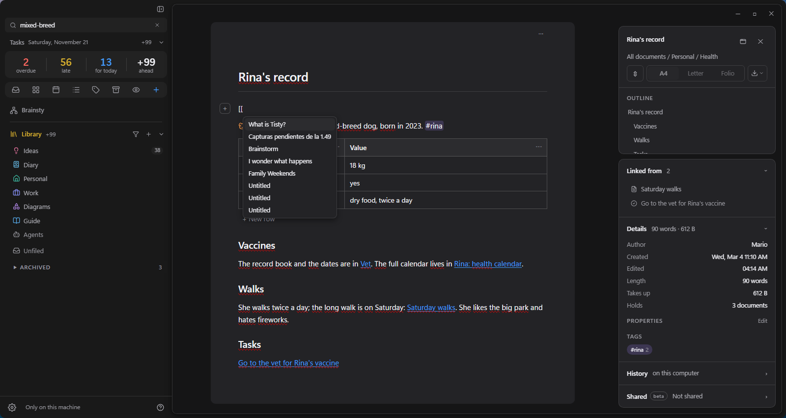
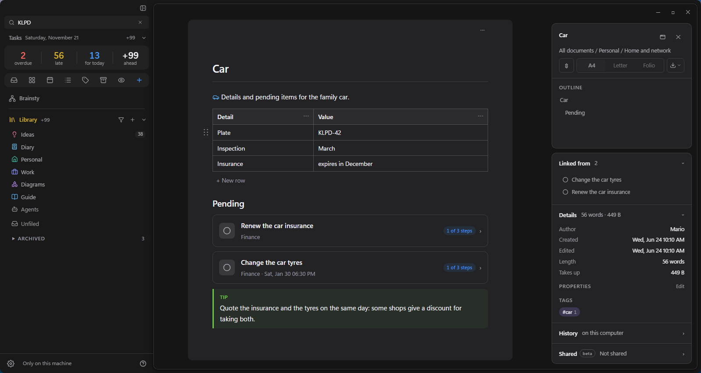

# Brainsty: everything joined

This sheet is a page of the guide. It tells you about Brainsty, Tisty's brain: how to join a document to another one and to its tasks while you write, and how to see everything you keep as one network. Almost all of it can be tried right here, on this guide.

What you keep was already joined: a document cites another, a task was born in some minutes, a book has pages. Brainsty makes those ties visible, lets you walk them, and serves them to your agent too.

## Linking a document to another

Type `[[` where you want the link and go on with a few words of the title. Tisty offers up to eight documents that match, ignoring accents and capitals, those that start that way first. Pick one with `Enter` and a link with its title stays, pointing at the document and not at its name: if you rename it, the link still gets there.



**Try it:** at the end of this paragraph type `[[rina` and pick **Rina**, this guide's sample page. You get a link like this one: [Rina](tisty:page).

To land on a section, follow the title with `#`: `[[what is#tasks` offers the sections of this guide's cover that hold that word, and the link opens the guide right at **Tasks**. If that section stops existing, the link opens the document at the top.

Rest the pointer on a link to another document and its preview appears: its first lines, or the section it points at. To open it while you write, `Ctrl` + click (`⌘` + click on a Mac); a plain click only puts the caret there.

## Who links to it

The panel beside a document has a **Linked from** row: every document and every task that cites or mentions it, with the section where it does. A click takes you there.

**Try it:** open Rina's page with the link above and, in the panel beside it, open **Linked from**: this sheet is there, and the guide's cover. Tisty builds that list in the background, so a link you just wrote shows up a few seconds later.

## Citing a task

What you know about a subject lives in its document, and the work you did on it, in its tasks. Cite the task in the document and you find it where you will look for it. In the `/` menu, **A task** searches the open and the archived ones, and leaves its card alone in its paragraph.



The card reads the task every time it is drawn: its list, its dates, how many steps are done and, if it closed, the day. A click opens it; its circle marks it done; its count unfolds the steps to tick them right there. A closed task is read, but no longer changes from the document.

**Try it:** on an empty line of this sheet type `/`, pick **A task** and write a word of one of your tasks. If you have none yet, the quick capture is one `Ctrl` + `Shift` + `Space` away.

## Creating a task without leaving the document

In some minutes or a plan a «we need to…» comes up. In the `/` menu, **A new task** opens the quick capture's field right there: write the task the way you would say it and `Enter` creates it with its date, its list, its tags and its priority, and leaves its card in that place.

**Try it:** on an empty line, below here, type `/task`, `Enter`, and then `Walk Rina and Roger on Saturday #rina`. Open the task with a click on its card: beside its page, **Born in** names this sheet, and a click brings you back. `Esc` in the field lets it go without creating anything.

On a task's page, **A new task** creates a part of that task, in its same list.

## The network

**Brainsty**, in the sidebar under the task views, opens everything you keep as one network. It opens in the content panel, like any other view, with the sidebar in sight and **Brainsty** marked in it. It opens with the whole network in sight; the document or the task you were on stays as the starting point for the arrows.

![Tisty's window with the sidebar on the left and Brainsty marked in it; in the content panel, the network zoomed out: at the top the count, «589 nodes · 1252 connections», each folder and each list in its colour, documents as squares, folders as big squares, lists as diamonds, tasks as circles and tags as purple dots, folders, lists and tags fainter than documents and tasks, citations and mentions stronger than the other lines, the network turned a little like a globe and its fourteen travellers with their trail on the lines, and at the bottom left the Legend, folded](network.png)

- **It costs something only while you look at it.** When you move to another view, everything the network ran stops: the drawing, the settling of the dots and its work in the background.
- **It is read again each time you come in**, so what you wrote meanwhile is already there. It starts clean: without the dot you had picked or the filters from last time.
- **Legend**, at the bottom left, says what everything you see means. It comes folded and a click opens it. Each computer remembers whether you left it open.

**The network is alive.** It turns by itself like a globe, once a minute, and what is behind looks smaller and fainter. **Travellers** walk its lines: dots of light with a short trail, which flash as they cross a tag or a node with many ties. They prefer what someone wrote: to choose their way on, a citation, a mention or a part weighs twice a line to a file and ten times a tag. How many there are, and how often they go from one node to the next, depends on the nodes in your network, not counting folders or lists:

| Nodes | Travellers | One node every |
| --- | --- | --- |
| under 60 | 4 | 3 seconds |
| 60 to 99 | 8 | 4 seconds |
| 100 to 149 | 10 | 5 seconds |
| 150 to 349 | 12 | 6 seconds |
| 350 or more | 14 | 7 seconds |

**Up close, the globe holds still.** As soon as you bring the view closer, with the wheel, a search or the arrows, it stops turning, and it does not turn again until you see the whole network once more; the travellers keep walking. It also rests while the pointer is on the network and while you have a node picked; over the empty space around it, it keeps turning. **A double click on an empty spot** takes you back to the whole network, and the globe turns again. To turn it yourself, drag with the right button or with `Shift`; a plain drag still moves the view.

At the top, inside the open **Legend**, there are two switches, **Travellers** and **Turning**, each with a dot that lights up. They come on, even if your system asks for reduced motion. With no turning, the network lies flat; with both off, it stays still. Each computer remembers how you left them.

The **Legend** also has four parts. **What it is** shows the shape of each kind there is in your network. **Colour: its folder or list** shows the coloured folders and lists, the fullest first; past six, **N more** shows the rest, and what has no colour takes its kind's tone. If you have the **Agents** folder, **AGENTS** shows right there, apart from your colours; with the pointer on it, it tells you they are your agents' files that Tisty keeps in step. **State** shows how a task under way, a done one and an archived one look. **Lines, up close** shows each kind of line in your network, with **In its folder or list** last, and **Alike** too when Tisty thinks something is alike. This table says the same:

| In the network | It is |
| --- | --- |
| Square | a document or a page, in its folder's colour |
| Small square, faint coral | a document in **Agents**: your agents' files, which do not crowd yours |
| Big square, faint | a folder, amid its documents |
| Diamond, faint | a list, amid its tasks |
| Circle | a task, in its list's colour: bright while under way, faint once done |
| Purple dot, faint | a tag |
| Grey dot | a picture or a file |
| Solid, strong line | a citation, a card |
| Dashed line | a mention, a link in a sentence |
| Solid line | **Part of**: a page and its book, a part and its task, the document a task was born in |
| Thin, faint line | a tag, or what uses a file |
| Thin line, the faintest | **In its folder or list**: a folder or a list and what it holds |
| Amber curve | an alike pair: two things Tisty thinks are alike because they share uncommon words, one with a typo or a translation, and that nobody tied |

Each folder and each list that holds something in the network is a node, tied to what it holds and amid it, and it also tints its zone with its colour.

**What you wrote leads.** As it settles, the network draws together what cites, mentions or is part of the same thing; a line to a file pulls half as much, and a shared tag, barely. Folders, lists and alike pairs move nobody. That is why tags, folders and lists look faint: they say where something is, not what you wrote. If you cite the task «Rina's yearly vaccine» on Rina's sheet, the two sit together, even though the task lives in the **Home** list and the sheet in the **Pets** folder.

The network changes with the distance. From afar, as it opens or with the wheel backwards, its dots make a brain seen from the side, with no titles, and each kind has the shape in the table. At middle distance the coloured zones show. Up close every title shows, each kind of line, the tags and each picture's thumbnail, and each node becomes its icon, in its folder or list colour: a sheet for a document, a few lines of text for a page, a box for a task and a tick once it is done, a `#` for a tag, a clip for a file, a folder and a list. With the network turned, the zones hide and fewer titles show.

![«Rina» picked up close in Brainsty, in the content panel beside the sidebar: her neighbours with titles, each drawn as its icon in its folder or list colour (a document's sheet, a task's box, the photo's clip), the rest dimmed and, on the right, her card: «Document · Pets · 6 connections», the rows Last written, Created, Size with its words and Language EN, the rina tag, Connections by kind with «1 in folder or list», Pointing here with what cites her, Alike with «Saturday walks» and «Tisty thinks they are alike: they share rina and park», the Link with Copy link and the Open button; in the network, an amber curve joins Rina to «Saturday walks»](network-near.png)

- **A click** on a dot lights it up with its neighbours and opens its card, on the right. The card does not show the document's text: it shows its facts, so you know what it is before you open it.
- **Open**, `Enter` or a double click opens the document, the task or the tag in this same window, in the network's place; a folder opens in **Documents** and a list in **Lists**. To come back to the network, another click on **Brainsty**. A picture or a file does not open from the network: open it from what uses it.
- **Search the network**, at the top, or `/`: type part of a title and `Enter` centres the network on it.
- **Filters**, the funnel beside the search box: which kinds to show, **Folders** and **Lists** too, **Alike** for the amber curves, the state of tasks, a tag and **Touched**, to see only what changed in the last days. A folder or a list hides when the filters hide everything it holds.
- **With the keyboard**: `Tab` goes round the search box, the filters and the network; the arrows walk from a dot to its neighbour, and the first one sets out from the document or the task you were on; `Enter` opens and `Esc` lets go in layers: first the search, then the dot, and the last one takes you back to where you were. An `Esc` you type in a field of the sidebar stays in that field. `Ctrl` + `Shift` + `M` shows, beside the legend, what drawing each frame costs.

The card changes with what you pick:

| You pick | The card shows |
| --- | --- |
| A document or a page | **Page of**, if it is a page of a book; **Last written**, **Created**, **Size** with its words and **Language** |
| A task | **State**, like «Under way · Due soon»; **Day**, **Deadline**, **Part of**, **Parts**, **Steps**, like «1 of 3 done», and **Source** |
| A tag or a file | what it is and how many connections it has |

Below come its **Tags**; its **Connections** by kind, like «2 cites 3 mentions 1 in folder or list»; **Pointing here**, with what cites or mentions what you picked, and a click on one picks it in the network; its **Alike**, each with its why, and, on a document, a page or a task, its **Link**, with **Copy link**. A document's is the same one you copy from its panel, to paste in a chat or hand to your agent:

```text
tisty://doc/pets/rina?id=…
```

**Try it:** open **Brainsty** now. The network opens whole, turning slowly, with its travellers walking. Rest the pointer on it and the globe stops. Search `brainsty`, `Enter`: the network comes close to this sheet, picks it with its neighbours around it, each with its icon, and opens its card; under **Pointing here** is the guide's cover, which cites it with its card. While you look at it up close, the globe does not move. Close the card with its cross and double-click an empty spot: you are back at the whole network and the globe keeps turning. Open the **Legend** and turn **Turning** off: the network lies flat. Then search `one of`, `Enter`, and **Open**: **One of each** opens in the network's place. Come back with another click on **Brainsty** and, this time, leave with `Esc`: the last one takes you back to **One of each**, where you were.

## What your agent reads

Your agent reads the same network, but as an index. With a single tool, `brain`, it finds tasks and documents by their words, the Archive beside the rest; it brings a document's card, with its sections, who cites it and its decisions in force first, without reading it whole; and it sees a project grouped as blocked, under way, waiting for you and not started. On the card, what Tisty thinks is alike comes apart, under `guessed`, with the shared words or the pair of words that ties them, like `pagar≈pay`, so it is never mistaken for what someone wrote. When it names a task or a document by its exact title between quotes, Tisty links it when saving, as when you do. [Your agent's page](tisty:agent) tells it step by step.

## Good to know

- **Everything stays on this computer.** The network is worked out here and rebuilds itself: it is not synced and does not leave with what you share or export. Each computer draws it again from your documents and tasks.
- **What you hide does not show** in the network, nor does it reach your agent.
- **Outside Tisty**, a link to another document and a task's card stay only as their words: in standard Markdown, in Word, in the PDF and in Folio.
- **Up to 12,000 dots.** Past that, the network keeps what you touched last, its neighbours, your documents and the tasks under way, and tells you at the top how much was left out.
- **You wrote every straight line; not the amber curve.** Tisty ties as alike what nobody tied, with three clues and in this order:
  - **Shared words:** at least two uncommon ones, like *quote* and *roof*.
  - **A typo:** «La imrpesora nueva no imprime en color» with «Instalar la impresora nueva».
  - **A translation:** a task in Spanish and its twin in English, like «Pagar la cuenta del agua» with «Pay the water bill».

  The curve shows up close or around the dot you pick, and the card says why, with what each side wrote: «Tisty thinks they are alike: they share *pagar ≈ pay* and *agua ≈ water*». There is no AI in this: the translation comes from a fixed list of Spanish–English words, made by linguists, and all of it runs on your computer. Hidden tasks and your Diary never go through it. [The Brainsty network](https://www.tisty.app/docs/brainsty-network/), in the help, tells it.

Every detail, with an example from start to end, is in the help: [linking documents](https://www.tisty.app/docs/linking-documents/), [tasks in documents](https://www.tisty.app/docs/tasks-in-documents/) and [the Brainsty network](https://www.tisty.app/docs/brainsty-network/).
