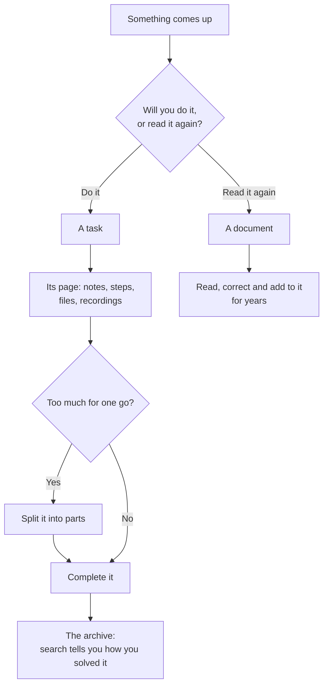
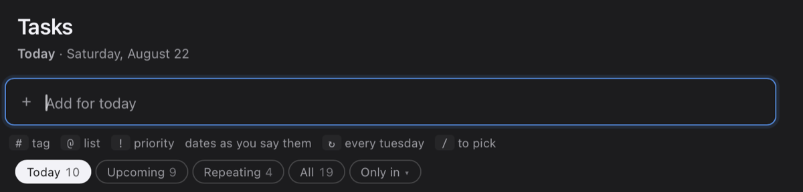
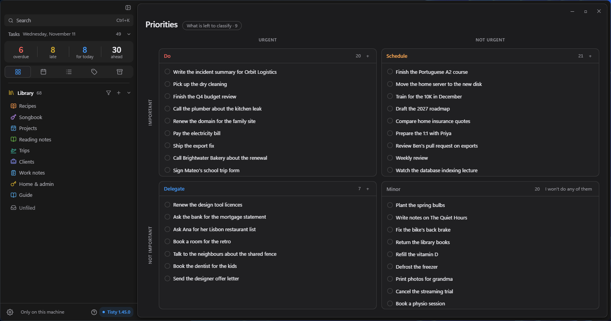
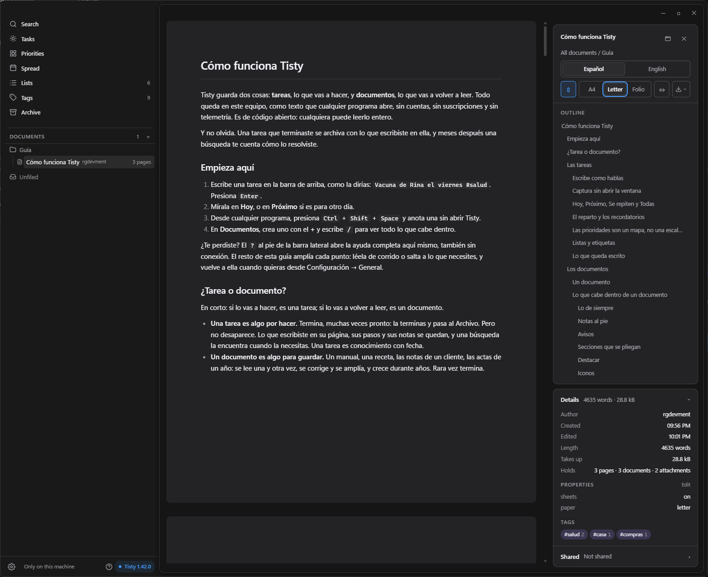
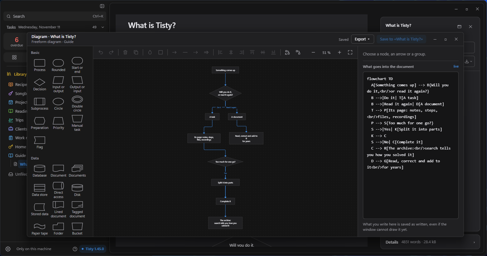
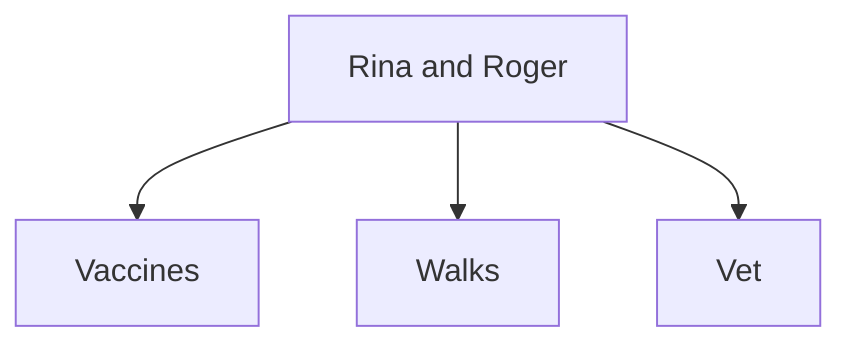
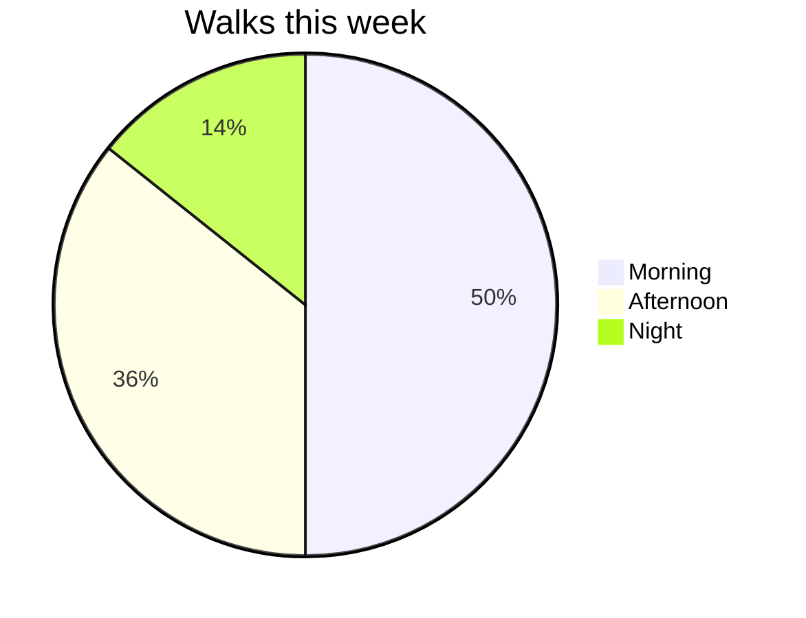
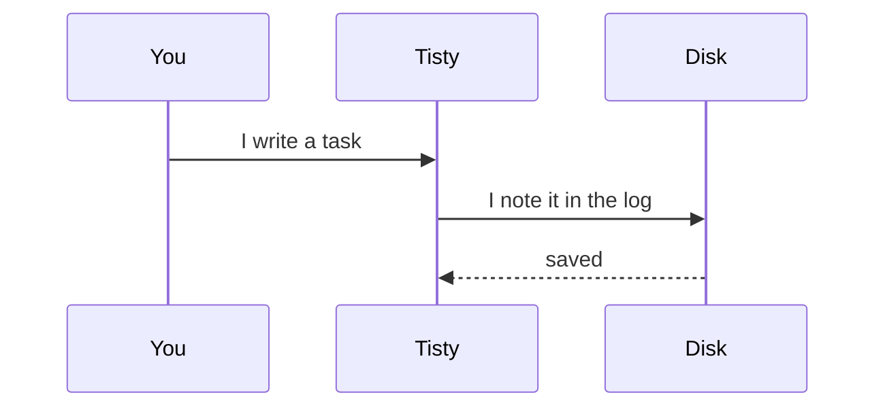

# What is Tisty?

Tisty is a quiet place for two things: what you have to do and what you want to keep. The first are **tasks**; the second, **documents**.

Everything stays on this computer, as text any program opens. It asks for no account, charges no subscription and sends nothing about how you use it. It is open source: anyone can audit it.

And it does not forget. A task you finished is archived with what you wrote in it, and months later a search tells you how you solved it. Neither does the AI agent you work with: connected through MCP, it keeps its memory here and picks up where it left off instead of starting from a blank chat.

Read this guide at your own pace: each section stands on its own, and whatever you do not need today can wait. It is a document like any other, so you can touch all of it: click, write, try things. If you ever get lost, the `?` at the foot of the sidebar opens the full help, offline too, and you come back to this guide from Settings → General.

## How does it work?

It all starts with one question: will you do it, or read it again? If you will do it, it is a task: it ends, sometimes the same day, and stays in the Archive as knowledge with a date. If you will read it again, it is a document: a manual, a recipe, a year of minutes, which you correct and add to for years. This drawing tells the rest:



**Try it:** click the drawing and it opens large. Double-click it and you are in the diagram window: move a box, change a label, and **Save to «What is Tisty?»** puts it back here, in your guide. That is also how you start one of your own.

:::details An example: planning a trip

1. You create the task "Plan the trip south". On its page you note what you found out and what you ruled out, and you attach the booking PDF, the photo of the map or the audio from whoever recommended the place.
2. When the plan is clear, you split it into **parts**: "Buy the tickets", "Book the lodging", "Rent the car". Each one is a task with its own steps.
3. You complete the parts one by one, and then the trip. It goes to the Archive.
4. A year later, "where did we stay in the south?" finds it: its page, its parts and every step, as they were left.

:::

And if a task teaches you something you will need again, like the fix for a fault that comes back, keep it in a document as well.

---

## Tasks

### Write the way you speak

There is no form to fill in. Type the sentence the way you would say it to someone, in the bar at the top, and Tisty picks out the day, the list and the priority as you type.



Each part it understands is coloured:

| You write | Colour | It understands |
| --- | --- | --- |
| ==tomorrow 10am=={blue} | blue | a day and a time, the way you would say them |
| ==on Friday=={blue} | blue | the next one coming |
| ==before Friday=={blue} | blue | a deadline: the latest it can be done |
| ==every tuesday=={pink} | pink | something that comes back on its own |
| ==#home=={pink} | pink | a tag: what it is about |
| ==@work=={green} | green | a list: where it happens |
| ==!schedule== | no colour | the priority: do, schedule, delegate or minor |

Whatever is not coloured stays in the title, as written.

**Try it:** type one of these in the bar at the top and watch it take colour. Rina, from the examples, is a dog, and Roger is her brother: their vaccines, their walks and their vet keep you company through the whole guide.

- `Rina's booster on 3 October !do #health`
- `Walk Rina and Roger every day`
- `Hand in the report before Friday @work`

If you only wanted a look, clear it before pressing `Enter`. All the words it understands, in English and in Spanish, are in [natural language](https://www.tisty.app/docs/natural-language/).

### Capture without opening the window

Something comes to mind in the middle of something else: press `Ctrl` + `Shift` + `Space` wherever you are and a small window opens to write it. `Enter` saves it, `Esc` closes it, and you carry on with what you were doing. Try it now, without leaving this guide.

If another program already uses that shortcut, Tisty takes another one and tells you which in Settings.

### Today, Upcoming, Repeating and All

Your task list can be seen four ways:

- **Today** — what the day asks for, most urgent first:
  - **overdue**: its deadline passed;
  - **due soon**: the deadline is close;
  - **late**: the day you planned passed, with no deadline;
  - **for today** and **underway**: what is on now.
- **Upcoming** — what is coming.
- **Repeating** — what comes back on its own.
- **All** — everything open, unfiltered.

The day's four counts, at the top of the sidebar, open what they count: **Overdue** and **Late** each open a view of their own, shown beside Today while you are on it, and **for today** and **ahead** open Today and Upcoming.

What is overdue sits at the top, in red; what is late, in amber. A task is overdue only once its deadline passes: if you gave it a day and nothing more, it runs late, but it is never overdue. And nobody chases you: Tisty keeps no streaks or points for emptying the list. What you did not get to today is still there tomorrow.

### The Spread and reminders

**Spread**, the calendar icon under the day's counts in the sidebar, is your work calendar: it is where you calmly decide what you do each day. What you wrote with no day waits in the **With no day** tray; drag it to the day it belongs to. If that day already carries two, Tisty tells you and offers the next free one. **Month** shows the same as a grid.

A reminder is a time you choose on the task: it rings as a system notification, on this computer only, with a short sound you can turn off. More in [the Spread and reminders](https://www.tisty.app/docs/spread-and-reminders/).

### Priorities are a map, not a ladder

Two questions, four boxes: whether it is pressing and whether it matters.



- **Do** — urgent and important. Today.
- **Schedule** — important, no rush. Give it a date before it turns urgent.
- **Delegate** — pressing, but not yours. Leave it to whoever should carry it.
- **Minor** — neither pressing nor important. Its **I won't do any of them** drops them all at once.

Drag a task into the quadrant it belongs in. What you do not sort waits in the tray beside it, without scolding you.

### Lists and tags

Two ways of sorting that do not compete:

- A **list** says where it happens: ==@home=={green}, ==@work=={green}. A task belongs to one.
- A **tag** says what it is about: ==#health=={pink}, ==#shopping=={pink}. A task carries as many as you like.

A tag also works in a document: write `#health` in the middle of a sentence and the document is filed under that same tag. **Tags**, the tag icon under the day's counts in the sidebar, gathers everything that carries one: what you have to do and what you wrote about it.

### What stays written

A task keeps more than its title. It opens on a page of its own, with sections to fill in (what it is about, how you will know it is done, its steps, what you found out along the way) and in each one a grey hint saying what goes there. Every box you write on that page, `- [ ]`, is one of its steps. Completing it erases none of that: it is archived with its date.

That is why it matters: the list tells you what is left; the Archive, how you solved it last time. Type a word you remember in the search at the top of the sidebar (`Ctrl`/`⌘` + `K`) and the task comes up, even if you closed it two years ago.

:::details Parts: when a step needs more than a line

A step is a line, a hundred characters at most. If it needs more, make it a task of its own, a **part** of this one: hover over the box and click **↗**. The line becomes its card, with its steps and its date, and a click opens it.

A task with parts shows a counter like **▣ 3/7** where its steps would count, and its parts fold beneath it. Beside the page, **Parts** adds a new one, **Part of another…** hangs it under another task and **Let it go** sets it loose again. If you close a task that still has open parts, Tisty asks you to let them go in that same move; if you undo the close, they hang under it again.

:::

Routines, the tasks that repeat, have one page for all their rounds. What you write under **This time** belongs to the round under way: completing it moves it to **Rounds**, under the page, and the section is blank again for the next one. The rest, step by step, is in [tasks](https://www.tisty.app/docs/tasks/).

### Completing, dropping and erasing

- **Complete** marks it done and sends it to the Archive. Its page is kept with it: it can be read but no longer written. Reopen it and it is yours to write again.
- **Close with a summary** asks you for two lines on how it went before completing it.
- **Drop** puts it aside without doing it, and it also ends up in the Archive.

The Archive reads in three layers: the **stories**, which left something written; the **routines**, which come back; and the **trace**, what closed leaving next to nothing. Each layer is in [the archive](https://www.tisty.app/docs/archive/).

> **Before erasing for good.** Erasing is only allowed for what is already closed **and** was left as a trace. It disappears from this computer and, at the next sync, from the others; it cannot be undone.

And if you want to know what is spare or missing in everything you keep, Settings → Maintenance counts it without changing anything.

---

## Documents

### A document

A document is yours and is kept as Markdown: plain text with a few marks, like `**bold**`, that any program opens. You do not need to learn them: the `/` key offers you all of them. And what matters is the file: if you delete Tisty tomorrow, your documents still open in any text editor.

**Try it:** click this very paragraph. It opens for writing, with its marks in view; `Esc` turns it back into the page.

**To make one**, use the **+** in the header of the **Library**, in the sidebar: **New document**. Inside a folder, that same button makes it there, and **New folder** groups them. Folders start folded; open them on the arrow.

The first line of the document is its title: there is no name to fill in anywhere else. Its properties, such as its tags or the paper it prints on, show in the panel beside it, under **About this document**.

To write:

- Click a paragraph and it opens for writing; `Esc` turns it back into the page.
- Select a few words and a small bar offers bold, italic, a link or the highlighter; right-click offers the same, plus copying and editing the block.
- `Ctrl`/`⌘` + `Shift` + `M` shows the block's marks, and `Ctrl`/`⌘` + `E` opens the whole document as one text.
- Drag a file in to attach it: Rina's vaccination card, the insurance PDF.
- Insert **another document**: in a paragraph of its own it shows as a card; inside a sentence, as a link with its title. Either way, a click opens it.

**Export**, in the document's panel, prints it, saves it as a PDF, a web page or a Word file, and copies it as standard Markdown for any other editor. Try it with this guide: it comes out with its diagrams, its tables and its sheets.

And when a matter is over, archive its folder with a right-click: it drops to the **Archived** shelf at the foot of the tree, with everything inside it. There it can be read and exported, but not written; unarchive it and it comes back as it was. More in [documents](https://www.tisty.app/docs/documents/).

### A document in several languages

A manual for the people you work with, in Spanish and English; a contract in two languages. Each language is a document of its own, with its own file, and Tisty shows them as one: one row in the tree, opened in the app's language.



**To translate one**, open the document's menu and choose **Translate into…**: Tisty makes a copy of its text and its pages, ready for you to translate section by section. If you already have both written, **Join with its other language…** brings them together, and **Take out of its languages** separates them again.

The switch sits in the title panel and takes you to the same section in the other language. **Try it:** pick Español in this guide and you land right here, in Spanish; come back with English. Moving, archiving or deleting acts on every language at once.

### A document with pages

A year of minutes, a book in chapters, Rina's life told year by year: that does not fit on one sheet, nor in a folder of loose sheets.

A page is a document like any other, with its own file, that also says which document it belongs to. There is one level and no more: a page has no pages.

**To add one**, type `/` where you want that chapter to start and choose **A new page**, or **A page that already exists** if you already wrote it. It is inserted right there, as a card with its title and its first words. **Try it:** this guide has one page, and it is this card. Open it with a click and see at the top which document it belongs to:


In the tree, dropping a document onto another also makes it a page of it.

> [!IMPORTANT]
> The order in which you insert them in the text is the order of the pages: in the tree, when exporting and when printing. To move a chapter, use the arrows on its row in the index at the end of the document, or `Alt` and an arrow key on the row.

At the end of the document comes the index, with its pages numbered. Inside a page you see at the top which document it belongs to, arrows to the neighbouring pages and, at the bottom, the step to the next one.

A page can be archived on its own, with a right-click, and stays dimmed in its document; archiving the document archives them all. How a book prints, with its index, is in [pages and PDF](https://www.tisty.app/docs/pages-and-pdf/).

### Sheets, page breaks and PDF

If a document will end up printed or as a PDF, you decide where each sheet starts. A line with only `---` cuts it: what follows goes on the next sheet, and `Ctrl`/`⌘` + `Enter` writes it for you.

Turn on **Sheets** in the document's panel to see it on real sheets (A4, Letter or Folio, portrait or landscape), where a sheet that fills up turns to the next on its own. Exporting to PDF gives those same sheets. **Try it:** there is one of those rules just below; turn on **Sheets** and see where the next paragraph lands.

---

This paragraph starts on a new sheet, because of the rule above.

### Diagrams by hand

A diagram tells at a glance what a paragraph takes a while to explain, like the one in "How does it work?" at the start. You write it as text, in a code block with the language `mermaid`, and Tisty draws it. A click enlarges it; a double-click opens it in the diagram window, where you can also draw mind maps, schemas, freeform diagrams or class diagrams by hand.



Here are three more. First, a sketch of what to keep up to date for Rina and Roger:



Charts fit too. Rina and Roger's walks this week, by time of day:



And a sequence diagram, which shows who talks to whom and in what order; here, what happens when you save a task:



### What fits inside a document

This section is a showcase: every form a document can take, with a live example you can touch. If you only want to write, skip it; everything is inserted with `/` when you need it. It is ordinary Markdown, so GitHub reads it the same as Tisty, and `F1` opens the [Tisty Markdown guide](https://markdown.tisty.app) on the form you are writing.

Or see it all together, one of each, on its own page, where Roger shows up too:


#### The usual

**Bold**, *italic*, ~~struck through~~, ++underlined++, `loose code` and a [link to a website](https://github.com/rgdevment/Tisty). Bulleted lists, numbered ones, and quotes:

> What is not written down did not happen.

1. This first
2. Then the other thing
3. And that one at the end

#### Footnotes

A word can carry a note without breaking the sentence: Rina had her booster in March[^march], and the vet wants her back in a year. A click on the call takes you to the note.

[^march]: The annual vaccine and the rabies shot on the same visit, with the blood test. A note like this one is called with `[^label]` and written once, on a line of its own.

#### Callouts

Five kinds (note, tip, important, warning and caution), each with its own colour. Underneath it is a quote that starts with its name in brackets, the way GitHub writes them.

> [!NOTE]
> For what is worth knowing, with no urgency at all.

And nearly anything fits inside a callout, not only text:

> [!TIP]
> Rina's food:
>
> - Weigh the portion
> - Write it in her table
>
> ```text
> 250 g in the morning, 200 g in the evening
> ```
>
> ---
>
> All of this reaches the PDF just the same.

#### Tables

A table is written right on the page: click a cell and type. The `⋯` menu of a row or a column moves, duplicates or removes it, and gives a column a type: a date with its calendar, money, options with their colours, stars or a switch, with its total at the foot. Sort and filter from a column's title without touching the file: **try it** with "Vaccine", just below.

| Vaccine | Given | Due again |
| :--- | :---: | ---: |
| Annual | march | 12 months |
| Rabies | march | 12 months |
| Worming | august | 3 months |

Drag the edge of a heading to make its column wider: other Markdown readers see a plain table, and Tisty keeps the width you gave it.

#### Formulas

A block whose language is `math` sets the formula.

```math
dose = \frac{weight \times 0.5}{2}
```

```math
\sum_{i=1}^{n} i = \frac{n(n+1)}{2}
```

A formula also fits inside a sentence, between dollar signs: Rina weighs 12 kilos, so her dose is $\frac{12 \times 0.5}{2} = 3$ millilitres. A dollar followed by a digit is a price, so `$5` stays five dollars. All of it is drawn offline.

#### Widgets

A block whose language is `widget` is drawn as a fixed view, made only of HTML and CSS: it runs nothing, so it looks the same wherever the document is read. It takes Tisty's colours and comes with ready classes such as `grid`, `stat`, `card` or `badge`. The code stays folded; open it with "Show code".

```widget title="Rina and Roger this month"
<div class="grid">
  <div class="stat"><small>Walks</small><b>42</b><em class="up">+6 vs August</em></div>
  <div class="stat"><small>Kilometres</small><b>61</b></div>
  <div class="stat"><small>Next vaccine</small><b>12 Nov</b><span class="badge warn">due</span></div>
</div>
```

#### Files, sound and video

An attached file is drawn as what it is: a picture as itself, which a click opens large; a sound or a video with its player; and anything else as a card with its type and size. Every card has a **⋯** to save a copy, turn it into a plain link or take it off the page. A video still in your cloud downloads only when you press play, and an attached `.html` page is never run.

#### A link in a paragraph of its own

A link that takes a whole paragraph is drawn as a card; the same link inside a sentence stays a link. If you want the site's title and picture, ask for them with **Bring the preview**.

[Tisty on GitHub](https://github.com/rgdevment/Tisty)

#### Code, with a name and a colour

A code block is coloured by its language, and you can give it a name: write the language and then `title="whatever"`. The name shows in the block's header, and the colour reaches the PDF too.

```python title="dose.py"
weight = 12
print(weight * 0.5 / 2)
```

```json title="rina.json"
{ "name": "Rina", "weight": 12 }
```

There is more to say about code, and it fits on a page of its own:


### What comes from elsewhere

Already have notes somewhere else? No need to copy them by hand. What arrives from elsewhere comes in converted into Tisty Markdown, and the file it came from is not touched:

- **Import a document**, in the tree, takes Markdown, text, a web page or a Word file.
- Pasting keeps the headings, lists, tables, links and colours of what you copied from a web page, an email or Word.
- An Obsidian note comes in with its callouts converted and its `[[links]]` pointing at the documents here with those titles.
- **Export for Tisty…** carries whole folders, with their pages, to another Tisty in a `.tistyx` file, and opening it brings them in as they were.
- An `.ics` calendar comes in too: drag it onto the window and choose which events become tasks.

A Markdown file can also be read without bringing it in: choose Tisty under **Open with** and it opens in a lightweight viewer that does not touch the file.

What you write in Tisty is kept exactly as you wrote it: properties, footnotes, links and comments stay in the file, word for word. What changes on each crossing is in [convert to and from Markdown](https://www.tisty.app/docs/convert-to-and-from-markdown/).

---

## Your data

What you write is yours, and this is how to look after it: take it to another computer, encrypt it and share it only with whoever you choose.

### Your copies in the cloud and syncing

Tisty always works on this computer. To have the same on another one, tell it where to leave the copies, in Settings → Sync:

- **Straight to a cloud**: your Google Drive, your OneDrive or your own WebDAV server (Nextcloud, ownCloud, Synology and others), with nothing else installed.
- **A folder**: Google Drive, OneDrive, iCloud or Dropbox if they are installed, or any folder both computers can see. There, whoever uploads and downloads is your provider's program, not Tisty.

> There is no server of ours in between. Syncing gives you another copy, not time travel: if you delete a task, the deletion travels too.

When two computers wrote the same part of a document, Tisty does not choose: it shows you both versions and you keep **This one**, **The other** or **Both**.

A shared folder is not a backup. In Settings → Your data you save a full backup whenever you want. Uninstalling Tisty leaves your tasks and documents where they are; where they live and how to delete them for good is in [sync and backup](https://www.tisty.app/docs/sync-and-backup/).

### Encryption and computers that sign

A copy straight to a cloud can be encrypted in Settings → Security with a 24-word phrase, and then not even your provider can read it. Keep it on paper or on the PDF sheet Tisty offers you. A copy in a folder is not encrypted.

So that nobody slips a stranger's computer into your sync, every computer signs what it writes, and a new one waits until you confirm it is yours:

1. A notice appears in the sidebar with that computer's name.
2. **Confirm…** shows you its twenty-digit code.
3. On the new computer, in Settings → Sync, **Show large** shows its own.
4. If the two codes match, **Yes, it is the same** lets it through; if not, **It doesn't match** keeps it out.

### Sharing a document

The panel beside a document has a **Shared** row with **Share…**. Sharing goes through Folio, a service separate from Tisty: it creates an end-to-end encrypted link, to read or to edit, and you choose how long it lasts. Whoever opens it needs no account. If Folio is not available yet, Tisty tells you and nothing of your document leaves this computer.

The first time, Share asks you to create your identity: the key you sign what you share with, backed by a 24-word phrase; if you already encrypted your copy, it is the same one. Nobody from Tisty or Folio will ever ask you for it. More in [documents](https://www.tisty.app/docs/documents/) and in [privacy](https://www.tisty.app/docs/privacy/).

---

## When you want more

None of this is needed to get started. It is here for when you need it.

### An assistant can write here

If you use an AI agent such as GitHub Copilot, Claude Code or Codex, it can come into Tisty through MCP, with a program that runs on this computer. Settings → Assistants finds the ones you have installed and connects one with a click. What it writes is signed with its name: "by Claude Code", "by Codex".

From then on Tisty is its memory between sessions. It starts by asking what moved since last time, reads a document's outline and then only the section it needs, ticks the steps of the task it is on and notes in its journal what it tried and ruled out. The next session starts there, and costs a fraction of rereading your Markdown files.

- **It can** propose tasks, write documents, add to or correct the ones it may write in, and mark one that has had its day, saying why.
- **It can say** that a task or a step is done. The task stays in **To confirm** until you finish it or send it back with **Still to do**; the steps wait for you with **Tick them** or **Not yet**.
- **It cannot** close or delete a task, delete a document, or change a task you wrote.

If you wrote in a document while it was reading it, it does not write over you: it is asked to read it again. And when something writes in the document you have open, the window tells you and offers to go back to what it said before. How to connect one and what each door lets through are in [assistants and MCP](https://www.tisty.app/docs/assistants-and-mcp/) and in [what an assistant may do](https://www.tisty.app/docs/mcp-permissions/).

### Shortcuts

| Shortcut | What it does |
| --- | --- |
| `Ctrl` + `Shift` + `Space` | Capture a task without opening the window |
| `Ctrl`/`⌘` + `Enter` | Complete the task you are on; in a document, a page break |
| `/` | Insert something inside a document |
| `Shift` + `Enter` | Break the line without starting a paragraph |
| `Ctrl`/`⌘` + `Shift` + `M` | Show or hide the block's marks |
| `Ctrl`/`⌘` + `E` | Open or leave the whole document as text |
| `F1` | Open the Tisty Markdown guide on what you are writing |
| `Ctrl`/`⌘` + `K` | Go to the search at the top of the sidebar |
| `Tab` · `Shift` + `Tab` | Walk the cells of a table |
| `Ctrl`/`⌘` + `X` · `V` | Move a document between folders |
| `Esc` | Close whatever is open |

The rest is in [keyboard shortcuts](https://www.tisty.app/docs/keyboard-shortcuts/).

## If it was any use

Everything Tisty does is explained in [the Tisty docs](https://www.tisty.app/docs/), with [frequently asked questions](https://www.tisty.app/docs/faq/), and every form a document can hold, in [the Markdown guide](https://markdown.tisty.app).

Questions and ideas go to [Discussions](https://github.com/rgdevment/Tisty/discussions); a bug, to [Issues](https://github.com/rgdevment/Tisty/issues).

This guide is written and signed by rgdevment, who makes Tisty. [rgdevment's GitHub profile](https://github.com/rgdevment) holds two more tools, with the same idea: free, open, no ads, no telemetry, all on your computer.

- [**CoPanda**](https://copanda.app) — a clipboard manager for Windows and macOS.
- [**LinkUnbound**](https://github.com/rgdevment/LinkUnbound) — a browser picker for Windows and macOS: it asks which one should open a link instead of assuming. If it is installed, the links you open from Tisty go through it.
