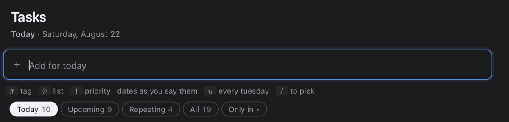
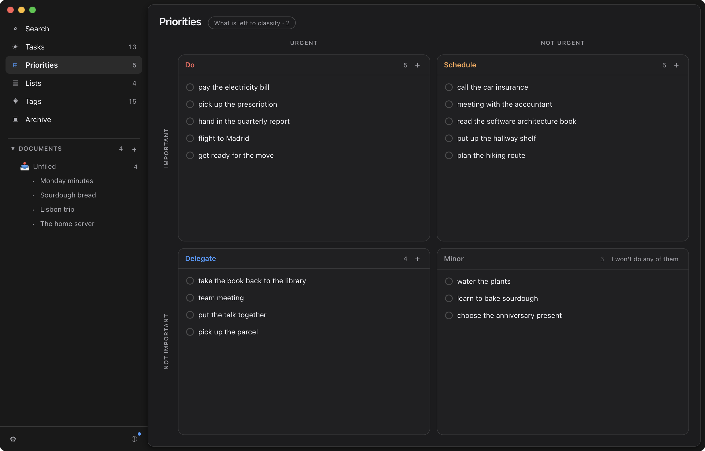
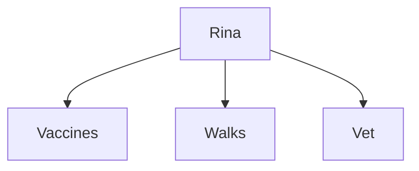
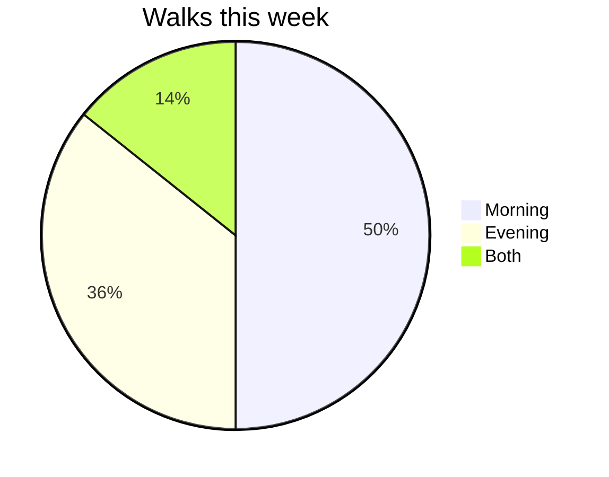
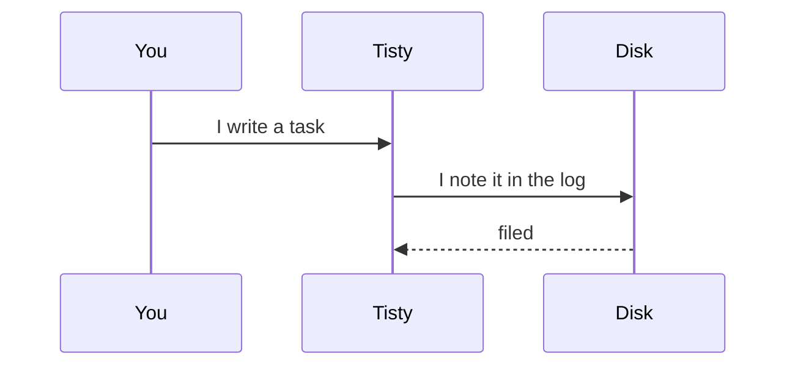

# How Tisty works

Tisty is Opensource. You can read it yourself, build it, try it, or download the stable releases already out there. Nothing is hidden: all of it can be audited.

We work on it constantly, on fixes and on new things, but we want it to stay small and useful. We are not going to load it with a thousand features nobody will use, the way commercial tools do.

Tisty is not a TODO app as you know it. It is a record of what you learned and worked out, with figures and searches over your own work. How did you solve that? Cannot remember? Tisty has it.

All local, no accounts, no subscriptions and no telemetry: your data is yours. Write notes in Markdown, documentation, reminders and much more. It is your notebook, personal and for work, and private.

And if you work with an assistant, it has a door through MCP to read your documents, write a new one or propose tasks to you. The program that opens that door runs on this machine. It can tell you a task of its own is done; closing and deleting it cannot do.

This guide takes a couple of minutes, and you will come out of it knowing a little more about what you can do in Tisty. You can come back to it from Settings whenever you like.

When you need help along the way, press `F1` or the `?` at the foot of the sidebar: it opens the [Tisty Markdown guide](https://markdown.tisty.app) right here, on what you are writing, and it works offline. Tasks, assistants and everything else are explained at [www.tisty.app/docs](https://www.tisty.app/docs/).

## A task or a document?

Tisty keeps two kinds of things, and telling them apart is most of using it well.

- **A task is something to do.** It ends, often soon: you complete it and it goes to the archive. But it does not go away. What you wrote on its page, its steps and its notes stay, and months later a search finds it and tells you how you solved it. A task is knowledge with a date.
- **A document is something to keep.** A manual, a recipe, the notes on a client or a machine, a year of minutes: it is read again and again, corrected and added to, and it grows for years. It rarely ends.

Something you will do is a task. Something you will come back to is a document. When doing a task teaches you something you will need again — the fix for a fault that returns, how a supplier wants an order — put it in a document as well.

---

## Tasks

### 1. Write it the way you would say it

There is no form to fill in. Type the whole sentence in the bar at the top and Tisty pulls the day, the list and the priority out of it as you go.



The colours say what it understood, and these are them:

| You write | It understands |
| --- | --- |
| ==tomorrow 10am=={blue} | a day and a time, said out loud |
| ==on friday=={blue} | the next one coming |
| ==every tuesday=={pink} | something that comes back |
| ==#home=={pink} | a tag: what it is about |
| ==@work=={green} | a list: where it happens |
| ==!schedule== | do, schedule, delegate or minor |

If a part stays plain, it simply belongs to the title, which is no great loss.

Try these:

- `Rina's booster 3 october !do #health`
- `Walk Rina every morning`
- `Go through the report on friday @work`

Every word it understands —days, hours, what comes back, in English and in Spanish— is listed in [natural language](https://www.tisty.app/docs/natural-language/), in the docs.

### 2. Capture without opening the window

Press `Ctrl` + `Shift` + `Space` wherever you are and a small window opens for one task. Enter files it, Esc closes it, and you carry on with what you were doing.

If another program already holds that shortcut, Tisty takes another one and tells you which in Settings.

### 3. Today

The task list is read in stretches:

- **Today** — what is due, overdue included.
- **Upcoming** — what is coming.
- **Repeating** — what comes back on its own.
- **All** — everything open, unfiltered.

Anything overdue sits at the top, in red. There is no prize for emptying the list.

### 4. Priorities are a map, not a ladder

Two questions, four boxes: whether it is pressing, and whether it matters.



- **Do** — urgent and important. Today.
- **Schedule** — important, no rush. Give it a date before it turns urgent.
- **Delegate** — pressing, but not yours to carry.
- **Minor** — neither pressing nor important. That quadrant has its own «I won't do any of them».

Drag a task into the box it belongs in. Whatever you leave unclassified waits in the tray beside it, without nagging.

### 5. Lists and tags

Two ways of sorting that do not compete:

- A **list** says where it happens: ==@home=={green}, ==@work=={green}. A task belongs to one.
- A **tag** says what it is about: ==#health=={pink}, ==#shopping=={pink}. A task carries as many as you like.

A tag is not only for tasks. Write `#health` in the middle of a sentence in a document, or list it under `tags:` in its properties, and the document is filed under that same tag: one word ties what you have to do with what you wrote about it.

### 6. What stays written

A task keeps more than its title. It opens on a page of its own, with sections to fill in —what it is about, how you will know it is done, its steps, what you found out— and a grey hint in each saying what goes there. Every box you write on that page, `- [ ]`, is one of its steps. Completing it erases none of that: it is archived with its date.

A step is a line, a hundred characters at most. When one needs more, make it a task of its own as a **part** of this one. A task with parts is something that ends: it shows **▣ 3/7** where its steps would count, its parts fold beneath it, and elsewhere each part names it with **⌂**. Beside the task's page, **Parts** takes a new one on its own line, and **Part of another…** finds the task it belongs to by name; a part names its whole there and lets go of it with **Let it go**. Closing it with parts still open asks you to let them go in the same breath, and undo brings them back.

A part can also live in its task's words. Hover over an open box and press **↗**: the line becomes a part and its card stays in its place, with the steps it has done and its date. A click on the card opens it. The trail of each one tells when a part joined and when it was let go.

A routine has one page for all its rounds. What you write under **This time** belongs to the round under way: completing it moves it to **Rounds**, under the page, with how many steps you ticked and when it closed, and the section is blank again for the next one.

That is the difference. The list tells you what is left; the archive tells you how you solved it last time. Search for a word you remember and it comes up, even if you closed it two years ago. All of it, step by step, is told in [tasks](https://www.tisty.app/docs/tasks/).

---

## Documents

### 7. A document

A document is text of yours, kept as Markdown, that you can write here and read with anything else. The file is what counts: delete Tisty tomorrow and your documents still open in any text editor.

**For making one**, go to Documents and use the **+** at the top: **New document**. That same button, inside a folder, makes it there. **New folder** groups them, and a folder can hold folders of its own.

The first line of the document is its title. There is no name to fill in anywhere: whatever you write at the top is what it is called. Above it, if you want them, go its properties, between two `---` lines, the way many Markdown tools write them: `tags:`, the paper it prints on. Tisty does not show them on the page; it shows them in the panel beside it, under **About this document**.

You write a block at a time. Click a paragraph and it opens for writing, with its bar above it; press `Esc` and it reads as a page again. Pick a few words on the page and a small bar offers bold, italic, a link or a pen right there, and the right button offers the same along with copy and editing the block. Read in the viewer, the page is only read: nothing pops up.

Type `/` anywhere and the menu of what fits inside comes up. Besides that:

- Drag a file in to attach it — the photo from the vet, the insurance PDF.
- Insert **another document**: alone in its paragraph it comes in as a card, with its title and its first words, and you open it with a click; inside a sentence it is a word you click.
- Print, or save as PDF, from the panel itself; the document's menu also exports it as a web page (**Export as HTML…**) or as Word (**Export as Word…**), and **Copy as Markdown** hands any other editor standard Markdown.

**Folders start folded** and open on the arrow. When something is over, archive the whole folder with the right button: it drops to the **Archived** shelf at the foot of the tree, with its icon and everything inside it just as it was. There it reads and exports, but nothing writes into it and nothing new goes in. Bring it back and it returns as it was. [Documents](https://www.tisty.app/docs/documents/), in the docs, goes through the rest.

### 8. What fits inside a document

Everything below is ordinary Markdown. You write it with `/`, and the file left on disk reads the same to GitHub as it does to Tisty. This section does not describe it: it shows it to you. Each form has its own page, with its fine print, in the [Tisty Markdown guide](https://markdown.tisty.app), and `F1` opens it on the one you are writing.

And for seeing all of it at once, one of each with no story around it, there is a page of its own:


#### The usual

**Bold**, *italic*, ~~struck through~~, ++underlined++, `loose code` and a [link to a website](https://github.com/rgdevment/Tisty). Bulleted lists, numbered ones, and quotes of the ordinary kind:

> What is not written down did not happen.

1. This first
2. Then the other thing
3. And that one at the end

#### Footnotes

A word can carry a note without breaking the sentence it is in: Rina had her booster in March[^march], and the vet wants her back in a year.

[^march]: Six-in-one and rabies on the same visit, with the blood test. A note like this one is called with `[^label]` and said once, on a line of its own; GitHub reads it the same way.

The call is the small raised label, and a click on it takes you to the note.

#### Callouts

Five kinds, each with its own colour. Underneath it is a quote that opens with its name in brackets, which is how GitHub writes them too.

> [!NOTE]
> For what is worth knowing, with no urgency at all.

> [!TIP]
> If you are already inside a callout and pick another kind, it changes the one you are in instead of nesting a second one.

> [!IMPORTANT]
> For what cannot be passed over.

> [!WARNING]
> For what can go wrong if you do not look.

> [!CAUTION]
> For what has no way back.

And nearly anything fits inside a callout, not only text:

> [!TIP]
> The steps of a backup by hand:
>
> - Close Tisty
> - Copy the whole folder
>
> ```bash
> cp -r ~/Tisty ~/Backup
> ```
>
> ---
>
> All of that reaches the PDF just the same.

#### Sections that fold

What is long and only needed now and then can stay folded under a title, out of the way until somebody opens it. It is **Collapsible section** in the `/` menu:

:::details Rina's full record

Born in 2023. Six-in-one and rabies every March, worming every three months.

:::

#### Highlighting

Four pens: ==yellow==, ==green=={green}, ==blue=={blue} and ==pink=={pink}. You pick the colour in the bar that appears while you write a block.

#### Icons

::dog orange:: An icon is looked up by what it draws: ask for «dog», «motorcycle» or «fist» and you get the one you expected. It marks a line without spending a heading on it.

#### Stages

A list of boxes you tick. In a document they are not Tisty tasks: they never close, they have no date and they never show up in Today. They are the stages of something you are writing. On a task's own page, the same boxes are its steps.

- [x] Bring Rina's record book
- [x] Weigh her before the appointment
- [ ] Ask about the tick tablet

A stage can be named from anywhere in the text by its place in the list: the one still open, [[#3]], shows its words here, and a click takes you to it.

#### Tables

A table can be worked on. Click it and `Tab` walks its cells — past the last one it starts a new row — and the bar's **Table** menu adds and removes rows and columns and leans a column left, centre or right. On the page, drag the edge of a heading to make its column wider.

| Vaccine | Given | Due again |
| :--- | :---: | ---: |
| Six-in-one | march | 12 months |
| Rabies | march | 12 months |
| Worming | august | 3 months |

The width rides in how long the rule under the header is drawn, so every other Markdown reader sees a plain table and Tisty sees the width you gave it.

#### Diagrams

A code block whose language is `mermaid` stops being code and gets drawn. Good for a shape:



For splitting a total:



Or for telling who says what to whom:



#### Formulas

And a block that says `math` sets the formula.

```math
dose = \frac{weight \times 0.5}{2}
```

```math
\sum_{i=1}^{n} i = \frac{n(n+1)}{2}
```

A formula can also sit inside a sentence, between single dollars: Rina weighs 12 kilos, so her dose is $\frac{12 \times 0.5}{2} = 3$ millilitres. A dollar followed by a digit is a price, so `$5` stays five dollars.

They are all drawn by code that ships inside Tisty. Nothing is fetched, and it works with the cable unplugged.

#### Widgets

A block that says `widget` is drawn as a small page: HTML, styles and, if you like, a little script. It runs sealed off, with no network and in Tisty's colours, and it comes with classes such as `grid`, `stat`, `card` and `badge`, so plain HTML already looks right. Its code stays folded; open it with «Show code».

```widget title="Rina this month"
<div class="grid">
  <div class="stat"><small>Walks</small><b>42</b><em class="up">+6 on August</em></div>
  <div class="stat"><small>Kilometres</small><b>61</b></div>
  <div class="stat"><small>Next vaccine</small><b>12 Nov</b><span class="badge warn">due</span></div>
</div>
```

If the widget grows large, attach it instead: an `.html` file attached to a document is drawn the same way.

#### Files, sound and film

An attached file is drawn as what it is: a picture as itself, a sound or a film with its player, an `.html` page live, and anything else as a card with its kind and size. Every card has a **⋯**: save a copy, show the page as a file or live again, turn the card into a plain link, or take it off the page. A film still in your cloud comes down only when you press play, and says why if it cannot.

#### Code, with a name and a colour

A code block is coloured by its language, and it can carry a name: write the language and then `title="whatever"`. The name shows in the block's header, and the colour reaches the PDF too.

```bash title="backup.sh"
rsync -a ~/Tisty/ /Volumes/Backup/Tisty/
```

```json title="settings.json"
{ "language": "en", "folder": "~/Tisty" }
```

#### Page break

A rule on its own splits the sheet: what follows starts on the next one, and `Ctrl`/`⌘` + `Enter` writes one while you write. Turn on **Sheets** in the document's panel to read it on real sheets — A4, Letter or Tabloid, upright or across — where a sheet that fills up turns on its own, on screen as on paper. What you pick travels with the file, in its properties, and a break you wrote yourself is kept whether the sheets are on or not.

There is more to say about code, and it fits on a sheet of its own:


---

This bit here is already on the sheet after it.

### 9. A document with pages

A year of minutes, a book in chapters, a dog's life told year by year. That does not fit on one sheet, and it does not fit in a folder of loose papers with nothing tying them together either.

A page is a document like any other — same file on disk, same way out — with one thing that sets it apart: it says which document it belongs to. There is one level and no more: a page holds no pages.

**For adding one**, type `/` where that chapter should start and pick **A new page**, or **A page that already exists** if the document is already written. It stays named right there, drawn as a card with its title, its first words and its place in the book.

> [!IMPORTANT]
> The order they are named in is the order the pages sit in: in the tree, in the export and in print. To move a chapter, use the arrows on its row in the index at the end of the document, or Alt and an arrow key on the row itself — or cut and paste its block, which is the same move written by hand.

At the end of the document, on its own sheet, comes the index: the pages the text names, numbered, and after a rule the ones it does not, one click from a place in the text. Inside a page you see which document it belongs to and where it sits, arrows to its sisters, and the step to the next one at the foot.

What names a page is its card, the block Tisty writes when you make one. Writing about a page in a sentence — a link to it in the middle of a paragraph, like [this one to Rina](tisty:page) — points at it without giving it a place, the way a footnote points at a chapter without being one; a page you have only written about that way sits under the rule until you put a card in.

In the tree, a document dropped on another becomes a page of it. If you have that document open, the line naming the page goes at the end of what you are reading, which is where it will sit, and you move it from there like any other chapter; if you do not, the page waits in the index, one click from a place in the text.

**A page is put away on its own** with the right button, and it does not go down to the shelf: it stays where it lives, inside its document, with another icon and dimmed. There it reads and exports, but nothing writes in it. Put the whole document away and every page goes with it without being marked one by one; bring it back and each one returns as it was, and the one you had already set apart stays apart. How a book prints, its index included, is told in [pages and PDF](https://www.tisty.app/docs/pages-and-pdf/).

This guide has one. It is named right here, and so here is where it goes:


### 10. What comes from elsewhere

Tisty keeps what you write exactly as you wrote it: front matter, footnotes, links by reference, comments — all of it stays in the file, word for word.

What arrives from elsewhere is turned into Tisty Markdown on the way in, and the file it came from is never touched. **Import a document** in the tree takes Markdown, text, a web page or a Word file; pasting keeps the headings, lists, tables, links and colours of what you copied from a page, an email or Word; and a note from Obsidian comes in with its callouts and comments turned, and its `[[links]]` pointing at the documents here that bear those titles. On the way out, the same document leaves as standard Markdown, a web page, Word or a PDF. What changes on each crossing, word by word, is in [convert to and from Markdown](https://www.tisty.app/docs/convert-to-and-from-markdown/).

A calendar comes in too. Drag an `.ics` onto the window, away from a document, or open it with Tisty: **From the calendar** shows each event and to-do with when, where, how it repeats and its reminder, and makes the ones you pick into tasks, in the list you pick. Opening the same file twice makes nothing twice. For an `.ics` to open in Tisty with a double click, choose it yourself: on Windows, right-click → Open with → Choose another app → Tisty, with «Always use»; on a Mac, Get Info → Open with → Tisty → Change All.

---

## What holds for all of it

### 11. An assistant can write here

If you use an assistant, it can file documents and propose tasks of its own accord. What it cannot do is close, delete or touch what you wrote. It can also **mark** a document or a page that has had its day: you will see a diamond beside its name and, when you open it, what the assistant said. It is a proposal, not a deletion — deleting stays yours, and the diamond comes off with one click. What it writes is signed with the name of the program it spoke through — «by Claude Code», «by Codex» — and what was written before programs said their name reads «by an assistant».

When it finishes one of the tasks it filed, it says so and leaves the account of what it did in the journal. The task stays open, gathered under **To confirm** with the hour it spoke — unless it is due today or overdue, which stays where you look for it. You finish it, or you send it back with **Still to do** and it returns to its day with the account kept.

A task of your own you can open to it: in the detail, **Allow agents**. From there an assistant may say it is done, or that it should not be done — for you to confirm — describe it, plan its steps and tick them off as it goes, which is the one thing it does without asking, and correct its open steps and its notes; a tick it gave by mistake it can take back, never one you gave. The day, the title, the list and the closing stay yours. **No agents** shuts the door and keeps what it managed to fill in. How to connect one, and what each door lets through, is in [assistants and MCP](https://www.tisty.app/docs/assistants-and-mcp/).

To rewrite a whole document it is handed a print of the exact text it read, and it has to send that print back when it writes. If you wrote in between, the print no longer matches: nothing is written and it is told to read the document again. The window tells you when something wrote in the document you have open, and where what it wrote over is still kept, that same bar offers to put the document back to what it said before. What it says now is kept in its place, so you can come back to it. The offer only appears when what is kept is exactly the one write back — after anything else it stays quiet rather than putting you somewhere you did not mean.

### 12. Your copies

Tisty always works on this computer. To reach it from another one, tell it where to leave the copies: it offers Google Drive, OneDrive, iCloud and Dropbox — whichever it finds installed, folder already worked out — or any other folder both computers reach, a NAS or an external disk. Your Google Drive can also be connected directly, from Settings, with no program of Google's installed.

Whoever takes that folder up and down is your provider's program, not Tisty. If it is not running, the tasks wait there until it is.

> There is no server of ours in between. Syncing gives you redundancy, not time travel: if you delete a task, the deletion travels too.

Every machine signs what it writes. One you already knew is recognised on its own when it updates. A new one — just installed or reinstalled — waits until you confirm it is yours: a notice in the sidebar names that computer, and **Confirm…** shows its twenty-digit code. Open it on that machine, in Settings → Your data → **Syncing**, where **Show large** makes it easy to read from across the desk: if the code is the same, **Yes, it is the same** lets it through and brings in what it wrote; if not, **It doesn't match** keeps it out. You do it once on each of your other machines. If what waits is another computer's assistant, its code is on that computer, in Settings → Assistants.

Right there, **Rename** chooses how your other machines will show this one; left empty, it goes back to the system's name. And every **Sync now** says when it ran and whether something came back or was written to the folder.

When both machines wrote the same part of a document, Tisty does not pick: it shows you the two side by side and you keep **This one**, **The other** or **Both**.

Settings can also write you a full backup whenever you want one — even when you sync, because a shared folder is not a backup. [Sync and backup](https://www.tisty.app/docs/sync-and-backup/) goes through each provider.

Uninstalling Tisty takes the program away and leaves your tasks and documents where they are, so reinstalling finds them as they were. On Windows they live in `.tisty`, in your user folder, hidden and closed to the other accounts on the computer; on a Mac, in `Library/Application Support/tisty` and `Library/Caches/tisty`, in your home folder. To leave for good, delete that folder yourself — on Windows, turn on **Hidden items** in File Explorer's **View** menu to see it first. If Tisty moved there from an earlier version, the copy from before stays in `AppData\Local\tisty`, with a `MOVED.txt` that says so: you can delete it too.

### 13. Completing, dropping and erasing

- **Completing** a task marks it done and sends it to the Archive.
- **Close with a summary** asks for two lines on how it went before completing it. They go first under **When it closes**; in a routine, they stay with its round.
- Once it closes, its page is put away with it: it reads but takes no more writing. Reopen it and it comes back.
- **Dropping** puts it aside without doing it: it lands in the Archive too.
- What is in the Archive stays there in case you look for it.

The Archive reads in three layers: the **stories**, which left something written; the **routines**, which come back; and the **trace**, what closed leaving next to nothing. You decide which layer each one reads in: in the detail of a closed task, «Move to the trace» or «Move to the stories». The trail keeps each move. A trace is erased or hidden one at a time, from its detail or its row.

> **Before erasing for good.** It is only possible for what is already closed **and** reads as a trace. A story is only hidden: to erase it, read it as a trace first. Erasing takes it off this computer, and off the others at the next sync, with no undo.

Files you had attached do not go with it, because another document might still be using them. They stay behind as loose files, and Settings → Maintenance lists them for you to let go of when you want.

Right there, under **The store**, is **Review**: it counts what is spare, what is missing and what you can get back, and changes nothing on its own. Attachments nothing names any more go to the bin with thirty days to change your mind. Documents on disk the log does not name are set apart to look at first, because they may be the only copy of something that lost its event: taking one in can never be wrong. [The archive](https://www.tisty.app/docs/archive/), in the docs, tells each layer in full.

### 14. Shortcuts

| Shortcut | What it does |
| --- | --- |
| `Ctrl` + `Shift` + `Space` | Capture without opening the window |
| `Ctrl`/`⌘` + `Enter` | Complete the task you are on; in a document you are writing, a page break |
| `F1` | Open the Tisty Markdown guide, on what you are writing |
| `/` | Insert inside a document |
| `Ctrl`/`⌘` + `Shift` + `M` | Show every Markdown mark in the block |
| `Tab` · `Shift` + `Tab` | Walk the cells of a table |
| `Ctrl`/`⌘` + `X` · `V` | Move a document between folders |
| Right button | On words you picked, copy and format them; on a block, edit it |
| `Esc` | Close whatever is open |

The rest, for each corner of Tisty, is in [keyboard shortcuts](https://www.tisty.app/docs/keyboard-shortcuts/).

### 15. If it was any use

Everything Tisty does is explained at [www.tisty.app/docs](https://www.tisty.app/docs/), and every form a document can hold, drawn the way Tisty draws it, at [markdown.tisty.app](https://markdown.tisty.app).

Tisty is open source and can be read in full here; that is where the bugs you find and the ideas you have should go.

[Tisty on GitHub](https://github.com/rgdevment/Tisty)

A link left alone in its paragraph, like that one, is drawn as a card; the same link inside a sentence stays a link. The card is made of the address alone, without asking anybody anything: if you want the site's title and picture, you ask for them with **Bring the preview**, and they are kept here.

[The same profile](https://github.com/rgdevment) holds two more tools, same idea and same terms: free, open, no ads, no telemetry, all on your own machine.

- [**CopyPaste**](https://github.com/rgdevment/CopyPaste) — a clipboard manager for Windows and macOS.
- [**LinkUnbound**](https://github.com/rgdevment/LinkUnbound) — a browser picker for Windows and macOS: it asks which one should open a link instead of assuming. If it is installed, the links you open from Tisty go through it.
