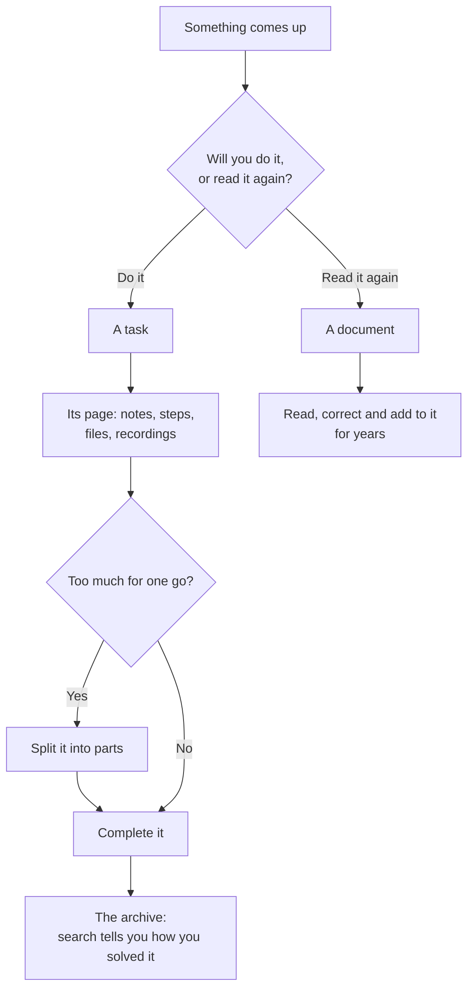
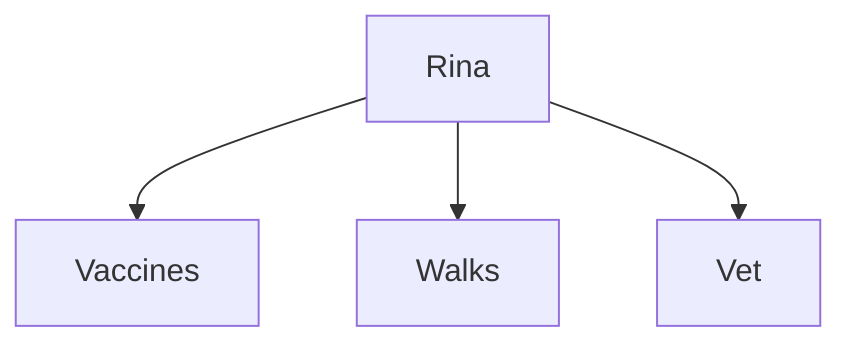
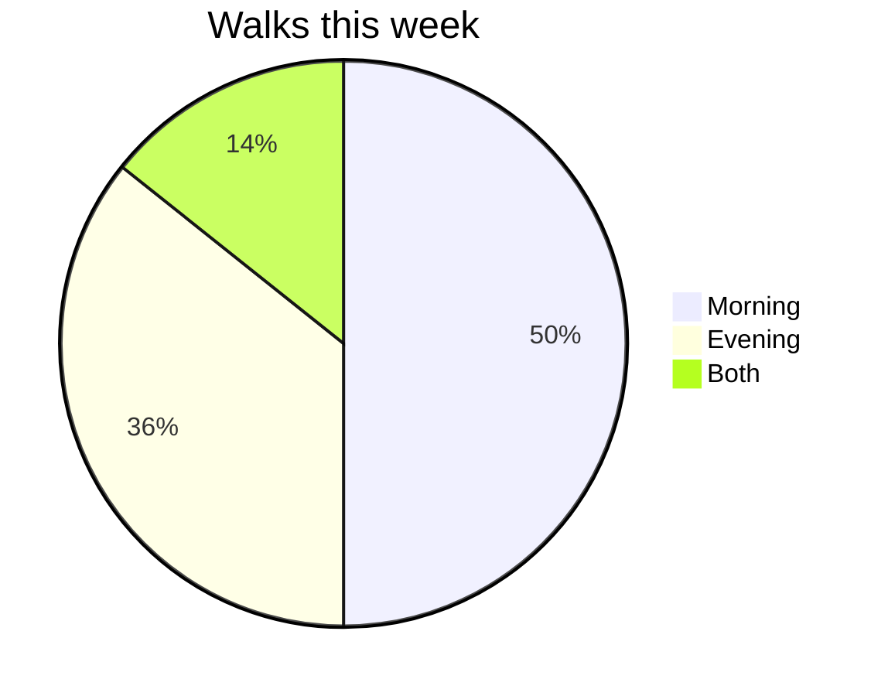
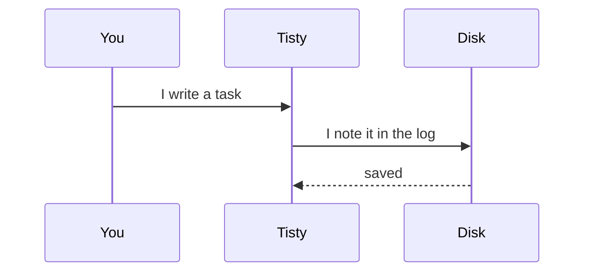

# How Tisty works

Tisty keeps two things: **tasks**, what you are going to do, and **documents**, what you are going to read again. Everything stays on this computer, as text any program opens, with no accounts, no subscriptions and no telemetry. It is open source: anyone can read all of it.

And it does not forget. A task you finished is archived with what you wrote in it, and months later a search tells you how you solved it.

Lost? The `?` at the foot of the sidebar opens the full help right here, offline too. Come back to this guide whenever you like from Settings → General.

## A task or a document?

In short: if you are going to do it, it is a task; if you are going to read it again, it is a document.

- **A task is something to do.** It ends, often soon: you complete it and it goes to the Archive. But it does not go away. What you wrote on its page, its steps and its notes stay, and a search finds it when you need it. A task is knowledge with a date.
- **A document is something to keep.** A manual, a recipe, the notes on a client, a year of minutes: it is read again and again, corrected and added to, and it grows for years. It rarely ends.



:::details An example: planning a trip

1. It starts as a task, "Plan the trip south". On its page you note what you found out, what you ruled out and why, and you attach what a description could not hold: the booking PDF, the photo of the map, the audio from whoever recommended the place.
2. When the plan is clear, the work is split into **parts**: "Buy the tickets", "Book the lodging", "Rent the car". Each one is a task with its own steps.
3. The parts are completed one by one, and then the trip. It goes to the Archive.
4. A year later, "where did we stay in the south?" finds it: its page, its parts and every step, as they were left.

:::

When doing a task teaches you something you will need again (the fix for a fault that comes back, how a supplier wants to be asked), keep it in a document as well.

---

## Tasks

### Write the way you speak

There is no form to fill in. Type the whole sentence in the bar at the top and Tisty picks out the day, the list and the priority as you type.


Each part it understands is coloured:

| You write | Colour | It understands |
| --- | --- | --- |
| ==tomorrow 10am=={blue} | blue | a day and a time, the way you would say them |
| ==on Friday=={blue} | blue | the next one coming |
| ==before Friday=={blue} | blue | a deadline: the latest it can be done |
| ==every tuesday=={pink} | pink | something that comes back on its own |
| ==#home=={pink} | pink | a tag: what it is about |
| ==@work=={green} | green | a list: where it happens |
| ==!schedule== | no colour | the priority: do, schedule, delegate or minor |

If a part is not coloured, it stays in the title, and that is fine.

Try these:

- `Rina's booster on 3 October !do #health`
- `Walk Rina every day`
- `Hand in the report before Friday @work`

A **date** is when you plan to do it; a **deadline**, the latest it can be done. All the words it understands (days, hours, deadlines, what repeats, in English and in Spanish) are in [natural language](https://www.tisty.app/docs/natural-language/).

### Capture without opening the window

Press `Ctrl` + `Shift` + `Space` wherever you are and a small window opens to write a task. `Enter` saves it, `Esc` closes it, and you carry on with what you were doing.

If another program already uses that shortcut, Tisty takes another one and tells you which in Settings.

### Today, Upcoming, Repeating and All

The task list is split into four views:

- **Today** — what the day asks for, most urgent first:
  - **overdue**: its deadline passed;
  - **due soon**: the deadline is close;
  - **late**: the day you planned passed, with no deadline;
  - **for today** and **underway**.
- **Upcoming** — what is coming.
- **Repeating** — what comes back on its own.
- **All** — everything open, unfiltered.

What is overdue sits at the top, in red; what is late, in amber. A task is only overdue once its deadline passes: if you only gave it a day, it runs late, but it is never overdue. There is no prize for emptying the list.

### The Spread and reminders

**Spread**, in the sidebar, is your work calendar: each day is a row that grows with what it carries. What you wrote with no day waits in the **With no day** tray; drag it to the day it belongs to. If you drop a task on a day that already carries two, Tisty tells you and offers the next free day. **Month** shows the same days as a grid, for a look over the month.

A reminder is a time you choose on the task. It rings on this computer and on no other, as a system notification with a short sound you can turn off. More in [the Spread and reminders](https://www.tisty.app/docs/spread-and-reminders/).

### Priorities are a map, not a ladder

Two questions, four boxes: whether it is pressing and whether it matters.


- **Do** — urgent and important. Today.
- **Schedule** — important, no rush. Give it a date before it turns urgent.
- **Delegate** — pressing, but not yours. Leave it to whoever should carry it.
- **Minor** — neither pressing nor important. That quadrant has its own "I won't do any of them".

Drag a task into the quadrant it belongs in. What you do not sort waits in the tray beside it, without scolding you.

### Lists and tags

Two ways of sorting that do not compete:

- A **list** says where it happens: ==@home=={green}, ==@work=={green}. A task belongs to one.
- A **tag** says what it is about: ==#health=={pink}, ==#shopping=={pink}. A task carries as many as you like.

A tag also works in a document: write `#health` in the middle of a sentence and the document is filed under that same tag. **Tags**, in the sidebar, gathers everything that carries one: what you have to do and what you wrote about it.

### What stays written

A task keeps more than its title. It opens on a page of its own, with sections to fill in (what it is about, how you will know it is done, its steps, what you found out along the way) and in each one a grey hint saying what goes there. Every box you write on that page, `- [ ]`, is one of its steps. Completing it erases none of that: it is archived with its date.

:::details Parts: when a step needs more than a line

A step is a line, a hundred characters at most. If it needs more, make it a task of its own, a **part** of this one: hover over the box and click **↗**. The line becomes its card, with its steps and its date, and a click opens it.

A task with parts shows a counter like **▣ 3/7** where its steps would count, and its parts fold beneath it. Beside the page, **Parts** adds a new one and **Part of another…** hangs it under another task; **Let it go** sets it loose again. Closing a task with parts still open asks you to let them go in the same move, and undo brings them back.

:::

A routine has one page for all its rounds. What you write under **This time** belongs to the round under way: completing it moves it to **Rounds**, under the page, and the section is blank again for the next one.

That is the difference: the list tells you what is left; the Archive tells you how you solved it last time. Search for a word you remember and it comes up, even if you closed it two years ago. The rest, step by step, is in [tasks](https://www.tisty.app/docs/tasks/).

### Completing, dropping and erasing

- **Complete** marks a task done and sends it to the Archive.
- **Close with a summary** asks you for two lines on how it went before completing it.
- Once it closes, its page is kept with it: it can be read but no longer written. Reopen it and it comes back.
- Dropping a task puts it aside without doing it: it also ends up in the Archive.
- What is in the Archive stays there in case you look for it. It does not get in the way.

The Archive reads in three layers: the **stories**, which left something written; the **routines**, which come back; and the **trace**, what closed leaving next to nothing.

> **Before erasing for good.** It is only possible for what is already closed **and** reads as a trace. Erasing takes it off this computer, and off the others at the next sync, and there is no undo.

Settings → Maintenance looks over your history, your documents and your attachments, counts what is spare and what is missing, and changes nothing on its own. Each layer of the Archive is in [the archive](https://www.tisty.app/docs/archive/).

---

## Documents

### A document

A document is text of yours, kept as Markdown: plain text with a few marks, like `**bold**`, that any program opens. You do not need to learn it: Tisty offers you everything with the `/` key. And the file is what counts: if you delete Tisty tomorrow, your documents still open in any text editor.

**To make one**, go to Documents and use the **+** at the top: **New document**. Inside a folder, that same button makes it there, and **New folder** groups them.

The first line of the document is its title: there is no name to fill in anywhere else. Its properties, such as its tags or the paper it prints on, show in the panel beside it, under **About this document**.

To write:

- Click a paragraph and it opens for writing; `Esc` turns it back into the page.
- Select a few words and a small bar offers bold, italic, a link or the highlighter; right-click offers the same, plus copying and editing the block.
- `Ctrl`/`⌘` + `Shift` + `M` shows the block's marks, and `Ctrl`/`⌘` + `E` opens the whole document as one text.
- Drag a file in to attach it: the photo from the vet, the insurance PDF.
- Insert **another document**: alone in its paragraph it comes in as a card you open with a click; inside a sentence it is a word you click.

**Export**, in the document's panel, prints it, saves it as a PDF, a web page or a Word file, and copies it as standard Markdown for any other editor.

**Folders start folded** and open on the arrow.

When a matter is over, archive the folder with a right-click: it drops to the **Archived** shelf at the foot of the tree, with everything inside it. There it can be read and exported, but not written. Unarchive it and it comes back as it was. More in [documents](https://www.tisty.app/docs/documents/).

### A document in several languages

A manual for your team in Spanish and English, a contract in two languages. Each language is a document of its own, with its own file, and Tisty shows them as one: one row in the tree, opened in the app's language.


**To translate one**, open the document's menu and choose **Translate into…**: it writes a copy of its text and its pages, ready to translate section by section. If you already have both written, **Join with its other language…** brings them together, and **Take out of its languages** separates them again.

The switch sits in the title panel and takes you to the same section in the other language. Moving, archiving or deleting acts on every language at once. This guide is one: it is in Spanish too, a click away in its switch.

### Diagrams by hand

A code block whose language is `mermaid` stops being code and is drawn: it fits any width, reads well in dark mode, and a click opens it large. A double-click opens it in the diagram window, where you can also draw a mind map, a schema, a freeform diagram or a class diagram by hand.


Here, Rina and what surrounds her:



The week's walks, split up: seven in the morning, five in the evening and two with both.



And who talks to whom when you write a task:



### Sheets, page breaks and PDF

A rule on its own cuts the sheet when printing: what follows starts on the next one, and `Ctrl`/`⌘` + `Enter` writes one while you type. Turn on **Sheets** in the document's panel to read it on real sheets (A4, Letter or Folio, portrait or landscape), where a sheet that fills up turns to the next on its own.

**Export**, in the document's panel, saves it as a PDF on those same sheets.

---

With **Sheets** on or in the PDF, this paragraph already starts on the next sheet.

### A document with pages

A year of minutes, a book in chapters, a dog's life told year by year: that does not fit on one sheet, nor in a folder of loose sheets.

A page is a document like any other, with its own file, that also says which document it belongs to. There is one level and no more: a page has no pages.

**To add one**, type `/` where you want that chapter to start and choose **A new page**, or **A page that already exists** if you already wrote it. It is named right there, drawn as a card with its title and its first words. In the tree, dropping a document onto another also makes it a page of it.

> [!IMPORTANT]
> The order in which they are named in the text is the order of the pages: in the tree, when exporting and when printing. To move a chapter, use the arrows on its row in the index at the end of the document, or `Alt` and an arrow key on the row.

At the end of the document comes the index, with its pages numbered. Inside a page you see at the top which document it belongs to, arrows to its sibling pages, and at the bottom the step to the next one. A page is archived on its own with a right-click and stays dimmed in its document; archiving the document puts them all away. How a book prints, with its index, is in [pages and PDF](https://www.tisty.app/docs/pages-and-pdf/).

This guide has one, and it is named here:


### What fits inside a document

Everything below is ordinary Markdown: you write it with `/`, and the file left on disk reads the same to GitHub as to Tisty. None of this is required: if you only want to write, skip this section, since everything is inserted with `/`. Nothing here is explained; it is shown. Each form has its own page in the [Tisty Markdown guide](https://markdown.tisty.app), and `F1` opens it on the one you are writing.

And to see it all together, one of each, there is a separate page:


#### The usual

**Bold**, *italic*, ~~struck through~~, ++underlined++, `loose code` and a [link to a website](https://github.com/rgdevment/Tisty). Bulleted lists, numbered ones, and quotes:

> What is not written down did not happen.

1. This first
2. Then the other thing
3. And that one at the end

#### Footnotes

A word can carry a note without breaking the sentence it is in: Rina had her booster in March[^march], and the vet wants her back in a year.

[^march]: The annual vaccine and the rabies shot on the same visit, with the blood test. A note like this one is called with `[^label]` and written once, on a line of its own; GitHub reads it the same way.

The call is the small raised label, and a click on it takes you to the note.

#### Callouts

Five kinds, each with its own name and colour. Underneath it is a quote that starts with its name in brackets, which is how GitHub writes them.

> [!NOTE]
> For what is worth knowing, with no urgency at all.

And nearly anything fits inside a callout, not only text:

> [!TIP]
> Rina's food:
>
> - Weigh the portion
> - Write it in her table
>
> ```text
> 250 g in the morning, 200 g in the evening
> ```
>
> ---
>
> All of this reaches the PDF just the same.

#### Tables

A table is written right on the page: click a cell and type. The `⋯` menu of a row or a column moves, duplicates or removes it, and gives a column a type (a date with its calendar, money, options with their colours, stars, a switch) that adds up at its foot. Sort and filter from a column's title without touching the file, and drag the edge of a heading to make its column wider.

| Vaccine | Given | Due again |
| :--- | :---: | ---: |
| Annual | march | 12 months |
| Rabies | march | 12 months |
| Worming | august | 3 months |

The width is kept in the length of the rule under the header: other Markdown readers see a plain table, and Tisty keeps the width you gave it.

#### Formulas

A block whose language is `math` sets the formula.

```math
dose = \frac{weight \times 0.5}{2}
```

```math
\sum_{i=1}^{n} i = \frac{n(n+1)}{2}
```

A formula also fits inside a sentence, between dollar signs: Rina weighs 12 kilos, so her dose is $\frac{12 \times 0.5}{2} = 3$ millilitres. A dollar followed by a digit is a price, so `$5` stays five dollars.

All of this is drawn with what ships inside Tisty: nothing is requested from the internet, and it works offline.

#### Widgets

A block whose language is `widget` is drawn as a fixed view, only HTML and CSS. It runs nothing and loads nothing from outside, so it looks the same wherever the document is read. It takes Tisty's colours and comes with ready classes such as `grid`, `stat`, `card` or `badge`. The code stays folded; open it with "Show code".

```widget title="Rina this month"
<div class="grid">
  <div class="stat"><small>Walks</small><b>42</b><em class="up">+6 vs August</em></div>
  <div class="stat"><small>Kilometres</small><b>61</b></div>
  <div class="stat"><small>Next vaccine</small><b>12 Nov</b><span class="badge warn">due</span></div>
</div>
```

An `.html` file attached to a document is only a file: Tisty never runs it.

#### Files, sound and video

An attached file is drawn as what it is: a picture as itself, which a click opens large; a sound or a video with its player; and anything else, an `.html` page too, as a card with its type and size. Every card has a **⋯** to save a copy, turn it into a plain link or take it off the page. A video still in your cloud downloads only when you press play.

#### A link alone

A link alone in its paragraph is drawn as a card; the same link inside a sentence stays a link. The card is built from what the address already says, without asking anybody anything: if you want the site's title and picture, ask for them with **Bring the preview**.

[Tisty on GitHub](https://github.com/rgdevment/Tisty)

#### Code, with a name and a colour

A code block is coloured by its language, and you can give it a name: write the language and then `title="whatever"`. The name shows in the block's header, and the colour reaches the PDF too.

```python title="dose.py"
weight = 12
print(weight * 0.5 / 2)
```

```json title="rina.json"
{ "name": "Rina", "weight": 12 }
```

There is more to say about code, and it fits on a page of its own:


### What comes from elsewhere

Tisty keeps what you write exactly as you wrote it: properties, footnotes, links and comments stay in the file, word for word.

What arrives from elsewhere comes in converted into Tisty Markdown, and the file it came from is not touched:

- **Import a document**, in the tree, takes Markdown, text, a web page or a Word file.
- Pasting keeps the headings, lists, tables, links and colours of what you copied from a web page, an email or Word.
- An Obsidian note comes in with its callouts converted and its `[[links]]` pointing at the documents here with those titles.
- **Export for Tisty…** carries whole folders, with their pages, to another Tisty in a `.tistyx` file, and opening it brings them in as they were.
- An `.ics` calendar comes in too: drag it onto the window and choose which events become tasks.

A Markdown file can also be read without bringing it in: choose Tisty under **Open with** and it opens in a lightweight viewer that does not touch the file. What changes on each crossing is in [convert to and from Markdown](https://www.tisty.app/docs/convert-to-and-from-markdown/).

---

## Your data

### Your copies in the cloud and syncing

Tisty always works on this computer. To reach it from another one, tell it where to leave the copies, in Settings → Sync:

- **Straight to a cloud**: your Google Drive, your OneDrive or your own WebDAV server (Nextcloud, ownCloud, Synology and others), with nothing else installed.
- **A folder**: Google Drive, OneDrive, iCloud or Dropbox if they are installed, or any folder both computers reach. There, whoever uploads and downloads is your provider's program, not Tisty.

> There is no server of ours in between. Syncing gives you redundancy, not time travel: if you delete a task, the deletion travels too.

When two computers wrote the same part of a document, Tisty does not choose: it shows you both versions and you keep **This one**, **The other** or **Both**.

A shared folder is not a backup. In Settings → Your data you save a full backup whenever you want. Uninstalling Tisty leaves your tasks and documents where they are; where they live and how to delete them for good is in [sync and backup](https://www.tisty.app/docs/sync-and-backup/).

### Encryption and computers that sign

A copy straight to a cloud can be encrypted in Settings → Security with your 24-word phrase, and then not even your provider can read it. That same phrase backs your identity: keep it on paper or on the PDF sheet Tisty offers. A folder is not encrypted.

Every computer signs what it writes, and a new one waits until you confirm it is yours:

1. A notice appears in the sidebar with that computer's name.
2. **Confirm…** shows you its twenty-digit code.
3. On the new computer, in Settings → Sync, **Show large** shows its own.
4. If the two codes match, **Yes, it is the same** lets it through; if not, **It doesn't match** keeps it out.

### Sharing a document

The panel beside a document has a **Shared** row with **Share…**. Sharing goes through Folio, a service separate from Tisty: it creates an end-to-end encrypted link, to read or to edit, and you choose how long it lasts. Whoever opens it needs no account. If Folio is not open yet, Tisty tells you and nothing of your document leaves this computer.

The first time, Share asks you to create your identity: the key you sign what you share with, backed by a 24-word phrase. Keep that phrase on paper or on the PDF sheet Tisty offers you. Nobody from Tisty or Folio will ever ask you for it. More in [documents](https://www.tisty.app/docs/documents/) and in [privacy](https://www.tisty.app/docs/privacy/).

---

## When you want more

### An assistant can write here

If you use an assistant such as Claude Code or Codex, it can come into Tisty through MCP, with a program that runs on this computer. Settings → Assistants finds the ones you have installed and connects one with a click. What it writes is signed with its name: "by Claude Code", "by Codex".

- **It can** propose tasks, write documents, add to or correct the ones it may write in, and mark one that has had its day, saying why.
- **It can say** that a task or a step is done. The task stays in **To confirm** until you finish it or send it back with **Still to do**; the steps wait for you with **Tick them** or **Not yet**.
- **It cannot** close or delete a task, delete a document, or change a task you wrote.

If you wrote in a document while it was reading it, it does not write over you: it is asked to read it again. And when something writes in the document you have open, the window tells you and offers to go back to what it said before. How to connect one and what each door lets through are in [assistants and MCP](https://www.tisty.app/docs/assistants-and-mcp/) and in [what an assistant may do](https://www.tisty.app/docs/mcp-permissions/).

### Shortcuts

| Shortcut | What it does |
| --- | --- |
| `Ctrl` + `Shift` + `Space` | Capture a task without opening the window |
| `Ctrl`/`⌘` + `Enter` | Complete the task you are on; in a document, a page break |
| `/` | Insert something inside a document |
| `Shift` + `Enter` | Break the line without starting a paragraph |
| `Ctrl`/`⌘` + `Shift` + `M` | Show or hide the block's marks |
| `Ctrl`/`⌘` + `E` | Open or leave the whole document as text |
| `F1` | Open the Tisty Markdown guide on what you are writing |
| `Tab` · `Shift` + `Tab` | Walk the cells of a table |
| `Ctrl`/`⌘` + `X` · `V` | Move a document between folders |
| `Esc` | Close whatever is open |

The rest is in [keyboard shortcuts](https://www.tisty.app/docs/keyboard-shortcuts/).

## If it was any use

Everything Tisty does is explained in [the Tisty docs](https://www.tisty.app/docs/), with [frequently asked questions](https://www.tisty.app/docs/faq/), and every form a document can hold, in [the Markdown guide](https://markdown.tisty.app).

Questions and ideas go to [Discussions](https://github.com/rgdevment/Tisty/discussions); a bug, to [Issues](https://github.com/rgdevment/Tisty/issues).

This guide is written and signed by rgdevment, who makes Tisty. [rgdevment's GitHub profile](https://github.com/rgdevment) holds two more tools, with the same idea: free, open, no ads, no telemetry, all on your computer.

- [**CoPanda**](https://copanda.app) — a clipboard manager for Windows and macOS.
- [**LinkUnbound**](https://github.com/rgdevment/LinkUnbound) — a browser picker for Windows and macOS: it asks which one should open a link instead of assuming. If it is installed, the links you open from Tisty go through it.
