# One of each

This page is the guide's sample case: one of everything a document can hold, all on one sheet. Nothing here explains much; it is here to be looked at, edited and printed. If something on this page looks wrong, that is worth telling us.

---

## Words

**Bold**, *italic*, ***both at once***, ~~struck through~~, ++underlined++ and `loose code`. A [link to a website](https://github.com/rgdevment/Tisty), and the same address written bare between angle brackets: <https://github.com/rgdevment/Tisty>. An address for mail works the same way: <rina@example.com>.

Four pens: ==yellow==, ==green=={green}, ==blue=={blue} and ==pink=={pink}.

Icons, with a colour or without: ::dog orange:: ::bone amber:: ::heart red:: ::leaf green:: ::moon indigo:: ::star::

Emoji by name: :dog: :tada: :+1: :sunny:

A tag written in a document files the document under it: #rina, #vet.

A line ends where you end it.
This line is the same paragraph, one line down.

## Headings

### Third level

#### Fourth level

##### Fifth level

###### Sixth level

## Lists

- Lead
- Poo bags
  - The green ones
  - The spare roll
- Water

1. Put her lead on
2. Walk to the park
3. Let her off by the pond

Stages, ticked as they go:

- [x] Bring Rina's record book
- [x] Weigh her before the appointment
- [ ] Ask about the tick tablet

## Quotes and callouts

> What is not written down did not happen.

> [!NOTE]
> For what is worth knowing, with no urgency at all.

> [!TIP]
> For the shortcut you found the hard way.

> [!IMPORTANT]
> For what cannot be passed over.

> [!WARNING]
> For what can go wrong if you do not look.

> [!CAUTION]
> For what has no way back.

## A table

Columns leaning left, centred and right, and the first one wider: its rule is drawn longer.

| Vaccine | Given | Due again |
| :------------------ | :---: | ---: |
| Six-in-one | march | 12 months |
| Rabies | march | 12 months |
| Worming | august | 3 months |

## Code

```rust title="src/walk.rs"
fn walks_today(done: u8) -> &'static str {
    if done >= 2 { "enough" } else { "one more" }
}
```

```python title="weight.py"
weights = [13.2, 13.8, 14.1]
print(sum(weights) / len(weights))
```

```ts title="remind.ts"
const due = new Date("2026-11-12");
const days = Math.ceil((due.getTime() - Date.now()) / 86_400_000);
```

```html
<p class="note">Rina was here.</p>
```

```css
.note { color: tomato; font-weight: 600; }
```

```yaml title="walks.yml"
morning: "08:00"
evening: "21:00"
```

```diff
- const WALKS: u8 = 1;
+ const WALKS: u8 = 2;
```

```text
Plain text, with no colour at all.
```

## Diagrams

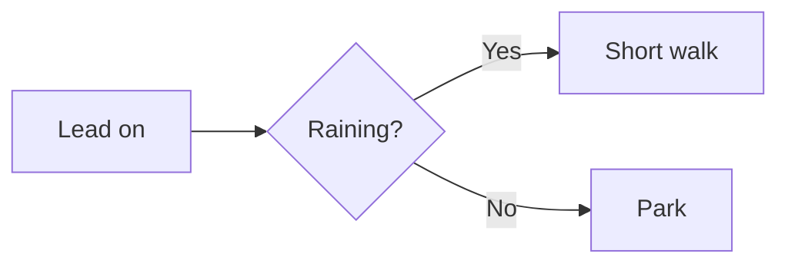

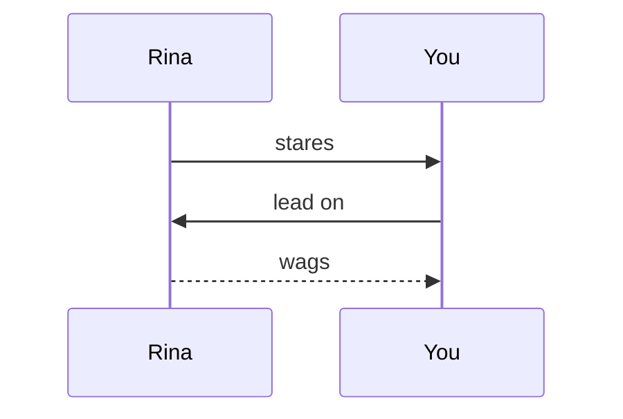

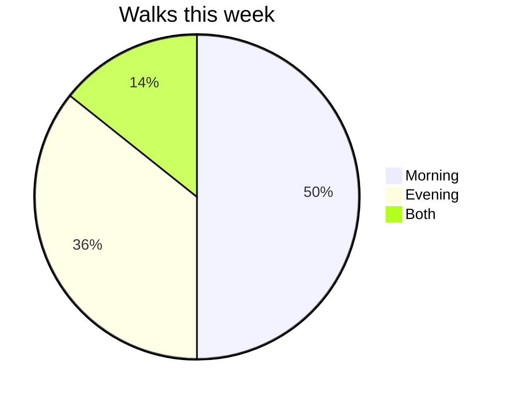

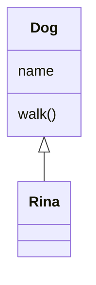

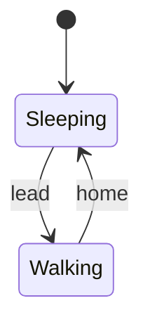

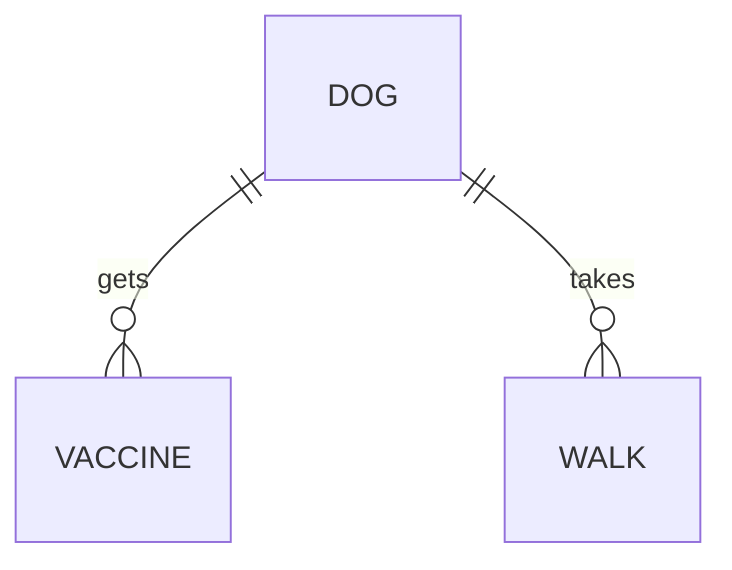

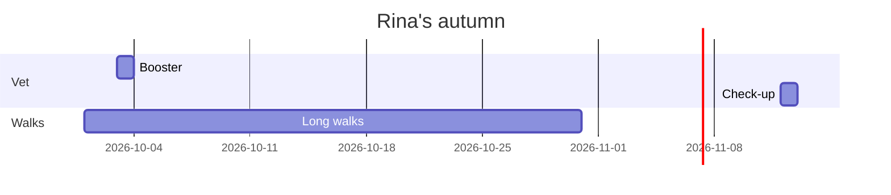

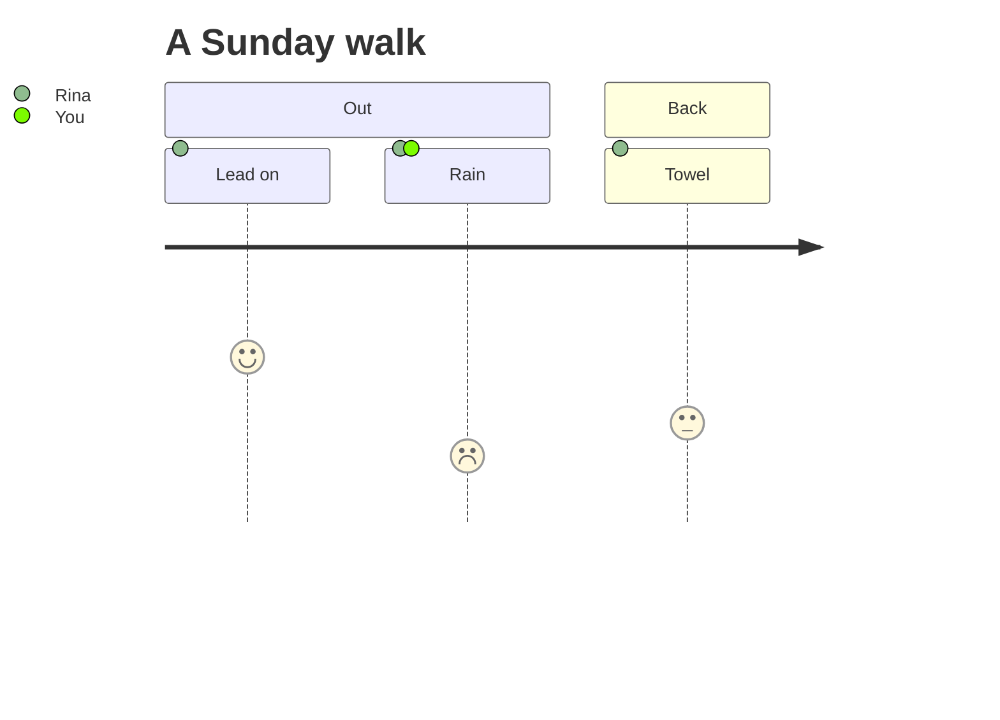

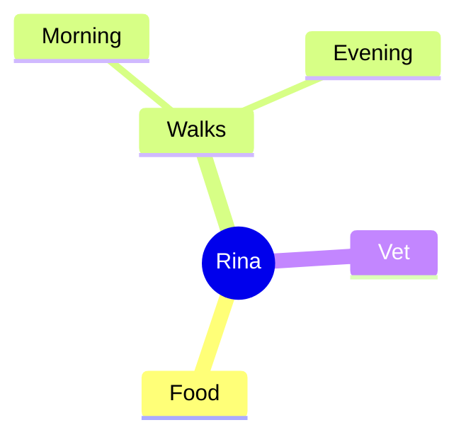

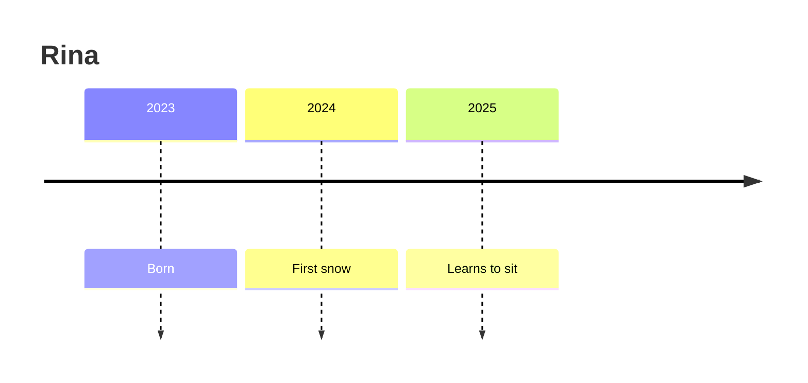

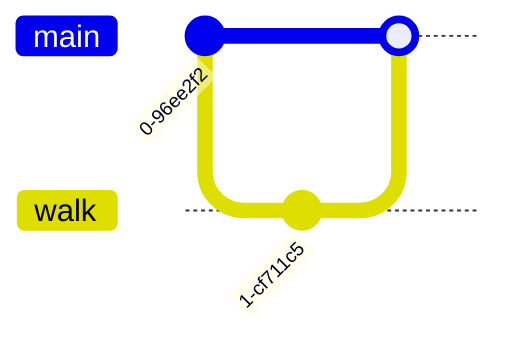

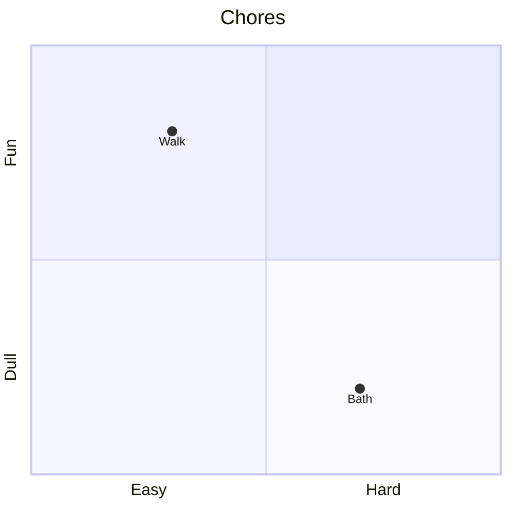

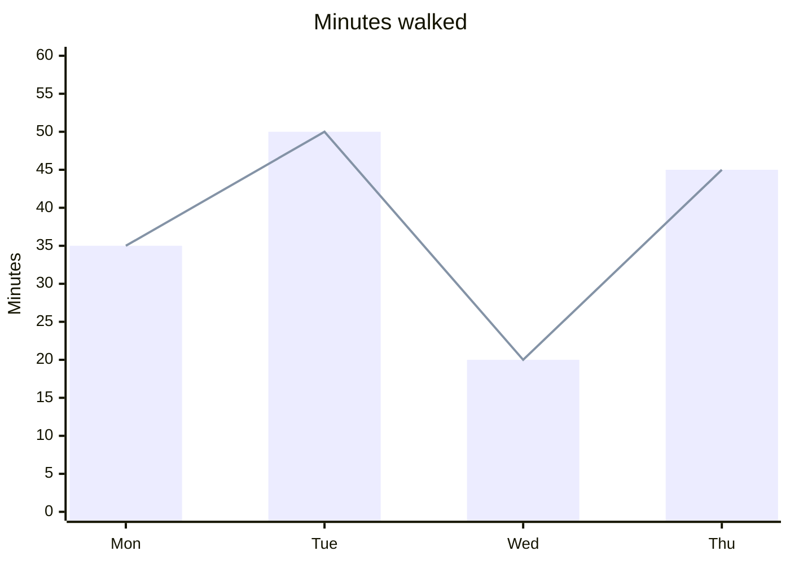

## Formulas

```math
dose = \frac{weight \times 0.5}{2}
```

```math
\sum_{i=1}^{n} i = \frac{n(n+1)}{2}
```

```math
\int_0^1 x^2 \, dx = \frac{1}{3}
```

```math
\begin{pmatrix} 1 & 0 \\ 0 & 1 \end{pmatrix}
```

## A widget

```widget title="Rina this month"
<div class="grid">
  <div class="stat"><small>Walks</small><b>42</b><em class="up">+6 on August</em></div>
  <div class="stat"><small>Weight</small><b>14 kg</b><em class="down">−0.3 kg</em></div>
  <div class="stat"><small>Next vaccine</small><b>12 Nov</b><span class="badge warn">due</span></div>
</div>
<div class="card" style="margin-top:12px">
  <div class="head"><h3>Checks</h3><span class="badge bad">one missed</span></div>
  <ul class="list">
    <li><span class="box done"></span><span class="gone">Ticks</span></li>
    <li><span class="box"></span>Ears</li>
  </ul>
  <div class="row"><button class="primary">Done</button><button>Later</button></div>
</div>
```

## Attachments

A picture:

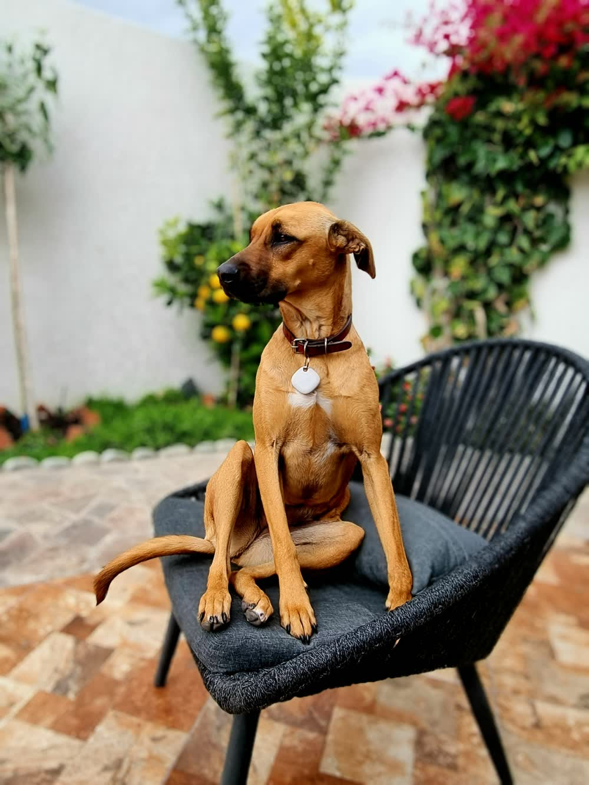

A PDF:


A sound:


A film:


Data:


A page of HTML, drawn as a widget:


The same page, kept as a file:


## A link alone

[Tisty on GitHub](https://github.com/rgdevment/Tisty)

## A rule

What follows starts on the next sheet when printed.

---

That is all of it.
