# One of each

This page is the guide's sample sheet: one of everything a document can hold, with a live example, how it is written and what it combines with. It is here to be looked at, edited and printed. If something on this page looks wrong, tell us in [Issues](https://github.com/rgdevment/Tisty/issues).

Three ways to read it:

- Write on the sheet itself: click anywhere and type there, with no marks in sight.
- The **⋯** at the top, or `Ctrl`/`⌘` + `E`, shows it in **Markdown**: that is how each example is written.
- The `/` key inserts all of it without learning a single mark. Each section says what it is called in that menu.

## Properties

This sheet starts with a block of properties between two `---` lines, before the title. The page does not draw it: it is in the panel beside the page, under **About this document**, where **Edit** opens it as it is written.

```yaml title="The first lines of this sheet"
---
tags: [rina, roger]
source: the Tisty guide
---
```

`tags:` files the document under each tag, the same as one written with `#` in a sentence. `title:` gives it another title; `paper:`, `sheets:` and `orientation:` say which sheet it prints on, and `lang:`, which language it is written in. Any other, like `source:`, is kept as it is.

---

## Words

What marks a few words inside a sentence. Select the words and a small bar offers the most used, as the right button does; the `/` menu has the rest.

| What | Written | Looks like | Shortcut |
| :--- | :--- | :--- | :--- |
| Bold | `**bold**` | **bold** | `Ctrl`/`⌘` + `B` |
| Italic | `*italic*` | *italic* | `Ctrl`/`⌘` + `I` |
| Underline | `++underlined++` | ++underlined++ | `Ctrl`/`⌘` + `U` |
| Strikethrough | `~~struck~~` | ~~struck~~ | `Ctrl`/`⌘` + `Shift` + `X` |
| Code | `` `code` `` | `code` | `Ctrl`/`⌘` + `Shift` + `C` |
| Link | `[a link](https://www.tisty.app)` | [a link](https://www.tisty.app) | `Ctrl`/`⌘` + `K` |
| Highlight | `==highlighted==` | ==highlighted== | the bar |
| An icon | `::dog orange::` | ::dog orange:: | the `/` menu |
| A step, by its number | `[[#2]]` | [[#2]] | the `/` menu |
| Reference | `[[Rina's vet card]]` | [[Rina's vet card]] | typed |
| Tag | `#rina` | #rina | typed |
| Emoji | `:tada:` | :tada: | typed |
| Footnote | `[^1]` | with its note[^1] | typed |
| Formula | `$\pi r^2$` | $\pi r^2$ | typed |

### One inside another

A mark fits inside another: ***bold and italic at once***, **bold with a ==highlight== inside**, ==a highlight with *italic* and `code`=={green}, ~~struck with **bold**~~, ++underlined with *italic*++, a [link with **bold** and `code`](https://www.tisty.app), **an icon ::star amber:: in bold**, a :dog: inside ==a highlight=={pink} and a tag in italic, *#vet*.

The one thing that does not cross: a highlight or an underline starts and ends inside the same bold or the same link.

### Highlighters

**Highlight** paints in yellow, which takes no name. The other colours go in braces, right against the closing wall:

==yellow== ==red=={red} ==orange=={orange} ==amber=={amber} ==green=={green} ==teal=={teal} ==blue=={blue} ==indigo=={indigo} ==purple=={purple} ==pink=={pink} ==brown=={brown} ==gray=={gray}

The bar carries four: yellow, green, blue and pink. The other eight are typed, as in `==words=={teal}`.

### Icons

**An icon**, in the `/` menu, opens a search: type what it draws. It sits between two pairs of colons, with its name and, if you like, a colour:

::dog:: ::dog red:: ::dog orange:: ::dog amber:: ::dog green:: ::dog teal:: ::dog blue:: ::dog indigo:: ::dog purple:: ::dog pink:: ::dog brown:: ::dog gray::

It marks a line without spending a heading on it: ::bone amber:: food, ::walk green:: walks, ::syringe red:: vaccines, ::pill blue:: the tablet, ::heart pink:: cuddles, ::moon indigo:: the nap and ::star:: done.

### Emoji

An emoji goes in as it is, 🎉 🐕 🦴, or by its code between colons, the way GitHub writes them: :dog: :tada: :+1: :sunny: :bone: :paw_prints:

### Tags

A word after `#` files the document under it, and **Tags**, in the sidebar, gathers it with everything else that carries it: the March booster for #rina and #roger, with their #vet. Typing `#` offers the ones you already use.

### Links

- With words: [the Tisty site](https://www.tisty.app).
- The bare address: https://www.tisty.app
- Between angle brackets: <https://www.tisty.app>
- An email: <rina@example.com>

By reference, the address is said once, on a line of its own: the [map of the walk][park] and the [vet][clinic]. The page shows each definition where it is written, and a click on it edits it.

[park]: https://example.com/park
[clinic]: https://example.com/vet "Open on Saturdays"

A link alone in its paragraph is drawn as a card; it is further down, under **Cards**.

### Mentions and references

Two double brackets name something without linking it: [[Rina's vet card]] stays as a chip with that name. With a number, [[#2]] brings the words of this sheet's second stage, which is further down, under **Lists**, and a click takes you to it. On a task's page, that number is one of its steps.

Another document is mentioned inside a sentence too: here is [Rina's page](tisty:page), and a click opens it.

### Footnotes

A word carries its note without breaking the sentence: Rina had her booster in March[^march], and Roger a week later[^2]. A click on the call takes you to the note, which stays where you wrote it.

[^1]: The note from the table above. The label is a number or a short word.

[^march]: The annual vaccine and the rabies one at the same visit, with the blood test.

[^2]: Roger would not step on the scale.

### Formulas in a sentence

Between dollar signs: Rina weighs 14 kilos, so her dose is $\frac{14 \times 0.5}{2} = 3.5$ millilitres, and the round park measures $\pi r^2$. A dollar followed by a figure is a price, so $5 is still five dollars.

### Lines and paragraphs

A line ends where you end it.
This one is the same paragraph, one line down: `Shift` + `Enter`.
And this one was cut with a backslash at its end,\
which breaks the line in any Markdown reader.

A blank line starts another paragraph: `Enter`.

### Comments, entities and backslashes

A note to yourself that the page does not show goes between `<!--` and `-->`. This paragraph holds one: click it and you see it. <!-- ask about the tick tablet -->

An entity names a character that is hard to type: &copy; 2026 Rina &amp; Roger's vet, 14&nbsp;kg, 2&nbsp;&times;&nbsp;7&nbsp;=&nbsp;14, &hearts; and &rarr;.

A backslash leaves a sign as it is, without what it would mark: \*no italic\*, \`no code\` and \[no link\]. At the start of a line, the same:

\# Not a heading.
\- Not a list.
1\. Not a numbered one either.
\> Nor a quote.

---

## Headings

Six levels, from `#` to `######`, always with a space after. The `/` menu offers the first three: **Heading**, **Subheading** and **Small heading**. The first line with words is the document's title, and the rest make up the outline in the panel beside the page.

### Third level

#### Fourth level

##### Fifth level

###### Sixth level

### A heading with an ::star amber:: icon, *italic*, a ==highlight== and `code`

---

## Lists

**Bulleted list**: a dash and a space; `*` and `+` work too. Indent two spaces and one sits inside another.

- Lead
- Poo bags
  - The green ones
    - The spare roll
- Water

**Numbered list**: a number with its full stop, or with a bracket, as in `1)`. It nests the same way, and mixes with bullets.

1. Put her lead on
2. Walk to the park
   1. On the shady side
   2. Without crossing the avenue
3. Let her off by the pond
   - Only if there are no ducks

A numbered list keeps the number it starts with:

4. Walk back home
5. Dry their paws

**Stages**: boxes you tick with a click, on the page and while you write. In a document they are not tasks: they have no date and do not show in Today. On a task's page, though, each box is one of its steps.

- [x] Bring Rina's vet card
- [x] Weigh her before the appointment
- [ ] Ask about the tick tablet
  - [ ] And about Roger's
- [ ] Book the next appointment

An item carries its marks and, under it, other blocks indented to its level: a quote, code, a picture.

- **Morning** ::sun amber:: the long walk, with ==water=={blue} and the long `lead`.

  > Rina pulls less if Roger goes out first.

  ```text
  35 min · 2.4 km
  ```

- **Night** ::moon indigo:: the short one, to the corner, with [[#3]] still to do.

---

## Quotes and callouts

**Quote**: a line that starts with `>`. Another quote fits inside, and a list.

> What is not written down did not happen.
>
> > And what is half written half happened.
>
> - So this sheet
> - writes all of it down

A callout is a quote whose first line says its kind in brackets. There are five, each with its colour; in the `/` menu they are **Note**, **Tip**, **Important**, **Warning** and **Caution**.

> [!NOTE]
> For what is worth knowing, with no urgency at all.

> [!TIP]
> For the shortcut you found the hard way.

> [!IMPORTANT]
> For what cannot be passed over.

> [!WARNING]
> For what can go wrong if you do not look.

> [!CAUTION]
> For what has no way back.

The words can also go on the same line as the kind:

> [!TIP] Always bring the spare roll.

Other tools write the same callout between `:::tip` and a `:::` alone, and Tisty draws it the same:

:::warning

The ducks at the pond do not want to play.

:::

Almost anything fits inside a callout, as long as every line carries its `>`:

> [!IMPORTANT]
> **Rina and Roger's food** ::bone amber::
>
> 1. Weigh the portion
> 2. Note it in their table
>
> - [ ] Buy the 15 kg bag
>
> | Time | Rina | Roger |
> | :--- | ---: | ---: |
> | Morning | 250 g | 300 g |
> | Afternoon | 200 g | 250 g |
>
> ```text
> 450 g a day for Rina, 550 g for Roger
> ```
>
> > Roger eats faster: keep them apart.
>
> :::details And a collapsible section
>
> With what need not always be seen: the brand of the bag, where to buy it.
>
> :::
>
> ---
>
> All of this reaches the PDF the same.

## Sticky notes

A sixth kind, **Idea** in the `/` menu, is a note stuck on the sheet, in handwriting, a little crooked and held with tape or a pin. Its first line says when it was written, its colour and its side, in any order and separated by a middle dot; none is required. That is how **Brainstorm** writes each idea.

> [!IDEA] 2026-11-12 09:12 · yellow
> Try the new park, the one with the pond.

With `right` or `left` it goes to the side, and the paragraphs that follow flow round it:

> [!IDEA] 2026-11-12 · blue · right
> Can Roger eat carrot?

This paragraph runs beside the blue note, which is on the right. That is how an idea you appended to a document from Brainstorm ends up: next to what was already written, without cutting it. When the text is longer than the note, it carries on below it, across the whole sheet.

> [!IDEA] pink · left
> No date, and on the left.

And this one runs beside the pink note, which is on the left. A note is fine with just the colour, just the side or nothing at all: without a colour it wears the sheet's, inside a dotted line, like the next one.

> [!IDEA]
> No colour, no date, no side.

The same fits inside as in a callout, and pictures too:

> [!IDEA] 2026-11-12 18:30 · green
> **For Saturday** ::walk green::
>
> - [ ] Take them both up the hill
> - [ ] Take ==lots== of pictures
>
> 

The twelve colours, side by side:

> [!IDEA] pink · left
> pink

> [!IDEA] coral · left
> coral

> [!IDEA] orange · left
> orange

> [!IDEA] yellow · left
> yellow

> [!IDEA] lime · left
> lime

> [!IDEA] green · left
> green

> [!IDEA] teal · left
> teal

> [!IDEA] cyan · left
> cyan

> [!IDEA] blue · left
> blue

> [!IDEA] lavender · left
> lavender

> [!IDEA] violet · left
> violet

> [!IDEA] magenta · left
> magenta

---

## Collapsible sections

**Collapsible section**, in the `/` menu: a title you click to open or fold what is under it. It starts folded, and any block fits inside, another section too.

:::details Rina's full vet card

Born in 2023. Annual vaccine and rabies every March.

- Worming every three months
- [x] Chip registered

| Year | Weight |
| :--- | ---: |
| 2024 | 11.5 kg |
| 2025 | 13.2 kg |
| 2026 | 14.0 kg |

:::details And Roger's, inside hers

Roger arrived a year later and weighs two kilos more.

> [!NOTE]
> A callout inside a section inside another.

:::

:::

---

## Tables

**Table**, in the `/` menu, and it is written on the page itself: click a cell and type; `Tab` moves to the next one. The `⋯` menu of a row or a column moves it, duplicates it or removes it. From a column's heading you sort and filter without touching the file.

The colons in the rule under the heading align each column: left, centred and right. And the first one is wider because its rule is longer: ten pixels a dash, which is what gets written when you drag the edge.

| Vaccine | Given | Due again |
| :------------------ | :---: | ---: |
| Annual | March | 12 months |
| Rabies | March | 12 months |
| Worming | August | 3 months |

A cell carries one line of words with their marks, as in the table under **Words**, and a vertical bar inside it is written with a backslash in front:

| Written | Looks like |
| :--- | :--- |
| `morning \| night` | morning \| night |
| `**Rina** and *Roger*` | **Rina** and *Roger* |
| `==up to date=={green}` | ==up to date=={green} |
| `::syringe red:: :+1:` | ::syringe red:: :+1: |

### Column types

A word in braces at the end of a heading says what the column holds, and Tisty shows, sorts and adds up its cells by that. You pick it in the column's `⋯` menu, under **Type**: **Choice**, **Money**, **Percent**, **Date**, **Rating** and **Yes or no**. Each column also picks its **Total**: **Sum**, **Average**, **Minimum**, **Maximum** or **Count**. The foot is drawn and never written in the file.

| Expense | Kind {select} | Price {money USD sum} | Of the month {percent sum} | Next charge {date min} | Worth it {rating avg} | Paid {check count} |
| :--- | :--- | ---: | ---: | :--- | :--- | :---: |
| 15 kg bag of food | Food | 38.99 | 52 | 2026-12-01 | 5 | [x] |
| Tick tablet | Health | 17.50 | 23 | 2026-11-20 | 4 | [x] |
| Roger's grooming | Grooming | 12 | 16 | soon | 3 | [ ] |
| Squeaky ball | Play | 6.50 | 9 | 2027-01-05 | 5 | [ ] |

A value that is not written the way its type asks, like that "soon" among the dates, is shown as it is with a wavy line under it: nothing is refused.

**Text**, **Number**, **Duration** and **Tags**:

| Walk {text} | Laps {number max} | Time {duration sum} | Who {tags} |
| :--- | ---: | ---: | :--- |
| The pond one | 2 | 1h10m | rina, roger |
| The hill one | 1 | 45m | roger |
| The corner one | 3.5 | 20m | rina |

**Document**, **Web address**, **Email** and **Phone**:

| Who | Card {link} | Site {url} | Email {email} | Phone {phone count} |
| :--- | :--- | :--- | :--- | :--- |
| Marisol, the vet | [[Rina's vet card]] | https://example.com/vet | marisol@example.com | +56 9 1234 5678 |
| Jaime, the walker | [[October walks]] | https://example.com/walks | jaime@example.com | +56 9 8765 4321 |
| Yisset, the groomer | [[Roger's vet card]] | https://example.com/grooming | yisset@example.com | +56 9 5555 0199 |

---

## Code

**Code block**, in the `/` menu: a fence of three backticks, the language after it and, if you like, a name with `title="…"`. Each language is coloured its own way, and the colour reaches the PDF too.

```rust title="src/walk.rs"
fn walks_today(done: u8) -> &'static str {
    if done >= 2 { "enough" } else { "one more" }
}
```

```python title="weight.py"
weights = [13.2, 13.8, 14.0]
print(sum(weights) / len(weights))
```

```ts title="remind.ts"
const due = new Date("2026-11-12");
const days = Math.ceil((due.getTime() - Date.now()) / 86_400_000);
```

```json title="rina.json"
{ "name": "Rina", "weight": 14, "vaccines": ["annual", "rabies"], "chip": true }
```

```yaml title="walks.yml"
morning: "08:00"
night: "21:00"
```

```sql title="spending.sql"
SELECT month, SUM(amount) AS total FROM spending WHERE kind = 'vet' GROUP BY month;
```

```bash title="photos.sh"
rsync -a ~/Photos/Rina/ /Volumes/Backup/Rina/
```

```html
<p class="note">Rina was here.</p>
```

```css
.note { color: tomato; font-weight: 600; }
```

```diff
- const WALKS: u8 = 1;
+ const WALKS: u8 = 2;
```

```text
Plain text, with no colour at all.
```

To show a fence inside a block, wrap it in a longer one:

````markdown title="A fence inside another"
```python
print("woof")
```
````

Inside a sentence, code goes between backticks and is not coloured: `cargo build --release`, `~/Photos/Rina`. Nothing in code is a tag, a highlight, an icon or an emoji: `#rina ==no== ::dog:: :tada:`.

A fence of tildes, `~~~`, and a block indented four spaces are code too. There is more on code in [a page of its own](tisty:code).

---

## Diagrams

A block whose language is `mermaid` is drawn. **New diagram**, in the `/` menu, opens the diagram window; **Existing diagram…** copies one from another document, and **Mermaid block as text** leaves the fence empty for you to write. A click opens it large; a double click, in the window.

Four kinds are also drawn by hand in that window, and stay as you leave them. The free diagram, with its lanes and a `<br/>` that breaks the line inside a shape:

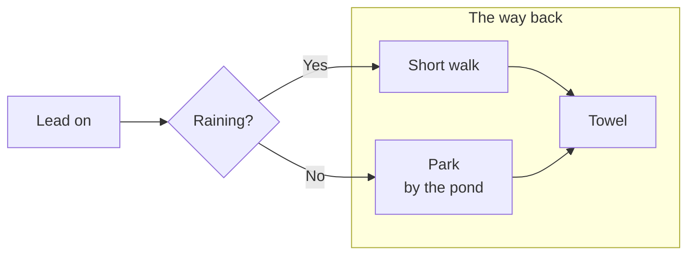

The mind map:

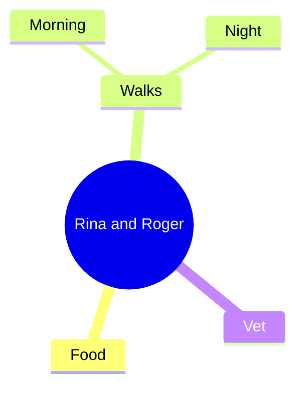

The database schema:

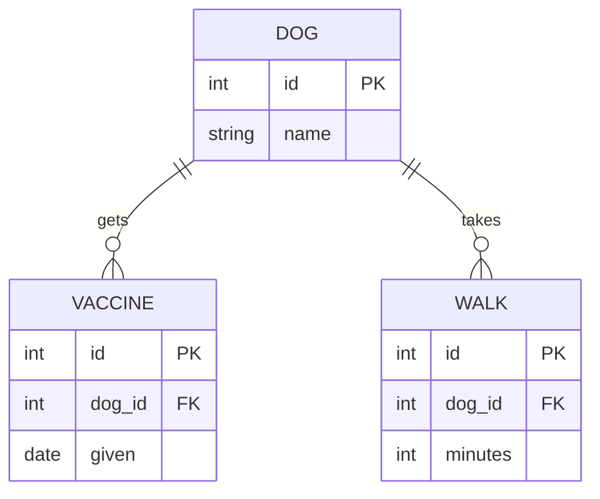

And the class diagram:

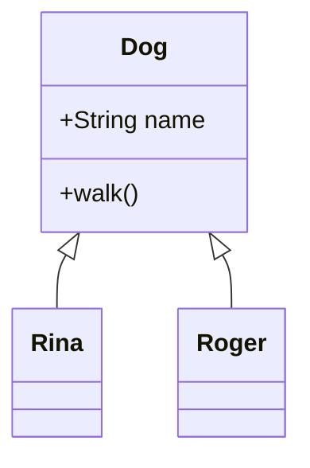

The rest are written in the text, with the drawing beside it. A sequence:

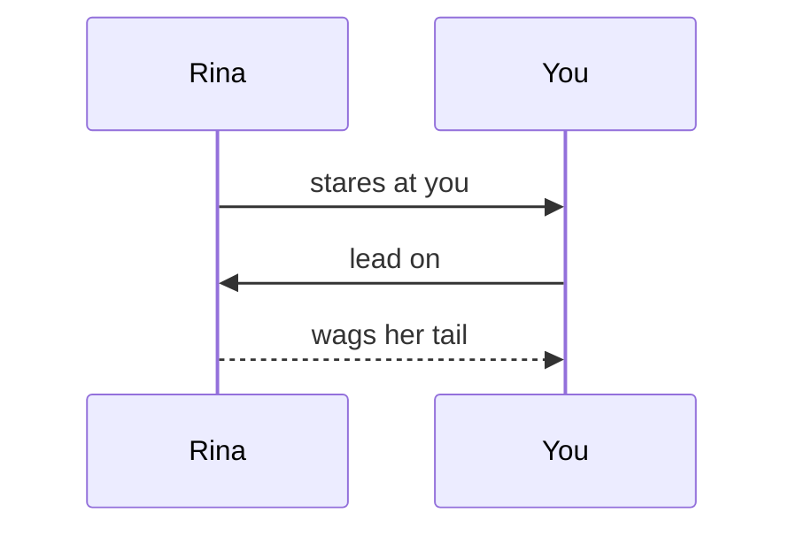

States:

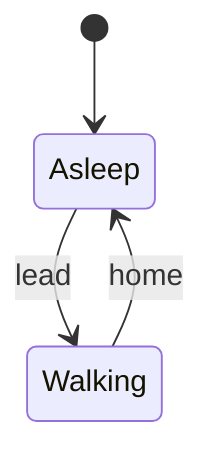

A pie:

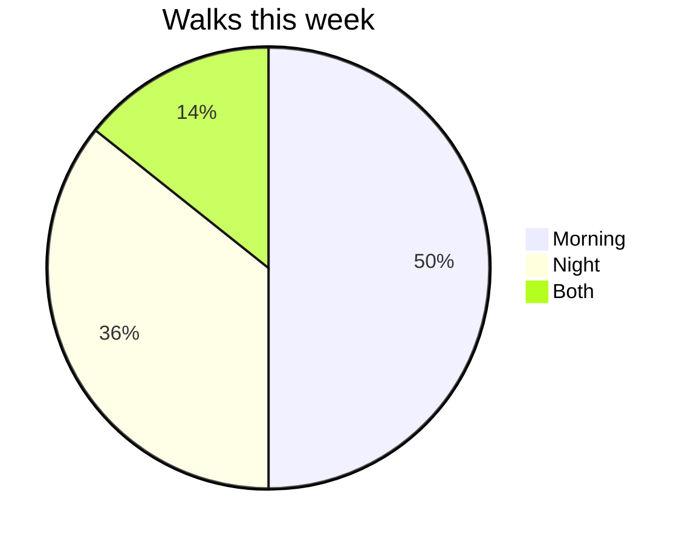

A Gantt chart:

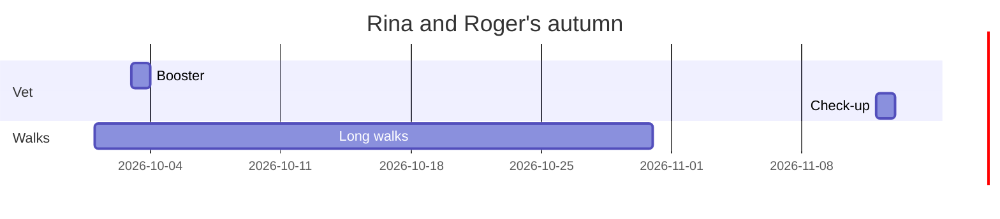

A journey:

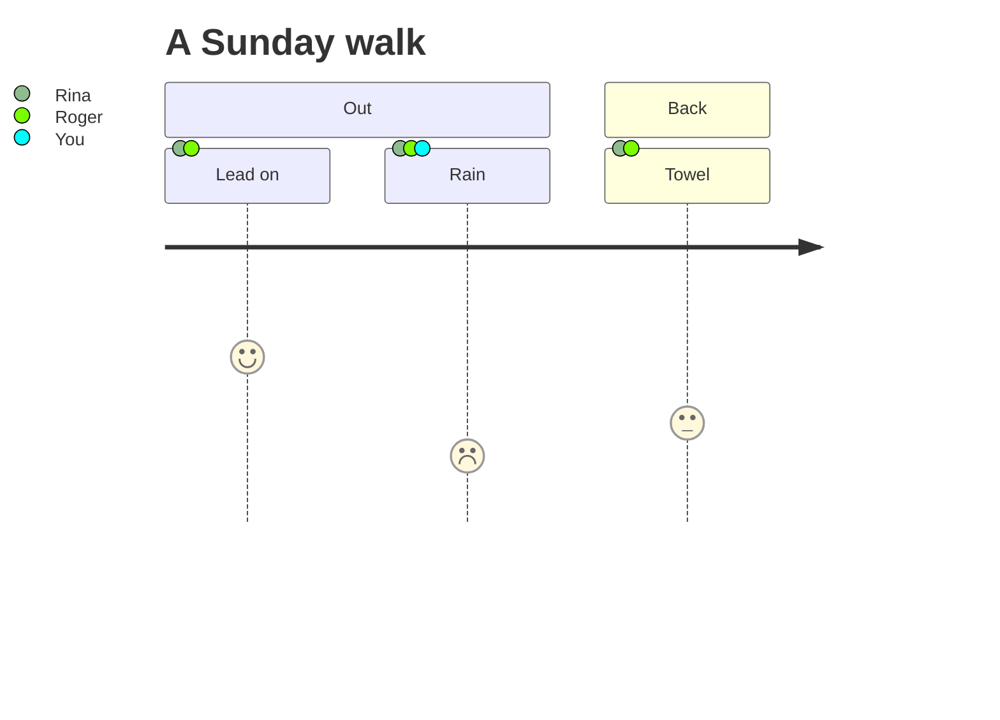

A timeline:

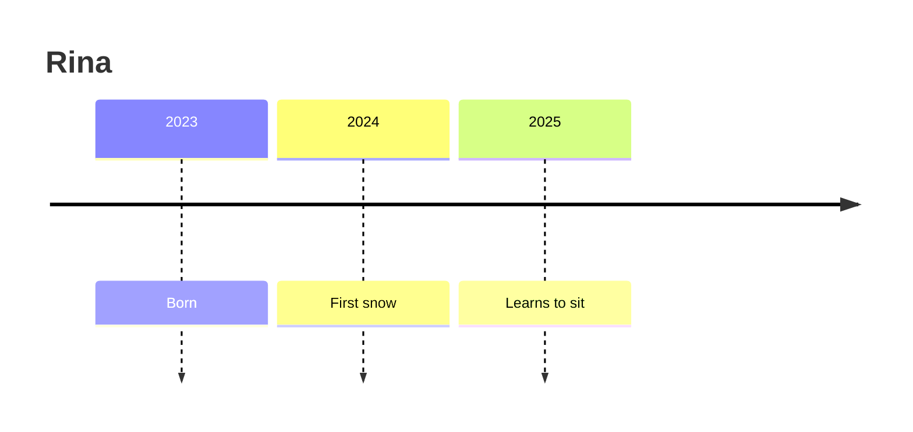

The branches of a repository:

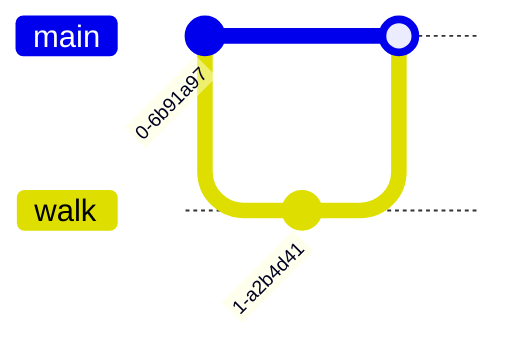

Quadrants:

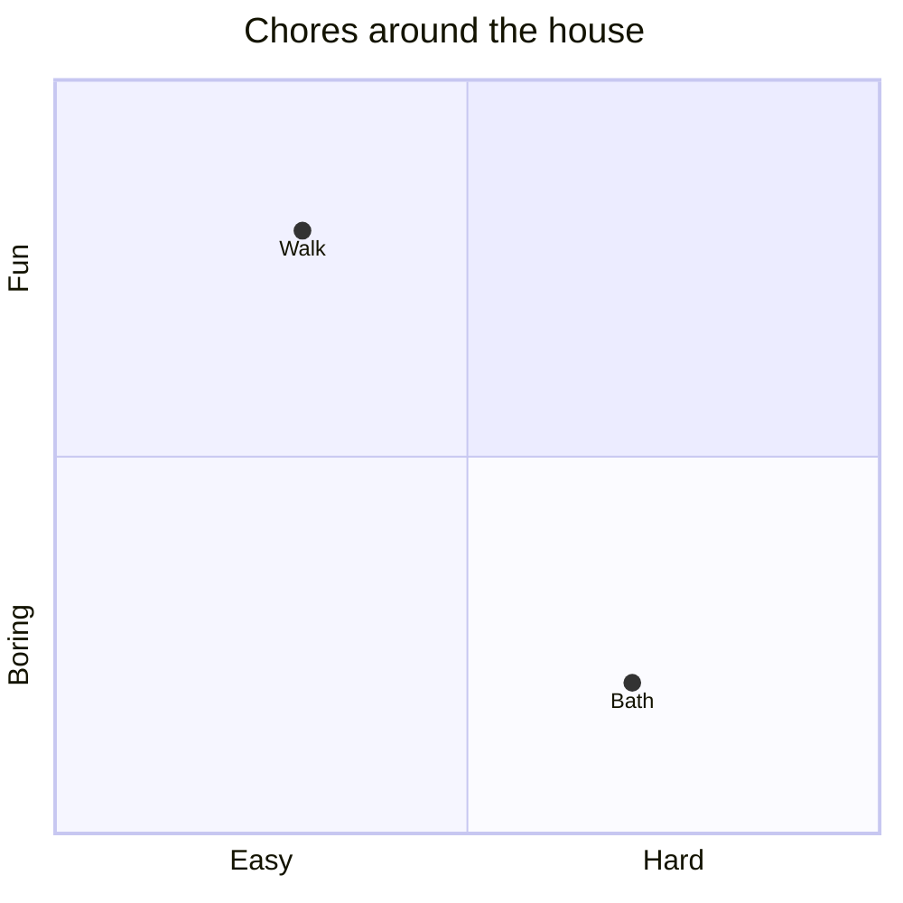

Bars and lines:

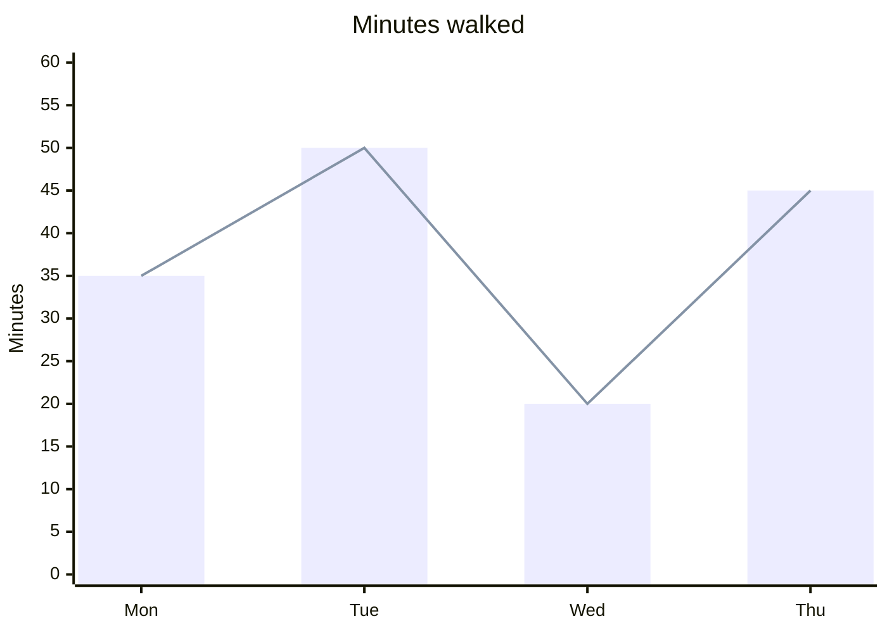

A flow of amounts:

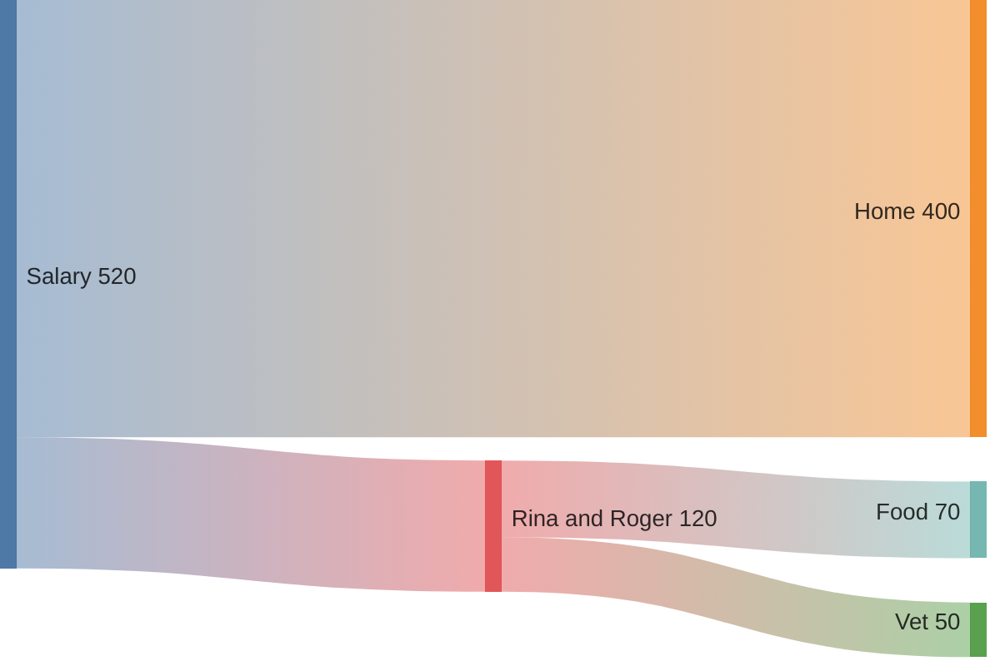

And a board:

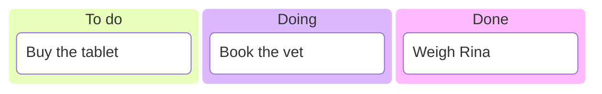

---

## Formulas

**Formula**, in the `/` menu: a block whose language is `math` typesets the formula, offline.

```math
dose = \frac{weight \times 0.5}{2}
```

```math
\sum_{i=1}^{n} i = \frac{n(n+1)}{2}
```

```math
\begin{pmatrix} 1 & 0 \\ 0 & 1 \end{pmatrix} \qquad |x| = \begin{cases} x & x \ge 0 \\ -x & x < 0 \end{cases}
```

Between double dollars, on lines of their own, it is the same:

$$
\int_0^1 x^2 \, dx = \frac{1}{3}
$$

---

## Widgets

**Widget**, in the `/` menu: a block whose language is `widget` is drawn as a fixed view, made of HTML and CSS alone. It runs nothing, so it looks the same wherever the document is read. It takes Tisty's colours and brings ready-made styles. The code stays folded: open it with **Show code**.

Figures in a grid, and a card with its list:

```widget title="Rina and Roger this month"
<div class="grid">
  <div class="stat"><small>Walks</small><b>42</b><em class="up">+6 vs August</em></div>
  <div class="stat"><small>Weight</small><b>14 kg</b><em class="down">−0.3 kg</em></div>
  <div class="stat"><small>Next vaccine</small><b>12 Nov</b><span class="badge warn">due</span></div>
</div>
<div class="card" style="margin-top:12px">
  <div class="head"><h3>Checks</h3><span class="badge bad">one missed</span></div>
  <ul class="list">
    <li><span class="box done"></span><span class="gone">Ticks</span></li>
    <li><span class="box"></span>Ears</li>
  </ul>
</div>
```

Two columns, a table, a drawing, a fold and a style of its own:

```widget title="October walks"
<style>
  .bar { fill: var(--accent); }
</style>
<div class="two">
  <div class="card">
    <div class="head"><h3>By week</h3><span class="badge ok">up to date</span></div>
    <table>
      <tr><th>Week</th><th class="num">Walks</th><th class="num">Km</th></tr>
      <tr><td>1</td><td class="num">12</td><td class="num">18.4</td></tr>
      <tr><td>2</td><td class="num">9</td><td class="num">13.1</td></tr>
      <tr><td>3</td><td class="num">11</td><td class="num">16.0</td></tr>
    </table>
  </div>
  <div class="card">
    <div class="head"><h3>Minutes a day</h3><span class="badge">this week</span></div>
    <svg viewBox="0 0 140 60" role="img" aria-label="Minutes walked from Monday to Thursday">
      <rect class="bar" x="5" y="25" width="25" height="35"></rect>
      <rect class="bar" x="40" y="10" width="25" height="50"></rect>
      <rect class="bar" x="75" y="40" width="25" height="20"></rect>
      <rect class="bar" x="110" y="15" width="25" height="45"></rect>
    </svg>
    <details>
      <summary>The numbers</summary>
      <p>Monday 35, Tuesday 50, Wednesday 20 and Thursday 45.</p>
    </details>
    <div class="row"><span class="badge ok">morning 7</span><span class="badge warn">night 5</span><span class="badge bad">no walk 1</span></div>
  </div>
</div>
```

---

## Attachments

**Attach a file**, in the `/` menu, or drag it into the sheet. It is kept inside Tisty and drawn as what it is. Each card has a **⋯** to save a copy, show it as a link or remove it from the page.

A picture, which a click opens large:


A PDF:


A sound, with its player:


A video, with its own:


Data:


A page of HTML, attached like any other file: it never runs.


And the same file inside a sentence is a link: [Rina's vet card](vet-card.pdf).

---

## Cards

What takes a whole paragraph is drawn as a card; the same thing inside a sentence is a word you click.

Another document: **A document** or **A new document**, in the `/` menu. The card carries its title as it is now and its first words.


A page: **A new page** or **A page that already exists**. Its card also says where it sits in the book.


A card also tells you when its document is archived or gone. And on a task's page, each part is a card just the same, with its steps done and its date.

A link alone in its paragraph, with its site's letter and colour. **Bring the preview** gives it the title and the picture the site offers.

[Tisty on GitHub](https://github.com/rgdevment/Tisty)

A bare address does the same:

https://www.tisty.app

---

## Sheets and page breaks

**Page break**, in the `/` menu, or `Ctrl`/`⌘` + `Enter`: a line with only `---`. On screen it shows as a cut, and when printed or in the PDF what follows starts on the next sheet. This sheet has one between each part, and here goes another. Turn on **Sheets**, in the panel beside the page, and see where the last line lands.

---

That is all of it: one of each.
