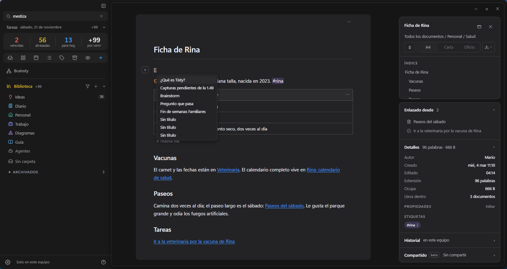

# Brainsty: todo unido

Esta hoja es una página de la guía. Cuenta Brainsty, el cerebro de Tisty: cómo unir un documento con otro y con sus tareas mientras escribes, y cómo ver todo lo que guardas como una sola red. Casi todo se prueba aquí mismo, sobre esta guía.

Lo que guardas ya estaba unido: un documento cita otro, una tarea nació de un acta, un libro tiene páginas. Brainsty hace que esas uniones se vean, se recorran y le sirvan también a tu agente.

## Enlazar un documento con otro

Escribe `[[` donde quieras el enlace y sigue con unas palabras del título. Tisty te ofrece hasta ocho documentos que calzan, sin mirar acentos ni mayúsculas, primero los que empiezan así. Elige uno con `Enter` y queda un enlace con su título, que apunta al documento y no a su nombre: si lo renombras, el enlace sigue llegando.



**Pruébalo:** al final de este párrafo escribe `[[rina` y elige **Rina**, la página de ejemplo de esta guía. Queda un enlace igual a este: [Rina](tisty:page).

Para llegar a una sección, sigue el título con `#`: `[[qué es#tareas` te ofrece las secciones de la portada de esta guía que llevan esa palabra, y el enlace abre la guía justo en **Las tareas**. Si esa sección deja de existir, el enlace abre el documento al comienzo.

Deja el puntero sobre un enlace a otro documento y aparece su vista previa: sus primeras líneas, o la sección a la que apunta. Para abrirlo mientras escribes, `Ctrl` + clic (`⌘` + clic en un Mac); un clic solo deja el cursor ahí.

## Quién lo enlaza

El panel junto a un documento tiene la fila **Enlazado desde**: cada documento y cada tarea que lo cita o lo menciona, con la sección donde lo hace. Un clic te lleva ahí.

**Pruébalo:** abre la página de Rina con el enlace de arriba y, en el panel de al lado, abre **Enlazado desde**: ahí está esta hoja, y la portada de la guía. Tisty arma esa lista en segundo plano, así que un enlace recién escrito aparece a los pocos segundos.

## Citar una tarea

Lo que sabes de un tema vive en su documento, y el trabajo que hiciste sobre él, en sus tareas. Cita la tarea en el documento y la encuentras donde la vas a buscar. En el menú `/`, **Una tarea** busca entre las abiertas y las archivadas, y deja su tarjeta sola en su párrafo.


La tarjeta lee la tarea cada vez que se dibuja: su lista, sus fechas, cuántos pasos lleva hechos y, si se cerró, el día. Un clic la abre; su círculo la marca hecha; su contador despliega los pasos para marcarlos ahí mismo. Una tarea cerrada se lee, pero ya no cambia desde el documento.

**Pruébalo:** en una línea vacía de esta hoja escribe `/`, elige **Una tarea** y escribe una palabra de una tarea tuya. Si todavía no tienes ninguna, la captura rápida está a un `Ctrl` + `Shift` + `Space`.

## Crear una tarea sin salir del documento

En un acta o en un plan aparece un «hay que…». En el menú `/`, **Una tarea nueva** abre ahí mismo el campo de la captura rápida: escribe la tarea como la dirías y `Enter` la crea con su fecha, su lista, sus etiquetas y su prioridad, y deja su tarjeta en ese lugar.

**Pruébalo:** en una línea vacía, aquí abajo, escribe `/tarea`, `Enter`, y después `Pasear a Rina y Roger el sábado #rina`. Abre la tarea con un clic en su tarjeta: junto a su página, **Nació en** nombra esta hoja, y un clic te trae de vuelta. `Esc` en el campo la deja ir sin crear nada.

En la página de una tarea, **Una tarea nueva** crea una parte de esa tarea, en su misma lista.

## La red

**Brainsty**, en la barra lateral bajo las vistas de tareas, abre todo lo que guardas como una sola red. Se abre en el panel de contenido, como una vista más, con la barra lateral a la vista y **Brainsty** marcado en ella. Abre con la red entera a la vista; el documento o la tarea en que estabas queda como punto de partida de las flechas.


- **Gasta solo mientras la miras.** Cuando pasas a otra vista, se detiene todo lo que la red corría: el dibujo, el acomodo de los puntos y su trabajo en segundo plano.
- **Se lee de nuevo cada vez que entras**, así que lo que escribiste entretanto ya está. Arranca limpia: sin el punto que habías elegido ni los filtros de la vez anterior.
- **Leyenda**, abajo a la izquierda, dice qué significa cada cosa que ves. Viene plegada y un clic la abre. Cada equipo recuerda si la dejaste abierta.

**La red está viva.** Gira sola como un globo, una vuelta por minuto, y lo que queda atrás se ve más chico y tenue. Por sus líneas caminan **viajeros**: puntos de luz que pasan de un nodo a otro cada cinco segundos, con una estela corta y un destello al cruzar una etiqueta o un nodo muy conectado. Son dos en una red de menos de 60 nodos y suben de a dos hasta diez, desde 250. El globo se queda quieto mientras el puntero está sobre la red, un momento después de acercarte o alejarte y mientras tienes un nodo elegido; en el espacio vacío sigue girando. Para girarlo tú, arrastra con el botón derecho o con `Shift`; el arrastre normal sigue moviendo la vista.

Arriba, dentro de la **Leyenda** abierta, hay dos interruptores, **Viajeros** y **Girar**, cada uno con un punto que se enciende. Sin giro, la red queda plana; con los dos apagados, queda quieta. Cada equipo recuerda cómo los dejaste, y arrancan apagados si tu sistema pide reducir el movimiento.

En la **Leyenda** hay además cuatro partes. **Qué es** muestra la forma de cada clase que hay en tu red. **Color: su carpeta o lista** muestra las carpetas y listas de color, primero las más llenas; si son más de seis, **N más** muestra el resto, y lo que no tiene color toma el tono de su clase. **Estado** muestra cómo se ve una tarea en curso, una terminada y una archivada. **Líneas, de cerca** muestra cada tipo de línea, y también **Parecidos** cuando Tisty adivinó alguno. Esta tabla dice lo mismo:

| En la red | Es |
| --- | --- |
| Cuadrado | un documento o una página, del color de su carpeta |
| Cuadrado grande | una carpeta, en medio de sus documentos |
| Rombo | una lista, en medio de sus tareas |
| Círculo | una tarea, del color de su lista: viva si sigue en curso, tenue si se terminó |
| Punto morado | una etiqueta |
| Punto gris | una imagen o un archivo |
| Línea sólida | una cita, una tarjeta |
| Línea punteada | una mención, un enlace en una frase |
| Línea fina | una página y su libro, una parte y su tarea, el documento donde nació una tarea, una carpeta o una lista y lo suyo |
| Curva ámbar | un parecido: lo que Tisty adivina porque comparten palabras poco comunes, una con un error de tipeo o una traducción, y nadie los unió |

Cada carpeta y cada lista que tiene algo en la red es un nodo, unido a lo suyo y en medio de ello, y además tiñe su zona con su color.

La red cambia con la distancia. De lejos, con la rueda hacia atrás, sus puntos forman un cerebro visto de lado, sin títulos. A media distancia aparecen las zonas de color. De cerca, todos los títulos, cada tipo de línea, las etiquetas, la miniatura de cada imagen y, dentro de cada nodo, el ícono de lo que es: documento, página, tarea, con un tic si está hecha, etiqueta, archivo, carpeta o lista. Con la red girada, las zonas se ocultan y se ven menos títulos.

![«Rina» elegida de cerca en Brainsty, en el panel de contenido junto a la barra lateral: sus vecinos con título, el resto atenuado y, a la derecha, su ficha: «Documento · Mascotas · 6 conexiones», las filas Escrito por última vez, Creado, Tamaño con sus palabras e Idioma ES, la etiqueta rina, Conexiones por tipo, Apuntan aquí con lo que la cita, Parecidos con «Paseos del sábado» y «Tisty lo adivina: comparten rina y parque», el Enlace con Copiar enlace y el botón Abrir; en la red, una curva ámbar une a Rina con «Paseos del sábado»](red-cerca.png)

- **Un clic** en un punto lo resalta con sus vecinos y abre su ficha, a la derecha. La ficha no muestra el texto del documento: muestra sus datos, para que sepas qué es antes de abrirlo.
- **Abrir**, `Enter` o un doble clic abre el documento, la tarea o la etiqueta en esta misma ventana, en el lugar de la red; una carpeta se abre en **Documentos** y una lista en **Listas**. Para volver a la red, otro clic en **Brainsty**. Una imagen o un archivo no se abre desde la red: ábrelo desde lo que lo usa.
- **Buscar en la red**, arriba, o `/`: escribe parte de un título y `Enter` centra la red en él.
- **Filtros**, el embudo junto al buscador: qué tipos mostrar, también **Carpetas** y **Listas**, **Parecidos** para las curvas ámbar, el estado de las tareas, una etiqueta y **Tocado**, para ver solo lo que cambió en los últimos días. Una carpeta o una lista se esconde cuando los filtros esconden todo lo suyo.
- **Con el teclado**: `Tab` recorre el buscador, los filtros y la red; las flechas caminan de un punto a su vecino, y la primera sale del documento o la tarea en que estabas; `Enter` abre y `Esc` suelta por capas: primero la búsqueda, después el punto, y el último te devuelve a donde estabas. Un `Esc` que escribes en un campo de la barra lateral se queda en ese campo. `Ctrl` + `Shift` + `M` muestra, junto a la leyenda, cuánto cuesta dibujar cada cuadro.

La ficha cambia según lo que eliges:

| Eliges | La ficha muestra |
| --- | --- |
| Un documento o una página | **Página de**, si es página de un libro; **Escrito por última vez**, **Creado**, **Tamaño** con sus palabras e **Idioma** |
| Una tarea | **Estado**, como «En curso · Por vencer»; **Día**, **Plazo**, **Parte de**, **Partes**, **Pasos**, como «1 de 3 hechos», y **Origen** |
| Una etiqueta o un archivo | qué es y cuántas conexiones tiene |

Debajo vienen sus **Etiquetas**; sus **Conexiones** por tipo, como «2 citas 3 menciones»; **Apuntan aquí**, con lo que cita o menciona lo que elegiste, y un clic en uno lo elige en la red; sus **Parecidos**, cada uno con su porqué, y, en un documento, una página o una tarea, su **Enlace**, con **Copiar enlace**. El de un documento es el mismo que copias desde su panel, para pegarlo en un chat o dárselo a tu agente:

```text
tisty://doc/mascotas/rina?id=…
```

**Pruébalo:** abre **Brainsty** ahora. La red abre entera, girando despacio, con sus viajeros caminando. Deja el puntero sobre ella y el globo se detiene. Busca `brainsty`, `Enter`: la red elige esta hoja, con sus vecinos alrededor, y abre su ficha; en **Apuntan aquí** está la portada de la guía, que la cita con su tarjeta. Abre la **Leyenda** y apaga **Girar**: la red queda plana. Después busca `uno de cada`, `Enter`, y **Abrir**: **Uno de cada cosa** se abre en el lugar de la red. Vuelve con otro clic en **Brainsty** y, esta vez, sal con `Esc`: el último te devuelve a **Uno de cada cosa**, donde estabas.

## Lo que lee tu agente

Tu agente lee la misma red, pero como un índice. Con una sola herramienta, `brain`, busca tareas y documentos por sus palabras, el Archivo junto a lo demás; trae la ficha de un documento, con sus secciones, quién lo cita y sus decisiones vigentes primero, sin leerlo entero; y ve un proyecto agrupado en bloqueado, en curso, esperándote y sin empezar. En la ficha, lo que Tisty adivina como parecido le llega aparte, en `guessed`, con las palabras en común o la pareja de palabras que los une, como `pagar≈pay`, para que no lo confunda con lo que alguien escribió. Cuando nombra una tarea o un documento por su título exacto entre comillas, Tisty lo enlaza al guardar, como cuando lo haces tú. Lo cuenta, paso a paso, [la página de tu agente](tisty:agent).

## Lo que conviene saber

- **Todo queda en este equipo.** La red se calcula aquí y se rehace sola: no se sincroniza ni sale con lo que compartes o exportas. Cada equipo la dibuja de nuevo con tus documentos y tareas.
- **Lo que ocultas no aparece** en la red ni le llega a tu agente.
- **Fuera de Tisty**, un enlace a otro documento y la tarjeta de una tarea quedan solo como sus palabras: en Markdown estándar, en Word, en el PDF y en Folio.
- **Hasta 12.000 puntos.** Más allá, la red guarda lo último que tocaste, sus vecinos, tus documentos y las tareas en curso, y te dice arriba cuánto quedó fuera.
- **Cada línea recta la escribiste tú; la curva ámbar, no.** Tisty une como parecidos lo que nadie unió, con tres pistas y en este orden:
  - **Palabras en común:** al menos dos poco comunes, como *presupuesto* y *techo*.
  - **Un error de tipeo:** «La imrpesora nueva no imprime en color» con «Instalar la impresora nueva».
  - **Una traducción:** una tarea en español y su gemela en inglés, como «Pagar la cuenta del agua» con «Pay the water bill».

  La curva aparece de cerca o junto al punto que eliges, y la ficha dice por qué, con lo que escribió cada lado: «Tisty lo adivina: comparten *pagar ≈ pay* y *agua ≈ water*». No hay IA en esto: la traducción sale de una lista fija de palabras español–inglés, hecha por lingüistas, y todo corre en tu equipo. Las tareas ocultas y tu Diario nunca pasan por ahí. Lo cuenta [la red de Brainsty](https://www.tisty.app/es/ayuda/red-de-brainsty/), en la ayuda.

Cada detalle, con un ejemplo de principio a fin, está en la ayuda: [enlazar documentos](https://www.tisty.app/es/ayuda/enlazar-documentos/), [tareas en documentos](https://www.tisty.app/es/ayuda/tareas-en-documentos/) y [la red de Brainsty](https://www.tisty.app/es/ayuda/red-de-brainsty/).
