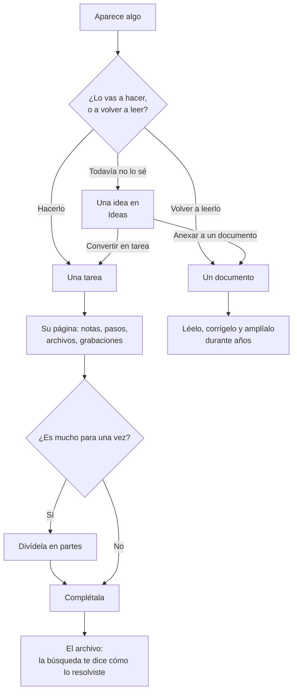
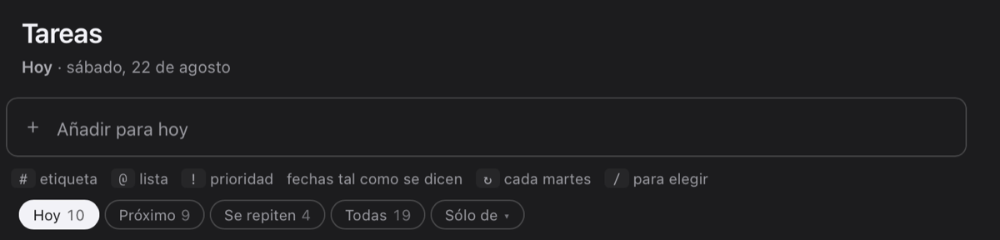
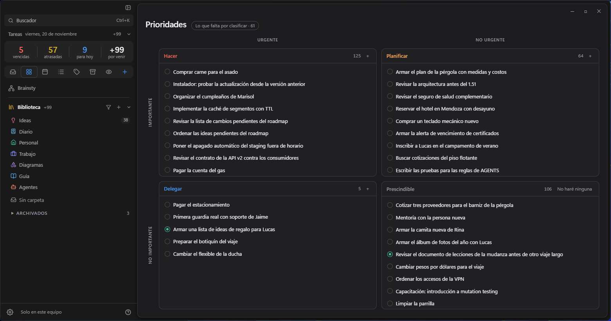
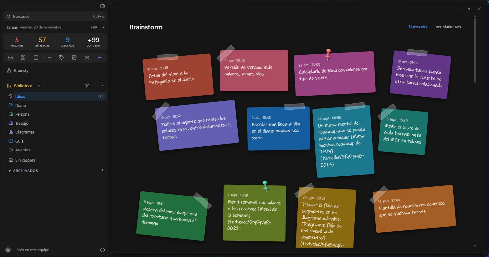
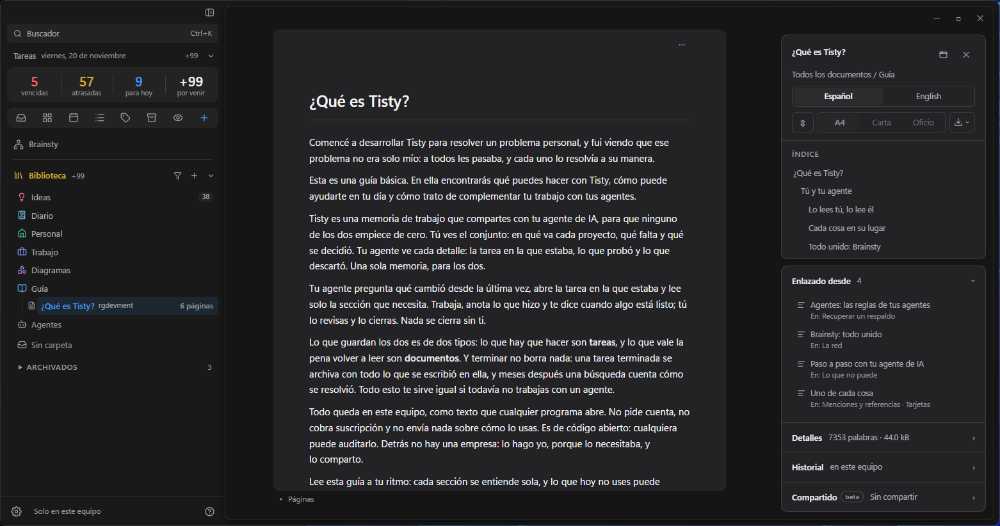
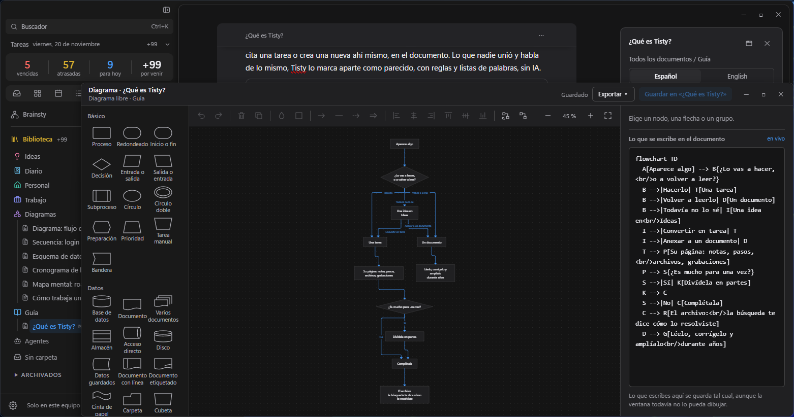
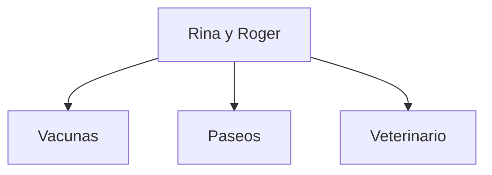
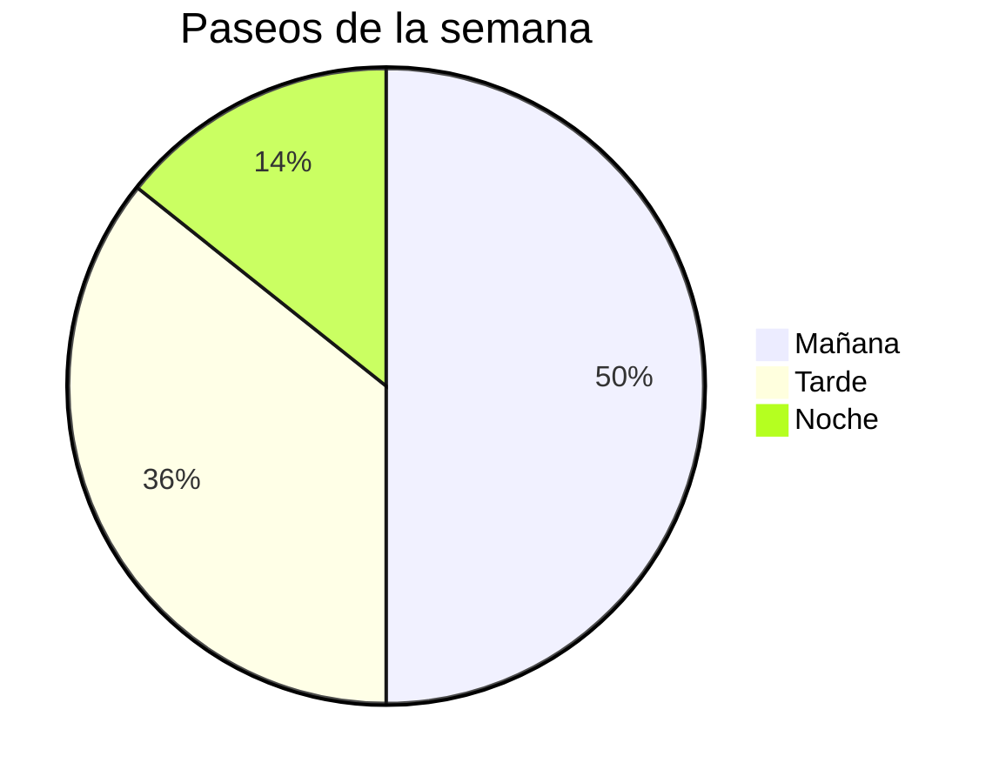
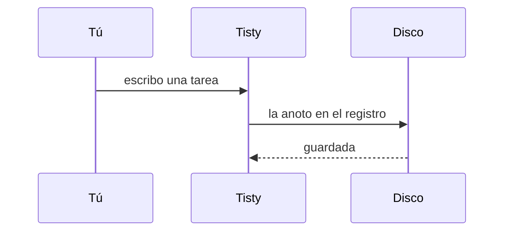
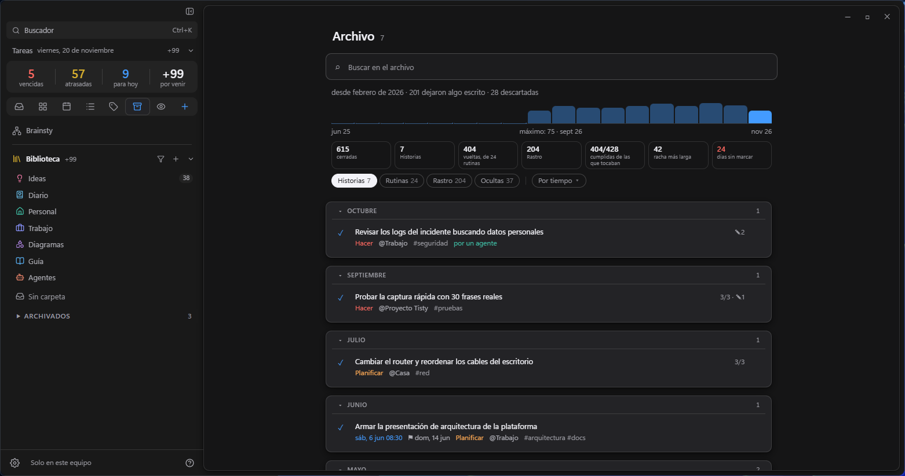

# ¿Qué es Tisty?

Comencé a desarrollar Tisty para resolver un problema personal, y fui viendo que ese problema no era solo mío: a todos les pasaba, y cada uno lo resolvía a su manera.

Esta es una guía básica. En ella encontrarás qué puedes hacer con Tisty, cómo puede ayudarte en tu día y cómo trato de complementar tu trabajo con tus agentes.

Tisty es una memoria de trabajo que compartes con tu agente de IA, para que ninguno de los dos empiece de cero. Tú ves el conjunto: en qué va cada proyecto, qué falta y qué se decidió. Tu agente ve cada detalle: la tarea en la que estaba, lo que probó y lo que descartó. Una sola memoria, para los dos.

Tu agente pregunta qué cambió desde la última vez, abre la tarea en la que estaba y lee solo la sección que necesita. Trabaja, anota lo que hizo y te dice cuando algo está listo; tú lo revisas y lo cierras. Nada se cierra sin ti.

Lo que guardan los dos es de dos tipos: lo que hay que hacer son **tareas**, y lo que vale la pena volver a leer son **documentos**. Y terminar no borra nada: una tarea terminada se archiva con todo lo que se escribió en ella, y meses después una búsqueda cuenta cómo se resolvió. Y si prefieres trabajar de una forma más personal, sin agente, Tisty está igual de completo para ti: tus tareas, tus documentos, tus ideas y tu diario, a la vista y unidos en Brainsty. El agente es una forma de usarlo, no una condición, y lo conectas el día que quieras.

Todo queda en este equipo, como texto que cualquier programa abre. No pide cuenta, no cobra suscripción y no envía nada sobre cómo lo usas. Es de código abierto: cualquiera puede auditarlo. Detrás no hay una empresa: lo hago yo, porque lo necesitaba, y lo comparto.

Lee esta guía a tu ritmo: cada sección se entiende sola, y lo que hoy no uses puede esperar. Es un documento como cualquier otro, así que puedes tocarlo todo: hacer clic, escribir, probar. Si en algún momento te pierdes, el `?` al pie de la barra lateral abre la ayuda completa, también sin conexión. El engranaje, en ese mismo pie, abre Configuración en un **Resumen** que dice qué pide algo de ti, y **Buscar un ajuste** encuentra cualquier ajuste por su nombre. A esta guía vuelves desde **Configuración › Ayuda y acerca de**, con **Abrir la guía**.

## Tú y tu agente

Trabajar con un agente es repartirse el trabajo: tú decides hacia dónde va y él se encarga del detalle. Tisty está hecho para que esas dos mitades se entiendan.

### Lo lees tú, lo lee él

Un documento en Tisty se lee con gusto: títulos, colores, avisos que resaltan lo importante, diagramas, tablas y casillas, en vez de un muro de texto. Tu agente lee el mismo documento a su manera: primero el índice y después solo la sección que necesita. Y cuando escribe, escribe para ti: Tisty le pide que lo haga visual, ordenado y fácil de leer, en el mismo lenguaje que usas tú.

### Cada cosa en su lugar

Las tareas van en listas, los documentos en carpetas, y lo que es mucho para una vez se divide en partes. Así, cuando vuelves a un proyecto después de semanas, tú ves dónde quedó y tu agente sabe por dónde seguir.

Hasta dónde llega: cada persona tiene su propio Tisty y sus propios agentes. No reparte trabajo entre personas ni lleva un equipo; cuando alguien necesita lo que sabes, le compartes el documento.

### Todo unido: Brainsty

Brainsty es el cerebro de Tisty: todo lo que guardas, con lo que lo une, dibujado como una sola red. Tú la ves de lejos, como un mapa de todos tus proyectos, y de cerca, cada documento con sus tareas. Tu agente la lee como un índice que le dice dónde mirar sin leerlo todo. Las uniones las haces tú al escribir: `[[` enlaza un documento con otro, y `/` cita una tarea o crea una nueva ahí mismo, en el documento. Lo que nadie unió y habla de lo mismo, Tisty lo marca aparte como parecido, con reglas y listas de palabras, sin IA.


## ¿Cómo funciona?

Todo empieza con una pregunta, y tu agente se hace la misma: ¿lo vas a hacer, o lo vas a volver a leer? Si lo vas a hacer, es una tarea: se acaba, a veces el mismo día, y queda en el Archivo como conocimiento con fecha. Si lo vas a volver a leer, es un documento: un manual, una receta, las actas de un año, que corriges y amplías durante años. Y si todavía no lo sabes, es una idea: espera en Ideas hasta que la ordenes. Lo que solo pasó, y quieres recordar, va al Diario. Este dibujo cuenta el resto:



**Pruébalo:** haz clic en el dibujo y se abre en grande. Con doble clic entras a la ventana de diagramas: mueve una caja, cambia un texto, y **Guardar en «¿Qué es Tisty?»** lo deja aquí, en tu guía. Así se empieza también uno propio.

:::details Un ejemplo: planear un viaje

1. Creas la tarea «Planear el viaje al sur». En su página anotas lo que averiguaste y lo que descartaste, y adjuntas el PDF de la reserva, la foto del mapa o el audio de quien te recomendó el lugar.
2. Cuando el plan está claro, lo divides en **partes**: «Comprar los boletos», «Reservar el alojamiento», «Alquilar el auto». Cada una es una tarea con sus propios pasos.
3. Terminas las partes una a una, y después el viaje. Pasa al Archivo.
4. Un año después, «¿dónde nos quedamos en el sur?» lo encuentra: su página, sus partes y cada paso, tal como quedaron.

:::

Y si una tarea te enseña algo que vas a necesitar de nuevo, como el arreglo de una falla que vuelve, guárdalo también en un documento.

---

## Tu agente de IA

Conectar un agente es opcional: todo lo de arriba funciona sin él, y lo conectas cuando quieras. Tu agente de IA, sea GitHub Copilot, Claude Code, Codex u otro, entra a Tisty por MCP, con un programa que corre en este equipo, sin cuenta y sin pasar nada por la red. Lo que escribe va firmado con su nombre: «por Claude Code», «por Codex».

Desde ahí, Tisty es su memoria entre sesiones. De un documento lee primero el índice y después solo la sección que necesita; de la tarea en la que está, marca los pasos y anota en su bitácora lo que probó y descartó. La próxima sesión parte de ahí, y cuesta una fracción de releer tus archivos Markdown.

- **Puede** proponer tareas, escribir documentos, agregar o corregir en los que puede escribir, anotar y ordenar ideas contigo, y marcar lo que ya cumplió su vida, con el porqué.
- **Puede decir** que una tarea o un paso está listo. La tarea queda en **Por confirmar** hasta que tú la terminas o la devuelves con **Sigue pendiente**; los pasos te esperan con **Marcarlos** o **Todavía no**.
- **No puede** cerrar ni borrar una tarea, borrar un documento o una idea, marcar un paso tuyo ni mover un día que pusiste tú. En una tarea que escribiste tú puede cambiar la descripción, la página y los pasos abiertos, como en un documento.
- **No ve tu diario** mientras no lo abras tú. Abierto, lo lee y solo añade al final de hoy.

Si escribiste en un documento mientras él lo leía, no escribe encima: se le pide que vuelva a leerlo. Y cuando algo escribe en el documento que tienes abierto, la ventana te avisa y te ofrece volver a lo que decía antes; lo que tu agente reemplazó queda además como una versión en su historial, que cuenta **Volver a lo que decía antes**, más abajo.

Al conectarlo, Tisty te da dos ayudas, cada una con su propio sí: sus **hooks**, que le traen al empezar las tareas que dejó abiertas y le recuerdan anotar al terminar un turno, y las **skills de Tisty**, que le enseñan a retomar, ordenar y dejar el trabajo listo para el próximo agente cuando se lo pides con tus palabras, como «Retoma donde quedamos». Las dos son opcionales, y las enciendes o las quitas cuando quieras.

Cómo conectarlo, cómo darle o quitarle la entrada y cómo pedirle las cosas, paso a paso, está en esta página:


### Las reglas de tus agentes, en un solo lugar

Cada agente lee sus reglas de su propio archivo: Claude Code de `CLAUDE.md`, Codex de `AGENTS.md`, Gemini de `GEMINI.md`. La carpeta **Agentes**, arriba de todo en la Biblioteca, los junta en Tisty como documentos. **Traer** los copia, para leerlos y ordenarlos, sin escribir nada en ellos; **Sincronizar** hace además que lo que escribes en cada documento llegue al archivo de ese agente, palabra por palabra, con un respaldo antes de tocarlo; una skill escrita una vez en **Global** llega a todos. Un cambio que haces por fuera nunca se pisa, cada equipo tiene su carpeta y escribe solo la suya, y tu agente no escribe tus reglas: te propone el cambio, y solo tú lo apruebas. Está en tu barra lateral desde el principio, en gris, y no lee nada de tus agentes hasta que tú lo dices: se empieza con un clic en ella. En la red de [Brainsty](tisty:brainsty) sus archivos vienen ocultos, para que no tapen lo tuyo, hasta que enciendes **Mostrar AGENTS**.


---

## Las tareas

### Escribe como hablas

No hay formulario que llenar. Escribe la frase como se la dirías a alguien, en la barra de arriba, y Tisty va separando el día, la lista y la prioridad mientras escribes.



Cada parte que entiende se colorea:

| Escribes | Color | Entiende |
| --- | --- | --- |
| ==mañana 10am=={blue} | azul | día y hora, tal como los dirías |
| ==el viernes=={blue} | azul | el próximo que venga |
| ==antes del viernes=={blue} | azul | una fecha límite: hasta cuándo se puede |
| ==cada martes=={pink} | rosa | algo que vuelve solo |
| ==#casa=={pink} | rosa | una etiqueta: de qué va |
| ==@trabajo=={green} | verde | una lista: dónde ocurre |
| ==!planificar== | sin color | la prioridad: hacer, planificar, delegar o prescindible |

Lo que no se colorea se queda en el título, tal cual.

**Pruébalo:** escribe una de estas en la barra de arriba y mira cómo se colorea. Rina, la de los ejemplos, es una perra, y Roger es su hermano: sus vacunas, sus paseos y su veterinario te acompañan en toda la guía.

- `Vacuna de Rina el 3 de octubre !hacer #salud`
- `Sacar a Rina y Roger cada día`
- `Entregar el informe antes del viernes @trabajo`

Si solo querías mirar, bórrala antes de presionar `Enter`. Todas las palabras que entiende, en español y en inglés, están en [lenguaje natural](https://www.tisty.app/es/ayuda/lenguaje-natural/).

### Captura sin abrir la ventana

Se te ocurre algo en medio de otra cosa: presiona `Ctrl` + `Shift` + `Space` desde donde estés y se abre una ventanita para escribirlo. `Enter` la guarda, `Esc` la cierra, y sigues con lo tuyo.

**Pruébalo:** sin salir de esta guía, presiona `Ctrl` + `Shift` + `Space`, escribe lo primero que tengas pendiente y `Enter`. Esa es tu primera tarea: con un día en la frase te espera en **Hoy** o en **Próximo**; sin día, en **Todas**.

Si ese atajo ya lo usa otro programa, Tisty toma otro y te dice cuál quedó en **Configuración › Tareas y avisos**. Y si lo que se te ocurrió todavía no es una tarea, `Tab` en esa misma ventanita lo vuelve una idea, y otro `Tab`, una línea en el diario de hoy: los dos están más abajo, en **Las ideas** y **El diario**.

### Hoy, Próximo, Se repiten y Todas

Tu lista de tareas se mira de cuatro maneras:

- **Hoy** — lo que pide el día, lo más urgente primero:
  - **vencidas**: pasó su fecha límite;
  - **por vencer**: el límite está cerca;
  - **atrasadas**: pasó el día que planeaste, sin límite;
  - **para hoy** y **en curso**: lo que toca ahora.
- **Próximo** — lo que viene.
- **Se repiten** — lo que vuelve por su cuenta.
- **Todas** — todo lo abierto, sin filtro.

Las cuatro cuentas del día, arriba en la barra lateral, abren lo que cuentan: **Vencidas** y **Atrasadas** abren cada una su propia vista, que aparece junto a Hoy mientras estás en ella, y **para hoy** y **por venir** abren Hoy y Próximo.

Lo vencido sale arriba y en rojo; lo atrasado, en ámbar. Una tarea vence únicamente cuando pasa su fecha límite: si le pusiste un día y nada más, se atrasa, pero no vence. Y nadie te persigue: Tisty no lleva rachas ni puntos por vaciar la lista. Lo que no alcanzaste hoy, mañana sigue ahí.

### El reparto y los recordatorios

**Reparto**, el icono del calendario bajo las cuentas del día en la barra lateral, es tu calendario de trabajo: ahí decides con calma qué haces cada día. Lo que escribiste sin día espera en la bandeja **Sin día**; arrástralo al día que le toca. Si ese día ya lleva dos, Tisty te lo dice y te ofrece el siguiente libre. **Mes** muestra lo mismo en cuadrícula.

Un recordatorio es una hora que eliges en la tarea: suena como una notificación del sistema en cada equipo donde tienes tu Tisty, aunque esté cerrado, con un sonido corto que puedes apagar. Para que te avise también el teléfono, **Guardar en mi calendario**, en una tarea con fecha, la lleva a Google Calendar, a Outlook o, en un Mac, al Calendario de Apple. Más en [el reparto y los recordatorios](https://www.tisty.app/es/ayuda/reparto-y-recordatorios/).

### Las prioridades son un mapa, no una escalera

Dos preguntas, cuatro casillas: si corre prisa y si importa.



- **Hacer** — urgente e importante. Hoy.
- **Planificar** — importante, sin prisa. Ponle fecha antes de que se vuelva urgente.
- **Delegar** — corre, pero no es tuyo. Que lo lleve quien deba.
- **Prescindible** — ni corre ni importa. Su **No haré ninguna** las descarta todas de una vez.

Arrastra una tarea al cuadrante que le toque. Lo que no clasificas espera en la bandeja de al lado, sin regañarte.

### Listas y etiquetas

Dos formas de ordenar que no compiten:

- Una **lista** dice dónde ocurre: ==@casa=={green}, ==@trabajo=={green}. Una tarea está en una sola.
- Una **etiqueta** dice de qué va: ==#salud=={pink}, ==#compras=={pink}. Una tarea lleva las que quieras.

Una etiqueta también sirve en un documento: escribe `#salud` en medio de una frase y el documento queda bajo esa misma etiqueta. **Etiquetas**, el icono de la etiqueta bajo las cuentas del día en la barra lateral, junta todo lo que lleva una: lo que tienes que hacer y lo que escribiste sobre eso.

### Lo que queda escrito

Una tarea guarda más que su título. Se abre en una página propia, con secciones para llenar —de qué se trata, cómo sabrás que está lista, sus pasos, lo que fuiste averiguando— y en cada una, una pista en gris que dice qué va ahí. Cada casilla que escribas en esa página, `- [ ]`, es uno de sus pasos. Al terminarla nada de eso se borra: se archiva con su fecha.

Por eso importa: la lista te dice qué falta; el Archivo, cómo lo resolviste la última vez. Escribe una palabra que recuerdes en el buscador de arriba de la barra lateral (`Ctrl`/`⌘` + `K`) y la tarea aparece, aunque la hayas cerrado hace dos años.

:::details Partes: cuando un paso necesita más que una línea

Un paso es una línea, de cien caracteres como máximo. Si necesita más, conviértelo en una tarea propia, **parte** de esta: pasa el puntero sobre la casilla y haz clic en **↗**. La línea se vuelve su tarjeta, con sus pasos y su fecha, y un clic la abre.

Una tarea con partes muestra un contador como **▣ 3/7** donde contaría sus pasos, y sus partes se pliegan debajo. Junto a la página, **Partes** agrega una nueva, **Es parte de otra…** la cuelga de otra tarea y **Soltarla** la deja suelta otra vez. Si cierras una tarea que todavía tiene partes abiertas, Tisty te pide soltarlas en ese mismo paso; si deshaces el cierre, vuelven a colgar de ella.

:::

Las rutinas, las tareas que se repiten, tienen una sola página para todas sus vueltas. Lo que escribas en **Esta vez** es de la vuelta en curso: al completarla pasa a **Vueltas**, bajo la página, y la sección queda en blanco para la siguiente. El resto, paso a paso, está en [tareas](https://www.tisty.app/es/ayuda/tareas/).

### Terminar, descartar y borrar

- **Completar** la marca como hecha y la manda al Archivo. Su página se guarda con ella: se lee, pero ya no se escribe. Si la reabres, vuelve a ser tuya para escribir.
- **Cerrar con resumen** te pide dos líneas de cómo salió antes de terminarla.
- **No lo haré** la descarta: la aparta sin hacerla, y también acaba en el Archivo.

Lo que guarda el Archivo y cómo encontrarlo después está más abajo, en **El Archivo**.

> **Antes de borrar de verdad.** Borrar solo se permite con lo que ya está cerrado **y** quedó como rastro. Desaparece de este equipo y, en la siguiente sincronización, de los demás; no se puede deshacer.

Y si quieres saber qué falta en todo lo que guardas, **Configuración › Salud** lo revisa, y qué sobra, **Configuración › Almacenamiento**, en **Liberar espacio**, los dos sin cambiar nada.

---

## Las ideas

Entre lo que vas a hacer y lo que vas a guardar hay algo más suelto. Una idea es un pensamiento atrapado al vuelo, antes de saber si es algo que hacer o algo que guardar: pocas palabras, 140 caracteres como máximo, con fecha, en la hoja **Ideas**. Espera a que la ordenes: se vuelve tarea, va al documento de su tema o se aparta.

### Anótala en cuanto llega

En la captura rápida, `Tab` cambia de **Tarea** a **Idea**: escríbela y `Enter` la deja en **Ideas**, el documento anclado arriba en la **Biblioteca**, con su fecha y sin elegir carpeta. En la barra lateral se llama siempre **Ideas** y lleva una ampolleta, diga lo que diga su título, para que no la confundas con **Brainsty**, justo arriba. **Pruébalo:** abre la captura rápida, presiona `Tab` y escribe lo primero que se te ocurra.

### Ordénalas cuando llegue su momento

Las ideas esperan ahí como notas adhesivas de colores, la más nueva primero. Arrastra una sobre otra para dejarla en ese lugar, y cuando llegue su momento, **Convertir en tarea** la guarda como tarea y **Anexar a un documento** la agrega al final del que elijas, con **Diario de hoy** como primera opción. La Biblioteca cuenta las que siguen esperando.



Tu agente de IA también puede hacer una lluvia de ideas contigo y ayudarte a ordenarlas: lo cuenta [la página de tu agente](tisty:agent).

---

## El diario

Hay cosas que no son para hacer ni para consultar después: simplemente pasaron. La visita al veterinario, lo que se decidió en una reunión, cómo estuvo el día. Eso va al **Diario**, una fila propia arriba en la **Biblioteca**.

### Hoy primero

**Diario** abre siempre en hoy. Arriba está el cuadro **¿Qué pasó hoy?**: escribe ahí y `Ctrl`/`⌘` + `Enter` lo guarda al final del día. Debajo queda el mes como una línea de días, el más nuevo arriba, y bajo lo que escribiste cada día se pliegan las tareas que completaste ese día. Un día en el que no escribiste no aparece: nadie te lleva la cuenta.

**Pruébalo:** abre **Diario** y cuenta en una línea cómo va tu día. O sin salir de esta guía: abre la captura rápida, presiona `Tab` dos veces y escríbela ahí.

- **Pegar nota**, el botón junto al cuadro, lo vuelve una nota adhesiva corta, de 140 caracteres como máximo: `Enter` la guarda, con el minuto en que llegó.
- El lápiz abre el mes como un documento, para corregir cualquier día.
- Por dentro no son 365 notas sueltas: es un libro por año, con una página por mes y una sección por día, en Markdown como todo lo demás.

### Solo tuyo

El diario nunca se comparte: no tiene **Compartir…**. Y tu agente de IA no lo ve hasta que haces clic en **Solo tú**, arriba, y pasa a decir **Abierto a los agentes**. Abierto, lo lee y, solo cuando se lo pides, añade al final de hoy con su firma; nunca cambia lo que escribiste. Más en [documentos](https://www.tisty.app/es/ayuda/documentos/).

---

## Los documentos

### Tuyo y en Markdown

Un documento es tuyo y se guarda en Markdown: texto plano con unas pocas marcas, como `**negrita**`, que cualquier programa abre. No hace falta aprenderlas: la barra que aparece al elegir unas palabras y la tecla `/` te las ofrecen. Y lo que importa es el archivo: si mañana borras Tisty, tus documentos siguen abriéndose en cualquier editor de texto.

**Pruébalo:** haz clic en este mismo párrafo y escribe. Escribes sobre la misma página que lees, sin marcas a la vista.

**Para hacer uno**, usa el **+** del encabezado de la **Biblioteca**, en la barra lateral: **Documento nuevo**. Dentro de una carpeta, ese mismo botón lo crea ahí, y **Carpeta nueva** los agrupa. Las carpetas aparecen plegadas; ábrelas con la flecha.

La primera línea del documento es su título: no hay que ponerle nombre en ninguna otra parte. Sus propiedades se ven en el panel de al lado: el papel en que se imprime, junto a **Hojas**; las etiquetas y las demás, en **Detalles**.

Para escribir:

- Haz clic donde quieras y escribe: la página que lees es la que escribes.
- Elige unas palabras y una barra pequeña te ofrece negrita, cursiva, subrayado, tachado, código, un enlace o el resaltador; el botón derecho, además, las corta o las copia como Markdown.
- La tecla `/` al empezar una línea, o el **+** del margen, inserta lo que cabe en un documento. El asa que aparece a la izquierda de un bloque lo arrastra a otro lugar, y su menú lo sube, lo baja, lo duplica o lo borra; `Alt` + ↑ ↓ (`Ctrl` + `Alt` en un Mac) también lo mueve.
- El **⋯** de arriba del documento lo pasa a **Markdown**, el texto con todas sus marcas a la vista; `Ctrl`/`⌘` + `E` también, y **Enriquecido** te devuelve a la página.
- Arrastra un archivo dentro para adjuntarlo: la cartilla de vacunas de Rina, el PDF del seguro.
- Inserta **otro documento**: en un párrafo propio aparece como tarjeta; dentro de una frase, como enlace con su título. La tarjeta se abre con un clic; el enlace, mientras escribes, con `Ctrl` (`⌘` en un Mac) + clic.
- Escribe `[[` y unas palabras de un título para enlazar otro documento, o una de sus secciones con `#`. Junto a cada documento, **Enlazado desde** te dice quién lo enlaza.

**Exportar**, en el panel del documento, te muestra su PDF, lo guarda en PDF, como página web o como Word, y lo copia como Markdown estándar para cualquier otro editor. Prueba con esta guía: sale con sus diagramas, sus tablas y sus hojas.

Y cuando un asunto ya pasó, archiva su carpeta con el botón derecho: baja al estante de **Archivados**, al final del árbol, con todo lo que tiene dentro. Ahí se lee y se exporta, pero no se escribe; desarchívala y vuelve como estaba. Más en [documentos](https://www.tisty.app/es/ayuda/documentos/).

### En varios idiomas

Un manual para la gente con la que trabajas, en español y en inglés; un contrato en dos idiomas. Cada idioma es un documento propio, con su archivo, y Tisty los muestra como uno solo: una fila en el árbol, abierta en el idioma de la app.



**Para traducir uno**, abre el menú del documento y elige **Traducir a…**: Tisty crea una copia de su texto y de sus páginas, lista para que la traduzcas sección por sección. Si ya tienes los dos escritos, **Unir con su otro idioma…** los junta, y **Separar de sus idiomas** los vuelve a separar.

El selector está en el panel del título y te deja en la misma sección del otro idioma. **Pruébalo:** elige English en esta guía y llegas aquí mismo, en inglés; vuelve con Español. Mover, archivar o borrar actúa sobre todos los idiomas a la vez.

### Con páginas

Un año de actas, un libro por capítulos, la vida de Rina contada año a año: eso no cabe en un solo papel, ni en una carpeta de papeles sueltos.

Una página es un documento como cualquier otro, con su propio archivo, que además dice de qué documento es. Hay un nivel y no más: una página no tiene páginas.

**Para agregarle una**, escribe `/` donde quieras que empiece ese capítulo y elige **Una página nueva**, o **Una página que ya existe** si ya la escribiste. Queda insertada ahí mismo, como una tarjeta con su título y sus primeras palabras. **Pruébalo:** esta guía tiene varias páginas, y esta tarjeta es una de ellas. Ábrela con un clic y mira arriba de qué documento es:


En el árbol, soltar un documento encima de otro también lo vuelve su página.

> [!IMPORTANT]
> El orden en que las insertas en el texto es el orden de las páginas: en el árbol, al exportar y al imprimir. Para mover un capítulo, abre **Páginas**, bajo la hoja, y usa las flechas de su fila, o `Alt` y una flecha sobre la fila.

Bajo la hoja del documento, la fila **Páginas** se abre con un clic y muestra el índice, con sus páginas numeradas. Dentro de una página ves arriba de qué documento es, flechas a las páginas vecinas y, abajo, el paso a la siguiente.

Una página se puede archivar por separado, con el botón derecho, y queda atenuada en su documento; archivar el documento las archiva todas. Cómo se imprime un libro, con su índice, está en [páginas y PDF](https://www.tisty.app/es/ayuda/paginas-y-pdf/).

### Hojas, saltos de página y PDF

Si un documento va a terminar impreso o en PDF, tú decides dónde empieza cada hoja. Una línea con solo `---` la corta: lo que sigue va en la hoja siguiente, y `Ctrl`/`⌘` + `Enter` la escribe por ti.

Enciende **Hojas** en el panel del documento para verlo en hojas de verdad (A4, Carta u Oficio, en vertical u horizontal), donde una hoja que se llena pasa sola a la siguiente. Al exportar a PDF salen esas mismas hojas. **Pruébalo:** aquí abajo hay una raya de esas; enciende **Hojas** y mira dónde cae el párrafo que sigue.

---

Este párrafo empieza en una hoja nueva, por la raya de arriba.

### Diseños de documento

La receta que cocinas y el acta de una reunión no tienen por qué verse iguales. Las líneas de color del panel de la derecha, bajo el papel, cambian cómo se ve este documento sin tocar ni una palabra; deja el cursor sobre una, o llega con `Tab`, para leer su nombre. Cada uno tiene su versión clara y su versión oscura, y las notas, el código y los diagramas conservan sus colores.

**Pruébalo:** presiona un nombre y mira cambiar esta misma guía, y el panel de la derecha con ella.

| Diseño | Cómo se ve |
| --- | --- |
| [Bosque](tisty:design/bosque) | Verdes, con una línea bajo el título |
| [Coral](tisty:design/coral) | Cálido, con una barra bajo el título |
| [Fiordo](tisty:design/fiordo) | Azules y grises |
| [Violeta](tisty:design/violeta) | Violetas, con una barra bajo el título |
| [Propio](tisty:design/own/arena/vino/cafe/lora) | Lo armas tú: fondo, títulos, cuerpo y letra |
| [Default](tisty:design/tisty) | El de siempre: presiónalo para volver |

Con **Propio**, la última línea, el panel muestra sus colores y sus letras, y la hoja cambia con cada una que presionas. Cada color trae su claro y su oscuro, y los que se ofrecen se leen bien juntos. Los tamaños no cambian.

Al imprimir y en el PDF salen los colores claros sobre papel blanco.

### Diagramas a mano

Un diagrama cuenta de un vistazo lo que un párrafo tarda en explicar, como el de «¿Cómo funciona?» al principio. Lo escribes como texto, en un bloque de código con el lenguaje `mermaid`, y Tisty lo dibuja. Un clic lo agranda; un doble clic lo abre en la ventana de diagramas, donde también puedes dibujar a mano mapas mentales, esquemas, diagramas libres o de clases.



Así se ven otros tres. Primero, un esquema con lo que hay que llevar al día de Rina y Roger:



También caben gráficos. Los paseos de Rina y Roger esta semana, según la hora:



Y uno de secuencia, que muestra quién le habla a quién y en qué orden; aquí, lo que pasa cuando guardas una tarea:



### Lo que cabe dentro de un documento

Esta sección es un muestrario: cada forma que puede tomar un documento, con un ejemplo vivo que puedes tocar. Si solo quieres escribir, sáltatela; todo se inserta con `/` cuando lo necesites. Es Markdown corriente, así que GitHub lo lee igual que Tisty, y `F1` abre la [guía de Markdown de Tisty](https://markdown.tisty.app/es/) en la forma que estás escribiendo.

O míralo todo junto, uno de cada cosa, en su propia página, donde también sale Roger:


#### Lo de siempre

**Negrita**, *cursiva*, ~~tachado~~, ++subrayado++, `código suelto` y un [enlace a una web](https://github.com/rgdevment/Tisty). Listas con viñetas, numeradas, y citas:

> Lo que no está escrito, no ocurrió.

1. Primero esto
2. Después lo otro
3. Y al final lo de más allá

#### Notas al pie

Una palabra puede llevar una nota sin cortar la frase: a Rina le pusieron el refuerzo en marzo[^marzo], y el veterinario la quiere de vuelta en un año. Un clic en la llamada te lleva a la nota.

[^marzo]: La vacuna anual y la antirrábica en la misma visita, con el examen de sangre. Una nota como esta se llama con `[^etiqueta]` y se escribe una vez, en una línea propia.

#### Avisos

Cinco tipos —nota, consejo, importante, aviso y cuidado—, cada uno con su color. Por dentro es una cita que empieza por su nombre entre corchetes, como los escribe GitHub.

> [!NOTE]
> Para lo que conviene saber, sin urgencia ninguna.

Y dentro de un aviso cabe casi todo, no solo texto:

> [!TIP]
> La comida de Rina:
>
> - Pesar la porción
> - Anotarla en su tabla
>
> ```text
> 250 g en la mañana, 200 g en la tarde
> ```
>
> ---
>
> Todo esto llega igual al PDF.

#### Tablas

Una tabla se escribe en la misma página: haz clic en una celda y escribe. El menú `⋯` de una fila o columna la mueve, la duplica o la quita, y le da un tipo a una columna: una fecha con su calendario, dinero, opciones con su color, estrellas o un interruptor, con su total al pie. Ordena y filtra desde el título de una columna sin tocar el archivo: **pruébalo** con «Vacuna», aquí abajo.

| Vacuna | Puesta | Toca otra vez |
| :--- | :---: | ---: |
| Anual | marzo | 12 meses |
| Antirrábica | marzo | 12 meses |
| Desparasitación | agosto | 3 meses |

Arrastra el borde de un encabezado para ensanchar su columna: otros lectores de Markdown ven una tabla normal, y Tisty respeta el ancho que le diste.

#### Fórmulas

Un bloque cuyo lenguaje es `math` compone la fórmula.

```math
dosis = \frac{peso \times 0.5}{2}
```

```math
\sum_{i=1}^{n} i = \frac{n(n+1)}{2}
```

Una fórmula también cabe dentro de una frase, entre signos de dólar: Rina pesa 12 kilos, así que su dosis es $\frac{12 \times 0.5}{2} = 3$ mililitros. Un dólar seguido de una cifra es un precio, así que `$5` sigue siendo cinco dólares. Para cambiar una fórmula, haz clic en la que va dentro de una frase, o usa **Ver código** en la que tiene su propio bloque. Todo se dibuja sin conexión.

#### Widgets

Un bloque cuyo lenguaje es `widget` se dibuja como una vista fija, hecha solo de HTML y CSS: no ejecuta nada, así que se ve igual donde se lea el documento. Toma los colores de Tisty y trae clases listas como `grid`, `stat`, `card` o `badge`. El código no se ve en la página: **Ver código**, en la barra del widget, lo abre en una ventana propia, con el código a un lado y lo que dibuja al otro.

```widget title="Rina y Roger este mes"
<div class="grid">
  <div class="stat"><small>Paseos</small><b>42</b><em class="up">+6 frente a agosto</em></div>
  <div class="stat"><small>Kilómetros</small><b>61</b></div>
  <div class="stat"><small>Próxima vacuna</small><b>12 nov</b><span class="badge warn">pendiente</span></div>
</div>
```

#### Archivos, sonido y video

Un archivo adjunto se dibuja como lo que es: una imagen tal cual, que un clic abre en grande; un sonido o un video con su reproductor; y cualquier otro, como una tarjeta con su tipo y su tamaño. Cada tarjeta tiene un **⋯** para guardar una copia, convertirla en un enlace simple o quitarla de la página. Un video que todavía está en tu nube se descarga solo cuando le das play, y una página `.html` adjunta nunca se ejecuta.

#### Un enlace en su propio párrafo

Un enlace que ocupa un párrafo entero se dibuja como tarjeta; el mismo enlace dentro de una frase sigue siendo un enlace. Si quieres el título y la imagen del sitio, pídelos con **Traer la vista previa**.

[Tisty en GitHub](https://github.com/rgdevment/Tisty)

#### Código, con nombre y con color

Un bloque de código se colorea según su lenguaje, que eliges en la etiqueta de su esquina. También le puedes poner nombre: en la vista Markdown, escribe `title="lo que sea"` después del lenguaje. El nombre se ve en la cabecera del bloque, y el color llega también al PDF.

```python title="dosis.py"
peso = 12
print(peso * 0.5 / 2)
```

```json title="rina.json"
{ "nombre": "Rina", "peso": 12 }
```

Del código hay más que decir, y cabe en su propia página:


### Volver a lo que decía antes

Cada documento guarda en este equipo lo que decía antes, para el día en que un cambio se lleva algo que todavía necesitas. Por ejemplo, le pides a tu agente que ordene «Paseos de Rina» y lo deja sin los horarios:

1. En el panel junto al documento, la fila **Historial** tiene **Ver el historial**.
2. A la izquierda están sus versiones, la más nueva primero, con la hora, quién la escribió (**tú**, **un agente** o el nombre de su programa, como **Claude Code**) y cuánto pesa. Haz clic en la de antes del cambio de tu agente y léela a la derecha. **Qué cambió**, arriba, te muestra en rojo lo que tu agente quitó y en verde lo que puso; **Comparar**, en otra fila, compara dos versiones entre sí.
3. **Volver a esta versión** la trae de vuelta. Lo que decía queda guardado, y **Volver a lo que decía antes**, en la barra del documento, deshace la vuelta.

Tisty no guarda una versión en cada tecla. Lo que había queda como versión cuando alguien escribe después de 30 minutos sin cambios, o cuando cambia quien escribe: tú después de un agente, un agente después de ti, o dos agentes distintos. Así, lo que dejó tu agente y lo que escribiste tú nunca se mezclan en una sola versión.

- **La página de una tarea** tiene lo mismo en **Versiones de esta página**, y vuelven las palabras sin quitar ningún paso.
- **Cada página de un libro y tu hoja de Ideas** llevan su propio historial.
- **Un documento de Agentes** lo abre con **Historial**, al pie de su ficha. Ahí los **Respaldos** son otra cosa: lo que tenía el archivo de tu agente antes de que Tisty escribiera en él. Lo cuenta [Agentes: las reglas de tus agentes](tisty:agents).
- **Un documento archivado** muestra su historial, pero no ofrece volver: desarchívalo primero.
- **Una fila en gris** es una versión que guarda otro de tus equipos, «No está en este equipo; lo guarda…». Se lee allá.
- **Tu agente** también puede listar las versiones, leer una y volver a ella, y nunca vaciar el historial ni ver el de tu diario. Lo cuenta [la página de tu agente](tisty:agent).

El historial es de este equipo: no se sincroniza ni sale al compartir o exportar, y un equipo nuevo empieza sin él, salvo que restaures ahí un respaldo completo, que sí lo lleva. Se guarda 30 días, o 1, 5 o 15 si lo eliges en Configuración › Documentos y firma › **Guardar las versiones anteriores**, y la última versión queda siempre. Para que un texto que borraste a propósito no quede guardado, **Vaciar el historial**, al pie de la lista, lo borra de este equipo, sin vuelta atrás; tus otros equipos y los respaldos que ya hiciste conservan el suyo, así que vacíalo también allá. Borrar un documento borra su historial. Más en [versiones anteriores](https://www.tisty.app/es/ayuda/documentos/#versiones-anteriores), en la ayuda.

### Su enlace

Cada documento tiene un enlace para llegar a él desde afuera: un chat, el navegador, una tarea o tu agente. **Copiar enlace** está en **Exportar**, en el panel junto al documento; en su menú del árbol, y en **Más**, en la ventana aparte. El de «Paseos de Rina» se ve así: `tisty://doc/personal/paseos-de-rina?id=k7tq2mzw-0012`.

- Al seguirlo, el documento se abre en solo lectura en una ventana aparte, aunque Tisty esté cerrado o el documento archivado.
- Sigue llegando aunque lo renombres o lo cambies de carpeta: lo que cuenta es el `id` del final.
- Dentro de una tarea o de otro documento, escríbelo como enlace, `[Paseos](el enlace)`, y ábrelo con `Ctrl` (`⌘` en un Mac) + clic.
- Pégaselo a tu agente y lee o cambia ese mismo documento sin buscarlo.
- En [Brainsty](tisty:brainsty), la ficha de cada documento, página o tarea trae su **Enlace** con **Copiar enlace**.

Abre solo en tus equipos, donde está tu almacén; para dárselo a otra persona, compártelo. Más en [el enlace de un documento](https://www.tisty.app/es/ayuda/documentos/#el-enlace-de-un-documento), en la ayuda.

### Lo que viene de afuera

¿Ya tienes notas en otro lado? No hace falta copiarlas a mano. Lo que llega de afuera entra convertido en Markdown de Tisty, y el archivo de donde vino no se toca:

- **Importar un documento**, en el árbol, toma Markdown, texto, una página web o un Word.
- Al pegar se conservan los títulos, listas, tablas, enlaces y colores de lo que copiaste de una web, un correo o un Word.
- Una nota de Obsidian entra con sus avisos convertidos y sus `[[enlaces]]` apuntando a los documentos de aquí con esos títulos.
- **Exportar para Tisty…** lleva carpetas enteras, con sus páginas, a otro Tisty en un archivo `.tistyx`, y abrirlo las trae tal cual.
- Un calendario `.ics` también entra: arrástralo a la ventana y elige qué citas se vuelven tareas.

Un archivo Markdown también se lee sin traerlo: elige Tisty en **Abrir con** y se abre en un visor liviano que no toca el archivo.

Lo que escribes en Tisty se guarda tal como lo escribiste: propiedades, notas al pie, enlaces y comentarios quedan en el archivo, palabra por palabra. Lo que cambia en cada cruce está en [convertir a y desde Markdown](https://www.tisty.app/es/ayuda/convertir-a-y-desde-markdown/).

---

## Tus datos

Lo que escribes es tuyo, y aquí está cómo cuidarlo: llevarlo a otro equipo, cifrarlo y compartirlo solo con quien quieras.

### Tus copias en la nube y sincronizar

Tisty trabaja siempre en este equipo. Para tener lo mismo en otro, dile dónde dejar las copias, en **Configuración › Sincronización**:

- **Directo a una nube**: tu Google Drive, tu OneDrive o tu propio servidor WebDAV (Nextcloud, ownCloud, Synology y otros), sin instalar nada más.
- **Una carpeta**: Google Drive, OneDrive, iCloud o Dropbox si están instalados, o cualquier carpeta que vean los dos equipos. Ahí quien sube y baja es el programa de tu proveedor, no Tisty.

> No hay ningún servidor por medio. Sincronizar te da otra copia, no un viaje al pasado: si borras una tarea, el borrado también viaja.

Cuando dos equipos escribieron la misma parte de un documento, Tisty no elige: te muestra las dos versiones y te quedas con **Esta**, **La otra** o **Las dos**.

Una carpeta compartida no es un respaldo. En **Configuración › Copias**, **Crear respaldo…** guarda un respaldo completo cuando quieras. Desinstalar Tisty deja tus tareas y documentos donde están; dónde viven y cómo borrarlos del todo está en [sincronizar y respaldar](https://www.tisty.app/es/ayuda/sincronizar-y-respaldar/).

### Cifrado y equipos que firman

Una copia directa a una nube se puede cifrar en **Configuración › Seguridad** con una frase de 24 palabras, y entonces ni tu proveedor puede leerla. Guárdala en papel o en la hoja PDF que te ofrece Tisty. La copia en una carpeta no se cifra.

Para que nadie cuele un equipo ajeno en tu sincronización, cada equipo firma lo que escribe, y uno nuevo espera a que confirmes que es tuyo:

1. Aparece un aviso en la barra lateral con el nombre de ese equipo.
2. **Confirmar…** te muestra su código de veinte dígitos.
3. En el equipo nuevo, en **Configuración › Seguridad**, bajo **Tus equipos**, **Mostrar en grande** muestra el suyo.
4. Si los dos códigos coinciden, **Sí, es el mismo** lo deja pasar; si no, **No coincide** lo deja fuera.

### Compartir un documento

El panel junto a un documento tiene una fila **Compartido** con **Compartir…**. Compartir pasa por Folio, un servicio aparte de Tisty: crea un enlace cifrado de punta a punta, para leer o para editar, y tú eliges cuánto dura. Quien lo abre no necesita cuenta. Si Folio todavía no está disponible, Tisty te lo dice y nada de tu documento sale de este equipo.

La primera vez, Compartir te pide crear tu identidad: la llave con que firmas lo que compartes, respaldada por una frase de 24 palabras; si ya cifraste tu copia, es la misma. Nadie de Tisty ni de Folio te la va a pedir nunca. Más en [documentos](https://www.tisty.app/es/ayuda/documentos/) y en [privacidad](https://www.tisty.app/es/ayuda/privacidad/).

---

## El Archivo

Una tarea terminada no se acaba: se archiva. Deja de ser algo por hacer y se vuelve el registro de cómo resolviste algo, con su página, sus pasos, sus archivos y sus partes, tal como quedaron. Se lee pero ya no se escribe, y vuelve si la reabres.



Lo abre el icono de la caja, junto a las vistas de la barra lateral, y se lee en tres capas:

- **Historias** — las tareas que dejaron algo escrito, con todo su trayecto.
- **Rutinas** — las que se repiten, con sus vueltas, su racha y la hora a la que sueles hacerlas.
- **Rastro** — lo que se cerró sin dejar casi nada, aparte y compacto, porque igual pasó.

Tú decides en qué capa va cada una: en el detalle de una tarea cerrada, **Mover a rastro** o **Mover a historia**.

**La entrada es el buscador.** Escribe una palabra que recuerdes en el buscador de arriba de la barra lateral (`Ctrl`/`⌘` + `K`) y aparece, aunque la hayas cerrado hace dos años; si la palabra está en la página de una tarea, aparece la tarea. **Pruébalo** cuando cierres tus primeras tareas: busca algo que escribiste en una de ellas.

Tu agente de IA también busca aquí antes de empezar algo que ya resolviste. Cada capa, y cómo borrar de verdad, está en [el archivo](https://www.tisty.app/es/ayuda/el-archivo/).

---

## Cuando quieras más

Nada de esto hace falta para empezar. Está aquí para cuando lo necesites.

### Atajos

| Atajo | Qué hace |
| --- | --- |
| `Ctrl` + `Shift` + `Space` | Capturar una tarea sin abrir la ventana |
| `Tab` (en la captura rápida) | Cambiar entre una tarea, una idea para Ideas y el diario de hoy |
| `Ctrl`/`⌘` + `Enter` | Terminar la tarea señalada; en un documento, un salto de página |
| `/` | Insertar algo dentro de un documento; `Ctrl`/`⌘` + `/` abre ese menú en cualquier punto |
| `Shift` + `Enter` | Saltar de línea sin empezar un párrafo |
| `Alt` + ↑ ↓ (`Ctrl` + `Alt` en un Mac) | Mover el bloque o el elemento donde está el cursor |
| `Esc` · `Shift` + ↑ ↓ (escribiendo un documento) | Elegir el bloque entero · sumar los de al lado, para moverlos, copiarlos o borrarlos juntos |
| `Ctrl`/`⌘` + `Z` | Deshacer lo que escribiste seguido, solo en el documento que tienes delante |
| `Ctrl`/`⌘` + `E` | Cambiar el documento entre Enriquecido y Markdown |
| `F1` | Abrir la guía de Markdown de Tisty en lo que estás escribiendo |
| `Ctrl`/`⌘` + `K` | Ir al buscador de arriba de la barra lateral; escribiendo un documento, poner un enlace |
| `[[` | Enlazar otro documento por su título; con `#`, una de sus secciones |
| `Tab` · `Shift` + `Tab` | Recorrer las celdas de una tabla; en una lista, meter o sacar un elemento |
| `Ctrl`/`⌘` + `X` · `V` | Mover un documento entre carpetas |
| `Esc` | Cerrar lo que esté abierto |

El resto está en [atajos de teclado](https://www.tisty.app/es/ayuda/atajos-de-teclado/).

## Si te sirvió

Todo lo que hace Tisty se explica en [la ayuda de Tisty](https://www.tisty.app/es/ayuda/), con [preguntas frecuentes](https://www.tisty.app/es/ayuda/preguntas-frecuentes/), y cada forma que cabe en un documento, en [la guía de Markdown](https://markdown.tisty.app/es/).

Las preguntas y las ideas van a [Discussions](https://github.com/rgdevment/Tisty/discussions); un error, a [Issues](https://github.com/rgdevment/Tisty/issues).

Esta guía la escribe y la firma rgdevment, quien hace Tisty. En [su perfil de GitHub](https://github.com/rgdevment) hay dos herramientas más, con la misma idea: gratis, abiertas, sin anuncios, sin telemetría, todo en tu equipo.

- [**CoPanda**](https://copanda.app) — un gestor de portapapeles para Windows y macOS.
- [**LinkUnbound**](https://github.com/rgdevment/LinkUnbound) — un selector de navegadores para Windows y macOS: pregunta cuál debe abrir un enlace en vez de suponerlo. Si está instalado, los enlaces que abres desde Tisty pasan por él.
