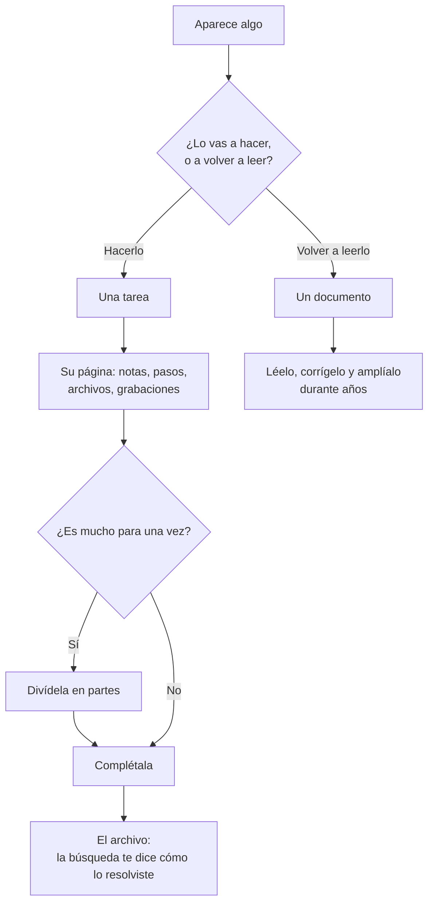
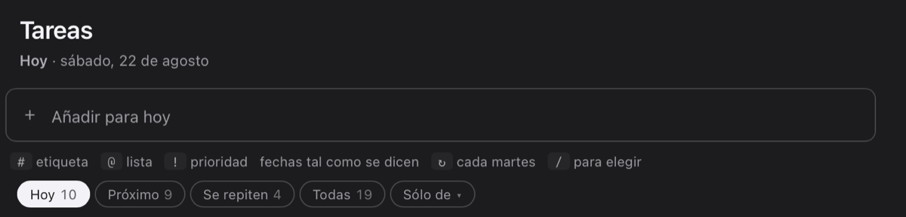
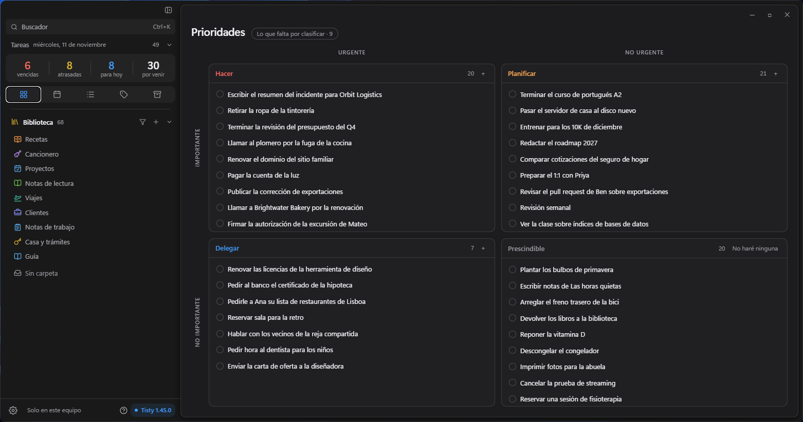
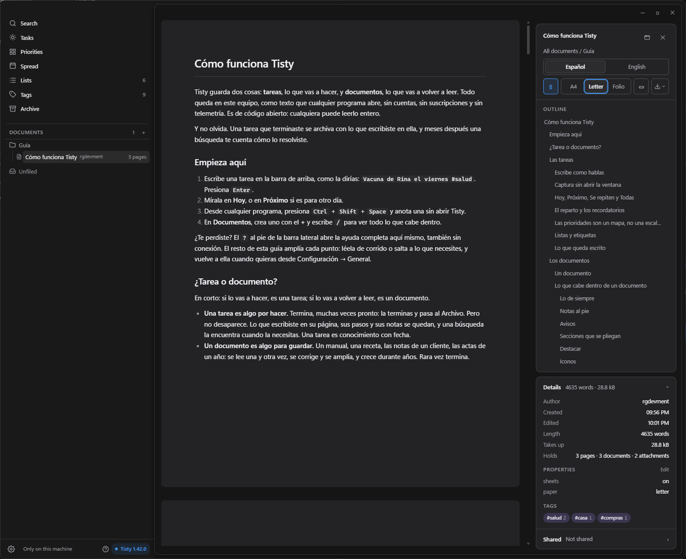
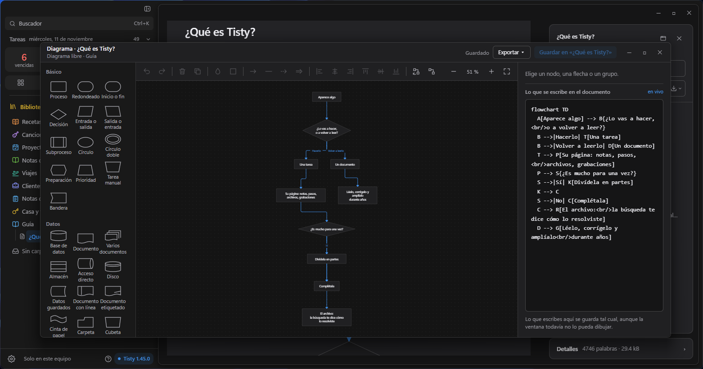
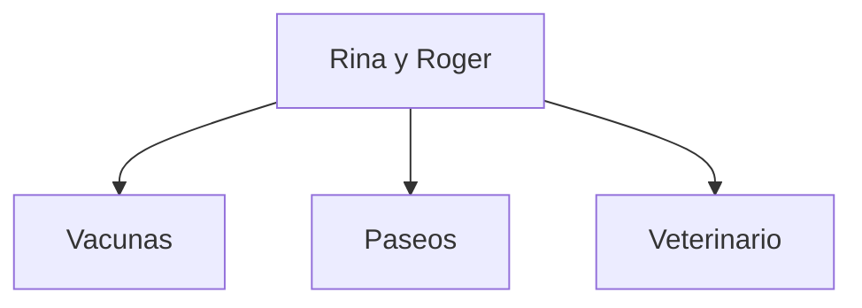
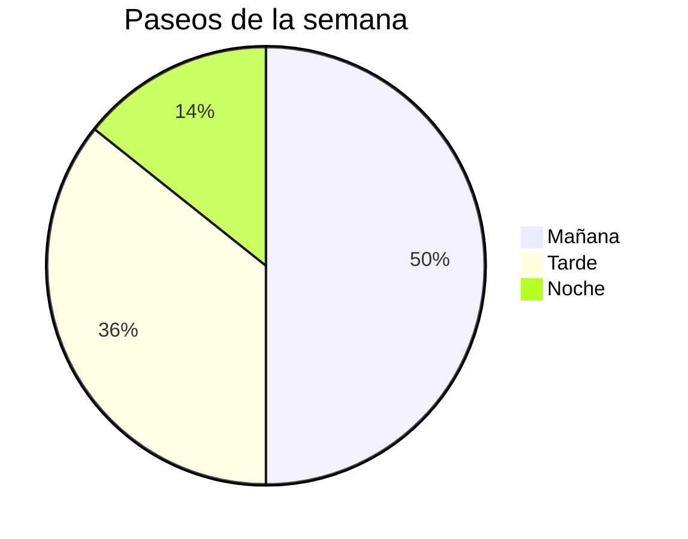
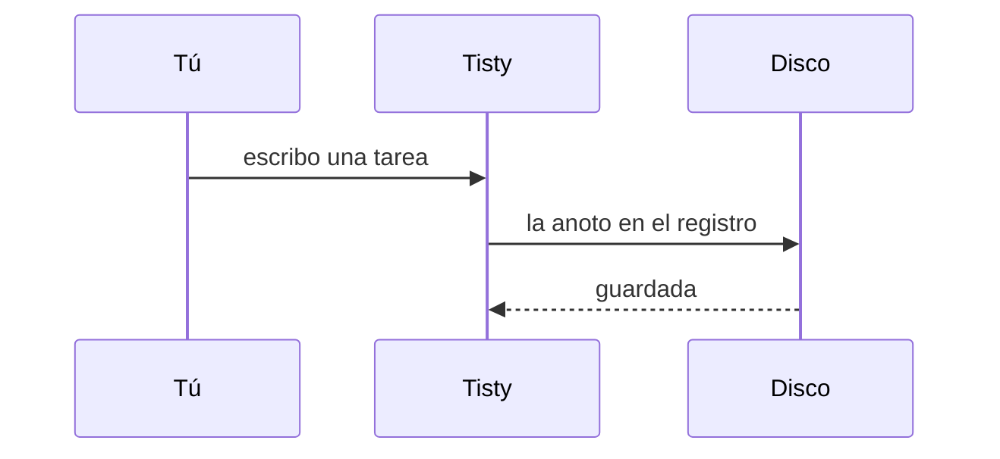

# ¿Qué es Tisty?

Tisty es un lugar tranquilo para dos cosas: lo que tienes que hacer y lo que quieres guardar. Lo primero son **tareas**; lo segundo, **documentos**.

Todo queda en este equipo, como texto que cualquier programa abre. No pide cuenta, no cobra suscripción y no envía nada sobre cómo lo usas. Es de código abierto: cualquiera puede auditarlo.

Y no olvida. Una tarea que terminaste se archiva con lo que escribiste en ella, y meses después una búsqueda te cuenta cómo lo resolviste.

Lee esta guía a tu ritmo: cada sección se entiende sola, y lo que hoy no uses puede esperar. Es un documento como cualquier otro, así que puedes tocarlo todo: hacer clic, escribir, probar. Si en algún momento te pierdes, el `?` al pie de la barra lateral abre la ayuda completa, también sin conexión, y a esta guía vuelves desde Configuración → General.

## ¿Cómo funciona?

Todo empieza con una pregunta: ¿lo vas a hacer, o lo vas a volver a leer? Si lo vas a hacer, es una tarea: se acaba, a veces el mismo día, y queda en el Archivo como conocimiento con fecha. Si lo vas a volver a leer, es un documento: un manual, una receta, las actas de un año, que corriges y amplías durante años. Este dibujo cuenta el resto:



**Pruébalo:** haz clic en el dibujo y se abre en grande. Con doble clic entras a la ventana de diagramas: mueve una caja, cambia un texto, y **Guardar en «¿Qué es Tisty?»** lo deja aquí, en tu guía. Así se empieza también uno propio.

:::details Un ejemplo: planear un viaje

1. Creas la tarea «Planear el viaje al sur». En su página anotas lo que averiguaste y lo que descartaste, y adjuntas el PDF de la reserva, la foto del mapa o el audio de quien te recomendó el lugar.
2. Cuando el plan está claro, lo divides en **partes**: «Comprar los boletos», «Reservar el alojamiento», «Alquilar el auto». Cada una es una tarea con sus propios pasos.
3. Terminas las partes una a una, y después el viaje. Pasa al Archivo.
4. Un año después, «¿dónde nos quedamos en el sur?» lo encuentra: su página, sus partes y cada paso, tal como quedaron.

:::

Y si una tarea te enseña algo que vas a necesitar de nuevo, como el arreglo de una falla que vuelve, guárdalo también en un documento.

---

## Las tareas

### Escribe como hablas

No hay formulario que llenar. Escribe la frase como se la dirías a alguien, en la barra de arriba, y Tisty va separando el día, la lista y la prioridad mientras escribes.



Cada parte que entiende se colorea:

| Escribes | Color | Entiende |
| --- | --- | --- |
| ==mañana 10am=={blue} | azul | día y hora, tal como los dirías |
| ==el viernes=={blue} | azul | el próximo que venga |
| ==antes del viernes=={blue} | azul | una fecha límite: hasta cuándo se puede |
| ==cada martes=={pink} | rosa | algo que vuelve solo |
| ==#casa=={pink} | rosa | una etiqueta: de qué va |
| ==@trabajo=={green} | verde | una lista: dónde ocurre |
| ==!planificar== | sin color | la prioridad: hacer, planificar, delegar o prescindible |

Lo que no se colorea se queda en el título, tal cual.

**Pruébalo:** escribe una de estas en la barra de arriba y mira cómo se colorea. Rina, la de los ejemplos, es una perra, y Roger es su hermano: sus vacunas, sus paseos y su veterinario te acompañan en toda la guía.

- `Vacuna de Rina el 3 de octubre !hacer #salud`
- `Sacar a Rina y Roger cada día`
- `Entregar el informe antes del viernes @trabajo`

Si solo querías mirar, bórrala antes de presionar `Enter`. Todas las palabras que entiende, en español y en inglés, están en [lenguaje natural](https://www.tisty.app/es/ayuda/lenguaje-natural/).

### Captura sin abrir la ventana

Se te ocurre algo en medio de otra cosa: presiona `Ctrl` + `Shift` + `Space` desde donde estés y se abre una ventanita para escribirlo. `Enter` la guarda, `Esc` la cierra, y sigues con lo tuyo. Pruébalo ahora, sin salir de esta guía.

Si ese atajo ya lo usa otro programa, Tisty toma otro y te dice cuál quedó en Configuración.

### Hoy, Próximo, Se repiten y Todas

Tu lista de tareas se mira de cuatro maneras:

- **Hoy** — lo que pide el día, lo más urgente primero:
  - **vencidas**: pasó su fecha límite;
  - **por vencer**: el límite está cerca;
  - **atrasadas**: pasó el día que planeaste, sin límite;
  - **para hoy** y **en curso**: lo que toca ahora.
- **Próximo** — lo que viene.
- **Se repiten** — lo que vuelve por su cuenta.
- **Todas** — todo lo abierto, sin filtro.

Las cuatro cuentas del día, arriba en la barra lateral, abren lo que cuentan: **Vencidas** y **Atrasadas** abren cada una su propia vista, que aparece junto a Hoy mientras estás en ella, y **para hoy** y **por venir** abren Hoy y Próximo.

Lo vencido sale arriba y en rojo; lo atrasado, en ámbar. Una tarea vence únicamente cuando pasa su fecha límite: si le pusiste un día y nada más, se atrasa, pero no vence. Y nadie te persigue: Tisty no lleva rachas ni puntos por vaciar la lista. Lo que no alcanzaste hoy, mañana sigue ahí.

### El reparto y los recordatorios

**Reparto**, el icono del calendario bajo las cuentas del día en la barra lateral, es tu calendario de trabajo: ahí decides con calma qué haces cada día. Lo que escribiste sin día espera en la bandeja **Sin día**; arrástralo al día que le toca. Si ese día ya lleva dos, Tisty te lo dice y te ofrece el siguiente libre. **Mes** muestra lo mismo en cuadrícula.

Un recordatorio es una hora que eliges en la tarea: suena como una notificación del sistema, solo en este equipo, con un sonido corto que puedes apagar. Más en [el reparto y los recordatorios](https://www.tisty.app/es/ayuda/reparto-y-recordatorios/).

### Las prioridades son un mapa, no una escalera

Dos preguntas, cuatro casillas: si corre prisa y si importa.



- **Hacer** — urgente e importante. Hoy.
- **Planificar** — importante, sin prisa. Ponle fecha antes de que se vuelva urgente.
- **Delegar** — corre, pero no es tuyo. Que lo lleve quien deba.
- **Prescindible** — ni corre ni importa. Su **No haré ninguna** las descarta todas de una vez.

Arrastra una tarea al cuadrante que le toque. Lo que no clasificas espera en la bandeja de al lado, sin regañarte.

### Listas y etiquetas

Dos formas de ordenar que no compiten:

- Una **lista** dice dónde ocurre: ==@casa=={green}, ==@trabajo=={green}. Una tarea está en una sola.
- Una **etiqueta** dice de qué va: ==#salud=={pink}, ==#compras=={pink}. Una tarea lleva las que quieras.

Una etiqueta también sirve en un documento: escribe `#salud` en medio de una frase y el documento queda bajo esa misma etiqueta. **Etiquetas**, el icono de la etiqueta bajo las cuentas del día en la barra lateral, junta todo lo que lleva una: lo que tienes que hacer y lo que escribiste sobre eso.

### Lo que queda escrito

Una tarea guarda más que su título. Se abre en una página propia, con secciones para llenar —de qué se trata, cómo sabrás que está lista, sus pasos, lo que fuiste averiguando— y en cada una, una pista en gris que dice qué va ahí. Cada casilla que escribas en esa página, `- [ ]`, es uno de sus pasos. Al terminarla nada de eso se borra: se archiva con su fecha.

Por eso importa: la lista te dice qué falta; el Archivo, cómo lo resolviste la última vez. Escribe una palabra que recuerdes en el buscador de arriba de la barra lateral (`Ctrl`/`⌘` + `K`) y la tarea aparece, aunque la hayas cerrado hace dos años.

:::details Partes: cuando un paso necesita más que una línea

Un paso es una línea, de cien caracteres como máximo. Si necesita más, conviértelo en una tarea propia, **parte** de esta: pasa el puntero sobre la casilla y haz clic en **↗**. La línea se vuelve su tarjeta, con sus pasos y su fecha, y un clic la abre.

Una tarea con partes muestra un contador como **▣ 3/7** donde contaría sus pasos, y sus partes se pliegan debajo. Junto a la página, **Partes** agrega una nueva, **Es parte de otra…** la cuelga de otra tarea y **Soltarla** la deja suelta otra vez. Si cierras una tarea que todavía tiene partes abiertas, Tisty te pide soltarlas en ese mismo paso; si deshaces el cierre, vuelven a colgar de ella.

:::

Las rutinas, las tareas que se repiten, tienen una sola página para todas sus vueltas. Lo que escribas en **Esta vez** es de la vuelta en curso: al completarla pasa a **Vueltas**, bajo la página, y la sección queda en blanco para la siguiente. El resto, paso a paso, está en [tareas](https://www.tisty.app/es/ayuda/tareas/).

### Terminar, descartar y borrar

- **Completar** la marca como hecha y la manda al Archivo. Su página se guarda con ella: se lee, pero ya no se escribe. Si la reabres, vuelve a ser tuya para escribir.
- **Cerrar con resumen** te pide dos líneas de cómo salió antes de terminarla.
- **Descartar** la aparta sin hacerla, y también acaba en el Archivo.

El Archivo se lee en tres capas: las **historias**, que dejaron algo escrito; las **rutinas**, que vuelven; y el **rastro**, lo que se cerró sin dejar casi nada. Cada capa está en [el archivo](https://www.tisty.app/es/ayuda/el-archivo/).

> **Antes de borrar de verdad.** Borrar solo se permite con lo que ya está cerrado **y** quedó como rastro. Desaparece de este equipo y, en la siguiente sincronización, de los demás; no se puede deshacer.

Y si quieres saber qué sobra o qué falta en todo lo que guardas, Configuración → Mantenimiento lo cuenta sin cambiar nada.

---

## Los documentos

### Un documento

Un documento es tuyo y se guarda en Markdown: texto plano con unas pocas marcas, como `**negrita**`, que cualquier programa abre. No hace falta aprenderlas: la tecla `/` te las ofrece todas. Y lo que importa es el archivo: si mañana borras Tisty, tus documentos siguen abriéndose en cualquier editor de texto.

**Pruébalo:** haz clic en este mismo párrafo. Se abre para escribir, con sus marcas a la vista; `Esc` lo devuelve a la página.

**Para hacer uno**, usa el **+** del encabezado de la **Biblioteca**, en la barra lateral: **Documento nuevo**. Dentro de una carpeta, ese mismo botón lo crea ahí, y **Carpeta nueva** los agrupa. Las carpetas aparecen plegadas; ábrelas con la flecha.

La primera línea del documento es su título: no hay que ponerle nombre en ninguna otra parte. Sus propiedades, como las etiquetas o el papel en que se imprime, se ven en el panel de al lado, en **Sobre este documento**.

Para escribir:

- Haz clic en un párrafo y se abre para escribir; `Esc` lo devuelve a la página.
- Elige unas palabras y una barra pequeña te ofrece negrita, cursiva, un enlace o el resaltador; el botón derecho ofrece lo mismo, más copiar y editar el bloque.
- `Ctrl`/`⌘` + `Shift` + `M` muestra las marcas del bloque, y `Ctrl`/`⌘` + `E` abre el documento entero como un solo texto.
- Arrastra un archivo dentro para adjuntarlo: la cartilla de vacunas de Rina, el PDF del seguro.
- Inserta **otro documento**: en un párrafo propio aparece como tarjeta; dentro de una frase, como enlace con su título. En los dos casos, un clic lo abre.

**Exportar**, en el panel del documento, lo imprime, lo guarda en PDF, como página web o como Word, y lo copia como Markdown estándar para cualquier otro editor. Prueba con esta guía: sale con sus diagramas, sus tablas y sus hojas.

Y cuando un asunto ya pasó, archiva su carpeta con el botón derecho: baja al estante de **Archivados**, al final del árbol, con todo lo que tiene dentro. Ahí se lee y se exporta, pero no se escribe; desarchívala y vuelve como estaba. Más en [documentos](https://www.tisty.app/es/ayuda/documentos/).

### Un documento en varios idiomas

Un manual para la gente con la que trabajas, en español y en inglés; un contrato en dos idiomas. Cada idioma es un documento propio, con su archivo, y Tisty los muestra como uno solo: una fila en el árbol, abierta en el idioma de la app.



**Para traducir uno**, abre el menú del documento y elige **Traducir a…**: Tisty crea una copia de su texto y de sus páginas, lista para que la traduzcas sección por sección. Si ya tienes los dos escritos, **Unir con su otro idioma…** los junta, y **Separar de sus idiomas** los vuelve a separar.

El selector está en el panel del título y te deja en la misma sección del otro idioma. **Pruébalo:** elige English en esta guía y llegas aquí mismo, en inglés; vuelve con Español. Mover, archivar o borrar actúa sobre todos los idiomas a la vez.

### Un documento con páginas

Un año de actas, un libro por capítulos, la vida de Rina contada año a año: eso no cabe en un solo papel, ni en una carpeta de papeles sueltos.

Una página es un documento como cualquier otro, con su propio archivo, que además dice de qué documento es. Hay un nivel y no más: una página no tiene páginas.

**Para agregarle una**, escribe `/` donde quieras que empiece ese capítulo y elige **Una página nueva**, o **Una página que ya existe** si ya la escribiste. Queda insertada ahí mismo, como una tarjeta con su título y sus primeras palabras. **Pruébalo:** esta guía tiene una página, y es esta tarjeta. Ábrela con un clic y mira arriba de qué documento es:


En el árbol, soltar un documento encima de otro también lo vuelve su página.

> [!IMPORTANT]
> El orden en que las insertas en el texto es el orden de las páginas: en el árbol, al exportar y al imprimir. Para mover un capítulo, usa las flechas de su fila en el índice del final del documento, o `Alt` y una flecha sobre la fila.

Al final del documento va el índice, con sus páginas numeradas. Dentro de una página ves arriba de qué documento es, flechas a las páginas vecinas y, abajo, el paso a la siguiente.

Una página se puede archivar por separado, con el botón derecho, y queda atenuada en su documento; archivar el documento las archiva todas. Cómo se imprime un libro, con su índice, está en [páginas y PDF](https://www.tisty.app/es/ayuda/paginas-y-pdf/).

### Hojas, saltos de página y PDF

Si un documento va a terminar impreso o en PDF, tú decides dónde empieza cada hoja. Una línea con solo `---` la corta: lo que sigue va en la hoja siguiente, y `Ctrl`/`⌘` + `Enter` la escribe por ti.

Enciende **Hojas** en el panel del documento para verlo en hojas de verdad (A4, Carta u Oficio, en vertical u horizontal), donde una hoja que se llena pasa sola a la siguiente. Al exportar a PDF salen esas mismas hojas. **Pruébalo:** aquí abajo hay una raya de esas; enciende **Hojas** y mira dónde cae el párrafo que sigue.

---

Este párrafo empieza en una hoja nueva, por la raya de arriba.

### Diagramas a mano

Un diagrama cuenta de un vistazo lo que un párrafo tarda en explicar, como el de «¿Cómo funciona?» al principio. Lo escribes como texto, en un bloque de código con el lenguaje `mermaid`, y Tisty lo dibuja. Un clic lo agranda; un doble clic lo abre en la ventana de diagramas, donde también puedes dibujar a mano mapas mentales, esquemas, diagramas libres o de clases.



Así se ven otros tres. Primero, un esquema con lo que hay que llevar al día de Rina y Roger:



También caben gráficos. Los paseos de Rina y Roger esta semana, según la hora:



Y uno de secuencia, que muestra quién le habla a quién y en qué orden; aquí, lo que pasa cuando guardas una tarea:



### Lo que cabe dentro de un documento

Esta sección es un muestrario: cada forma que puede tomar un documento, con un ejemplo vivo que puedes tocar. Si solo quieres escribir, sáltatela; todo se inserta con `/` cuando lo necesites. Es Markdown corriente, así que GitHub lo lee igual que Tisty, y `F1` abre la [guía de Markdown de Tisty](https://markdown.tisty.app/es/) en la forma que estás escribiendo.

O míralo todo junto, uno de cada cosa, en su propia página, donde también sale Roger:


#### Lo de siempre

**Negrita**, *cursiva*, ~~tachado~~, ++subrayado++, `código suelto` y un [enlace a una web](https://github.com/rgdevment/Tisty). Listas con viñetas, numeradas, y citas:

> Lo que no está escrito, no ocurrió.

1. Primero esto
2. Después lo otro
3. Y al final lo de más allá

#### Notas al pie

Una palabra puede llevar una nota sin cortar la frase: a Rina le pusieron el refuerzo en marzo[^marzo], y el veterinario la quiere de vuelta en un año. Un clic en la llamada te lleva a la nota.

[^marzo]: La vacuna anual y la antirrábica en la misma visita, con el examen de sangre. Una nota como esta se llama con `[^etiqueta]` y se escribe una vez, en una línea propia.

#### Avisos

Cinco tipos —nota, consejo, importante, aviso y cuidado—, cada uno con su color. Por dentro es una cita que empieza por su nombre entre corchetes, como los escribe GitHub.

> [!NOTE]
> Para lo que conviene saber, sin urgencia ninguna.

Y dentro de un aviso cabe casi todo, no solo texto:

> [!TIP]
> La comida de Rina:
>
> - Pesar la porción
> - Anotarla en su tabla
>
> ```text
> 250 g en la mañana, 200 g en la tarde
> ```
>
> ---
>
> Todo esto llega igual al PDF.

#### Tablas

Una tabla se escribe en la misma página: haz clic en una celda y escribe. El menú `⋯` de una fila o columna la mueve, la duplica o la quita, y le da un tipo a una columna: una fecha con su calendario, dinero, opciones con su color, estrellas o un interruptor, con su total al pie. Ordena y filtra desde el título de una columna sin tocar el archivo: **pruébalo** con «Vacuna», aquí abajo.

| Vacuna | Puesta | Toca otra vez |
| :--- | :---: | ---: |
| Anual | marzo | 12 meses |
| Antirrábica | marzo | 12 meses |
| Desparasitación | agosto | 3 meses |

Arrastra el borde de un encabezado para ensanchar su columna: otros lectores de Markdown ven una tabla normal, y Tisty respeta el ancho que le diste.

#### Fórmulas

Un bloque cuyo lenguaje es `math` compone la fórmula.

```math
dosis = \frac{peso \times 0.5}{2}
```

```math
\sum_{i=1}^{n} i = \frac{n(n+1)}{2}
```

Una fórmula también cabe dentro de una frase, entre signos de dólar: Rina pesa 12 kilos, así que su dosis es $\frac{12 \times 0.5}{2} = 3$ mililitros. Un dólar seguido de una cifra es un precio, así que `$5` sigue siendo cinco dólares. Todo se dibuja sin conexión.

#### Widgets

Un bloque cuyo lenguaje es `widget` se dibuja como una vista fija, hecha solo de HTML y CSS: no ejecuta nada, así que se ve igual donde se lea el documento. Toma los colores de Tisty y trae clases listas como `grid`, `stat`, `card` o `badge`. El código queda plegado; ábrelo con «Ver código».

```widget title="Rina y Roger este mes"
<div class="grid">
  <div class="stat"><small>Paseos</small><b>42</b><em class="up">+6 frente a agosto</em></div>
  <div class="stat"><small>Kilómetros</small><b>61</b></div>
  <div class="stat"><small>Próxima vacuna</small><b>12 nov</b><span class="badge warn">pendiente</span></div>
</div>
```

#### Archivos, sonido y video

Un archivo adjunto se dibuja como lo que es: una imagen tal cual, que un clic abre en grande; un sonido o un video con su reproductor; y cualquier otro, como una tarjeta con su tipo y su tamaño. Cada tarjeta tiene un **⋯** para guardar una copia, convertirla en un enlace simple o quitarla de la página. Un video que todavía está en tu nube se descarga solo cuando le das play, y una página `.html` adjunta nunca se ejecuta.

#### Un enlace en su propio párrafo

Un enlace que ocupa un párrafo entero se dibuja como tarjeta; el mismo enlace dentro de una frase sigue siendo un enlace. Si quieres el título y la imagen del sitio, pídelos con **Traer la vista previa**.

[Tisty en GitHub](https://github.com/rgdevment/Tisty)

#### Código, con nombre y con color

Un bloque de código se colorea según su lenguaje, y le puedes poner nombre: escribe el lenguaje y después `title="lo que sea"`. El nombre se ve en la cabecera del bloque, y el color llega también al PDF.

```python title="dosis.py"
peso = 12
print(peso * 0.5 / 2)
```

```json title="rina.json"
{ "nombre": "Rina", "peso": 12 }
```

Del código hay más que decir, y cabe en su propia página:


### Lo que viene de afuera

¿Ya tienes notas en otro lado? No hace falta copiarlas a mano. Lo que llega de afuera entra convertido en Markdown de Tisty, y el archivo de donde vino no se toca:

- **Importar un documento**, en el árbol, toma Markdown, texto, una página web o un Word.
- Al pegar se conservan los títulos, listas, tablas, enlaces y colores de lo que copiaste de una web, un correo o un Word.
- Una nota de Obsidian entra con sus avisos convertidos y sus `[[enlaces]]` apuntando a los documentos de aquí con esos títulos.
- **Exportar para Tisty…** lleva carpetas enteras, con sus páginas, a otro Tisty en un archivo `.tistyx`, y abrirlo las trae tal cual.
- Un calendario `.ics` también entra: arrástralo a la ventana y elige qué citas se vuelven tareas.

Un archivo Markdown también se lee sin traerlo: elige Tisty en **Abrir con** y se abre en un visor liviano que no toca el archivo.

Lo que escribes en Tisty se guarda tal como lo escribiste: propiedades, notas al pie, enlaces y comentarios quedan en el archivo, palabra por palabra. Lo que cambia en cada cruce está en [convertir a y desde Markdown](https://www.tisty.app/es/ayuda/convertir-a-y-desde-markdown/).

---

## Tus datos

Lo que escribes es tuyo, y aquí está cómo cuidarlo: llevarlo a otro equipo, cifrarlo y compartirlo solo con quien quieras.

### Tus copias en la nube y sincronizar

Tisty trabaja siempre en este equipo. Para tener lo mismo en otro, dile dónde dejar las copias, en Configuración → Sincronizar:

- **Directo a una nube**: tu Google Drive, tu OneDrive o tu propio servidor WebDAV (Nextcloud, ownCloud, Synology y otros), sin instalar nada más.
- **Una carpeta**: Google Drive, OneDrive, iCloud o Dropbox si están instalados, o cualquier carpeta que vean los dos equipos. Ahí quien sube y baja es el programa de tu proveedor, no Tisty.

> No hay servidor nuestro por medio. Sincronizar te da otra copia, no un viaje al pasado: si borras una tarea, el borrado también viaja.

Cuando dos equipos escribieron la misma parte de un documento, Tisty no elige: te muestra las dos versiones y te quedas con **Esta**, **La otra** o **Las dos**.

Una carpeta compartida no es un respaldo. En Configuración → Tus datos guardas un respaldo completo cuando quieras. Desinstalar Tisty deja tus tareas y documentos donde están; dónde viven y cómo borrarlos del todo está en [sincronizar y respaldar](https://www.tisty.app/es/ayuda/sincronizar-y-respaldar/).

### Cifrado y equipos que firman

Una copia directa a una nube se puede cifrar en Configuración → Seguridad con una frase de 24 palabras, y entonces ni tu proveedor puede leerla. Guárdala en papel o en la hoja PDF que te ofrece Tisty. La copia en una carpeta no se cifra.

Para que nadie cuele un equipo ajeno en tu sincronización, cada equipo firma lo que escribe, y uno nuevo espera a que confirmes que es tuyo:

1. Aparece un aviso en la barra lateral con el nombre de ese equipo.
2. **Confirmar…** te muestra su código de veinte dígitos.
3. En el equipo nuevo, en Configuración → Sincronizar, **Mostrar en grande** muestra el suyo.
4. Si los dos códigos coinciden, **Sí, es el mismo** lo deja pasar; si no, **No coincide** lo deja fuera.

### Compartir un documento

El panel junto a un documento tiene una fila **Compartido** con **Compartir…**. Compartir pasa por Folio, un servicio aparte de Tisty: crea un enlace cifrado de punta a punta, para leer o para editar, y tú eliges cuánto dura. Quien lo abre no necesita cuenta. Si Folio todavía no está disponible, Tisty te lo dice y nada de tu documento sale de este equipo.

La primera vez, Compartir te pide crear tu identidad: la llave con que firmas lo que compartes, respaldada por una frase de 24 palabras; si ya cifraste tu copia, es la misma. Nadie de Tisty ni de Folio te la va a pedir nunca. Más en [documentos](https://www.tisty.app/es/ayuda/documentos/) y en [privacidad](https://www.tisty.app/es/ayuda/privacidad/).

---

## Cuando quieras más

Nada de esto hace falta para empezar. Está aquí para cuando lo necesites.

### Un asistente puede escribir aquí

Si usas un asistente como Claude Code o Codex, puede entrar a Tisty por MCP, con un programa que corre en este equipo. Configuración → Asistentes encuentra los que tienes instalados y conecta uno con un clic. Lo que escribe va firmado con su nombre: «por Claude Code», «por Codex».

- **Puede** proponer tareas, escribir documentos, agregar o corregir en los que puede escribir, y marcar uno que ya cumplió su vida, con el porqué.
- **Puede decir** que una tarea o un paso está listo. La tarea queda en **Por confirmar** hasta que tú la terminas o la devuelves con **Sigue pendiente**; los pasos te esperan con **Marcarlos** o **Todavía no**.
- **No puede** cerrar ni borrar una tarea, borrar un documento ni cambiar una tarea que escribiste tú.

Si escribiste en un documento mientras él lo leía, no escribe encima: se le pide que vuelva a leerlo. Y cuando algo escribe en el documento que tienes abierto, la ventana te avisa y te ofrece volver a lo que decía antes. Cómo conectar uno y qué deja pasar cada puerta está en [asistentes y MCP](https://www.tisty.app/es/ayuda/asistentes-y-mcp/) y en [qué puede hacer un asistente](https://www.tisty.app/es/ayuda/que-puede-hacer-un-asistente/).

### Atajos

| Atajo | Qué hace |
| --- | --- |
| `Ctrl` + `Shift` + `Space` | Capturar una tarea sin abrir la ventana |
| `Ctrl`/`⌘` + `Enter` | Terminar la tarea señalada; en un documento, un salto de página |
| `/` | Insertar algo dentro de un documento |
| `Shift` + `Enter` | Saltar de línea sin empezar un párrafo |
| `Ctrl`/`⌘` + `Shift` + `M` | Mostrar u ocultar las marcas del bloque |
| `Ctrl`/`⌘` + `E` | Abrir o dejar el documento entero como texto |
| `F1` | Abrir la guía de Markdown de Tisty en lo que estás escribiendo |
| `Ctrl`/`⌘` + `K` | Ir al buscador de arriba de la barra lateral |
| `Tab` · `Shift` + `Tab` | Recorrer las celdas de una tabla |
| `Ctrl`/`⌘` + `X` · `V` | Mover un documento entre carpetas |
| `Esc` | Cerrar lo que esté abierto |

El resto está en [atajos de teclado](https://www.tisty.app/es/ayuda/atajos-de-teclado/).

## Si te sirvió

Todo lo que hace Tisty se explica en [la ayuda de Tisty](https://www.tisty.app/es/ayuda/), con [preguntas frecuentes](https://www.tisty.app/es/ayuda/preguntas-frecuentes/), y cada forma que cabe en un documento, en [la guía de Markdown](https://markdown.tisty.app/es/).

Las preguntas y las ideas van a [Discussions](https://github.com/rgdevment/Tisty/discussions); un error, a [Issues](https://github.com/rgdevment/Tisty/issues).

Esta guía la escribe y la firma rgdevment, quien hace Tisty. En [su perfil de GitHub](https://github.com/rgdevment) hay dos herramientas más, con la misma idea: gratis, abiertas, sin anuncios, sin telemetría, todo en tu equipo.

- [**CoPanda**](https://copanda.app) — un gestor de portapapeles para Windows y macOS.
- [**LinkUnbound**](https://github.com/rgdevment/LinkUnbound) — un selector de navegadores para Windows y macOS: pregunta cuál debe abrir un enlace en vez de suponerlo. Si está instalado, los enlaces que abres desde Tisty pasan por él.
