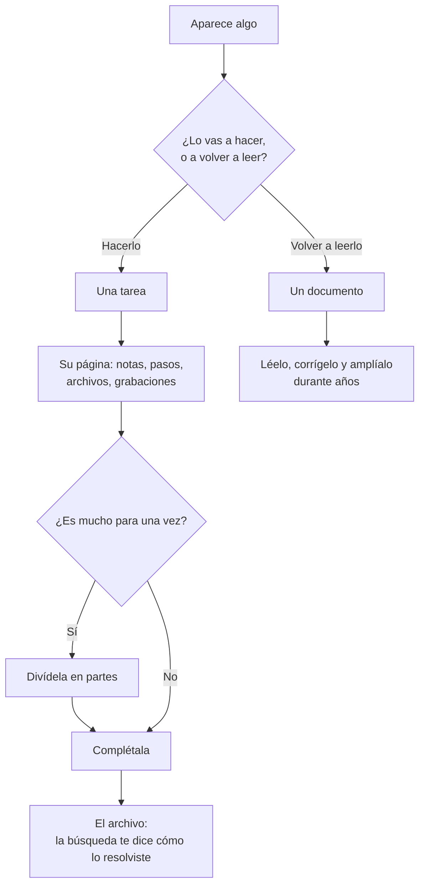
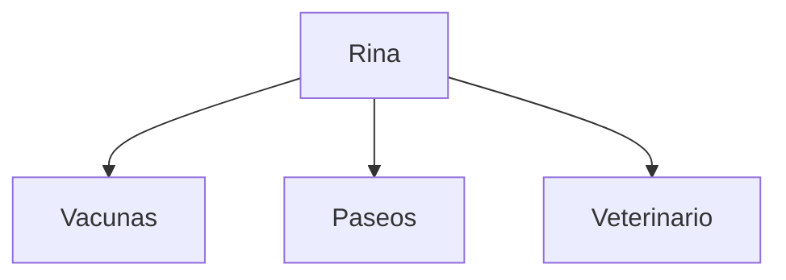
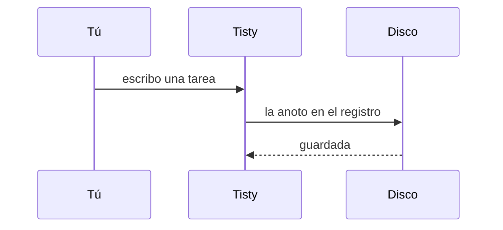

# Cómo funciona Tisty

Tisty guarda dos cosas: **tareas**, lo que vas a hacer, y **documentos**, lo que vas a volver a leer. Todo queda en este equipo, como texto que cualquier programa abre, sin cuentas, sin suscripciones y sin telemetría. Es de código abierto: cualquiera puede leerlo entero.

Y no olvida. Una tarea que terminaste se archiva con lo que escribiste en ella, y meses después una búsqueda te cuenta cómo lo resolviste.

## Empieza aquí

1. Escribe una tarea en la barra de arriba, como la dirías: `Vacuna de Rina el viernes #salud`. Presiona `Enter`.
2. Mírala en **Hoy**, o en **Próximo** si es para otro día.
3. Desde cualquier programa, presiona `Ctrl` + `Shift` + `Space` y anota una sin abrir Tisty.
4. En **Documentos**, crea uno con el **+** y escribe `/` para ver todo lo que cabe dentro.

¿Te perdiste? El `?` al pie de la barra lateral abre la ayuda completa aquí mismo, también sin conexión. El resto de esta guía amplía cada punto: léela de corrido o salta a lo que necesites, y vuelve a ella cuando quieras desde Configuración → General.

## ¿Tarea o documento?

En corto: si lo vas a hacer, es una tarea; si lo vas a volver a leer, es un documento.

- **Una tarea es algo por hacer.** Termina, muchas veces pronto: la terminas y pasa al Archivo. Pero no desaparece. Lo que escribiste en su página, sus pasos y sus notas se quedan, y una búsqueda la encuentra cuando la necesitas. Una tarea es conocimiento con fecha.
- **Un documento es algo para guardar.** Un manual, una receta, las notas de un cliente, las actas de un año: se lee una y otra vez, se corrige y se amplía, y crece durante años. Rara vez termina.



:::details Un ejemplo: planear un viaje

1. Empieza como una tarea, «Planear el viaje al sur». En su página anotas lo que averiguaste, lo que descartaste y por qué, y adjuntas lo que una descripción no podría contener: el PDF de la reserva, la foto del mapa, el audio de quien te recomendó el lugar.
2. Cuando el plan está claro, el trabajo se divide en **partes**: «Comprar los boletos», «Reservar el alojamiento», «Alquilar el auto». Cada una es una tarea con sus propios pasos.
3. Las partes se terminan una a una, y después el viaje. Pasa al Archivo.
4. Un año después, «¿dónde nos quedamos en el sur?» lo encuentra: su página, sus partes y cada paso, tal como quedaron.

:::

Cuando hacer una tarea te enseña algo que vas a necesitar de nuevo —el arreglo de una falla que vuelve, cómo quiere un proveedor que le pidan—, guárdalo también en un documento.

---

## Las tareas

### Escribe como hablas

No hay formulario que llenar. Escribe la frase entera en la barra de arriba y Tisty va separando el día, la lista y la prioridad mientras escribes.


Cada parte que entiende se colorea:

| Escribes | Color | Entiende |
| --- | --- | --- |
| ==mañana 10am=={blue} | azul | día y hora, tal como los dirías |
| ==el viernes=={blue} | azul | el próximo que venga |
| ==antes del viernes=={blue} | azul | una fecha límite: hasta cuándo se puede |
| ==cada martes=={pink} | rosa | algo que vuelve solo |
| ==#casa=={pink} | rosa | una etiqueta: de qué va |
| ==@trabajo=={green} | verde | una lista: dónde ocurre |
| ==!planificar== | sin color | la prioridad: hacer, planificar, delegar o prescindible |

Si una parte no se colorea, se queda en el título, y no pasa nada.

Prueba con estas:

- `Vacuna de Rina el 3 de octubre !hacer #salud`
- `Sacar a Rina cada día`
- `Entregar el informe antes del viernes @trabajo`

Una **fecha** es cuándo piensas hacerlo; una **fecha límite**, hasta cuándo se puede. Todas las palabras que entiende —días, horas, límites, lo que se repite, en español y en inglés— están en [lenguaje natural](https://www.tisty.app/es/ayuda/lenguaje-natural/).

### Captura sin abrir la ventana

Presiona `Ctrl` + `Shift` + `Space` desde donde estés y se abre una ventanita para escribir una tarea. `Enter` la guarda, `Esc` la cierra, y sigues con lo tuyo.

Si ese atajo ya lo usa otro programa, Tisty toma otro y te dice cuál quedó en Configuración.

### Hoy, Próximo, Se repiten y Todas

La lista de tareas se divide en cuatro vistas:

- **Hoy** — lo que pide el día, lo más urgente primero:
  - **vencidas**: pasó su fecha límite;
  - **por vencer**: el límite está cerca;
  - **atrasadas**: pasó el día que planeaste, sin límite;
  - **para hoy** y **en curso**.
- **Próximo** — lo que viene.
- **Se repiten** — lo que vuelve por su cuenta.
- **Todas** — todo lo abierto, sin filtro.

Lo vencido aparece arriba y en rojo; lo atrasado, en ámbar. Una tarea solo vence cuando pasa su fecha límite: si solo le pusiste un día, se atrasa, pero no vence. No hay premios por vaciar la lista.

### El reparto y los recordatorios

**Reparto**, en la barra lateral, es tu calendario de trabajo: cada día es una fila que crece con lo que lleva. Lo que escribiste sin día espera en la bandeja **Sin día**; arrástralo al día que le toca. Si sueltas una tarea en un día que ya lleva dos, Tisty te lo dice y te ofrece el siguiente día libre. **Mes** muestra los mismos días en cuadrícula, para mirar.

Un recordatorio es una hora que eliges en la tarea. Suena en este equipo y en ningún otro, como una notificación del sistema con un sonido corto que puedes apagar. Más en [el reparto y los recordatorios](https://www.tisty.app/es/ayuda/reparto-y-recordatorios/).

### Las prioridades son un mapa, no una escalera

Dos preguntas, cuatro casillas: si corre prisa y si importa.


- **Hacer** — urgente e importante. Hoy.
- **Planificar** — importante, sin prisa. Ponle fecha antes de que se vuelva urgente.
- **Delegar** — corre, pero no es tuyo. Que lo lleve quien deba.
- **Prescindible** — ni corre ni importa. Ese cuadrante tiene su propio «No haré ninguna».

Arrastra una tarea al cuadrante que le toque. Lo que no clasificas espera en la bandeja de al lado, sin regañarte.

### Listas y etiquetas

Dos formas de ordenar que no compiten:

- Una **lista** dice dónde ocurre: ==@casa=={green}, ==@trabajo=={green}. Una tarea está en una sola.
- Una **etiqueta** dice de qué va: ==#salud=={pink}, ==#compras=={pink}. Una tarea lleva las que quieras.

Una etiqueta también sirve en un documento: escribe `#salud` en medio de una frase y el documento queda bajo esa misma etiqueta. **Etiquetas**, en la barra lateral, junta todo lo que lleva una: lo que tienes que hacer y lo que escribiste sobre eso.

### Lo que queda escrito

Una tarea guarda más que su título. Se abre en una página propia, con secciones para llenar —de qué se trata, cómo sabrás que está lista, sus pasos, lo que fuiste averiguando— y en cada una, una pista en gris que dice qué va ahí. Cada casilla que escribas en esa página, `- [ ]`, es uno de sus pasos. Al terminarla nada de eso se borra: se archiva con su fecha.

:::details Partes: cuando un paso necesita más que una línea

Un paso es una línea, de cien caracteres como máximo. Si necesita más, conviértelo en una tarea propia, **parte** de esta: pasa el puntero sobre la casilla y haz clic en **↗**. La línea se vuelve su tarjeta, con sus pasos y su fecha, y un clic la abre.

Una tarea con partes muestra un contador como **▣ 3/7** donde contaría sus pasos, y sus partes se pliegan debajo. Junto a la página, **Partes** agrega una nueva y **Es parte de otra…** la cuelga de otra tarea; **Soltarla** la deja suelta otra vez. Cerrar una tarea con partes abiertas te pide soltarlas en el mismo gesto, y deshacer las devuelve.

:::

Una rutina tiene una sola página para todas sus vueltas. Lo que escribas en **Esta vez** es de la vuelta que corre: al completarla pasa a **Vueltas**, bajo la página, y la sección queda en blanco para la siguiente.

Ahí está la diferencia: la lista te dice qué falta; el Archivo te dice cómo lo resolviste la última vez. Busca una palabra que recuerdes y aparece, aunque la cerraras hace dos años. El resto, paso a paso, está en [tareas](https://www.tisty.app/es/ayuda/tareas/).

---

## Los documentos

### Un documento

Un documento es texto tuyo, guardado en Markdown: texto simple con unas pocas marcas, como `**negrita**`, que cualquier programa abre. No necesitas aprenderlo: Tisty te ofrece todo con la tecla `/`. Y el archivo es lo que vale: si mañana borras Tisty, tus documentos siguen abriéndose en cualquier editor de texto.

**Para hacer uno**, ve a Documentos y usa el **+** de arriba: **Documento nuevo**. Dentro de una carpeta, ese mismo botón lo crea ahí, y **Carpeta nueva** las agrupa.

La primera línea del documento es su título: no hay que ponerle nombre en ninguna otra parte. Sus propiedades, como las etiquetas o el papel en que se imprime, se ven en el panel de al lado, en **Sobre este documento**.

Para escribir:

- Haz clic en un párrafo y se abre para escribir; `Esc` lo devuelve a la página.
- Elige unas palabras y una barra pequeña te ofrece negrita, cursiva, un enlace o el resaltador; el botón derecho ofrece lo mismo, más copiar y editar el bloque.
- `Ctrl`/`⌘` + `Shift` + `M` muestra las marcas del bloque, y `Ctrl`/`⌘` + `E` abre el documento entero como un solo texto.
- Arrastra un archivo dentro para adjuntarlo: la foto del veterinario, el PDF del seguro.
- Inserta **otro documento**: solo en su párrafo entra como una tarjeta que se abre con un clic; dentro de una frase es una palabra en la que haces clic.

**Exportar**, en el panel del documento, lo imprime, lo guarda en PDF, como página web o como Word, y lo copia como Markdown estándar para cualquier otro editor.

**Las carpetas nacen plegadas** y se abren con la flecha.

Cuando un asunto ya pasó, archiva la carpeta con el botón derecho: baja al estante de **Archivados**, al final del árbol, con todo lo que tiene dentro. Ahí se lee y se exporta, pero no se escribe. Desarchívala y vuelve como estaba. Más en [documentos](https://www.tisty.app/es/ayuda/documentos/).

### Lo que cabe dentro de un documento

Todo lo de aquí abajo es Markdown corriente: lo escribes con `/`, y el archivo que queda en el disco lo entiende GitHub igual que Tisty. Nada de esto es obligatorio: si solo quieres escribir, sáltate esta sección, porque todo se inserta con `/`. Aquí no se explica; se muestra. Cada forma tiene su página en la [guía de Markdown de Tisty](https://markdown.tisty.app/es/), y `F1` la abre en la que estás escribiendo.

Y para verlo todo junto, uno de cada cosa, hay una página aparte:


#### Lo de siempre

**Negrita**, *cursiva*, ~~tachado~~, ++subrayado++, `código suelto` y un [enlace a una web](https://github.com/rgdevment/Tisty). Listas con viñetas, numeradas, y citas:

> Lo que no está escrito, no ocurrió.

1. Primero esto
2. Después lo otro
3. Y al final lo de más allá

#### Notas al pie

Una palabra puede llevar una nota sin cortar la frase en que está: a Rina le pusieron el refuerzo en marzo[^marzo], y el veterinario la quiere de vuelta en un año.

[^marzo]: La vacuna anual y la antirrábica en la misma visita, con el examen de sangre. Una nota como esta se llama con `[^etiqueta]` y se escribe una vez, en una línea propia; GitHub la lee igual.

La llamada es la etiqueta pequeña en alto, y un clic en ella te lleva a la nota.

#### Avisos

Cinco tipos, cada uno con su nombre y su color. Por dentro es una cita que empieza por su nombre entre corchetes, que es como los escribe GitHub.

> [!NOTE]
> Para lo que conviene saber, sin urgencia ninguna.

> [!TIP]
> Si ya estás dentro de un aviso y eliges otro tipo, cambia el que hay en vez de meter uno dentro de otro.

> [!IMPORTANT]
> Para lo que no se puede pasar por alto.

> [!WARNING]
> Para lo que puede salir mal si no miras.

> [!CAUTION]
> Para lo que no tiene vuelta atrás.

Y dentro de un aviso cabe casi todo, no solo texto:

> [!TIP]
> La comida de Rina:
>
> - Pesar la porción
> - Anotarla en su tabla
>
> ```text
> 250 g en la mañana, 200 g en la tarde
> ```
>
> ---
>
> Todo esto llega igual al PDF.

#### Secciones que se pliegan

Lo que es largo y solo se necesita de vez en cuando puede quedar plegado bajo un título, sin estorbar hasta que alguien lo abra. Es **Sección plegable** en el menú `/`:

:::details La ficha completa de Rina

Nació en 2023. Vacuna anual y antirrábica cada marzo, desparasitación cada tres meses.

:::

#### Destacar

Cuatro colores de resaltador: ==amarillo==, ==verde=={green}, ==azul=={blue} y ==rosa=={pink}. Eliges el color en la barra que se abre al seleccionar palabras en un bloque.

#### Iconos

::dog orange:: Un icono se busca por lo que dibuja, en español o en inglés: pide «perro», «moto» o «puño» y sale el que esperas. Sirve para marcar una línea sin gastar un título en ella.

#### Etapas

Una lista de casillas que se marcan. En un documento no son tareas: no se cierran, no tienen fecha y no salen en Hoy. Son las etapas de algo que estás escribiendo. En la página propia de una tarea, esas mismas casillas son sus pasos.

- [x] Llevar la cartilla de Rina
- [x] Pesarla antes de la consulta
- [ ] Preguntar por la pastilla de las garrapatas

Una etapa se puede nombrar desde cualquier parte del texto por su lugar en la lista: la que sigue abierta, [[#3]], muestra aquí sus palabras, y un clic te lleva a ella.

#### Tablas

Una tabla se escribe en la misma página: haz clic en una celda y escribe. El menú `⋯` de una fila o columna la mueve, la duplica o la quita, y le da un tipo a una columna —una fecha con su calendario, dinero, opciones con su color, estrellas, un interruptor— que se suma al pie. Ordena y filtra desde el título de una columna sin tocar el archivo, y arrastra el borde de un encabezado para ensanchar su columna.

| Vacuna | Puesta | Toca otra vez |
| :--- | :---: | ---: |
| Anual | marzo | 12 meses |
| Antirrábica | marzo | 12 meses |
| Desparasitación | agosto | 3 meses |

El ancho se guarda en el largo de la raya bajo el encabezado: otros lectores de Markdown ven una tabla normal y Tisty respeta el ancho que le diste.

#### Diagramas

Un bloque de código cuyo lenguaje es `mermaid` deja de ser código y se dibuja: cabe en cualquier ancho, se lee bien en modo oscuro y un clic lo abre en grande. Un doble clic lo abre en la ventana de diagramas, donde también dibujas a mano un mapa mental, un esquema, un diagrama libre o uno de clases. Aquí, Rina y lo que la rodea:



Los paseos de la semana, repartidos: siete en la mañana, cinco en la tarde y dos con ambos.


Y quién habla con quién cuando escribes una tarea:



#### Fórmulas

Un bloque cuyo lenguaje es `math` compone la fórmula.

```math
dosis = \frac{peso \times 0.5}{2}
```

```math
\sum_{i=1}^{n} i = \frac{n(n+1)}{2}
```

Una fórmula también cabe dentro de una frase, entre signos de dólar: Rina pesa 12 kilos, así que su dosis es $\frac{12 \times 0.5}{2} = 3$ mililitros. Un dólar seguido de una cifra es un precio, así que `$5` sigue siendo cinco dólares.

Todo esto se dibuja con lo que trae Tisty: no se pide nada a internet, y funciona sin conexión.

#### Widgets

Un bloque cuyo lenguaje es `widget` se dibuja como una vista fija, solo HTML y CSS. No ejecuta nada ni carga nada de afuera, así que se ve igual donde se lea el documento. Toma los colores de Tisty y trae clases listas como `grid`, `stat`, `card` o `badge`. El código queda plegado; ábrelo con «Ver código».

```widget title="Rina este mes"
<div class="grid">
  <div class="stat"><small>Paseos</small><b>42</b><em class="up">+6 frente a agosto</em></div>
  <div class="stat"><small>Kilómetros</small><b>61</b></div>
  <div class="stat"><small>Próxima vacuna</small><b>12 nov</b><span class="badge warn">pendiente</span></div>
</div>
```

Un archivo `.html` adjunto a un documento es solo un archivo: Tisty nunca lo ejecuta.

#### Archivos, sonido y video

Un archivo adjunto se dibuja como lo que es: una imagen tal cual, que un clic abre en grande; un sonido o un video con su reproductor; y cualquier otro, también una página `.html`, como una tarjeta con su tipo y su tamaño. Cada tarjeta tiene un **⋯** para guardar una copia, convertirla en un enlace simple o quitarla de la página. Un video que todavía está en tu nube se descarga solo cuando le das play.

#### Un enlace solo

Un enlace solo en su párrafo se dibuja como tarjeta; el mismo enlace dentro de una frase se queda como enlace. La tarjeta se arma con lo que ya dice la dirección, sin preguntarle nada a nadie: si quieres el título y la imagen del sitio, los pides con **Traer la vista previa**.

[Tisty en GitHub](https://github.com/rgdevment/Tisty)

#### Código, con nombre y con color

Un bloque de código se colorea según su lenguaje, y le puedes poner nombre: escribe el lenguaje y después `title="lo que sea"`. El nombre se ve en la cabecera del bloque, y el color llega también al PDF.

```python title="dosis.py"
peso = 12
print(peso * 0.5 / 2)
```

```json title="rina.json"
{ "nombre": "Rina", "peso": 12 }
```

#### Salto de página

Una raya sola corta la hoja al imprimir: lo que sigue empieza en la siguiente, y `Ctrl`/`⌘` + `Enter` la escribe mientras escribes. Enciende **Hojas** en el panel del documento para leerlo en hojas de verdad (A4, Carta u Oficio, en vertical u horizontal), donde una hoja que se llena pasa sola a la siguiente.

Del código hay más que decir, y cabe en su propia página:


---

Con **Hojas** encendidas o en el PDF, este párrafo ya empieza en la hoja siguiente.

### Un documento con páginas

Un año de actas, un libro por capítulos, la vida de un perro contada año a año: eso no cabe en un solo papel, ni en una carpeta de papeles sueltos.

Una página es un documento como cualquier otro, con su propio archivo, que además dice de qué documento es. Hay un nivel y no más: una página no tiene páginas.

**Para agregarle una**, escribe `/` donde quieras que empiece ese capítulo y elige **Una página nueva**, o **Una página que ya existe** si ya la escribiste. Queda nombrada ahí mismo, dibujada como una tarjeta con su título y sus primeras palabras. En el árbol, soltar un documento encima de otro también lo vuelve su página.

> [!IMPORTANT]
> El orden en que están nombradas en el texto es el orden de las páginas: en el árbol, al exportar y al imprimir. Para mover un capítulo, usa las flechas de su fila en el índice del final del documento, o `Alt` y una flecha sobre la fila.

Al final del documento va el índice, con sus páginas numeradas. Dentro de una página ves arriba de qué documento es, flechas a sus hermanas, y abajo el paso a la siguiente. Una página se archiva sola con el botón derecho y queda atenuada en su documento; archivar el documento las guarda todas. Cómo se imprime un libro, con su índice, está en [páginas y PDF](https://www.tisty.app/es/ayuda/paginas-y-pdf/).

Esta guía tiene una, y está nombrada aquí:


### Un documento en varios idiomas

Un manual para tu equipo en español y en inglés, un contrato en dos idiomas. Cada idioma es un documento propio, con su archivo, y Tisty los muestra como uno solo: una fila en el árbol, abierta en el idioma de la app.

**Para traducir uno**, abre el menú del documento y elige **Traducir a…**: escribe una copia de su texto y sus páginas, lista para traducir sección por sección. Si ya tienes los dos escritos, **Unir con su otro idioma…** los junta, y **Separar de sus idiomas** los vuelve a separar.

El selector está en el panel del título y te deja en la misma sección del otro idioma. Mover, archivar o borrar actúa sobre todos los idiomas a la vez. Esta guía es uno: también está en inglés, a un clic en su selector.

### Compartir un documento

El panel junto a un documento tiene una fila **Compartido** con **Compartir…**. Compartir pasa por Folio, un servicio aparte de Tisty: crea un enlace cifrado de punta a punta, para leer o para editar, y tú eliges cuánto dura. Quien lo abre no necesita cuenta. Si Folio todavía no está abierto, Tisty te lo dice y nada de tu documento sale de este equipo.

La primera vez, Compartir te pide crear tu identidad: la llave con que firmas lo que compartes, respaldada por una frase de 24 palabras. Guarda esa frase en papel o en la hoja PDF que te ofrece Tisty. Nadie de Tisty ni de Folio te la va a pedir nunca. Más en [documentos](https://www.tisty.app/es/ayuda/documentos/) y en [privacidad](https://www.tisty.app/es/ayuda/privacidad/).

### Lo que viene de afuera

Tisty guarda lo que escribes exactamente como lo escribiste: propiedades, notas al pie, enlaces y comentarios quedan en el archivo, palabra por palabra.

Lo que llega de afuera entra convertido en Markdown de Tisty, y el archivo de donde vino no se toca:

- **Importar un documento**, en el árbol, toma Markdown, texto, una página web o un Word.
- Al pegar se conservan los títulos, listas, tablas, enlaces y colores de lo que copiaste de una web, un correo o un Word.
- Una nota de Obsidian entra con sus avisos convertidos y sus `[[enlaces]]` apuntando a los documentos de aquí con esos títulos.
- **Exportar para Tisty…** lleva carpetas enteras, con sus páginas, a otro Tisty en un archivo `.tistyx`, y abrirlo las trae tal cual.
- Un calendario `.ics` también entra: arrástralo a la ventana y elige qué citas se vuelven tareas.

Un archivo Markdown también se lee sin traerlo: elige Tisty en **Abrir con** y se abre en un visor liviano que no toca el archivo. Lo que cambia en cada cruce está en [convertir a y desde Markdown](https://www.tisty.app/es/ayuda/convertir-a-y-desde-markdown/).

---

## Cuando quieras más

### Un asistente puede escribir aquí

Si usas un asistente como Claude Code o Codex, puede entrar a Tisty por MCP, con un programa que corre en este equipo. Configuración → Asistentes encuentra los que tienes instalados y conecta uno con un clic. Lo que escribe va firmado con su nombre: «por Claude Code», «por Codex».

- **Puede** proponer tareas, escribir documentos, agregar o corregir en los que puede escribir, y marcar uno que ya cumplió su vida, con el porqué.
- **Puede decir** que una tarea o un paso está listo. La tarea queda en **Por confirmar** hasta que tú la terminas o la devuelves con **Sigue pendiente**; los pasos te esperan con **Marcarlos** o **Todavía no**.
- **No puede** cerrar ni borrar una tarea, borrar un documento ni cambiar una tarea que escribiste tú.

Si escribiste en un documento mientras él lo leía, no escribe encima: se le pide que vuelva a leerlo. Y cuando algo escribe en el documento que tienes abierto, la ventana te avisa y te ofrece volver a lo que decía antes. Cómo conectar uno y qué deja pasar cada puerta está en [asistentes y MCP](https://www.tisty.app/es/ayuda/asistentes-y-mcp/) y en [qué puede hacer un asistente](https://www.tisty.app/es/ayuda/que-puede-hacer-un-asistente/).

### Tus copias

Tisty trabaja siempre en este equipo. Para alcanzarlo desde otro, dile dónde dejar las copias, en Configuración → Sincronizar:

- **Directo a una nube**: tu Google Drive, tu OneDrive o tu propio servidor WebDAV (Nextcloud, ownCloud, Synology y otros), sin instalar nada más. Esa copia se puede cifrar en Configuración → Seguridad, con tu frase de 24 palabras, y entonces ni tu proveedor puede leerla.
- **Una carpeta**: Google Drive, OneDrive, iCloud o Dropbox si están instalados, o cualquier carpeta que los dos equipos alcancen. Ahí quien sube y baja es el programa de tu proveedor, no Tisty.

> No hay servidor nuestro por medio. Sincronizar te da redundancia, no vuelta atrás en el tiempo: si borras una tarea, el borrado también viaja.

Cada equipo firma lo que escribe, y uno nuevo espera a que confirmes que es tuyo:

1. Aparece un aviso en la barra lateral con el nombre de ese equipo.
2. **Confirmar…** te muestra su código de veinte dígitos.
3. En el equipo nuevo, en Configuración → Sincronizar, **Mostrar en grande** muestra el suyo.
4. Si los dos códigos coinciden, **Sí, es el mismo** lo deja pasar; si no, **No coincide** lo deja fuera.

Cuando dos equipos escribieron la misma parte de un documento, Tisty no elige: te muestra las dos versiones y te quedas con **Esta**, **La otra** o **Las dos**.

Una carpeta compartida no es un respaldo. En Configuración → Tus datos guardas un respaldo completo cuando quieras. Desinstalar Tisty deja tus tareas y documentos donde están; dónde viven y cómo borrarlos del todo está en [sincronizar y respaldar](https://www.tisty.app/es/ayuda/sincronizar-y-respaldar/).

### Terminar, descartar y borrar

- **Completar** marca una tarea como hecha y la manda al Archivo.
- **Cerrar con resumen** te pide dos líneas de cómo salió antes de terminarla.
- Al cerrarla, su página se guarda con ella: se lee pero ya no se escribe. Si la reabres, vuelve.
- Descartar una tarea la aparta sin hacerla: también acaba en el Archivo.
- Lo del Archivo sigue ahí por si lo buscas. No estorba.

El Archivo se lee en tres capas: las **historias**, que dejaron algo escrito; las **rutinas**, que vuelven; y el **rastro**, lo que se cerró sin dejar casi nada.

> **Antes de borrar de verdad.** Solo se puede con lo que ya está cerrado **y** se lee como rastro. Al borrar desaparece de este equipo y de los demás en la siguiente sincronización, y no hay deshacer.

Configuración → Mantenimiento revisa tu historial, tus documentos y tus adjuntos, cuenta lo que sobra y lo que falta, y no cambia nada por su cuenta. Cada capa del Archivo está en [el archivo](https://www.tisty.app/es/ayuda/el-archivo/).

### Atajos

| Atajo | Qué hace |
| --- | --- |
| `Ctrl` + `Shift` + `Space` | Capturar una tarea sin abrir la ventana |
| `Ctrl`/`⌘` + `Enter` | Terminar la tarea señalada; en un documento, un salto de página |
| `/` | Insertar algo dentro de un documento |
| `Shift` + `Enter` | Saltar de línea sin empezar un párrafo |
| `Ctrl`/`⌘` + `Shift` + `M` | Mostrar u ocultar las marcas del bloque |
| `Ctrl`/`⌘` + `E` | Abrir o dejar el documento entero como texto |
| `F1` | Abrir la guía de Markdown de Tisty en lo que estás escribiendo |
| `Tab` · `Shift` + `Tab` | Recorrer las celdas de una tabla |
| `Ctrl`/`⌘` + `X` · `V` | Mover un documento entre carpetas |
| `Esc` | Cerrar lo que esté abierto |

El resto está en [atajos de teclado](https://www.tisty.app/es/ayuda/atajos-de-teclado/).

## Si te sirvió

Todo lo que hace Tisty se explica en [la ayuda de Tisty](https://www.tisty.app/es/ayuda/), con [preguntas frecuentes](https://www.tisty.app/es/ayuda/preguntas-frecuentes/), y cada forma que cabe en un documento, en [la guía de Markdown](https://markdown.tisty.app/es/).

Las preguntas y las ideas van a [Discussions](https://github.com/rgdevment/Tisty/discussions); un error, a [Issues](https://github.com/rgdevment/Tisty/issues).

Esta guía la escribe y la firma rgdevment, quien hace Tisty. En [su perfil de GitHub](https://github.com/rgdevment) hay dos herramientas más, con la misma idea: gratis, abiertas, sin anuncios, sin telemetría, todo en tu equipo.

- [**CoPanda**](https://copanda.app) — un gestor de portapapeles para Windows y macOS.
- [**LinkUnbound**](https://github.com/rgdevment/LinkUnbound) — un selector de navegadores para Windows y macOS: pregunta cuál debe abrir un enlace en vez de suponerlo. Si está instalado, los enlaces que abres desde Tisty pasan por él.
