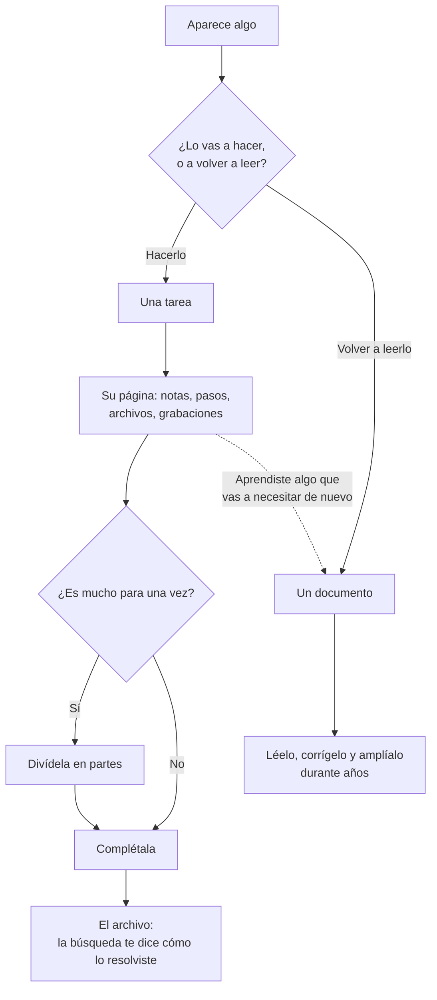
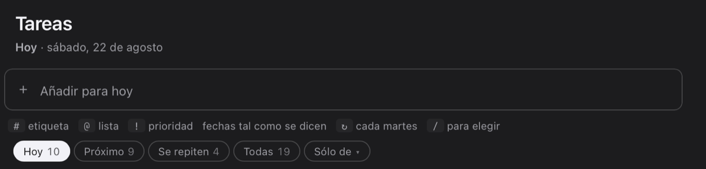
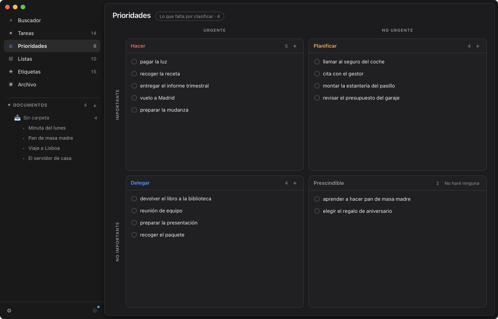
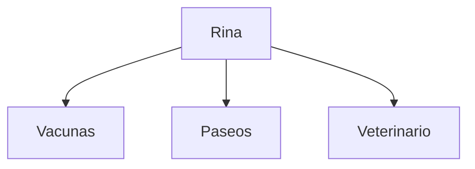
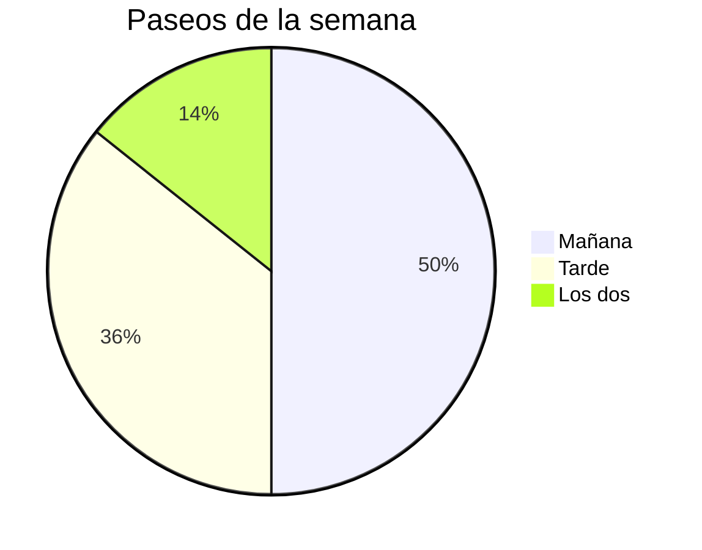
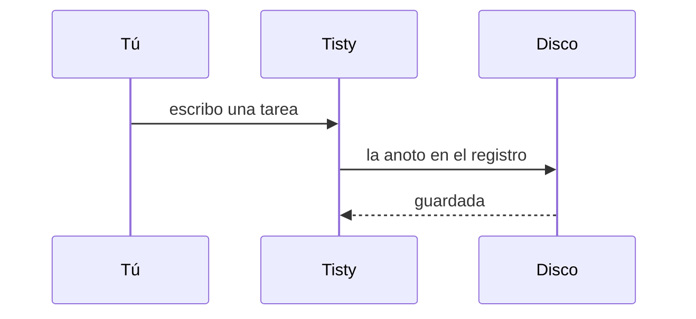

# Cómo funciona Tisty

Tisty es Opensource. Puedes leerlo tú mismo, compilarlo, probarlo o descargar las versiones ya distribuidas y estables. No hay nada oculto: todo es auditable.

Trabajamos constantemente en mejoras y funciones nuevas, pero queremos que siga siendo minimalista y útil. No vamos a sobrecargarlo con mil cosas que nadie va a usar, como hacen otras herramientas comerciales.

Tisty no es un TODO como lo conoces. Es un historial de aprendizaje y conocimiento, con estadísticas y búsquedas sobre tu propio trabajo. ¿Cómo resolviste eso? ¿No te acuerdas? Tisty lo tiene.

Todo local, sin cuentas, sin suscripciones y sin telemetría: tus datos son tuyos. Crea notas en Markdown, documentación, recordatorios y mucho más. Es tu cuaderno personal y de trabajo, privado.

Y si trabajas con un asistente, tiene una puerta por MCP para leer tus documentos, escribir uno nuevo o proponerte tareas. El programa que la abre corre en esta máquina. Puede decirte que una tarea suya está hecha; cerrar y borrar no puede.

Esta guía te tomará un par de minutos y podrás conocer un poco más de qué puedes hacer en Tisty. Puedes volver a ella cuando quieras desde Configuración.

Cuando necesites ayuda en el camino, pulsa `F1` o el `?` al pie de la barra lateral: abre la [guía de Markdown de Tisty](https://markdown.tisty.app/es/) aquí mismo, en lo que estás escribiendo, y funciona sin conexión. Las tareas, los asistentes y todo lo demás se explican en [www.tisty.app/es/ayuda](https://www.tisty.app/es/ayuda/).

## ¿Tarea o documento?

Tisty guarda dos tipos de cosas, y distinguirlas es buena parte de usarlo bien.

- **Una tarea es algo por hacer.** Termina, muchas veces pronto: la completas y pasa al archivo. Pero no desaparece. Lo que escribiste en su página, sus pasos y sus notas se quedan, y meses después una búsqueda la encuentra y te cuenta cómo lo resolviste. Una tarea es conocimiento con fecha.
- **Un documento es algo para guardar.** Un manual, una receta, las notas de un cliente o de una máquina, las actas de un año: se lee una y otra vez, se corrige y se amplía, y crece durante años. Rara vez termina.

Por eso una tarea tiene una página propia: una tarea también es un documento, uno que termina. Piensa en un **spike**, una investigación para saber cómo se puede hacer algo antes de hacerlo:

1. Empieza como una tarea, «Averiguar cómo sincronizar con OneDrive». En su página escribes lo que leíste, lo que probaste y lo que descartaste, sección por sección, y vuelves a corregirlo a medida que aprendes. Adjuntas lo que una descripción fija nunca podría contener: la grabación de la reunión, un video de la falla, el análisis del código, el PDF del proveedor.
2. Cuando el camino está claro, el trabajo se divide en **partes**: «Iniciar sesión», «Subir archivos grandes», «Retomar una subida cortada». Cada una es una tarea con sus propios pasos y notas.
3. Las partes se completan una a una, y después el spike. Pasa al archivo.
4. No se pierde nada. Un año después, «¿cómo resolvimos las subidas a OneDrive?» lo encuentra: su página, sus partes y cada paso, tal como quedaron.



Lo que vas a hacer es una tarea. Lo que vas a volver a consultar es un documento: una receta no es una tarea con pasos, y un pendiente no es un documento. Cuando hacer una tarea te enseña algo que vas a necesitar de nuevo más allá de ella —el arreglo de una falla que vuelve, cómo quiere un proveedor que le pidan— guárdalo también en un documento.

---

## Las tareas

### 1. Escribe como hablas

No hay formulario que rellenar. Escribe la frase entera en la barra de arriba y Tisty va separando el día, la lista y la prioridad mientras la escribes.



Cada color dice qué entendió, y son estos:

| Escribes | Entiende |
| --- | --- |
| ==mañana 10am=={blue} | día y hora, dichos como se dicen |
| ==el viernes=={blue} | el próximo que venga |
| ==cada martes=={pink} | algo que vuelve solo |
| ==#casa=={pink} | una etiqueta: de qué va |
| ==@trabajo=={green} | una lista: dónde ocurre |
| ==!planificar== | hacer, planificar, delegar o prescindible |

Si una parte no se colorea, se queda en el título, que tampoco es grave.

Prueba con estas:

- `Vacuna de Rina el 3 de octubre !hacer #salud`
- `Sacar a Rina cada mañana`
- `Revisar el informe el viernes @trabajo`

Todas las palabras que entiende —días, horas, lo que se repite, en español y en inglés— están en [lenguaje natural](https://www.tisty.app/es/ayuda/lenguaje-natural/), en la ayuda.

### 2. Captura sin abrir la ventana

Presiona `Ctrl` + `Shift` + `Space` desde donde estés y se abre una ventanita para escribir una tarea. Enter la guarda, Esc la cierra, y sigues con lo tuyo.

Si ese atajo ya lo usa otro programa, Tisty prueba con otro y te dice cuál quedó en Configuración.

### 3. El día de hoy

La lista de tareas se mira por tramos:

- **Hoy** — lo que toca, incluido lo que se pasó de fecha.
- **Próximo** — lo que viene.
- **Se repiten** — lo que vuelve por su cuenta.
- **Todas** — todo lo abierto, sin filtro.

Lo vencido aparece arriba y en rojo. No hay premios por vaciar la lista.

### 4. Las prioridades son un mapa, no una escalera

Dos preguntas, cuatro casillas: si corre prisa y si importa.



- **Hacer** — urgente e importante. Hoy.
- **Planificar** — importante, sin prisa. Ponle fecha antes de que se vuelva urgente.
- **Delegar** — corre, pero no es tuyo. Que lo lleve quien deba.
- **Prescindible** — ni corre ni importa. Ese cuadrante tiene su propio «No haré ninguna».

Arrastra una tarea al cuadrante que le toque. Lo que no clasificas espera en la bandeja de al lado, sin regañarte.

### 5. Listas y etiquetas

Dos formas de ordenar que no compiten:

- Una **lista** dice dónde ocurre: ==@casa=={green}, ==@trabajo=={green}. Una tarea está en una sola.
- Una **etiqueta** dice de qué va: ==#salud=={pink}, ==#compras=={pink}. Una tarea lleva las que quieras.

Una etiqueta no es solo para tareas. Escribe `#salud` en medio de una frase de un documento, o ponla en `tags:` en sus propiedades, y el documento queda bajo esa misma etiqueta: una palabra une lo que tienes que hacer con lo que escribiste sobre eso.

### 6. Lo que queda escrito

Una tarea guarda más que su título. Se abre en una página propia, con secciones para llenar —de qué se trata, cómo sabrás que está lista, sus pasos, lo que fuiste averiguando— y en cada una una pista en gris que dice qué va ahí. Cada casilla que escribas en esa página, `- [ ]`, es uno de sus pasos. Al terminarla nada de eso se borra: se archiva con su fecha.

Un paso es una línea, de cien caracteres como máximo. Cuando uno necesita más, hazlo una tarea propia, como **parte** de esta. Una tarea con partes es algo que termina: muestra **▣ 3/7** donde contaría sus pasos, sus partes se pliegan debajo y, en otras vistas, cada parte la nombra con **⌂**. Junto a la página de la tarea, **Partes** recibe una nueva en su propia línea, y **Es parte de otra…** busca por nombre la tarea a la que pertenece; una parte nombra ahí a su tarea y se suelta con **Soltarla**. Cerrarla con partes abiertas te pide soltarlas en el mismo gesto, y deshacer las devuelve.

Una parte también puede vivir en el texto de su tarea. Pasa el mouse sobre una casilla abierta y aprieta **↗**: la línea se vuelve una parte y en su lugar queda su tarjeta, con los pasos que lleva y su fecha. Un clic en la tarjeta la abre. El trayecto de cada una cuenta cuándo se sumó una parte y cuándo se soltó.

Una rutina tiene una sola página para todas sus vueltas. Lo que escribas en **Esta vez** es de la vuelta que corre: al completarla pasa a **Vueltas**, bajo la página, con cuántos pasos marcaste y cuándo se cerró, y la sección queda en blanco para la siguiente.

Ahí está la diferencia. La lista te dice qué falta; el archivo te dice cómo lo resolviste la última vez. Búscalo por una palabra que recuerdes y sale, aunque lo cerraras hace dos años. Todo eso, paso a paso, se cuenta en [tareas](https://www.tisty.app/es/ayuda/tareas/).

---

## Los documentos

### 7. Un documento

Un documento es texto tuyo, guardado en Markdown, que puedes escribir aquí o leer con cualquier otro programa. El archivo es lo que vale: si mañana borras Tisty, tus documentos siguen abriéndose en cualquier editor de texto.

**Para hacer uno**, ve a Documentos y usa el **+** de arriba: **Documento nuevo**. Ese mismo botón, dentro de una carpeta, lo crea ahí. Con **Carpeta nueva** las agrupas, y una carpeta puede tener carpetas dentro.

La primera línea del documento es su título. No hay que ponerle nombre en ninguna parte: lo que escribas arriba es como se llama. Encima, si las quieres, van sus propiedades, entre dos líneas `---`, como las escriben muchas herramientas de Markdown: `tags:`, el papel en que se imprime. Tisty no las muestra en la página; las muestra en el panel de al lado, en **Sobre este documento**.

Se escribe de a un bloque. Haz clic en un párrafo y se abre para escribir, con su barra encima; pulsa `Esc` y vuelve a leerse como página. Elige unas palabras en la página y una barra pequeña te ofrece negrita, cursiva, un enlace o un rotulador ahí mismo, y el botón derecho ofrece lo mismo junto con copiar y editar el bloque. Leída en el visor, la página solo se lee: no aparece nada.

Escribe `/` en cualquier punto y sale el menú de lo que cabe dentro. Además:

- Arrastra un archivo dentro para adjuntarlo — la foto del veterinario, el PDF del seguro.
- Inserta **otro documento**: solo en su párrafo entra como una tarjeta, con su título y sus primeras palabras, y se abre con un clic; dentro de una frase es una palabra en la que haces clic.
- Imprime, o guarda en PDF, desde el propio panel; el menú del documento también lo exporta como página web (**Exportar como HTML…**) o como Word (**Exportar como Word…**), y **Copiar como Markdown** le entrega Markdown estándar a cualquier otro editor.

**Las carpetas nacen plegadas** y se abren con la flecha. Cuando un asunto ya pasó, archiva la carpeta entera con el botón derecho: baja al estante de **Archivados**, al final del árbol, con su icono y todo lo que tiene dentro tal cual. Ahí se lee y se exporta, pero no se escribe ni entra nada nuevo. Desarchívala y vuelve como estaba. [Documentos](https://www.tisty.app/es/ayuda/documentos/), en la ayuda, cuenta el resto.

### 8. Lo que cabe dentro de un documento

Todo lo de aquí abajo es Markdown corriente. Lo escribes con `/`, y el archivo que queda en el disco lo entiende GitHub igual que Tisty. Esta sección no lo cuenta: te lo enseña. Cada forma tiene su página, con su letra chica, en la [guía de Markdown de Tisty](https://markdown.tisty.app/es/), y `F1` la abre en la que estás escribiendo.

Y para verlo todo junto, uno de cada cosa y sin historia alrededor, hay una página aparte:


#### Lo de siempre

**Negrita**, *cursiva*, ~~tachado~~, ++subrayado++, `código suelto` y un [enlace a una web](https://github.com/rgdevment/Tisty). Listas con viñetas, numeradas, y citas de las de toda la vida:

> Lo que no está escrito, no ocurrió.

1. Primero esto
2. Después lo otro
3. Y al final lo de más allá

#### Notas al pie

Una palabra puede llevar una nota sin cortar la frase en que está: a Rina le pusieron el refuerzo en marzo[^marzo], y el veterinario la quiere de vuelta en un año.

[^marzo]: Séxtuple y antirrábica en la misma visita, con el examen de sangre. Una nota como esta se llama con `[^etiqueta]` y se dice una vez, en una línea propia; GitHub la lee igual.

La llamada es la etiqueta pequeña en alto, y un clic en ella te lleva a la nota.

#### Avisos

Cinco tipos, cada uno con su color. Por dentro es una cita que empieza por su nombre entre corchetes, que es como los escribe GitHub.

> [!NOTE]
> Para lo que conviene saber, sin urgencia ninguna.

> [!TIP]
> Si ya estás dentro de un aviso y eliges otro tipo, cambia el que hay en vez de meter uno dentro de otro.

> [!IMPORTANT]
> Para lo que no se puede pasar por alto.

> [!WARNING]
> Para lo que puede salir mal si no miras.

> [!CAUTION]
> Para lo que no tiene vuelta atrás.

Y dentro de un aviso cabe casi todo, no solo texto:

> [!TIP]
> Los pasos de un respaldo a mano:
>
> - Cerrar Tisty
> - Copiar la carpeta entera
>
> ```bash
> cp -r ~/Tisty ~/Backup
> ```
>
> ---
>
> Todo esto llega igual al PDF.

#### Secciones que se pliegan

Lo que es largo y solo se necesita de vez en cuando puede quedar plegado bajo un título, sin estorbar hasta que alguien lo abra. Es **Sección plegable** en el menú `/`:

:::details La ficha completa de Rina

Nació en 2023. Séxtuple y antirrábica cada marzo, desparasitación cada tres meses.

:::

#### Destacar

Cuatro colores de rotulador: ==amarillo==, ==verde=={green}, ==azul=={blue} y ==rosa=={pink}. Eliges el color en la barra que sale mientras escribes un bloque.

#### Iconos

::dog orange:: Un icono se busca por lo que dibuja, y en español: pide «perro», «moto» o «puño» y sale el que esperas. Sirve para marcar una línea sin gastar un título en ella.

#### Etapas

Una lista de casillas que se marcan. En un documento no son tareas de Tisty: no se cierran, no tienen fecha y no salen en Hoy. Son las etapas de algo que estás escribiendo. En la página propia de una tarea, esas mismas casillas son sus pasos.

- [x] Llevar la cartilla de Rina
- [x] Pesarla antes de la consulta
- [ ] Preguntar por la pastilla de las garrapatas

Una etapa se puede nombrar desde cualquier parte del texto por su lugar en la lista: la que sigue abierta, [[#3]], muestra aquí sus palabras, y un clic te lleva a ella.

#### Tablas

Una tabla se puede trabajar. Haz clic en ella y `Tab` recorre sus celdas (pasada la última empieza una fila nueva), y el menú **Tabla** de la barra agrega y quita filas y columnas y alinea una columna a la izquierda, al centro o a la derecha. En la página, arrastra el borde de un encabezado para ensanchar su columna.

| Vacuna | Puesta | Toca otra vez |
| :--- | :---: | ---: |
| Séxtuple | marzo | 12 meses |
| Antirrábica | marzo | 12 meses |
| Desparasitación | agosto | 3 meses |

El ancho viaja en lo larga que se dibuja la raya de debajo del encabezado, así que cualquier otro lector de Markdown ve una tabla normal y Tisty ve el ancho que le diste.

#### Diagramas

Un bloque de código cuyo lenguaje es `mermaid` deja de ser código y se dibuja. Sirve para un esquema:



Para repartir un total:



O para contar quién habla con quién:



#### Fórmulas

Y un bloque cuyo lenguaje es `math` compone la fórmula.

```math
dosis = \frac{peso \times 0.5}{2}
```

```math
\sum_{i=1}^{n} i = \frac{n(n+1)}{2}
```

Una fórmula también cabe dentro de una frase, entre dólares sueltos: Rina pesa 12 kilos, así que su dosis es $\frac{12 \times 0.5}{2} = 3$ mililitros. Un dólar seguido de una cifra es un precio, así que `$5` sigue siendo cinco dólares.

Todo esto se dibuja con código que viaja dentro de Tisty. No se pide nada a internet, y funcionan con el cable desenchufado.

#### Widgets

Un bloque cuyo lenguaje es `widget` se dibuja como una pequeña página: HTML, estilos y, si quieres, algo de script. Corre aislado, sin red y con los colores de Tisty, y trae clases listas como `grid`, `stat`, `card` o `badge`, así que con HTML sencillo ya se ve bien. El código queda plegado; ábrelo con «Ver código».

```widget title="Rina este mes"
<div class="grid">
  <div class="stat"><small>Paseos</small><b>42</b><em class="up">+6 frente a agosto</em></div>
  <div class="stat"><small>Kilómetros</small><b>61</b></div>
  <div class="stat"><small>Próxima vacuna</small><b>12 nov</b><span class="badge warn">pendiente</span></div>
</div>
```

Si el widget crece mucho, adjúntalo: un archivo `.html` adjunto a un documento se dibuja igual.

#### Archivos, sonido y video

Un archivo adjunto se dibuja como lo que es: una imagen tal cual, un sonido o un video con su reproductor, una página `.html` en vivo, y cualquier otro como una tarjeta con su tipo y su tamaño. Cada tarjeta tiene un **⋯**: guardar una copia, mostrar la página como archivo o de nuevo en vivo, convertir la tarjeta en un enlace simple o quitarla de la página. Un video que todavía está en tu nube se descarga solo cuando le das play, y si no puede llegar te dice por qué.

#### Código, con nombre y con color

Un bloque de código se colorea según su lenguaje, y le puedes poner nombre: escribe el lenguaje y después `title="lo que sea"`. El nombre se ve en la cabecera del bloque, y el color llega también al PDF.

```bash title="backup.sh"
rsync -a ~/Tisty/ /Volumes/Backup/Tisty/
```

```json title="settings.json"
{ "language": "es", "folder": "~/Tisty" }
```

#### Salto de página

Una raya sola corta la hoja: lo que sigue empieza en la siguiente, y `Ctrl`/`⌘` + `Enter` la escribe mientras escribes. Enciende **Hojas** en el panel del documento para leerlo en hojas de verdad (A4, Carta o Tabloide, en vertical u horizontal), donde una hoja que se llena pasa sola a la siguiente, en pantalla igual que en papel. Lo que eliges viaja con el archivo, en sus propiedades, y un salto que escribiste tú se respeta con las hojas encendidas o apagadas.

De código hay más que decir, y cabe en su propia hoja:


---

Esto de aquí ya va en la hoja de después.

### 9. Un documento con páginas

Un año de actas, un libro por capítulos, la vida de un perro contada año a año. Eso no cabe en un solo papel, y tampoco en una carpeta de papeles sueltos que no ata nada.

Una página es un documento como cualquier otro —mismo archivo en el disco, misma salida— con una sola cosa que la distingue: dice de qué documento es. Hay un nivel y no más: una página no tiene páginas.

**Para añadirle una**, escribe `/` donde quieras que empiece ese capítulo y elige **Una página nueva**, o **Una página que ya existe** si el documento ya está escrito. Queda nombrada ahí mismo, dibujada como una ficha con su título, sus primeras palabras y su lugar en el libro.

> [!IMPORTANT]
> El orden en que están nombradas en el texto es el orden en que van las páginas: en el árbol, en la exportación y al imprimir. Para mover un capítulo, usa las flechas de su fila en el índice del final del documento, o Alt y una tecla de flecha sobre la fila — o corta y pega su bloque, que es el mismo movimiento hecho a mano.

Al final del documento, en su propia hoja, va el índice: las páginas que el texto nombra, numeradas, y tras una raya las que no, a un clic de tener su sitio en el texto. Dentro de una página verás arriba de qué documento es y en qué lugar va, flechas a sus hermanas, y abajo el paso a la siguiente.

Lo que nombra una página es su tarjeta, el bloque que Tisty escribe al crearla. Hablar de una página en una frase —un enlace a ella en medio de un párrafo, como [este a la Rina](tisty:page)— la señala sin darle sitio, como una nota al pie señala un capítulo sin serlo; una página de la que solo has hablado así se queda bajo la raya hasta que le pongas una tarjeta.

En el árbol, un documento soltado encima de otro se vuelve página suya. Si tienes ese documento abierto, la línea que la nombra va al final de lo que estás leyendo, que es donde quedará, y desde ahí la mueves como cualquier otro capítulo; si no, la página espera en el índice, a un clic de tener su sitio en el texto.

**Una página se archiva sola** con el botón derecho, y no baja al estante: se queda donde vive, dentro de su documento, con otro icono y atenuada. Ahí se lee y se exporta, pero no se escribe. Archiva el documento entero y se guardan todas con él sin marcarlas una a una; cuando lo desarchivas, cada una vuelve como estaba, y la que ya habías apartado tú sigue apartada. Cómo se imprime un libro, con su índice, se cuenta en [páginas y PDF](https://www.tisty.app/es/ayuda/paginas-y-pdf/).

Esta guía tiene una. Aquí debajo está nombrada, y por eso aquí es donde va:


### 10. Lo que viene de afuera

Tisty guarda lo que escribes exactamente como lo escribiste: la cabecera de propiedades, las notas al pie, los enlaces por referencia, los comentarios. Todo queda en el archivo, palabra por palabra.

Lo que llega de afuera entra convertido en Markdown de Tisty, y el archivo de donde vino no se toca. **Importar un documento**, en el árbol, toma Markdown, texto, una página web o un Word; al pegar se conservan los títulos, listas, tablas, enlaces y colores de lo que copiaste de una página, un correo o un Word; y una nota de Obsidian entra con sus avisos y comentarios convertidos, y sus `[[enlaces]]` apuntando a los documentos de aquí que llevan esos títulos. De salida, el mismo documento sale como Markdown estándar, página web, Word o PDF. Lo que cambia en cada cruce, palabra por palabra, está en [convertir a y desde Markdown](https://www.tisty.app/es/ayuda/convertir-a-y-desde-markdown/).

Un calendario también entra. Arrastra un `.ics` a la ventana, fuera de un documento, o ábrelo con Tisty: **Desde el calendario** muestra cada cita y pendiente con cuándo, dónde, cómo se repite y su recordatorio, y crea como tareas las que elijas, en la lista que elijas. Abrir dos veces el mismo archivo no las duplica. Para que un `.ics` se abra con Tisty con doble clic, elígelo tú: en Windows, clic derecho → Abrir con → Elegir otra aplicación → Tisty, con «Usar siempre»; en el Mac, Obtener información → Abrir con → Tisty → Cambiar todo.

---

## Lo que vale para todo

### 11. Un asistente puede escribir aquí

Si usas un asistente, puede proponer tareas y escribir documentos por su cuenta, y añadir o corregir en los documentos donde puede escribir. Lo que nunca hace es cerrar ni borrar una tarea, borrar un documento ni cambiar una tarea que escribiste tú, salvo que abras esa tarea a los agentes. También puede **marcar** un documento o una página que ya cumplió su vida: verás un rombo junto a su nombre y, al abrirlo, lo que dijo. Es una propuesta, no un borrado — borrar sigue siendo tuyo, y el rombo se quita con un clic. Lo que escribe va firmado con el nombre del programa por el que habló —«por Claude Code», «por Codex»—, y lo que se escribió antes de que los programas dijeran su nombre se lee «por un asistente».

También puede ordenar lo que se desordenó. Un documento que creció sesión tras sesión lo puede compactar en un solo texto limpio: verás «Compactado por…» arriba, y **Deshacer** devuelve lo que decía antes con un clic. Cuando marca un documento dice por qué —una copia de otro, que se movió, que otro lo reemplaza, erróneo, obsoleto o un borrador— y nombra el que ocupa su lugar, que abres desde ahí; lo borras con un clic, o todos los de un grupo que marcó junto, de una vez. Puede hacer que las tareas que anotó sean partes de otra, o soltarlas de nuevo, y llevar los pasos abiertos a la tarea donde corresponden. Ni ordenando borra nada.

Cuando termina una de las tareas que anotó él, lo dice y deja en la bitácora la cuenta de lo que hizo. La tarea sigue abierta, reunida bajo **Por confirmar** con la hora en que habló —salvo que venza hoy o esté atrasada, que se queda donde la buscas—. Tú la terminas, o la devuelves con **Sigue pendiente** y vuelve a su día con la cuenta guardada.

Una tarea tuya se la puedes abrir: en su detalle, **Permitir agentes**. Desde ahí un asistente puede darla por hecha o decir que no se hará —para que lo confirmes—, describirla, planear sus pasos y marcarlos a medida que avanza, que es lo único que hace sin preguntar, y corregir sus pasos abiertos y sus notas; una marca que puso por error puede quitarla, nunca una tuya. El día, el título, la lista y el cierre siguen siendo tuyos. **Sin agentes** cierra la puerta y conserva lo que alcanzó a completar. Cómo conectar uno, y qué deja pasar cada puerta, está en [asistentes y MCP](https://www.tisty.app/es/ayuda/asistentes-y-mcp/).

Para reescribir un documento entero se le entrega una huella del texto exacto que leyó, y tiene que devolverla al escribir. Si escribiste tú en medio, la huella ya no cuadra: no se escribe nada y se le dice que vuelva a leerlo. La ventana te avisa cuando algo ha escrito en el documento que tienes abierto, y cuando lo que esa escritura reemplazó sigue guardado, esa misma barra te ofrece volver a lo que el documento decía antes. Lo que dice ahora queda guardado en su lugar, así que puedes regresar a ello. La oferta solo aparece cuando lo guardado es exactamente esa escritura hacia atrás: tras cualquier otra cosa se calla, en vez de dejarte donde no querías.

### 12. Tus copias

Tisty trabaja siempre en este equipo. Si quieres alcanzarlo desde otro, dile dónde dejar las copias: te ofrece Google Drive, OneDrive, iCloud y Dropbox —los que encuentre instalados, con su carpeta ya resuelta— o cualquier otra que los dos equipos alcancen, un NAS o un disco externo. Tu Google Drive o tu OneDrive también se pueden conectar directamente, desde Configuración, sin tener instalado ningún programa de Google ni de Microsoft.

Quien sube y baja esa carpeta es el programa de tu proveedor, no Tisty. Si no está en marcha, las tareas esperan ahí hasta que lo esté.

> No hay servidor nuestro por medio. Sincronizar te da redundancia, no vuelta atrás en el tiempo: si borras una tarea, el borrado también viaja.

Cada equipo firma lo que escribe. Uno que ya conocías se reconoce solo cuando se actualiza. Uno nuevo —recién instalado o reinstalado— espera a que confirmes que es tuyo: aparece un aviso en la barra lateral con el nombre de ese computador, y **Confirmar…** te muestra su código de veinte números. Ábrelo en ese equipo, en Configuración → Tus datos → **Sincronizar**, donde **Mostrar en grande** lo deja fácil de leer desde lejos: si el código es el mismo, **Sí, es el mismo** lo deja pasar y trae lo que escribió; si no, **No coincide** lo deja fuera. Se hace una vez en cada uno de tus otros equipos. Si quien espera es el asistente de otro computador, su código está en ese computador, en Configuración → Asistentes.

Ahí mismo, **Cambiar nombre** elige cómo verán este equipo los demás; vacío, vuelve al nombre del sistema. Y cada **Sincronizar ahora** dice a qué hora fue y si llegó algo o quedó escrito en la carpeta.

Cuando los dos equipos escribieron la misma parte de un documento, Tisty no elige: te muestra las dos versiones una junto a otra y te quedas con **Esta**, **La otra** o **Las dos**.

En Configuración puedes además guardar un respaldo completo cuando quieras, también si sincronizas, porque una carpeta compartida no es un respaldo. [Sincronizar y respaldar](https://www.tisty.app/es/ayuda/sincronizar-y-respaldar/) recorre cada proveedor.

Desinstalar Tisty quita el programa y deja tus tareas y documentos donde están, así que al reinstalarlo los encuentra tal como los dejaste. En Windows viven en `.tisty`, dentro de tu carpeta de usuario, oculta y cerrada para las demás cuentas del equipo; en un Mac, en `Library/Application Support/tisty` y `Library/Caches/tisty`, dentro de tu carpeta personal. Para irte del todo, borra esa carpeta; en Windows, activa antes **Elementos ocultos** en el menú **Ver** del Explorador de archivos para verla. Si Tisty se mudó ahí desde una versión anterior, en `AppData\Local\tisty` queda la copia de antes, con un archivo `MOVED.txt` que lo dice: también puedes borrarla.

### 13. Terminar, descartar y borrar

- **Terminar** una tarea la marca hecha y la manda al Archivo.
- **Cerrar con resumen** te pide dos líneas de cómo salió antes de terminarla. Van primero en **Al cerrarla**; en una rutina, quedan con su vuelta.
- Al cerrarla, su página se guarda con ella: se lee pero ya no se escribe. Si la reabres, vuelve.
- **Descartar** la aparta sin hacerla: también acaba en el Archivo.
- Lo del Archivo sigue ahí por si lo buscas. No estorba.

El Archivo se lee en tres capas: las **historias**, que dejaron algo escrito; las **rutinas**, que vuelven; y el **rastro**, lo que se cerró sin dejar casi nada. Tú decides en qué capa se lee cada una: en el detalle de una cerrada, «Mover a rastro» o «Mover a historia». El trayecto guarda cada movimiento. Un rastro se borra o se oculta de uno en uno, desde su detalle o su fila.

> **Antes de borrar de verdad.** Solo se puede con lo que ya está cerrado **y** se lee como rastro. Una historia solo se oculta: para borrarla, léela antes como rastro. Al borrar desaparece de este equipo y de los demás en la siguiente sincronización, y no hay deshacer.

Los archivos que hubieras adjuntado no se van con ella, porque podrían estar en uso en otro documento. Quedan sueltos, y Configuración → Mantenimiento te los lista para soltarlos cuando quieras.

Ahí mismo, en **El almacén**, está **Revisión**: cuenta lo que sobra, lo que falta y lo que puedes recuperar, y no cambia nada por su cuenta. Los adjuntos que ya no nombra nadie se van a la papelera con treinta días para arrepentirte. Los documentos que están en el disco pero el registro no nombra se apartan para mirarlos primero, porque pueden ser la única copia de algo que perdió su evento: recogerlos nunca puede estar mal. [El archivo](https://www.tisty.app/es/ayuda/el-archivo/), en la ayuda, cuenta cada capa completa.

### 14. Atajos

| Atajo | Qué hace |
| --- | --- |
| `Ctrl` + `Shift` + `Space` | Capturar sin abrir la ventana |
| `Ctrl`/`⌘` + `Enter` | Terminar la tarea señalada; en un documento que estás escribiendo, un salto de página |
| `F1` | Abrir la guía de Markdown de Tisty, en lo que estás escribiendo |
| `/` | Insertar dentro de un documento |
| `Ctrl`/`⌘` + `Shift` + `M` | Mostrar todas las marcas de Markdown del bloque |
| `Tab` · `Shift` + `Tab` | Recorrer las celdas de una tabla |
| `Ctrl`/`⌘` + `X` · `V` | Mover un documento entre carpetas |
| Botón derecho | Sobre palabras elegidas, copiarlas y darles formato; sobre un bloque, editarlo |
| `Esc` | Cerrar lo que esté abierto |

Lo demás, para cada rincón de Tisty, está en [atajos de teclado](https://www.tisty.app/es/ayuda/atajos-de-teclado/).

### 15. Si te sirvió

Todo lo que hace Tisty se explica en [www.tisty.app/es/ayuda](https://www.tisty.app/es/ayuda/), y cada forma que cabe en un documento, dibujada como la dibuja Tisty, en [markdown.tisty.app](https://markdown.tisty.app/es/).

Tisty es de código abierto y se lee entero aquí; ahí van los fallos que encuentres y las ideas que se te ocurran.

[Tisty en GitHub](https://github.com/rgdevment/Tisty)

Un enlace solo en su párrafo, como ese, se dibuja como tarjeta; el mismo enlace dentro de una frase se queda como enlace. La tarjeta se dibuja con lo que ya dice la dirección, sin preguntarle nada a nadie: si quieres el título y la imagen del sitio, se los pides tú con **Traer la vista previa** y quedan guardados aquí.

En [el mismo perfil](https://github.com/rgdevment) hay dos herramientas más, con la misma idea y los mismos términos: gratis, abiertas, sin anuncios, sin telemetría, todo en tu equipo.

- [**CopyPaste**](https://github.com/rgdevment/CopyPaste) — un gestor de portapapeles para Windows y macOS.
- [**LinkUnbound**](https://github.com/rgdevment/LinkUnbound) — un selector de navegadores para Windows y macOS: pregunta cuál debe abrir un enlace en vez de suponerlo. Si está instalado, los enlaces que abres desde Tisty pasan por él.
