# Uno de cada cosa

Esta hoja es el muestrario de la guía: uno de todo lo que cabe en un documento, todo en una sola hoja. Aquí casi nada se explica; está para mirarla, editarla e imprimirla. Si algo en esta hoja se ve mal, vale la pena contárnoslo.

---

## Palabras

**Negrita**, *cursiva*, ***las dos a la vez***, ~~tachado~~, <u>subrayado</u> y `código suelto`. Un [enlace a un sitio](https://github.com/rgdevment/Tisty), y la misma dirección escrita tal cual entre ángulos: <https://github.com/rgdevment/Tisty>. Una dirección de correo funciona igual: <rina@example.com>.

Cuatro marcadores: ==amarillo==, <mark data-pen="green">verde</mark>, <mark data-pen="blue">azul</mark> y <mark data-pen="pink">rosa</mark>.

Íconos, con color o sin él: <span data-ico="dog" data-hue="orange">:dog:</span> <span data-ico="bone" data-hue="amber">:bone:</span> <span data-ico="heart" data-hue="red">:heart:</span> <span data-ico="leaf" data-hue="green">:leaf:</span> <span data-ico="moon" data-hue="indigo">:moon:</span> <span data-ico="star">:star:</span>

Emojis por su nombre: :dog: :tada: :+1: :sunny:

Una etiqueta escrita en un documento lo archiva bajo ella: #rina, #veterinario.

Una línea termina donde tú la terminas.
Esta línea es el mismo párrafo, una línea más abajo.

## Títulos

### Tercer nivel

#### Cuarto nivel

##### Quinto nivel

###### Sexto nivel

## Listas

- Correa
- Bolsas
  - Las verdes
  - El rollo de repuesto
- Agua

1. Ponerle la correa
2. Caminar hasta el parque
3. Soltarla junto a la laguna

- [x] Llevar la libreta de Rina
- [x] Pesarla antes de la hora
- [ ] Preguntar por la pastilla de las garrapatas

## Citas y avisos

> Lo que no se escribe, no pasó.

> [!NOTE]
> Para lo que vale la pena saber, sin ninguna urgencia.

> [!TIP]
> Para el atajo que encontraste por las malas.

> [!IMPORTANT]
> Para lo que no se puede pasar por alto.

> [!WARNING]
> Para lo que puede salir mal si no miras.

> [!CAUTION]
> Para lo que no tiene vuelta atrás.

## Una tabla

Columnas a la izquierda, al centro y a la derecha, y la primera más ancha: su regla está dibujada más larga.

| Vacuna | Puesta | Otra vez en |
| :------------------ | :---: | ---: |
| Séxtuple | marzo | 12 meses |
| Antirrábica | marzo | 12 meses |
| Desparasitación | agosto | 3 meses |

## Código

```rust title="src/paseo.rs"
fn paseos_de_hoy(hechos: u8) -> &'static str {
    if hechos >= 2 { "suficiente" } else { "uno más" }
}
```

```python title="peso.py"
pesos = [13.2, 13.8, 14.1]
print(sum(pesos) / len(pesos))
```

```ts title="recordar.ts"
const toca = new Date("2026-11-12");
const dias = Math.ceil((toca.getTime() - Date.now()) / 86_400_000);
```

```html
<p class="nota">Rina estuvo aquí.</p>
```

```css
.nota { color: tomato; font-weight: 600; }
```

```yaml title="paseos.yml"
manana: "08:00"
noche: "21:00"
```

```diff
- const PASEOS: u8 = 1;
+ const PASEOS: u8 = 2;
```

```text
Texto plano, sin ningún color.
```

## Diagramas

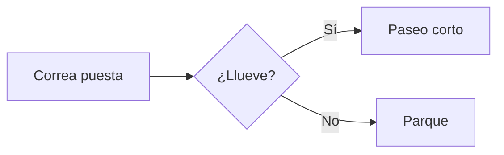

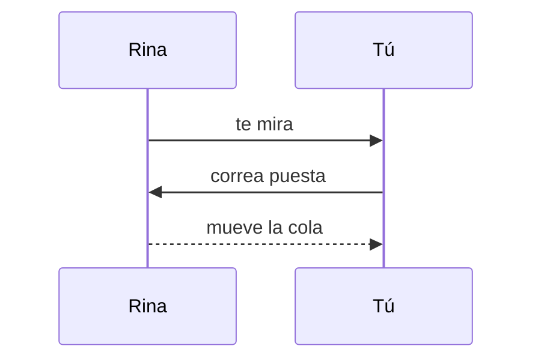

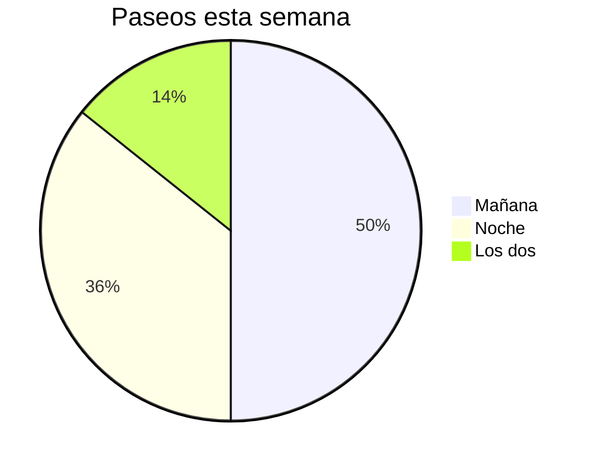

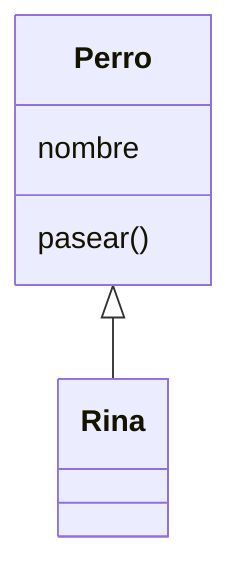

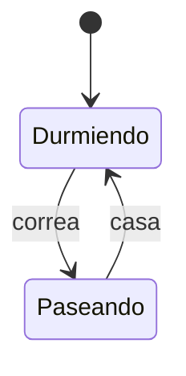

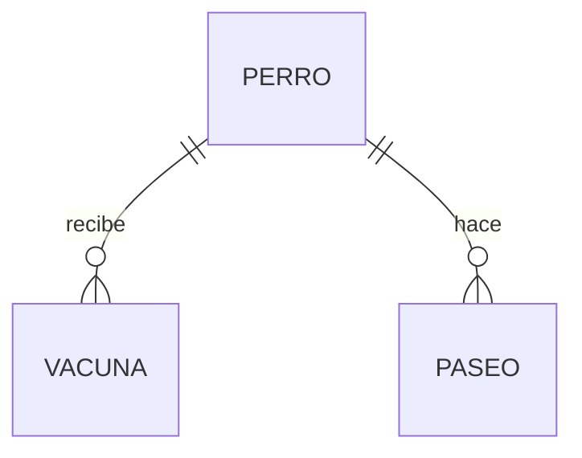

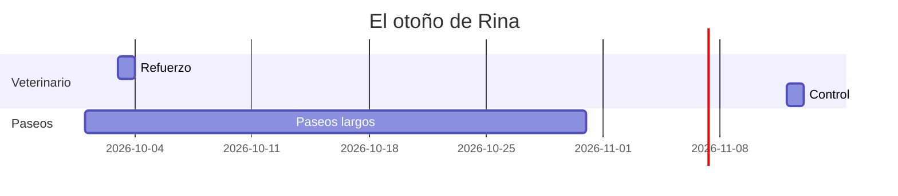

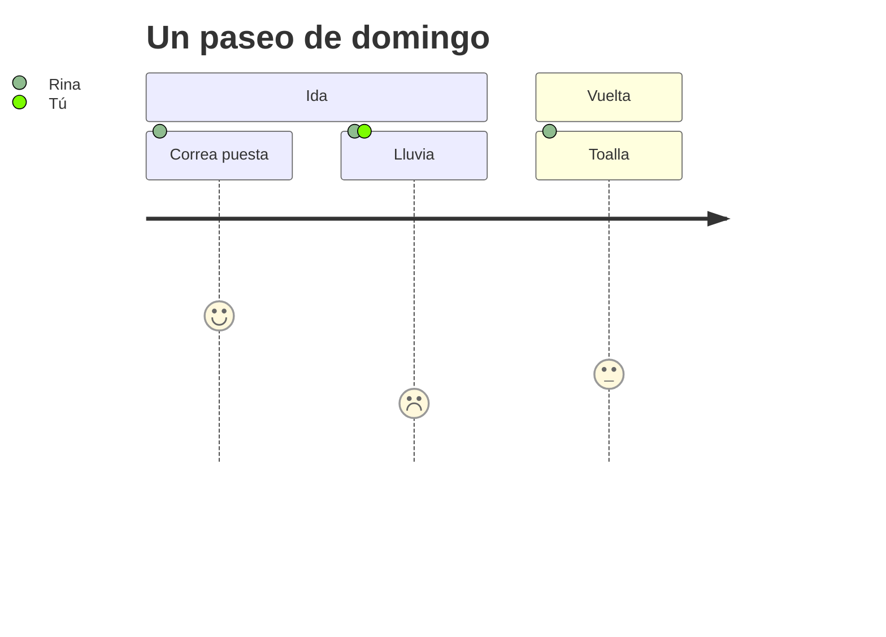

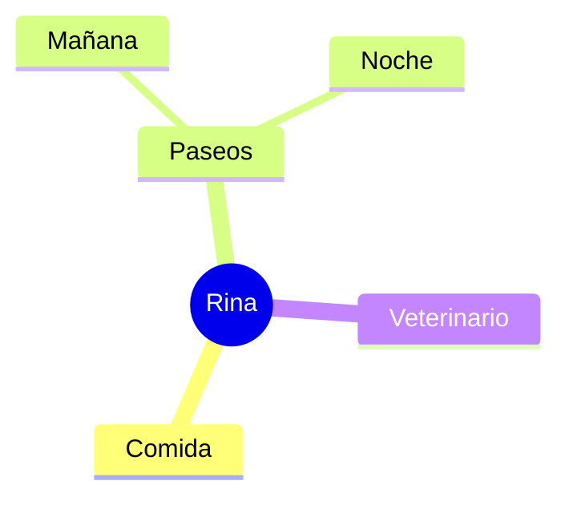

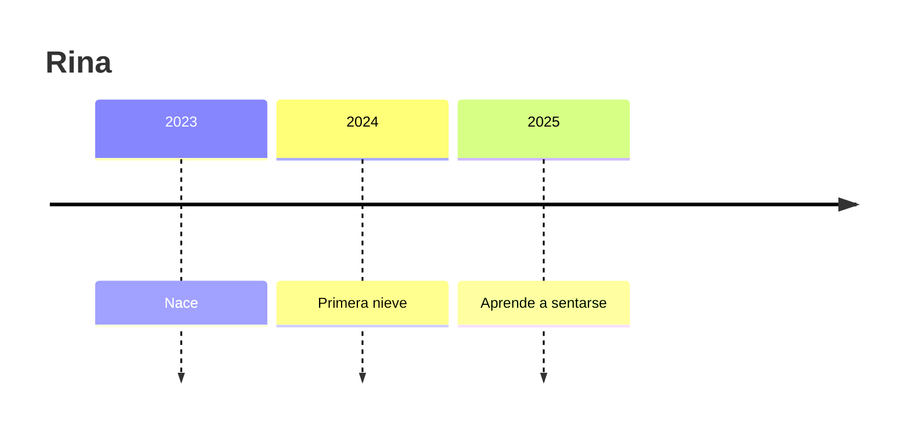

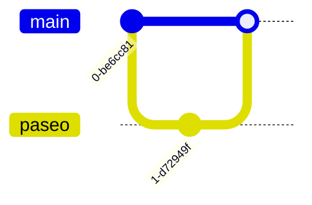

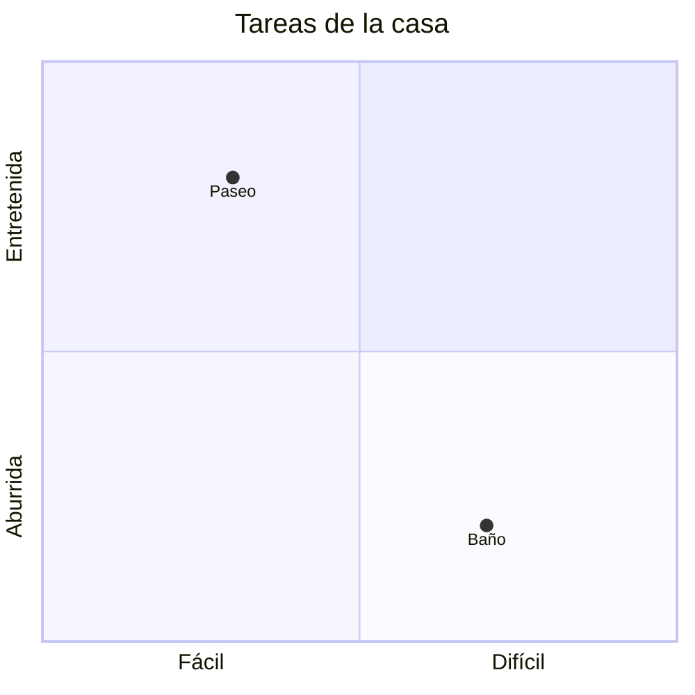

```mermaid
xychart-beta
  title "Minutos de paseo"
  x-axis [Lun, Mar, Mié, Jue]
  y-axis "Minutos" 0 --> 60
  bar [35, 50, 20, 45]
  line [35, 50, 20, 45]
```

## Fórmulas

```math
dosis = \frac{peso \times 0.5}{2}
```

```math
\sum_{i=1}^{n} i = \frac{n(n+1)}{2}
```

```math
\int_0^1 x^2 \, dx = \frac{1}{3}
```

```math
\begin{pmatrix} 1 & 0 \\ 0 & 1 \end{pmatrix}
```

## Un widget

```widget title="Rina este mes"
<div class="grid">
  <div class="stat"><small>Paseos</small><b>42</b><em class="up">+6 sobre agosto</em></div>
  <div class="stat"><small>Peso</small><b>14 kg</b><em class="down">−0,3 kg</em></div>
  <div class="stat"><small>Próxima vacuna</small><b>12 nov</b><span class="badge warn">toca</span></div>
</div>
<div class="card" style="margin-top:12px">
  <div class="head"><h3>Revisiones</h3><span class="badge bad">falta una</span></div>
  <ul class="list">
    <li><span class="box done"></span><span class="gone">Garrapatas</span></li>
    <li><span class="box"></span>Orejas</li>
  </ul>
  <div class="row"><button class="primary">Hecho</button><button>Después</button></div>
</div>
```

## Adjuntos

Una foto:


Un PDF:


Un sonido:


Un video:


Datos:


Una página HTML, dibujada como widget:


La misma página, guardada como archivo:


## Un enlace solo

[Tisty en GitHub](https://github.com/rgdevment/Tisty)

## Una regla

Lo que sigue empieza en la hoja siguiente al imprimir.

---

Eso es todo.
