# Uno de cada cosa

Esta hoja es el muestrario de la guía: uno de todo lo que cabe en un documento, con su ejemplo vivo, cómo se escribe y con qué se combina. Está para mirarla, editarla e imprimirla. Si algo en esta hoja se ve mal, cuéntalo en [Issues](https://github.com/rgdevment/Tisty/issues).

Tres maneras de leerla:

- Haz clic en cualquier bloque y se abre con sus marcas a la vista; `Esc` lo devuelve a la página.
- `Ctrl`/`⌘` + `E` muestra la hoja entera como texto: así está escrito cada ejemplo.
- La tecla `/` lo inserta todo sin aprender ninguna marca. Cada sección dice cómo se llama en ese menú.

## Propiedades

Esta hoja empieza con un bloque de propiedades entre dos líneas `---`, antes del título. La página no lo dibuja: está en el panel de al lado, en **Sobre este documento**, donde **Editar** lo abre tal como está escrito.

```yaml title="Las primeras líneas de esta hoja"
---
tags: [rina, roger]
fuente: la guía de Tisty
---
```

`tags:` archiva el documento bajo cada etiqueta, igual que una escrita con `#` en una frase. `title:` le da otro título; `paper:`, `sheets:` y `orientation:` dicen en qué hoja se imprime, y `lang:`, en qué idioma está escrito. Cualquier otra, como `fuente:`, se guarda tal cual.

---

## Palabras

Lo que marca unas palabras dentro de una frase. Elige las palabras y una barra pequeña te ofrece lo más usado, igual que el botón derecho; el menú `/` tiene el resto.

| Qué | Se escribe | Se ve | Atajo |
| :--- | :--- | :--- | :--- |
| Negrita | `**negrita**` | **negrita** | `Ctrl`/`⌘` + `B` |
| Cursiva | `*cursiva*` | *cursiva* | `Ctrl`/`⌘` + `I` |
| Subrayado | `++subrayado++` | ++subrayado++ | `Ctrl`/`⌘` + `U` |
| Tachado | `~~tachado~~` | ~~tachado~~ | `Ctrl`/`⌘` + `Shift` + `X` |
| Código | `` `código` `` | `código` | `Ctrl`/`⌘` + `Shift` + `C` |
| Enlace | `[enlace](https://www.tisty.app)` | [enlace](https://www.tisty.app) | `Ctrl`/`⌘` + `K` |
| Destacar | `==destacado==` | ==destacado== | la barra |
| Un icono | `::dog orange::` | ::dog orange:: | el menú `/` |
| Un paso, por su número | `[[#2]]` | [[#2]] | el menú `/` |
| Referencia | `[[La cartilla de Rina]]` | [[La cartilla de Rina]] | se escribe |
| Etiqueta | `#rina` | #rina | se escribe |
| Emoji | `:tada:` | :tada: | se escribe |
| Nota al pie | `[^1]` | con su nota[^1] | se escribe |
| Fórmula | `$\pi r^2$` | $\pi r^2$ | se escribe |

### Unas dentro de otras

Una marca cabe dentro de otra: ***negrita y cursiva a la vez***, **negrita con ==rotulador== dentro**, ==un rotulador con *cursiva* y `código`=={green}, ~~tachado con **negrita**~~, ++subrayado con *cursiva*++, un [enlace con **negrita** y `código`](https://www.tisty.app), **un icono ::star amber:: en negrita**, un :dog: dentro de ==un rotulador=={pink} y una etiqueta en cursiva, *#veterinario*.

Lo único que no se cruza: un rotulador o un subrayado empiezan y terminan dentro de la misma negrita o del mismo enlace.

### Rotuladores

**Destacar** pinta en amarillo, que no lleva nombre. Los demás colores van entre llaves, pegados al cierre y en inglés:

==amarillo== ==rojo=={red} ==naranja=={orange} ==ámbar=={amber} ==verde=={green} ==turquesa=={teal} ==azul=={blue} ==índigo=={indigo} ==morado=={purple} ==rosa=={pink} ==café=={brown} ==gris=={gray}

La barra trae cuatro: amarillo, verde, azul y rosa. Los otros ocho se escriben, como `==palabras=={teal}`.

### Iconos

**Un icono**, en el menú `/`, abre un buscador: escribe lo que dibuja, en español. Queda entre dos pares de dos puntos, con su nombre en inglés y, si quieres, un color:

::dog:: ::dog red:: ::dog orange:: ::dog amber:: ::dog green:: ::dog teal:: ::dog blue:: ::dog indigo:: ::dog purple:: ::dog pink:: ::dog brown:: ::dog gray::

Marca una línea sin gastar un título en ella: ::bone amber:: la comida, ::walk green:: los paseos, ::syringe red:: las vacunas, ::pill blue:: la pastilla, ::heart pink:: los mimos, ::moon indigo:: la siesta y ::star:: listo.

### Emojis

Un emoji va tal cual, 🎉 🐕 🦴, o por su código entre dos puntos, como los escribe GitHub: :dog: :tada: :+1: :sunny: :bone: :paw_prints:

### Etiquetas

Una palabra después de `#` archiva el documento bajo ella, y **Etiquetas**, en la barra lateral, lo junta con todo lo demás que la lleva: el refuerzo de marzo de #rina y #roger, con su #veterinario. Al escribir `#` se te ofrecen las que ya usas.

### Enlaces

- Con palabras: [el sitio de Tisty](https://www.tisty.app).
- La dirección tal cual: https://www.tisty.app
- Entre ángulos: <https://www.tisty.app>
- Un correo: <rina@example.com>

Por referencia, la dirección se dice una sola vez, en una línea propia: el [mapa del paseo][parque] y la [veterinaria][vet]. La página muestra cada definición donde está escrita, y un clic en ella la edita.

[parque]: https://example.com/parque
[vet]: https://example.com/vet "Abre los sábados"

Un enlace solo en su párrafo se dibuja como una tarjeta; está más abajo, en **Tarjetas**.

### Menciones y referencias

Dos corchetes dobles nombran algo sin enlazarlo: [[La cartilla de Rina]] queda como una ficha con ese nombre. Con un número, [[#2]] trae las palabras de la segunda etapa de esta hoja, que está más abajo, en **Listas**, y un clic te lleva a ella. En la página de una tarea, ese número es el de uno de sus pasos.

Otro documento también se menciona dentro de una frase: aquí está [la página de Rina](tisty:page), y un clic la abre.

### Notas al pie

Una palabra lleva su nota sin cortar la frase: a Rina le pusieron el refuerzo en marzo[^marzo], y a Roger, una semana después[^2]. Un clic en la llamada te lleva a la nota, que queda donde la escribiste.

[^1]: La nota de la tabla de arriba. La etiqueta es un número o una palabra corta.

[^marzo]: La vacuna anual y la antirrábica en la misma visita, con el examen de sangre.

[^2]: Roger no quiso subirse a la balanza.

### Fórmulas en una frase

Entre signos de dólar: Rina pesa 14 kilos, así que su dosis es $\frac{14 \times 0.5}{2} = 3.5$ mililitros, y el parque redondo mide $\pi r^2$. Un dólar seguido de una cifra es un precio, así que $5 siguen siendo cinco dólares.

### Líneas y párrafos

Una línea termina donde tú la terminas.
Esta es del mismo párrafo, una línea más abajo: `Shift` + `Enter`.
Y esta se cortó con una barra invertida al final,\
que corta la línea en cualquier lector de Markdown.

Una línea en blanco empieza otro párrafo: `Enter`.

### Comentarios, entidades y barras

Una nota para ti que la página no muestra va entre `<!--` y `-->`. En este párrafo hay una: haz clic en él y la ves. <!-- preguntar por la pastilla de las garrapatas -->

Una entidad nombra un carácter difícil de escribir: &copy; 2026 la veterinaria de Rina &amp; Roger, 14&nbsp;kg, 2&nbsp;&times;&nbsp;7&nbsp;=&nbsp;14, &hearts; y &rarr;.

Una barra invertida deja un signo tal cual, sin lo que marcaría: \*sin cursiva\*, \`sin código\` y \[sin enlace\]. Al principio de una línea, lo mismo:

\# No es un título.
\- No es una lista.
1\. Tampoco una numerada.
\> Ni una cita.

---

## Títulos

Seis niveles, de `#` a `######`, siempre con un espacio detrás. El menú `/` ofrece los tres primeros: **Título**, **Subtítulo** y **Título pequeño**. La primera línea con palabras es el título del documento, y los demás arman el índice del panel de al lado.

### Tercer nivel

#### Cuarto nivel

##### Quinto nivel

###### Sexto nivel

### Un título con ::star amber:: icono, *cursiva*, ==rotulador== y `código`

---

## Listas

**Lista con viñetas**: un guion y un espacio; también sirven `*` y `+`. Sangra dos espacios y queda una dentro de otra.

- Correa
- Bolsas
  - Las verdes
    - El rollo de repuesto
- Agua

**Lista numerada**: un número con su punto, o con un paréntesis, como `1)`. Se anida igual, y se mezcla con viñetas.

1. Ponerle la correa
2. Caminar hasta el parque
   1. Por la sombra
   2. Sin cruzar la avenida
3. Soltarla junto a la laguna
   - Solo si no hay patos

Una lista numerada conserva el número con que empieza:

4. Volver a casa
5. Secarles las patas

**Etapas**: casillas que se marcan con un clic, en la página y mientras escribes. En un documento no son tareas: no tienen fecha ni salen en Hoy. En la página de una tarea, en cambio, cada casilla es uno de sus pasos.

- [x] Llevar la cartilla de Rina
- [x] Pesarla antes de la hora
- [ ] Preguntar por la pastilla de las garrapatas
  - [ ] Y por la de Roger
- [ ] Pedir la próxima hora

Un elemento lleva sus marcas y, debajo, otros bloques sangrados a su altura: una cita, código, una imagen.

- **Mañana** ::sun amber:: el paseo largo, con ==agua=={blue} y la `correa` larga.

  > Rina tira menos si Roger sale primero.

  ```text
  35 min · 2,4 km
  ```

- **Noche** ::moon indigo:: el corto, hasta la esquina, con [[#3]] todavía pendiente.

---

## Citas y avisos

**Cita**: una línea que empieza con `>`. Dentro cabe otra cita, y una lista.

> Lo que no se escribe, no pasó.
>
> > Y lo que se escribe a medias, pasó a medias.
>
> - Por eso esta hoja
> - lo escribe todo

Un aviso es una cita cuya primera línea dice su tipo entre corchetes, en inglés. Son cinco, cada uno con su color; en el menú `/` se llaman **Nota**, **Consejo**, **Importante**, **Aviso** y **Cuidado**.

> [!NOTE]
> Para lo que vale la pena saber, sin ninguna urgencia.

> [!TIP]
> Para el atajo que encontraste por las malas.

> [!IMPORTANT]
> Para lo que no se puede pasar por alto.

> [!WARNING]
> Para lo que puede salir mal si no miras.

> [!CAUTION]
> Para lo que no tiene vuelta atrás.

Las palabras también pueden ir en la misma línea que el tipo:

> [!TIP] Lleva siempre el rollo de repuesto.

Otras herramientas escriben el mismo aviso entre `:::tip` y un `:::` solo, y Tisty lo dibuja igual:

:::warning

Los patos de la laguna no quieren jugar.

:::

Dentro de un aviso cabe casi todo, siempre que cada línea lleve su `>`:

> [!IMPORTANT]
> **La comida de Rina y Roger** ::bone amber::
>
> 1. Pesar la porción
> 2. Anotarla en su tabla
>
> - [ ] Comprar el saco de 15 kg
>
> | Hora | Rina | Roger |
> | :--- | ---: | ---: |
> | Mañana | 250 g | 300 g |
> | Tarde | 200 g | 250 g |
>
> ```text
> 450 g al día para Rina, 550 g para Roger
> ```
>
> > Roger come más rápido: sepáralos.
>
> :::details Y una sección plegable
>
> Con lo que no hace falta ver siempre: la marca del saco, dónde se compra.
>
> :::
>
> ---
>
> Todo esto llega igual al PDF.

## Notas adhesivas

Un sexto tipo, **Idea** en el menú `/`, es una nota pegada en la hoja, con letra de mano, un poco torcida y sujeta con cinta o chinche. Su primera línea dice cuándo se escribió, su color y su lado, en cualquier orden y separados por un punto medio; ninguno es obligatorio. Así escribe la **Lluvia de ideas** cada idea.

> [!IDEA] 2026-11-12 09:12 · yellow
> Probar el parque nuevo, el de la laguna.

Con `right` o `left` se va al costado, y los párrafos que siguen la rodean:

> [!IDEA] 2026-11-12 · blue · right
> ¿Roger puede comer zanahoria?

Este párrafo corre al lado de la nota azul, que está a la derecha. Así queda una idea que anexaste a un documento desde la Lluvia de ideas: junto a lo que ya estaba escrito, sin cortarlo. Cuando el texto es más largo que la nota, sigue por debajo de ella, a todo el ancho de la hoja.

> [!IDEA] pink · left
> Sin fecha, y a la izquierda.

Y este corre al lado de la nota rosa, que está a la izquierda. A una nota le basta con el color, con el lado o con nada: sin color lleva el de la hoja, dentro de una línea punteada, como la que sigue.

> [!IDEA]
> Ni color, ni fecha, ni lado.

Dentro cabe lo mismo que en un aviso, y también imágenes:

> [!IDEA] 2026-11-12 18:30 · green
> **Para el sábado** ::walk green::
>
> - [ ] Llevar a los dos al cerro
> - [ ] Sacar ==muchas== fotos
>
> 

Los doce colores, uno junto a otro:

> [!IDEA] pink · left
> pink

> [!IDEA] coral · left
> coral

> [!IDEA] orange · left
> orange

> [!IDEA] yellow · left
> yellow

> [!IDEA] lime · left
> lime

> [!IDEA] green · left
> green

> [!IDEA] teal · left
> teal

> [!IDEA] cyan · left
> cyan

> [!IDEA] blue · left
> blue

> [!IDEA] lavender · left
> lavender

> [!IDEA] violet · left
> violet

> [!IDEA] magenta · left
> magenta

---

## Secciones plegables

**Sección plegable**, en el menú `/`: un título en el que haces clic para abrir o plegar lo que hay debajo. Empieza plegada, y dentro cabe cualquier bloque, también otra sección.

:::details La cartilla completa de Rina

Nació en 2023. Vacuna anual y antirrábica cada marzo.

- Desparasitación cada tres meses
- [x] Chip registrado

| Año | Peso |
| :--- | ---: |
| 2024 | 11,5 kg |
| 2025 | 13,2 kg |
| 2026 | 14,0 kg |

:::details Y la de Roger, dentro de la suya

Roger llegó un año después y pesa dos kilos más.

> [!NOTE]
> Un aviso dentro de una sección dentro de otra.

:::

:::

---

## Tablas

**Tabla**, en el menú `/`, y se escribe en la misma página: haz clic en una celda y escribe; `Tab` pasa a la siguiente. El menú `⋯` de una fila o de una columna la mueve, la duplica o la quita. Desde el título de una columna ordenas y filtras sin tocar el archivo.

Los dos puntos de la raya bajo el encabezado alinean cada columna: a la izquierda, al centro y a la derecha. Y la primera es más ancha porque su raya es más larga: diez píxeles por guion, que es lo que queda escrito cuando arrastras el borde.

| Vacuna | Puesta | Otra vez en |
| :------------------ | :---: | ---: |
| Anual | marzo | 12 meses |
| Antirrábica | marzo | 12 meses |
| Desparasitación | agosto | 3 meses |

Una celda lleva una línea de palabras con sus marcas, como en la tabla de **Palabras**, y una barra vertical dentro de ella se escribe con una barra invertida delante:

| Se escribe | Se ve |
| :--- | :--- |
| `mañana \| noche` | mañana \| noche |
| `**Rina** y *Roger*` | **Rina** y *Roger* |
| `==al día=={green}` | ==al día=={green} |
| `::syringe red:: :+1:` | ::syringe red:: :+1: |

### Tipos de columna

Una palabra entre llaves al final del encabezado dice qué guarda la columna, y Tisty muestra, ordena y suma sus celdas según eso. Se elige en el menú `⋯` de la columna, en **Tipo**: **Opción**, **Dinero**, **Porcentaje**, **Fecha**, **Valoración** y **Sí o no**. Cada columna elige además su **Total**: **Suma**, **Promedio**, **Mínimo**, **Máximo** o **Contar**. El pie se dibuja y nunca se escribe en el archivo.

| Gasto | Tipo {select} | Precio {money CLP sum} | Del mes {percent sum} | Próximo cobro {date min} | Vale la pena {rating avg} | Pagado {check count} |
| :--- | :--- | ---: | ---: | :--- | :--- | :---: |
| Saco de comida de 15 kg | Comida | 38990 | 52 | 2026-12-01 | 5 | [x] |
| Pastilla de las garrapatas | Salud | 17500 | 23 | 2026-11-20 | 4 | [x] |
| Peluquería de Roger | Aseo | 12000 | 16 | pronto | 3 | [ ] |
| Pelota que suena | Juego | 6500 | 9 | 2027-01-05 | 5 | [ ] |

Un valor que no está escrito como pide su tipo, como ese «pronto» entre las fechas, se muestra tal cual con una línea ondulada debajo: nada se rechaza.

**Texto**, **Número**, **Duración** y **Etiquetas**:

| Paseo {text} | Vueltas {number max} | Tiempo {duration sum} | Quiénes {tags} |
| :--- | ---: | ---: | :--- |
| El de la laguna | 2 | 1h10m | rina, roger |
| El del cerro | 1 | 45m | roger |
| El de la esquina | 3.5 | 20m | rina |

**Documento**, **Dirección web**, **Correo** y **Teléfono**:

| Quién | Ficha {link} | Sitio {url} | Correo {email} | Teléfono {phone count} |
| :--- | :--- | :--- | :--- | :--- |
| Marisol, la veterinaria | [[La cartilla de Rina]] | https://example.com/veterinaria | marisol@example.com | +56 9 1234 5678 |
| Jaime, el paseador | [[Los paseos de octubre]] | https://example.com/paseos | jaime@example.com | +56 9 8765 4321 |
| Yisset, la peluquera | [[La cartilla de Roger]] | https://example.com/peluqueria | yisset@example.com | +56 9 5555 0199 |

---

## Código

**Bloque de código**, en el menú `/`: una valla de tres acentos graves, el lenguaje detrás y, si quieres, un nombre con `title="…"`. Cada lenguaje se colorea a su manera, y el color llega también al PDF.

```rust title="src/paseo.rs"
fn paseos_de_hoy(hechos: u8) -> &'static str {
    if hechos >= 2 { "suficiente" } else { "uno más" }
}
```

```python title="peso.py"
pesos = [13.2, 13.8, 14.0]
print(sum(pesos) / len(pesos))
```

```ts title="recordar.ts"
const toca = new Date("2026-11-12");
const dias = Math.ceil((toca.getTime() - Date.now()) / 86_400_000);
```

```json title="rina.json"
{ "nombre": "Rina", "peso": 14, "vacunas": ["anual", "antirrábica"], "chip": true }
```

```yaml title="paseos.yml"
manana: "08:00"
noche: "21:00"
```

```sql title="gastos.sql"
SELECT mes, SUM(monto) AS total FROM gastos WHERE tipo = 'veterinario' GROUP BY mes;
```

```bash title="fotos.sh"
rsync -a ~/Fotos/Rina/ /Volumes/Respaldo/Rina/
```

```html
<p class="nota">Rina estuvo aquí.</p>
```

```css
.nota { color: tomato; font-weight: 600; }
```

```diff
- const PASEOS: u8 = 1;
+ const PASEOS: u8 = 2;
```

```text
Texto plano, sin ningún color.
```

Para mostrar una valla dentro de un bloque, rodéalo con una más larga:

````markdown title="Una valla dentro de otra"
```python
print("guau")
```
````

Dentro de una frase, el código va entre acentos graves y no se colorea: `cargo build --release`, `~/Fotos/Rina`. Nada de lo que hay en el código es etiqueta, rotulador, icono ni emoji: `#rina ==no== ::dog:: :tada:`.

Una valla de virgulillas, `~~~`, y un bloque sangrado cuatro espacios también son código. Del código hay más en [su propia página](tisty:code).

---

## Diagramas

Un bloque cuyo lenguaje es `mermaid` se dibuja. **Diagrama nuevo**, en el menú `/`, abre la ventana de diagramas; **Diagrama existente…** copia uno de otro documento, y **Bloque Mermaid como texto** deja la valla vacía para escribirla. Un clic lo abre en grande; un doble clic, en la ventana.

Cuatro tipos se dibujan también a mano en esa ventana, y quedan tal como los dejas. El diagrama libre, con sus carriles y un `<br/>` que corta la línea dentro de una forma:

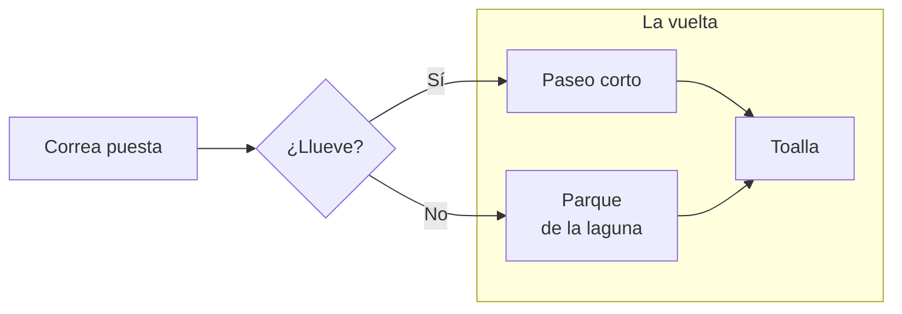

El mapa mental:

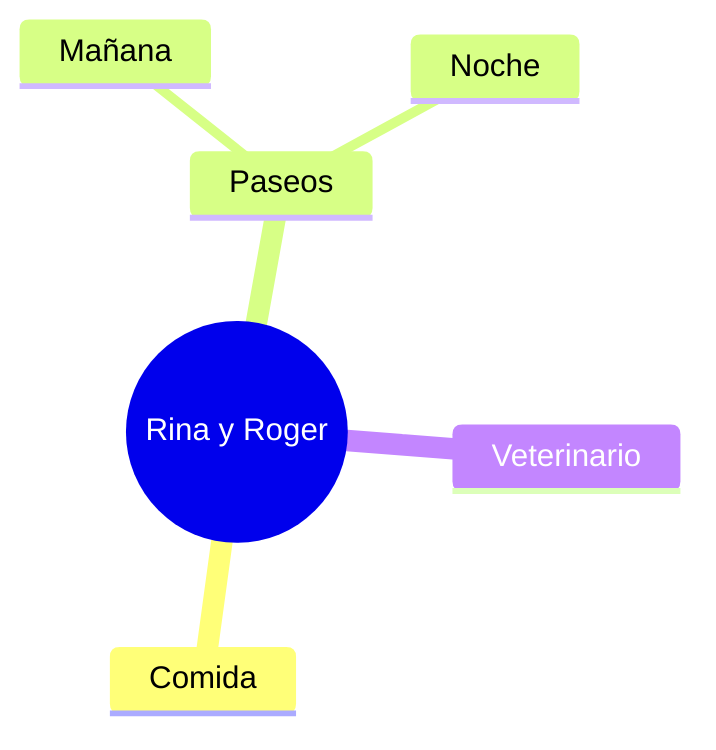

El esquema de base de datos:

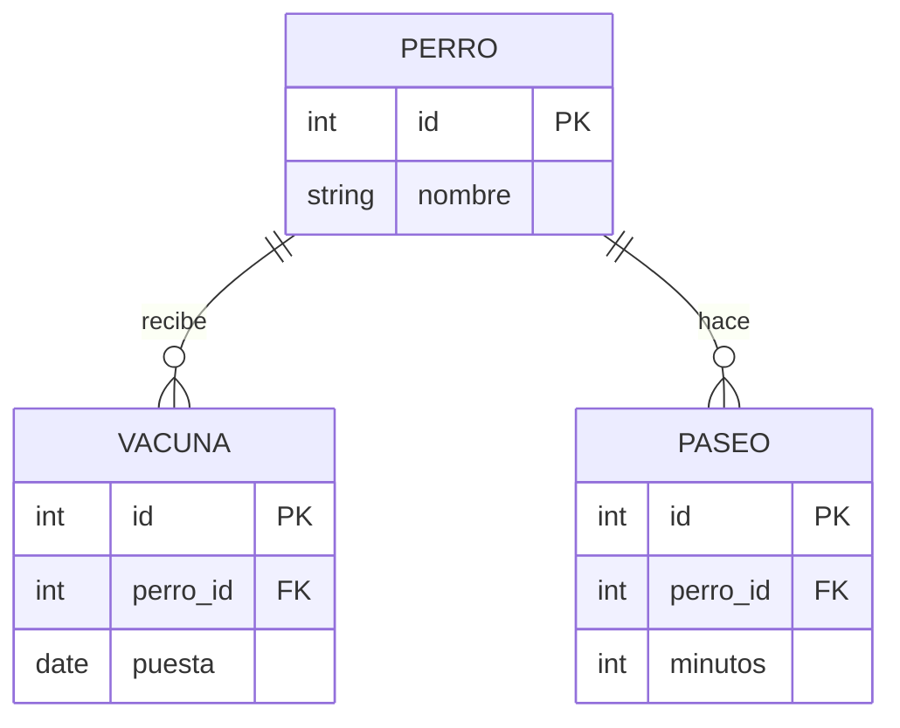

Y el diagrama de clases:

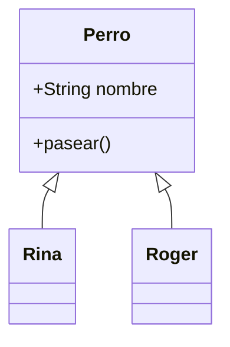

Los demás se escriben en el texto, con el dibujo al lado. De secuencia:

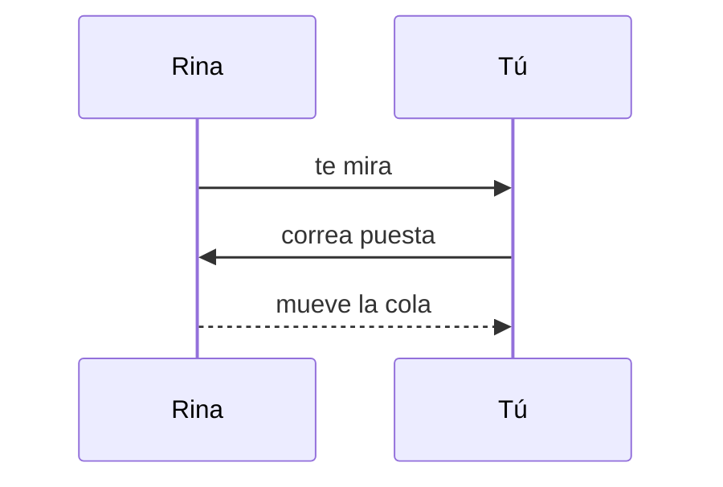

De estados:

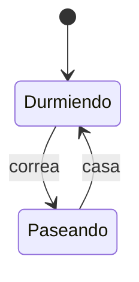

De torta:

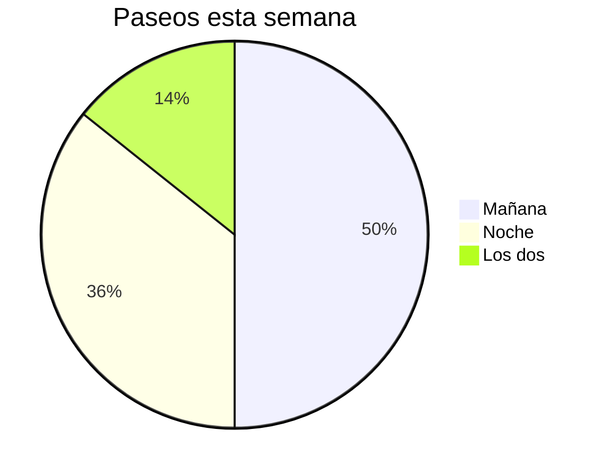

De Gantt:

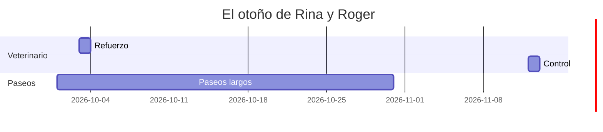

Un recorrido:

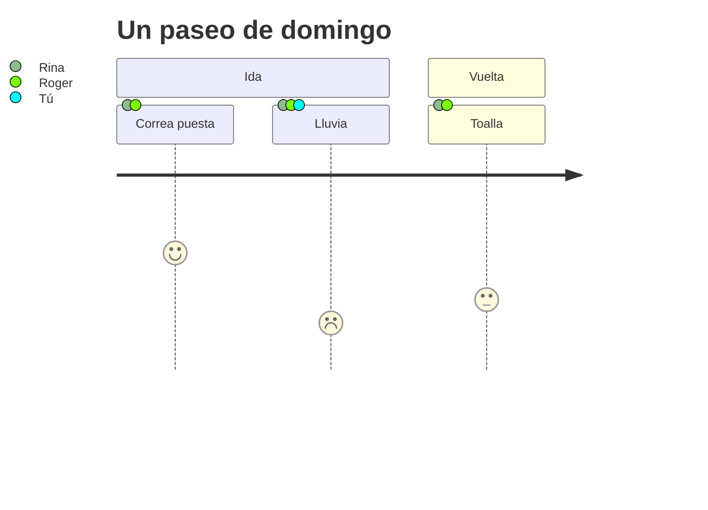

Un cronograma:

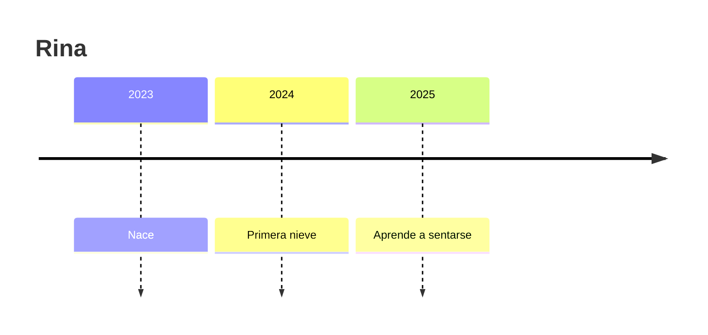

Las ramas de un repositorio:

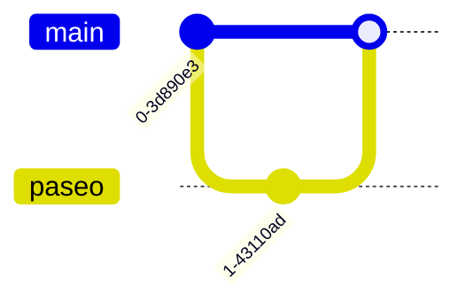

Cuadrantes:

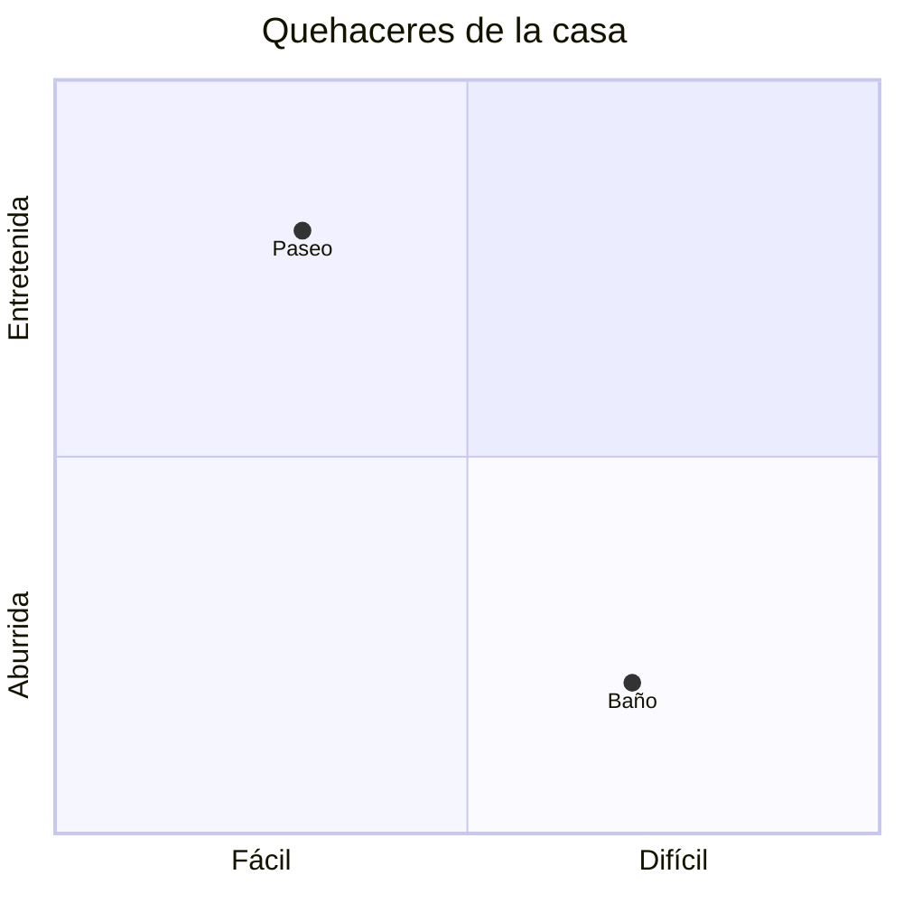

Barras y líneas:

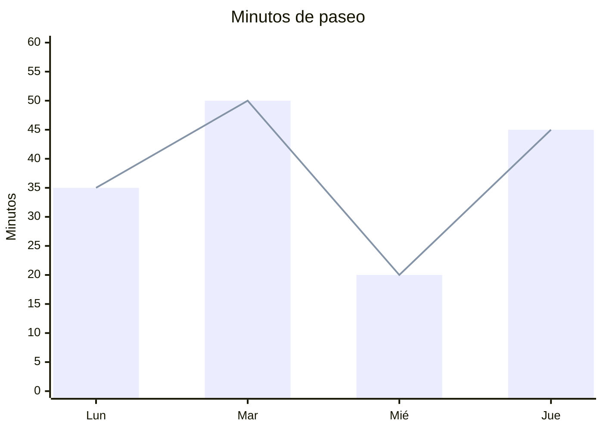

Un flujo de cantidades:

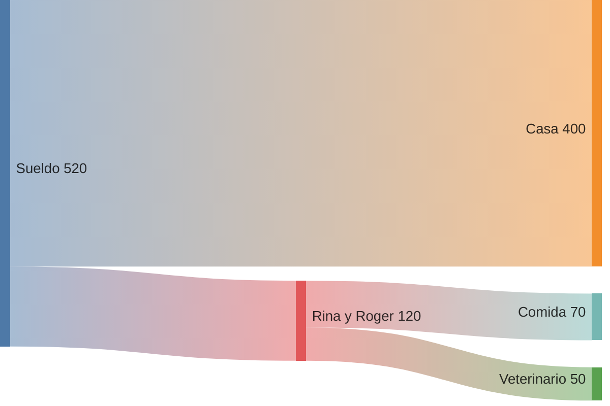

Y un tablero:

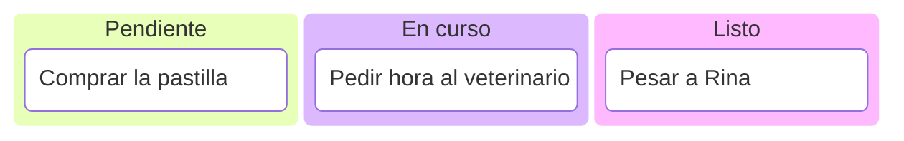

---

## Fórmulas

**Fórmula**, en el menú `/`: un bloque cuyo lenguaje es `math` compone la fórmula, sin conexión.

```math
dosis = \frac{peso \times 0.5}{2}
```

```math
\sum_{i=1}^{n} i = \frac{n(n+1)}{2}
```

```math
\begin{pmatrix} 1 & 0 \\ 0 & 1 \end{pmatrix} \qquad |x| = \begin{cases} x & x \ge 0 \\ -x & x < 0 \end{cases}
```

Entre dólares dobles, en líneas propias, es lo mismo:

$$
\int_0^1 x^2 \, dx = \frac{1}{3}
$$

---

## Widgets

**Widget**, en el menú `/`: un bloque cuyo lenguaje es `widget` se dibuja como una vista fija, hecha solo de HTML y CSS. No ejecuta nada, así que se ve igual donde se lea el documento. Toma los colores de Tisty y trae estilos listos. El código queda plegado: ábrelo con **Ver código**.

Cifras en una cuadrícula, y una tarjeta con su lista:

```widget title="Rina y Roger este mes"
<div class="grid">
  <div class="stat"><small>Paseos</small><b>42</b><em class="up">+6 frente a agosto</em></div>
  <div class="stat"><small>Peso</small><b>14 kg</b><em class="down">−0,3 kg</em></div>
  <div class="stat"><small>Próxima vacuna</small><b>12 nov</b><span class="badge warn">pendiente</span></div>
</div>
<div class="card" style="margin-top:12px">
  <div class="head"><h3>Revisiones</h3><span class="badge bad">falta una</span></div>
  <ul class="list">
    <li><span class="box done"></span><span class="gone">Garrapatas</span></li>
    <li><span class="box"></span>Orejas</li>
  </ul>
</div>
```

Dos columnas, una tabla, un dibujo, un plegable y su propio estilo:

```widget title="Los paseos de octubre"
<style>
  .barra { fill: var(--accent); }
</style>
<div class="two">
  <div class="card">
    <div class="head"><h3>Por semana</h3><span class="badge ok">al día</span></div>
    <table>
      <tr><th>Semana</th><th class="num">Paseos</th><th class="num">Km</th></tr>
      <tr><td>1</td><td class="num">12</td><td class="num">18,4</td></tr>
      <tr><td>2</td><td class="num">9</td><td class="num">13,1</td></tr>
      <tr><td>3</td><td class="num">11</td><td class="num">16,0</td></tr>
    </table>
  </div>
  <div class="card">
    <div class="head"><h3>Minutos por día</h3><span class="badge">esta semana</span></div>
    <svg viewBox="0 0 140 60" role="img" aria-label="Minutos de paseo de lunes a jueves">
      <rect class="barra" x="5" y="25" width="25" height="35"></rect>
      <rect class="barra" x="40" y="10" width="25" height="50"></rect>
      <rect class="barra" x="75" y="40" width="25" height="20"></rect>
      <rect class="barra" x="110" y="15" width="25" height="45"></rect>
    </svg>
    <details>
      <summary>Los números</summary>
      <p>Lunes 35, martes 50, miércoles 20 y jueves 45.</p>
    </details>
    <div class="row"><span class="badge ok">mañana 7</span><span class="badge warn">noche 5</span><span class="badge bad">sin paseo 1</span></div>
  </div>
</div>
```

---

## Adjuntos

**Adjuntar un archivo**, en el menú `/`, o arrástralo dentro de la hoja. Queda guardado en Tisty y se dibuja como lo que es. Cada tarjeta tiene un **⋯** para guardar una copia, mostrarla como enlace o quitarla de la página.

Una imagen, que un clic abre en grande:


Un PDF:


Un sonido, con su reproductor:


Un video, con el suyo:


Datos:


Una página HTML, adjunta como cualquier otro archivo: nunca se ejecuta.


Y el mismo archivo dentro de una frase es un enlace: [la cartilla de Rina](cartilla.pdf).

---

## Tarjetas

Lo que ocupa un párrafo entero se dibuja como una tarjeta; lo mismo dentro de una frase es una palabra en la que haces clic.

Otro documento: **Un documento** o **Un documento nuevo**, en el menú `/`. La tarjeta lleva su título de ahora y sus primeras palabras.


Una página: **Una página nueva** o **Una página que ya existe**. Su tarjeta dice además qué lugar tiene en el libro.


Una tarjeta también avisa cuando su documento está archivado o ya no está. Y en la página de una tarea, cada parte es una tarjeta igual, con sus pasos hechos y su fecha.

Un enlace solo en su párrafo, con la letra y el color de su sitio. **Traer la vista previa** le pone el título y la imagen que el sitio ofrece.

[Tisty en GitHub](https://github.com/rgdevment/Tisty)

Una dirección sola hace lo mismo:

https://www.tisty.app

---

## Hojas y saltos de página

**Salto de página**, en el menú `/`, o `Ctrl`/`⌘` + `Enter`: una línea con solo `---`. En pantalla se ve como un corte, y al imprimir o en el PDF lo que sigue empieza en la hoja siguiente. Esta hoja tiene uno entre cada parte, y aquí va otro. Enciende **Hojas**, en el panel de al lado, y mira dónde cae la última línea.

---

Eso es todo: uno de cada cosa.
