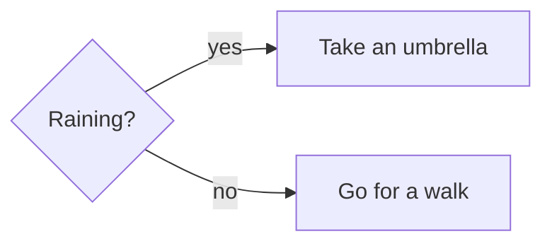
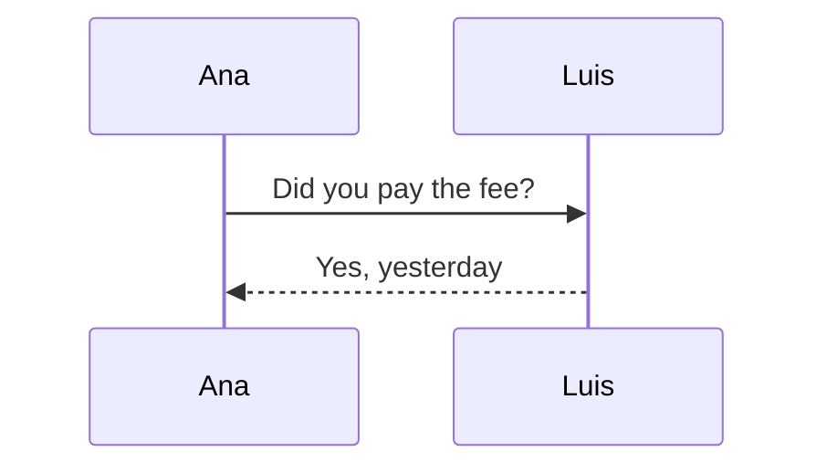
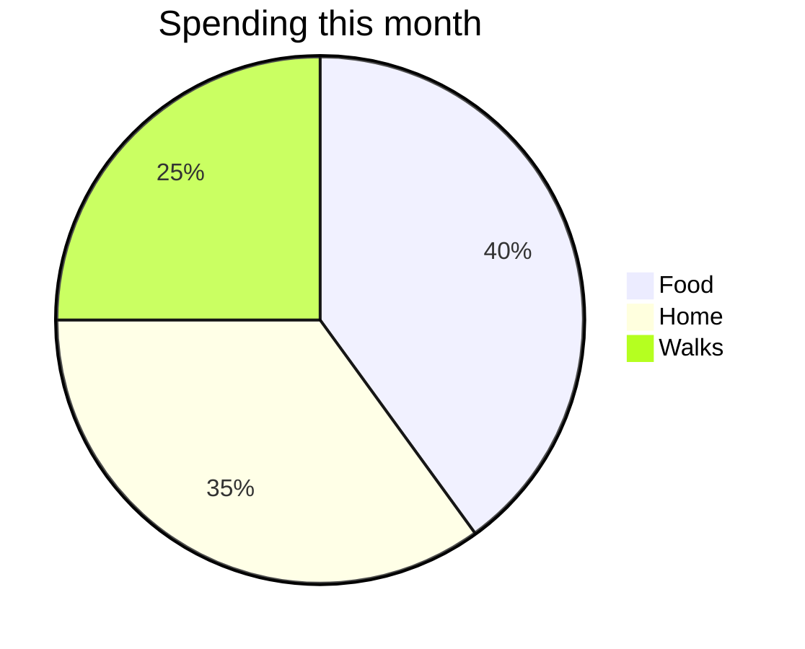
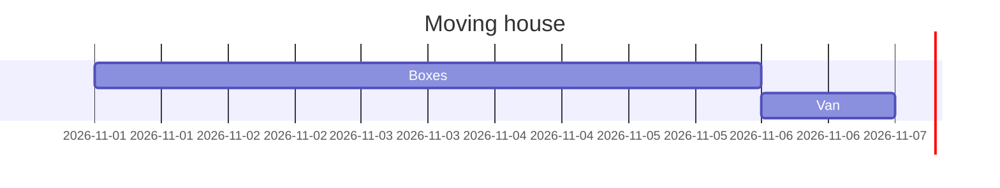

# Tisty Markdown

A Tisty document is a plain `.md` file. What it holds is Markdown: CommonMark with GitHub's additions, plus a handful of short words of Tisty's own for what Markdown has no way to say: a pen colour, an underline, an icon, a section that folds. This page lists every one of them: what it is for, how it is written in the file, how it reads, and the small rules that decide when it counts. Help with tasks, assistants through MCP and the rest of Tisty is at [www.tisty.app/docs](https://www.tisty.app/docs/).

Nothing on this page needs learning by heart. The `/` menu and the bar in the editor write all of it for you; this is what you find if you open the file somewhere else, or want to write it by hand.

## At a glance

| What | Written | GitHub | CommonMark |
| :-- | :-- | :-: | :-: |
| [Properties](#properties) | `---` `title:` `tags:` … `---` | as a table | as a rule and words |
| [Headings](#headings) | `# Title` … `###### Title` | yes | yes |
| [Bold, italic, struck, code](#bold-italic-struck-through-and-code) | `**b**` `*i*` `~~s~~` `` `c` `` | yes | all but `~~s~~` |
| [Underline](#underline) | `++words++` | no | no |
| [Pens](#pens) | `==words==` `==words=={green}` | no | no |
| [Links](#links) | `[words](https://…)` `[words][one]` `https://…` | yes | all but a bare `https://…` |
| [Line breaks](#paragraphs-and-line-breaks) | one line per line | joins them | joins them |
| [Lists and stages](#lists) | `- item` `1. item` `- [ ] stage` | yes | lists, not stages |
| [Quotes and callouts](#quotes-and-callouts) | `> words` `> [!NOTE]` | yes | quotes, not callouts |
| [Collapsible sections](#collapsible-sections) | `:::details Title` … `:::` | no | no |
| [Tags](#tags) | `#contract` | as words | as words |
| [Icons](#icons) | `::dog orange::` | no | no |
| [Emoji](#emoji) | `🎉` or `:tada:` | yes | `🎉` only |
| [Other documents and pages](#other-documents-and-pages) | `` | no | no |
| [Attachments](#attachments) | `` | no | no |
| [References](#references) | `[[Name]]` `[[#2]]` | no | no |
| [Footnotes](#footnotes) | `[^1]` … `[^1]: note` | yes | no |
| [Code](#code-blocks) | ` ```lang title="name" ` | yes | yes |
| [Diagrams](#diagrams-formulas-and-widgets) | ` ```mermaid ` | yes | as code |
| [Formulas](#diagrams-formulas-and-widgets) | ` ```math ` `$x$` `$$x$$` | yes | no |
| [Widgets](#diagrams-formulas-and-widgets) | ` ```widget ` | as code | as code |
| [Tables](#tables) | `\| a \| b \|` | yes | no |
| [Page breaks](#page-breaks) | `---` | as a rule | as a rule |
| [Comments and entities](#comments-and-entities) | `<!-- note -->` `&copy;` | yes | yes |

Where the table says *no*, a reader that follows only GitHub or only CommonMark shows the words exactly as they are written, so nothing is lost: `++words++` stays readable, and `::dog::` is still a dog.

## Properties

A block of properties at the very top of the file, between two `---` lines, the way many Markdown tools write them (it is often called front matter):

```markdown
---
title: Rina's vaccines
tags: [rina, vet]
source: the vet's card
---
```

- It is kept exactly as written. The page leaves it out and shows the properties in the panel beside it, under **About this document**, where **Edit** opens the block at the top of the page as it is written.
- `title:` is the document's [title](#the-title).
- `tags:` (or `tag:`) files the document under each one, the same as writing `#rina` in a sentence: one tag either way. A list in brackets, words split by commas, or one `- item` per line all work, with or without the `#`.
- The block only counts at the very top: the first line is `---`, the line under it has words, and a `---` or `...` closes it. Anywhere else, `---` is a [page break](#page-breaks).
- `paper:` is the sheet the document is printed on: `letter` or `tabloid`, and A4 when it is left out. `sheets: on` draws the page on those sheets, and `orientation: landscape` lays them across. **Paper** and **Sheets** in the panel write them, and taking them back leaves nothing written.
- Besides those three, Tisty never writes properties: a tag it adds goes in the text as `#tag`.
- A block past 4 KiB, with more than 32 properties or a value past 500 characters is kept as written, but nothing in it is read. Only plain properties are read: `key: value`, a list in brackets, or `- item` lines.

## The title

The first line with words in it is the document's title, unless its [properties](#properties) name one with `title:`. There is no name to fill in anywhere. A callout's marker and a code fence are stepped over to find it.

```markdown
# Rina's vaccines
```

## Headings

Six levels, from `#` to `######`, always followed by a space. The `/` menu offers the first three.

```markdown
## Vaccines

### Rabies
```

- `# Hola` is a heading; `#Hola`, with no space, is a [tag](#tags).
- To start a line with a `#` that is neither, write `\#`.

## Paragraphs and line breaks

A blank line starts a new paragraph. A single line break stays a line break: what you write on the next line is drawn on the next line, in the same paragraph.

```markdown
A line ends where you end it.
This line is the same paragraph, one line down.

This one is a new paragraph.
```

GitHub joins those two lines into one when it shows a file; Tisty keeps them apart. A backslash at the end of a line breaks it everywhere.

To write a line that would otherwise start something — a heading, a list, a quote — put a backslash before it: `\#`, `\-`, `1\.`, `\>`.

## Bold, italic, struck through and code

```markdown
**Bold**, *italic*, ***both at once***, ~~struck through~~ and `loose code`.
```

- A mark touching a space on its inner side is not a mark: `** bold **` stays as written, and so does `5 * 3`.
- A word joined by underscores, like `snake_case` or `__dunder__`, is not italic or bold.
- Inside backticks nothing else counts: a tag, a pen or an emoji between them is just text.

## Underline

Markdown has no underline, so Tisty has two plus signs.

```markdown
++underlined++
```

- Exactly two `+` on each side. The words inside cannot start or end with a space.
- The walls cannot touch a letter, a digit or another `+` on their outer side, so `C++`, `i++` and `a ++ b ++ c` are never underlines.
- An underline cannot cross the edge of a bold or a link: both walls sit inside the same one.
- Other readers show `++underlined++` as it is. When a document leaves Tisty as plain Markdown — **Copy as Markdown**, or written out to a folder — the walls are dropped and the words stay.

## Pens

A highlight, in a colour. Yellow is the plain one; any other colour is named in braces right after the closing wall.

```markdown
==yellow==, ==green=={green}, ==blue=={blue} and ==pink=={pink}.
```

The bar offers four pens — **yellow**, **green**, **blue** and **pink** — and the file takes eight more colours: `red`, `orange`, `amber`, `teal`, `indigo`, `purple`, `brown` and `gray`.

- Exactly two `=` on each side: `===` and longer are something else. The words inside cannot start or end with a space.
- The colour goes straight after the closing `==`, with no space: `==words=={green}`. `=={yellow}` is the same as no colour.
- A colour the palette does not have, like `{chartreuse}`, leaves a yellow pen with `{chartreuse}` written after it, in sight.
- A pen cannot cross the edge of a bold or a link.
- When the document leaves Tisty as plain Markdown, pens are written as `<mark>` so other readers can still paint them.

## Links

```markdown
A [link to a website](https://github.com/rgdevment/Tisty), an address
between angle brackets <https://github.com/rgdevment/Tisty>, and a mail
address the same way: <rina@example.com>.
```

A link alone in its own paragraph is shown as a card, with its site's letter and colour:

```markdown
https://github.com/rgdevment/Tisty
```

- A web address written on its own, `https://github.com/rgdevment/Tisty`, is a link too. A full stop, a comma or a closing bracket right after it is not part of it.
- A link can also be written by reference, with its address said once on a line of its own, anywhere in the document:

  ```markdown
  The [walk map][park] and the [vet][vet].

  [park]: https://example.com/park
  [vet]: https://example.com/vet "Open on Saturdays"
  ```

- The page shows each definition where it is written, as a small line with its label and address; a click on it edits it.
- A link with no address yet, `[words]()`, reads as its words.
- Only web addresses, `mailto:` and Tisty's own `tisty:` are followed. Any other scheme reads as plain words.
- An address with spaces goes between angle brackets: `[clip](<C:/Users/me/a clip.mkv>)`.
- A link opens your browser only when you click it.

## Lists

```markdown
- Lead
- Poo bags
  - The green ones
- Water

1. Put her lead on
2. Walk to the park

3. A numbered list keeps the number it starts on
```

- Bullets are `-`, `*` or `+`; numbers are `1.` or `1)`. Indent an item to nest it.
- An item can open on words or on another block — a quote, a heading, a picture, a fence — the way Markdown has it.

### Stages

A list of boxes you tick. They are not Tisty tasks: they never close, have no date and never show up in *Today*.

```markdown
- [x] Bring Rina's record book
- [ ] Ask about the tick tablet
```

`[ ]` is open, `[x]` (or `[X]`) is ticked. A click on the box ticks it, on the page and while you write.

## Quotes and callouts

A quote is a line starting with `>`.

```markdown
> What is not written down did not happen.
```

A callout is a quote whose first line names its kind in brackets. Five kinds, each with its own colour:

```markdown
> [!NOTE]
> For what is worth knowing, with no urgency at all.

> [!TIP]
> For the shortcut you found the hard way.

> [!IMPORTANT]
> For what cannot be passed over.

> [!WARNING]
> For what can go wrong if you do not look.

> [!CAUTION]
> For what has no way back.
```

- The kind is read in any case: `[!note]` is a note.
- GitHub wants the marker alone on its line; Tisty also takes words after it, `> [!TIP] Take the spare roll.`, and those words become the callout's first line.
- A kind Tisty does not know, like `[!FOO]`, leaves an ordinary quote.
- Nearly anything fits inside a callout — lists, code, rules, a section — as long as every line carries its `>`.
- The same five kinds can also be written the way other tools write them, as a block between `:::tip` and a lone `:::`; Tisty draws it as the same callout.

## Collapsible sections

A title you click to open or fold what is under it. Pick **Collapsible section** in the `/` menu, or write it:

```markdown
:::details Rina's full record

Born in 2023. Six-in-one and rabies every March.

- Worming every three months

:::
```

- The opening line, `:::details` and its title, stands as a paragraph of its own: a blank line before and after it. So does the closing `:::`.
- Without its closing `:::` it is not a section: both lines stay as written.
- A section starts folded. With no title after `:::details`, it shows an empty one.
- Sections nest. Any `:::word` line opens a container that the next lone `:::` closes, so a section inside another, or a `:::tip` block written by another tool, never steals its closing fence. `details` folds and the five callout kinds draw a callout; any other `:::word` block shows its lines as written.
- They work inside a callout too.
- GitHub shows both fence lines as text and everything between them unfolded. Tisty also draws a `<details>` block written in HTML, the way GitHub writes them, but that is HTML, which is [outside the language](#what-is-outside-the-language).

## Tags

A word after `#` files the document under that tag. It lives in the sentence, so it travels with the file.

```markdown
Booster due in March #rina #vet
```

- `#Hola` is a tag; `# Hola`, with a space, is a heading.
- Accents and case come off: `#Camión` and `#camion` are one tag, `camion`. An underscore becomes a dash: `#mi_tag` is `mi-tag`.
- Two characters at least, one of them a letter: `#1234` is a ticket number, not a tag, and neither is `#a`. `#2026x` is a tag.
- A `#` stuck to what comes before it is not a tag: `C#`, `bg-#fff`, `page.html#top` and the anchor in a link's address are all left alone.
- Nothing inside code is a tag, and neither is the `#2` in a [reference](#references) like `[[#2]]`.
- A document keeps its first 64 tags.
- While you write, typing `#` offers the tags you already use, so one tag is never spelled two ways.

## Icons

An icon marks a line without spending a heading on it. Pick **An icon** in the `/` menu and search it by what it draws — «dog», «motorcycle», «fist» — in your language. It is written between double colons, with an optional colour after a space:

```markdown
::dog orange:: Rina's vaccines
::star:: Done
```

- The name is one from Tisty's set, in English: lowercase, with dashes (`dog`, `bone`, `heart`, `rocket-thing`). The picker knows them all.
- The colours are `red`, `orange`, `amber`, `green`, `teal`, `blue`, `indigo`, `purple`, `pink`, `brown` and `gray`.
- An icon cannot touch a letter or a digit: `a::star::b` stays as written.
- A name or a colour Tisty does not have stays as written, `::nothing::` included.
- Other readers show `::dog orange::` as words. When the document leaves Tisty as plain Markdown, an icon is written as a small piece of HTML whose words are its name between colons, `:dog:`.

## Emoji

An emoji is best written as itself: 🎉. A shortcode GitHub knows, such as `:tada:`, `:+1:` or `:dog:`, is drawn as its emoji too, and stays written as the shortcode.

- A shortcode cannot touch a letter, a digit or another colon: `10:30:00` and `a:tada:b` stay as written.
- One Tisty does not know stays as words.

## Other documents and pages

Another document is named by its id after `tisty:doc/`. The `/` menu writes these for you (**A document**, **A new document**, **A page that already exists**, **A new page**).

```markdown


The [walks of October](tisty:doc/01JC4M9F2W7DQ1E3S8RB6PKMHT) went better.
```

- With `!` in front and alone in its paragraph, it is a **card**: the document's current title, its first words, and — for a page — its place in the book. The words in brackets are only what other readers show.
- The same thing inside a sentence is a word you can click.
- For a page, only the card gives it its place in the book; a link in a sentence points at it without placing it. See Pages and PDF.
- A `[`, `]` or `\` in a title is written with a backslash before it.

## Attachments

A file you drag in is kept inside Tisty and named by a stamp of its bytes. It is written like a picture, with the label you see:

```markdown


```

- A picture is drawn; any other file is a chip with its label that opens it.
- The stamp is 8 to 16 lowercase hexadecimal characters after the last dash, and the whole name is lowercase.
- Documents written by an older Tisty that say `attachments/ab/name` still read; when the document is rewritten, only the name is kept.
- When a document is written out to a folder, its attachments go beside it and the links point at them.

## References

Two square brackets name something without linking to it.

```markdown
See [[Rina's record]] and step [[#2]].
```

- `[[name]]` is drawn as a chip with the name.
- In a task's description or journal, `[[#2]]` shows the words of that task's second step.
- In a document, `[[#2]]` shows the words of the document's second [stage](#lists), counted as they are read, and a click takes you to it.
- An empty name, or one with a `[` or a line break in it, is not a reference.

## Footnotes

A note at the foot of the text is called by a short label in square brackets with a caret, and said once on a line of its own:

```markdown
The vet confirmed it[^vet].

[^vet]: Visit of 3 March, with the blood test.
```

- The call is drawn as a small raised label that takes you to the note; the note sits where it is written, with its label beside it.
- A label is any short word or number: `[^1]`, `[^vet]`.
- GitHub reads them the same way.

## Code blocks

A fence of three or more backticks (or tildes), the language after it, and optionally a name:

````markdown
```bash title="backup.sh"
rsync -a ~/Tisty/ /Volumes/Backup/Tisty/
```
````

Each language is coloured its own way:

````markdown
```python title="walks.py"
def kilometres(walks):
    # Add up what was walked this month
    return sum(w["km"] for w in walks if w["done"])
```
````

````markdown
```javascript
const vaccines = ["rabies", "eight-in-one"];
for (const one of vaccines) console.log(`Due: ${one}`);
```
````

````markdown
```json title="rina.json"
{ "name": "Rina", "age": 4, "vaccines": ["rabies"], "chip": true }
```
````

````markdown
```sql
SELECT name, date FROM vaccines WHERE pet = 'Rina' ORDER BY date DESC;
```
````

Inside a sentence, code goes between backticks:

```markdown
Run `npm run guide` and open `target/guide`.
```

- The name goes in `title="…"`; a `"` inside it is written `\"`. Other readers ignore it.
- Whatever else other tools write after the language, like `showLineNumbers`, is kept as written; Tisty reads the language and the name.
- To show a fence inside a block, use a longer fence around it.
- A block indented four spaces is code too.
- Nothing in code is a tag, a pen, an icon or an emoji.

## Diagrams, formulas and widgets

Three languages are drawn instead of shown as code: `mermaid` for diagrams, `math` for formulas and `widget` for a small page of its own.

### Diagrams

A `mermaid` (or `mmd`) block draws a diagram: flows, sequences, states, pies and timelines.

````markdown

````

````markdown

````

````markdown

````

````markdown

````

- One too large to lay out — past 32 KiB, or a thousand boxes and arrows — or one that does not parse, is shown as code.

### Formulas

A formula inside a sentence goes between single dollars:

```markdown
Energy is $E=mc^2$ and a circle's area, $\pi r^2$.
```

A `math` block, or a formula between double dollars on a line of its own, stands apart:

````markdown
```math
\sum_{i=1}^{n} i = \frac{n(n+1)}{2}
```
````

```markdown
$$
\int_0^1 x\,dx = \tfrac{1}{2}
$$
```

````markdown
```math
\begin{pmatrix} a & b \\ c & d \end{pmatrix} \qquad |x| = \begin{cases} x & x \ge 0 \\ -x & x < 0 \end{cases}
```
````

- A digit right after the closing dollar makes it a price, not a formula: `$5 and $10` stays as written.
- `\$` is a dollar sign.
- Past 8 KiB a formula is shown as code; a command it does not know is skipped.

### Widgets

A `widget` block draws a small page sealed off from the network; its name goes in `title`. It comes with styles ready to use: `stat`, `card`, `grid`, `two`, `head`, `badge` (with `ok`, `warn` and `bad`), `list`, `box`, `up` and `down`, as well as tables and buttons.

````markdown
```widget title="Rina this month"
<div class="grid">
  <div class="stat"><small>Walks</small><b>42</b><em class="up">+6</em></div>
  <div class="stat"><small>Kilometres</small><b>61</b><em class="down">−3</em></div>
  <div class="stat"><small>Vaccines</small><b>up to date</b><span class="badge ok">done</span></div>
</div>
```
````

````markdown
```widget title="Glasses of water"
<div class="card">
  <div class="head"><h3>Today</h3><span class="badge" id="n">0</span></div>
  <div class="row">
    <button class="primary" onclick="n.textContent = +n.textContent + 1">One more</button>
    <button onclick="n.textContent = 0">Start over</button>
  </div>
</div>
```
````

- It may carry a `<script>` of its own, which runs inside the widget and never in the document.

GitHub draws every one of these fences but `widget`, and `$…$` and `$$…$$` too.

## Tables

```markdown
| Vaccine        | Given | Due again |
| :------------- | :---: | --------: |
| Six-in-one     | march | 12 months |
| Rabies         | march | 12 months |
```

- Colons in the rule under the header lean a column: `:---` left, `:---:` centre, `---:` right.
- A column's width rides in that rule: four dashes or more set it, ten pixels a dash; three leave it to the page. Other readers ignore how many dashes there are. See Tables.
- A `|` inside a cell is written `\|`.
- A cell holds a line of words and marks, not blocks.

## Page breaks

A rule on its own line splits the sheet: on screen it looks like a break, and in print or PDF what follows starts on the next sheet.

```markdown
What follows starts on the next sheet.

---

This is already on the next one.
```

Leave a blank line above it: right under a line of words, `---` turns that line into a heading.

With **Sheets** on, a sheet that fills up turns on its own, on screen as on paper; a break always holds, sheets or not. `Ctrl`/`⌘` + `Enter` writes one while you write. A `\newpage`, `\pagebreak` or `\clearpage` on a line of its own, and a page break written in a web page or a Word document, come in as a rule.

## Comments and entities

A note to yourself that the page does not show goes between `<!--` and `-->`, on a line or across several. An entity names a character that is awkward to type: `&copy;` is ©, `&amp;` is &, `&nbsp;` is a space that does not break.

```markdown
Booster due in March. <!-- ask about the tick tablet -->

&copy; 2026 Rina's vet
```

- Both are kept in the file exactly as written; the page shows what they mean.
- Inside code they are just text.

## What is outside the language

Whatever arrives from elsewhere is turned into these words on the way in: a web page pasted or imported, a Word document, a note from Obsidian, Markdown sent by an assistant. Its headings, lists, links, tables, colours and pictures become the forms on this page; a colour outside the palette becomes the nearest pen, and what has no word at all is kept as plain text. The file it came from is never touched.

Only HTML written into a document by hand stays as it is written. The document still opens, edits and saves whole, with nothing cut out; the page draws that part as best it can, and **Settings › Maintenance** lists the documents that hold some.

### Words from an older Tisty

Earlier versions wrote pens as `<mark data-pen="green">`, icons as `<span data-ico="dog">` and underlines as `<u>`. Those are turned into the words on this page when the documents come in, every other byte left as it was.
