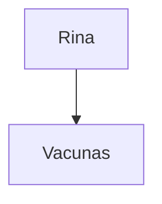

# El lenguaje de Tisty

Un documento de Tisty es un archivo `.md` normal. Lo que lleva es Markdown, el mismo que leen GitHub y Obsidian, más unas pocas palabras cortas propias de Tisty para lo que Markdown no sabe decir: el color de un rotulador, un subrayado, un icono, una sección que se pliega. Esta página las reúne todas: para qué sirve cada una, cómo queda escrita en el archivo, cómo se lee y las reglas chicas que deciden cuándo cuenta.

Nada de esto hay que aprenderlo de memoria. El menú `/` y la barra del editor lo escriben todo por ti; esto es lo que encuentras si abres el archivo en otra parte, o si quieres escribirlo a mano.

## De un vistazo

| Qué | Se escribe | GitHub | Obsidian |
| :-- | :-- | :-: | :-: |
| [Propiedades](#propiedades) | `---` `title:` `tags:` … `---` | como tabla | sí |
| [Títulos](#títulos) | `# Título` … `###### Título` | sí | sí |
| [Negrita, cursiva, tachado, código](#negrita-cursiva-tachado-y-código) | `**n**` `*c*` `~~t~~` `` `c` `` | sí | sí |
| [Subrayado](#subrayado) | `++palabras++` | no | no |
| [Rotuladores](#rotuladores) | `==palabras==` `==palabras=={green}` | no | solo amarillo |
| [Enlaces](#enlaces) | `[palabras](https://…)` `[palabras][uno]` `https://…` | sí | sí |
| [Saltos de línea](#párrafos-y-saltos-de-línea) | una línea por línea | las junta | sí |
| [Listas y etapas](#listas) | `- elemento` `1. elemento` `- [ ] etapa` | sí | sí |
| [Citas y avisos](#citas-y-avisos) | `> palabras` `> [!NOTE]` | sí | sí |
| [Secciones plegables](#secciones-plegables) | `:::details Título` … `:::` | no | no |
| [Etiquetas](#etiquetas) | `#contrato` | como texto | sí |
| [Iconos](#iconos) | `::dog orange::` | no | no |
| [Emojis](#emojis) | `🎉` o `:tada:` | sí | solo `🎉` |
| [Otros documentos y páginas](#otros-documentos-y-páginas) | `` | no | no |
| [Adjuntos](#adjuntos) | `` | no | no |
| [Referencias](#referencias) | `[[Nombre]]` `[[#2]]` | no | sí |
| [Notas al pie](#notas-al-pie) | `[^1]` … `[^1]: nota` | sí | sí |
| [Código](#bloques-de-código) | ` ```lenguaje title="nombre" ` | sí | sí |
| [Diagramas](#diagramas-fórmulas-y-widgets) | ` ```mermaid ` | sí | sí |
| [Fórmulas](#diagramas-fórmulas-y-widgets) | ` ```math ` `$x$` `$$x$$` | sí | solo `$` |
| [Widgets](#diagramas-fórmulas-y-widgets) | ` ```widget ` | como código | como código |
| [Tablas](#tablas) | `\| a \| b \|` | sí | sí |
| [Saltos de página](#saltos-de-página) | `---` | como raya | como raya |
| [Comentarios y entidades](#comentarios-y-entidades) | `<!-- nota -->` `&copy;` | sí | sí |

Donde la tabla dice *no*, el otro lector muestra las palabras tal como están escritas, así que no se pierde nada: `++palabras++` se sigue leyendo, y `::dog::` sigue siendo un perro.

## Propiedades

Un bloque de propiedades al principio del archivo, entre dos líneas `---`, como lo escriben GitHub y Obsidian (también se le dice front matter):

```markdown
---
title: Vacunas de Rina
tags: [rina, veterinaria]
fuente: la libreta de la veterinaria
---
```

- Se guarda tal como está escrito. La página no lo muestra: las propiedades aparecen en el panel de al lado, bajo **Sobre este documento**, donde **Editar** abre el bloque arriba de la página tal como está escrito.
- `title:` es el [título](#el-título) del documento.
- `tags:` (o `tag:`) guarda el documento bajo cada una, igual que escribir `#rina` en una frase: es la misma etiqueta de las dos maneras. Sirve una lista entre corchetes, palabras separadas por comas o un `- elemento` por línea, con `#` o sin él.
- El bloque solo cuenta al principio: la primera línea es `---`, la de abajo tiene palabras, y lo cierra un `---` o `...`. En cualquier otra parte, `---` es un [salto de página](#saltos-de-página).
- Tisty nunca escribe propiedades por su cuenta: una etiqueta que agrega va en el texto como `#etiqueta`.
- Un bloque de más de 4 KiB, con más de 32 propiedades o con un valor de más de 500 caracteres se guarda tal cual, pero no se lee nada de él. Solo se leen propiedades simples: `clave: valor`, una lista entre corchetes o líneas `- elemento`.

## El título

La primera línea con palabras es el título del documento, salvo que sus [propiedades](#propiedades) digan otro con `title:`. No hay que ponerle nombre en ninguna parte. Para encontrarla, Tisty se salta la marca de un aviso y las vallas de código.

```markdown
# Vacunas de Rina
```

## Títulos

Seis niveles, de `#` a `######`, siempre seguidos de un espacio. El menú `/` ofrece los tres primeros.

```markdown
## Vacunas

### Antirrábica
```

- `# Hola` es un título; `#Hola`, sin espacio, es una [etiqueta](#etiquetas).
- Para empezar una línea con un `#` que no sea ninguna de las dos, escribe `\#`.

## Párrafos y saltos de línea

Una línea en blanco empieza un párrafo nuevo. Un salto de línea simple se queda como salto: lo que escribes en la línea siguiente se dibuja en la línea siguiente, en el mismo párrafo.

```markdown
Una línea termina donde tú la terminas.
Esta línea es del mismo párrafo, una más abajo.

Este ya es un párrafo nuevo.
```

GitHub junta esas dos líneas en una cuando muestra un archivo; Tisty y Obsidian las dejan separadas. Una barra invertida al final de la línea la corta en todas partes.

Para escribir una línea que si no empezaría otra cosa (un título, una lista, una cita), pon una barra invertida delante: `\#`, `\-`, `1\.`, `\>`.

## Negrita, cursiva, tachado y código

```markdown
**Negrita**, *cursiva*, ***las dos a la vez***, ~~tachado~~ y `código suelto`.
```

- Una marca que toca un espacio por dentro no es marca: `** negrita **` queda tal cual, y `5 * 3` también.
- Una palabra unida con guiones bajos, como `snake_case` o `__dunder__`, no es cursiva ni negrita.
- Entre comillas invertidas no cuenta nada más: una etiqueta, un rotulador o un emoji ahí dentro es solo texto.

## Subrayado

Markdown no tiene subrayado, así que Tisty usa dos signos más.

```markdown
++subrayado++
```

- Exactamente dos `+` a cada lado. Las palabras de dentro no pueden empezar ni terminar con un espacio.
- Por fuera, las paredes no pueden tocar una letra, un dígito ni otro `+`, así que `C++`, `i++` y `a ++ b ++ c` nunca son subrayados.
- Un subrayado no puede cruzar el borde de una negrita ni de un enlace: las dos paredes quedan dentro del mismo.
- Los demás lectores muestran `++subrayado++` tal cual. Cuando un documento sale de Tisty como Markdown llano (**Copiar como Markdown**, o escrito en una carpeta), las paredes se quitan y las palabras quedan.

## Rotuladores

Un destacado, en un color. El amarillo es el de siempre; cualquier otro color se nombra entre llaves justo después de la pared que cierra.

```markdown
==amarillo==, ==verde=={green}, ==azul=={blue} y ==rosa=={pink}.
```

La barra ofrece cuatro rotuladores (**amarillo**, **verde**, **azul** y **rosa**) y el archivo acepta ocho colores más: `red`, `orange`, `amber`, `teal`, `indigo`, `purple`, `brown` y `gray`. Los colores se escriben en inglés.

- Exactamente dos `=` a cada lado: `===` y más largos son otra cosa. Las palabras de dentro no pueden empezar ni terminar con un espacio.
- El color va pegado al `==` que cierra, sin espacio: `==palabras=={green}`. `=={yellow}` es lo mismo que no poner color.
- Un color que la paleta no tiene, como `{chartreuse}`, deja un rotulador amarillo con `{chartreuse}` escrito detrás, a la vista.
- Un rotulador no puede cruzar el borde de una negrita ni de un enlace.
- Obsidian pinta `==palabras==` en amarillo y muestra `{green}` como texto. Cuando el documento sale de Tisty como Markdown llano, los rotuladores se escriben como `<mark>`, para que otros lectores los sigan pintando.

## Enlaces

```markdown
Un [enlace a una web](https://github.com/rgdevment/Tisty), una dirección
entre ángulos <https://github.com/rgdevment/Tisty>, y un correo
igual: <rina@example.com>.
```

- Una dirección web escrita sola, `https://github.com/rgdevment/Tisty`, también es un enlace. Un punto, una coma o un paréntesis que cierra justo después no son parte de ella.
- Un enlace también se puede escribir por referencia, con su dirección dicha una vez en una línea propia, en cualquier parte del documento:

  ```markdown
  El [mapa del paseo][parque] y la [veterinaria][vet].

  [parque]: https://example.com/parque
  [vet]: https://example.com/vet "Abre los sábados"
  ```

- Un enlace todavía sin dirección, `[palabras]()`, se lee como sus palabras.
- Solo se siguen las direcciones web, `mailto:` y el `tisty:` propio. Cualquier otro esquema se lee como texto.
- Una dirección con espacios va entre ángulos: `[clip](<C:/Users/yo/un clip.mkv>)`.
- Un enlace abre tu navegador solo cuando haces clic en él.

## Listas

```markdown
- Correa
- Bolsas
  - Las verdes
- Agua

1. Ponerle la correa
2. Caminar hasta el parque

3. Una lista numerada conserva el número con que empieza
```

- Las viñetas son `-`, `*` o `+`; los números, `1.` o `1)`. Sangra un elemento para anidarlo.
- Un elemento puede empezar con palabras o con otro bloque (una cita, un título, una imagen, una valla), tal como lo dice Markdown.

### Etapas

Una lista de casillas que se marcan. No son tareas de Tisty: no se cierran, no tienen fecha y no salen en *Hoy*.

```markdown
- [x] Llevar la cartilla de Rina
- [ ] Preguntar por la pastilla de las garrapatas
```

`[ ]` está abierta, `[x]` (o `[X]`) está marcada. Un clic en la casilla la marca, en la página y mientras escribes.

## Citas y avisos

Una cita es una línea que empieza con `>`.

```markdown
> Lo que no está escrito, no ocurrió.
```

Un aviso es una cita cuya primera línea nombra su tipo entre corchetes. Cinco tipos, cada uno con su color:

```markdown
> [!NOTE]
> Para lo que conviene saber, sin urgencia ninguna.

> [!TIP]
> Para el atajo que descubriste por las malas.

> [!IMPORTANT]
> Para lo que no se puede pasar por alto.

> [!WARNING]
> Para lo que puede salir mal si no miras.

> [!CAUTION]
> Para lo que no tiene vuelta atrás.
```

- El tipo se escribe en inglés y se lee en mayúsculas o minúsculas: `[!note]` es una nota. En pantalla se llaman Nota, Consejo, Importante, Aviso y Cuidado.
- GitHub quiere la marca sola en su línea; Tisty también acepta palabras detrás, `> [!TIP] Lleva el rollo de repuesto.`, y esas palabras pasan a ser la primera línea del aviso.
- Un tipo que Tisty no conoce, como `[!FOO]`, deja una cita normal.
- Dentro de un aviso cabe casi todo (listas, código, rayas, una sección) siempre que cada línea lleve su `>`.
- Los mismos cinco tipos también se pueden escribir como lo hacen otras herramientas, como un bloque entre `:::tip` y un `:::` solo; Tisty lo dibuja como el mismo aviso.

## Secciones plegables

Un título en el que haces clic para abrir o plegar lo que hay debajo. Elige **Sección plegable** en el menú `/`, o escríbela:

```markdown
:::details La cartilla completa de Rina

Nació en 2023. Séxtuple y antirrábica cada marzo.

- Desparasitación cada tres meses

:::
```

- La línea que abre, `:::details` y su título, va como párrafo propio: una línea en blanco antes y otra después. Lo mismo el `:::` que cierra.
- Sin su `:::` de cierre no es sección: las dos líneas quedan tal como están escritas.
- Una sección empieza plegada. Sin título después de `:::details`, muestra uno vacío.
- Las secciones se anidan. Cualquier línea `:::palabra` abre un contenedor que cierra el siguiente `:::` solo, así que una sección dentro de otra, o un bloque `:::tip` escrito por otra herramienta, nunca se roba la valla de cierre. `details` se pliega y los cinco tipos de aviso dibujan un aviso; cualquier otro bloque `:::palabra` muestra sus líneas tal como están escritas.
- También funcionan dentro de un aviso.
- GitHub y Obsidian muestran las dos vallas como texto y todo lo de en medio desplegado. Tisty también dibuja un bloque `<details>` escrito en HTML, como los escribe GitHub, pero eso es HTML, que queda [fuera del lenguaje](#lo-que-queda-fuera-del-lenguaje).

## Etiquetas

Una palabra después de `#` archiva el documento bajo esa etiqueta. Vive en la frase, así que viaja con el archivo.

```markdown
Refuerzo en marzo #rina #veterinario
```

- `#Hola` es una etiqueta; `# Hola`, con espacio, es un título.
- Se quitan los acentos y las mayúsculas: `#Camión` y `#camion` son una sola etiqueta, `camion`. Un guion bajo pasa a ser guion: `#mi_etiqueta` es `mi-etiqueta`.
- Dos caracteres como mínimo, uno de ellos una letra: `#1234` es un número de ticket, no una etiqueta, y `#a` tampoco. `#2026x` sí lo es.
- Un `#` pegado a lo que va antes no es etiqueta: `C#`, `bg-#fff`, `pagina.html#arriba` y el ancla en la dirección de un enlace no cuentan.
- Nada dentro de código es etiqueta, ni tampoco el `#2` de una [referencia](#referencias) como `[[#2]]`.
- Un documento guarda sus primeras 64 etiquetas.
- Mientras escribes, al teclear `#` se te ofrecen las etiquetas que ya usas, para que una etiqueta nunca se escriba de dos maneras.

## Iconos

Un icono marca una línea sin gastar un título en ella. Elige **Un icono** en el menú `/` y búscalo por lo que dibuja, en español: «perro», «moto», «puño». Se escribe entre dos puntos dobles, con un color opcional después de un espacio:

```markdown
::dog orange:: Vacunas de Rina
::star:: Listo
```

- El nombre es uno del juego de Tisty, en inglés: en minúsculas y con guiones (`dog`, `bone`, `heart`, `rocket-thing`). El buscador los conoce todos.
- Los colores son `red`, `orange`, `amber`, `green`, `teal`, `blue`, `indigo`, `purple`, `pink`, `brown` y `gray`.
- Un icono no puede tocar una letra ni un dígito: `a::star::b` queda tal cual.
- Un nombre o un color que Tisty no tiene queda tal como está escrito, `::nada::` incluido.
- Los demás lectores muestran `::dog orange::` como texto. Cuando el documento sale de Tisty como Markdown llano, un icono se escribe como un pedacito de HTML cuyas palabras son su nombre entre dos puntos, `:dog:`.

## Emojis

Un emoji conviene escribirlo tal cual: 🎉. Un código que GitHub conoce, como `:tada:`, `:+1:` o `:dog:`, también se dibuja como su emoji, y queda escrito como código.

- Un código no puede tocar una letra, un dígito ni otros dos puntos: `10:30:00` y `a:tada:b` quedan tal cual.
- Uno que Tisty no conoce queda como texto.

## Otros documentos y páginas

Otro documento se nombra por su identificador después de `tisty:doc/`. El menú `/` los escribe por ti (**Un documento**, **Un documento nuevo**, **Una página que ya existe**, **Una página nueva**).

```markdown


Los [paseos de octubre](tisty:doc/01JC4M9F2W7DQ1E3S8RB6PKMHT) fueron mejor.
```

- Con `!` delante y sola en su párrafo, es una **tarjeta**: el título actual del documento, sus primeras palabras y, si es una página, su lugar en el libro. Las palabras entre corchetes son solo lo que muestran otros lectores.
- Lo mismo dentro de una frase es una palabra en la que puedes hacer clic.
- En una página, solo la tarjeta le da su lugar en el libro; un enlace en una frase la señala sin colocarla. Mira Páginas y PDF.
- Un `[`, `]` o `\` en un título se escribe con una barra invertida delante.

## Adjuntos

Un archivo que arrastras queda guardado dentro de Tisty y se nombra con un sello de sus bytes. Se escribe como una imagen, con la etiqueta que ves:

```markdown


```

- Una imagen se dibuja; cualquier otro archivo es una ficha con su etiqueta que lo abre.
- El sello son de 8 a 16 caracteres hexadecimales en minúscula después del último guion, y el nombre entero va en minúsculas.
- Los documentos escritos por un Tisty anterior que dicen `attachments/ab/nombre` se siguen leyendo; cuando el documento se reescribe, queda solo el nombre.
- Cuando un documento se escribe en una carpeta, sus adjuntos van al lado y los enlaces apuntan a ellos.

## Referencias

Dos corchetes dobles nombran algo sin enlazarlo.

```markdown
Mira [[La cartilla de Rina]] y el paso [[#2]].
```

- `[[nombre]]` se dibuja como una ficha con el nombre.
- En la descripción o el diario de una tarea, `[[#2]]` muestra las palabras del segundo paso de esa tarea.
- Un nombre vacío, o con un `[` o un salto de línea, no es referencia.
- Obsidian lee `[[nombre]]` como enlace a una nota con ese nombre.

## Notas al pie

Una nota al pie del texto se llama con una etiqueta corta entre corchetes y con acento circunflejo, y se dice una vez en una línea propia:

```markdown
El veterinario lo confirmó[^vet].

[^vet]: Visita del 3 de marzo, con el examen de sangre.
```

- La llamada se dibuja como una etiqueta pequeña y elevada que lleva a la nota; la nota queda donde está escrita, con su etiqueta al lado.
- La etiqueta es cualquier palabra o número corto: `[^1]`, `[^vet]`.
- GitHub y Obsidian las leen igual.

## Bloques de código

Una valla de tres o más comillas invertidas (o virgulillas), el lenguaje detrás y, si quieres, un nombre:

````markdown
```bash title="respaldo.sh"
rsync -a ~/Tisty/ /Volumes/Respaldo/Tisty/
```
````

- El nombre va en `title="…"`; una `"` dentro se escribe `\"`. Los demás lectores lo ignoran.
- Lo demás que otras herramientas escriben después del lenguaje, como `showLineNumbers`, se guarda tal cual; Tisty lee el lenguaje y el nombre.
- Para mostrar una valla dentro de un bloque, rodéalo con una valla más larga.
- Un bloque sangrado cuatro espacios también es código.
- Nada en el código es etiqueta, rotulador, icono ni emoji. Mira Bloques de código.

## Diagramas, fórmulas y widgets

Tres lenguajes se dibujan en vez de mostrarse como código.

````markdown


```math
\sum_{i=1}^{n} i = \frac{n(n+1)}{2}
```

```widget title="Rina este mes"
<div class="stat"><small>Paseos</small><b>42</b></div>
```
````

- `mermaid` (o `mmd`) dibuja un diagrama. Uno demasiado grande para acomodarlo (más de 32 KiB, o mil cajas y flechas) o que no se entiende, se muestra como código.
- `math` compone una fórmula. Pasados 8 KiB se muestra como código; un comando que no conoce se salta.
- `widget` dibuja una pequeña página aislada.

Una fórmula dentro de una frase va entre dólares simples: `$E=mc^2$`.

- Un dígito justo después del dólar que cierra la vuelve un precio, no una fórmula: `$5 y $10` queda tal cual.
- `\$` es un signo de dólar.
- Una fórmula entre dólares dobles, `$$…$$`, va en una línea propia, como un bloque `math`:

  ```markdown
  $$
  \int_0^1 x\,dx = \tfrac{1}{2}
  $$
  ```

GitHub dibuja las tres vallas salvo `widget`, y también `$…$` y `$$…$$`. Obsidian dibuja `mermaid`, `$…$` y `$$…$$`, y muestra un bloque `math` como código.

## Tablas

```markdown
| Vacuna         | Puesta | Toca otra vez |
| :------------- | :----: | ------------: |
| Séxtuple       | marzo  |      12 meses |
| Antirrábica    | marzo  |      12 meses |
```

- Los dos puntos en la raya bajo el encabezado alinean una columna: `:---` a la izquierda, `:---:` al centro, `---:` a la derecha.
- El ancho de una columna viaja en esa raya: cuatro guiones o más lo fijan, diez píxeles por guion; con tres lo decide la página. Los demás lectores ignoran cuántos guiones hay. Mira Tablas.
- Un `|` dentro de una celda se escribe `\|`.
- Una celda lleva una línea de palabras y marcas, no bloques.

## Saltos de página

Una raya sola en su línea corta la hoja: en pantalla se ve como un corte, y al imprimir o en el PDF lo que sigue empieza en la hoja siguiente.

```markdown
Lo que sigue empieza en la hoja siguiente.

---

Esto ya está en la otra.
```

Deja una línea en blanco encima: justo debajo de una línea con palabras, `---` convierte esa línea en un título.

## Comentarios y entidades

Una nota para ti que la página no muestra va entre `<!--` y `-->`, en una línea o en varias. Una entidad nombra un carácter difícil de escribir: `&copy;` es ©, `&amp;` es &, `&nbsp;` es un espacio que no se corta.

```markdown
Refuerzo en marzo. <!-- preguntar por la pastilla de garrapatas -->

&copy; 2026 Veterinaria de Rina
```

- Los dos quedan en el archivo tal como se escribieron; la página muestra lo que significan.
- Dentro de código son solo texto.

## Lo que queda fuera del lenguaje

Algunas cosas que escribe otro Markdown no tienen palabra en Tisty. Un documento que las lleva se abre, se edita y se guarda entero, sin que se corte nada; pero esa parte se dibuja como la página buenamente puede, y mientras la editas se ve tal como está escrita:

- las etiquetas HTML de cualquier tipo, en bloques o dentro de una línea.

**Configuración › Mantenimiento** recorre todos los documentos y te lista los que llevan algo de esto.

### Palabras de un Tisty anterior

Las versiones anteriores escribían los rotuladores como `<mark data-pen="green">`, los iconos como `<span data-ico="dog">` y los subrayados como `<u>`. Todo eso se convierte en las palabras de esta página cuando los documentos llegan, sin tocar ningún otro byte.
