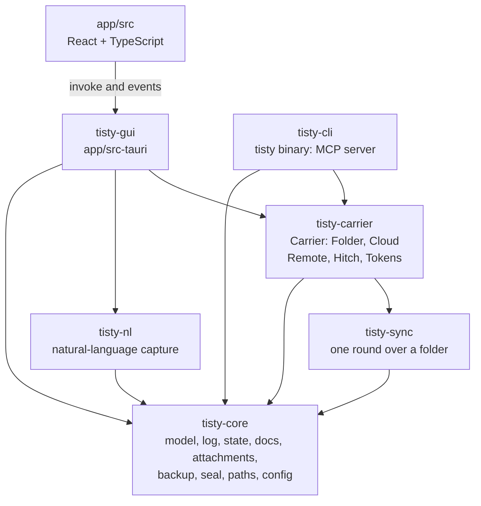
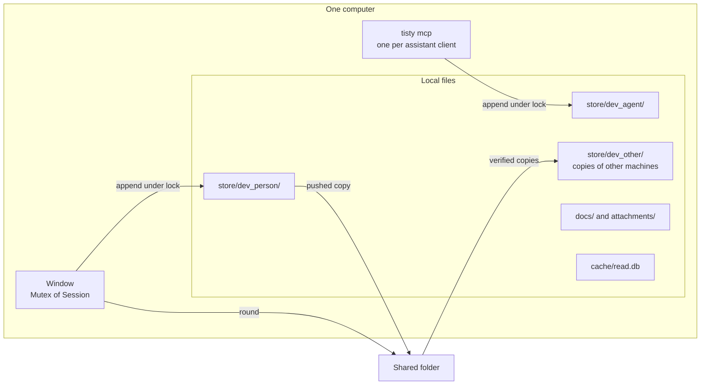
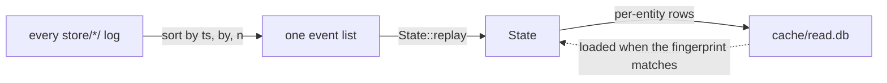
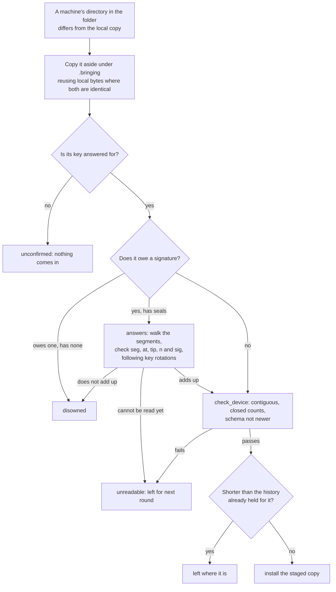
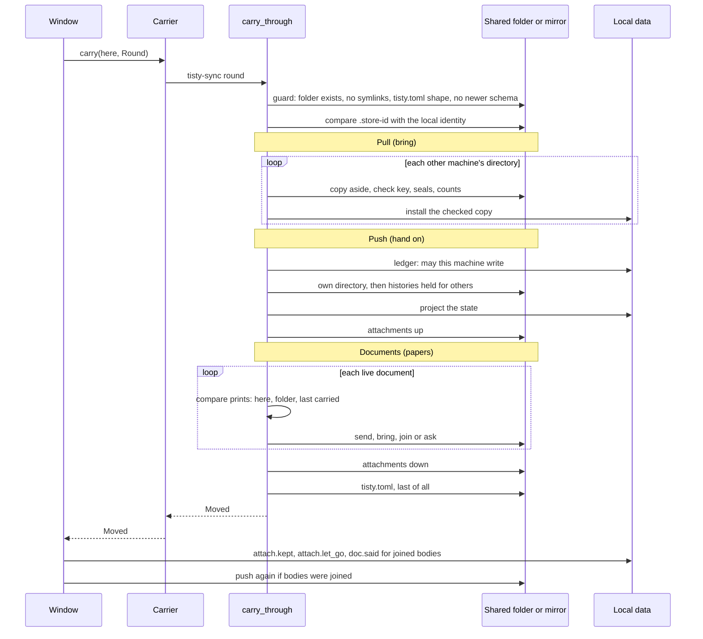
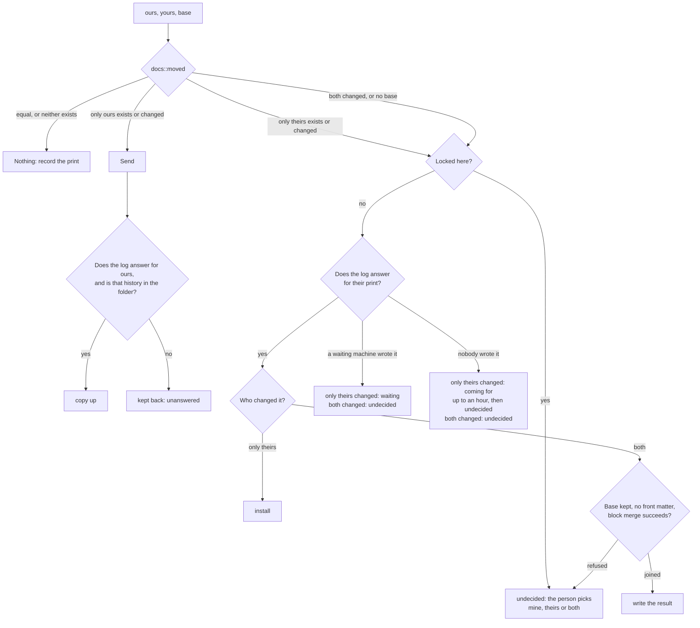
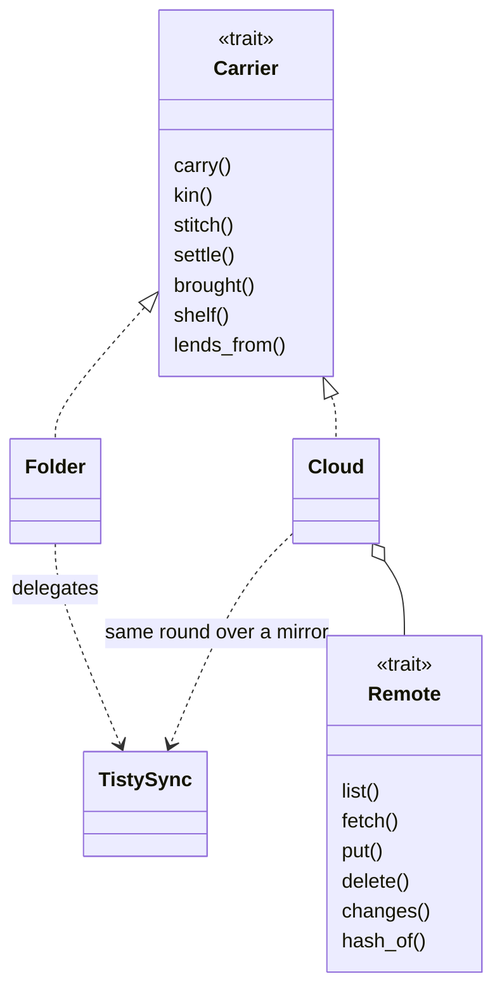
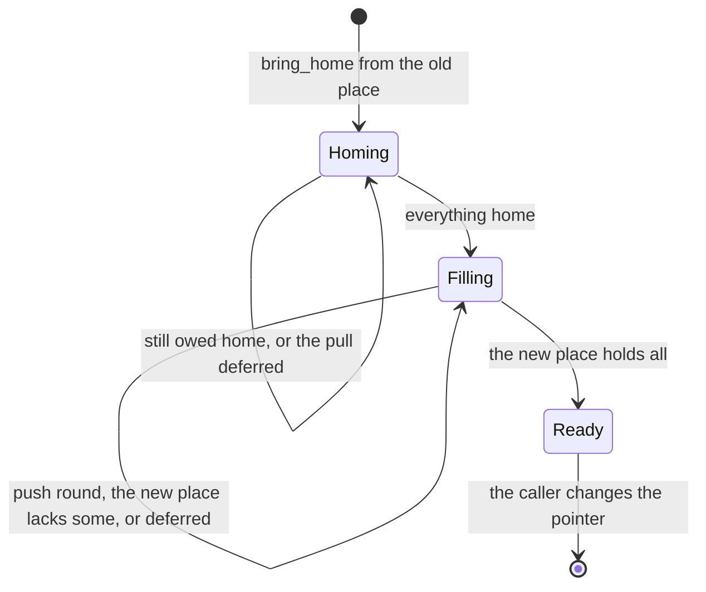
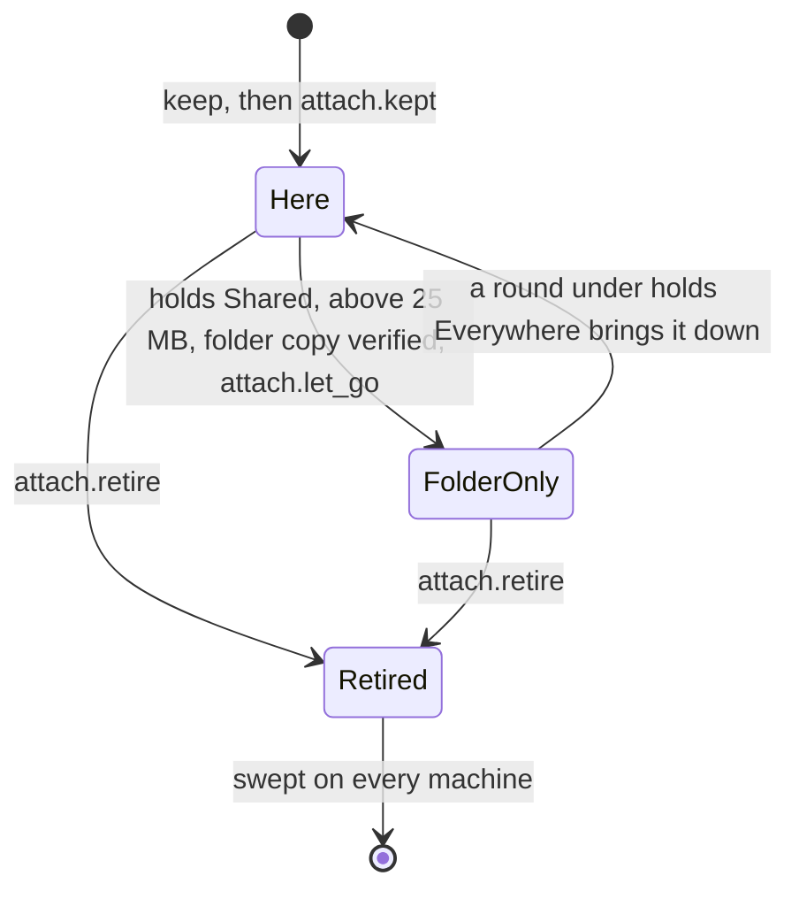
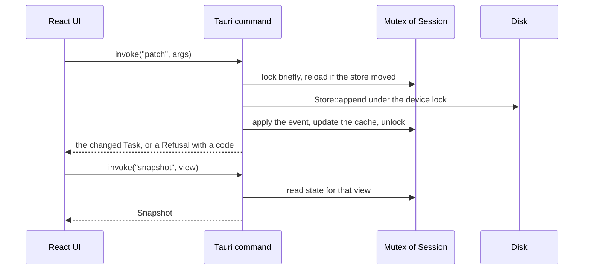

# Architecture

How Tisty is built and how it behaves, as the code stands. Identifiers are in
backticks so they can be searched for. Each fact is stated once, in the section
it belongs to.

## What Tisty is

Tisty is one person's task list and documents, kept on that person's own
computers. It has three faces over one core.

| Face | What it is |
|---|---|
| Window | `tisty-gui`: a Tauri 2 app, Rust backend and React/TypeScript front end, with a tray icon, a quick-capture window and reminders |
| `tisty` | The binary assistants start. It answers `tisty mcp` and `tisty --version` and nothing else, and the window bundles it as a sidecar |
| `tisty mcp` | An MCP server over stdin and stdout, so assistants on the machine can file work. It proposes; it never closes, drops or deletes |

Everything the person writes lives in plain files on that machine: a JSON-lines
event log for tasks, lists, folders and document metadata, Markdown files for
document bodies, ordinary files for attachments. There is no Tisty server and
no account.

Syncing between the person's computers is optional. The way that is wired is a
shared folder both computers can reach: a folder a cloud client keeps in step, a
NAS, an external drive. Tisty only reads and writes local paths there and does
not know which provider, if any, stands behind it.

Since 1.30 the person can also sync through Google Drive's API, chosen and
connected in the window only. The `Cloud` carrier, the `Remote` contract it
speaks and token renewal are tested against simulated Drive, OneDrive and
Dropbox providers, and `tisty_google::Drive` implements `Remote` for real. A
setting selects it (`Sync::Cloud`); a build without the Google client id and
secret offers no cloud at all.
*Carriers* says exactly what exists.

### Rules that hold everywhere

1. The log is the truth. State is what replaying every log produces, and the
   read cache is a disposable copy of that state.
2. Every log has one writer: the device whose directory holds it. Every other
   machine only copies it.
3. Logs only grow. A closed segment is never written again, and a deletion is
   an event like any other.
4. Every machine reads every log and sorts events by `(ts, by, n)`, so all of
   them reach the same state without talking to each other.
5. Nothing that arrives from outside (a shared folder, a backup, a parcel) is
   installed before it is checked, and the bytes installed are the bytes
   checked.
6. `tisty-core` never prints, and `tisty-core`, `tisty-sync` and
   `tisty-carrier` never panic (`scripts/rules.sh`). A failure is an `Err` that
   the caller shows.

## The big picture

### Crates and who depends on whom



| Crate | Role | Depends on |
|---|---|---|
| `tisty-core` | The model and everything that touches the person's data: `event`, `store`, `state`, `cache`, `docs`, `attach`, `parcel`, `backup`, `seal` and `signing`, `person` (who the person is for Tisty Share, and each machine's share key), `paths`, `config`, `merge`, `herald`, `witness` (the local log) | `tisty-markdown`, `tisty-share-proto` |
| `tisty-nl` | `parse` turns a sentence typed in the capture bar into a title plus date, deadline, priority, tags, list and repeat, in English and Spanish (`vocab.rs`) | `tisty-core` |
| `tisty-sync` | One sync round over a folder (`carry_through`): histories, document bodies, attachments; lineage (`kinship`, `stitch`); settling a document by hand | `tisty-core` |
| `tisty-carrier` | The `Carrier` contract and its two implementations, `Folder` (hands every call to `tisty-sync`) and `Cloud` (the same round over a local mirror of a `Remote`); `Remote`, `Hitch`, `Tokens` | `tisty-core`, `tisty-sync` |
| `tisty-cli` | The `tisty` binary: the MCP server and nothing else; any other command is refused and sends the person to the window | `tisty-core`, `tisty-carrier`, `tisty-markdown` |
| `tisty-gui` | Tauri commands (`answers/`), the `Session`, tray, reminders, updater, wiring settings of assistants | `tisty-core`, `tisty-carrier`, `tisty-nl` |
| `tisty-share-proto` | What the app and the Tisty Share server agree on: the seed a 24-word phrase holds, from which every key a person has comes under its own label (the root of their identity, the key of an encrypted cloud), the share key of each machine, certificates and revocations, signing and checking, the fingerprint, and the sealing of an encrypted cloud (a versioned stream of XChaCha20-Poly1305 blocks numbered in their nonces, which parcels share, bound to the store and to each file's name, with a mark that tells the right phrase, another phrase or a damaged mark apart before anything comes down). It builds for wasm without its `mint` feature, which the CI checks | external crates only |
| `app/src` | The React UI: `App.tsx` shell, `ui/` components, `core.ts` typed `invoke` wrappers, `locales.ts` | none; talks to `tisty-gui` over IPC |

Only `tisty-carrier` depends on `tisty-sync`. A rule in `scripts/rules.sh` keeps
the variants of `config::Sync` named in `config.rs` and in `chosen()` alone;
everything else asks the `Carrier` it was handed.

### Processes and how they share one store



The window writes as the person's device (`config.device_id`), in one
directory under one lock. The MCP server writes as a separate agent
device (`config.agent_id`) with a directory, a key and an undo history of its
own. Every process reads every directory.

Nothing keeps a lock across a session. Each lock is taken for one operation:

| Resource | Lock | Held for | Wait |
|---|---|---|---|
| `store/<device>/` | `.lock`, exclusive file lock (`Store::acquire`) | one append of one or more events | polls every 5 ms for 500 ms, then `Error::AlreadyRunning` |
| `docs/` | `docs/.lock` (`docs::hold`) | one body write, or one read-then-write (`append`, `edit`, `rewrite`) | 2 s, then the writer is refused; a sync round carries on unheld |
| A take-over | `<folder>/.taking-over.lock` | `backup::take_over` | none: `AlreadyRunning` |
| A cloud mirror | `round.lock` in the mirror home | one `Cloud` round | none for a round (it defers as busy); 5 s for foreground work |
| Token renewal | `renewing.lock` in the mirror home | one refresh across processes | 30 s |
| Window state | `Mutex<Session>` | one command; disk work grows with the store, so it runs off the lock | in process |
| Window rounds | `OneAtATime` flag | a sync round, backup, restore or free-up | `stillCarrying`, or 120 s for backup and restore |

How an append stays safe (`Store`):

1. It takes the device lock, then compares the active segment's length and
   modification time with what it last saw (`Mark`). If another process wrote,
   it reads the counters again, so `(ts, by, n)` stays unique across processes.
2. Time only moves forward: `stamp` never emits a stamp at or below the last
   one; when the clock stands still or steps back it raises `n` instead.
3. The events and the seal that answers for them are written in one append and
   one `fsync`. The read cache is updated after that, so a crash leaves the
   cache behind the log, never ahead of it.
4. A line is whole or absent. A half-written last line (a power cut) is set
   aside as `active.torn` when the store opens, behind the same lock, and the
   next write seals again over what remains. Damage anywhere but the tail fails
   the read instead of returning a shorter history.

### Network

`tisty-core`, `tisty-sync`, `tisty-nl`, `tisty-carrier` and `tisty-cli` contain
no network code; `deny.toml` lets `reqwest` be wrapped by the window,
`tisty-google`, `tisty-onedrive` and `tisty-webdav` alone, on every target the
release builds.
`tisty-gui` holds the version check and the updater (`update.rs`, limited to
GitHub hosts) and the preview of a link the person asks for (`glimpse.rs`).
`tisty-google`, which only the window depends on, holds Google's sign-in and
token renewal and the Drive `Remote`. The store lives in Drive's hidden `appDataFolder`
(`spaces=appDataFolder`); its id comes out of the same whole listing as every
file, as the one parent the listing does not hold, and Google's alias stands for
it until then. The space has no bin of Drive's, so a deletion against a revision
first moves the file into Tisty's own `.bin` folder there, which no listing
shows, reads it again and puts it back if another machine wrote meanwhile; only
then is it deleted for good, and what a deletion cut short leaves in `.bin` goes
an hour later. Drive has no conditional write, so a revision is checked
just before writing; two machines making one new file in that gap both land and
the mirror keeps the oldest, and a write over another machine's in that gap puts
the other bytes back on top from the file's revisions and is refused (*A write
in the gap*). The
window's content policy allows no connection but IPC (`tauri.conf.json`).

## The data model

### The event log

Each machine appends events to its own log, one JSON object per line.

```jsonl
{"v":17,"ts":"2026-08-06T22:22:18.006Z","by":"dev_a3f1c9d2","tz":"America/Santiago","op":"task.add","id":"01KZ…","d":{"title":"buy bread","order":"V"}}
```

| Field | Meaning |
|---|---|
| `v` | Schema version the event was written under |
| `ts` | UTC time of the write |
| `by` | Device that wrote it; must equal the directory that holds the line |
| `n` | Sequence within one stamp; absent when zero |
| `tx` | Groups the events of one user action (one undo takes the group back) |
| `un`, `re` | Written by an undo, or by a redo of one |
| `tz` | The zone the writer was in, so an hour reads back where it happened |
| `via` | The MCP client an assistant spoke through; a label, nothing decides on it |
| `opt` | A reader that does not know this operation may skip the line |
| `op`, `id`, `d` | The operation, the entity it affects, its payload |

| Family | Operations |
|---|---|
| Task | `task.add`, `task.update`, `task.done`, `task.reopen`, `task.drop`, `task.hide`, `task.show`, `task.delete`, `task.move`, `task.describe` |
| Task detail | `task.log`, `task.log.edit`, `task.step.add`, `.done`, `.undone`, `.text`, `.remove`, `.reorder`, `task.resolve`, `task.unresolve` |
| List | `list.add`, `.rename`, `.look`, `.archive`, `.unarchive`, `.delete` |
| Folder | `folder.add`, `.rename`, `.look`, `.move`, `.archive`, `.unarchive`, `.delete` |
| Document | `doc.add`, `.move`, `.said`, `.delete`, `.archive`, `.unarchive`, `.flag`, `.unflag`, `.lock`, `.unlock`, `.signed` |
| Person | `person.signed` (the alias documents are signed with) |
| Share | `share.key` (a machine's own word for the key it signs shared documents with), `share.certified` and `share.revoked` (the person's root vouching for that key, or taking it back) |
| Device | `device.join`, `.remove`, `.host`, `.key`, `.rotate`, `.named` |
| Attachment | `attach.kept`, `attach.let_go`, `attach.retire` |
| Store | `stores.joined` |

`KNOWN_OPS` lists every name. Payload details live in `event/op.rs`.

A history is a directory of segments:

```text
store/dev_a3f1c9d2/
├── 000001.tisty     closed segment, never written again
├── 000002.tisty
└── active.tisty     the only file this device appends to
```

`active.tisty` is closed as `NNNNNN.tisty` after 5,000 events
(`SEGMENT_MAX_EVENTS`). Closed segments are numbered from 1 without gaps. A
machine that cannot reach its signing key does not rotate: the live segment
grows past 5,000 until a write with the key seals and closes it.

### State is a replay



`State` (`state.rs`) holds what a reader needs:

| Part | Holds |
|---|---|
| `tasks` | `Task` per ULID: title, `Status` (`Open`, `Done`, `Dropped`), `Priority`, dates (`DateSpec`), reminders, `Repeat`, `after`, `part_of`, steps, journal (`LogEntry`), `hidden`, `source`, `read_as`, `open_to_agents`, `resolved` |
| `lists`, `folders` | Named, ordered, coloured containers. A task with no list is in the inbox. Folders nest `DEEPEST` = 4 levels, names up to 40 characters |
| `docs` | One `Kept` per document: file id, title, size, tags, `print`, `told` (print per device), author aliases, folder, `page_of`, `archived`, `locked`, `flagged`. Metadata only: the body is a file |
| `devices`, `agents`, `assistants`, `hosts`, `named`, `keys`, `dropped` | Machines and agent devices that joined or were removed, where each agent lives, the name each machine gave itself, the signing key each published |
| `signed`, `signed_before` | The alias documents are signed with, and the ones before it |
| `kept`, `holders`, `retired`, `shed` | Attachment digests and sizes by name, which machines hold each, names retired for everyone, document files whose document was deleted |
| `tombstones`, `sourced` | Ids that were deleted, and the `source` each task was filed from |
| `forebears` | Store identities merged into this one. Recorded; nothing consults it |

Priorities are stored as words: `do`, `decide`, `delegate`, `minor`, `unset`.
The window shows `decide` as Schedule. `minor` sorts after `unset`.

### Identity and order

- Every entity is a ULID (`Ulid::generate`), so two machines can create entities
  at once without agreeing on names.
- A device is `dev_` plus eight characters (`new_device_id`). The store itself
  has a ULID identity in `store/.store-id`.
- Documents are files named `<device>-NNNN.md`. Only the owning machine mints
  its numbers, and `docs/.spent-<device>` holds the highest one handed out, so a
  deleted document's name is never reused.
- Lists, folders, tasks, steps and documents are ordered by fractional keys in
  base 62 (`order.rs`). A move between two neighbours writes one key; a run that
  grows past 20 characters is dealt fresh keys.

### How replay decides

Merging happens in memory, on every read. Files are never merged.

- A field takes the value of the last event that sets it, by `(ts, by, n)`; a
  patch that sets `tags` or `reminders` replaces the whole list. Journal lines
  and steps accumulate instead, because each has its own id.
- An event about an id in `tombstones` is dropped, so an old edit arriving from
  a machine that was away cannot resurrect a deleted entity.
- A task is erased only if it is closed and reads as a trace (`Task::erasable`).
  A task the person converted to a story (`read_as = story`) survives a delete
  written elsewhere (`task_deleted`).
- `Reading` is derived: a task with `repeat` or `after` is a routine; otherwise
  the person's pin (`read_as`) wins; otherwise a task whose steps, links and
  written words weigh `STORY_AT` = 3 or more is a story, and the rest are
  traces.
- A part holds one level: a whole may not be a part, nothing that repeats may
  hold or be a part, and an assistant may hang a part only under a task it
  attends (`parts.rs`, `may_hold`). A move that breaks the rule is ignored on
  every machine alike.
- A folder move that would loop or pass `DEEPEST` is ignored. A page is a
  document with `page_of`; a page of a page stays a document.
- Whether a document is archived is derived (`held_away`): its own mark, or any
  folder above it, or its parent document.
- What an assistant's hand may do is judged here, not in the MCP server (see
  *The MCP server*).

### Repeating tasks and parts

A repeat is one task per occurrence. Finishing one writes `task.done` and the
next `task.add` (linked by `after`) in one batch, so one undo takes both back.
`Repeat` carries `from` (`Due` counts from the calendar, `Done` from the
doing), a `Cadence` (`every`, `Unit`) and an optional `until`. Nothing is
created ahead of time: there is no scheduler, so a skipped day leaves exactly one
overdue task.

A task can hold parts (`part_of`), each a whole task with its own steps and
journal. Finishing a whole with open parts drops them and closes it in one
transaction (`State::completing`).

### Schema and what a reader does with a newer one

`SCHEMA_VERSION` is 17. `SIGNED_FROM` is 16: a history with a line at that
version or above owes a signature. `SEALED_FROM` is 17: a `seal` line is
recognised from that version.

| Situation | Behaviour |
|---|---|
| A line with `v` above the build's schema | The read fails with `UnsupportedVersion`, unless the line has `opt` and its operation name is unknown to the build, in which case it is skipped and counted |
| A known operation that fails to parse | The read fails: corruption, whatever `opt` says |
| This build's own live segment holds a newer line | `Store` refuses to append (`UnsupportedVersion`) |
| Another machine's newest line is above this build | A sync round refuses in both directions (`Trouble::Newer`) |
| Window or MCP server meets the refusal | The window tells the person to update (`storeNewer`, and a dialog at start that links to where this copy is updated from); `tisty mcp` prints `store-newer` |

`opt` is set by `Store::minted` from `Op::is_optional`: `person.signed`,
`device.host`, `device.named`, `doc.flag`, `doc.unflag`, `share.*`. Mark only
an operation that adds something to look at. A reader that skips a line that
changes what exists diverges in silence. The mark is honoured only when the
operation name is unknown, so it reaches only builds that have never heard of
the name.

The read cache is tied to the schema (`SCHEMA = SCHEMA_VERSION + 18` in
`cache.rs`), so a build with another schema misses the cache and meets the
version guard.

### What a read refuses

`store::read_all` fails, rather than returning a smaller history, when:

- a closed segment is missing from the sequence, or is empty;
- a closed segment does not end in the seal that closes it, or holds a
  different number of events from the count that seal declares;
- a line does not parse, or declares a newer schema.

An event whose `by` differs from the directory that holds it is dropped with a
warning, because every rule keyed on the device would otherwise take a forged
name at its word.

### The read cache

`<cache>/read.db` (SQLite, WAL) holds the projected state: tables `task`,
`task_body`, `list`, `folder`, `doc`, `tombstone`, `kept`, `holder`, plus `meta`
(identity sets), `paper` (a card per document, see *Search*) and `gist`
(assistants' summaries).

- Freshness is a fingerprint: the name and size of every `*.tisty` file. If it
  matches, the state loads from the cache. If one segment only grew,
  `caught_up` applies just its new tail. Otherwise the log is replayed and the
  cache rewritten.
- After a write the cache is updated one entity at a time (`advance`). Events
  that reach beyond their own entity (deleting a list, folder or document,
  archiving, locking, moving a page between documents, any `device.*`,
  `attach.*`, `person.signed`, `share.*`) invalidate it instead.
- Any failure opening or reading it falls back to the log. It is never
  synced and never backed up.

The review in Settings › Maintenance (`checked`) replays the log and compares
it with the cache (`cache::audit`): absent, stale, in agreement, or wrong.
Rebuilding there (`rebuild`) discards the cache. With a cloud chosen, the
window also shows what this disk knows of it, with no request and no keychain
(`tisty_carrier::standing`): what waits, today's spend against the day's
limits, a pause here or from afar, and how the last round ended.

## On disk

`<data>`, `<config>` and `<cache>` come from `Paths::resolve`:

| | Linux | macOS | Windows |
|---|---|---|---|
| `<data>` | `~/.local/share/tisty` | `~/Library/Application Support/tisty` | `%USERPROFILE%\.tisty\data` |
| `<config>` | `~/.config/tisty` | `~/Library/Application Support/tisty/config` | `%USERPROFILE%\.tisty\config` |
| `<cache>` | `~/.cache/tisty` | `~/Library/Caches/tisty` | `%USERPROFILE%\.tisty\cache` |

`TISTY_DATA`, `TISTY_CONFIG` and `TISTY_CACHE` override each root.
`TISTY_PROFILE=<name>` moves all three under `sandboxes/<name>` and turns off
the single-instance guard; only debug builds read it, so a release keeps one
home. On Windows the packaged (Store) app's `AppData` is a
private copy that Windows deletes on uninstall, so the roots live under the
profile's `.tisty`; the window moves a store it finds under
`%LOCALAPPDATA%\tisty` there on its first start (see *Backup, restore, moving
the data home*) and sets the folder hidden and private to the account.

| Path | Holds | In sync | In a backup |
|---|---|---|---|
| `<data>/store/<device>/active.tisty`, `NNNNNN.tisty` | One machine's event log | yes, each machine's own directory is pushed and the others pulled | yes |
| `<data>/store/<device>/.lock` | Write lock | no | no |
| `<data>/store/<device>/active.torn` | A torn tail set aside | no; it is the one sibling of a segment, besides the lock, that stays (every other travels, known or not) | yes |
| `<data>/store/.store-id` | The store's identity (a ULID) | yes | yes |
| `<data>/docs/<device>-NNNN.md` | Document bodies | yes, by three prints and no clock | yes |
| `<data>/docs/.lock`, `.spent-<device>` | Body lock; highest name handed out | no | lock no, `.spent-*` yes |
| `<data>/attachments/<shelf>/<name>` | Attachment bytes | yes, subject to `Holds` | yes |
| `<data>/attachments.jsonl` | Local ledger: name to digest and size | no | no |
| `<data>/bin/`, `bin.jsonl` | Retired attachments, kept 30 days | no | no |
| `<data>/originals/<id>.md`, `originals-at/<id>.md` | The body before the last replacing write, and the print it was set aside against | no | `originals/` yes |
| `<data>/carried.json`, `carried/` | Last print carried per document, and the merge base | no | no |
| `<data>/prints.json` | Body prints keyed by path, size and time | no | no |
| `<data>/awaited` | When a body was first seen without its history | no | no |
| `<data>/.keys-confirmed` | Keys a person answered for | no | no |
| `<data>/.turned-away` | Machines the last round turned away, and why | no | no |
| `<data>/.verified-to`, `.shape-seen` | How far each history was checked; folder shapes met | no | no |
| `<data>/.bringing/` | Scratch copies of a round, swept a day later | no | no |
| `<data>/used.json` | When each attachment was last opened or shown, and since when that is counted (`*`); the measure freeing space goes by. Unreadable, it is set aside and begun again, so it frees nothing | no | no |
| `<config>/config.toml` | Settings and this machine's `device_id` | never | never |
| `<config>/private/<device>.device-key` | Ed25519 signing key (32 bytes) | never | never |
| `<config>/private/<store-id>.store-key` | The secret that seals parcels | never | never |
| `<config>/private/tisty.log` | The local log (rolls at 256 KiB to `tisty.log.1`) | never | never |
| `<config>/cloud/<provider>-<account>-<hash>/` | Where `Paths::cloud_home` puts a cloud carrier's mirror, index, caches and how its last round ended | never | never |
| `<cache>/read.db` | The read cache | never | never |
| `<cache>/vouched.json`, `glimpses/` | Digests of shared-folder attachments; link previews | never | never |
| `<cache>/carried-to`, `adopting` | Memo that this machine has been to a folder; machines to take up | never | never |

The shared folder (`<shared>`) holds:

```text
<shared>/tisty.toml          shape = 1, and the folders that shape has
├── store/                   .store-id and one directory per machine
├── attachments/<shelf>/
└── docs/
```

Tisty writes into the store on its own in two cases only: the example lists of
a first run (`model::sown`), held back until the welcome has said where the
copies go, and the guide, a document with its pages and images that the welcome
writes in the person's language from text compiled into the program. After that
they are ordinary lists and documents, deletable like any other.

The configuration never syncs. If two machines shared a `device_id` they would
write one directory and every guarantee here would stop holding. `Config::rest`
keeps keys this build has no name for, so a build never erases what a newer one
wrote. `config::Sync` is `Local`, `Folder(path)` or `Unknown`, which keeps a way
chosen by a newer build untouched: commands that need a carrier then refuse with
`syncLater`, and leaving it is refused (`syncLaterToLeave`). If the file on disk
cannot be read, nothing is written over it (`settingsUnreadable`).

`Config::inst` is a digest of the operating system's machine id (`machine.rs`).
When it differs from the stored one, the configuration was copied from another
computer: a computer seen before takes back its device id (`homes`); a new one
derives a new device id, joins as a new machine, and leaves its agent off.

## Integrity

### Signing and seals

Each machine and each agent device has an Ed25519 key in
`<config>/private/<device>.device-key` (`signing::mine`). The public key is
published in the log (`device.join` with `p`, or `device.key`). Only a machine's
own word for its own key counts, and the first key it publishes stands.

Every append by a machine that can reach its key ends with a seal, in the same
write and `fsync`:

```json
{"v":17,"op":"seal","seg":3,"at":40960,"tip":"…","n":212,"sig":"…"}
```

| Field | Covers |
|---|---|
| `seg` | The segment's number, not its file name, so renaming `active.tisty` to `000003.tisty` changes nothing |
| `at` | How many bytes of the segment come before the seal |
| `tip` | SHA-256 chain folded line by line over this machine's whole history up to the seal, earlier seals included |
| `n` | How many events the segment holds |
| `closed` | `true` on the seal that closes a segment |
| `sig` | Ed25519 over the exact bytes of the line up to `,"sig":"`, with the context `tisty.seal` and the device name |

A reader checks the bytes it holds and never re-serialises them. Fields a seal
does not know are ignored by readers and signed by writers that add them. A seal
never carries `opt`: a seal that cannot be read must stop whoever meets it.
Bytes after the last seal are on their way, not tampering.

Segments written before seals have a `.sig` file beside them, still read until a
seal follows them; a segment that has a seal never needs one.

A key can move on the word of the old key: `device.rotate`, sealed by the old
key, after which only the new key seals. The format is read and honoured; no
command writes it.

### Which machines are believed

A key is a claim until someone here answers for it. `<data>/.keys-confirmed`
records what a person accepted, apart from the log, which only records what a
machine claims.

| Case | Rule |
|---|---|
| The person compares the 20-digit code (`signing::spoken`) in the window and confirms it | The key stands |
| First folder this machine takes up, while it has confirmed nobody else | Machines already writing in it are confirmed without asking |
| A machine this store held from before it signed (`store::before`) | Its first key is taken once, if the folder's copy begins with the local copy byte for byte and verifies under that key; kept as `carried` |
| An agent whose host this machine confirmed | The host's own `device.host` carries the agent's key, and the agent joined as an agent under that key; kept as `host:<device>` |
| A rotation sealed by a confirmed key | The new key stands; kept as `rotated:<old key>` |
| Anything else | The machine's history is not brought in. The round reports it (`unconfirmed`) and the window shows its key to compare |

What a history owes (`owes_a_signature`): a signature, when any of its lines is
at `SIGNED_FROM` or above, or it says a key of its own, or a person confirmed it,
or this machine has seen it sign. A history that owes one and arrives with none
is disowned. A signed history whose keys do not read waits; it is never taken in
unchecked.

Removing a machine (`device.remove`) is the one privileged act. A machine that
joins by finding the folder needs no permission, but only machines on the list
write there: `Ledger::may_write` refuses one that was removed.

### Verifying a history on arrival



The checked copy is what is installed: whoever can write in the folder cannot
change a file between the check and the copy. A history with nothing new is not
copied at all. Round scratch lives in `<data>/.bringing/<pid>-<stamp>`, one per
round, so two rounds never touch each other's.

`answers` memoises how far a machine's history was verified (`.verified-to`,
per folder and device), so a round checks only what follows. What it cannot
catch is a whole segment rolled back together with the seal that answered for it
then; the next closed segment's chain runs through the rolled-back one, so only
the segment nothing follows yet is exposed.

### Attachments and bodies

- An attachment's name vouches for its bytes: `attachments/<shelf>/<slug>-<stamp>.<ext>`,
  where `shelf` is the first two hex digits of the SHA-256 and `stamp` the next
  eight (sixteen if two files collide on eight). `attach::vouched` checks both.
  Names are lowercase; a name in capitals vouches for nothing, so a drive that
  folds case never holds two spellings.
- When the log knows the full digest (`attach.kept` is projected into
  `State::kept`, and `attachments.jsonl` holds the local ledger), the whole
  digest must match (`attach::as_kept`). An attachment no machine ever brought
  home has no digest in the log; Maintenance lists those (*Attachments with no
  print*) and writes the digest down on request.
- A document body is answered for by its print: the SHA-256 of the settled body
  (`attach::printed`, final newline included), carried in `doc.said` and in
  `State`'s `Kept::print` and `told`. A body is installed from the folder only
  when the log answers for its print, or it waits (see *Documents in the
  round*).
- Digests computed for files in a shared folder are remembered in
  `vouched.json`, keyed by path, size, modification time to the nanosecond and
  the time the system last changed the file, so reading half a gigabyte happens
  once per file.
- A body or attachment left in the cloud as a placeholder (iCloud sidecar, a
  Windows or macOS dataless file) is never hashed to vouch for it: `holes.rs`
  detects it by metadata, asks the cloud to bring it down, and the round reports
  it as `coming`.

## The sync round

One round is `tisty_sync::carry_through`. A `Way` picks the direction: `Both`,
`Push`, `Pull` or `Again` (send everything of ours, skipping nothing).



| Stage | What happens | Where |
|---|---|---|
| Guard | The folder must be a directory with no symlink on the way to `store`, `attachments` or `docs`; no other machine may write a newer schema; `tisty.toml` is read first (a shape above 1, or one that said its shape and now says nothing, stops the round) | `guarding.rs`, `shape.rs` |
| Identity | A machine that never wrote adopts the folder's `.store-id`; two named stores that differ are refused (`OtherStore`); a folder that holds history but no `.store-id` is `WouldReset` | `settled` |
| Pull | Each directory of the folder other than this machine's own, verified and installed as in *Verifying a history on arrival*. Names that no machine could have are left alone. A directory still arriving from the cloud waits (`coming`). This machine's own directory is taken back only if the folder holds strictly more of it | `bringing.rs` |
| Push | Allowed only if the ledger lets this machine write. `.store-id` is written if it differs, the own directory is copied, and histories held for other machines are handed on when ours reaches further than the folder's | `segments.rs` |
| Attachments up | Everything the log has not retired, whose bytes match name and digest; with `Holds::Shared`, a copy above 25 MB is then released locally once the folder's copy is verified | `held.rs`, `attachments.rs` |
| Documents | One decision per live document (next section) | `papers.rs` |
| Attachments down | Files in the folder shaped like an attachment, not retired, not above the 25 MB line unless `Holds::Everywhere`, and, when the folder holds files no log claims, only those a task or document names. Bytes are checked against the name and digest before the rename | `held.rs` |
| Stamp | `tisty.toml` is written last, only if it is missing or says less than this build knows; finding it is finding a round that finished | `shape::stamp` |
| Outside a round | Whatever reads or writes the folder outside a round (`stitch`, `settle`, `both_papers`, `let_go`, `forget_paper`, leaving word) first asks `shape::refuses`: a later `needs`, a shape above ours or an unreadable `tisty.toml` stops it. Rewriting `tisty.toml` keeps every line this build does not write, so what a later build asked of every machine survives | `shape.rs` |

Files already identical are skipped. Identical means the same length and then
the same bytes, 16 KiB at a time (`segments::same`), never the same date.

What a round reports (`Moved`):

| Field | Meaning |
|---|---|
| `sent`, `brought` | Files copied up and down |
| `freed`, `let_go` | Bytes and names of local copies released because the folder holds a verified one |
| `took_in` | Attachments brought home; the window writes `attach.kept` for them |
| `arrived` | Bodies installed here; the window re-reads them to settle page order |
| `joined` | Bodies joined without asking |
| `unanswered` | Bodies of ours kept back until a `doc.said` with their print is written |
| `undecided` | Documents changed on both sides that could not be joined; the person chooses |
| `coming` | On its way: a cloud placeholder, a history still arriving, a body waiting for its history |
| `waiting` | A body that a machine still waiting for confirmation answers for |
| `astray` | A document that could not be read, or is a symlink |
| `unreadable`, `disowned`, `unconfirmed` | Machines whose history was left out this turn, and why |
| `unsaid` | Taken in while adopting, before that machine said its key |
| `unprojected` | The store would not project, so no body or attachment moved |
| `deferred` | A `Cloud` round stopped early: `Deferred { reason, left, retry_after }`, `Reason` being `Limit`, `Budget`, `Busy`, `Offline` or `Changed` |
| `refused` | A `Trouble` raised after part of a cloud round already went up |

A round refuses with a `Trouble`: `NotThere`, `OtherStore`, `WouldReset`,
`SameName` (one device name wrote different things on both sides), `NotAllowed`
(this machine was removed), `Emptied` (the folder was emptied after this machine
carried to it), `Newer`, `Shape`, `Unshaped`, `Unreadable`, `Refused`, `Broke`.
The window maps each to a refusal code.

During a round `Reached` events report progress (`Log`, `Papers`,
`Along { stage, done, whole }`, `Kept`). The window forwards them as `carried`
and `bringing` events at most every 250 ms, and writes `attach.kept` for
attachments in handfuls, so a round that is cut short still records what it
brought.

### Guarantees

- Local writes win. A round holds no store lock while it reads or copies, so
  writing goes on during it. Of the histories it writes only other machines'
  directories here (it takes this machine's own back only when the folder holds
  strictly more of it), and a body changed here and in the folder is joined
  block by block or put to the person, never overwritten. A copy caught in the
  middle of an append has bytes after its last seal, which read as on their way
  and not as tampering.
- Nothing is installed unchecked: histories are verified from a private copy and
  that copy is what lands; a body is read again and printed as read before it is
  installed; an attachment must hold the bytes its name vouches for.
- A body never travels before the history that answers for it. A body the log
  does not answer for stays out, and one that arrives first waits up to an hour
  (`awaited::LANDING`, counted on this machine's clock) before the person is
  asked.
- A history that arrives shorter than the one already held for that machine is
  left where it is, and this machine's own history is never pushed over a
  longer copy the folder holds of it (after a restore to an earlier point, say).
  Histories held for another machine are handed on only when ours reaches
  further; one that cannot be handed on is said in the log, and the bodies only
  it answers for wait here in `coming`.
- Each directory has exactly one writer, so two machines cannot produce
  conflicting files: pushing writes only your own directory, pulling writes
  only the others'.
- Whatever is in the folder is treated as someone else's writing: nothing is
  written through a symlink, a body past the reader's ceiling is refused, a
  retired attachment is not carried back in.

### Documents in the round

Document bodies travel by three prints and no clock: `ours` (the file here),
`yours` (the file in the folder) and `base` (`Carried`, the print this machine
last carried to that folder). `Carried` names the folder it belongs to by
volume and inode first and by path second; pointing Tisty at another folder
drops it.



The log answers for a print when it is the newest one a history wrote, or one
another machine wrote earlier, or when the log holds no print for the document
at all; in the last two cases the body here is set aside in `originals/` before
the incoming one replaces or joins it (`Answer::Doubtful`). A print only a
machine still waiting for confirmation wrote waits for that machine.

The merge (`merge::merged`) is three-way over blocks, the text between blank
lines; a table or list is one block, fenced code keeps its blank lines. Edits
that do not overlap are both taken. It refuses, and the person is asked, when
both sides rewrote the same block differently, when the comparison would need
more than 16 million cells, when the result would hold a block more times than
either side has it or fewer than both kept, when the woven text would not split
back into the same blocks or would put two lists side by side, or when a
document has YAML front matter. A joined result that would name an attachment
nobody can reach is also refused. Line endings are normalised on the way out so
prints agree.

Settling by hand (`settle`, `Keep::{Mine, Theirs, Both}`): mine is refused if
the folder moved since the person was asked. Both writes what arrived as a
second document beside the first, unless it equals the text here or an
identical document already sits there, so asking again never piles up twins.
The window can also show the conflict as `Rift`s (`was`, `mine`, `theirs`) and
weave the answer block by block (`paper_rifts`, `weave_paper`).

Bodies are written under the document lock per document, not per round, so a
long round never keeps the editor from saving.

### Joining two histories

A folder whose `.store-id` differs from the local one is refused before
anything moves. `kinship` compares each directory present on both sides as the
ordered concatenation of its segments: one side must be a prefix of the other.

| `Kin` | Meaning | What the person is offered |
|---|---|---|
| `SameLineage` | For every directory on both sides, one is a prefix of the other | Adopt the folder's name with nothing lost (`stitch` writes only the marker) |
| `Strangers` | No device name appears on both sides | Three choices, each backing up first |
| `Clash` | A device name appears on both sides holding different bytes, or an id survives only in a `device.remove` | Nothing: two writers under one name is the one thing the design forbids (`SameName`) |
| `Unsure` | A file could not be read | Nothing until it can be |

The three choices: join them (`backup::reset`: back this machine up, empty it,
take the folder's with a new device id), take over (`backup::take_over`: back
the folder up, empty it, leave ours), merge (`stitch`: hold both). A merge
writes `stores.joined` before it takes the folder's name, so an interruption
leaves the question to come back.
After a merge, lists with the same name become one (`doubled.rs`) and the guide
each side brought stays once.

## Carriers



`chosen_with(Option<&Sync>, Option<&dyn Reach>) -> Keeping` is the one place a
carrier is built from settings: `Local` and no setting give no carrier
(`Chosen::Alone`), `Folder` gives a `Folder`, `Cloud` gives `Chosen::Cloud` and
whatever the `Reach` builds, `Unknown` gives none and `Chosen::Later`. Only the
window has a `Reach` (`reaching.rs`): `chosen(sync)` is `chosen_with(sync, None)`,
so the agents see a chosen cloud and never reach the network. A build without
Google's ids builds nothing and the window says so (`cloudNotOffered`).
`Reaching` keeps the carrier it built for an account, so Drive's listing
outlives a command. A `Sync::Cloud` names the
provider, the provider's id for the account and its address; one named any
other way is a later build's and is kept whole as `Unknown`. Leaving a cloud is
never a choice of another way (`Leaving::Cloud`): it goes through the move that
first brings everything here. `considering(path)`
builds a `Folder` for a folder only being considered. A carrier is shared as
`Arc<dyn Carrier>` and its methods take `&self`; one that keeps tokens, cursors
or counters keeps them behind interior mutability.

`Here { data, aside, device }` is what the caller supplies: the data root, the
cache directory (where memos live) and this machine's device id.

| `Carrier` method | Meaning |
|---|---|
| `carry(here, Round)` | One round: `Round { way, alive, holds, saying }` returns `Moved` |
| `place`, `reachable` | The folder's local path (none for the cloud) and whether it can be reached |
| `theirs`, `been_here` | The `.store-id` found there; whether this machine completed a round there before |
| `kin`, `stitch` | Compare lineages; merge them |
| `signed`, `unclaimed`, `stirring` | The alias in the histories there; files there no log claims; a cheap mark that changes when something there moved |
| `let_go` | Release local copies of large attachments that verifiably live there |
| `lends_from`, `brought` | The directory outside the store the window may serve attachments from (the folder's; none for the cloud); fetch one attachment on demand (`Brought::{At, Unvouched, Absent, Later}`). The window serves from `lends_from` and looks for attachments itself (`finding.rs`); only with a place that `frees_space` does it call `brought` for one that is not here, without the `#` or `?` a link may carry, and it writes `AttachKept` for one that came back `Unvouched` once the work is done (`finding::fetched`); when that write fails the copy is removed, so the next open tries again. `Later` reads as `cloudLater`. With such a place, a size the disk cannot answer comes from the log, so one let go of here is never shown as lost, and a page is held to its ceiling before it is fetched. The window asks for one attachment once at a time and not again for a minute after a refusal (`inUse.ts::serve`), so an editor redrawing never fetches the same file twice |
| `frees_space` | True for the cloud: every attachment stays here once opened, so the window hides «Where large attachments stay» and Maintenance offers to free space (`unused_attachments`, `free_space`, 30, 60 or 90 days, `answers/freeing.rs`, which also holds `free_up`: both let go through one helper that says how far it got every 250 ms). The estimate reads no bytes; only letting go compares the provider's hash |
| `bring_home` | A pull round that brings home every attachment the place holds, within the budget, whatever `holds` says; what a move out of a place runs. It sends nothing up, so a full place never keeps anyone in it. For a folder it is a pull round |
| `could_free`, `set_free` | What freeing space would let go of, and letting go of it: local copies of attachments unused since a moment, that the place holds with the same size and provider's hash (a provider that gives no hash frees nothing). Answered as `LetGo`, like `let_go`, so the caller writes `AttachLetGo` for each. Only the cloud frees anything; a folder answers nothing |
| `shelf` | Every attachment the place holds, with its size, read once; `None` when it cannot tell (a folder out of reach, a cloud not yet listed) |
| `paper_waiting`, `paper_print`, `both_papers`, `settle`, `forget_paper` | Look at, compare, settle and delete one document's body there |
| `leave_word`, `word_left`, `forget_word` | `moved.json` in the place: the word a machine leaves when it stops syncing there. A folder keeps it as a file; the cloud mirrors it and takes it down by name |

**Changing the way of syncing** (`answers/storing.rs::changed_to`, `leaving.rs`).
Before any change, tasks and documents as they are on this disk are kept in
`<config>/private/before-a-change/` (`backup::before_a_change`: `store`, `docs`
and `originals`, the last five), and the change is refused when they cannot
be. Nothing is brought down to keep them. The place left behind then gets a
word signed with this machine's key (`tisty_core::moved`): who left, where to
and when. A place out of reach is owed it (`<cache>/word-owed.json`) and gets
it at the start of the next round that reaches it. A machine still there
heeds a word only from another machine whose key the person confirmed here,
and then stops before writing alone (`movedAway`, `movedAlone`); a word it
cannot vouch for is logged and ignored, so writing a file in a shared folder
cannot stop anyone. Choosing a place again takes its word away, and the same
cloud account under a new address is the same place. Leaving the cloud is
never this change: it goes through the move, which brings everything home
first.

### `Folder`

`Folder` hands every call to `tisty-sync`. It is the carrier for a folder a
cloud client keeps in step, a NAS or a drive. The window offers the folders that
Google Drive (My Drive only), OneDrive, iCloud and Dropbox keep on this machine
(`keepers::offers`), and any other folder can be chosen by path.

### `Cloud`

`Cloud::over(remote, home)` runs the same round over a local mirror of a
provider's files. It implements `Carrier`, and the window builds it when the
settings name a cloud.

| Piece | Behaviour |
|---|---|
| Mirror | `<home>/tree/` mirrors `tisty.toml`, `store/` and `docs/` only. A name the round does not read is neither fetched nor deleted. Files above 64 MiB are not mirrored |
| Index | `index.json`: the change cursor, whether `tisty.toml` was seen or put (`confirmed`), per mirrored name the revision, length, time and digest of the copy, and per attachment up there what the provider reported (`Seen`) |
| Round | `with_mirror`: take `round.lock`, pull (apply `Remote::changes` since the cursor, download what changed into a `.part` and rename), run `carry_through` over the mirror, then push. The pull brings `tisty.toml` first and asks `shape::refuses` before anything else comes down; a place a later Tisty raised stops it as `Hitch::Barred` with the cursor unmoved, so no round, read or word left touches what that build wrote |
| Push order | History first, then documents, `tisty.toml` last. A document file missing from the mirror while `docs/` stands is read as a deletion and deleted up there against the revision last seen; anything else missing from the mirror is fetched again |
| Attachments | Not mirrored: `Shelf` implements `Attachments` and talks to the `Remote` directly, putting with `Expect::Absent` and checking the landed size and hash. A round sends attachments up and never brings one down nor lets go of a copy here, whatever `holds` says: the cloud is where other machines fetch from, not where a copy lives instead of here. Only `bring_home` brings them all down |
| Verification | Downloads are checked against the provider's hash and length before they count; the round then installs exactly what it checked |
| Pull failures | A cursor the provider no longer knows is dropped and the place read whole. A file that comes short or fails its hash is held back alone, for the next round, and the round says so as deferred (`Changed`) |
| Polling | `stirring` asks for changes at most once per `Limits::poll_every`, stretches the wait to four intervals while nothing moves and returns to one when something does; a revision the index already holds (this machine's own upload) is not a change. It waits at least a `Limited`'s `wait` and asks again if the clock went back. State is in `stirring.json` because every command builds its carrier anew. Drive keeps, for each cursor its listing reached, the paths that moved to reach it, so the round asking from the cursor a poll already passed hears every change and deletion again, and Drive is asked only onward. `hears` hands out the provider's own `Watch` when it can push (Dropbox's longpoll) and otherwise `cloud/asking.rs`, which waits for the same `stirring.json` pace and says `told` when the mark moves, so the window's glance and its listening never ask twice. Drive cannot push to a desktop: `changes.watch` needs a public HTTPS address and Tisty keeps none |
| Budget | `cloud/budget.rs`: every request goes through `Metered`, which charges the provider's `Costs` and the bytes brought down to `budget.json` under `budget.lock`, started again each UTC day. History may spend all of `units_a_day` and `bytes_a_day`; attachments (sending them, and `bring_home`) stop at nine tenths; what is opened by hand (`brought`) always goes and is counted |
| `cloud.json` | `cloud/policy.rs`: a word from the maintainer, signed with minisign by a key kept off CI and checked on the raw bytes before any field is read (at most 16 KB). It may lower `units_a_day` and `bytes_a_day` freely and raise them to twice what the build ships with, never further; the newest `serial` is kept in `cloud-policy.json` for good and an older one is refused as a replay. `halted_until` pauses every cloud request, by hand too, while its date is ahead and no more than a week out, so a lost word cannot stop Tisty for good. The fields at the top are what 1.30 reads, so they speak to Google alone; a `providers` map gives each provider (`google`, `onedrive`) its own `units_a_day`, `bytes_a_day` or `halted_until`, over the top for Google and on their own for any other, so a word meant for one provider never reaches another. What is kept in `cloud-policy.json` is already the word as that cloud's provider hears it. A `paused-here` file is the person's own switch for this machine. Both raise `Hitch::Paused`. The window fetches `cloud.json` and its `.sig` from the `manifest` branch before a round, at most once an hour and only while a cloud is chosen, with no redirect followed and no more than 16 KB read (`reaching::heed`); the public key is fixed when the release is built (`TISTY_CLOUD_POLICY_KEY`), and a build without it keeps the limits it ships with |
| Deferral | `Hitch::Limited` pauses with `Reason::Limit` and its `wait`; `Spent` pauses with `Reason::Budget`; `Paused` with `Reason::Paused`; `Unreachable` with `Offline`; a busy `round.lock` with `Busy`. A deferred round has written everything locally, lost nothing and asks nothing of the person. It names, up to `NAMED_AT_MOST`, the attachments it left; the rest of what waits is counted |
| Refusal | `Hitch::Full`, `Lost` and `Elsewhere { found }` stop the round as `Trouble::CloudFull`, `CloudLost` and `CloudElsewhere`, each naming the provider (`Limits::provider`) so the person is told it is the provider that refuses. `Missing`, `Changed` and `Broke` stop it as `Trouble::Broke` |
| Bringing | Opening an attachment that is not here: one buried (retired and named by nothing) is `Absent`. `brought` serves the copy here first; an attachment the last listing did not show is `Later`, never asked of the provider; otherwise it is fetched straight into this machine's `attachments/`, held to its name and the log's full digest, written in the ledger and kept, so it plays from the disk from then on. One the log does not answer for yet is held to its name and the ledger and handed back as `Unvouched`, so the caller writes its `AttachKept`. Bytes refused for what they hold (not a disk that failed to take them) are remembered by revision in `index.json` (`spoiled`): not fetched again, refused at once when opened, not counted as held there so they never stall a move, and written over by a genuine copy when this machine sends one |
| Freeing space | `set_free` lets go of copies here neither opened nor shown (`<data>/used.json`, which the window writes, again each day a picture stays on screen) nor attached or brought in (the latest `AttachKept` in the log) since the chosen moment, nor since `used.json` was begun. It runs after a fresh pull under the round lock, decides what is unused only then, asks `used.json` again right before each copy goes, and refuses with `Trouble::NotNow` when that pull cannot run; it lets go only when the cloud holds the same size and the provider's hash matches, never of a placeholder. Opening one again brings it back, and attaching the same bytes puts them back under the name the ledger gives |
| First round | Until `tisty.toml` has been seen or put, what the engine remembers about the place (`.shape-seen`, `carried-to`) is forgotten, so a first round that was deferred cannot leave this machine unable to start again. Another account has another home and so another mirror path, so `Carried::facing` forgets what was carried before and nothing is read as deleted |
| A write in the gap | A provider without conditional writes checks a revision and then writes, so another machine can land in between. `Remote::put` promises never to leave its bytes over a revision `expect` did not name: Drive finds the other bytes among the file's revisions (only one that landed after the revision checked and before this write), puts them back on top and answers `Changed`, and the round turns that into a question for the person like any other conflict. When that cannot finish now it is written down (`owed-back.json`, `tisty_carrier::OWED_BACK`) and finished before the next change is read, so the bytes come in as another machine's change; if a newer write has come since, they are not put over it but kept in Drive's version history and named in the log. A deletion against a revision first moves the file into `.bin` (`drive/bin.rs`), a folder of Tisty's own in the app space that listings and changes leave out, renamed with when it went; it reads the file there again and, if its bytes moved on meanwhile, moves it back under its name and answers `Changed`, and only otherwise deletes it for good. When it cannot be read again or moved back now, putting it back is written down in `owed-back.json` like any other debt and done before the next change is read. Another machine no longer finds it by name once it sits there, so only a write already on its way when it was read again can still be lost. What a deletion cut short leaves in `.bin` is read again and deleted at a later round once it is an hour old, unless it is owed back or its bytes moved since the listing that saw it; what one sweep could not reach waits for the next. A list of debts that cannot be read is never written over: a new debt is refused instead. What these extra requests cost is charged through `Remote::spent_beyond` |
| Forgetting | `forget_paper` queues the id in `forgotten`; the next round deletes it up there |

`Tokens` hands out an access token: it renews it a minute before it expires from
a refresh token read through the `Secrets` trait, the seam for the system
keychain, serialising renewals across processes with `renewing.lock`. A refresh
token that cannot be saved is kept in memory and retried. No stored refresh
token is `Hitch::Lost`. `spoiled(access)` drops an access token the provider
turned down, so the next ask renews. `Keychain` implements `Secrets` over the
system's own store through `keyring-core`: the Keychain on macOS and the Secret
Service on Linux. Windows keeps no token in a keychain: `Sealed` (`sealed.rs`)
writes it to a file sealed with DPAPI under `%LOCALAPPDATA%\Tisty\secrets`.
DPAPI is the lock Credential Manager itself uses, and that folder leaves with
the app: a Store install writes it inside its own package, and the installer's
uninstaller and `--unreach` delete it. Only the window reads or writes a token.
`Keychain` writes a token as UTF-8 bytes; one past the keychain's room is said
so, and `Tokens` writes it to the log and keeps it only while Tisty stays open.
Each entry is named by the account and the key, so two accounts never share a
token. Outside Windows no token is ever written to a file, which a test fixes;
on Windows the file never holds the token as it reads, which another test
fixes.

Connecting (`cloud_connect`) opens Google's consent in the browser, learns the
account with the grant held in memory, and files the refresh token under that
account; choosing the cloud (`cloud_choose`) is allowed only from a copy that
shares with nobody, since any other way has things to bring over first.
Google revokes per person and project, not per machine: revoking one token
invalidates every machine's. So letting go here (`cloud_forget`, uninstalling
on Windows) only forgets this machine's copy, and revoking (`cloud_revoke`) is
its own act that ends access everywhere, sent to Google before the token is
forgotten so a revoke that fails can be asked again. Either one forgets the
stored token before the one in memory, so nothing still running can renew it
back, and
either takes an account by name, since a connected account not chosen yet holds
a token too. Removing the app on macOS or Linux runs no code, so the keychain
entry stays until it is let go of first. Google also keeps at most 100
refresh tokens per account and client and drops the oldest without warning, so
Tisty asks for consent only when its token no longer renews. On macOS the
Keychain answers without asking only to the app that wrote the entry, as its
signature names it.
`tisty_google::GoogleRenew` implements `Renew` against Google's token endpoint:
a refresh Google no longer honours (`invalid_grant`) is `Hitch::Lost`, a 429 or
a 5xx with `Retry-After` waits that long and never under a second, and a
rotated refresh token comes back to be kept.

The sign-in is `tisty_google::Consent`, OAuth with PKCE (S256) and a `state`,
over a loopback on `127.0.0.1` at a port the system picks. Only an answer
carrying its own `state` ends the wait; a stale tab, a probe or an idle socket
is answered 404 and waited past, each request read for two seconds and 16 KiB at
most. The browser hears «connected» only after the code is traded and the grant
is checked: it must be `drive.appdata` alone, and one wider or empty is revoked
and refused. A sign-in nobody finishes leaves the account unconnected. The client
id and its secret, which Google does not treat as confidential for a desktop
app, are fixed when the release is built (`option_env!`, the secret from the
`release` environment); a build without them, a fork's included, has
no `client()` and offers no cloud.

### `Remote`

`Remote` is what a provider translates to. A name is the path from the store
root, `/`-separated, and names exactly one file (`named_well` rejects empty,
`.`, `..`, backslash and control characters).

| Method | Contract |
|---|---|
| `limits()` | `Limits`: the `provider`'s name as the person knows it, `units_a_day`, `bytes_a_day`, `poll_every`, `chunk`, `page`, `most_per_file`, `folds_case` and the `Costs` of each verb |
| `list(under)` | Each name once, as `Seen { name, bytes, hash, revision }` |
| `fetch(name, from, into)` | The file from an offset |
| `put(name, from, expect)` | Replace or refuse, never add a second file. `Expect::Absent`, `Revision(r)` or `Any`. Never leaves these bytes over a revision `expect` did not name: a write that finds one puts it back and answers `Changed` |
| `delete(name, expect)` | Delete against a revision |
| `hash_of(local)` | The provider's own fingerprint of a local file, so a landing is checked without downloading it |
| `about`, `changes(since)` | Default to a listing; `changes` returns `Changes::Whole` or `Since { changed, gone, cursor }`. A provider may answer an expired cursor with the whole listing or with an error; `Cloud` copes with both |
| `hears(since)`, `lends(name)` | Optional: a pushed-changes `Watch` for a provider that can push, and a link to a file. `Cloud` asks at the provider's pace for the rest |

A revision names one version of one file and is never given again.
`Revision` on a file that is gone is `Missing`, not `Changed`. A provider that
folds case answers to every spelling as one file; Tisty writes lowercase names.

`Hitch` is the refusal a `Remote` raises:

| `Hitch` | Meaning |
|---|---|
| `Limited { wait }` | The provider's rate limit, with how long to wait |
| `Spent` | This installation's own budget is spent |
| `Paused` | Tisty itself holds the cloud: a signed `cloud.json` paused it, or the person did on this machine |
| `Full` | The person's storage is full |
| `Lost` | Authorisation is gone: reconnect |
| `Elsewhere { found }` | A different account from the one chosen |
| `Unreachable` | Not reachable; waited out and retried, never asked of the person |
| `Missing`, `Changed`, `Broke` | The named file is gone; the revision no longer matches; anything else |

### Moving between places

A move is one step at a time: `shift(from, to, here, alive, saying)` returns
`Shift::Homing`, `Filling` or `Ready`, each with what is still owed (`Owed {
files, bytes }`) and why the step stopped. It has no download or upload of its
own: it runs `bring_home` on the old place and a push round with
`Holds::Everywhere` on the new one, which go file by file and stop with the
budget, so the next step carries on where the last one stopped. Every step
pulls from the old place first, so history only it holds comes along even when
no attachment is owed; a pull that was deferred leaves the move in `Homing`.



- **Homing** (`homing(from, here)`): attachments the log keeps, not buried,
  not whole here, and held in the old place at their size (a place that cannot
  tell counts as holding them). One that no
  place ever held (another machine kept it to itself) does not hold a move back.
- **Filling** (`filling(to, here)`): attachments whole here that the new place
  does not hold at their size. A deferred push round also leaves the move in
  `Filling`.
- The old place stays chosen until `Ready`, and nothing in it is deleted. The
  window drives it (`answers/relocating.rs`, *Move to another place…* in
  Settings): `move_plan` says what will travel, `move_to` runs steps until
  `Ready`, changes the pointer, and leaves the signed `moved.json` in the old
  place so the other machines follow.

### What exists

- `Folder`: complete and in use.
- `Cloud`, `Shelf`, `Tokens` and the `Remote` contract, proved against test
  providers (`remote_fakes.rs` simulates Drive, OneDrive, Dropbox and a WebDAV
  server with their
  limits, a lagging index, truncated downloads and conflict copies;
  `remote_folder_backed.rs` serves a real folder through the same contract).
- Google Drive's `Remote` in `crates/tisty-google` (`Drive`, scope `drive.appdata`,
  sign-in through the browser with PKCE). A build without
  `TISTY_GOOGLE_CLIENT_ID` and `TISTY_GOOGLE_CLIENT_SECRET` has no client and
  offers no cloud.
- OneDrive's `Remote` in `crates/tisty-onedrive` (`OneDrive`, over Microsoft
  Graph in the app's own folder, `Files.ReadWrite.AppFolder`), with
  `MicrosoftRenew` and OneDrive's `quickXorHash`, built by `reaching.rs` once
  the person connects it; a build without `TISTY_MICROSOFT_CLIENT_ID` offers no
  OneDrive. Graph names nothing by path in its feed of changes, so the folder is
  held by id and each path is rebuilt up to the app's folder; a feed OneDrive
  let lapse (410) is listed again whole. A write lands whole up to 10 MiB, tried
  three times when the way fails and taken as landed when a new file is found
  there; past it, it goes in pieces of an upload session kept in
  `uploading.json` (`tisty_carrier::uploads`, shared with Drive), so a cut piece
  asks OneDrive where it got and one cut by a restart carries on. `If-Match`
  with the eTag and `conflictBehavior=fail` make every write conditional. A
  rename moves the item in place with `PATCH`. A lock (423) and
  `activityLimitReached` wait like a 429; a download address that lapsed is
  asked for again, never the sign-in; download and upload addresses are taken
  only from Microsoft's hosts. The way check, the token asks and the reading of
  a failed request live in `tisty_carrier::net`, behind the `net` feature the
  providers and the window turn on and `tisty-cli` does not.
- A WebDAV `Remote` in `crates/tisty-webdav` (`WebDav`). It speaks RFC 4918
  to any server, Nextcloud being one of many: Tisty keeps a
  `Tisty/` folder inside the one the person names, lists it folder by folder
  with `PROPFIND` (many servers refuse `Depth: infinity`), writes with
  `If-None-Match: *` or `If-Match` and the ETag (quoted alike whether a server
  lists it with quotes or not), moves with `MOVE`, and reads
  the room left from `quota-available-bytes`. The password is sent by Basic
  over https only (a server on this machine is spared), never across a
  redirect, and is kept like a refresh token; `Password` hands it back as it is,
  and a second 401 is `Lost`. A server with no strong ETag cannot guard a write,
  so a write or a delete against a revision is refused there rather than made
  blindly. No server shares a fingerprint, so `Seen.hash` is empty and size and
  revision stand in, a case `Cloud` already handles; there is no feed of
  changes, push or link. `tests/real_server.rs` runs the contract against a
  server named in the environment. The window signs in with an address, a user
  and a password typed there (`cloud_connect_dav`), and keeps the password only
  once `guards_writes` shows the server refuses a write over another copy:
  judged by a file Tisty already keeps at its root, or by a note written,
  refused when written again only if absent, and taken back. Its keychain
  entry is named by a digest of the account, an address too long and loose for
  a file name. Reconnecting asks for the password alone; there is no access to
  revoke everywhere, and the window offers no *Free up space*, since `Cloud`
  never frees what it cannot prove the same.
- `Sync::Cloud` in `config.rs`, naming the provider and the account.
- The window: the Google Drive card with its states, the local switch, the
  day's spend, *Free space*, and the move between this machine, a folder and
  the cloud (`answers/clouding.rs`, `answers/relocating.rs`,
  `answers/freeing.rs`). The MCP server never reaches the network: a cloud
  round is the window's.

## Documents and attachments

### Documents

A document is a Markdown file `<data>/docs/<device>-NNNN.md` plus a `Kept`
record in the log. The log holds who, where and what it said about itself
(`doc.add`, `doc.said` with title, size, tags and print); the body lives outside
the log and is capped at `BODY_AT_MOST` = 500 KiB.

- **Writing.** One lock, `docs/.lock`, covers every writer of a body (window,
  MCP, sync). A save that reads then writes holds it across both. Waiting is
  two seconds; a writer that waits longer is told the document is being
  written. Writes are atomic (`write_atomic`: temporary file, `fsync`, rename).
- **What it says about itself** is read from the body, never asked for: title,
  size, tags (`#word` pinned to a letter or digit after a separator, two
  characters at least with a letter; fenced code and code spans are skipped; at
  most 64) and print. `Said::news_for` writes a `doc.said` only when something
  changed.
- **Before a write replaces text**, the old body is copied to
  `originals/<id>.md` and the print of the new body to `originals-at/<id>.md`.
  The window's own save and appending to the end keep nothing. Putting back is
  offered by the window only while the document still reads as it did when the
  copy was set aside (`doc_backable`, `doc_back`), and `restore_doc` refuses
  otherwise unless the caller says `even_if_more`. What either replaces is kept
  in turn, so putting back undoes itself.
- **A stale save is refused.** The window keeps a print of every document it
  read or wrote (`Session::minded`); a save over a body that no longer matches
  is `documentMoved`, and the person chooses which stands (`doc_write` with
  `anyway` keeps the person's).
- **Pages.** A document may hold pages: documents with `page_of`, one level.
  A page lives in its document's folder and is archived, put back and deleted
  with it. Where a page sits is where the body names it: a card
  `` is a place, a plain link is a mention
  (`refs::papers` versus `refs::extract`). Saving a body settles the order into
  `doc.move` events (`State::settling`), and reading follows the same rule
  (`pages_read`). One tracker (`docs::Fencing`) decides what is code, for the
  reading order, the editor and the reference scan alike; the reference scan used
  by the attachment sweep errs toward counting more.
- **Archive, lock, flag.** `doc.archive` and `folder.archive` shelve without
  moving anything; the state is derived. `doc.lock` stops the window, the MCP
  server and sync from changing a body (a changed body that arrives for a locked
  document goes to the person). `doc.flag` is an assistant's note that a
  document looks stale; the person clears it (`doc_unflag`), or archives or
  deletes the document.
- **Deleting** is `doc.delete`, made from the window only: every machine that
  reads it removes its own file (`State::shed`), the document's pages go with
  it, and the window asks the carrier to remove the body from the shared folder
  (`forget_paper`). Files the log does not name are counted by Maintenance and
  are never deleted on a guess.
- **What the editor may write** is plain Markdown: headings, lists, emphasis,
  links, tables with alignment, fenced code with its language, `[!WARNING]`
  callouts. A fenced block with language `widget` is HTML drawn in a sealed
  frame (`widget://`, no network); `mermaid` and `math` fences are drawn too.
  Stable Markdown from elsewhere is adopted as written: front matter
  (`tisty_markdown::front`; its `title:` names the document, its `tags:` file
  it, and the window shows it in the panel beside the page), footnotes,
  reference links, `$` and `$$` maths, what a fence says after its language,
  HTML comments and entities. What has no word in the language (raw HTML, a
  colour outside the palette, an unknown icon) is what `docs::speaks` finds.
  An assistant may send
  Markdown from anywhere: `arriving::tidied` turns it into the language and the
  answer says what changed, and `docs::speaks` refuses only what still has no
  way in. Its cases are in `fixtures/speaks.json`.

### Ways out

| Way | Result |
|---|---|
| Copy as Markdown | The text through `tisty_markdown::to_standard`: GitHub and CommonMark forms, every tag in the front matter, links to other documents as their words |
| Export as Markdown | A folder: the document beside an `attachments/` holding what it names, each body through `to_standard`, a link to a page pointing at the page's file |
| Export everything | The same across the store, with the folder tree on disk |
| Export for Tisty | A `.tistyx` zip (`parcel.rs`): bodies byte for byte, the attachments they name, a manifest with folders, order, archive state, locks and aliases. No log line travels. Importing makes new ids and rewrites references between documents. A parcel for one's own machines can be locked with a number (scrypt, then XChaCha20-Poly1305 in 64 KiB blocks); the manifest carries an HMAC under the store's secret so a store can tell a parcel it wrote from one that merely wears its name |
| Export as HTML | One standalone page composed in the UI (`webPage.ts`): the drawn fragments of the document and its pages, `page.css`, icons as SVG, pictures as `data:` URLs, links into the store as words; written by `keep_file` |
| Export as Word | `tisty_core::leaving_word::to_word` turns the same tree the PDF reads into a `.docx`: heading styles, numbering, tables, hyperlinks, highlights, code in a `Code` style in Consolas, png/jpeg/gif inside; `doc_word` writes it |
| Export to PDF | The same standalone page as Export as HTML, with the sheet's size and margins and the signature, laid out by the window's own engine in a hidden `paper-*` window (`page_pdf`, `pdf.rs`: WebView2 `PrintToPdf` on Windows, an `NSPrintOperation` saving to a file on macOS). No print dialog opens, and what the PDF shows is what the page draws |

### Search

One engine serves the window and the MCP `find` tool. A query is words, not a
string (`text::terms`): each word must turn up in the same task or document, in
any order; a quoted phrase keeps its order; accents and case are folded; at most
twelve terms. Tasks rank by where a word lands (title and tags above the
description, steps and journal). Documents are searched over stripped text: with
a cache, a card per document (`docs::Card`: title, outline, counts, folded words,
print) names the few candidates and only those are read; without one, a bounded
in-memory `Corpus` (64 MiB) keyed by size and time is used.

### Attachments



- **Keeping.** `attach::keep` copies a file in 64 KiB blocks while hashing it
  into a `.part` file, then renames it to
  `attachments/<shelf>/<slug>-<stamp>.<ext>`. The slug is the source's name
  folded to ASCII, the extension is lowercased. A second copy of the same bytes
  finds the first. The reference written into the task journal or document is
  ``.
- **Limits.** Fixed, not a setting. A task and a document both copy up to
  `COPIED_IN_DOC` = 650 MB; a document refuses before
  copying when the line would not fit or the document already names 150 files.
  Nothing larger than `HELD_UP_TO` = 750 MB is taken in from another machine
  or the cloud.
- **Events.** `attach.kept { at, sha256, bytes }` says a machine holds a copy,
  and since 1.33 also how it came (`came`: `window` dropped or pasted in the
  app, `assistant` through the assistant's `attach`, `imported` beside a
  document brought in by the app or by `import_doc`, `parcel` from a parcel,
  `guide` for the guide's pictures), optional so an older build reads it as
  before, and
  absent where a machine only says it holds a copy that came another way. Of
  the file's name it carries only `at`, the tidied stem it is kept under: the
  log is shared and never forgets. `attach::arrivals` reads each one's first
  arrival since it was last retired — how it came, the machine and the day —
  when Maintenance lists loose and twice-kept attachments; it is read from the
  log then, not projected.
  `attach.let_go` says it released its copy; `attach.retire` retires the name
  for every machine, with `why` (`unused` or `joined`).
- **The ledger stays.** `attachments.jsonl` is the local index that finds a
  copy of the same bytes at once; the log could answer the same, but every
  caller of `attach` would then need the projected state, not only the folder.
- **Holds** (`config::Holds`) decides where files above 25 MB
  (`COPIED_UP_TO`) live once there is a shared folder. `Everywhere`: every
  machine keeps every file. `Mine`: large files are not brought here, and this
  machine never releases its own. `Shared` (the default with a folder): a large
  file lives in the folder and the local copy is released after the folder's is
  verified. Without a folder, `holds()` is `Everywhere`.
- **Opening one that is not here.** The window looks in `<data>` and then in the
  shared folder, verifies the shared copy (`vouching.rs`), and asks the cloud
  client to download a placeholder (`finding::found_in`). It reports `comingDown`
  or `heldAway` rather than waiting.
- **Retiring.** Maintenance lists attachments nothing names; retiring one moves
  it to `bin/` for 30 days (`BIN_HOLDS_FOR`) and writes `attach.retire`, which
  every machine honours by removing its copy. A retired name is never carried
  back in.
- **Sweeps** (`tidy::all_of_it`) remove retired attachments and the files of
  deleted documents. `tidy::Already` remembers in the cache what this machine
  already took out, so a sweep costs what is new.

## The window and the MCP server

### Window



- **Commands.** More than 150 `#[tauri::command]` functions registered in
  `lib.rs`, grouped under `answers/` (`tasks`, `shelves` for lists and folders,
  `papers`, `attaching`, `storing` for sync, backup and keepers, `joining`,
  `carrying` for parcels, `agents`, `settings`, `parts`, `reporting`). The front
  end calls them through typed wrappers in `app/src/core.ts`.
- **`Session`** (`session.rs`) holds `Paths`, `Config`, `State`, this device's
  `Store`, the `Cache`, a `Corpus` for document search, the store fingerprint
  (`print`), a counter of its own writes and a `behind` flag. Commands lock the
  `Mutex<Session>` briefly. `reload` re-projects when the fingerprint shows
  another process wrote.
- **Long work runs off the main thread.** `elsewhere` runs disk work that grows
  with the store in `spawn_blocking`. A sync round takes only the `OneAtATime`
  flag, runs on a blocking thread and re-enters the session afterwards to commit
  `attach.kept`, `attach.let_go` and `doc.said` for joined bodies, then
  re-projects outside the lock (`catching_up`; if writes happened meanwhile it
  projects again). A first round that brings thousands of files therefore never
  leaves the window waiting to draw.
- **Seeing other processes.** A background thread (`herald::watch`) wakes every
  30 seconds, compares the store fingerprint and a print of `docs/`, and emits
  `stirred` when something outside the window wrote. It also rings reminders.
- **Sync schedule** (`app/src/carrying.ts`): a pull when the window opens, gains
  focus or becomes visible; a push 4 seconds after a change; both every 15
  minutes; a glance (`folder_astir`, the carrier's `stirring` mark) every 30
  seconds while visible, which pulls when the mark moves; and, for a carrier
  that `hears`, a thread (`hearing.rs`) that emits `told` the moment the other
  side changes, which the window treats like a moved mark. A round that runs
  past 60 seconds is shown as slow. The foot of the sidebar names the way this
  copy syncs (`Mode.tsx`, from `Carrying.mode`: alone, folder, cloud with its
  account, or later) and opens its settings.
- **Events from Rust to the UI:** `bringing` and `brought` (round progress and
  end), `carried`, `stirred`, `freeing`, `closing`, `withdrawn`, `parting`,
  `unstuck`, `chime`, `updating`, `moving`. The quick window tells the main one
  it filed something by emitting `captured`.
- **Windows:** `main`, `quick` (always-on-top capture, global shortcut),
  `moving` (shown only while the store moves home). One instance runs, except
  under a sandbox profile. The tray and `Closing` setting decide whether closing
  hides or quits.
- **Reminders.** A reminder is a moment kept on the task. `herald::owed` reads
  the store with a 12-hour lookback and returns what came due since the last
  look; `Screen` (system notification) and `Chime` (a sound in the window) are
  `Channel`s picked once in `Heralds`. A moment already past is refused, since
  it would never ring. Reminders ring on the machine that holds the store and
  nowhere else.
- **Maintenance** is the person's: attachments nothing names, documents on disk
  the log does not name (take in, or let go), documents the log names with no
  file, repeated lists, tags in documents, attachments with no print, machines
  waiting for confirmation, document conflicts. Nothing there runs on its own.
- **Capture.** The quick window and the capture bar preview a sentence with the
  `read` command (`tisty_nl::parse`). `capture` parses it again, applies the
  person's corrections and the current view's list, tags and day, refuses a
  deadline in the past, and commits what `capture::plan` makes of the `Draft`:
  a `list.add` for a list the sentence names that does not exist, and the
  `task.add`.
- **Updates** (`update.rs`) follow how Tisty was installed (`Route`: Store,
  Brew, Download) and check a manifest on GitHub once a day. The feeds
  (`release-manifest.json`, `latest.json`, `candidate.json`) are each signed
  with a minisign key of its own, held only by the `feed` environment the
  release publishes from, which signs a trial file before anything is published.
  The app verifies `release-manifest.json.sig` against `TISTY_FEED_KEY` before
  it announces a version, asking both past the cache at once; one it cannot
  verify is no news, leaves what was found before and waits for the next day's
  look. A build without that key reads it as before, and the daily feed check
  fails on a missing or wrong signature. The updater plugin reads a channel file
  itself and cannot be handed one, so before it downloads, `channel_vouched`
  reads the same channel and its `.sig`, verifies them, and requires the JSON
  the plugin read (`raw_json`) to equal the signed one; otherwise the install is
  refused as `updateUnconfirmed`. Each installer is signed too, with the updater
  key, and the release signs it with the version it was cut for (`tauri signer
  sign --app-version`). The app requires that signed version to match the one
  offered (`requireSignedVersion`), and the release and the daily feed check
  refuse a signature that does not name it, so an older signed installer cannot
  pose as a newer one.
- **Security.** The webview may connect only to IPC. Files are served through the
  `asset:` scope, limited to `attachments/`, `docs/` and the directory a carrier
  lends. Widgets and attached pages are served over `widget://` under their own
  policy (`widgets.rs`): no network, no reach into the window.

### Refusals, diagnostics and language

A command that cannot proceed returns `Refusal { code, name }`
(`refusing.rs`). `name` carries what the person wrote (a list, a path) and is
left out of the log. Codes known to mean the store and the window disagree are
logged as warnings (`TELLS_OF_TROUBLE`); the rest are traces.
`app/src/refusal.ts` turns a code into a sentence from `locales.ts`. A `Trouble`
from a round maps to a code in `said`. In `tisty-core`, `Error::coded` gives a
stable code for each error.

Diagnostics go through `witness`: five levels (`trace` to `fatal`), a channel per
area (`store`, `sync`, `cloud`, `window`, `agent`, …) and typed facts
(`Fact::Count`, `Id`, `Path`, …) instead of free text. Lines are appended to
`<config>/private/tisty.log`; `trace` is kept only under `TISTY_LOG=all`; the
system user name is masked, and so is anything in a `Fact::Why` that looks like
a provider's token, a value named as a token, secret or password, or the query
of an address (`masked.rs`); a panic hook records a `fatal` line. The window shows
the log to the person, and nothing is sent anywhere.

Interface text is English and Spanish. The window has catalogs in `locales.ts`
(plus `worded` in Rust for the tray, menu and notifications); the `tisty`
binary has `crates/tisty-cli/locales/en.toml` and `es.toml`. The language is
the person's setting (`config.locale`) or the system's. Code, comments and test
names are in English, and `rules.sh` checks that the binary's source holds no
interface text.

### The `tisty` binary

`crates/tisty-cli` builds `tisty`, which serves MCP and nothing else. It
answers `tisty mcp` and `tisty --version`. A bare `tisty`, `help`, `-h` and
`--help` print `retired`, which sends the person to the window, and exit cleanly;
any other command prints the same and exits with an error. The command
line that was here is gone, and with it the only general undo: `undo.rs` in
`tisty-core` still computes an inverse per event, but the window offers none,
only putting a document's body back.

The window bundles the binary as a sidecar, because it is how assistants reach
Tisty. Plugins and the `tisty-mcp` launcher on npm, from
[mcp-plugins](https://github.com/rgdevment/mcp-plugins), find the installed
copy and run it, so the server always matches the app and its data; the MCP
Registry lists that npm package.

Its tests in `crates/tisty-cli/tests` spawn the binary for the assistant's side
and do the person's side through `tisty-core` (`tests/person`), so the door is
tested alone. `tests/versions.rs` meets earlier released binaries, and does
what this build would through the core.

### The MCP server

`tisty mcp` speaks JSON-RPC, one message per line, on stdin and stdout; stdout
carries nothing else. It supports protocol versions `2026-07-28` (every request
carries its own version; `server/discover` answers with versions, tools and
instructions) and the `initialize` handshake for clients on `2025-11-25` or
`2025-06-18`. The client's `clientInfo` name is kept for the session and sealed
as `via` on every event it writes.

The server holds no store open. Each tool call loads the configuration, projects
the state, and opens a `Store` as the agent device (`opened`); the log, not the
settings file, says who may write: the call is refused unless the log lists the
agent. An agent is minted only by the person (`agent::register`, from the Agents
tab): the join and the host line are written together,
signed by the agent's own key, and the host machine then writes `device.host`
with the agent's key in its own signed history so other machines can take the
agent on that word.

| Group | Tools |
|---|---|
| File and mend tasks | `propose`, `remind`, `note`, `reschedule`, `describe`, `plan`, `tick`, `untick`, `rename`, `reword_step`, `unplan`, `reword_note`, `say_done`, `say_not_doing`, `attach` |
| Read | `catch_up`, `find`, `read`, `lists`, `tags`, `language`, `docs`, `read_doc`, `outline_doc`, `sum_up` (leaves a summary in the local cache) |
| Write documents | `write_doc`, `append_doc`, `edit_doc`, `restore_doc`, `import_doc` |
| Organise and take out | `file_doc`, `page_doc`, `folder`, `archive_doc`, `flag_doc`, `export_doc` |

There is no tool that closes, drops, erases or deletes a task, list, folder or
document, and none that changes a task the person wrote beyond what the person
opened to assistants. That is enforced twice. The server exposes no such tool.
And replay refuses it everywhere, because a shared folder takes lines from
anywhere:

- `State::apply` drops any `Op::destroys` operation (the four deletions,
  `device.remove`, `attach.retire`) written by a device that joined as an
  agent. `assistants` only grows, and a device's kind is believed only from its
  own `device.join`.
- An agent's write on a task lands only where `lets_agents` allows: a journal
  line anywhere; a patch that only sets reminders; a patch on a task an agent
  filed; and, on a task an agent filed or the person opened with
  `open_to_agents`, a description, steps, ticks, the mending of steps not yet
  ticked and of notes (never emptying one) and the `task.resolve` mark.
  `say_done` and `say_not_doing` only mark; the person closes or drops. Opening
  a task is the person's verb, never part of an edit.
- A write that depends on what the log holds goes through
  `Store::append_batch_unless`: under the agent's lock, against the whole log as
  read then, and stamped after its newest event, so a clock behind another
  machine's cannot sort a legitimate write before the opening that let it in.

Rules for cheap, safe use:

- Read the shape before the body: `outline_doc` returns headings, line spans,
  length and print; `read_doc` takes a section, a line range or a character
  budget with a cursor, and a body above 12,000 characters comes back as its
  outline.
- A whole-body `write_doc` over an existing document must carry the print it
  read (`docs::rewrite` refuses a stale one), `edit_doc` names an exact passage
  that must match exactly once, and `append_doc` leaves existing bytes alone. All
  but the append copy the old body to `originals/` first, inside the lock; if the
  copy cannot be made, nothing is written. Writing tools answer with the title,
  length, growth and new print, not the body.
- A task the person closed is history: a write on it is refused with a notice.
  `propose` takes a `source`; a second filing from the same source is refused
  inside the lock that appends and the first task is returned. `again` files it
  anew.
- `attach` and `import_doc` take files only from the temporary directory,
  Downloads, Documents, Pictures and Desktop, never from Tisty's own
  directories (`agent::may_attach`, `may_reach`); `attach` also needs the first
  bytes to match the file's extension. A document body that looks like it holds
  a credential gets a `[!CAUTION]` callout written at its head
  (`agent::secrets_in`).
- Text that comes back has absolute paths replaced by `[path]`, and a task the
  person hid or dropped is neither returned nor counted. What the person wrote
  is data for the agent, not instructions.

**An update never cuts the door.** A client starts `tisty mcp` once and does not
restart it. The server remembers the length and time of its own binary
(`handing::Born`); before each message it compares them, and if a new binary is
in place it starts that one, repeats the client's greeting to it, drops the
answer, and relays every later line. The client keeps talking to the same
process, served by the new version. A new binary that does not answer within ten
seconds is left alone.

### Wiring assistants

The Agents tab finds assistants by the settings file each keeps, not by the
`PATH`, and writes Tisty's server entry into it (`wiring/`). Only the `tisty`
entry is written; the rest is left byte for byte (JSON is edited in place,
a TOML table replaced as text), the original is copied to
`<file>.before-tisty`, and the write is atomic. What is written is the `tisty`
binary beside the window, or the bare name (the Store's execution alias) when
the window is `Tisty.exe` from the Store, with the arguments `["mcp"]`.

## Backup, restore, moving the data home

- **Backup** (`backup::write`) is one zip of `store/`, `docs/`, `originals/` and
  `attachments/` (`CARRIED`). Never the configuration (a shared `device_id` would
  put two machines in one directory) and never `<config>/private/`. What goes in,
  and what a restore may put back, is one list of name shapes. Capped at 8 GB and
  200,000 files. With `Holds::Shared`, the bodies and attachments that live only
  in the folder are packed too. With a carrier that `frees_space` (the cloud),
  the window keeps backing up off and says why: attachments never opened live
  only in the account, so a backup here would not hold everything. Restoring
  stays.
- **Restore** (`backup::read`) is a photograph. It unpacks beside the data,
  reads the store back, moves each old folder aside, and only then moves the new
  ones in; a corrupt or foreign zip changes nothing. A backup of another store
  is refused (`OtherStore`) unless this one is empty. The machine takes a new
  device id, writes `device.remove` for the old one, stops sharing (the folder it
  was is remembered in `shared_was`, so choosing it again asks which side wins),
  and empties the cache.
- **A shared folder is not a backup**: it holds the same history, and a deletion
  travels. Both stay available whether or not a folder is chosen.
- **Moving the data home** (Windows). Only the window moves the store out of
  `%LOCALAPPDATA%\tisty`, once, before it resolves its paths, and never when an
  override or profile is set (`moving.rs`, `paths::settle_home`). It holds every
  device's write lock while it copies, builds the new root as a `.part` folder
  renamed into place, and shows a `moving` window with bytes carried against
  bytes weighed. The old folders stay, with a `MOVED.txt` and one line appended
  to each `active.tisty` at schema `u32::MAX`, so an older Tisty refuses that
  store instead of writing where nobody reads. A move that fails closes the
  window with a message rather than opening an empty store.

## Tests and quality gates

**Unit and integration tests** sit beside the code (`*_test.rs` modules) and in
`crates/*/tests/`. Test names say what must hold.

**One set of round cases, two carriers.** `crates/tisty-sync/src/round_cases_test.rs`
holds the cases the round answers for. `tisty-sync` includes it and runs it on a
shared folder (`both_sides!`); `tisty-carrier/src/round_test.rs` includes the
same file and runs it again on a `Cloud` whose `FolderBacked` provider keeps its
files in that same folder. A case marked `folder_only!` does not apply to a
cloud.

**Fakes.** `remote_fakes.rs`: `Fake::drive()`, `onedrive()`, `dropbox()`,
`webdav()` with
each provider's chunk, page, case folding and cost numbers, a lagging index,
truncated downloads, conflict copies, injected failures (`fail_after`) and
request counts; `Bare` hides the optional verbs so the defaults are tested too.
A provider declares whether it reports a fingerprint (`reports_hashes`); the
WebDAV one does not, and the contract holds it to that.

**Property tests.** `converge_test.rs`: two or three machines apply random
sequences of writes, rounds in either direction and cut connections against
every fake and the folder-backed provider, and must end with every task and
nothing else (`PROPTEST_CASES=1000` in the scheduled run).

**Stores of released versions.** `fixtures/stores/v15`, `v16` and `v17` are
histories written by published releases; `earlier_stores.rs` reads them. The
`versions` workflow downloads the `tisty` binary published with three earlier
releases and runs `cargo test -p tisty-cli --test versions -- --ignored` to
check that each and this build, through the core, read and refuse each other's
stores correctly.

**Workflows** (`.github/workflows/`):

| Workflow | Does |
|---|---|
| `ci.yml` | `cargo clippy` (warnings are errors) and `cargo nextest` on Windows (in two parts) and macOS; `cargo fmt --check`; the front end's Biome lint and build; `markdownlint`; `cargo deny`; coverage into SonarCloud |
| `rules.yml` | Validates every workflow (`actionlint`, `zizmor`), runs `scripts/rules.sh`, checks the third-party notices against the lockfiles, and on a schedule runs the suite twenty times to find unsteady tests |
| `commits.yml` | Conventional commit subjects, short enough for the squash title (`scripts/commits.sh`) |
| `mutants.yml`, `mutants-sweep.yml` | `cargo-mutants` on the lines a branch changed (crates) and Stryker (front end); the scheduled sweep runs every mutant, sharded |
| `versions.yml` | Published releases against this build |
| `release.yml` | Builds, signs and publishes installers, the Store package, the MCP bundle and package-manager entries |

**`scripts/rules.sh`** (also run by the pre-commit hook and `rules.yml`):

- no file of code over 1,500 lines (`.github/oversized.txt` lists exceptions, and
  is empty);
- no four-line comment block;
- identifiers, comments and error messages in English; no interface text in the
  `tisty` binary's source;
- `tisty-core` prints nothing; `tisty-core`, `tisty-sync` and `tisty-carrier` do
  not call `unwrap`, `expect`, `panic!` or `todo!`;
- every test that spawns the binary pins its language;
- a way of syncing is named only in `config.rs` and `chosen()`, and a second
  check proves the rule can fail;
- the English and Spanish READMEs and guides carry the same headings, code blocks
  and tables.

`unsafe_code` is forbidden in the libraries and denied in the window crate, and
`clippy::too_many_lines` is denied everywhere. Mutation testing (`mutants.yml`)
checks that a test would notice a changed line.

## Not built yet

- A `Remote` for Dropbox.
- A command that writes `device.rotate`; the format is read and honoured.
- Anything that consults `forebears` when a machine arrives from a merged store.
- Undo in the window.
- Compaction or rewriting of a log: the log only grows, and the tombstone it
  leaves is what makes deleting safe.
