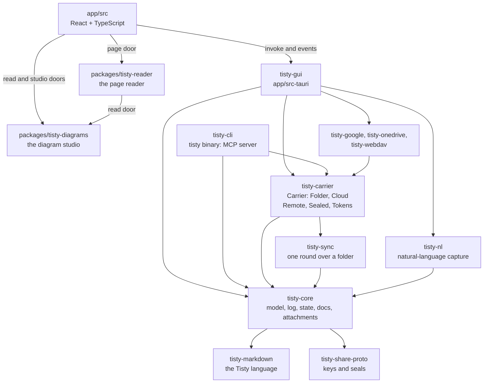
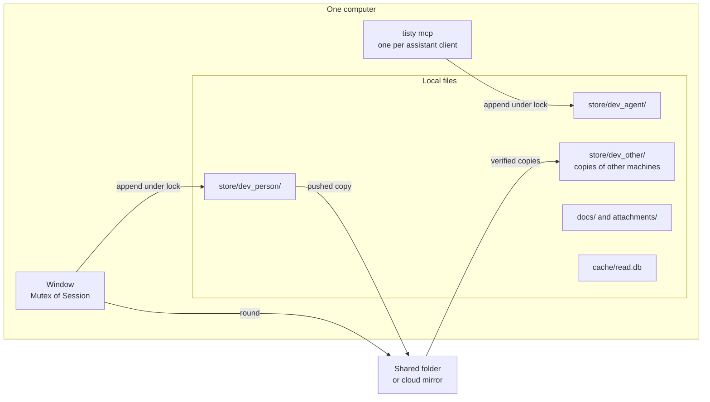
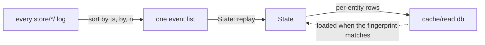
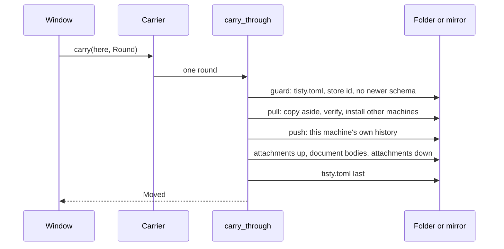
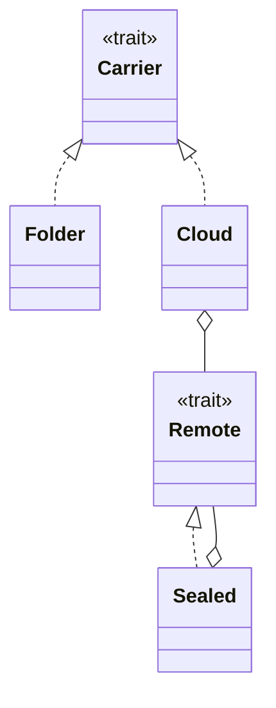

# Architecture

A map for contributors: what each crate does, where things live and the few
rules nothing may break. It names where to look, not how every mechanism
works; the code and its tests are the reference for that. Identifiers are in
backticks so they can be searched for.

## What Tisty is

One person's tasks and documents, kept on that person's own computers. Three
faces over one core:

| Face | What it is |
|---|---|
| Window | `tisty-gui`: Tauri 2, a Rust backend and a React/TypeScript front end |
| `tisty` | The binary assistants start; it answers `tisty mcp` and `--version` only |
| `tisty mcp` | An MCP server over stdin and stdout. It proposes; it never closes, drops or deletes |

Everything lives in plain files on the machine: a JSON-lines event log per
device, Markdown files for document bodies, ordinary files for attachments.
There is no Tisty server and no account. Syncing between the person's
computers is optional: a shared folder, or a cloud provider's API (Google
Drive, OneDrive, WebDAV), which can be encrypted with the person's phrase.

## Rules that hold everywhere

1. The log is the truth. State is what replaying every log produces, and the
   read cache is a disposable copy of that state.
2. Every log has one writer: the device whose directory holds it. Every other
   machine only copies it.
3. Logs only grow. A closed segment is never written again, and a deletion is
   an event like any other.
4. Every machine reads every log and sorts events by `(ts, by, n)`, so all of
   them reach the same state without talking to each other.
5. Nothing that arrives from outside (a folder, a cloud, a backup, a parcel) is
   installed before it is checked, and the bytes installed are the bytes
   checked.
6. `tisty-core` never prints, and `tisty-core`, `tisty-sync` and
   `tisty-carrier` never panic. A failure is an `Err` the caller shows.
7. A way of syncing is named only in `config.rs` and `chosen()`; everything
   else asks the `Carrier` it was handed.
8. An assistant can never destroy: replay drops every `Op::destroys` written by
   an agent device, whatever the MCP server exposes.

`scripts/rules.sh` checks 6 and 7, among others.

## Crates

| Crate | What it does | Start at |
|---|---|---|
| `tisty-core` | The model and everything that touches the person's data: events, the log, replay, the read cache, documents, task pages, attachments, backup, signing | `event.rs`, `store.rs`, `state.rs` |
| `tisty-markdown` | The Tisty language: reading by blocks, drawing to HTML, the translator at the edges | `lib.rs`, `fixtures/markdown.json` |
| `tisty-share-proto` | The seed behind the 24-word phrase, the keys that come from it, certificates, the sealing of an encrypted cloud, and the envelope that hands its key to another machine | `lib.rs` |
| `tisty-nl` | Turns a typed sentence into a task with dates, priority, tags, list and repeat | `parse` |
| `tisty-sync` | One sync round over a folder, the word a place leaves in `tisty.toml`, and the `Trouble` a round refuses with | `carry_through`, `shape.rs` |
| `tisty-carrier` | The `Carrier` contract and its two carriers, `Folder` and `Cloud`; the `Remote` contract a provider speaks; sealing a cloud; the plain `knock/` box a machine asks for the cloud's key through; tokens | `lib.rs`, `cloud.rs`, `remote.rs` |
| `tisty-google`, `tisty-onedrive`, `tisty-webdav` | One `Remote` each. Only the window depends on them | `lib.rs` |
| `tisty-cli` | The `tisty` binary: the MCP server and nothing else | `mcp.rs`, `mcp/catalogue.rs` |
| `tisty-gui` | Tauri commands (`answers/`), the `Session`, tray, reminders, updater, wiring assistants | `lib.rs`, `session.rs` |
| `app/src` | The React UI; `core.ts` holds the typed `invoke` wrappers | `App.tsx` |
| `packages/tisty-diagrams` | The diagram studio: Mermaid read and written back, laid out, drawn as SVG, and edited by hand on a React Flow canvas. A private package, never published, that needs nothing of the app: the app hands it its words' language, Mermaid's drawing and the clipboard, and enters only by `tisty-diagrams/read` and `tisty-diagrams/studio`. The app's toolchain builds, tests and lints it | `read.ts`, `DiagramStudio.tsx` |
| `packages/tisty-reader` | The page reader: wraps the HTML `tisty-markdown` draws in a page with its CSS, tokens and theme, colours its code, draws its diagrams and lays its sheets. The same body for the window, Tisty Share and the phone. A private package that needs nothing of the app or Tauri; clicks, attachments and widgets stay in the app, which enters only by `tisty-reader/page` | `page.ts`, `shell.ts` |

`scripts/rules.sh` keeps each package and the app apart. Only `tisty-carrier`
depends on `tisty-sync`. Only the window and the provider crates hold network
code (`deny.toml`).

## Processes and one store

The window writes as the person's device, the MCP server as a separate agent
device with its own directory and key. Every process reads every directory.
No lock is kept across a session; each is taken for one operation.

## State is a replay

Merging happens in memory, on every read; files are never merged. Every
append ends with a seal signed by the device's key, in the same write. A
history that arrives is copied aside, checked and only then installed.

## The sync round

`Folder` runs the round on the folder itself; `Cloud` runs it on a local mirror
of a `Remote` and pulls and pushes around it. A body never travels before the
history that answers for it, and a body changed on both sides is joined block
by block or put to the person.

## Where things live

| Path | Holds | Syncs |
|---|---|---|
| `<data>/store/<device>/` | One machine's event log, in segments | yes |
| `<data>/docs/` | Document bodies, and each task's page (`t_<task>-NNNN.md`) | yes |
| `<data>/attachments/` | Attachment bytes, named by a stamp of their hash | yes |
| `<config>/config.toml` | Settings and this machine's device id | never |
| `<config>/private/` | Signing keys, the local log | never |
| `<config>/cloud/` | A cloud carrier's mirror and index | never |
| `<cache>/read.db` | The read cache | never |

`Paths::resolve` picks `<data>`, `<config>` and `<cache>` per platform;
`TISTY_DATA`, `TISTY_CONFIG` and `TISTY_CACHE` override them.

## Tests

Tests sit beside the code (`*_test.rs`) and in `crates/*/tests/`, and their
names say what must hold. The round's cases in
`crates/tisty-sync/src/round_cases_test.rs` run on a folder and again on a
`Cloud` (`tisty-carrier/src/round_test.rs`). `remote_fakes.rs` simulates each
provider, `converge_test.rs` drives random machines to the same state, and
`fixtures/stores/` holds histories written by published releases.
`.github/workflows/` says what CI runs.
