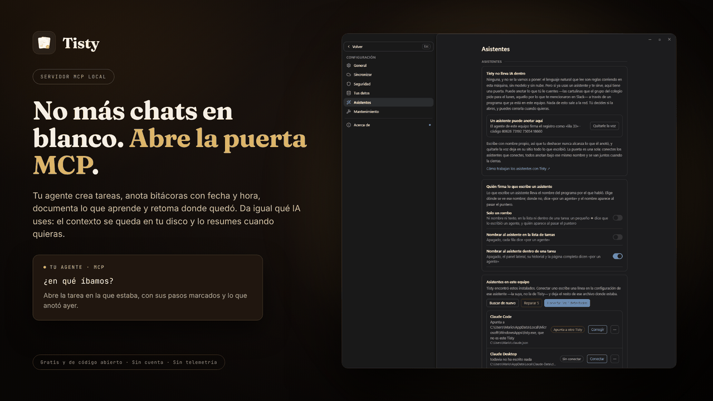

# Agentes y MCP

**Tisty es la memoria que tu agente de IA guarda entre sesiones.** GitHub Copilot, Claude Code, Codex, Cursor o cualquier agente que hable MCP anota aquí su trabajo como tareas con pasos y bitácora, guarda lo que aprende en documentos y empieza la sesión siguiente desde lo que cambió, no desde un chat en blanco, en este equipo, sin cuenta y sin pasar nada por la red.

**Tisty en sí no es IA y no tiene IA dentro.** El lenguaje natural que convierte «llamar al banco a las 3» en una tarea son reglas que corren en tu equipo: sin modelo, sin petición y sin nube. Eso no va a cambiar.

Pero si ya usas un agente, seguramente le cuentas cosas que vale la pena guardar: el grupo del colegio pide cartulina para el lunes, la factura vence el 30, el bug que acabas de arreglar y cómo lo hiciste. Por eso Tisty deja una puerta, y tú decides si usarla.

**El trabajo de tus agentes, a la vista.** Con Tisty, un agente planifica en documentos y trabaja en tareas: escribe en Markdown el plan, lo que encontró y lo que decidió, divide el trabajo en tareas con pasos y los va marcando a medida que avanza. Nada queda enterrado en un chat: cada etapa queda en Tisty, en tu equipo, donde puedes seguirla mientras ocurre y auditarla después. Cuando dice que una tarea está lista, eres tú quien la cierra.



## Cómo funciona la puerta

Tisty habla [MCP](https://modelcontextprotocol.io) a través de `tisty mcp`, por su propia entrada y salida estándar. Ese `tisty` viene dentro de la app y ya no es una línea de comandos: solo abre la puerta del agente, con `tisty mcp`, y responde a los hooks de Tisty, con `tisty hook` (mira [[Línea de comandos|Línea-de-comandos]]).

- **Solo en este equipo.** Sin puerto, sin cuenta y sin token. No es un servidor, y nada puede alcanzarlo desde la red.
- **Nada escucha hasta que lo conectas.** El agente arranca `tisty mcp` cuando lo necesita.
- **Tú manejas la puerta.** Viene abierta sola hasta que elijas —en una instalación nueva, y al actualizar si nunca la cerraste— y en **Configuración › Agentes › Puerta** la cierras con **Quitarle la voz**, que antes te dice lo que pasa: «Ningún agente podrá anotar en Tisty.», lo que escribió se queda en su sitio y los agentes conectados siguen conectados. Mientras está cerrada, todo lo que intente un agente se rechaza, y **Conectados** te lo recuerda: «Aun así no anotarán nada hasta que abras la puerta.», con **Ir a Puerta**. Dejar entrar a un agente y echarlo son eventos de tu registro; que elegiste mantener la puerta cerrada queda en la configuración de este equipo.

Desde la 1.32.1, un Tisty estable también responde a `tisty` a secas desde cualquier terminal, así un plugin puede arrancarlo por su nombre. Microsoft Store y Homebrew dejan ese nombre ahí por su cuenta; la copia del instalador en Windows agrega su propia carpeta a tu PATH mientras la puerta está abierta y la saca cuando la cierras. Si tienes a la vez la copia de Microsoft Store y la del instalador, responde la más nueva. Un agente que ya estaba abierto necesita reiniciarse para notarlo.

## Conectar un agente

### Desde Configuración (lo más fácil)

**Configuración › Agentes › Conectados** busca los agentes instalados en este equipo entre los que Tisty conoce (Claude Code, Claude Desktop, Codex, GitHub Copilot CLI, Visual Studio Code, Cursor, Devin Desktop, Windsurf, Antigravity, Gemini CLI, Qwen Code, OpenCode, Kilo Code, Zed, Junie, Kiro, Warp, LM Studio, Amp, Augment, Factory Droid, Trae, Cline, Roo Code, BoltAI, Goose, Continue y DeepSeek Harness) y dice cómo está cada uno:

- **Conectado**: abre este Tisty. **Quitar** te pregunta antes: «Quitar Tisty de Claude Code», con los archivos que va a escribir bajo **Escribe en:**, y con **Sí, quitar** saca su entrada y los hooks que Tisty puso.
- **Sin conectar**: **Conectar** escribe Tisty en su configuración, con la forma que ese agente lee. Si corre hooks, te muestra antes los archivos y los incluye, con una casilla para dejarlos fuera.
- **Apunta a otro Tisty**: una copia que ya no está, como al pasar de la Microsoft Store a winget. La fila dice cuál: «Apunta a `C:\…\tisty.exe`, que ya no existe». **Corregir** te muestra qué va a escribir y, con **Sí, corregir**, lo apunta aquí.
- **Usa tu otra instalación de Tisty**: otra copia que sigue en este equipo, como con la Store y winget a la vez. Las dos funcionan, así que nada cambia solo y nada te lo pide; **Corregir** lo trae a esta si quieres.
- **Puede que esté**: solo quedó su carpeta, así que quizás se desinstaló.
- **Escrito a tu manera**: ya tiene una entrada de Tisty que Tisty no puede comprobar, como `npx`, un script tuyo o una ruta con una variable: «Su entrada de Tisty dice npx. Tisty la deja como la escribiste.». **Quitar** la saca, con la misma pregunta, si la quieres cambiar.
- **No se pudo leer**: Tisty no pudo leer su archivo, así que no lo toca.
- **A mano**: Goose y Continue guardan su configuración en YAML, que Tisty no escribe. La fila muestra qué pegar.

**Conectar los 3 detectados**, con los que haya, conecta de una vez todos los que esperan. Algunos archivos sirven a más de un agente: el de GitHub Copilot CLI también lo lee VS Code, y el de Codex lo leen ChatGPT y Warp.

Un agente lee su configuración al abrirse, así que después de conectarlo sal de él del todo y ábrelo otra vez. Si tiene ventana, cerrarla no basta: en Windows sigue abierto junto al reloj hasta que sales desde ahí, y en un Mac hasta **⌘Q**.

Tisty solo toca su propia entrada. Lo que le agregaste, como `env` o las herramientas que permitiste, se queda, igual que el resto del archivo. La primera versión de cada archivo queda al lado como `.before-tisty`, y la de justo antes de cada escritura como `.before-tisty-last`, también en el archivo de los hooks de Copilot. Si el archivo es un enlace, Tisty escribe en el archivo al que lleva. Y si está escrito de una forma que Tisty no sabría cambiar sin estropearlo, no lo cambia y te lo dice.

**Hooks.** Claude Code, Codex, Cursor, Antigravity CLI, Gemini CLI y GitHub Copilot (su línea de comandos y las sesiones de Copilot en VS Code) también corren hooks: comandos que llaman al empezar una sesión, antes y después de algunas herramientas y al terminar un turno. Al conectarlo van incluidos; en uno que ya estaba, el interruptor **Hooks de Tisty**, bajo su fila, primero te dice qué archivo va a escribir y, cuando aceptas, pone ahí los hooks de Tisty: `~/.claude/settings.json`, `~/.codex/hooks.json`, `~/.cursor/hooks.json`, `~/.gemini/config/hooks.json` (Antigravity CLI), `~/.gemini/settings.json` (Gemini CLI), o un archivo propio, `~/.copilot/hooks/tisty.json`. Apagarlo saca solo los de Tisty. Codex los corre solo después de que los apruebes en él: la fila dice «Apruébalo en Codex con /hooks.», y hay que volver a hacerlo cada vez que Tisty los cambia, como al corregir a qué Tisty apuntan. Cursor también corre los hooks de la configuración de Claude Code, y aunque se disparen los dos, Tisty devuelve un turno una sola vez. Gemini CLI los corre solo en las carpetas en que confiaste. En Claude Code, antes de escribirlos, Tisty lee el registro de su plugin: si el plugin de Tisty ya los trae, no escribe nada y te lo dice. Cuando ya lo sabe, la fila de Claude Code dice **Los trae el plugin de Tisty**, sin **Agregar**, y si además están los de Tisty te avisa que corren dos veces. Si apuntan a otro Tisty, la fila lo dice, con **Corregir**; y si los escribiste de una forma que Tisty no puede leer, como dentro de un script, dice **Escritos a tu manera**: Tisty los deja como están y no agrega otros al lado. Lo que hacen está en [Un día con tu agente](#un-día-con-tu-agente), y todo lo de los hooks, en [[Hooks y skills|Hooks-y-skills]].

**Las skills de Tisty.** Al final de la lista, la fila **Skills de Tisty** dice «Tres skills que les enseñan a tus agentes a trabajar con Tisty. Tienen su propio sí, en este equipo.». **Ver** abre su ficha, y **Encender en este equipo** escribe `tisty`, `consolidate` y `next-agent` en la carpeta de skills de cada agente de este equipo: `~/.claude/skills` para Claude Code y `~/.agents/skills`, la carpeta de [Agent Skills](https://agentskills.io) que comparten Codex, Copilot, Gemini, DeepSeek Harness y Cursor. Bajo cada agente conectado que las lee, otra fila **Skills de Tisty** las enciende y las apaga con un interruptor, para todo este equipo. Desde ahí, «Retoma donde quedamos» o «Ordena mi Tisty» bastan para que tu agente sepa qué hacer. No necesitan la carpeta [[Agentes|Carpeta-AGENTS]], se actualizan solas con cada versión de Tisty y **Apagar en este equipo** las saca sin eliminarlas.

**Al conectar uno**, sus hooks y las skills de Tisty van incluidos, cada uno con su casilla marcada, y quedan encendidos. DeepSeek Harness, que no tiene hooks, ve solo las skills. A un agente que ya estaba conectado, si le faltan los hooks o las skills, los ofrece **Hooks y skills para tus agentes**, un recuadro sobre las pestañas, que los agrega a todos en un solo paso. Los casos, uno por uno, en [[Hooks y skills|Hooks-y-skills]].

**A mano**, en cada fila, muestra cómo conectar ese agente tú: su propio comando cuando lo tiene, y las líneas exactas para su archivo. En las que solo van a mano, las escritas a tu manera y las que no se pudieron leer, ese botón dice **Cómo conectarlo**. El buscador bajo la lista hace lo mismo con un agente que Tisty conoce pero no encontró.

### Cuando un agente deja de encontrar Tisty

Un agente guarda la ruta del Tisty que conectaste. Si mueves Tisty o cambias de instalador, esa ruta queda vieja, y el agente abre sus sesiones sin las herramientas de Tisty, muchas veces sin decirlo. Con la puerta abierta, Tisty lo mira al abrir su ventana y te lo dice al pie de la barra lateral: **Claude Code ya no encuentra Tisty**, o **Los hooks de Claude Code ya no encuentran Tisty**, o cuántos son. Con la barra plegada, queda un punto ámbar. **Ver y corregir** te lleva a **Agentes**; **Ahora no** calla ese aviso, que vuelve solo si algo cambia, y la lista sigue en Configuración.

1. Sobre las pestañas, **2 agentes por corregir** dice, de cada uno, si es su **conexión**, sus **hooks** o las dos cosas, a qué apunta y los archivos que se van a escribir, bajo **Escribe en:**.
2. **Corregir todo** los corrige a todos; si hay uno solo, dice **Corregir**. Para uno en particular está **Corregir** en su fila, que te muestra los mismos archivos y espera tu **Sí, corregir**.
3. Tisty cambia solo el programa de cada entrada: los argumentos, `env`, los matchers y los tiempos de los hooks quedan como estaban. Si uno falla, sigue con los demás y te dice el motivo.
4. Sal del todo de cada agente corregido y ábrelo otra vez.

Hay tres cosas que **Corregir todo** deja como están: un agente que usa tu otra instalación de Tisty, porque quizás lo quieres así; una entrada o unos hooks que escribiste a tu manera; y una skill que Tisty no reconoce como suya. Un agente que desinstalaste tampoco sale en el aviso, aunque su archivo siga ahí. Claude Code y Codex son la excepción, porque otras apps usan su archivo: Claude Code sigue contando mientras esté Claude Desktop, VS Code o Cursor, y Codex, mientras esté ChatGPT, Warp, VS Code o Cursor. Si en ninguna lo usas, **Ahora no** calla el aviso. Y si una ruta está en un disco externo o en la red, Tisty no dice que ya no existe: puede que solo esté desconectado.

**Ejemplo.** Marisol tiene las skills de Tisty encendidas, Claude Code con el plugin de Tisty y, de antes, los hooks que agregó desde Configuración, que apuntan a una carpeta que borró. El recuadro dice **Claude Code · hooks** y «El plugin de Tisty ya trae sus hooks, así que estos se quitan. Tisty lee antes su registro (installed_plugins.json y settings.json) para comprobarlo.». Pulsa **Corregir**, y el resultado lo confirma: **Claude Code** · hooks quitados, los trae el plugin. Así no corren dos veces.

### Con un plugin

Algunos agentes toman Tisty como plugin. El plugin trae un pequeño lanzador que busca el Tisty instalado en este equipo (la copia de Microsoft Store, la del instalador, la app de Mac o Homebrew), usa la más nueva si hay varias y arranca el `tisty mcp` de esa copia, así lo que escribe el agente siempre coincide con tu app y tus datos. Si Tisty no está instalado, el agente recibe una sola herramienta, `install_tisty`, que te dice cómo conseguirlo. El lanzador necesita Node.js.

En Claude Code:

```console
/plugin install tisty --marketplace rgdevment/mcp-plugins
```

Cualquier otro agente que arranque un servidor con un comando, como Cursor, Cline o Claude Desktop, toma el mismo lanzador desde npm:

```json
{
  "mcpServers": {
    "tisty": { "command": "npx", "args": ["-y", "tisty-mcp"] }
  }
}
```

VS Code lee la misma entrada bajo `servers` en vez de `mcpServers`.

La primera vez descarga el lanzador y puede tardar un momento; después arranca al instante. Si Tisty está en un lugar poco común, pon en `TISTY_PATH` la ruta completa de su `tisty`.

Desde la versión 1.4.0, el plugin también trae los hooks de Tisty a Claude Code, y la extensión de Gemini CLI los trae a Gemini CLI. Desde la 1.5.0, el plugin trae además las tres skills de Tisty a Claude Code: cuando Tisty lo ve instalado, no se las copia, y su ficha lo dice. Lo cuenta [Con el plugin de Tisty](Hooks-y-skills#con-el-plugin-de-tisty).

Conecta cada agente de una sola forma, con el plugin o desde **Configuración › Agentes**, no con las dos: si no, arranca dos veces el servidor de Tisty y ve cada herramienta repetida. El código del plugin y sus issues están en [mcp-plugins](https://github.com/rgdevment/mcp-plugins).

Tisty también está en los directorios donde los agentes buscan servidores: el MCP Registry oficial como `io.github.rgdevment/tisty`, el [GitHub MCP Registry](https://github.com/mcp/rgdevment/tisty), [npm](https://www.npmjs.com/package/tisty-mcp), [Glama](https://glama.ai/mcp/servers/rgdevment/Tisty) y [MCP Market](https://mcpmarket.com/server/tisty).

### Agentes dentro de WSL

En Windows, un agente que corre en una distro de Linux bajo WSL lee su configuración en Linux, donde una ruta `C:\...` no existe. **Configuración › Agentes › Conectados** muestra tus distros; **Buscar en Ubuntu** lee los archivos de esa distro (y la enciende si estaba apagada) y conecta sus agentes al mismo Tisty, con su ruta de Linux. Una distro que ya buscaste se vuelve a mirar sola cuando pulsas la pestaña **Conectados**, y al abrir la ventana solo si ya está encendida: Tisty nunca enciende una distro para mirarla, y un agente suyo que quedó apuntando a un Tisty que ya no está entra en el aviso, con el nombre de su distro, «Claude Code (Ubuntu · WSL)». Tisty también encuentra un agente instalado en la distro con npm (bajo nvm o `~/.npm-global`), bun, volta o cargo. Sus agentes se corrigen uno por uno, en su fila:

```console
$ claude mcp add --scope user tisty -- /mnt/c/Users/<tú>/AppData/Local/Programs/Tisty/tisty.exe mcp
```

Es el mismo Tisty y las mismas tareas y documentos que en Windows. Si una distro tiene apagados los programas de Windows (`[interop] enabled = false` en `/etc/wsl.conf`), Tisty lo dice y no escribe nada ahí. Lo mismo con una copia de la Microsoft Store que tiene apagado su alias `tisty.exe` en **Configuración › Aplicaciones › Configuración avanzada de aplicaciones › Alias de ejecución de aplicaciones**: ningún agente podría arrancarla, así que Tisty te pide encenderlo y no escribe nada.

### A mano

Para un agente que Tisty no conoce, basta una línea, con la ruta completa del `tisty` que viene con la app. **Configuración › Agentes › Conectados › Cómo conectar uno** muestra las dos formas de abajo con esa ruta ya puesta para este equipo, listas para copiar, así que no hace falta tener nada en el PATH:

```console
$ <tu-agente> mcp add tisty -- <ruta-a-tisty> mcp
```

Por ejemplo, con Claude Code:

```console
$ claude mcp add --scope user tisty -- <ruta-a-tisty> mcp
```

Los clientes que se configuran con un archivo JSON usan la forma de siempre:

```json
{
  "mcpServers": {
    "tisty": { "command": "<ruta-a-tisty>", "args": ["mcp"] }
  }
}
```

Reinicia el agente. Si cerraste la puerta, vuelve a abrirla en **Configuración › Agentes › Puerta**.

No tienes que acordarte de este paso. Cuando un agente intenta trabajar con Tisty con la puerta cerrada, la ventana te avisa («Claude Code intentó entrar») y **Dejarlo entrar** abre la puerta ahí mismo. También te avisa cuando tus agentes están conectados pero todavía no pueden hacer nada porque la puerta está cerrada.

## Qué puede hacer, en corto

Anotar una tarea con sus pasos y su fecha, ponerle un recordatorio, añadir a la bitácora de una tarea, escribir y editar documentos, ordenarlos en carpetas y páginas, guardar una copia de un archivo que le indiques, anotar ideas en Ideas y ordenarlas contigo, buscar y leer lo que hay, y decir que una tarea está hecha, también una tuya, **para que tú lo confirmes**.

Cuando te cuenta lo que hizo, nombra una tarea o un documento como lo harías tú: por su título y dónde está, la lista o la carpeta. Nunca te muestra un identificador.

**Nunca** puede cerrar ni borrar una tarea, borrar un documento ni mover un día que pusiste tú. Un documento que ya cumplió su vida lo marca: tú lo borras, lo archivas o le quitas la marca. Una idea sale de Ideas solo cuando la anexa a un documento o la convierte en tarea, como lo harías tú; a una vieja la marca igual. Tu [Diario](Documentos#diario) queda fuera de su vista hasta que lo abres desde el propio Diario, y aun así solo añade al final de hoy, con su firma, cuando se lo pides. En una tarea que escribiste tú trabaja como en un documento (la descripción, la página, los pasos abiertos, el título y la lista), y que un paso o la tarea entera están hechos es solo su palabra, que tú tomas o no.

Las reglas completas están en [[Qué puede hacer un agente|Qué-puede-hacer-un-agente]], y cada herramienta en la [[referencia de herramientas|Herramientas-MCP]]. Las reglas, skills y memoria que lee cada agente, aunque no lo conectes, las guardas en la carpeta [[Agentes|Carpeta-AGENTS]].

## Pedidos listos y menciones con @

La memoria que Tisty guarda para tu agente está a un comando o a una `@`, sin aprender nombres de herramientas.

**Ocho pedidos listos.** Tisty le entrega a tu agente ocho pedidos que muestra como comandos. En Claude Code están en el menú de `/`, y `/mcp__tisty__pick_up` y los demás los ejecutan; otros agentes que toman pedidos de un servidor los muestran en su propio menú.

- **Retomar donde lo dejé** (`pick_up`): lo que se movió desde la última vez que pasó el agente y quién lo movió y, después, la tarea abierta en la que trabajó por última vez, con sus pasos, su página y sus últimas notas. No cambia nada.
- **Dejar esto listo para retomarlo** (`leave_off`): en una sola llamada marca los pasos terminados y deja el estado de la tarea: lo hecho, lo que falta y lo que sigue, las decisiones vigentes y lo descartado. Anota solo lo que cambia algo, con su porqué; si todo está hecho, lo dice con la prueba, y una decisión que dura más que la tarea va a su documento, con fecha y la que reemplaza tachada; si ningún documento cubre el tema, queda en el estado y te lo dice.
- **Planificar este trabajo como una tarea con pasos** (`plan_task`): una tarea con sus pasos, en la lista que le corresponde, una vez que nada abierto ni en el archivo lo cubre ya.
- **¿Cómo lo resolvimos antes?** (`solved_before`): busca en el archivo de tareas terminadas y en tus documentos antes de probar nada nuevo.
- **Guardar esta decisión en su documento** (`keep_decision`): la decisión que acabas de tomar va al único documento de su tema, en su lugar, y la que reemplaza queda tachada; si ningún documento lo cubre, te pregunta dónde va.
- **Hacer una lluvia de ideas conmigo** (`brainstorm`): propone ideas cortas sobre un tema, numeradas, dice cuáles ya están en Ideas o ya son una tarea o un documento, y anota en Ideas solo las que te quedas.
- **Ordenar mis Ideas** (`sort_ideas`): lee las ideas que esperan y te dice cuáles van juntas, cuáles serían una tarea y en qué lista, cuáles van a qué documento y cuáles están viejas. No cambia nada hasta que lo digas, y entonces hace solo eso.
- **Revisar lo que guarda Tisty y proponer arreglos** (`consolidate`): el «dreaming» de Tisty, una pasada que corre solo cuando la pides. Busca resúmenes de agentes que quedaron viejos porque el documento cambió, enlaces que no llevan a ninguna parte, documentos repetidos o mal ordenados y tareas cuyo estado quedó atrás. Te muestra lo que encontró, numerado y con el arreglo que haría, y solo cambia lo que apruebas. Nunca borra: lo viejo queda marcado para que tú lo borres con un clic, lo guardes o le quites la marca. Con una palabra detrás, como `/mcp__tisty__consolidate Cocina`, revisa solo esa carpeta, lista o tema.

Cada uno toma una palabra detrás, como `/mcp__tisty__solved_before timeouts`, o nada, y entonces trabaja con lo que se ha hablado en la conversación.

Con las [skills de Tisty](Hooks-y-skills#las-skills-de-tisty) encendidas, no hace falta el comando: «Retoma donde quedamos» hace lo de `pick_up`, «Deja esto listo para el próximo agente», lo de `leave_off`, y «Ordena mi Tisty», lo de `consolidate`. El pedido lo escribes tú; la skill la elige tu agente cuando le hablas con tus palabras.

**Una pasada de `consolidate`, de principio a fin.** Mario escribe `/mcp__tisty__consolidate Cocina`. El agente lee primero las reglas de orden (`rules` con `topic: "tidying"`) y lo que se movió (`catch_up`), y después mira la carpeta sin cambiar nada:

- `brain` con `{ "folder": "Cocina" }` le trae cada documento con su tamaño en caracteres y el resumen que dejó un agente; uno escrito antes del último cambio del documento llega con `"stale": true`.
- `brain` con `{ "doc": … }` le trae la ficha de cada documento: `dead` nombra los enlaces que no llevan a ninguna parte, y `alike`, `repeated` y `mislabeled`, lo repetido o mal nombrado.
- En la ficha de una tarea, `brain` con `{ "task": … }`, `state_old` dice que el estado se escribió antes de que cambiaran sus pasos o llegara una decisión.

Y responde, por ejemplo:

> 1. **«Recetas de la semana»** (Cocina): el resumen del agente es anterior al último cambio. Lo leería de nuevo y dejaría uno que diga «Menú de lunes a viernes, con la lista de compras al final».
> 2. **«Recetas de la semana»**: el enlace a «Arroz con porotos» no lleva a ninguna parte; esa receta ahora está en **«Arroces»** (Cocina). Lo apuntaría ahí.
> 3. **«Lista de compras (copia)»** (Cocina): dice lo mismo que **«Lista de compras»**. La marcaría como copia de esa.
>
> ¿Cuáles hago?

Mario contesta «1 y 2». El agente hace solo eso (`sum_up` y `edit_doc`) y termina diciendo qué cambió, qué queda esperando y cómo deshacerlo. La copia del punto 3 sigue como estaba. Si hubiera dicho que sí, la copia habría quedado marcada (`flag_doc`), no borrada: la borras tú con un clic, la guardas o le quitas la marca. Un documento que escribiste tú se pregunta por separado, y en la carpeta Agentes el agente solo te dice qué cambiaría.

**Documentos para mencionar.** Tus documentos que no están guardados en el archivo también se ofrecen (tu Diario, solo mientras está abierto a los agentes), así que puedes pasarle uno al agente por su nombre: en Claude Code, escribe `@` y elígelo por su título y su carpeta. Un documento de hasta unos 12 000 caracteres llega entero; uno más largo llega como su índice, sus títulos y sus líneas, y el agente pide la parte que necesita.

## Un día con tu agente

Una sesión real, llamada por llamada y con un extracto de cada respuesta, está en [[Cómo trabaja un agente|Cómo-trabaja-un-agente]].

Lo que hace un agente conectado a Tisty en un trabajo real:

1. **Pregunta qué cambió** desde su última sesión, y quién lo cambió, en vez de releerlo todo. La misma respuesta le nombra las tareas que apremian, las vencidas primero, así que una que vuelve cada mes le llega el día que toca.
2. **Abre la tarea en la que estaba**, que Tisty le nombra. Primero le llega su estado, con las notas escritas después de él; *Para estar lista*, en su página, le dice cuándo termina, y los pasos sin marcar, qué falta.
3. **Busca en el archivo antes de proponer nada.** Si ya se resolvió, parte de ahí.
4. **Lee el documento del módulo por su índice**, después solo la sección que necesita, y respeta las decisiones y lo que está fuera de alcance: no reabre debates cerrados ni se desvía.
5. **Marca cada paso al terminarlo y deja el estado de la tarea en la misma llamada**, una sección «Estado» de su página que también lees tú y que escribe entera cada vez. La bitácora guarda lo que cambia algo (una decisión, algo descartado, un bloqueo), así la próxima sesión, u otro agente, no repite el intento fallido. Cuando una nota deja sin efecto otra anterior, la vieja queda en la historia marcada como reemplazada y deja de llegar primero. Si los pasos cambian o llegan notas después del estado, Tisty avisa que el estado quedó viejo.
6. **Cuando la página de una tarea crece, compacta las notas de los agentes** en un resumen fechado de lo que sigue vigente. La bitácora queda entera, y si le pides devolver las notas, vuelven como estaban, aunque después hayas marcado pasos.
7. **Termina diciendo qué hizo y cómo sabe que se sostiene.** Tú lo revisas y la cierras.
8. **Después de leer un documento largo, deja un resumen** para que el próximo agente elija con él. Si el documento cambia, el resumen queda marcado como desactualizado.

**Si se le olvida, Tisty le pregunta.** Cuando el agente sigue llamando a Tisty y la tarea que abrió lleva diez minutos sin una palabra suya, o mientras escribe otras tres cosas, la siguiente respuesta le pregunta una vez si esa tarea quedó al día. Le nombra la tarea y lo que falta (los pasos sin marcar, o que todos están marcados y no dijo que terminó) y le pide dejarla al día en una sola llamada: los pasos que terminó y el estado de la tarea, o, si el trabajo está hecho, decirlo con la prueba. Nunca le pide anotar su avance, y vuelve a preguntar solo después de que el agente escribe en esa tarea. Llega a todos los agentes, aunque solo cuando llaman a Tisty. Lo apagas en **Configuración › Agentes › Puerta**, con **Pedirle que deje su tarea al día**.

**Con los hooks de Tisty, también pregunta al terminar un turno.** En los agentes a los que se los agregaste, cada sesión empieza con las tres últimas tareas abiertas en que escribió ese mismo agente en este equipo, la más nueva primero, con cuántos pasos lleva y el siguiente, lo que se movió desde entonces y lo que apremia, en unos 2.000 caracteres, para que el agente no dependa de acordarse de pedirlo. Mientras dejas que un agente anote, cuando un turno editó archivos y no escribió nada en Tisty, le devuelve el turno una vez: si eso era trabajo de una tarea, que lo deje en un solo `tick` con los pasos terminados y el estado. Si el agente lo deja pasar, calla hasta que vuelva a llamar a Tisty, así que el trabajo fuera de una tarea cuesta como mucho un turno extra; en GitHub Copilot ese turno puede gastar una solicitud premium. El trabajo que no edita archivos, como planificar o investigar, no lo ve: ahí solo le llega la pregunta en las respuestas. Y antes de dejar un archivo de texto fuera de un repo, se le pregunta una vez si va en Tisty ([[Hooks y skills|Hooks-y-skills]]). Claude Desktop y DeepSeek Harness no tienen hooks. **Recordarle al empezar y al terminar cada turno**, en **Configuración › Agentes › Puerta**, apaga los tres hooks sin quitarlos.

**Lo que nombra, Tisty lo enlaza.** Cuando el agente nombra una tarea o un documento en lo que escribe —una nota, una descripción, un documento— por su id, o por su título exacto entre comillas, Tisty lo convierte en un enlace al guardarlo, el mismo que haces tú con `[[` o con la tarjeta de una tarea, y le dice al agente qué enlazó. Lo que no tiene claro, como un título que llevan dos cosas, lo deja como estaba y se lo devuelve al agente para que decida. Un nombre entre corchetes dobles queda como la ficha que se escribió. Nunca toca encabezados, tablas ni líneas que ya estaban, y una tarea que ocultaste nunca se nombra. Una imagen escrita o adjuntada sin decir qué muestra —el nombre del archivo no cuenta— recibe una pregunta en la respuesta, porque las palabras entre sus corchetes son todo lo que un agente o un lector de pantalla sabrá de ella. Y en una sección de decisiones, la tachada se lee como reemplazada: la ficha que lee el agente pone primero las vigentes.

Quién es dueño de qué queda claro. Lo que anota tu agente es suyo para mantenerlo al día: lo describe, planifica los pasos, los marca y anota lo que aprende. En lo que escribiste tú trabaja como en un documento (la descripción, la página, los pasos abiertos, el título y la lista), pero un paso que da por listo espera a que lo marques, el día sigue siendo tuyo y cerrar siempre es tuyo. Lo que solo puedes hacer tú (probarlo en la app real, firmar, decidir) no lo escribe como paso de su tarea, que nunca podría marcar: lo anota como una tarea aparte para ti, en la misma lista.

## Firmado con su nombre

Lo que escribe un agente va firmado con el nombre del programa por el que habló. En la fila dice «por un agente», y el nombre aparece al pasar el puntero; dentro de una tarea (el panel lateral, la página completa y la bitácora) se nombra el programa: «por Claude Code», «por Codex». **Configuración › Agentes › Conectados** cuenta lo que escribió cada uno, y en **Cómo se ve su firma** eliges cómo se ve en cada lugar, **En la lista de tareas** y **Dentro de una tarea** (el panel lateral, su historial, la página completa y sus versiones): **Su nombre**, **«por un agente»** o **Solo ◆**, un pequeño rombo del color de los agentes. Debajo de cada lugar, una vista previa cambia al momento. Donde no se ve el nombre, aparece al pasar el puntero. Lo que se escribió antes de que los programas dijeran su nombre se lee «por un agente».

## Lee con mesura

Tisty guarda una pequeña ficha de cada documento (sus títulos, cuánto mide, en qué se apoya) que saca del propio texto, en este equipo, y que nunca envía a ninguna parte. Un agente lee esa ficha para elegir el documento que necesita, y después pide solo la parte que quiere, o cambia esa parte sin leer el resto. Un documento largo no se vuelca en un modelo porque un agente quería un párrafo.

Después de leer un documento, puede dejar un resumen corto para el siguiente agente. Viaja a tus otros equipos con todo lo demás, así que un agente también lo encuentra allá, pero tú no lo ves, nunca sale a Folio y no forma parte de lo que escribiste.

Tisty sabe lo que cuesta cada respuesta, y lo sigue recortando. Medido sobre una bitácora de trabajo de 256 KB en Markdown, frente a un agente que relee el archivo entero en cada sesión:

| El agente… | Gasta, con Tisty | Ahorro |
| --- | --- | --- |
| Retoma el trabajo, sin novedades | cerca de un 1 % | 99 % menos |
| Retoma y abre la tarea en la que estaba | menos de un 3 % | más de un 97 % menos |
| Busca algo resuelto hace meses | cerca de un 3 % | 97 % menos |
| Consulta un tema: el índice y una sección | cerca de un 3 %, 12 % en el peor caso | 88–97 % menos |

Ninguna escritura lleva más de 64 000 caracteres, así que una bitácora larga queda en temas y páginas; ninguna lectura trae más de unos 12 000 caracteres, y pasado eso un documento pedido entero vuelve como su índice, salvo que el agente lo pida entero en Markdown estándar para llevarlo a otra parte, hasta 40 000; la página de una tarea llega entera solo hasta unos 4000 caracteres, y una nota de la bitácora tiene como máximo 4000; retomar trae solo lo que cambió; lo terminado no cuesta nada hasta que alguien lo busca; y una búsqueda trae diez tareas y diez documentos por vez, cada uno con la línea que lo dice recortada a 120 caracteres alrededor de la palabra.

Conectarse también cuesta: la descripción de las herramientas de Tisty pesa cerca de una sexta parte de esa bitácora, un tercio menos que antes, y un test impide que vuelva a crecer. Un agente que carga las herramientas solo a medida que las usa no la paga entera; uno que las carga todas en cada sesión ahorra entre un 72 y un 83 %, y con menos de unos 50 KB de notas un archivo plano sale más barato. Se cuentan caracteres, incluido el JSON que acompaña cada respuesta, y los tokens los siguen de cerca.

## Lo que conviene saber antes de conectar uno

> [!WARNING]
> Lo que un agente lee viaja adonde viaja ese agente. Si funciona contra un servicio en la nube, lo que mira va camino a ese servicio. Tisty sigue sin enviar nada y sin servidor propio, pero esta puerta es real: junto con la sincronización, un enlace de Folio y los archivos que escribe la carpeta [[Agentes|Carpeta-AGENTS]] mientras sincroniza, que cualquier agente lee, es lo que puede sacar tus datos del equipo. Con los hooks de Tisty agregados y la puerta abierta, cada sesión empieza con los títulos de algunas tareas aunque el agente no llame a Tisty, y también viajan. Por eso, aunque viene abierta, la cierras cuando quieras con **Quitarle la voz** en **Configuración › Agentes › Puerta**.
