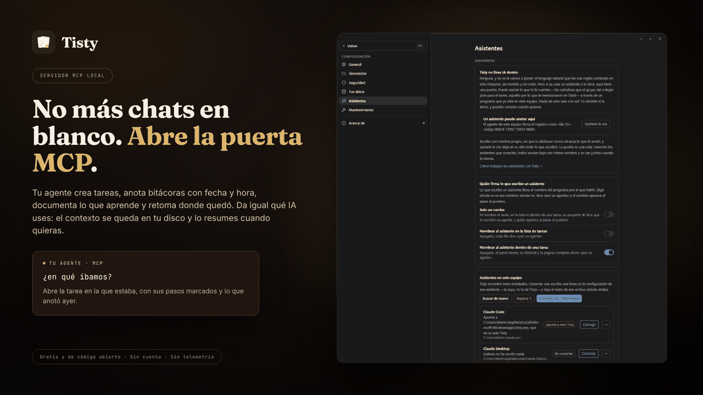

# Asistentes y MCP

**Tisty es la memoria que tu agente de IA guarda entre sesiones.** GitHub Copilot, Claude Code, Codex, Cursor o cualquier asistente que hable MCP anota aquí su trabajo como tareas con pasos y bitácora, guarda lo que aprende en documentos y empieza la sesión siguiente desde lo que cambió, no desde un chat en blanco, en este equipo, sin cuenta y sin pasar nada por la red.

**Tisty en sí no es IA y no tiene IA dentro.** El lenguaje natural que convierte «llamar al banco a las 3» en una tarea son reglas que corren en tu equipo: sin modelo, sin petición y sin nube. Eso no va a cambiar.

Pero si ya usas un asistente, seguramente le cuentas cosas que vale la pena guardar: el grupo del colegio pide cartulina para el lunes, la factura vence el 30, el bug que acabas de arreglar y cómo lo hiciste. Por eso Tisty deja una puerta, y tú decides si usarla.

**El trabajo de tus agentes, a la vista.** Con Tisty, un agente planifica en documentos y trabaja en tareas: escribe en Markdown el plan, lo que encontró y lo que decidió, divide el trabajo en tareas con pasos y los va marcando a medida que avanza. Nada queda enterrado en un chat: cada etapa queda en Tisty, en tu equipo, donde puedes seguirla mientras ocurre y auditarla después. Cuando dice que una tarea está lista, eres tú quien la cierra.



## Cómo funciona la puerta

Tisty habla [MCP](https://modelcontextprotocol.io) a través de `tisty mcp`, por su propia entrada y salida estándar. Ese `tisty` viene dentro de la app y ya no es una línea de comandos: solo abre la puerta del asistente (mira [[Línea de comandos|Línea-de-comandos]]).

- **Solo en este equipo.** Sin puerto, sin cuenta y sin token. No es un servidor, y nada puede alcanzarlo desde la red.
- **Nada escucha hasta que lo conectas.** El asistente arranca `tisty mcp` cuando lo necesita.
- **Tú manejas la puerta.** Viene abierta sola hasta que elijas —en una instalación nueva, y al actualizar si nunca la cerraste— y **Configuración › Asistentes** la cierra con un clic. Mientras está cerrada, todo lo que intente un asistente se rechaza. Dejar entrar a un asistente y echarlo son eventos de tu registro; que elegiste mantener la puerta cerrada queda en la configuración de este equipo.

Desde la 1.32.1, mientras la puerta está abierta, Tisty también responde a `tisty` a secas desde cualquier terminal: la copia del instalador en Windows y la de Homebrew en Mac. Si tienes a la vez la copia de Microsoft Store y la del instalador, responde la más nueva. Cierra la puerta y `tisty` deja de responder. Un asistente que ya estaba abierto necesita reiniciarse para notarlo.

## Conectar un asistente

### Desde Configuración (lo más fácil)

**Configuración › Asistentes** busca los asistentes instalados en este equipo entre los que Tisty conoce (Claude Code, Claude Desktop, Codex, GitHub Copilot CLI, VS Code, Cursor, Devin Desktop y Windsurf, Antigravity, Gemini CLI, Qwen Code, OpenCode, Kilo Code, Zed, Junie, Kiro, Warp, LM Studio, Amp, Augment, Factory Droid, Trae, Cline, Roo Code, BoltAI, Goose y Continue) y dice cómo está cada uno:

- **Conectado**: abre este Tisty.
- **Sin conectar**: **Conectar** escribe Tisty en su configuración, con la forma que ese asistente lee.
- **Apunta a otro Tisty**: una copia vieja o que se movió. **Corregir** lo apunta aquí.
- **Puede que esté**: solo quedó su carpeta, así que quizás se desinstaló.
- **A mano**: Goose y Continue guardan su configuración en YAML, que Tisty no escribe. La fila muestra qué pegar.

**Conectar los detectados** conecta de una vez todos los que esperan. Algunos archivos sirven a más de un asistente: el de GitHub Copilot CLI también lo lee VS Code, y el de Codex lo leen ChatGPT y Warp.

Un asistente lee su configuración al abrirse, así que después de conectarlo sal de él del todo y ábrelo otra vez. Si tiene ventana, cerrarla no basta: en Windows sigue abierto junto al reloj hasta que sales desde ahí, y en un Mac hasta **⌘Q**.

Tisty solo toca su propia entrada. Lo que le agregaste, como `env` o las herramientas que permitiste, se queda, igual que el resto del archivo. La primera versión de cada archivo queda al lado como `.before-tisty`, y la de justo antes de cada escritura como `.before-tisty-last`.

El **⋯** de cada fila muestra cómo conectar ese asistente a mano: su propio comando cuando lo tiene, y las líneas exactas para su archivo. El buscador bajo la lista hace lo mismo con un asistente que Tisty conoce pero no encontró.

### Con un plugin

Algunos asistentes toman Tisty como plugin. El plugin trae un pequeño lanzador que busca el Tisty instalado en este equipo (la copia de Microsoft Store, la del instalador, la app de Mac o Homebrew), usa la más nueva si hay varias y arranca el `tisty mcp` de esa copia, así lo que escribe el asistente siempre coincide con tu app y tus datos. Si Tisty no está instalado, el asistente recibe una sola herramienta, `install_tisty`, que te dice cómo conseguirlo. El lanzador necesita Node.js.

En Claude Code:

```console
/plugin install tisty --marketplace rgdevment/mcp-plugins
```

Cualquier otro asistente que arranque un servidor con un comando, como GitHub Copilot en VS Code, Cursor o Cline, toma el mismo lanzador desde npm:

```json
{
  "mcpServers": {
    "tisty": { "command": "npx", "args": ["-y", "tisty-mcp"] }
  }
}
```

La primera vez descarga el lanzador y puede tardar un momento; después arranca al instante. Si Tisty está en un lugar poco común, pon en `TISTY_PATH` la ruta completa de su `tisty`.

Conecta cada asistente de una sola forma, con el plugin o desde **Configuración › Asistentes**, no con las dos: si no, arranca dos veces el servidor de Tisty y ve cada herramienta repetida. El código del plugin y sus issues están en [mcp-plugins](https://github.com/rgdevment/mcp-plugins).

Tisty también está en los directorios donde los asistentes buscan servidores: el MCP Registry oficial como `io.github.rgdevment/tisty`, el [GitHub MCP Registry](https://github.com/mcp/rgdevment/tisty), [npm](https://www.npmjs.com/package/tisty-mcp), [Glama](https://glama.ai/mcp/servers/rgdevment/Tisty) y [MCP Market](https://mcpmarket.com/server/tisty).

### Asistentes dentro de WSL

En Windows, un asistente que corre en una distro de Linux bajo WSL lee su configuración en Linux, donde una ruta `C:\...` no existe. **Configuración › Asistentes** muestra tus distros; **Buscar en Ubuntu** lee los archivos de esa distro (y la enciende si estaba apagada) y conecta sus asistentes al mismo Tisty, con su ruta de Linux:

```console
$ claude mcp add --scope user tisty -- /mnt/c/Users/<tú>/AppData/Local/Programs/Tisty/tisty.exe mcp
```

Es el mismo Tisty y las mismas tareas y documentos que en Windows. Si una distro tiene apagados los programas de Windows (`[interop] enabled = false` en `/etc/wsl.conf`), Tisty lo dice y no escribe nada ahí.

### A mano

Para un asistente que Tisty no conoce, basta una línea, con la ruta completa del `tisty` que viene con la app. **Configuración › Asistentes › Cómo conectar uno** muestra las dos formas de abajo con esa ruta ya puesta para este equipo, listas para copiar, así que no hace falta tener nada en el PATH:

```console
$ <tu-asistente> mcp add tisty -- <ruta-a-tisty> mcp
```

Por ejemplo, con Claude Code:

```console
$ claude mcp add tisty -- <ruta-a-tisty> mcp
```

Los clientes que se configuran con un archivo JSON usan la forma de siempre:

```json
{
  "mcpServers": {
    "tisty": { "command": "<ruta-a-tisty>", "args": ["mcp"] }
  }
}
```

Reinicia el asistente. Si cerraste la puerta, vuelve a abrirla en **Configuración › Asistentes**.

No tienes que acordarte de este paso. Cuando un asistente intenta trabajar con Tisty con la puerta cerrada, la ventana te avisa («Claude Code intentó entrar») y **Dejarlo entrar** abre la puerta ahí mismo. También te avisa cuando tus asistentes están conectados pero todavía no pueden hacer nada porque la puerta está cerrada.

## Qué puede hacer, en corto

Anotar una tarea con sus pasos y su fecha, ponerle un recordatorio, añadir a la bitácora de una tarea, escribir y editar documentos, ordenarlos en carpetas y páginas, guardar una copia de un archivo que le indiques, anotar ideas en la Lluvia de ideas y ordenarlas contigo, buscar y leer lo que hay, y decir que una tarea está hecha, también una tuya, **para que tú lo confirmes**.

Cuando te cuenta lo que hizo, nombra una tarea o un documento como lo harías tú: por su título y dónde está, la lista o la carpeta. Nunca te muestra un identificador.

**Nunca** puede cerrar ni borrar una tarea, borrar un documento ni mover un día que pusiste tú. Un documento que ya cumplió su vida lo marca: tú lo borras, lo archivas o le quitas la marca. Una idea sale de la Lluvia de ideas solo cuando la anexa a un documento o la convierte en tarea, como lo harías tú; a una vieja la marca igual. En una tarea que escribiste tú trabaja como en un documento (la descripción, la página, los pasos abiertos, el título y la lista), y que un paso o la tarea entera están hechos es solo su palabra, que tú tomas o no.

Las reglas completas están en [[Qué puede hacer un asistente|Qué-puede-hacer-un-asistente]], y cada herramienta en la [[referencia de herramientas|Herramientas-MCP]].

## Pedidos listos y menciones con @

La memoria y el contexto que Tisty guarda para tu agente están a un comando o a una `@`, sin aprender nombres de herramientas.

**Siete pedidos listos.** Tisty le entrega a tu asistente siete pedidos que muestra como comandos. En Claude Code están en el menú de `/`, y `/mcp__tisty__pick_up` y los demás los ejecutan; otros asistentes que toman pedidos de un servidor los muestran en su propio menú.

- **Retomar donde lo dejé** (`pick_up`): lo que se movió desde la última vez que pasó el agente y quién lo movió y, después, la tarea abierta en la que trabajó por última vez, con sus pasos, su página y sus últimas notas. No cambia nada.
- **Dejar esto listo para retomarlo** (`leave_off`): marca los pasos terminados y anota lo que se hizo, lo que se descartó y por qué, y lo que sigue; si todo está hecho, lo dice con la prueba, y una decisión que dura más que la tarea va a su documento, con fecha y la que reemplaza tachada; si ningún documento cubre el tema, queda en la nota y te lo dice.
- **Planificar este trabajo como una tarea con pasos** (`plan_task`): una tarea con sus pasos, en la lista que le corresponde, una vez que nada abierto ni en el archivo lo cubre ya.
- **¿Cómo lo resolvimos antes?** (`solved_before`): busca en el archivo de tareas terminadas y en tus documentos antes de probar nada nuevo.
- **Guardar esta decisión en su documento** (`keep_decision`): la decisión que acabas de tomar va al único documento de su tema, en su lugar, y la que reemplaza queda tachada; si ningún documento lo cubre, te pregunta dónde va.
- **Hacer una lluvia de ideas conmigo** (`brainstorm`): propone ideas cortas sobre un tema, numeradas, dice cuáles ya están en la Lluvia de ideas o ya son una tarea o un documento, y anota en la Lluvia de ideas solo las que te quedas.
- **Ordenar mi Lluvia de ideas** (`sort_ideas`): lee las ideas que esperan y te dice cuáles van juntas, cuáles serían una tarea y en qué lista, cuáles van a qué documento y cuáles están viejas. No cambia nada hasta que lo digas, y entonces hace solo eso.

Cada uno toma una palabra detrás, como `/mcp__tisty__solved_before timeouts`, o nada, y entonces trabaja con lo que se ha hablado en la conversación.

**Documentos para mencionar.** Tus documentos que no están guardados en el archivo también se ofrecen, así que puedes pasarle uno al asistente por su nombre: en Claude Code, escribe `@` y elígelo por su título y su carpeta. Un documento de hasta unos 12 000 caracteres llega entero; uno más largo llega como su índice, sus títulos y sus líneas, y el asistente pide la parte que necesita.

## Un día con tu agente

Lo que hace un agente conectado a Tisty en un trabajo real:

1. **Pregunta qué cambió** desde su última sesión, y quién lo cambió, en vez de releerlo todo. La misma respuesta le nombra las tareas que apremian, las vencidas primero, así que una que vuelve cada mes le llega el día que toca.
2. **Abre la tarea en la que estaba**, que Tisty le nombra. *Para estar lista*, en su página, le dice cuándo termina, y los pasos sin marcar, qué falta.
3. **Busca en el archivo antes de proponer nada.** Si ya se resolvió, parte de ahí.
4. **Lee el documento del módulo por su índice**, después solo la sección que necesita, y respeta las decisiones y lo que está fuera de alcance: no reabre debates cerrados ni se desvía.
5. **Marca cada paso al terminarlo y anota lo que descartó**, así la próxima sesión, u otro agente, no repite el intento fallido.
6. **Cuando la página de una tarea crece, compacta las notas de los asistentes** en un resumen fechado: estado, decisiones, lo descartado. La bitácora queda entera, y si le pides devolver las notas, vuelven como estaban, aunque después hayas marcado pasos.
7. **Termina diciendo qué hizo y cómo sabe que se sostiene.** Tú lo revisas y la cierras.
8. **Después de leer un documento largo, deja un resumen** para que el próximo agente elija con él. Si el documento cambia, el resumen queda marcado como desactualizado.

Quién es dueño de qué queda claro. Lo que anota tu agente es suyo para mantenerlo al día: lo describe, planifica los pasos, los marca y anota lo que aprende. En lo que escribiste tú trabaja como en un documento (la descripción, la página, los pasos abiertos, el título y la lista), pero un paso que da por listo espera a que lo marques, el día sigue siendo tuyo y cerrar siempre es tuyo.

## Firmado con su nombre

Lo que escribe un asistente va firmado con el nombre del programa por el que habló. En la fila dice «por un agente», y el nombre aparece al pasar el puntero; dentro de una tarea (el panel lateral, la página completa y la bitácora) se nombra el programa: «por Claude Code», «por Codex». Configuración › Asistentes cuenta lo que escribió cada uno, y ahí eliges dónde se ve el nombre: en la lista de tareas, dentro de una tarea, en ambas o en ninguna; donde no se ve, dice «por un agente» y el nombre aparece al pasar el puntero. «Solo un rombo» va más allá: ningún texto, solo un pequeño ◆ del color de los asistentes, y quién lo escribió al pasar el puntero. Lo que se escribió antes de que los programas dijeran su nombre se lee «por un asistente».

## Lee con mesura

Tisty guarda una pequeña ficha de cada documento (sus títulos, cuánto mide, en qué se apoya) que saca del propio texto, en este equipo, y que nunca envía a ninguna parte. Un asistente lee esa ficha para elegir el documento que necesita, y después pide solo la parte que quiere, o cambia esa parte sin leer el resto. Un documento largo no se vuelca en un modelo porque un asistente quería un párrafo.

Después de leer un documento, puede dejar un resumen corto para el siguiente asistente: queda en este equipo, nunca se sincroniza y no forma parte de lo que escribiste.

Tisty sabe lo que cuesta cada respuesta, y lo sigue recortando. Medido sobre una bitácora de trabajo de 256 KB en Markdown, frente a un agente que relee el archivo entero en cada sesión:

| El agente… | Gasta, con Tisty | Ahorro |
| --- | --- | --- |
| Retoma el trabajo, sin novedades | cerca de un 1 % | 99 % menos |
| Retoma y abre la tarea en la que estaba | menos de un 3 % | más de un 97 % menos |
| Busca algo resuelto hace meses | cerca de un 3 % | 97 % menos |
| Consulta un tema: el índice y una sección | cerca de un 3 %, 12 % en el peor caso | 88–97 % menos |

Ninguna escritura lleva más de 64 000 caracteres, así que una bitácora larga queda en temas y páginas; ninguna lectura trae más de unos 12 000 caracteres, salvo que el agente pida un documento entero para llevarlo a otra parte, y pasado eso un documento pedido entero vuelve como su índice; la página de una tarea llega entera solo hasta unos 4000 caracteres, y una nota de la bitácora tiene como máximo 4000; retomar trae solo lo que cambió; lo terminado no cuesta nada hasta que alguien lo busca; y una búsqueda trae diez tareas y diez documentos por vez, cada uno con la línea que lo dice recortada a 120 caracteres alrededor de la palabra.

Conectarse también cuesta: la descripción de las herramientas de Tisty pesa cerca de una sexta parte de esa bitácora, un tercio menos que antes, y un test impide que vuelva a crecer. Un asistente que carga las herramientas solo a medida que las usa no la paga entera; uno que las carga todas en cada sesión ahorra entre un 72 y un 83 %, y con menos de unos 50 KB de notas un archivo plano sale más barato. Se cuentan caracteres, incluido el JSON que acompaña cada respuesta, y los tokens los siguen de cerca.

## Lo que conviene saber antes de conectar uno

> [!WARNING]
> Lo que un asistente lee viaja adonde viaja ese asistente. Si funciona contra un servicio en la nube, lo que mira va camino a ese servicio. Tisty sigue sin enviar nada y sin servidor propio, pero esta puerta es real, y es lo único en Tisty que puede sacar tus datos del equipo. Por eso, aunque viene abierta, cerrarla es un clic en **Configuración › Asistentes**.
