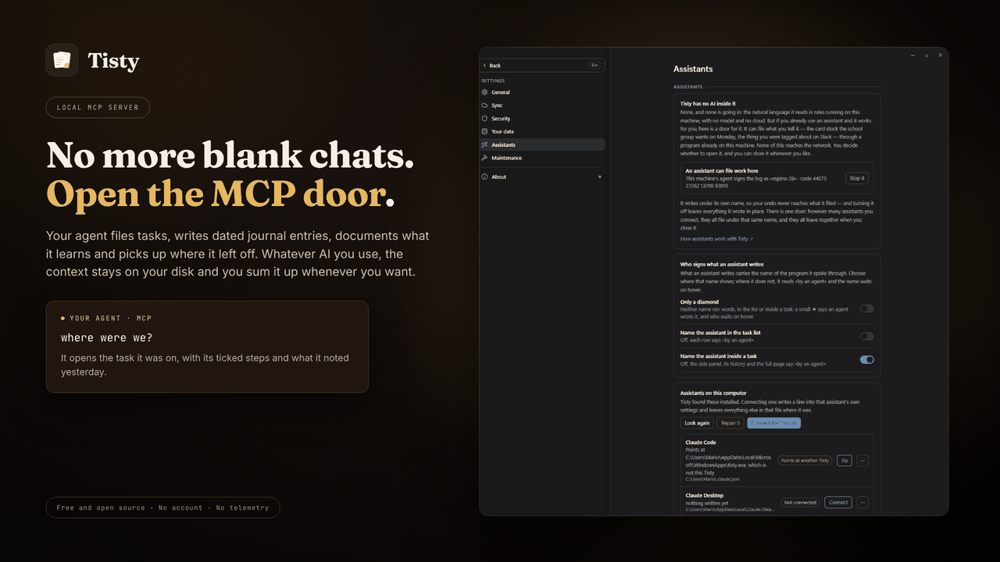

# Assistants and MCP

**Tisty is the memory your AI agent keeps between sessions.** GitHub Copilot, Claude Code, Codex, Cursor or any assistant that speaks MCP files its work here as tasks with steps and a journal, keeps what it learns in documents, and starts the next session from what moved instead of from a blank chat — on this computer, with no account and nothing over the network.

**Tisty itself is not AI and has none inside.** The natural language that turns «call the bank at 3» into a task is rules running on your machine: no model, no request, no cloud. That is not going to change.

But if you already use an assistant, you are probably telling it things worth keeping — the school group says card stock on Monday, the invoice is due on the 30th, the bug you just fixed and how. So Tisty leaves a door, and you decide whether to use it.

**Your agents' work, in the open.** Through Tisty, an agent plans in documents and works in tasks: it writes the plan, what it found and what it decided as Markdown, breaks the work into tasks with steps and ticks them off as it goes. Nothing stays buried in a chat: every stage lands in Tisty, on your computer, where you can follow it as it happens and audit it later. When it says a task is done, you are the one who closes it.



## How the door works

Tisty speaks [MCP](https://modelcontextprotocol.io) through `tisty mcp`, over its own standard input and output. That `tisty` comes inside the app and is not a command line any more: it opens only the assistant's door (see [[Command line|Command-Line]]).

- **On this machine only.** No port, no account, no token. It is not a server, and nothing can reach it from the network.
- **Nothing listens until you connect it.** The assistant starts `tisty mcp` when it needs it.
- **You hold the door.** It comes open on its own until you choose — on a new install, and on an update if you never closed it — and **Settings › Assistants** closes it with one click. While it is closed, everything an assistant tries is refused. Letting an assistant in and throwing it out are events in your log; that you chose to keep the door closed is kept in this computer's settings.

Since 1.32.1, while the door is open, Tisty also answers to plain `tisty` from any terminal: the installer's copy on Windows and the Homebrew one on a Mac. If you have the Microsoft Store copy and the installer's at once, the newest answers. Close the door and `tisty` stops answering. An assistant that was already open needs a restart to notice.

## Connecting an assistant

### From Settings (the easy way)

**Settings › Assistants** finds the assistants installed on this computer among the ones Tisty knows (Claude Code, Claude Desktop, Codex, GitHub Copilot CLI, VS Code, Cursor, Devin Desktop and Windsurf, Antigravity, Gemini CLI, Qwen Code, OpenCode, Kilo Code, Zed, Junie, Kiro, Warp, LM Studio, Amp, Augment, Factory Droid, Trae, Cline, Roo Code, BoltAI, Goose and Continue) and says how each one stands:

- **Connected** — it starts this Tisty.
- **Not connected** — **Connect** writes Tisty into its settings, in the shape that assistant reads.
- **Points at another Tisty** — an older copy, or one that moved. **Fix** points it here.
- **May be here** — only its folder is left, so it may have been uninstalled.
- **By hand** — Goose and Continue keep their settings in YAML, which Tisty does not write. The row shows what to paste.

**Connect the ones found** connects every one waiting at once. Some files serve more than one assistant: GitHub Copilot CLI's is also read by VS Code, and Codex's by ChatGPT and Warp.

An assistant reads its settings when it starts, so after connecting it, quit it completely and open it again. If it has a window, closing it is not enough: on Windows it keeps running by the clock until you quit it from there, and on a Mac until **⌘Q**.

Tisty only touches its own entry. Anything you added to it, like `env` or the tools you allowed, stays, and so does the rest of the file. The first version of each file is kept beside it as `.before-tisty`, and the one just before each write as `.before-tisty-last`.

The **⋯** on every row shows how to connect that assistant by hand: its own command when it has one, and the exact lines for its file. The search box below the list does the same for an assistant Tisty knows but did not find.

### With a plugin

Some assistants take Tisty as a plugin. The plugin carries a small launcher that finds the Tisty installed on this computer (the Microsoft Store copy, the installer's, the Mac app or Homebrew), uses the newest when there are several, and starts that copy's own `tisty mcp`, so what the assistant writes always matches your app and your data. If Tisty is not installed, the assistant gets a single tool, `install_tisty`, that tells you how to get it. The launcher needs Node.js.

In Claude Code:

```console
/plugin install tisty --marketplace rgdevment/mcp-plugins
```

Any other assistant that starts a server by command, such as GitHub Copilot in VS Code, Cursor or Cline, takes the same launcher from npm:

```json
{
  "mcpServers": {
    "tisty": { "command": "npx", "args": ["-y", "tisty-mcp"] }
  }
}
```

The first start downloads the launcher and can take a moment; later ones are immediate. If Tisty lives somewhere unusual, set `TISTY_PATH` to the full path of its `tisty`.

Connect each assistant one way, the plugin or **Settings › Assistants**, not both: otherwise it runs Tisty's server twice and sees every tool twice. The plugin's source and its issues are in [mcp-plugins](https://github.com/rgdevment/mcp-plugins).

Tisty is also listed where assistants look for servers: the official MCP Registry as `io.github.rgdevment/tisty`, the [GitHub MCP Registry](https://github.com/mcp/rgdevment/tisty), [npm](https://www.npmjs.com/package/tisty-mcp), [Glama](https://glama.ai/mcp/servers/rgdevment/Tisty) and [MCP Market](https://mcpmarket.com/server/tisty).

### Assistants inside WSL

On Windows, an assistant that runs in a Linux distro under WSL reads its settings in Linux, where a `C:\...` path does not exist. **Settings › Assistants** lists your distros; **Look in Ubuntu** reads that distro's files (starting it if it was stopped) and connects its assistants to the same Tisty, through its Linux path:

```console
$ claude mcp add --scope user tisty -- /mnt/c/Users/<you>/AppData/Local/Programs/Tisty/tisty.exe mcp
```

It is the same Tisty and the same tasks and documents as on Windows. If a distro has Windows programs turned off (`[interop] enabled = false` in `/etc/wsl.conf`), Tisty says so and writes nothing there.

### By hand

For an assistant Tisty does not know, one line does it, with the full path to the `tisty` that came with the app. **Settings › Assistants › How to connect one** shows both forms below with that path already filled in for this computer, ready to copy, so nothing needs to be on your PATH:

```console
$ <your-assistant> mcp add tisty -- <path-to-tisty> mcp
```

For example, with Claude Code:

```console
$ claude mcp add tisty -- <path-to-tisty> mcp
```

Clients configured with a JSON file take the usual shape:

```json
{
  "mcpServers": {
    "tisty": { "command": "<path-to-tisty>", "args": ["mcp"] }
  }
}
```

Restart the assistant. If you closed the door, open it again in **Settings › Assistants**.

You do not have to remember this step. When an assistant tries to work with Tisty while the door is closed, the window tells you — «Claude Code tried to come in» — and **Let it in** opens the door right there. It also tells you when your assistants are connected but cannot do anything yet because the door is closed.

## What it can do, in short

File a task with its steps and its date, set a reminder, add to a task's journal, write and edit documents, file them into folders and pages, keep a copy of a file you point it at, search and read what is there — and say a task it filed is done, **for you to confirm**.

When it tells you what it did, it names a task or a document the way you would: by its title and where it is — the list, or the folder. It never shows you an id.

It can **never** close or delete a task, delete a document, or move a day you set. A document that had its day it marks: you delete it, put it away or take the mark off. On a task you wrote it only says what it did — a step or the whole task is done — as its word, which you take or not.

The full rules are in [[What an assistant may do|MCP-Permissions]], and every tool is in the [[tools reference|MCP-Tools]].

## Ready-made requests and @-mentions

Since 1.46.0, the memory and context Tisty keeps for your agent is one command or one `@` away, with no tool names to learn.

**Five ready-made requests.** Tisty hands your assistant five requests it shows as commands. In Claude Code they are in the `/` menu, and `/mcp__tisty__pick_up` and the like run them; other assistants that take requests from a server show them in their own menu.

- **Pick up where I left off** (`pick_up`) — what moved since the agent was last here and who moved it, then the open task it last worked on, with its steps, its page and its latest notes. It changes nothing.
- **Leave this where I can pick it up** (`leave_off`) — it ticks the finished steps and notes what was done, what was ruled out and why, and what comes next; if everything is done, it says so with the proof, and a decision that outlasts the task goes in its document, dated, with the one it replaces struck through; with no document on it, it stays in the note and it tells you.
- **Plan this work as a task with steps** (`plan_task`) — one task with its steps, in the list it belongs in, once nothing open or in the archive already covers it.
- **How did we solve this before?** (`solved_before`) — it searches the archive of finished tasks and your documents before trying anything new.
- **Keep this decision in its document** (`keep_decision`) — the decision you just made goes into the one document on its subject, in place, and the one it replaces is crossed out; if no document covers it, it asks you where it belongs.

Each one takes a word after it, like `/mcp__tisty__solved_before timeouts`, or nothing, and then it works from what you have been talking about.

**Documents to mention.** Your documents that are not put away are offered too, so you can hand one to the assistant by name: in Claude Code, type `@` and pick it by its title and folder. A document of up to about 12,000 characters arrives whole; a longer one arrives as its outline, its headings and their lines, and the assistant asks for the part it needs.

## A day with your agent

What an agent connected to Tisty does on a real piece of work:

1. **It asks what moved** since its last session, and who moved it, instead of rereading everything.
2. **It opens the task it was on**, which Tisty names for it. *Done when* on its page says when it is finished, and the unticked steps say what is left.
3. **It searches the archive before proposing anything.** If it was solved before, it starts from there.
4. **It reads the module's document by its outline**, then only the section it needs, and keeps to the decisions and to what is out of scope — so it does not reopen settled debates or wander off.
5. **It ticks each step when it is done and notes what it ruled out**, so the next session, or another agent, does not repeat the failed attempt.
6. **When a task's page grows long, it compacts the assistants' notes on it** into one dated digest — state, decisions, what was ruled out. The journal stays whole, and asking it to put the notes back brings them as they were, even after later ticks.
7. **It ends by saying what it did and how it knows it holds.** You review it and close it.
8. **After reading a long document, it leaves a summary** for the next agent to choose by. When the document changes, the summary is marked stale.

Who owns what stays clear. What your agent files is its own to keep true: it describes it, plans the steps, ticks them and notes what it learns. What you wrote stays yours: the agent only adds — a journal entry, a reminder, a file — and gives its word that a step or the task is done, for you to confirm. Closing is always yours.

## Signed by name

What an assistant writes is signed with the name of the program it spoke through. In a row it reads «by an agent», and the name shows when you hover over it; inside a task — the side panel, the whole page and the journal — it names the program: «by Claude Code», «by Codex». Settings › Assistants counts what each one wrote, and there you choose where the name shows: in the task list, inside a task, both or neither — wherever it does not, it reads «by an agent» and the name waits on hover. «Only a diamond» goes further: no words anywhere, just a small ◆ in the assistants' colour, with who wrote it on hover. What was written before programs said their name reads «by an assistant».

## It reads sparingly

Tisty keeps a small card for each document — its headings, how long it is, what it leans on — worked out from the text itself, on this machine, and never sent anywhere. An assistant reads that card to pick the document it needs, then asks for only the part it wants, or changes that part without reading the rest. A long document is not poured into a model because an assistant wanted one paragraph of it.

Having read a document, it can leave a short summary for the next assistant — kept on this machine, never synced, and not part of what you wrote.

Tisty knows what each answer costs, and keeps cutting it. Measured on a 256 KB Markdown work log, against an agent that rereads the whole file every session:

| The agent… | Spends, with Tisty | Saving |
| --- | --- | --- |
| Picks up the work, with nothing new | about 1% | 99% less |
| Picks up and opens the task it was on | under 3% | over 97% less |
| Looks for something solved months ago | about 3% | 97% less |
| Looks up one subject: the outline and one section | about 6%, 12% at worst | 88–94% less |

No document holds more than 64,000 characters, so a log that size is kept as subjects in pages; no read brings more than about 12,000 characters, and past that a document asked for whole comes back as its outline; a task's page comes whole only up to about 4,000 characters, and a journal note holds at most 4,000; picking up again brings only what moved; and what is finished costs nothing until it is searched.

Connecting costs something too: the description of Tisty's tools weighs about a sixth of that log, a third less than it did, and a test keeps it from growing. An assistant that loads tools only as it uses them does not pay it whole; one that loads every tool each session saves 72–83%, and below some 50 KB of notes a plain file is cheaper. The counts are characters, with the JSON each answer carries included, and tokens follow them closely.

## The one thing worth knowing before you connect one

> [!WARNING]
> Whatever an assistant reads travels wherever that assistant travels. If it runs against a cloud service, what it looks at is on its way to that service. Tisty still sends nothing and has no server — but this door is real, and it is the only thing in Tisty that can carry your data off the machine. That is why, open as it comes, closing it is one click in **Settings › Assistants**.
