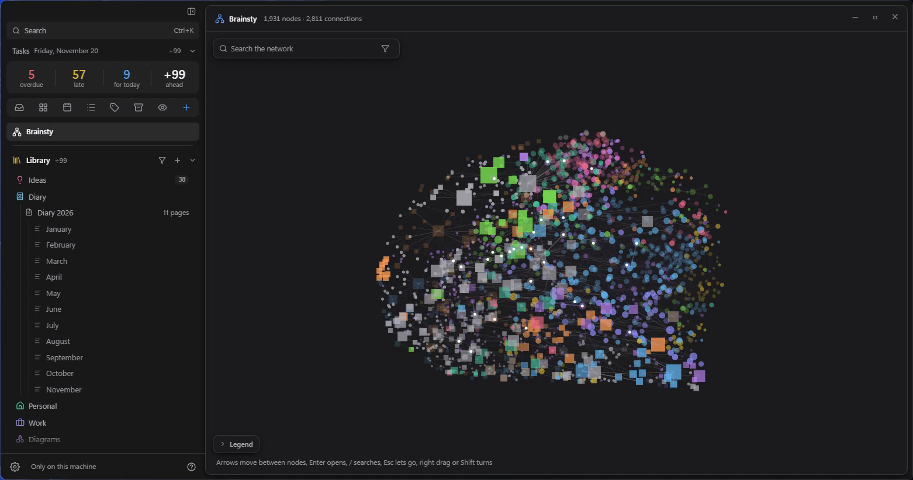

# The Brainsty network

I had kept things in Tisty for years and had no way to see them together. I knew «Rina» cited the task for her vaccine and that the building minutes had created three tasks, but each tie lived inside its own file. Brainsty draws everything you keep, with what joins it, as one network: from afar, a map of your projects; up close, every document and every task with its neighbours.

This page covers opening it, what each shape and each line means, moving through it and filtering it. The ties it draws are the ones you make as you write: [[Linking documents|Linking-Documents]] and [[Tasks in documents|Tasks-in-Documents]]. Your agent reads the same network as an index: [[How an agent works|How-an-Agent-Works]].


## When it helps

- **Coming back to a project after weeks.** Open the network, search for the project and see at a glance its documents, its open tasks and the ones you already closed.
- **Finding what was left loose.** A document with no lines is one nothing names: maybe it lacks a link, or it is no longer needed.
- **Seeing what a tag touches.** Filter by `#rina` and her vaccines, her walks, the vet and this month's tasks remain.
- **Seeing what you touched last.** The **Touched** filter with **Last 7 days** leaves only what moved this week.

## Opening and closing it

The network lives in a window of its own, apart from the main one. That way it costs something only while it is open, and the main window stays free beside it: you can write while the nodes settle.

- **Brainsty**, in the sidebar under the task views, opens it. With the sidebar folded, it is the network icon on the rail.
- It starts centred on the document or task you were on; if you were on none, on what you wrote last.
- It wears the system's title bar, named «Brainsty», and it moves, maximises and minimises like any other window. At the top, inside, the count: «589 nodes · 1252 connections».
- The first time, the nodes settle for a few seconds, as if let go, and stop by themselves within four seconds; a network of about 5,600 nodes is still in two or three.
- **There is never more than one.** With the network already open, another click on **Brainsty** brings it to the front just as you left it: the same zoom, the same picked node, the same filters. It does not centre again on what you are looking at now; for that, close it and open it again.
- **It closes** with the close button on its bar or with the last `Esc` (see [With the keyboard](#with-the-keyboard)). Once closed, nothing keeps running, neither the drawing nor the settling, and the main window stays as it was.

### Where it shows up

- The first time it opens centred, at 1280 × 820. It shrinks down to 640 × 480, no smaller.
- After that it remembers its size, its place and whether it was maximised. **Each computer remembers its own**: on the laptop it can live on the right, and on the office computer maximised on the second screen. It does not travel with sync.
- If its place was on a screen no longer plugged in, it opens centred on the one you have.
- Minimising it does not change the place it remembers.
- **It follows Tisty**: the light or dark theme and the language apply here too, even when you change them in **Settings** with the network open. In dark, the network takes the dark colours.

## What each thing is

| In the network | It is | How it looks |
| :-- | :-- | :-- |
| Square | a document or a page of a book | in its folder's colour; a page, smaller beside its document |
| Circle | a task | in its list's colour; under way, bright; done, fainter; dropped or archived, faint and small |
| Purple dot | a tag | tied to everything that carries it |
| Grey dot | a picture or a file | tied to what uses it; up close, with its thumbnail |

Lists and folders are not nodes: they are the colour and the zone where their things gather. If they were nodes, everything would be tied to «Home» or to the inbox and the network would say nothing.

| Line | Ties | When it exists |
| :-- | :-- | :-- |
| Solid | a citation | a card of another document or of a task, alone in its paragraph |
| Dashed | a mention | a link inside a sentence to another document or to a task |
| Thin | the structure | a page and its book, a part and its task, a task and the document it was born in, an idea and its document |
| Thin and faint | a tag | what carries `#tag` and its dot |
| Thin, toward a file | a use | what shows a picture or attaches a file |
| Amber curve | a guess | two things that share uncommon words and that nobody tied; more opaque the more alike they are |

Every straight line is written somewhere, and can be explained. The amber curve is not: it is what Tisty guesses, never straight, solid or dashed, so it is never mistaken for anything written, and its preview says why. [Alike](#alike) tells it.

## From afar and up close

The network changes what it shows with the distance, and each detail fades in as you come closer:

- **From afar**, with the wheel backwards: the nodes and their ties make the outline of a brain seen from the side, with no titles and faint lines. It shows where there is a lot and where there is little.
- **At middle distance**, as it opens: each folder and each list tints its zone, and only the most connected nodes carry a title.
- **Up close**: every title, each kind of line, tags as `#tag` and, beside each picture, its thumbnail. The amber curves show here, little by little, between two nodes in view; around the node you pick they show from any distance.



The wheel zooms in and out; dragging moves you around. At the first touch the network stops following the point it started on.

## Picking, looking and opening

- **A click on a node** lights it up with its neighbours, dims the rest and opens its preview, on the right. At the top it says what it is, where it lives and how many connections it has: «Document · Pets · 6 connections». Below:
  - for a document or a page, its first lines, with its pictures;
  - for a task, its card, the same one a document that cites it draws: its list, its date or its state and how many steps are done. Here it is read, not changed: a click on the card opens it in the main window, where you tick its steps;
  - for a tag, its name and how many connections it has;
  - at the end, when Tisty guesses things alike, the **Alike** section: each with its title and why, «Tisty guesses: they share *quote* and *roof*». A click on the title picks it in the network.
- **Open**, in the preview, or **a double click** on the node, brings the main window to the front and opens it there: a document in the Library, a task beside its list, a tag in its view. The network stays open behind it, with the same node picked; another click on **Brainsty** takes you back to it.
- **A picture or a file** has a preview but no **Open**: it opens from the document or the task that uses it, its neighbour in the network.
- **Close the preview**, or `Esc`, lets go of the node and the whole network shows again.


## Searching

The search box sits at the top left, **Search the network**; `/` focuses it from anywhere in the network. Type part of a title: accents and capitals do not matter. The list of what matches shows below, each with what it is («Document», «Task», «Tag»…): first what starts the same way, then what has a word that starts that way, and last the rest. `Enter` picks the first, or a click the one you want: the network centres on it and opens its preview. When nothing is called that, it says «Nothing by that name».

## Filtering

The funnel beside the search box, **Filters**, opens what can be left out. Each option is a button that turns on and off, and the network is drawn again with what remains:

- **Show**: **Documents**, **Pages**, **Tasks**, **Tags**, **Files** and **Alike**. **Alike** starts on; off, the network draws no amber curve and the preview lists none.
- The state of tasks: **Under way**, **Done** and **Archived**.
- **Touched**: **Any time**, **Last 7 days**, **Last 30 days** or **Last year**, by the last day each thing changed.
- **Tag**: pick one from the list and only what carries it remains; **Any tag** takes it off.

With a filter on, the funnel is tinted and **Show everything** appears, which brings the whole network back.


## With the keyboard

| Key | What it does |
| :-- | :-- |
| `Tab` | go round the search box, **Filters**, the preview and the network, without leaving the window |
| Arrows | pick a node and walk: first to a neighbour in that direction, otherwise to the nearest one; an amber curve is not a path |
| `Enter` | open the picked node in the main window |
| `/` | search |
| `Esc` | let go in layers: first the search, even when it is empty; then the node; and the last one closes the window |

After you pick a search result, or leave the search with `Esc`, the arrows and `Enter` walk the network again, with no mouse. So `/`, `rina`, `Enter` and `Enter` again open Rina's note without leaving the keyboard.

## An example: back to Rina's things

You have not touched anything about Rina for a month and want to know how it is going.

1. **Brainsty** in the sidebar. The network opens in its window, on what you wrote last: the building minutes.
2. `/`, `rina`, `Enter`. The network centres on «Rina», the note in the **Pets** folder, and its preview shows its first lines.
3. You come closer with the wheel: her neighbours show with titles, «Vet» joined by a dashed line (you mention it in a sentence), the solid card of «Rina's yearly vaccine», the photo of the walk with its thumbnail and an amber curve to «Saturday walks», which nobody linked. Rina's preview says why: «Tisty guesses: they share *rina* and *park*».
4. A click on «Rina's yearly vaccine»: the preview shows its card, «1 of 3 steps», due on Friday. **Open** brings the main window to the front, with the task beside its list, and there you tick «Book a slot».
5. Another click on **Brainsty** takes you back to the network, still behind. **Filters**, **Tag** `rina` and **Touched** **Last 30 days**: her two documents and the tasks under way that moved this month remain.
6. **Show everything**, and `Esc` until the window closes. The main window stays on the task you opened.

## Alike

Two things can be about the same without anyone having tied them: the task «Ask for a quote on the roof» and the document «House repairs», which talks about the roof and its quote. Brainsty notes them as **alike**, apart from the lines you wrote.

Two things are alike when they share at least two **weighty words**: the kind that shows up in few of the things you keep, in 5 % of them or fewer. *Quote* and *roof* weigh; *week* or *make*, which are everywhere, do not. Each guess keeps the words that say why. Words are compared without accents or capitals, so *Roof* and *roof* are the same.

It works across languages too when what they share are names: a task in English and a document in Spanish that both talk about *Folio* and *Glama* are alike; «Rina's yearly vaccine» and «Vacuna anual de Rina», which share only *Rina*, are not.

The rules:

- **Three alike at most for each thing**, and each end must be among the other's three closest.
- **The bar comes from what you keep**, not from a fixed figure: a guess must beat what one pair in a thousand reaches in your base.
- **What is already tied is not guessed**: when a line in the network already ties them (a citation, a mention, a part and its task, the document a task was born in), or when they are a page and its book, a document and its version in another language, or a task and its page.
- **A document in another language** has a place of its own among the three, so what it shares with another language is not crowded out by kin in its own.
- **Each thing keeps up to 256 words**, the ones said most. Bare numbers and long runs of letters and digits, like an id or a hash, do not count.

**When.** A low-priority pass, in the background, looks every 30 seconds and waits for you to stop writing, five minutes at most, before comparing. The words of what changed are kept at once. When a new version of Tisty changes Brainsty's base, the base is built again once, on the first start: meanwhile the network says «Brainsty is still reading what you keep. Open it again in a moment.».

**What never goes through it.** Hidden and dropped tasks, and your whole [Diary](Documents#diary), keep no words, even when you open the Diary to agents. Hiding a task takes its guesses away in the same round.

**Where they show:**

- **In the network**, as an amber curve: up close between two nodes in view, and around the node you pick from any distance. How opaque it is is measured among the guesses in your base: the most opaque is the most alike.
- **In the preview**, in its **Alike** section, apart from the connections, with the shared words. They show as the base keeps them: with no accents and in lowercase, *quote* and *roof*.
- **On the card your agent reads**, under `guessed`, apart from everything someone wrote. Each guess brings its title, its score and the shared words, and the rules ask it to read both before joining anything:

```json
> brain {"task": "…Ask for a quote on the roof…"}
{ "guessed": [
    { "id": "…", "kind": "doc", "title": "House repairs", "score": 0.42, "shared": ["quote", "roof"] } ] }
"Guessed alike by Tisty, linked by no one: \"House repairs\" […] (shares quote, roof)."
```

A guess shows only when both its ends are in sight: in the network, both must be drawn; for an agent, both must pass its gate, so a hidden task is never named through a guess. A guess adds no connection to the count at the top and does not count towards the 12,000-node cap.

## Good to know

- **It builds itself, on this computer.** Tisty reads how your things are tied in the background, without slowing what you do. A link you just wrote reaches the base a few seconds later.
- **The network is read when it opens.** What you write with Brainsty's window open shows the next time you open it: close it and open it again.
- **Just installed**, while it reads everything for the first time, the network says «Brainsty is still reading what you keep. Open it again in a moment.». With nothing kept: «Nothing to draw yet: write a document or a task and it shows up here.».
- **Up to 12,000 nodes and 40,000 connections.** Past that, the network keeps what you touched last, its neighbours, your documents and the tasks under way, and says at the top how much was left out: «312 nodes and 940 connections left out». Past 6,000 nodes, nodes shrink so the whole network takes the same room in the window.
- **What is hidden does not show.** A task you hid is not drawn, neither as a node nor as the end of a line, and a tag or a file only it carried goes with it. A dropped task does show, faint and small.
- **Nothing leaves the computer.** The network and the guesses are worked out on each computer and rebuild themselves: they are not synced, and they do not go to Folio, a `.tistyx` or an export. What travels is your documents and tasks, and each computer draws it again.
- **Without a dedicated graphics card** the network is drawn just the same; zooming in and out costs a little more.

## Where next

- [[Linking documents|Linking-Documents]]: the dashed and solid lines between documents.
- [[Tasks in documents|Tasks-in-Documents]]: the lines between a document and its tasks.
- [[How an agent works|How-an-Agent-Works]]: the same network, read by your agent.
- [[Documents]]: folders and tags, which give the colours and the zones.
