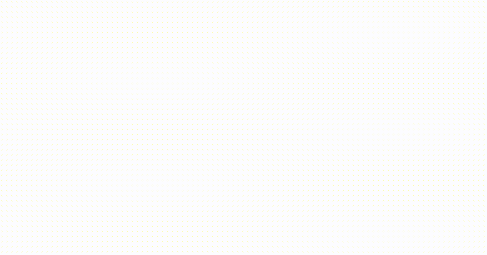

# The Brainsty network

I had kept things in Tisty for years and had no way to see them together. I knew «Rina» cited the task for her vaccine and that the building minutes had created three tasks, but each tie lived inside its own file. Brainsty draws everything you keep, with what joins it, as one network: from afar, a map of your projects; up close, every document and every task with its neighbours.

This page covers opening it, what each shape and each line means, moving through it and filtering it. The ties it draws are the ones you make as you write: [[Linking documents|Linking-Documents]] and [[Tasks in documents|Tasks-in-Documents]]. Your agent reads the same network as an index: [[How an agent works|How-an-Agent-Works]].

## When it helps

- **Coming back to a project after weeks.** Open the network, search for the project and see at a glance its documents, its open tasks and the ones you already closed.
- **Finding what was left loose.** A document with no lines is one nothing names: maybe it lacks a link, or it is no longer needed.
- **Seeing what a tag touches.** Filter by `#rina` and her vaccines, her walks, the vet and this month's tasks remain.
- **Seeing what you touched last.** The **Touched** filter with **Last 7 days** leaves only what moved this week.

## Opening and closing it

- **Brainsty**, in the sidebar under the task views, opens the network over the whole window. With the sidebar folded, it is the network icon on the rail.
- It starts centred on the document or task you were on; if you were on none, on what you wrote last.
- The first time, the nodes settle for a few seconds, as if let go; the window keeps answering meanwhile, and the settling stops by itself in about four seconds.
- At the top, the count: «589 nodes · 1252 connections».
- `Esc` or **Back** close it, and the window is exactly as it was: the same view, the same open task, the same place in the document.

## What each thing is

| In the network | It is | How it looks |
| :-- | :-- | :-- |
| Square | a document or a page of a book | in its folder's colour; a page, smaller beside its document |
| Circle | a task | in its list's colour; under way, bright; done, fainter; dropped or archived, faint and small |
| Purple dot | a tag | tied to everything that carries it |
| Grey dot | a picture or a file | tied to what uses it; up close, with its thumbnail |

Lists and folders are not nodes: they are the colour and the zone where their things gather. If they were nodes, everything would be tied to «Home» or to the inbox and the network would say nothing.

| Line | Ties | When it exists |
| :-- | :-- | :-- |
| Solid | a citation | a card of another document or of a task, alone in its paragraph |
| Dashed | a mention | a link inside a sentence to another document or to a task |
| Thin | the structure | a page and its book, a part and its task, a task and the document it was born in, an idea and its document |
| Thin and faint | a tag | what carries `#tag` and its dot |
| Thin, toward a file | a use | what shows a picture or attaches a file |

Brainsty ties only what is written, and every line can be explained: it never guesses ties by likeness.

## From afar and up close

The network changes what it shows with the distance, and each detail fades in as you come closer:

- **From afar**, with the wheel backwards: the nodes and their ties make the outline of a brain seen from the side, with no titles and faint lines. It shows where there is a lot and where there is little.
- **At middle distance**, as it opens: each folder and each list tints its zone, and only the most connected nodes carry a title.
- **Up close**: every title, each kind of line, tags as `#tag` and, beside each picture, its thumbnail.

The wheel zooms in and out; dragging moves you around. At the first touch the network stops following the point it started on.

## Picking, looking and opening

- **A click on a node** lights it up with its neighbours, dims the rest and opens its preview: the first words of a document, or a task's card with its steps, the same one a document that cites it draws.
- **Open**, in the preview, or **a double click** on the node, opens it: a document in the Library, a task beside its list, a tag in its view. The network closes and leaves you there.
- **Close the preview**, or `Esc`, lets go of the node and the whole network shows again.

## Searching

The search box sits at the top left, **Search the network**; `/` focuses it from anywhere in the network. Type part of a title: accents and capitals do not matter. The list of what matches shows below, each with what it is («Document», «Task», «Tag»…): first what starts the same way, then what has a word that starts that way, and last the rest. `Enter` picks the first, or a click the one you want: the network centres on it and opens its preview. When nothing is called that, it says «Nothing by that name».

## Filtering

The funnel beside the search box, **Filters**, opens what can be left out. Each option is a button that turns on and off, and the network is drawn again with what remains:

- **Show**: **Documents**, **Pages**, **Tasks**, **Tags** and **Files**.
- The state of tasks: **Under way**, **Done** and **Archived**.
- **Touched**: **Any time**, **Last 7 days**, **Last 30 days** or **Last year**, by the last day each thing changed.
- **Tag**: pick one from the list and only what carries it remains; **Any tag** takes it off.

With a filter on, the funnel is tinted and **Show everything** appears, which brings the whole network back.

## With the keyboard

| Key | What it does |
| :-- | :-- |
| Arrows | pick a node and walk: first to a neighbour in that direction, otherwise to the nearest one |
| `Enter` | open the picked node |
| `/` | search |
| `Esc` | let go in layers: first the search, then the node and last the network |

While the network is open, the window's shortcuts do not act on what lies below.

## An example: back to Rina's things

You have not touched anything about Rina for a month and want to know how it is going.

1. **Brainsty** in the sidebar. The network opens on what you wrote last, the building minutes.
2. `/`, `rina`, `Enter`. The network centres on «Rina», the note in the **Pets** folder, and its preview shows its first lines.
3. You come closer with the wheel: her neighbours show with titles, «Vet» joined by a dashed line (you mention it in a sentence), the solid card of «Rina's yearly vaccine» and the photo of the walk with its thumbnail.
4. A click on «Rina's yearly vaccine»: the preview shows its card, «1 of 3 steps», due on Friday. **Open** takes you to the task beside its list.
5. Back in the network, **Filters**, **Tag** `rina` and **Touched** **Last 30 days**: her two documents and the tasks under way that moved this month remain.
6. **Show everything** and `Esc`: you are back in the window as you left it.

## Good to know

- **It builds itself, on this computer.** Tisty reads how your things are tied in the background, without slowing what you do. A link you just wrote reaches the network a few seconds later.
- **Just installed**, while it reads everything for the first time, the network says «Brainsty is still reading what you keep. Open it again in a moment.». With nothing kept: «Nothing to draw yet: write a document or a task and it shows up here.».
- **Up to 12,000 nodes and 40,000 connections.** Past that, the network keeps what you touched last, its neighbours, your documents and the tasks under way, and says how much was left out.
- **What is hidden does not show.** A task you hid is not drawn, neither as a node nor as the end of a line, and a tag or a file only it carried goes with it. A dropped task does show, faint and small.
- **Nothing leaves the computer.** The network is worked out on each computer and rebuilds itself: it is not synced, and it does not go to Folio, a `.tistyx` or an export. What travels is your documents and tasks, and each computer draws it again.
- **The theme and the language** of the window apply here too: in dark, the network takes the dark colours.
- **Without a dedicated graphics card** the network is drawn just the same; zooming in and out costs a little more.

## Where next

- [[Linking documents|Linking-Documents]]: the dashed and solid lines between documents.
- [[Tasks in documents|Tasks-in-Documents]]: the lines between a document and its tasks.
- [[How an agent works|How-an-Agent-Works]]: the same network, read by your agent.
- [[Documents]]: folders and tags, which give the colours and the zones.
