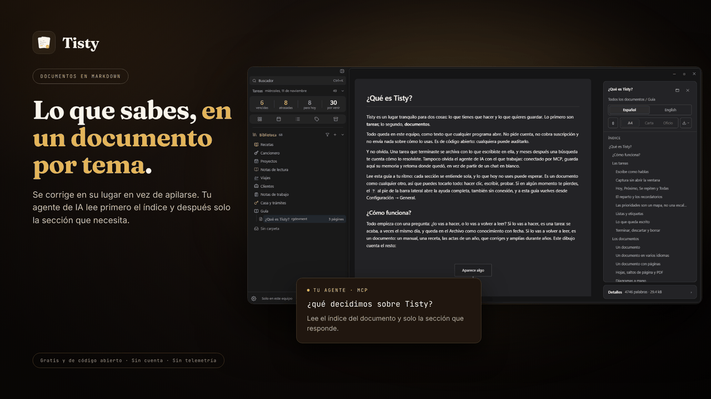
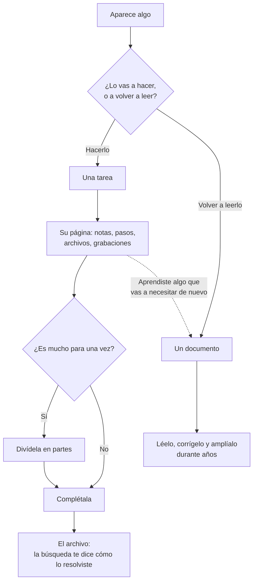
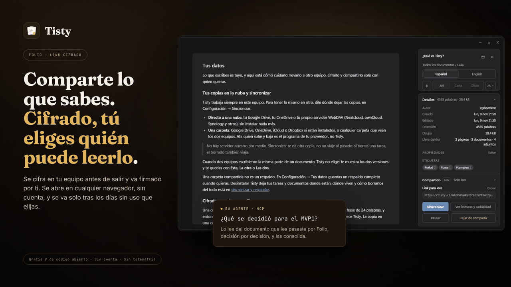

# Documentos

Los documentos viven junto a las tareas, para el material de consulta que no tiene fecha ni se marca como hecho. Son archivos Markdown normales, y el buscador también los lee. Una tarea puede apuntar a un documento; un documento nunca crea tareas.

Cómo se escribe en uno está en [[El editor Markdown|Editor-Markdown]]; todo lo que puede llevar (avisos, tablas, diagramas, fórmulas, widgets, código) está en la [guía de Markdown de Tisty](https://markdown.tisty.app/es/).

## ¿Tarea o documento?

Tisty guarda dos tipos de cosas, y distinguirlas es buena parte de usarlo bien.

- **Una tarea es algo por hacer.** Termina, muchas veces pronto: la completas y pasa al archivo. Pero no desaparece. Lo que escribiste en su página, sus pasos y sus notas se quedan, y meses después una búsqueda la encuentra y te cuenta cómo lo resolviste. Una tarea es conocimiento con fecha.
- **Un documento es algo para guardar.** Un manual, una receta, las notas de un cliente o de una máquina, las actas de un año: se lee una y otra vez, se corrige y se amplía, y crece durante años. Rara vez termina.

Por eso una tarea tiene una página propia: una tarea también es un documento, uno que termina. Piensa en un **spike**, una investigación para saber cómo se puede hacer algo antes de hacerlo:

1. Empieza como una tarea, «Averiguar cómo sincronizar con OneDrive». En su página escribes lo que leíste, lo que probaste y lo que descartaste, sección por sección, y vuelves a corregirlo a medida que aprendes. Adjuntas lo que una descripción fija nunca podría contener: la grabación de la reunión, un video de la falla, el análisis del código, el PDF del proveedor.
2. Cuando el camino está claro, el trabajo se divide en **partes**: «Iniciar sesión», «Subir archivos grandes», «Retomar una subida cortada». Cada una es una tarea con sus propios pasos y notas.
3. Las partes se completan una a una, y después el spike. Pasa al archivo.
4. No se pierde nada. Un año después, «¿cómo resolvimos las subidas a OneDrive?» lo encuentra: su página, sus partes y cada paso, tal como quedaron.

Lo que vas a hacer es una tarea. Lo que vas a volver a consultar es un documento: una receta no es una tarea con pasos, y un pendiente no es un documento. Cuando hacer una tarea te enseña algo que vas a necesitar de nuevo más allá de ella —el arreglo de una falla que vuelve, cómo quiere un proveedor que le pidan— guárdalo también en un documento.

Cómo funcionan la página, los pasos y las partes de una tarea está en [[Tareas]]; lo que guarda una cerrada, en [[El archivo|El-archivo]].

## Crear uno

En la **Biblioteca** de la barra lateral, usa el **+** de su encabezado: **Documento nuevo**. El mismo botón dentro de una carpeta lo crea ahí. **Diagrama nuevo** crea un documento con un diagrama y abre la [[ventana de diagramas|Diagramas]]. **Carpeta nueva** los agrupa, y una carpeta puede tener carpetas dentro.

La primera línea del documento es su título: no hay que ponerle nombre.

`Ctrl`/`⌘` + `X` y `V` mueven un documento entre carpetas.

## Lluvia de ideas

Una idea que llega en medio de otra cosa todavía no tiene dónde ir. Pulsa `Ctrl` + `Shift` + `Space` y después `Tab` para cambiar de **Tarea** a **Idea** (o el atajo propio de la idea, cuando lo elijas en **Configuración**), escríbela, hasta 140 caracteres, y pulsa `Enter`: cae en **Lluvia de ideas**, con su fecha, sin abrir la ventana ni elegir una carpeta. En **Configuración** eliges los dos atajos; el de la idea queda apagado hasta que lo elijas, porque `Ctrl` + `Alt` es AltGr en muchos teclados. Sin teclado, el **+** al final de la fila de vistas abre la misma captura.

- **Lluvia de ideas es un documento normal**, anclado arriba en la Biblioteca. La primera idea lo crea. Puedes abrirlo, escribir en él a mano, archivarlo o exportarlo como cualquier otro.
- **Se ve como notas pegadas en una hoja**, un poco torcidas, de distintos colores y con letra de mano: son ideas del momento. La más nueva va primero. Pulsa una para cambiarla, **Nueva idea** agrega otra y la **×** la quita. Arrastra una nota por su borde sobre otra para dejarla en ese lugar, o pulsa `Alt` y una flecha sobre ella; sigue tan torcida como estaba.
- **El archivo sigue siendo Markdown.** Cada nota es una sección con el día y el minuto en que llegó, y su color, que se elige al crearla y no cambia aunque la muevas, y **Ver Markdown** muestra el texto, solo para leer: una idea es texto suelto, y las tablas y los diagramas van en un documento propio. Cualquier documento con `view: notes` en sus [propiedades](https://markdown.tisty.app/es/propiedades) se ve igual.
- **Ordénalas después**: en cada nota, **Anexar a un documento** la agrega al final del documento que elijas, y **Convertir en tarea** la guarda como tarea, leída como cualquier captura rápida, con sus fechas, listas y etiquetas. En los dos casos la idea sale de la hoja. La Biblioteca muestra junto a la Lluvia de ideas cuántas esperan todavía.

## Carpetas

- **Todas las carpetas nacen plegadas**, así que un almacén con cientos de documentos es un puñado de filas hasta que vas a buscar.
- **El filtro** del encabezado de la Biblioteca deja solo las carpetas y los documentos cuyo nombre contiene lo que escribes, sin mirar acentos ni mayúsculas, con las carpetas de arriba de cada uno abiertas; una carpeta que coincide conserva todo lo que tiene. `Esc` lo cierra.
- **Cuando las tareas toman el espacio**, la Biblioteca se pliega a su título y una franja: cuántos documentos se escribieron hoy y esta semana, cuántas carpetas hay y cuántos marcó un agente como pasados. La flecha junto a su título le devuelve el espacio.
- **Archiva una carpeta entera** con el botón derecho cuando el asunto terminó: baja al estante de **Archivados**, al pie del árbol, con su icono, sus subcarpetas y sus páginas tal como las dejaste. Ahí se lee y se exporta, pero no se escribe ni entra nada nuevo.
- **Desarchívala** y vuelve igual, incluidos los documentos que habías archivado a mano ahí, que siguen archivados.

## Etiquetas

Un documento lleva etiquetas igual que una tarea: escribe `#contrato` en medio de una frase y el documento queda bajo esa etiqueta. La etiqueta vive en la frase, no en una cabecera escondida, así que si llevas el archivo a otro editor, la etiqueta va con él. Una nota traída de otra parte con `tags:` en sus [propiedades](https://markdown.tisty.app/es/propiedades) también queda bajo esas.

- La pantalla de **Etiquetas** muestra las tareas bajo una etiqueta y, debajo, los documentos. Pulsar una etiqueta dentro de un documento abre justo eso.
- Cómo se escribe una etiqueta, con qué letras y qué no cuenta como una, está en la [guía de Markdown](https://markdown.tisty.app/es/etiquetas).

## Adjuntos

Arrastra un archivo a un documento o a una tarea para adjuntarlo: la foto del veterinario, el PDF del seguro, la grabación de una reunión. Una tarea admite archivos de hasta 650 MB, igual que un documento. Se guarda tal cual, dentro de Tisty, y viaja con el documento cuando lo exportas.

Un adjunto se dibuja como lo que es: una imagen tal cual, un sonido o un video con su reproductor, y cualquier otro archivo, también una página `.html`, como una tarjeta con su tipo y su tamaño.

Un sonido o un video que ya está en este equipo se reproduce desde aquí, sin tocar tu nube. Uno que todavía está solo en tu nube muestra **Traer de tu nube** con su tamaño, y se descarga solo cuando lo pulsas; una vez aquí, se queda. Si no puede llegar (sin conexión, o porque nunca terminó de subir), el reproductor dice por qué y ofrece **Reintentar**. Una imagen que no puede llegar avisa de la misma forma.

El **⋯** de una tarjeta guarda una copia, convierte la tarjeta en un enlace simple o la quita de la página. En la tarjeta de una página, además, puede hacerla un documento propio.

## Páginas

Un documento largo por partes (un año de actas, un libro por capítulos) es un solo documento con páginas. Mira [Páginas y PDF](Páginas-y-PDF).

## Varios idiomas

Un documento puede estar en varios idiomas: cada idioma es un documento propio, y Tisty los muestra como uno solo, en el idioma de la app, con un selector en el panel del título, o sobre la hoja si cerraste el panel, que te deja en la misma sección. Desde cuatro idiomas, el selector, sobre la hoja y en el panel por igual, pasa a ser un solo botón con el idioma que ves y cuántos hay; los lista todos con su código, y desde nueve un campo busca uno por su nombre o su código.

- **Traducir a…**, en el menú del documento, escribe una copia de su texto y sus páginas en el idioma que elijas, lista para traducir sección por sección. Si el documento todavía no dice su idioma, te lo pregunta.
- **Unir con su otro idioma…** junta dos documentos que ya tienes, en cualquier orden: te pregunta el idioma de cada uno por su nombre, y **Separar de sus idiomas** los vuelve a separar.
- Los idiomas de un documento están en una misma carpeta y se mueven, se archivan y se borran juntos. La búsqueda los encuentra una sola vez, abiertos en el idioma donde cayó la palabra.
- Al exportar un documento, sus propiedades llevan `translationKey:`, y al volver a importarlo se une otra vez a los demás.

## Importar

**Importar un documento**, en el árbol, toma un archivo `.md`, `.markdown`, `.txt`, `.html`, `.htm` o de Word (`.docx`) y lo trae, de a uno. Una página web o un documento de Word entra en el Markdown de Tisty, con sus títulos, listas, enlaces, tablas y colores (un color pasa al rotulador más cercano de la paleta), y las imágenes de un Word entran con él como adjuntos. Un `.tistyx` de otro Tisty se desempaca entero.

Word, HTML, Google Docs, texto enriquecido, texto plano y notas de Obsidian entran todos como Markdown, con sus imágenes y archivos: [Convertir a y desde Markdown](Convertir-a-y-desde-Markdown) cuenta cada forma de entrar.

Las tareas hay que escribirlas: no hay importador para la lista de tareas de otro programa.

## Abrir un archivo Markdown de afuera

Tisty no necesita quedarse con un archivo para mostrarlo. Elige Tisty en **Abrir con** para un archivo `.md` o `.markdown` (nunca se pone como programa predeterminado) o sigue un enlace `tisty://open?path=…`, y el archivo se abre en **solo lectura** en un visor liviano propio, con la barra de título del sistema, sin entrar a tu almacén. Lee hasta 1 MB, cerca de un millón de caracteres, y avisa cuando un archivo pesa más.

- **La columna junto a la página** tiene **Editar**, **Ver Markdown** (`Ctrl`/`⌘` + `Shift` + `M`; **Ver el documento** regresa de ahí), los títulos del archivo y sus detalles: su carpeta, peso, fecha y propiedades. Mientras está abierta, la página se corre para dejarle lugar y se angosta si hace falta, así la columna nunca tapa el texto. En una ventana angosta la barra lateral se pliega primero a sus iconos, para que la columna conserve su lugar; solo si ni así cabe se pliega, y su botón en la barra (`Ctrl`/`⌘` + `\`) la abre.
- **La barra** tiene **Buscar en el texto** (`Ctrl`/`⌘` + `F`), el tema y **Más**, que además trae texto más grande y más pequeño, **Copiar el Markdown**, **Imprimir** y **Mostrar en la carpeta**. El tema y tu lugar en el archivo se recuerdan.
- **Lee el archivo como se escribió para otros programas.** Un encabezado centrado sigue centrado, una insignia queda en su línea, las líneas que un editor cortó por columnas se juntan, y `#ff0000` o `[[x]]` quedan como palabras. Los diagramas y las fórmulas se dibujan, y también un [widget](Widgets-en-documentos), porque nada en él se ejecuta.
- **Las imágenes** junto al archivo se muestran si están en su carpeta o más abajo. Las imágenes de internet esperan: una línea sobre la página dice cuántas hay, y **Mostrarlas** las trae. Vuelve a preguntar cada vez que abres el archivo ([qué envía eso](Privacidad#las-peticiones-de-red-que-hace-tisty)).
- **Los enlaces**: uno a otro `.md` de al lado se abre en la misma ventana, con **Volver** (`Alt` + ←). Uno a la web abre tu navegador.
- **Editar** hace una copia en tu almacén, escrita en Markdown de Tisty, y la abre; el archivo sigue igual y el visor se cierra. Un archivo de más de 500 KB se puede leer pero no editar, y **Editar** lo dice. Si un archivo de al lado no pudo venir, el visor sigue abierto y dice cuántos.
- **En un Tisty todavía sin configurar**, el archivo se lee de inmediato y **Editar** no hace ninguna copia: trae la bienvenida, y el visor dice que primero la termines. Cuando la bienvenida termina, la copia se hace y se abre.

Un enlace `tisty://open` solo llega a un archivo de texto legible de este equipo.

### Un documento en una ventana aparte

**Abrir en una ventana aparte**, bajo **Ventana** en el panel de un documento, lo muestra en solo lectura junto a tu trabajo.

- **Índice y página** (`Ctrl`/`⌘` + `\`) abre una columna con sus títulos, qué es el documento y el ancho de la página: cuánto mide para leer y el papel de su PDF. **Hojas**, primero en esa fila, desbloquea el papel y lo muestra en hojas, en **Vertical** u **Horizontal**, y su PDF sale así; el archivo no cambia.
- **Lectura** y **Markdown** cambian entre la página dibujada y su texto.
- **Más** tiene **Buscar en el texto**, texto más grande y más pequeño, **Copiar como Markdown** (Markdown estándar), **Vista previa** del PDF que saldría (**← Volver al documento** regresa de ella), **Exportar a PDF…**, **Exportar como HTML…**, **Exportar como Word…** y **Duplicar**, que hace una copia.
- **Editar en Tisty** te lleva de vuelta al documento. Su PDF ahí lleva quién lo escribió y cuándo, salvo que desmarques **Con firma** en la vista previa.

## Sacar documentos

Un documento sale entero; cada conversión está en [Convertir a y desde Markdown](Convertir-a-y-desde-Markdown):

- **Copiar como Markdown**: Markdown estándar, listo para cualquier otro editor.
- **Escribirlo en una carpeta**, como archivos de Markdown estándar con sus páginas y adjuntos al lado; un enlace a una de sus páginas apunta al archivo de esa página.
- **De Markdown a HTML**: **Exportar como HTML…**, en el menú del documento, hace una sola página web que viaja sola.
- **De Markdown a Word**: **Exportar como Word…** hace un `.docx` con sus títulos, listas, tablas e imágenes.
- **Exportar para Tisty** en un archivo `.tistyx`, que además lleva lo que Markdown no sabe decir: las carpetas con su orden, icono y color, de qué documento cuelga cada página, qué está archivado y el alias con que se firmó. Incluye un `README.txt`, para que quien lo reciba pueda leer los documentos sin Tisty.
- **De Markdown a PDF**: mira [Páginas y PDF](Páginas-y-PDF#el-pdf-propio-de-tisty).

Exportarlos todos pregunta para quién son: **Para dárselo a alguien**, que sale abierto y lo lee quien tenga el archivo, o **Para otro equipo mío**, que sale cerrado con seis dígitos para que nadie más lo lea. Un documento o una carpeta salen abiertos sin preguntar.

Cuando ya tienes tu identidad (**Configuración › Seguridad**), todo paquete sale firmado con tu llave. Otro Tisty tuyo lo toma como tuyo, cerrado o no. El de otra persona lo toma como escrito por ti y muestra tu nombre con tu huella, para que pueda compararla con la que tú ves. Si algo de adentro cambió en el camino, entra como de un extraño y Tisty avisa que la firma no calza. Un Tisty donde nadie ha creado ni escrito todavía una identidad pregunta antes de abrir un paquete firmado: escribe primero tu frase, en **Configuración › Seguridad**, y llega como tuyo; si lo abres igual, llega como de quien lo firmó, para siempre.

Sin tu identidad, el paquete sale sin firma. Uno abierto entra como de otra persona, aunque lo hayas escrito tú, salvo en el mismo almacén que lo hizo. Uno cerrado pregunta, cuando el número lo abre, si lo cerraste tú: **Lo cerré yo** lo trae como tuyo, **Me lo dio otra persona** como de un extraño. Si vuelve al mismo almacén que lo cerró, no pregunta: el almacén lo reconoce por su sello.

Un paquete firmado lleva además quién editó cada documento que compartiste por Folio. Los detalles del documento los muestran en **Quién lo editó**, cada uno con su huella, según quien te pasó el paquete; nada comprueba si esas llaves se retiraron después. En cualquier caso, ni una línea de la historia viaja dentro.

## Con tu agente

Los documentos son donde el agente de IA que conectas por [[MCP|Asistentes-y-MCP]] guarda lo que sabe, y cómo los lee es lo que lo mantiene barato.

- **Un documento vivo por tema.** Abre con lo que rige hoy, después el tema, lo que queda fuera de alcance, las decisiones fechadas con su porqué (la reemplazada queda tachada, no borrada) y su historia. El agente respeta las decisiones en vez de reabrirlas.
- **Se corrige en su lugar.** El agente reescribe el pasaje que cambió en vez de apilar una segunda copia junto a la primera, y no puede escribir encima de una versión que cambiaste después de que la leyó.
- **Primero el índice, después una sección.** El agente lee los títulos de un documento y cuánto pesa cada sección, y pide solo la parte que necesita. Un documento pedido entero que pasa de unos 12 000 caracteres vuelve como su índice.
- **Páginas para lo largo.** Ningún documento pasa de 64 000 caracteres, así que una bitácora larga queda en temas y páginas, no como un muro de texto.
- **Un resumen para el siguiente.** Después de leer un documento largo, el agente puede dejar un resumen con el que elige el próximo agente; si el documento cambia, queda marcado como desactualizado.

Más en [Un día con tu agente](Asistentes-y-MCP#un-día-con-tu-agente).

## Compartir

Cuando otra persona necesita lo que sabes (tu PO, el QA que llega al proyecto, otro equipo), le entregas el documento. El panel junto a un documento tiene una fila **Compartido** con **Compartir…**. Compartir pasa por Folio, un servicio aparte de Tisty. Al pulsar **Compartir…**, Tisty lee un archivo firmado pequeño para saber si Folio ya abrió. Mientras no abra, te lo dice, con un enlace a [tisty.cl](https://tisty.cl), y nada de tu documento sale de este equipo; las salidas de arriba siguen sirviendo para entregárselo a alguien. Si ese archivo no se puede alcanzar, lo dice y ofrece reintentar. Cuando Folio esté abierto, primero creas tu identidad si este computador todavía no la tiene (la llave que firma lo que compartes, respaldada con tu frase de 24 palabras), luego aceptas sus términos la primera vez, eliges qué puede hacer la otra persona y cuánto dura, y recibes un link. Un documento en varios idiomas los muestra con una casilla cada uno: el que compartes siempre va, puedes dejar fuera otro tuyo, y uno escrito por otra persona se queda aquí. Si Folio cambia sus términos, Compartir y Sincronizar te piden aceptar los nuevos apenas se puedan verificar; mientras tanto sigues compartiendo con los que aceptaste.

Cuando un documento ya está compartido, su fila tiene **Sincronizar**, y nada sube hasta que lo pulsas. Envía solo lo que cambió, y si nada cambió solo trae una versión más nueva que haya enviado otra persona. Folio acepta una nueva versión de cada documento tras una espera corta, y unos pocos documentos nuevos al día, contando cada documento que cita: mientras dura una espera, el botón dice cuánto falta y si hay cambios pendientes, y el diálogo te avisa antes de compartir si un documento y lo que cita no caben hoy.

Su fila dice quién lo creó, quién lo editó por última vez y todos los que lo editaron, cada uno con el nombre que eligió y firmado por su propia llave; un ✓ marca al creador de Tisty. Quien edita con el link de editar elige entre su alias y su nombre. Para quitarle ese poder a todos los que tienen el link, pulsa **Cambiar el link de editar**: el suyo deja de enviar versiones, se quedan con sus copias, y tú le das el link nuevo a quienes deban seguir editando. Lo que te llegó por un link de lectura sigue siendo una copia tuya: Sincronizar le trae las versiones nuevas, y solo un link de editar te deja enviar las tuyas. Si dejas de compartir un documento que otros editaron y después lo vuelves a compartir, el diálogo te recuerda primero quiénes fueron.

Cada idioma de un documento compartido para editar tiene su propio link de editar, y el que entregas los alcanza todos: quien lo abre edita todos los idiomas que compartiste, y **Cambiar el link de editar** los cambia todos de una vez. Abrir un link, de leer o de editar, trae todos los idiomas del documento, hasta 20, unidos como uno solo, y muestra el idioma en que usas Tisty si el documento lo tiene. Un idioma que no dice pertenecer a ese documento, o que su dueño no revisó, se queda en Folio. Sincronizar trae aparte la versión más nueva de cualquiera de sus idiomas, como hace con el documento.

**Un idioma que suma otra persona espera tu revisión.** Cuando alguien que edita con tu link de editar suma un idioma, queda como propuesta: quienes leen no lo ven hasta que lo mantengas. La fila **Compartido** nombra cada uno —«Inglés lo sumó alguien que edita y espera que lo revises»— con **Revisar inglés…**, que lo muestra como lo guarda Folio: quién lo sumó, su título, sus palabras y sus imágenes. **Mantener** firma esa misma versión; si después cambia, la fila lo dice y **Revisar los cambios en inglés…** muestra la versión nueva frente a la que mantuviste. **Dejar fuera** lo aparta, y solo tú puedes volver a leerlo con **Volver a revisar inglés…**. Tu decisión sale con el próximo **Sincronizar**. Quien sumó el idioma ve en su fila si todavía no lo revisas, si lo mantienes o si lo dejaste fuera, y quienes leen ven, junto a un idioma que sumó otra persona, quién lo tradujo y quién lo revisó. **Cambiar el link de editar** nombra los idiomas de otros que mantienes y ofrece **Cambiarlo y dejarlos fuera**, y **Traducir a…** bajo el link de editar de otra persona avisa que el idioma nuevo será una propuesta que revisa su dueño.

## Tu alias

Escribe un alias en Configuración (opcional, y lo eliges tú) y cada documento queda firmado con él, mientras lo que llega de otra persona conserva el suyo. Viaja con tu sincronización y dentro de cualquier paquete, así que elige un nombre que no te moleste que otros lean. Nunca se te pide tu nombre real.
