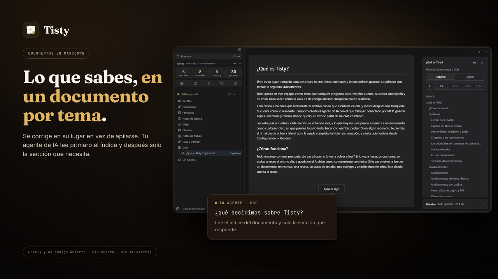
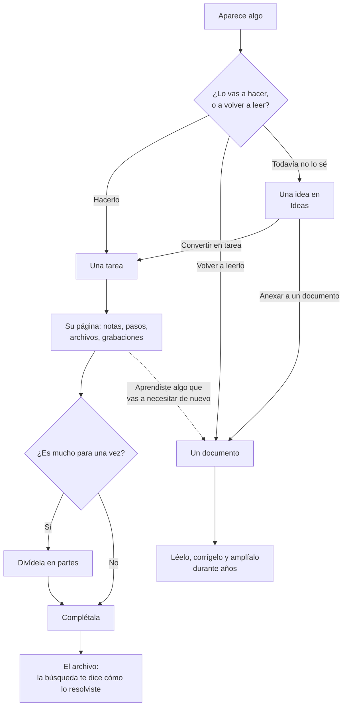
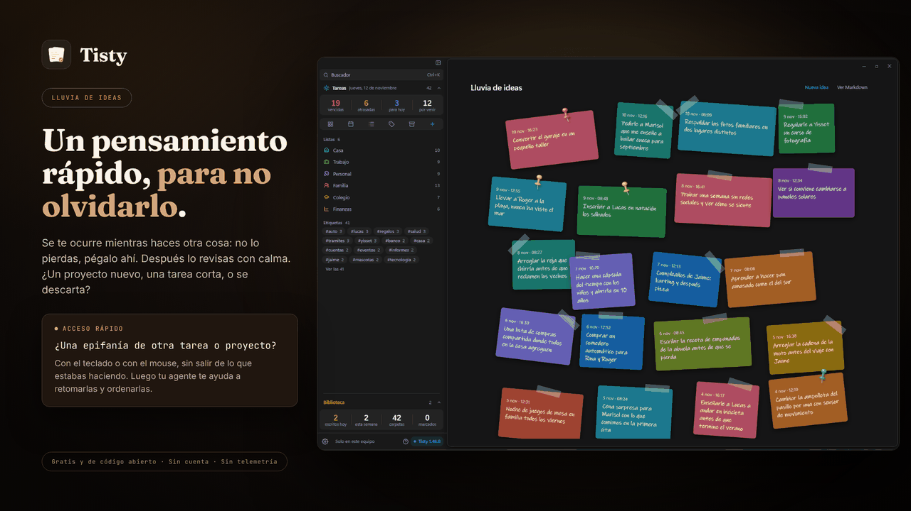
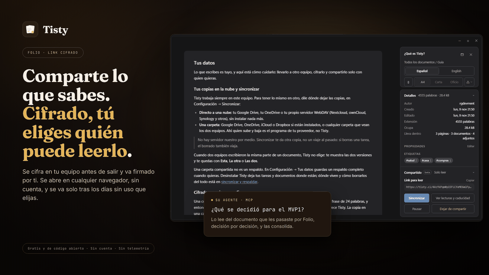

# Documentos

Los documentos viven junto a las tareas, para el material de consulta que no tiene fecha ni se marca como hecho. Son archivos Markdown normales, y el buscador también los lee. Una tarea puede apuntar a un documento; un documento nunca crea tareas.

Cómo se escribe en uno está en [[El editor Markdown|Editor-Markdown]]; todo lo que puede llevar (avisos, tablas, diagramas, fórmulas, widgets, código) está en la [guía de Markdown de Tisty](https://markdown.tisty.app/es/).



## ¿Tarea o documento?

Tisty guarda dos tipos de cosas, y distinguirlas es buena parte de usarlo bien.

- **Una tarea es algo por hacer.** Termina, muchas veces pronto: la completas y pasa al archivo. Pero no desaparece. Lo que escribiste en su página, sus pasos y sus notas se quedan, y meses después una búsqueda la encuentra y te cuenta cómo lo resolviste. Una tarea es conocimiento con fecha.
- **Un documento es algo para guardar.** Un manual, una receta, las notas de un cliente o de una máquina, las actas de un año: se lee una y otra vez, se corrige y se amplía, y crece durante años. Rara vez termina.

Por eso una tarea tiene una página propia: una tarea también es un documento, uno que termina. Piensa en un **spike**, una investigación para saber cómo se puede hacer algo antes de hacerlo:

1. Empieza como una tarea, «Averiguar cómo sincronizar con OneDrive». En su página escribes lo que leíste, lo que probaste y lo que descartaste, sección por sección, y vuelves a corregirlo a medida que aprendes. Adjuntas lo que una descripción fija nunca podría contener: la grabación de la reunión, un video de la falla, el análisis del código, el PDF del proveedor.
2. Cuando el camino está claro, el trabajo se divide en **partes**: «Iniciar sesión», «Subir archivos grandes», «Retomar una subida cortada». Cada una es una tarea con sus propios pasos y notas.
3. Las partes se completan una a una, y después el spike. Pasa al archivo.
4. No se pierde nada. Un año después, «¿cómo resolvimos las subidas a OneDrive?» lo encuentra: su página, sus partes y cada paso, tal como quedaron.



Lo que vas a hacer es una tarea. Lo que vas a volver a consultar es un documento: una receta no es una tarea con pasos, y un pendiente no es un documento. Cuando hacer una tarea te enseña algo que vas a necesitar de nuevo más allá de ella —el arreglo de una falla que vuelve, cómo quiere un proveedor que le pidan— guárdalo también en un documento.

**Antes de las dos, muchas veces hay una idea.** Una idea es un pensamiento atrapado al vuelo, antes de saber si es algo que hacer o algo que guardar: pocas palabras, 140 como máximo, con fecha, en la hoja Ideas. Espera a que la ordenes: se vuelve tarea, va al documento de su tema o se aparta. Una nota es otra cosa: la línea fechada en la bitácora de una tarea.

Cómo funcionan la página, los pasos y las partes de una tarea está en [[Tareas]]; lo que guarda una cerrada, en [[El archivo|El-archivo]].

## Crear uno

En la **Biblioteca** de la barra lateral, usa el **+** de su encabezado: **Documento nuevo**. El mismo botón dentro de una carpeta lo crea ahí. **Diagrama nuevo** crea un documento con un diagrama y abre la [[ventana de diagramas|Diagramas]]. **Carpeta nueva** los agrupa, y una carpeta puede tener carpetas dentro.

La primera línea del documento es su título: no hay que ponerle nombre.

`Ctrl`/`⌘` + `X` y `V` mueven un documento entre carpetas.

## Ideas

Una idea que llega en medio de otra cosa todavía no tiene dónde ir. Pulsa `Ctrl` + `Shift` + `Space` y después `Tab` para cambiar de **Tarea** a **Idea** (o el atajo propio de la idea, cuando lo elijas en **Configuración**), escríbela, hasta 140 caracteres, y pulsa `Enter`: cae en **Ideas**, con su fecha, sin abrir la ventana ni elegir una carpeta. En **Configuración** eliges los dos atajos; el de la idea queda apagado hasta que lo elijas, porque `Ctrl` + `Alt` es AltGr en muchos teclados. Sin teclado, el **+** al final de la fila de vistas abre la misma captura.



- **Ideas es un documento normal**, anclado arriba en la Biblioteca. La primera idea lo crea. Puedes abrirlo, cambiar sus notas, duplicarlo, archivarlo o eliminarlo; su menú no ofrece moverlo ni exportarlo. Cada idea queda escrita en él como una nota adhesiva `[!IDEA]`, con su fecha y su color, la misma que puede llevar cualquier documento.
- **Se ve como notas pegadas en una hoja**, un poco torcidas, de distintos colores y con letra de mano: son ideas del momento. La más nueva va primero. Pulsa una para cambiarla, **Nueva idea** agrega otra y la **×** la quita. Arrastra una nota por su borde sobre otra para dejarla en ese lugar, o pulsa `Alt` y una flecha sobre ella; sigue tan torcida como estaba.
- **El archivo sigue siendo Markdown.** Cada nota es un `[!IDEA]` cuya primera línea dice el día y el minuto en que llegó, y su color, que se elige al crearla y no cambia aunque la muevas, y **Ver Markdown** muestra el texto, solo para leer: una idea es texto suelto, y las tablas y los diagramas van en un documento propio. Cualquier documento con `view: notes` en sus [propiedades](https://markdown.tisty.app/es/propiedades) se ve igual.
- **Ordénalas después**: en cada nota, **Anexar a un documento** la agrega al final del documento que elijas, como la misma nota adhesiva con su fecha y su color, junto al texto, y **Convertir en tarea** la guarda como tarea, leída como cualquier captura rápida, con sus fechas, listas y etiquetas. En los dos casos la idea sale de la hoja. La Biblioteca muestra junto a Ideas cuántas esperan todavía.
- **Tu agente de IA también las ordena**: si se lo pides, anota ideas, anexa una a un documento o la convierte en tarea, y la idea sale de la hoja como cuando lo haces tú. Las que da por viejas solo las marca: la nota lleva un ◆ con el motivo, **Borrarla** la quita y **Quitar la marca** la conserva, y la franja sobre la hoja hace lo mismo con todas de un clic. Ideas también lleva el ◆ en la Biblioteca.

## Diario

Lo que pasó hoy, en la casa o en el trabajo, tiene un solo lugar: **Diario**, casi al principio de la Biblioteca. No es una nota por día, que serían 365 documentos al año: es un libro por año, **Diario 2026**, con una página por mes, **Noviembre**, y una sección por día, **Domingo 15**, en el idioma de la app. Hoy va arriba, y un día en el que no escribiste nunca aparece.

- **Diario en la Biblioteca abre hoy.** La primera vez en el año crea el libro de ese año y la página del mes; el día nace cuando escribes en él. Bajo la fila, los años y sus meses se abren como cualquier libro.
- **Se lee como una línea de días, no como una página.** Lo encabeza la fecha de hoy, y cada día muestra su número y su día de la semana junto a lo que escribiste, el más nuevo arriba.
- **El cuadro de arriba, «¿Qué pasó hoy?», escribe en hoy**: `Ctrl`/`⌘` + `Enter` o el botón redondo lo guarda. El botón de nota a su lado, **Pegar nota**, lo vuelve una nota adhesiva de hasta 140 caracteres con el minuto en que llegó, a la derecha de hoy, que se guarda con `Enter`.
- **Un día se corrige donde está**: un clic en lo que escribiste ese día lo vuelve una caja con sus palabras en Markdown. `Ctrl`/`⌘` + `Enter` o **Guardar** lo guarda y sigues en la línea de días; `Esc` o **Cancelar** lo deja como estaba. Las notas adhesivas del día quedan fuera de la caja y, al guardar, siguen después de las palabras, en su orden. Si vacías la caja, el día queda solo con sus notas, o desaparece si no tiene ninguna.
- **La × de una nota**, que aparece al pasar el cursor, la quita después de preguntarte, porque el diario no guarda una copia.
- **El lápiz** abre el mes como documento para lo que la línea de días no cambia: la introducción del mes, las palabras de una nota o pasar una nota a otro día. Al ir a otro lado, o al tocar **Diario** otra vez, vuelves a la línea de días.
- **Desde cualquier parte**: en la captura rápida, `Tab` pasa de **Tarea** a **Idea** y después a **Diario**, que escribe en hoy sin abrir la ventana. En una nota de Ideas, **Anexar a un documento** ofrece primero **Diario de hoy**.
- **Las tareas que terminaste ese día** se pliegan bajo lo que escribiste, como «3 tareas cerradas»; cada una se abre con un clic. Una que descartaste no sale, y un día en el que no escribiste no muestra ninguna. Solo se ven, nunca se escriben en el texto.
- **Solo tú.** Ningún agente ve tu diario hasta que pulsas **Solo tú** arriba y dice **Abierto a los agentes**. Abierto, un agente lo lee y, solo cuando se lo pides, añade al final de hoy bajo una línea con el minuto y su nombre. Nunca cambia lo que escribiste. Púlsalo otra vez para guardarlo solo para ti. La puerta es una sola para todos los años y para todos tus equipos, y solo la conoce Tisty 1.48 o más nuevo. Por eso **Diario** no empieza tu diario mientras alguno de tus equipos use una versión anterior, y te dice cuál: actualízalo o quítalo de tus equipos. Desde que existe un diario, un equipo con una versión anterior deja de sincronizar antes de recibir nada de él y te pide actualizarlo.
- **Nunca se comparte por link**: el diario no tiene panel lateral ni **Compartir**, y Folio lo rechaza. Sí viaja con tu sincronización y con tus respaldos, como cualquier documento.
- **El archivo sigue siendo Markdown**: un libro con `diary: on` en sus [propiedades](https://markdown.tisty.app/es/propiedades), cuyas páginas son los meses. Tisty nunca escribe en él por su cuenta.

## Redescubrir lo olvidado

Lo que guardaste y no volviste a abrir vuelve solo a la vista. Al pulsar **Biblioteca**, sobre **Sin carpeta**:

- **Hace tiempo que no abres** lista los documentos que no abriste en este equipo ni nadie escribió en 60 días, el más olvidado primero, con su carpeta y hace cuánto. Muestra cinco, y **Ver los N** despliega el resto. Al pasar el puntero dice si cuenta desde la última vez que lo abriste aquí o desde la última vez que se escribió.
- **Un documento al azar** abre uno que no hayas abierto esta semana.
- **Cuenta lo que abres aquí**: el día en que abres un documento se anota solo en este equipo y no viaja con tu sincronización. Abrir una página cuenta para su documento, y abrir uno de sus idiomas, para todos. Antes de esta función no había registro, así que al principio cuenta el día en que se escribió.
- **No salen** los archivados, los que un agente marcó como pasados, que ya esperan tu decisión, el Diario, Ideas ni la guía de Tisty.
- **Con el botón derecho** cada uno tiene su menú de siempre: archívalo si ya cumplió.

## Carpetas

- **Todas las carpetas nacen plegadas**, así que un almacén con cientos de documentos es un puñado de filas hasta que vas a buscar.
- **El filtro** del encabezado de la Biblioteca deja solo las carpetas y los documentos cuyo nombre contiene lo que escribes, sin mirar acentos ni mayúsculas, con las carpetas de arriba de cada uno abiertas; una carpeta que coincide conserva todo lo que tiene. `Esc` lo cierra.
- **Cuando las tareas toman el espacio**, la Biblioteca se pliega a su título y una franja: cuántos documentos se escribieron hoy y esta semana, cuántas carpetas hay y cuántos marcó un agente como pasados. La flecha junto a su título le devuelve el espacio.
- **Archiva una carpeta entera** con el botón derecho cuando el asunto terminó: baja al estante de **Archivados**, al pie del árbol, con su icono, sus subcarpetas y sus páginas tal como las dejaste. Ahí se lee y se exporta, pero no se escribe ni entra nada nuevo.
- **Desarchívala** y vuelve igual, incluidos los documentos que habías archivado a mano ahí, que siguen archivados.

### Ocultar una carpeta de la barra

Hay carpetas que no quieres archivar, porque lo que tienen sigue vigente, pero que tampoco necesitas ver cada vez que abres Tisty. Ocultarla la saca de la barra lateral en este equipo, sin tocar nada de lo que tiene.

Te sirve cuando:

- **Usas un equipo para cada cosa.** En el computador del trabajo no necesitas **Casa**, con las vacunas de Rina y el cumpleaños de Lucas, y en el de la casa no necesitas **Trabajo / Clientes**.
- **La barra creció de más.** Una carpeta que consultas dos veces al año, como **Trámites**, puede salir de la vista sin archivarse.
- **No usas el Diario o Ideas** y prefieres no verlos arriba de la Biblioteca.

**Ocultarla:**

1. En la barra lateral, botón derecho sobre la carpeta y **Ocultar de la barra**.
2. La carpeta sale de la barra sin dejar rastro: no queda ninguna fila ni una sección de ocultas.

**Volver a verla:**

1. Abre **Configuración › General** y baja hasta **Carpetas ocultas**: «Las carpetas que ocultaste de la barra en este equipo. Conservan todo lo que tienen, y la búsqueda, la paleta y «Mover a» las siguen encontrando.».
2. Cada carpeta oculta es una fila con su camino entero, como **Trabajo / Clientes**, y el botón **Volver a mostrar**. Púlsalo y vuelve a la barra, en su lugar.

Si no ocultaste ninguna, la sección dice «No hay carpetas ocultas.».


**Un ejemplo.** En el computador del trabajo, botón derecho sobre **Casa** y **Ocultar de la barra**: **Casa** y todo lo que tiene adentro, como **Casa / Rina**, salen de la barra. Una tarde Marisol te pide el carnet de vacunas de Rina. Lo escribes en el buscador de arriba de la barra y aparece, aunque **Casa** esté oculta, y lo abres desde ahí. En el computador de la casa, **Casa** sigue en la barra como siempre.

Lo que conviene saber:

- **Es de este equipo.** Lo que ocultas no viaja con tu sincronización: en tus otros equipos la carpeta sigue a la vista, y cada equipo oculta lo suyo.
- **No se borra ni se mueve nada.** La carpeta conserva sus documentos y sus subcarpetas, y la búsqueda, la paleta y **Mover a** la siguen encontrando: puedes mover un documento a una carpeta oculta, y entra igual.
- **El filtro de la barra la muestra.** Mientras escribes en el filtro de la Biblioteca, las carpetas ocultas aparecen también, para que un resultado nunca quede escondido. Al cerrar el filtro con `Esc`, vuelven a ocultarse.
- **Una subcarpeta sola.** Puedes ocultar **Trabajo / Clientes** y dejar **Trabajo** a la vista. Su fila en Carpetas ocultas nombra el camino entero, para que sepas cuál es.
- **El Diario e Ideas también.** Botón derecho sobre **Diario** o sobre **Ideas** y **Ocultar de la barra**. En Carpetas ocultas aparecen con su nombre, y **Volver a mostrar** los devuelve arriba de la Biblioteca.
- **Una carpeta archivada no se oculta.** En el estante de **Archivados** la opción aparece apagada: ya está fuera de tu camino.
- **AGENTS se oculta solo apagada.** Encendida, su botón derecho ofrece **Apagar AGENTS** en vez de ocultarla; apagada, su aviso ofrece **Ocultar**. Oculta, AGENTS sigue apagada: no escribe ningún archivo de tus agentes, y una propuesta de tu agente solo se guarda hasta que vuelves a mostrarla y la enciendes. Lo cuenta [Ocultarla de la barra](Carpeta-AGENTS#ocultarla-de-la-barra).

## Etiquetas

Un documento lleva etiquetas igual que una tarea: escribe `#contrato` en medio de una frase y el documento queda bajo esa etiqueta. La etiqueta vive en la frase, no en una cabecera escondida, así que si llevas el archivo a otro editor, la etiqueta va con él. Una nota traída de otra parte con `tags:` en sus [propiedades](https://markdown.tisty.app/es/propiedades) también queda bajo esas.

- La pantalla de **Etiquetas** muestra las tareas bajo una etiqueta y, debajo, los documentos. Pulsar una etiqueta dentro de un documento abre justo eso.
- Cómo se escribe una etiqueta, con qué letras y qué no cuenta como una, está en la [guía de Markdown](https://markdown.tisty.app/es/etiquetas).

## Enlazar documentos

Todo esto, con capturas y un ejemplo de principio a fin, está en [[Enlazar documentos|Enlazar-documentos]]; aquí va lo esencial.

Un documento suelto se olvida; uno enlazado se vuelve a encontrar. Escribe `[[` en un documento y sigue con unas palabras de su título: Tisty te ofrece los que calzan, primero los que empiezan así y después los escritos hace poco. Con `[[` solo, te muestra los últimos que escribiste. `Enter` deja un enlace como `[Viajes](tisty:doc/…)`, que apunta al documento y no a su nombre: si lo renombras, el enlace sigue llegando. Los `[[ ]]` no quedan escritos.

- **A una sección**: sigue el título con `#` (`[[Viajes#hot`) y elige uno de sus encabezados. El enlace abre el documento justo ahí; si esa sección ya no existe, lo abre al comienzo.
- **Vista previa**: deja el puntero sobre un enlace a otro documento y ves sus primeras líneas, o la sección a la que apunta, sin moverte de donde estás.
- **Quién lo enlaza**: el panel junto al documento tiene la fila **Enlazado desde**, con cada documento y cada tarea que lo cita o lo menciona y, en un documento, las secciones donde lo hace. Un clic lo abre en esa sección. Tisty arma esta lista en segundo plano, así que un enlace recién escrito aparece a los pocos segundos.
- `[[#2]]` sigue nombrando el segundo paso, como siempre.

## Citar una tarea

Con capturas, la tabla de lo que muestra la tarjeta en cada caso y un ejemplo completo: [[Tareas en documentos|Tareas-en-documentos]].

Lo que sabes de un tema vive en su documento; el trabajo que hiciste sobre él, en sus tareas. Cita la tarea en el documento y la encuentras donde la vas a buscar: «Auto» muestra «Cambiar los neumáticos», cerrada en marzo, y un clic te lleva a cómo se resolvió.

Escribe `/`, elige **Una tarea** y sigue con unas palabras de su título: Tisty busca entre las abiertas y las archivadas. `Enter` deja una tarjeta como ``, sola en su párrafo.

- **Siempre al día**: la tarjeta lee la tarea cada vez que se dibuja, con su título, su lista, sus fechas, cuántos pasos y partes lleva hechos y, si está cerrada, el día en que se cerró.
- **Un clic la abre**, también si está archivada.
- **Mientras sigue abierta**, el círculo de la tarjeta la marca hecha, y el contador de pasos los despliega para tacharlos ahí mismo. Una tarea cerrada se lee, pero ya no cambia desde el documento.
- **Si ya no está**, porque la borraste o todavía no llega a esta máquina, la tarjeta muestra las palabras con que la citaste y avisa que no está.
- **Fuera de Tisty** (Folio, PDF, Word, Markdown estándar) queda solo esa frase: nada de la tarea sale con el documento.
- **Quién la cita**: junto a la página de la tarea, **Enlazado desde** reúne los documentos y las tareas que la citan o la mencionan, con la sección donde lo hacen.

## Crear una tarea desde un documento

Las tareas nacen leyendo y escribiendo: en un acta o en un plan aparece «hay que…», y salir del documento para anotarlo te hace perder el hilo. Escribe `/`, elige **Una tarea nueva** y escríbela como en la captura rápida: `Llamar al vet el lunes #Rina !hacer`. `Enter` la crea con su fecha, su lista, sus etiquetas y su prioridad, y deja su tarjeta en ese lugar del documento.

- **Las mismas reglas que la captura rápida**: `@lista`, `#etiqueta`, `!prioridad`, fechas y repeticiones en palabras. Las marcas se pintan mientras escribes, y `/` dentro del campo ofrece lo mismo que allá.
- **`Esc` la deja ir** sin crear nada. Una línea vacía no crea una tarea, y si algo falla el documento queda como estaba.
- **La tarea recuerda dónde nació**: junto a su página, **Nació en** nombra el documento y la sección, y un clic te lleva de vuelta.
- **Deshacer** en el documento quita la tarjeta, pero no la tarea: borrarla sigue siendo decisión tuya.
- **En la página de una tarea**, **Una tarea nueva** crea una parte de esa tarea, en su misma lista salvo que nombres otra.

## Adjuntos

Arrastra un archivo a un documento o a una tarea para adjuntarlo: la foto del veterinario, el PDF del seguro, la grabación de una reunión. Una tarea admite archivos de hasta 650 MB, igual que un documento. Se guarda tal cual, dentro de Tisty, y viaja con el documento cuando lo exportas.

Un adjunto se dibuja como lo que es: una imagen tal cual, un sonido o un video con su reproductor, y cualquier otro archivo, también una página `.html`, como una tarjeta con su tipo y su tamaño.

Un sonido o un video que ya está en este equipo se reproduce desde aquí, sin tocar tu nube. Uno que todavía está solo en tu nube muestra **Traer de tu nube** con su tamaño, y se descarga solo cuando lo pulsas; una vez aquí, se queda. Si no puede llegar (sin conexión, o porque nunca terminó de subir), el reproductor dice por qué y ofrece **Reintentar**. Una imagen que no puede llegar avisa de la misma forma.

El **⋯** de una tarjeta guarda una copia, convierte la tarjeta en un enlace simple o la quita de la página. En la tarjeta de una página, además, puede hacerla un documento propio.

## Páginas

Un documento largo por partes (un año de actas, un libro por capítulos) es un solo documento con páginas. Mira [Páginas y PDF](Páginas-y-PDF).

## Varios idiomas

Un documento puede estar en varios idiomas: cada idioma es un documento propio, y Tisty los muestra como uno solo, en el idioma de la app, con un selector en el panel del título, o sobre la hoja si cerraste el panel, que te deja en la misma sección. Desde cuatro idiomas, el selector, sobre la hoja y en el panel por igual, pasa a ser un solo botón con el idioma que ves y cuántos hay; los lista todos con su código, y desde nueve un campo busca uno por su nombre o su código.

- **Traducir a…**, en el menú del documento, escribe una copia de su texto y sus páginas en el idioma que elijas, lista para traducir sección por sección. Si el documento todavía no dice su idioma, te lo pregunta.
- **Unir con su otro idioma…** junta dos documentos que ya tienes, en cualquier orden: te pregunta el idioma de cada uno por su nombre, y **Separar de sus idiomas** los vuelve a separar.
- Los idiomas de un documento están en una misma carpeta y se mueven, se archivan y se borran juntos. La búsqueda los encuentra una sola vez, abiertos en el idioma donde cayó la palabra.
- Al exportar un documento, sus propiedades llevan `translationKey:`, y al volver a importarlo se une otra vez a los demás.

## Importar

**Importar un documento**, en el árbol, toma un archivo `.md`, `.markdown`, `.txt`, `.html`, `.htm` o de Word (`.docx`) y lo trae, de a uno. Una página web o un documento de Word entra en el Markdown de Tisty, con sus títulos, listas, enlaces, tablas y colores (un color pasa al rotulador más cercano de la paleta), y las imágenes de un Word entran con él como adjuntos. Un `.tistyx` de otro Tisty se desempaca entero.

Word, HTML, Google Docs, texto enriquecido, texto plano y notas de Obsidian entran todos como Markdown, con sus imágenes y archivos: [Convertir a y desde Markdown](Convertir-a-y-desde-Markdown) cuenta cada forma de entrar.

Las tareas hay que escribirlas: no hay importador para la lista de tareas de otro programa.

## Abrir un archivo Markdown de afuera

Tisty no necesita quedarse con un archivo para mostrarlo. Elige Tisty en **Abrir con** para un archivo `.md` o `.markdown` (nunca se pone como programa predeterminado) o sigue un enlace `tisty://open?path=…`, y el archivo se abre en **solo lectura** en un visor liviano propio, con la barra de título del sistema, sin entrar a tu almacén. Lee hasta 1 MB, cerca de un millón de caracteres, y avisa cuando un archivo pesa más.

- **La columna junto a la página** tiene **Editar**, **Ver Markdown** (`Ctrl`/`⌘` + `Shift` + `M`; **Ver el documento** regresa de ahí), los títulos del archivo y sus detalles: su carpeta, peso, fecha y propiedades. Mientras está abierta, la página se corre para dejarle lugar y se angosta si hace falta, así la columna nunca tapa el texto. En una ventana angosta la barra lateral se pliega primero a sus iconos, para que la columna conserve su lugar; solo si ni así cabe se pliega, y su botón en la barra (`Ctrl`/`⌘` + `\`) la abre.
- **La barra** tiene **Buscar en el texto** (`Ctrl`/`⌘` + `F`), el tema y **Más**, que además trae texto más grande y más pequeño, **Copiar el Markdown**, **Imprimir** y **Mostrar en la carpeta**. El tema y tu lugar en el archivo se recuerdan.
- **Lee el archivo como se escribió para otros programas.** Un encabezado centrado sigue centrado, una insignia queda en su línea, las líneas que un editor cortó por columnas se juntan, y `#ff0000` o `[[x]]` quedan como palabras. Los diagramas y las fórmulas se dibujan, y también un [widget](Widgets-en-documentos), porque nada en él se ejecuta.
- **Las imágenes** junto al archivo se muestran si están en su carpeta o más abajo. Las imágenes de internet esperan: una línea sobre la página dice cuántas hay, y **Mostrarlas** las trae. Vuelve a preguntar cada vez que abres el archivo ([qué envía eso](Privacidad#las-peticiones-de-red-que-hace-tisty)).
- **Los enlaces**: uno a otro `.md` de al lado se abre en la misma ventana, con **Volver** (`Alt` + ←). Uno a la web abre tu navegador.
- **Editar** hace una copia en tu almacén, escrita en Markdown de Tisty, y la abre; el archivo sigue igual y el visor se cierra. Un archivo de más de 500 KB se puede leer pero no editar, y **Editar** lo dice. Si un archivo de al lado no pudo venir, el visor sigue abierto y dice cuántos.
- **En un Tisty todavía sin configurar**, el archivo se lee de inmediato y **Editar** no hace ninguna copia: trae la bienvenida, y el visor dice que primero la termines. Cuando la bienvenida termina, la copia se hace y se abre.

Un enlace `tisty://open` solo llega a un archivo de texto legible de este equipo.

### Un documento en una ventana aparte

**Abrir en una ventana aparte**, el botón junto al título en el panel de un documento, lo muestra en solo lectura junto a tu trabajo, en el mismo visor ligero que abre un archivo de afuera.

- **Índice y detalles** (`Ctrl`/`⌘` + `\`) abre una columna con sus títulos, su carpeta, su peso y cuándo cambió.
- **Ver Markdown** (`Ctrl`/`⌘` + `Shift` + `M`) cambia entre la página dibujada y su texto.
- **Más** tiene **Buscar en el texto**, texto más grande y más pequeño, **Copiar el Markdown**, **Copiar enlace** e **Imprimir**.
- Sus widgets, imágenes, sonidos, videos y tarjetas de archivo se ven como en la ventana principal; un clic en una tarjeta de archivo la abre con su programa.
- Un enlace o una tarjeta a otro documento o a una tarea lo abre en la ventana principal; el [enlace de un documento](#el-enlace-de-un-documento), en otra ventana aparte.
- **Editar** te lleva al documento en la ventana principal. Si lo cambias ahí, la ventana aparte lo vuelve a leer cuando regresas a ella.
- Su PDF, sus hojas y sus exportaciones se hacen desde la ventana principal.

### El enlace de un documento

Cada documento tuyo tiene un enlace, para llegar a él desde un chat, una nota, el navegador o tu agente. **Copiar enlace** está en **Exportar**, en el panel del documento; en el menú del documento, en el árbol, y en **Más**, en la ventana aparte. Se ve así:

`tisty://doc/personal/viajes/plan-de-verano?id=k7tq2mzw-0012`

- **Abre el documento en solo lectura** en el visor ligero, no en el editor, también si está archivado. Si una ventana aparte ya lo muestra, la trae al frente. Con Tisty cerrado, se abre solo esa ventana.
- **Solo cuenta el `id`.** Las carpetas y el título van en palabras para quien lee el enlace, en minúsculas, sin tildes y con guiones, así que sigue llegando si renombras o mueves el documento. Una página lleva primero el nombre de su documento: `tisty://doc/trabajo/actas/marzo?id=…`.
- **Dentro de un documento** o en la página de una tarea, escríbelo como enlace de Markdown, `[Plan de verano](tisty://doc/…?id=…)`, y se abre como cualquier otro enlace. Pegado solo, queda como texto. Para ir de un documento a otro mientras escribes sigue sirviendo `[[`, que abre en la ventana principal ([Enlazar documentos](#enlazar-documentos)).
- **Tu agente** lo toma tal cual: pásale el enlace y lee o cambia ese mismo documento sin buscarlo.
- **Solo abre en un equipo que tiene el documento**, es decir, uno de tus equipos con tu almacén. Donde no está, la ventana se abre y lo dice. Para dárselo a otra persona, compártelo por [Folio](#compartir).
- **Dentro de un documento compartido por Folio no viaja**: un enlace de Markdown llega como sus palabras, y una dirección escrita sola llega tal cual, con sus carpetas y su título.
- **Quien lo recibe lee** los nombres de las carpetas y el título.

Por ejemplo, preparas con tu agente el viaje de verano. En **Exportar** de «Plan de verano», en la carpeta Personal / Viajes, eliges **Copiar enlace** y se lo pegas en el chat: «Revisa las fechas de los vuelos en tisty://doc/personal/viajes/plan-de-verano?id=k7tq2mzw-0012». Tu agente no lo busca: lo pide por su enlace,

```json
{ "name": "read", "arguments": { "doc": "tisty://doc/personal/viajes/plan-de-verano?id=k7tq2mzw-0012" } }
```

y Tisty le contesta con ese mismo documento, `"doc": "k7tq2mzw-0012"`, `"title": "Plan de verano"`, `"folder": "Personal / Viajes"`, con su texto. Si después lo llamas «Vacaciones de verano» y lo mueves a Familia, el mismo enlace sigue llegando a él. Si se lo pegas a tu agente en otro equipo que no tiene tu almacén, Tisty le dice que ahí no hay ningún documento con ese id.

## Versiones anteriores

Cada documento guarda en este equipo lo que decía antes de cambiar, como un historial de versiones: abres la lista, lees cómo estaba y, si te sirve, vuelves a eso. Vale también para las páginas de tus tareas. Lo hice para el día en que un cambio, tuyo o de un asistente, se llevó algo que todavía necesitabas.

### Cuándo te sirven

- **Un asistente reescribió de más.** Le pediste a tu agente que ordenara «Paseos de Rina» y lo dejó sin los horarios. La versión de antes de su escritura está en la lista: ves qué cambió y vuelves a ella.
- **Borraste un párrafo y a la semana lo necesitas.** Quitaste de «Cumpleaños de Lucas» la lista de invitados porque ya estaba cerrada, y ahora Marisol pregunta quién venía. Una versión de antes de ese cambio todavía la tiene, aunque el documento haya seguido cambiando.
- **Quieres ver cómo estaba algo un día concreto.** Cada versión lleva su fecha, así que lees el plan como estaba el martes sin tocar el de hoy.
- **Escribiste algo que no debía quedar guardado.** Borras el texto y después vacías el historial de ese documento (más abajo).

### Ver una versión y volver a ella

1. Abre el documento. En el panel junto a él, la fila **Historial** dice **en este equipo** y tiene **Ver el historial**. En la página de una tarea, el botón es **Versiones de esta página**.
2. A la izquierda queda la lista, la más nueva primero. Cada fila dice cuándo se escribió esa versión (solo la hora si fue hoy), quién la escribió (**tú**, **un asistente** o el nombre de su programa, como **Claude Code**) y cuánto pesa.
3. Haz clic en una para leerla a la derecha, tal como se veía.
4. **Volver a esta versión**, arriba de lo que lees, te pregunta antes: el documento vuelve a decir lo que decía en ella, y lo que dice ahora queda guardado.
5. El documento muestra **Volvió a la versión de** y la fecha, con **Volver a lo que decía antes**: ese botón deshace la vuelta si elegiste la equivocada.

En la página de una tarea vuelven las palabras, no el estado de la tarea: ningún paso se quita ni cambia su casilla, y un paso que esa versión nombra y la tarea ya no tiene vuelve como paso nuevo.

Si todavía no hay ninguna, la lista lo dice: Tisty guarda una cuando pasan 30 minutos sin cambios o cuando cambia quien escribe.

### Ver qué cambió

Antes de volver a una versión, puedes ver exactamente qué cambió, en un documento o en la página de una tarea:

1. Elige una versión en la lista. **Qué cambió**, arriba de lo que lees, la compara con lo que el documento dice ahora.
2. Para comparar dos versiones entre sí, pulsa **Comparar** en otra fila de la lista. Se lee siempre de la más vieja a la más nueva, en el orden que sea que las elijas. **Comparar** otra vez en esa fila vuelve a comparar con lo de ahora, y **Qué cambió** apaga la comparación.
3. Arriba, una línea dice qué se compara, como «De la versión de 16:10 a lo que dice ahora» o «De la versión de 16:10 a la de 17:45», y cuántos bloques cambiaron: **Lo que se fue** y **Lo que llegó**, cada uno con su número. Si no hay diferencias, dice **Dicen lo mismo: no cambió nada.**

La comparación es una sola página, dibujada como siempre, que abre en el primer cambio. Lo que se fue sale en rojo y lo que llegó en verde, uno encima del otro; dentro de un párrafo, un ítem, una celda o una línea de código que cambió, las palabras de antes van tachadas y las nuevas resaltadas. Lo que solo cambia la forma de escribir y no lo que dice no cuenta como cambio: los fines de línea, el número de un ítem en una lista numerada y los espacios de una tabla.

Por ejemplo: Claude Code reescribió el párrafo de horarios de «Paseos de Rina» y no sabes qué tocó. Abres **Ver el historial**, eliges la versión de antes de su cambio y pulsas **Qué cambió**. El párrafo viejo aparece en rojo y el nuevo en verde, y dentro de él «a las 8:00» va tachado y «temprano» resaltado; arriba dice **Lo que se fue: 1** y **Lo que llegó: 1**. Ya sabes que solo cambió eso: vuelves con **Volver a esta versión**, o copias la hora y te quedas con lo demás.

- **Solo versiones de este equipo.** Una fila de otro equipo no tiene **Comparar**, porque su texto no está aquí.
- **Lo de ahora es lo guardado.** Si lo que escribiste todavía no se pudo guardar, no se compara, y la ventana te lo dice: resuélvelo primero y vuelve a comparar.
- **Un documento demasiado largo.** Cuando lo distinto entre las dos versiones es tan grande que marcarlo tomaría demasiado, unos 4.000 bloques distintos por lado, la vista lo dice y ofrece **Ver la versión entera**. Un cambio chico en un documento largo siempre se marca, porque lo que las dos versiones tienen igual al comienzo y al final no cuenta.

### Cuándo se guarda una versión

No en cada tecla ni en cada guardado. Lo que había queda como versión cuando alguien escribe en el documento:

- **después de 30 minutos sin cambios**, o
- **siendo otro que quien escribió la última vez**: tú después de un asistente, un asistente después de ti, o dos asistentes distintos.

Por ejemplo: a las 9:00 Mario abre el acta de la reunión de ayer y la corrige durante veinte minutos, sin pausas largas. Queda una sola versión, la de ayer: los guardados de esos veinte minutos son una misma escritura. A las 11:00 vuelve a corregirla, y lo que decía a las 9:20 queda como versión. A las 11:05 Claude Code agrega un resumen, y lo que Mario había dejado queda como otra versión, porque cambió quien escribe.

Una versión es el texto entero del documento tal como estaba, en un archivo Markdown dentro de la carpeta `history` de tus datos. Los adjuntos no entran: se quedan donde siempre. Lo que llega de tus otros equipos sigue la misma regla, con la hora y el autor de quien lo escribió allá.

### Cuánto tiempo se guardan

**30 días** por defecto, contados desde que la versión fue reemplazada y no desde que la escribiste, así que siempre puedes volver a como estaba el documento al comienzo del plazo.

Para cambiarlo, en **Configuración › Tus datos › Historial de documentos**, **Guardar las versiones anteriores** ofrece **1 día**, **5 días**, **15 días** o **30 días**. Cada equipo tiene el suyo. Al abrir Tisty, como mucho una vez al día, se van las versiones que pasaron el plazo, así que un plazo más corto se aplica en esa revisión. Si pasas de 30 a 5 días, en la siguiente revisión se borran las versiones reemplazadas hace más de 5 días; las de los últimos 5 se quedan.

Dos se quedan siempre, tengan la edad que tengan:

- **La más reciente.** La última versión anterior de cada documento no vence, aunque el documento lleve meses sin cambiar. Un documento quieto conserva siempre su vuelta atrás.
- **La que deshace el último cambio:** lo que te devolvería **Volver a lo que decía antes**.

### Vaciar el historial

**Vaciar el historial**, al pie de la lista, borra de este equipo todas las versiones anteriores de ese documento, también la que permite deshacer el último cambio. Lo que el documento dice ahora queda como está. Te pregunta antes, porque no se puede deshacer.

Sirve para un texto que borraste a propósito: pegaste en «Datos del seguro» un número que no debía quedar ahí y lo quitaste. Mientras no vacíes el historial, ese número sigue en la versión de antes. Vacíalo, y si sincronizas, hazlo también en cada equipo donde ese texto alcanzó a estar, porque cada uno guarda sus propias versiones. Los respaldos que hiciste entretanto lo conservan; mira [Privacidad](Privacidad#qué-se-guarda).

### En tus otros equipos

**Las versiones no se sincronizan.** Cada equipo guarda lo que se reemplazó en él, también lo que reemplazó un cambio llegado de otro equipo, y las poda con su propio plazo.

- **Una versión que guarda otro equipo** aparece en la lista mientras dura el plazo, como **No está en este equipo; lo guarda** y el nombre de ese equipo, por ejemplo «No está en este equipo; lo guarda Portátil de Marisol». Su texto está solo allá, así que aquí no se lee ni se recupera: ábrela en ese equipo.
- **Un equipo nuevo empieza sin versiones anteriores,** aunque reciba todos tus documentos. Lo que ese equipo cambie desde ahí, lo guarda.
- **Para llevarlas a otra máquina,** usa un [respaldo](Sincronizar-y-respaldar#respaldos): el zip las lleva, y restaurarlo cambia las de ese equipo por las que trae.

### Casos especiales

- **Borrar un documento** borra también sus versiones, en cada equipo. Si quieres conservar una, vuelve a ella o cópiala antes.
- **Una página de tarea** tiene sus propias versiones, en **Versiones de esta página**. Volver a una trae sus palabras, nunca quita pasos (más arriba).
- **El [Diario](#diario)** también guarda versiones en este equipo, que cuentan para lo que guarda tu equipo y tus respaldos, pero su vista no tiene la fila **Historial**: no se listan desde la ventana.
- **Un documento archivado o bloqueado, y la página de una tarea cerrada,** muestran sus versiones pero no ofrecen **Volver a esta versión**. Desarchívalo o desbloquéalo (o su carpeta archivada, o el documento bloqueado del que es página), o reabre la tarea con **Reabrir**, para volver a una.
- **Restaurar un respaldo** cambia las versiones de este equipo por las del zip, y su plazo vuelve a contar desde ese día.
- **Al actualizar desde un Tisty sin historial,** la copia que cada documento guardaba de su texto anterior pasó sola a ser su primera versión.

### Con tu asistente

También vuelves atrás sin abrir la lista: cuando algo escribe en el documento que tienes abierto, la barra te ofrece **Volver a lo que decía antes**. Un asistente lista, lee y recupera las mismas versiones con `read` y `restore_doc`, y nunca puede vaciarlas: eso es tuyo. Puedes pedírselo en tus palabras: «vuelve “Paseos de Rina” a como estaba antes de tu cambio de ayer». Cómo lo hace, con ejemplos, está en [Herramientas MCP](Herramientas-MCP#versiones-anteriores-de-un-documento).

## Sacar documentos

Un documento sale entero; cada conversión está en [Convertir a y desde Markdown](Convertir-a-y-desde-Markdown):

- **Copiar como Markdown**: Markdown estándar, listo para cualquier otro editor.
- **Exportar como Markdown…**, en el menú del documento, lo escribe en la carpeta que elijas, como archivos de Markdown estándar con sus páginas y adjuntos al lado; un enlace a una de sus páginas apunta al archivo de esa página.
- **De Markdown a HTML**: **Exportar como HTML…**, en el menú del documento, hace una sola página web que viaja sola.
- **De Markdown a Word**: **Exportar como Word…** hace un `.docx` con sus títulos, listas, tablas e imágenes.
- **Exportar para Tisty…** en un archivo `.tistyx`, que además lleva lo que Markdown no sabe decir: las carpetas con su orden, icono y color, de qué documento cuelga cada página, qué está archivado y el alias con que se firmó. Incluye un `README.txt`, para que quien lo reciba pueda leer los documentos sin Tisty.
- **De Markdown a PDF**: mira [Páginas y PDF](Páginas-y-PDF#el-pdf-propio-de-tisty).

Exportarlos todos pregunta para quién son: **Para dárselo a alguien**, que sale abierto y lo lee quien tenga el archivo, o **Para otro equipo mío**, que sale cerrado con seis dígitos para que nadie más lo lea. Un documento o una carpeta salen abiertos sin preguntar.

Cuando ya tienes tu identidad (**Configuración › Seguridad**), todo paquete sale firmado con tu llave. Otro Tisty tuyo lo toma como tuyo, cerrado o no. El de otra persona lo toma como escrito por ti y muestra tu nombre con tu huella, para que pueda compararla con la que tú ves. Si algo de adentro cambió en el camino, entra como de un extraño y Tisty avisa que la firma no calza. Un Tisty donde nadie ha creado ni escrito todavía una identidad pregunta antes de abrir un paquete firmado: escribe primero tu frase, en **Configuración › Seguridad**, y llega como tuyo; si lo abres igual, llega como de quien lo firmó, para siempre.

Sin tu identidad, el paquete sale sin firma. Uno abierto entra como de otra persona, aunque lo hayas escrito tú, salvo en el mismo almacén que lo hizo. Uno cerrado pregunta, cuando el número lo abre, si lo cerraste tú: **Lo cerré yo** lo trae como tuyo, **Me lo dio otra persona** como de un extraño. Si vuelve al mismo almacén que lo cerró, no pregunta: el almacén lo reconoce por su sello.

Un paquete firmado lleva además quién editó cada documento que compartiste por Folio. Los detalles del documento los muestran en **Quién lo editó**, cada uno con su huella, según quien te pasó el paquete; nada comprueba si esas llaves se retiraron después. En cualquier caso, ni una línea de la historia viaja dentro.

## Con tu agente

Los documentos son donde el agente de IA que conectas por [[MCP|Asistentes-y-MCP]] guarda lo que sabe, y cómo los lee es lo que lo mantiene barato.

- **Un documento vivo por tema.** Abre con lo que rige hoy, después el tema, lo que queda fuera de alcance, las decisiones fechadas con su porqué (la reemplazada queda tachada, no borrada) y su historia. El agente respeta las decisiones en vez de reabrirlas.
- **Se corrige en su lugar.** El agente reescribe el pasaje que cambió en vez de apilar una segunda copia junto a la primera, y no puede escribir encima de una versión que cambiaste después de que la leyó.
- **Primero el índice, después una sección.** El agente lee los títulos de un documento y cuánto pesa cada sección, y pide solo la parte que necesita. Un documento pedido entero que pasa de unos 12 000 caracteres vuelve como su índice.
- **Páginas para lo largo.** Ninguna escritura lleva más de 64 000 caracteres, así que una bitácora larga queda en temas y páginas, no como un muro de texto.
- **Un resumen para el siguiente.** Después de leer un documento largo, el agente puede dejar un resumen con el que elige el próximo agente; si el documento cambia, queda marcado como desactualizado.

Más en [Un día con tu agente](Asistentes-y-MCP#un-día-con-tu-agente).

## Compartir



Cuando otra persona necesita lo que sabes (tu PO, el QA que llega al proyecto, otro equipo), le entregas el documento. El panel junto a un documento tiene una fila **Compartido** con **Compartir…**. Compartir pasa por Folio, un servicio aparte de Tisty. Al pulsar **Compartir…**, Tisty lee un archivo firmado pequeño para saber si Folio ya abrió. Mientras no abra, te lo dice, con un enlace a [tisty.cl](https://tisty.cl), y nada de tu documento sale de este equipo; las salidas de arriba siguen sirviendo para entregárselo a alguien. Si ese archivo no se puede alcanzar, lo dice y ofrece reintentar. Cuando Folio esté abierto, primero creas tu identidad si este equipo todavía no la tiene (la llave que firma lo que compartes, respaldada con tu frase de 24 palabras), luego aceptas sus términos la primera vez, eliges qué puede hacer la otra persona y cuánto dura, y recibes un link. Un documento en varios idiomas los muestra con una casilla cada uno: el que compartes siempre va, puedes dejar fuera otro tuyo, y uno escrito por otra persona se queda aquí. Si Folio cambia sus términos, Compartir y Sincronizar te piden aceptar los nuevos apenas se puedan verificar; mientras tanto sigues compartiendo con los que aceptaste.

Cuando un documento ya está compartido, su fila tiene **Sincronizar**, y nada sube hasta que lo pulsas. Envía solo lo que cambió, y si nada cambió solo trae una versión más nueva que haya enviado otra persona. Folio acepta una nueva versión de cada documento tras una espera corta, y unos pocos documentos nuevos al día, contando cada documento que cita: mientras dura una espera, el botón dice cuánto falta y si hay cambios pendientes, y el diálogo te avisa antes de compartir si un documento y lo que cita no caben hoy.

Su fila dice quién lo creó, quién lo editó por última vez y todos los que lo editaron, cada uno con el nombre que eligió y firmado por su propia llave; un ✓ marca al creador de Tisty. Quien edita con el link de editar elige entre su alias y su nombre. Para quitarle ese poder a todos los que tienen el link, pulsa **Cambiar el link de editar**: el suyo deja de enviar versiones, se quedan con sus copias, y tú le das el link nuevo a quienes deban seguir editando. Lo que te llegó por un link de lectura sigue siendo una copia tuya: Sincronizar le trae las versiones nuevas, y solo un link de editar te deja enviar las tuyas. Si dejas de compartir un documento que otros editaron y después lo vuelves a compartir, el diálogo te recuerda primero quiénes fueron.

Cada idioma de un documento compartido para editar tiene su propio link de editar, y el que entregas los alcanza todos: quien lo abre edita todos los idiomas que compartiste, y **Cambiar el link de editar** los cambia todos de una vez. Abrir un link, de leer o de editar, trae todos los idiomas del documento, hasta 20, unidos como uno solo, y muestra el idioma en que usas Tisty si el documento lo tiene. Un idioma que no dice pertenecer a ese documento, o que su dueño no revisó, se queda en Folio. Sincronizar trae aparte la versión más nueva de cualquiera de sus idiomas, como hace con el documento.

**Un idioma que suma otra persona espera tu revisión.** Cuando alguien que edita con tu link de editar suma un idioma, queda como propuesta: quienes leen no lo ven hasta que lo mantengas. La fila **Compartido** nombra cada uno —«Inglés lo sumó alguien que edita y espera que lo revises»— con **Revisar Inglés…**, que lo muestra como lo guarda Folio: quién lo sumó, su título, sus palabras y sus imágenes. **Mantener** firma esa misma versión; si después cambia, la fila lo dice y **Revisar los cambios en Inglés…** muestra la versión nueva frente a la que mantuviste. **Dejar fuera** lo aparta, y solo tú puedes volver a leerlo con **Volver a revisar Inglés…**. Tu decisión sale con el próximo **Sincronizar**. Quien sumó el idioma ve en su fila si todavía no lo revisas, si lo mantienes o si lo dejaste fuera, y quienes leen ven, junto a un idioma que sumó otra persona, quién lo tradujo y quién lo revisó. **Cambiar el link de editar** nombra los idiomas de otros que mantienes y ofrece **Cambiarlo y dejarlos fuera**, y **Traducir a…** bajo el link de editar de otra persona avisa que el idioma nuevo será una propuesta que revisa su dueño.

## Tu alias

Escribe un alias en Configuración (opcional, y lo eliges tú) y cada documento queda firmado con él, mientras lo que llega de otra persona conserva el suyo. Viaja con tu sincronización y dentro de cualquier paquete, así que elige un nombre que no te moleste que otros lean. Nunca se te pide tu nombre real.
