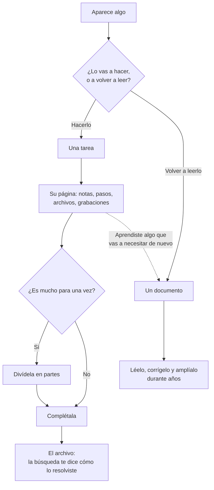

# Documentos

Los documentos viven junto a las tareas, para el material de consulta que no tiene fecha ni se marca como hecho. Son archivos Markdown normales, y el buscador también los lee. Una tarea puede apuntar a un documento; un documento nunca crea tareas.

Cómo se escribe en uno está en [[El editor Markdown|Editor-Markdown]]; todo lo que puede llevar (avisos, tablas, diagramas, fórmulas, widgets, código) está en la [guía de Markdown de Tisty](https://markdown.tisty.app/es/).

## ¿Tarea o documento?

Tisty guarda dos tipos de cosas, y distinguirlas es buena parte de usarlo bien.

- **Una tarea es algo por hacer.** Termina, muchas veces pronto: la completas y pasa al archivo. Pero no desaparece. Lo que escribiste en su página, sus pasos y sus notas se quedan, y meses después una búsqueda la encuentra y te cuenta cómo lo resolviste. Una tarea es conocimiento con fecha.
- **Un documento es algo para guardar.** Un manual, una receta, las notas de un cliente o de una máquina, las actas de un año: se lee una y otra vez, se corrige y se amplía, y crece durante años. Rara vez termina.

Por eso una tarea tiene una página propia: una tarea también es un documento, uno que termina. Piensa en un **spike**, una investigación para saber cómo se puede hacer algo antes de hacerlo:

1. Empieza como una tarea, «Averiguar cómo sincronizar con OneDrive». En su página escribes lo que leíste, lo que probaste y lo que descartaste, sección por sección, y vuelves a corregirlo a medida que aprendes. Adjuntas lo que una descripción fija nunca podría contener: la grabación de la reunión, un video de la falla, el análisis del código, el PDF del proveedor.
2. Cuando el camino está claro, el trabajo se divide en **partes**: «Iniciar sesión», «Subir archivos grandes», «Retomar una subida cortada». Cada una es una tarea con sus propios pasos y notas.
3. Las partes se completan una a una, y después el spike. Pasa al archivo.
4. No se pierde nada. Un año después, «¿cómo resolvimos las subidas a OneDrive?» lo encuentra: su página, sus partes y cada paso, tal como quedaron.

Lo que vas a hacer es una tarea. Lo que vas a volver a consultar es un documento: una receta no es una tarea con pasos, y un pendiente no es un documento. Cuando hacer una tarea te enseña algo que vas a necesitar de nuevo más allá de ella —el arreglo de una falla que vuelve, cómo quiere un proveedor que le pidan— guárdalo también en un documento.

Cómo funcionan la página, los pasos y las partes de una tarea está en [[Tareas]]; lo que guarda una cerrada, en [[El archivo|El-archivo]].

## Crear uno

Ve a Documentos y usa el **+** de arriba: **Documento nuevo**. El mismo botón dentro de una carpeta lo crea ahí. **Diagrama nuevo** crea un documento con un diagrama y abre la [[ventana de diagramas|Diagramas]]. **Carpeta nueva** los agrupa, y una carpeta puede tener carpetas dentro.

La primera línea del documento es su título: no hay que ponerle nombre.

`Ctrl`/`⌘` + `X` y `V` mueven un documento entre carpetas.

## Carpetas

- **Todas las carpetas nacen plegadas**, así que un almacén con cientos de documentos es un puñado de filas hasta que vas a buscar.
- **Archiva una carpeta entera** con el botón derecho cuando el asunto terminó: baja al estante de **Archivados**, al pie del árbol, con su icono, sus subcarpetas y sus páginas tal como las dejaste. Ahí se lee y se exporta, pero no se escribe ni entra nada nuevo.
- **Desarchívala** y vuelve igual, incluidos los documentos que habías archivado a mano ahí, que siguen archivados.

## Etiquetas

Un documento lleva etiquetas igual que una tarea: escribe `#contrato` en medio de una frase y el documento queda bajo esa etiqueta. La etiqueta vive en la frase, no en una cabecera escondida, así que si llevas el archivo a otro editor, la etiqueta va con él. Una nota traída de otra parte con `tags:` en sus [propiedades](https://markdown.tisty.app/es/propiedades) también queda bajo esas.

- La pantalla de **Etiquetas** muestra las tareas bajo una etiqueta y, debajo, los documentos. Pulsar una etiqueta dentro de un documento abre justo eso.
- Se quitan los acentos y se ignoran las mayúsculas: `#camion` y `#camión` son la misma etiqueta.
- Un número solo no es etiqueta (`#1234` es un ticket), ni tampoco una sola letra: dos caracteres, al menos uno de ellos una letra.

## Adjuntos

Arrastra un archivo a un documento o a una tarea para adjuntarlo: la foto del veterinario, el PDF del seguro, la grabación de una reunión. Una tarea admite archivos de hasta 650 MB, igual que un documento. Se guarda tal cual, dentro de Tisty, y viaja con el documento cuando lo exportas.

Un adjunto se dibuja como lo que es: una imagen tal cual, un sonido o un video con su reproductor, una página `.html` en vivo como un [widget](Widgets-en-documentos), y cualquier otro archivo como una tarjeta con su tipo y su tamaño.

Un sonido o un video que ya está en este equipo se reproduce desde aquí, sin tocar tu nube. Uno que todavía está solo en tu nube muestra **Traer de tu nube** con su tamaño, y se descarga solo cuando lo pulsas; una vez aquí, se queda. Si no puede llegar (sin conexión, o porque nunca terminó de subir), el reproductor dice por qué y ofrece **Reintentar**. Una imagen que no puede llegar avisa de la misma forma.

El **⋯** de una tarjeta guarda una copia, muestra una página como archivo o la vuelve a dibujar en vivo, convierte la tarjeta en un enlace simple o la quita de la página. En la tarjeta de una página, además, puede hacerla un documento propio.

## Páginas

Un documento largo por partes (un año de actas, un libro por capítulos) es un solo documento con páginas. Mira [Páginas y PDF](Páginas-y-PDF).

## Importar

**Importar un documento**, en el árbol, toma un archivo `.md`, `.markdown`, `.txt`, `.html`, `.htm` o de Word (`.docx`) y lo trae, de a uno. Una página web o un documento de Word entra en el Markdown de Tisty, con sus títulos, listas, enlaces, tablas y colores (un color pasa al rotulador más cercano de la paleta), y las imágenes de un Word entran con él como adjuntos. Un `.tistyx` de otro Tisty se desempaca entero.

Word, HTML, Google Docs, texto enriquecido, texto plano y notas de Obsidian entran todos como Markdown, con sus imágenes y archivos: [Convertir a y desde Markdown](Convertir-a-y-desde-Markdown) cuenta cada forma de entrar.

Las tareas hay que escribirlas: no hay importador para la lista de tareas de otro programa.

## Abrir un archivo Markdown de afuera

Tisty no necesita quedarse con un archivo para mostrarlo. Elige Tisty en **Abrir con** para un archivo `.md` o `.markdown` (nunca se pone como programa predeterminado) o sigue un enlace `tisty://open?path=…`, y el archivo se abre en **solo lectura** en una ventana propia, sin entrar a tu almacén.

- **Índice y página** (`Ctrl`/`⌘` + `\`) abre una columna con los títulos del archivo, qué es el archivo y el ancho de la página: cuánto mide para leer y el papel de su PDF.
- **Lectura** y **Markdown** cambian entre la página dibujada y su texto.
- **Más** tiene **Buscar en el texto**, texto más grande y más pequeño, **Copiar como Markdown** (Markdown estándar, igual que desde un documento), **Vista previa** del PDF que saldría (**← Volver al documento** regresa de ella), **Exportar a PDF…**, **Exportar como HTML…**, **Exportar como Word…**, **Importar sin abrir** y **Mostrar en la carpeta**.
- **Editar en Tisty** lo trae como documento y lo abre; el original se queda donde estaba.

Un widget dentro de un archivo así no se ejecuta hasta que lo editas en Tisty. Un enlace `tisty://open` solo llega a un archivo de texto legible de este equipo.

### Un documento en una ventana aparte

Un documento tuyo se abre igual: **Abrir en una ventana aparte**, bajo **Ventana** en su panel, lo muestra en solo lectura junto a tu trabajo, con la misma columna, el mismo menú y la misma vista previa. **Editar en Tisty** te lleva de vuelta a él, y **Duplicar** hace una copia. Su PDF ahí lleva quién lo escribió y cuándo, salvo que desmarques **Con firma** en la vista previa.

## Sacar documentos

Un documento sale entero; cada conversión está en [Convertir a y desde Markdown](Convertir-a-y-desde-Markdown):

- **Copiar como Markdown**: Markdown estándar, como lo leen GitHub y CommonMark, listo para cualquier otro editor. Las formas propias de Tisty pasan a las estándar (`:::tip` pasa a `> [!TIP]`, `:::details` a `
`, y un salto de línea simple sigue siendo salto), un enlace a otro documento queda como su texto, y todas las etiquetas del documento (las de `tags:` y los `#hashtags`) quedan en el front matter.
- **Escribirlo en una carpeta**, como archivos de Markdown estándar con sus páginas y adjuntos al lado; un enlace a una de sus páginas apunta al archivo de esa página.
- **De Markdown a HTML**: **Exportar como HTML…**, en el menú del documento, hace una sola página web que viaja sola: el documento y sus páginas en orden, con el aspecto de la página y sus imágenes dentro.
- **De Markdown a Word**: **Exportar como Word…** hace un `.docx` con sus títulos, listas, tablas, enlaces, rotuladores e imágenes dentro, y el código en Consolas, para que vuelva a entrar como código si lo importas de nuevo. Cada página y cada salto de página empieza una hoja nueva.
- **Exportar para Tisty** en un archivo `.tistyx`, que además lleva lo que Markdown no sabe decir: las carpetas con su orden, icono y color, de qué documento cuelga cada página, qué está archivado y el alias con que se firmó. Incluye un `README.txt`, para que quien lo reciba pueda leer los documentos sin Tisty.
- **De Markdown a PDF**: mira [Páginas y PDF](Páginas-y-PDF#el-pdf-propio-de-tisty).

Exportarlos todos pregunta para quién son: **abiertos**, **para entregárselos a alguien**, o **cerrados con seis dígitos para otro equipo tuyo**, que es lo que hace que lleguen ahí como tuyos y no como de un extraño. En cualquier caso, ni una línea de la historia viaja dentro.

## Tu alias

Escribe un alias en Configuración (opcional, y lo eliges tú) y cada documento queda firmado con él, mientras lo que llega de otra persona conserva el suyo. Viaja con tu sincronización y dentro de cualquier paquete, así que elige un nombre que no te moleste que otros lean. Nunca se te pide tu nombre real.
