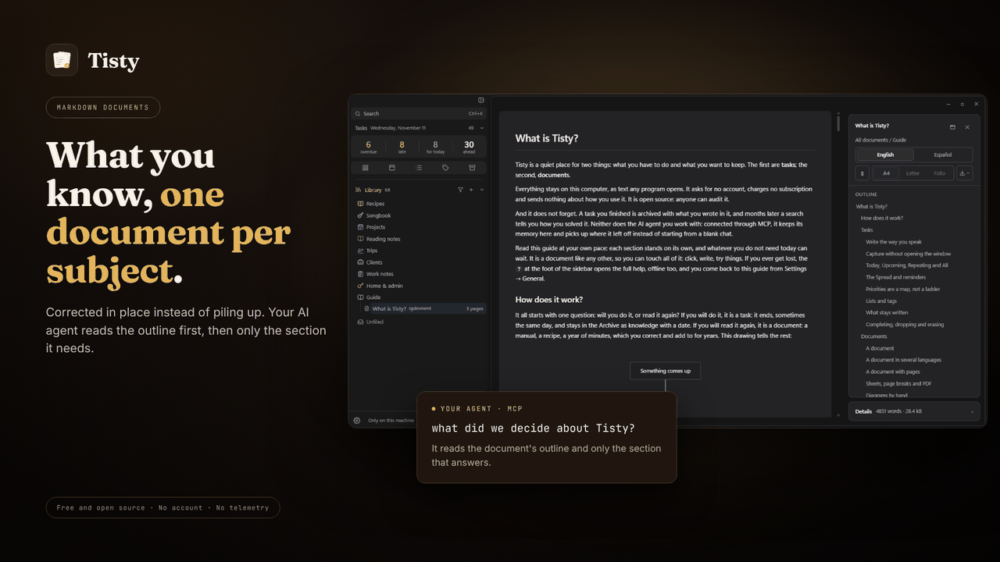
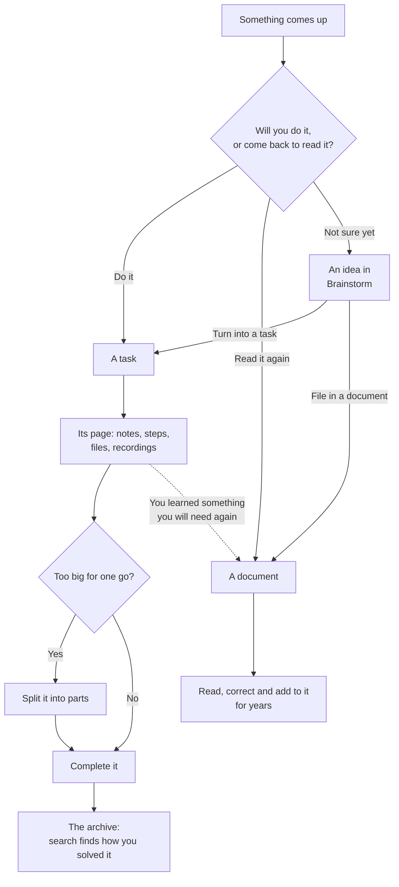
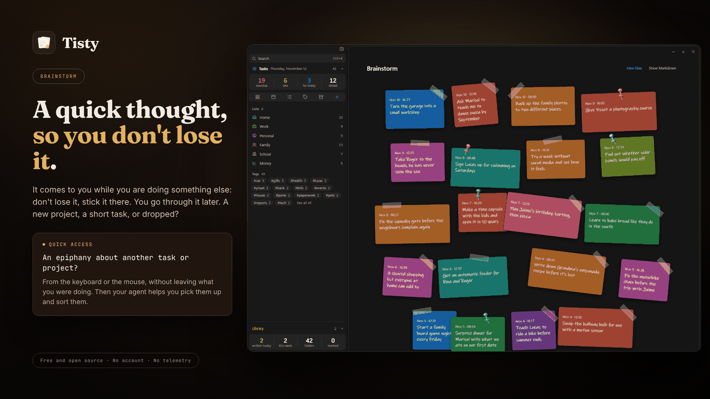
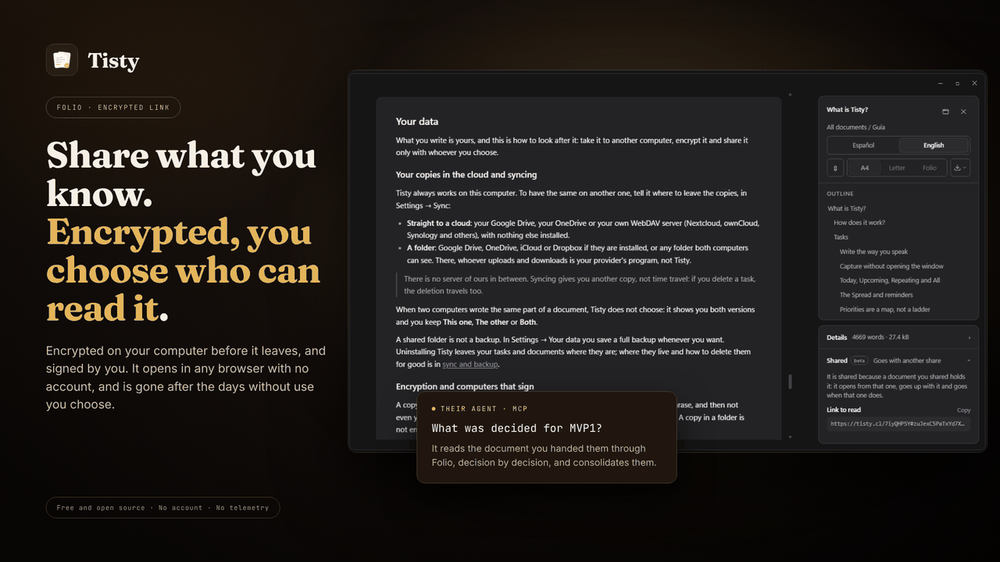

# Documents

Documents live beside the tasks, for reference material that has no date and never gets ticked. They are plain Markdown files, and search reads them too. A task can point at a document; a document never creates tasks.

For writing in one, see [[The Markdown editor|Markdown-Editor]]; for everything it can hold — callouts, tables, diagrams, math, widgets, code — see the [Tisty Markdown guide](https://markdown.tisty.app).



## A task or a document?

Tisty keeps two kinds of things, and telling them apart is most of using it well.

- **A task is something to do.** It ends, often soon: you complete it and it goes to the archive. But it does not go away. What you wrote on its page, its steps and its notes stay, and months later a search finds it and tells you how you solved it. A task is knowledge with a date.
- **A document is something to keep.** A manual, a recipe, the notes on a client or a machine, a year of minutes: it is read again and again, corrected and added to, and it grows for years. It rarely ends.

That is why a task has a page of its own: a task is also a document, one with an end. Take a **spike** — finding out how something can be done before doing it:

1. It starts as a task, «Find out how to sync with OneDrive». On its page you write what you read, what you tried and what you ruled out, section by section, and you go back and correct it as you learn. You attach what a single description could never hold: the recording of the meeting, a video of the fault, the code analysis, the PDF from the vendor.
2. When the way is clear, the work is split into **parts**: «Sign in», «Upload large files», «Resume a cut upload». Each one is a task with its own steps and notes.
3. The parts are completed one by one, and then the spike itself. It goes to the archive.
4. Nothing is lost. A year later, «how did we solve the OneDrive uploads?» finds it: its page, its parts and every step, as they were left.



Something you will do is a task. Something you will come back to is a document — a recipe is not a task with steps, and a to-do is not a document. When doing a task teaches you something you will need again beyond it — the fix for a fault that returns, how a supplier wants an order — put it in a document as well.

**Before either, there is often an idea.** An idea is a thought caught on the fly, before you know whether it is something to do or something to keep: a few words, 140 at most, dated, on the Brainstorm sheet. It waits for you to sort it out: it becomes a task, goes into the document on its subject, or is set aside. A note is something else: the dated line in a task's journal.

How a task's page, steps and parts work is in [[Tasks]]; what a closed one keeps, in [[The archive|Archive]].

## Making one

In the sidebar's **Library**, use the **+** in its header: **New document**. The same button inside a folder makes it there. **New diagram** makes a document holding a diagram and opens the [[diagram window|Diagrams]]. **New folder** groups them, and a folder can hold folders of its own.

The first line of the document is its title — there is no name to fill in.

`Ctrl`/`⌘` + `X` and `V` move a document between folders.

## Brainstorm

An idea that comes in the middle of something else has nowhere to go yet. Press `Ctrl` + `Shift` + `Space` and then `Tab` to switch from **Task** to **Idea** (or the idea's own shortcut, once you pick one in **Settings**), type it, up to 140 characters, and press `Enter`: it lands in **Brainstorm**, dated, without opening the window or choosing a folder. **Settings** lets you pick both shortcuts; the idea's stays off until you choose it, since `Ctrl` + `Alt` is AltGr on many keyboards. Without the keyboard, the **+** at the end of the row of views opens the same capture.



- **Brainstorm is an ordinary document**, pinned at the top of the Library. The first idea makes it. You can open it, change its notes, duplicate it, archive it or delete it; its menu does not offer moving or exporting it. Each idea is written in it as a `[!IDEA]` sticky note, with its date and colour, the same note any document can hold.
- **It shows as notes stuck on a sheet**, a little crooked and in different colours, written by hand: they are ideas of the moment. The newest comes first. Click one to change it, **New idea** adds one, and the **×** takes it off. Drag a note by its edge onto another to put it in that place, or press `Alt` and an arrow on it; it stays as crooked as it was.
- **The file is still Markdown.** Each note is an `[!IDEA]` whose first line says the day and the minute it came, and its colour, chosen when it is made and kept wherever you move it, and **Show Markdown** shows the text, only to read: an idea is plain words, so tables and diagrams belong in a document of their own. Any document with `view: notes` in its [properties](https://markdown.tisty.app/properties) shows the same way.
- **Sort them out later**: on each note, **File in a document** adds it at the end of the document you pick, as the same sticky note with its date and colour, beside the text, and **Turn into a task** files it as a task, read like any quick capture, with its dates, lists and tags. Either way the idea leaves the sheet. The Library shows beside Brainstorm how many ideas are still waiting.
- **Your AI agent sorts them too**: ask it and it jots ideas, files one in a document or turns it into a task, and the idea leaves the sheet as it does when you do it. One it deems old is only marked: the note wears a ◆ with the reason, **Delete it** takes it off and **Remove the mark** keeps it, and the bar above the sheet does either for all of them in one click. Brainstorm wears the ◆ in the Library too.

## Diary

What happened today, at home or at work, has one place: **Diary**, near the top of the Library. It is not a note a day, which would be 365 documents a year: it is one book a year, **Diary 2026**, with a page a month, **November**, and a section a day, **Sunday 15**, in the app's language. Today is on top, and a day you did not write never appears.

- **Diary in the Library opens today.** The first time in a year it makes that year's book and the month's page; the day itself is born when you write in it. Under the row, the years and their months open like any book.
- **It reads as a line of days, not as a page.** Today's date heads it, and each day shows its number and weekday beside what you wrote, newest on top.
- **The box on top, «What happened today?», writes in today**: `Ctrl`/`⌘` + `Enter` or the round button keeps it. The note button beside it, **Stick a note**, turns it into a sticky note of up to 140 characters with the minute it came, on the right of today, kept with `Enter`.
- **A day is corrected where it stands**: a click on what you wrote that day turns it into a box holding its words in Markdown. `Ctrl`/`⌘` + `Enter` or **Keep** keeps it and you stay on the line of days; `Esc` or **Cancel** leaves it as it was. The day's sticky notes stay out of the box and, once kept, follow the words in their order. Empty the box and the day keeps only its notes, or goes if it has none.
- **A note's ×**, shown when the pointer is over it, removes it after asking you, since the diary keeps no copy.
- **The pencil** opens the month as a document for what the line of days does not change: the month's introduction, a note's words or moving a note to another day. Going anywhere else, or choosing **Diary** again, brings back the line of days.
- **From anywhere**: in the quick capture, `Tab` goes from **Task** to **Idea** and then to **Diary**, which writes in today without opening the window. On a Brainstorm note, **File in a document** offers **Today's diary** first.
- **Tasks you finished that day** fold under what you wrote, as «3 tasks closed»; each one opens with a click. One you dropped is not listed, and a day you did not write shows none. They are only shown, never written into the text.
- **Only you.** No agent sees your diary until you press **Only you** at its top and it reads **Open to agents**. Open, an agent reads it and, only when you ask, adds to the end of today under a line with the minute and its name. It never changes what you wrote. Press it again to keep it to yourself. The door is one for every year and for all your computers, and only Tisty 1.48 or later knows it. So **Diary** does not start your diary while any computer of yours runs an older version, and names it: update it, or remove it from your computers. Once a diary exists, a computer on an older version stops syncing before it receives any of it, and asks you to update it.
- **It is never shared by link**: the diary has no side panel and no **Share**, and Folio refuses it. It still travels with your sync and your backups, like every document.
- **The file is still Markdown**: a book with `diary: on` in its [properties](https://markdown.tisty.app/properties), whose pages are the months. Tisty never writes in it on its own.

## Rediscovering what you forgot

What you kept and never opened again comes back into view on its own. Choose **Library**, and above **Unfiled**:

- **Not opened in a while** lists the documents you did not open on this computer and nobody wrote in 60 days, the most forgotten first, with their folder and how long ago. It shows five, and **See all N** unfolds the rest. Hovering says whether it counts from the last time you opened it here or from the last time it was written.
- **A document at random** opens one you have not opened this week.
- **It counts what you open here**: the day you open a document is noted on this computer only and does not travel with your sync. Opening a page counts for its document, and opening one of its languages counts for all of them. There was no record before this feature, so at first it counts from the day it was written.
- **Left out** are what is archived, what an agent marked as having had its day, which already waits for your call, the Diary, Brainstorm and Tisty's guide.
- **With the right button** each one has its usual menu: archive it if it has served its turn.

## Folders

- **Every folder starts folded**, so a store with hundreds of documents is a handful of rows until you go looking.
- **The filter** in the Library's header keeps only the folders and documents whose name holds what you type, accents and case aside, with the folders above each one open; a folder that matches keeps all it holds. `Esc` closes it.
- **When tasks take the room**, the Library folds to its title and one strip: how many documents were written today and this week, how many folders, and how many an agent marked as having had their day. The arrow beside its title gives it the room again.
- **Archive a whole folder** with the right button when work is over: it drops to the **Archived** shelf at the foot of the tree with its icon, subfolders and pages exactly as you left them. There it reads and exports, but nothing writes into it and nothing new goes in.
- **Bring it back** and it returns the same — including documents you had archived by hand in there, which stay archived.

## Tags

A document takes tags the way a task does: write `#contract` in the middle of a sentence and the document is filed under it. The tag lives in the sentence, not a hidden header, so taking the file to another editor takes the tag with it. A note brought from elsewhere with `tags:` in its [properties](https://markdown.tisty.app/properties) is filed under those too.

- The **Tags** screen shows the tasks under a tag and the documents beneath them. Pressing a tag inside a document opens exactly that.
- How a tag is written, which letters it takes and what does not count as one, is in the [Markdown guide](https://markdown.tisty.app/tags).

## Linking documents

All of this, with pictures and an example from start to end, is in [[Linking documents|Linking-Documents]]; here is the gist.

A document on its own gets forgotten; a linked one gets found again. Type `[[` in a document and go on with a few words of its title: Tisty offers the ones that fit, first those that begin that way, then those written lately. `[[` alone shows the ones you wrote last. `Enter` leaves a link like `[Trips](tisty:doc/…)`, which points at the document and not at its name: rename it and the link still gets there. The `[[ ]]` are not kept.

- **To a section**: follow the title with `#` (`[[Trips#hot`) and pick one of its headings. The link opens the document right there; if that section is gone, it opens at the top.
- **Preview**: rest the pointer on a link to another document and you see its first lines, or the section it points at, without leaving where you are.
- **Who links to it**: the panel beside the document has a **Linked from** row, with every document and task that cites or mentions it and, for a document, the sections where it does. A click opens it at that section. Tisty builds this list in the background, so a link you just wrote shows up a few seconds later.
- `[[#2]]` still names the second step, as always.

## Citing a task

With pictures, a table of what the card shows in each case and a whole example: [[Tasks in documents|Tasks-in-Documents]].

What you know about a subject lives in its document; the work you did on it, in its tasks. Cite the task in the document and you find it where you will look for it: «Car» shows «Change the tyres», closed in March, and a click takes you to how it was solved.

Type `/`, choose **A task** and go on with a few words of its title: Tisty searches the open ones and the archived ones. `Enter` leaves a card like ``, alone in its paragraph.

- **Always current**: the card reads the task each time it is drawn, with its title, its list, its dates, how many of its steps and parts are done and, if it is closed, the day it closed.
- **A click opens it**, archived or not.
- **While it is still open**, the card's circle marks it done, and the step count unfolds its steps so you can tick them right there. A closed task is read, but no longer changes from the document.
- **If it is gone**, because you deleted it or it has not reached this machine yet, the card shows the words you cited it with and says it is not here.
- **Outside Tisty** (Folio, PDF, Word, standard Markdown) only those words remain: nothing of the task leaves with the document.
- **Who cites it**: beside the task's page, **Linked from** gathers the documents and tasks that cite or mention it, with the section where they do.

## Making a task from a document

Tasks are born while you read and write: a «we need to…» turns up in minutes or in a plan, and leaving the document to note it down makes you lose the thread. Type `/`, choose **A new task** and write it as you would in the quick capture: `Call the vet on Monday #Rina !do`. `Enter` makes it with its date, its list, its tags and its priority, and leaves its card in that place of the document.

- **The same rules as the quick capture**: `@list`, `#tag`, `!priority`, dates and repeats in words. The marks are painted as you type, and `/` inside the field offers what it offers there.
- **`Esc` lets it go** without making anything. An empty line makes no task, and if something fails the document stays as it was.
- **The task remembers where it was born**: beside its page, **Born in** names the document and the section, and a click takes you back.
- **Undo** in the document takes the card away, not the task: deleting it is still your call.
- **On a task's page**, **A new task** makes a part of that task, in its same list unless you name another.

## Attachments

Drag a file into a document or onto a task to attach it — the photo from the vet, the insurance PDF, the recording of a meeting. A task takes files up to 650 MB, the same as a document. It is kept as itself, inside Tisty, and travels with the document when you export it.

An attachment is drawn as what it is: a picture as itself, a sound or a video with its player, and any other file, an `.html` page among them, as a card with its kind and size.

A sound or a video already on this computer plays from here, without touching your cloud. One that is still only in your cloud shows **Bring it from your cloud** with its size, and comes down only when you press it; once here, it stays. If it cannot come — no connection, or it never arrived — the player says why and offers **Try again**. A picture that cannot come says so the same way.

The **⋯** on a card saves a copy, turns the card into a plain link, or takes it off the page. On the card of a page, it can also make that page a document of its own.

## Pages

A long document in parts — a year of minutes, a book by chapters — is one document holding pages. See [Pages and PDF](Pages-and-PDF).

## Several languages

A document can be told in several languages: each language is a document of its own, and Tisty shows them as one, in the language of the app, with a switch in the title panel, or above the sheet when the panel is shut, that keeps your place. From four languages on, the switch, above the sheet and in the panel alike, becomes one button with the language shown and how many there are; it lists them all with their code, and from nine on a field finds one by its name or its code.

- **Translate into…**, in the document's menu, writes a copy of its words and pages in the language you pick, ready to translate section by section. If the document does not say its language yet, it asks.
- **Join with its other language…** puts two documents you already have together, in either order: it asks each one's language by its name, and **Take out of its languages** parts them again.
- The languages of a document stand in one folder, and move, rest and go together. Searching finds them once, open in the language the words turned up in.
- Taking a document out writes `translationKey:` in its properties, and bringing it back in joins it to the others again.

## Importing

**Import a document** in the tree takes a `.md`, `.markdown`, `.txt`, `.html`, `.htm` or Word `.docx` file and brings it in, one at a time. A web page or a Word document comes in as Tisty Markdown, with its headings, lists, links, tables and colours (a colour becomes the nearest pen of the palette), and a Word document's pictures come in with it as attachments. A `.tistyx` from another Tisty unpacks whole.

Word, HTML, Google Docs, rich text, plain text and Obsidian notes all come in as Markdown, with their pictures and files: [Convert to and from Markdown](Convert-to-and-from-Markdown) tells each way in.

Tasks have to be typed: there is no importer for another program's task list.

## Opening a Markdown file from outside

Tisty does not need to own a file to show it. Pick Tisty under **Open with** for a `.md` or `.markdown` file — it never takes over as the default program — or follow a `tisty://open?path=…` link, and the file opens **read only** in a light viewer of its own, with the system's title bar, without coming into your store. It reads up to 1 MB, about a million characters, and says so when a file is heavier.

- **The column beside the page** holds **Edit**, **See Markdown** (`Ctrl`/`⌘` + `Shift` + `M`; **See the document** returns from it), the file's headings and its details: its folder, size, date and properties. While it is open, the page moves aside for it and narrows if it has to, so the column never covers the text. In a narrow window the sidebar folds to its icons first, so the column keeps its place; only when even that is not enough does it fold away, and its button in the bar (`Ctrl`/`⌘` + `\`) opens it.
- **The bar** has **Find in the text** (`Ctrl`/`⌘` + `F`), the theme and **More**, which also holds larger and smaller text, **Copy Markdown**, **Print** and **Show in folder**. The theme and your place in the file are remembered.
- **It reads the file as it was written for other programs.** A centred header stays centred, a badge sits in its line, lines an editor cut at a column join up, and `#ff0000` or `[[x]]` stay as words. Diagrams and formulas are drawn, and so is a [widget](Widgets), since nothing in it runs.
- **Pictures** beside the file show when they sit in its folder or below it. Pictures from the internet wait: a line above the page says how many, and **Show them** fetches them. It asks again each time you open the file ([what that sends](Privacy#the-network-requests-tisty-makes)).
- **Links**: a link to another `.md` beside it opens in the same window, with **Back** (`Alt` + ←). A web link opens your browser.
- **Edit** makes a copy in your store, written in Tisty Markdown, and opens it; the file stays as it is and the viewer closes. A file over 500 KB can be read but not edited, and **Edit** says so. If a file beside it could not come along, the viewer stays open and says how many.
- **On a Tisty not set up yet**, the file reads at once and **Edit** makes no copy: it brings up the welcome, and the viewer says to finish it first. When the welcome ends, the copy is made and opened.

A `tisty://open` link reaches only a readable text file on this computer.

### A document in a window of its own

**Open in a window of its own**, the button beside the title in a document's panel, shows it read only beside your work, in the same light viewer that opens a file from outside.

- **Contents and details** (`Ctrl`/`⌘` + `\`) opens a column with its headings, its folder, its size and when it changed.
- **See Markdown** (`Ctrl`/`⌘` + `Shift` + `M`) switches between the drawn page and its text.
- **More** has **Find in the text**, larger and smaller text, **Copy Markdown**, **Copy link** and **Print**.
- Its widgets, pictures, sounds, videos and file cards look as they do in the main window; a press on a file card opens it in its own program.
- A link or a card to another document or to a task opens it in the main window; a [document's link](#a-documents-link), in another window of its own.
- **Edit** takes you to the document in the main window. If you change it there, the window of its own reads it again when you come back to it.
- Its PDF, its sheets and its exports are made from the main window.

### A document's link

Every document of yours has a link, to reach it from a chat, a note, your browser or your agent. **Copy link** is under **Export**, in the document's panel; in the document's menu, in the tree; and under **More**, in the window of its own. It looks like this:

`tisty://doc/personal/trips/summer-plan?id=k7tq2mzw-0012`

- **It opens the document read only** in the light viewer, not in the editor, archived or not. If a window of its own already shows it, that window comes forward. With Tisty closed, only that window opens.
- **Only the `id` counts.** The folders and the title are words for whoever reads the link, lowercase, without accents and with dashes, so it still gets there after you rename or move the document. A page carries its document's name before its own: `tisty://doc/work/minutes/march?id=…`.
- **Inside a document** or on a task's page, write it as a Markdown link, `[Summer plan](tisty://doc/…?id=…)`, and it opens like any other link. Pasted on its own, it stays as text. To go from one document to another while you write, `[[` still does it, and opens in the main window ([Linking documents](#linking-documents)).
- **Your agent** takes it as it is: hand it the link and it reads or changes that very document without searching for it.
- **It opens only on a computer that holds the document**, that is, one of your computers with your store. Where the document is not, the window opens and says so. To give it to someone else, share it through [Folio](#sharing).
- **Inside a document shared through Folio it does not travel**: a Markdown link arrives as its words, and an address written on its own arrives as written, folders and title included.
- **Whoever gets it reads** its folder names and its title.

For example, you are planning the summer trip with your agent. Under **Export** of «Summer plan», in the folder Personal / Trips, you choose **Copy link** and paste it in the chat: «Check the flight dates in tisty://doc/personal/trips/summer-plan?id=k7tq2mzw-0012». Your agent does not search for it: it asks for it by its link,

```json
{ "name": "read_doc", "arguments": { "doc": "tisty://doc/personal/trips/summer-plan?id=k7tq2mzw-0012" } }
```

and Tisty answers with that very document, `"doc": "k7tq2mzw-0012"`, `"title": "Summer plan"`, `"folder": "Personal / Trips"`, with its text. If you later call it «Summer holidays» and move it to Family, the same link still gets there. Paste it to your agent on another computer that does not hold your store, and Tisty tells it there is no document with that id there.

## Earlier versions

Each document keeps, on this computer, what it said before it changed, as a history of versions: you open the list, read how it stood and, if it helps, go back to it. Task pages too. I made it for the day a change, yours or an assistant's, took away something you still needed.

### When they help

- **An assistant rewrote too much.** You asked your agent to tidy «Rina's walks» and it left out the times. The version from before its write is in the list: see what changed and go back to it.
- **You deleted a paragraph and need it a week later.** You took the guest list out of «Lucas's birthday» because it was settled, and now Marisol asks who was coming. A version from before that change still has it, even after the document kept changing.
- **You want to see how something stood on a given day.** Each version carries its date, so you read the plan as it was on Tuesday without touching today's.
- **You wrote something that should not stay kept.** Delete the text, then empty that document's history (below).

### Seeing a version and going back to it

1. Open the document. In the panel beside it, the **History** row says **on this computer** and has **See the history**. On a task's page the button is **Versions of this page**.
2. The list sits on the left, newest first. Each row says when that version was written (only the time if it was today), who wrote it (**you**, **an assistant** or its program's name, such as **Claude Code**) and its size.
3. Click one to read it on the right, as it looked.
4. **Go back to this version**, above what you read, asks first: the document goes back to saying what it said in it, and what it says now is kept.
5. The document shows **It went back to the version from** and the date, with **Put back what it said before**: that button undoes the go-back if you picked the wrong one.

On a task's page the words come back, not the task's state: no step is removed and no box changes, and a step that version names and the task no longer has comes back as a new step.

If there are none yet, the list says so: Tisty keeps one when 30 minutes go by without changes or when the one writing changes.

### Seeing what changed

Before going back to a version, you can see exactly what changed, in a document or on a task's page:

1. Pick a version in the list. **What changed**, above what you read, compares it with what the document says now.
2. To compare two versions with each other, press **Compare** on another row of the list. It always reads from the older to the newer, whatever order you pick them in. **Compare** again on that row goes back to comparing with what it says now, and **What changed** turns the comparison off.
3. At the top, a line says what is compared, such as «From the version of 04:10 PM to what it says now» or «From the version of 04:10 PM to the one of 05:45 PM», and how many blocks changed: **What went** and **What came**, each with its number. When there is no difference, it says **They say the same: nothing changed.**

The comparison is a single page, drawn as always, that opens at the first change. What went shows in red and what came in green, one above the other; inside a paragraph, an item, a cell or a line of code that changed, the old words are struck through and the new ones highlighted. What only changes how something is written and not what it says does not count as a change: line endings, an item's number in a numbered list and the spaces of a table.

For example: Claude Code rewrote the times paragraph of «Rina's walks» and you do not know what it touched. Open **See the history**, pick the version from before its change and press **What changed**. The old paragraph shows in red and the new one in green, and inside it «at 8:00» is struck through and «early» highlighted; at the top it says **What went: 1** and **What came: 1**. Now you know that was all that changed: go back with **Go back to this version**, or copy the time and keep the rest.

- **Only this computer's versions.** A row from another computer has no **Compare**, because its text is not here.
- **Now means what is saved.** If what you typed could not be saved yet, nothing is compared, and the window says so: settle that first, then compare again.
- **A document too long.** When what differs between the two versions is so large that marking it would take too long, about 4,000 differing blocks a side, the view says so and offers **See the whole version**. A small change in a long document is always marked, because what both versions share at the start and the end does not count.

### When a version is kept

Not at every key or every save. What was there becomes a version when someone writes in the document:

- **after 30 minutes without changes**, or
- **being someone other than whoever wrote last**: you after an assistant, an assistant after you, or two different assistants.

For example: at 9:00 Mario opens yesterday's meeting minutes and corrects them for twenty minutes, with no long pauses. A single version is kept, yesterday's: the saves of those twenty minutes are one write. At 11:00 he corrects them again, and what they said at 9:20 becomes a version. At 11:05 Claude Code adds a summary, and what Mario had left becomes another version, because the one writing changed.

A version is the document's whole text as it stood, in a Markdown file inside the `history` folder of your data. Attachments stay out, where they always are. What arrives from your other computers follows the same rule, with the time and the writer of whoever wrote it there.

### How long they are kept

**30 days** by default, counted from when the version was replaced and not from when you wrote it, so you can always go back to how the document stood when the limit began.

To change it, in **Settings › Your data › Document history**, **Keep earlier versions for** offers **1 day**, **5 days**, **15 days** or **30 days**. Each computer has its own. On opening Tisty, once a day at most, the versions past the limit go, so a shorter limit takes effect at that tidy. Go from 30 to 5 days and the next tidy deletes the versions replaced more than 5 days ago; those of the last 5 stay.

Two always stay, whatever their age:

- **The latest.** The last earlier version of each document never runs out, even when the document has not changed in months. A quiet document always keeps its way back.
- **The one that undoes the last change:** what **Put back what it said before** would bring back.

### Emptying the history

**Empty the history**, at the foot of the list, deletes every earlier version of that document from this computer, including the one that lets you undo the last change. What the document says now stays as it is. It asks first, because this cannot be undone.

It is there for a text you deleted on purpose: you pasted a number into «Insurance details» that should not stay there, and took it out. Until you empty the history, that number is still in the version from before. Empty it and, if you sync, do it too on each computer the text reached, because each keeps its own versions. Backups you made in the meantime keep it; see [Privacy](Privacy#what-is-stored).

### On your other computers

**Versions are not synced.** Each computer keeps what was replaced on it, what a change from another computer replaced included, and prunes them with its own limit.

- **A version another computer keeps** shows in the list while the limit lasts, as **Not on this computer; … keeps it**, with that computer's name, for instance «Not on this computer; Marisol's laptop keeps it». Its text is only there, so here it can be neither read nor gone back to: open it on that computer.
- **A new computer starts with no earlier versions,** even once it holds all your documents. What that computer changes from then on, it keeps.
- **To take them to another machine,** use a [backup](Sync-and-Backup#backups): the zip carries them, and restoring it swaps that computer's for the ones it brings.

### Edge cases

- **Deleting a document** deletes its versions too, on every computer. To keep one, go back to it or copy it first.
- **A task's page** has versions of its own, under **Versions of this page**. Going back to one brings its words and never removes steps (above).
- **The [Diary](#diary)** keeps versions on this computer too, which count toward what your computer and your backups hold, but its view has no **History** row: they are not listed from the window.
- **An archived or locked document, and a closed task's page,** show their versions but do not offer **Go back to this version**. Unarchive or unlock it (or its archived folder, or the locked document it is a page of), or reopen the task with **Reopen**, to go back to one.
- **Restoring a backup** swaps this computer's versions for the zip's, and their limit counts again from that day.
- **On updating from a Tisty without the history,** the copy each document used to keep of what it said before became its first version on its own.

### With your assistant

You also go back without opening the list: when something writes in the document you have open, the bar offers **Put back what it said before**. An assistant lists, reads and goes back to the same versions with `read` and `restore_doc`, and can never empty them: that is yours. You can ask in your own words: «put "Rina's walks" back the way it was before your change yesterday». How it does it, with examples, is in [MCP tools](MCP-Tools#a-documents-earlier-versions).

## Taking documents out

A document leaves whole — every conversion is in [Convert to and from Markdown](Convert-to-and-from-Markdown):

- **Copy as Markdown** — standard Markdown, ready for any other editor.
- **Export as Markdown…**, in the document's menu, writes it out to the folder you pick, as standard Markdown files with its pages and attachments beside it; a link to one of its pages points at that page's file.
- **Markdown to HTML** — **Export as HTML…**, in the document's menu, makes one web page that travels alone.
- **Markdown to Word** — **Export as Word…** makes a `.docx` with its headings, lists, tables and pictures.
- **Export for Tisty…** into a `.tistyx` file, which also carries what Markdown cannot say: folders with their order, icon and colour, which document each page hangs from, what is archived, and the alias it was signed with. It includes a `README.txt`, so whoever receives it can read the documents without Tisty.
- **Markdown to PDF** — see [Pages and PDF](Pages-and-PDF#tistys-own-pdf).

Exporting all of them asks who they are for: **To hand to somebody**, which goes out open for anyone holding the file to read, or **For another machine of mine**, locked with six digits so nobody else can read it. A single document or a folder goes out open without asking.

Once you have your identity (**Settings › Security**), every parcel goes out signed with your key. Another Tisty of yours takes it as yours, locked or not. Anybody else's takes it as your writing and shows your name with your fingerprint, so they can compare it with the one you see. If anything inside was changed on the way, it lands as a stranger's and Tisty says the signature does not match. A Tisty where nobody has made or typed an identity yet asks before it opens a signed parcel: type your phrase first, in **Settings › Security**, and it arrives as yours; open it anyway and it arrives as the signer's, for good.

Without your identity the parcel goes out unsigned. An open one lands as someone else's, even what you wrote, except back in the very store that made it. A locked one asks, once the number opens it, whether you locked it: **I locked it** brings it in as yours, **Somebody gave it to me** as a stranger's. Back in the very store that locked it, it needs no question: the store knows it by its seal.

A signed parcel also carries who edited each document you shared through Folio. The document's details list them under **Who edited it**, each with a fingerprint, as whoever handed you the parcel tells it — nothing checks whether those keys were taken back since. Either way, not one line of the history travels inside.

## With your agent

Documents are where the AI agent you connect through [[MCP|Assistants-and-MCP]] keeps what it knows, and how it reads them is what keeps it cheap.

- **One living document per subject.** It opens with what holds today, then the subject, what is out of scope, the decisions dated with their why — a replaced one struck through, not erased — and its history. The agent keeps to the decisions instead of reopening them.
- **Corrected in place.** The agent rewrites the passage that changed instead of piling a second copy beside the first, and it cannot write over a version you changed after it read.
- **Outline first, then one section.** The agent reads a document's headings and what each section weighs, then asks for only the part it needs. A document asked for whole past about 12,000 characters comes back as its outline.
- **Pages for what is long.** No single write carries more than 64,000 characters, so a long log is kept as subjects in pages rather than one wall of text.
- **A summary for the next one.** After reading a long document the agent can leave a summary that the next agent chooses by; when the document changes, it is marked stale.

More in [A day with your agent](Assistants-and-MCP#a-day-with-your-agent).

## Sharing



When somebody else needs what you know — your PO, the QA joining the project, another team — you hand them the document. The panel beside a document has a **Shared** row with **Share…**. Sharing goes through Folio, a service apart from Tisty. Pressing **Share…** reads a small signed file to learn whether Folio has opened. While it has not, it says so, with a link to [tisty.cl](https://tisty.cl), and nothing of your document leaves this computer; the ways out above still hand a document to someone. If that file cannot be reached, it says so and offers to try again. Once Folio is open, you make your identity first if this computer has none yet — the key that signs what you share, backed up with your 24-word phrase — then accept its terms the first time, choose what the other person can do and how long it lasts, and get a link. A document in several languages lists them with a box each: the one you share always goes, you can leave out another of yours, and one written by someone else stays here. If Folio changes its terms, Share and Sync ask you to accept the new ones as soon as they can be checked; until then you keep sharing under the ones you accepted.

Once a document is shared, its row has **Sync**, and nothing goes up until you press it. It sends only what changed, and if nothing did it only brings in a newer version someone else sent. Folio takes a new version of each document after a short wait, and a few new documents a day, each document it cites included: while a wait runs, the button says how long is left and whether changes are waiting, and the dialog says before you share when a document and what it cites would not fit today.

Its row says who created it, who edited it last and everyone who edited it, each under the name they chose and signed by their own key; a ✓ marks the maker of Tisty. Whoever edits through the edit link chooses between their alias and their name. To take that power from everyone who has the link, press **Change the edit link**: theirs stops sending versions, they keep their copies, and you give the new link to whoever should keep editing. What reached you through a read link stays a copy of your own: Sync brings newer versions into it, and only an edit link lets you send yours. Stop sharing a document others edited and share it again later, and the dialog reminds you who they were first.

Each language of a document shared to edit has its own edit link, and the one you hand over reaches them all: whoever opens it edits every language you shared, and **Change the edit link** changes them all at once. Opening a link, to read or to edit, brings every language of the document, up to 20, joined as one, and shows the one Tisty speaks when the document has it. A language that does not say it belongs to that document, or that its owner has not reviewed, stays in Folio. Sync brings a newer version of any of its languages apart, as it does for the document itself.

**A language someone else adds waits for your review.** When someone who edits through your edit link adds a language, it is a proposal: readers do not see it until you keep it. The **Shared** row names each one — «English was added by someone who edits, and waits for your review» — with **Review English…**, which shows it as Folio holds it: who added it, its title, its words and its pictures. **Keep** signs that very version; if it changes later, the row says so and **Review the changes in English…** shows the new version against the one you kept. **Leave out** sets it aside, where only you can read it again with **Review English again…**. Your word goes up with the next **Sync**. Whoever added the language sees on their row whether you have not reviewed it yet, keep it or left it out, and readers see, beside a language someone else added, who translated it and who reviewed it. **Change the edit link** names the kept languages others added and offers **Change it and leave them out**, and **Translate into…** under someone else's edit link warns that the new language will be a proposal its owner reviews.

## Your alias

Write an alias in Settings — optional, and yours to choose — and every document is signed with it, while whatever arrives from somebody else keeps theirs. It travels with your sync and inside any parcel, so pick a name you are content for others to read. Your real name is never asked for.
