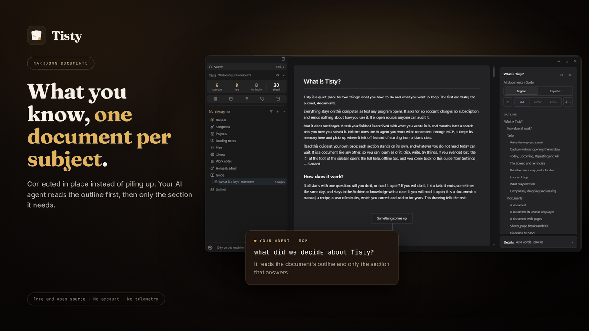
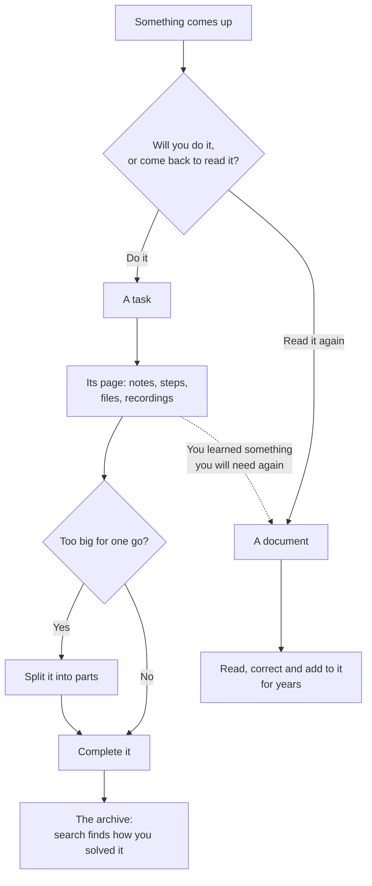
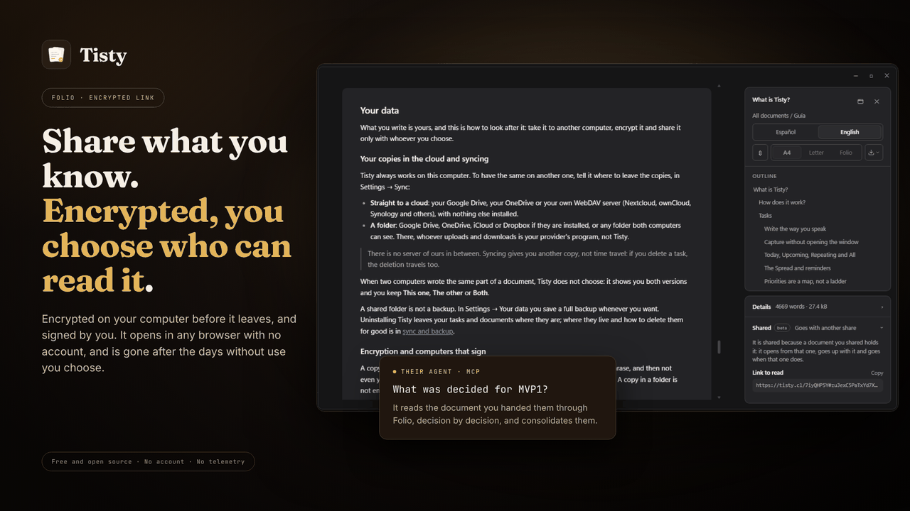

# Documents

Documents live beside the tasks, for reference material that has no date and never gets ticked. They are plain Markdown files, and search reads them too. A task can point at a document; a document never creates tasks.

For writing in one, see [[The Markdown editor|Markdown-Editor]]; for everything it can hold — callouts, tables, diagrams, math, widgets, code — see the [Tisty Markdown guide](https://markdown.tisty.app).

## A task or a document?

Tisty keeps two kinds of things, and telling them apart is most of using it well.

- **A task is something to do.** It ends, often soon: you complete it and it goes to the archive. But it does not go away. What you wrote on its page, its steps and its notes stay, and months later a search finds it and tells you how you solved it. A task is knowledge with a date.
- **A document is something to keep.** A manual, a recipe, the notes on a client or a machine, a year of minutes: it is read again and again, corrected and added to, and it grows for years. It rarely ends.

That is why a task has a page of its own: a task is also a document, one with an end. Take a **spike** — finding out how something can be done before doing it:

1. It starts as a task, «Find out how to sync with OneDrive». On its page you write what you read, what you tried and what you ruled out, section by section, and you go back and correct it as you learn. You attach what a single description could never hold: the recording of the meeting, a video of the fault, the code analysis, the PDF from the vendor.
2. When the way is clear, the work is split into **parts**: «Sign in», «Upload large files», «Resume a cut upload». Each one is a task with its own steps and notes.
3. The parts are completed one by one, and then the spike itself. It goes to the archive.
4. Nothing is lost. A year later, «how did we solve the OneDrive uploads?» finds it: its page, its parts and every step, as they were left.

Something you will do is a task. Something you will come back to is a document — a recipe is not a task with steps, and a to-do is not a document. When doing a task teaches you something you will need again beyond it — the fix for a fault that returns, how a supplier wants an order — put it in a document as well.

How a task's page, steps and parts work is in [[Tasks]]; what a closed one keeps, in [[The archive|Archive]].

## Making one

In the sidebar's **Library**, use the **+** in its header: **New document**. The same button inside a folder makes it there. **New diagram** makes a document holding a diagram and opens the [[diagram window|Diagrams]]. **New folder** groups them, and a folder can hold folders of its own.

The first line of the document is its title — there is no name to fill in.

`Ctrl`/`⌘` + `X` and `V` move a document between folders.

## Brainstorm

An idea that comes in the middle of something else has nowhere to go yet. Press `Ctrl` + `Shift` + `Space` and then `Tab` to switch from **Task** to **Idea** (or the idea's own shortcut, once you pick one in **Settings**), type it, up to 140 characters, and press `Enter`: it lands in **Brainstorm**, dated, without opening the window or choosing a folder. **Settings** lets you pick both shortcuts; the idea's stays off until you choose it, since `Ctrl` + `Alt` is AltGr on many keyboards. Without the keyboard, the **+** at the end of the row of views opens the same capture.

- **Brainstorm is an ordinary document**, pinned at the top of the Library. The first idea makes it. You can open it, write in it by hand, archive it or export it like any other.
- **It shows as notes stuck on a sheet**, a little crooked and in different colours, written by hand: they are ideas of the moment. The newest comes first. Click one to change it, **New idea** adds one, and the **×** takes it off. Drag a note by its edge onto another to put it in that place, or press `Alt` and an arrow on it; it stays as crooked as it was.
- **The file is still Markdown.** Each note is a section headed by the day and the minute it came, and its colour, chosen when it is made and kept wherever you move it, and **Show Markdown** shows the text, only to read: an idea is plain words, so tables and diagrams belong in a document of their own. Any document with `view: notes` in its [properties](https://markdown.tisty.app/properties) shows the same way.
- **Sort them out later**: on each note, **File in a document** adds it at the end of the document you pick, and **Turn into a task** files it as a task, read like any quick capture, with its dates, lists and tags. Either way the idea leaves the sheet. The Library shows beside Brainstorm how many ideas are still waiting.

## Folders

- **Every folder starts folded**, so a store with hundreds of documents is a handful of rows until you go looking.
- **The filter** in the Library's header keeps only the folders and documents whose name holds what you type, accents and case aside, with the folders above each one open; a folder that matches keeps all it holds. `Esc` closes it.
- **When tasks take the room**, the Library folds to its title and one strip: how many documents were written today and this week, how many folders, and how many an agent marked as having had their day. The arrow beside its title gives it the room again.
- **Archive a whole folder** with the right button when work is over: it drops to the **Archived** shelf at the foot of the tree with its icon, subfolders and pages exactly as you left them. There it reads and exports, but nothing writes into it and nothing new goes in.
- **Bring it back** and it returns the same — including documents you had archived by hand in there, which stay archived.

## Tags

A document takes tags the way a task does: write `#contract` in the middle of a sentence and the document is filed under it. The tag lives in the sentence, not a hidden header, so taking the file to another editor takes the tag with it. A note brought from elsewhere with `tags:` in its [properties](https://markdown.tisty.app/properties) is filed under those too.

- The **Tags** screen shows the tasks under a tag and the documents beneath them. Pressing a tag inside a document opens exactly that.
- How a tag is written, which letters it takes and what does not count as one, is in the [Markdown guide](https://markdown.tisty.app/tags).

## Attachments

Drag a file into a document or onto a task to attach it — the photo from the vet, the insurance PDF, the recording of a meeting. A task takes files up to 650 MB, the same as a document. It is kept as itself, inside Tisty, and travels with the document when you export it.

An attachment is drawn as what it is: a picture as itself, a sound or a video with its player, and any other file, an `.html` page among them, as a card with its kind and size.

A sound or a video already on this computer plays from here, without touching your cloud. One that is still only in your cloud shows **Bring it from your cloud** with its size, and comes down only when you press it; once here, it stays. If it cannot come — no connection, or it never arrived — the player says why and offers **Try again**. A picture that cannot come says so the same way.

The **⋯** on a card saves a copy, turns the card into a plain link, or takes it off the page. On the card of a page, it can also make that page a document of its own.

## Pages

A long document in parts — a year of minutes, a book by chapters — is one document holding pages. See [Pages and PDF](Pages-and-PDF).

## Several languages

A document can be told in several languages: each language is a document of its own, and Tisty shows them as one, in the language of the app, with a switch in the title panel, or above the sheet when the panel is shut, that keeps your place. From four languages on, the switch, above the sheet and in the panel alike, becomes one button with the language shown and how many there are; it lists them all with their code, and from nine on a field finds one by its name or its code.

- **Translate into…**, in the document's menu, writes a copy of its words and pages in the language you pick, ready to translate section by section. If the document does not say its language yet, it asks.
- **Join with its other language…** puts two documents you already have together, in either order: it asks each one's language by its name, and **Take out of its languages** parts them again.
- The languages of a document stand in one folder, and move, rest and go together. Searching finds them once, open in the language the words turned up in.
- Taking a document out writes `translationKey:` in its properties, and bringing it back in joins it to the others again.

## Importing

**Import a document** in the tree takes a `.md`, `.markdown`, `.txt`, `.html`, `.htm` or Word `.docx` file and brings it in, one at a time. A web page or a Word document comes in as Tisty Markdown, with its headings, lists, links, tables and colours (a colour becomes the nearest pen of the palette), and a Word document's pictures come in with it as attachments. A `.tistyx` from another Tisty unpacks whole.

Word, HTML, Google Docs, rich text, plain text and Obsidian notes all come in as Markdown, with their pictures and files: [Convert to and from Markdown](Convert-to-and-from-Markdown) tells each way in.

Tasks have to be typed: there is no importer for another program's task list.

## Opening a Markdown file from outside

Tisty does not need to own a file to show it. Pick Tisty under **Open with** for a `.md` or `.markdown` file — it never takes over as the default program — or follow a `tisty://open?path=…` link, and the file opens **read only** in a light viewer of its own, with the system's title bar, without coming into your store. It reads up to 1 MB, about a million characters, and says so when a file is heavier.

- **The column beside the page** holds **Edit**, **See Markdown** (`Ctrl`/`⌘` + `Shift` + `M`; **See the document** returns from it), the file's headings and its details: its folder, size, date and properties. While it is open, the page moves aside for it and narrows if it has to, so the column never covers the text. In a narrow window the sidebar folds to its icons first, so the column keeps its place; only when even that is not enough does it fold away, and its button in the bar (`Ctrl`/`⌘` + `\`) opens it.
- **The bar** has **Find in the text** (`Ctrl`/`⌘` + `F`), the theme and **More**, which also holds larger and smaller text, **Copy Markdown**, **Print** and **Show in folder**. The theme and your place in the file are remembered.
- **It reads the file as it was written for other programs.** A centred header stays centred, a badge sits in its line, lines an editor cut at a column join up, and `#ff0000` or `[[x]]` stay as words. Diagrams and formulas are drawn, and so is a [widget](Widgets), since nothing in it runs.
- **Pictures** beside the file show when they sit in its folder or below it. Pictures from the internet wait: a line above the page says how many, and **Show them** fetches them. It asks again each time you open the file ([what that sends](Privacy#the-network-requests-tisty-makes)).
- **Links**: a link to another `.md` beside it opens in the same window, with **Back** (`Alt` + ←). A web link opens your browser.
- **Edit** makes a copy in your store, written in Tisty Markdown, and opens it; the file stays as it is and the viewer closes. A file over 500 KB can be read but not edited, and **Edit** says so. If a file beside it could not come along, the viewer stays open and says how many.
- **On a Tisty not set up yet**, the file reads at once and **Edit** makes no copy: it brings up the welcome, and the viewer says to finish it first. When the welcome ends, the copy is made and opened.

A `tisty://open` link reaches only a readable text file on this computer.

### A document in a window of its own

**Open in a window of its own**, under **Window** in a document's panel, shows it read only beside your work.

- **Contents and page** (`Ctrl`/`⌘` + `\`) opens a column with its headings, what the document is, and the width of the page: how wide it reads, and the paper of its PDF. **Sheets**, first in that row, unlocks the paper and shows it on sheets, **Portrait** or **Landscape**, and its PDF comes out that way; the file does not change.
- **Reading** and **Markdown** switch between the drawn page and its text.
- **More** has **Find in the text**, larger and smaller text, **Copy as Markdown** (standard Markdown), **Preview** of the PDF it would make — **← Back to the document** returns from it — **Export to PDF…**, **Export as HTML…**, **Export as Word…** and **Duplicate**, which makes a copy.
- **Edit in Tisty** takes you back to the document. Its PDF there carries who wrote it and when unless you untick **Signed** in the preview.

## Taking documents out

A document leaves whole — every conversion is in [Convert to and from Markdown](Convert-to-and-from-Markdown):

- **Copy as Markdown** — standard Markdown, ready for any other editor.
- **Write it out to a folder**, as standard Markdown files with its pages and attachments beside it; a link to one of its pages points at that page's file.
- **Markdown to HTML** — **Export as HTML…**, in the document's menu, makes one web page that travels alone.
- **Markdown to Word** — **Export as Word…** makes a `.docx` with its headings, lists, tables and pictures.
- **Export for Tisty** into a `.tistyx` file, which also carries what Markdown cannot say: folders with their order, icon and colour, which document each page hangs from, what is archived, and the alias it was signed with. It includes a `README.txt`, so whoever receives it can read the documents without Tisty.
- **Markdown to PDF** — see [Pages and PDF](Pages-and-PDF#tistys-own-pdf).

Exporting all of them asks who they are for: **To hand to somebody**, which goes out open for anyone holding the file to read, or **For another machine of mine**, locked with six digits so nobody else can read it. A single document or a folder goes out open without asking.

Once you have your identity (**Settings › Security**), every parcel goes out signed with your key. Another Tisty of yours takes it as yours, locked or not. Anybody else's takes it as your writing and shows your name with your fingerprint, so they can compare it with the one you see. If anything inside was changed on the way, it lands as a stranger's and Tisty says the signature does not match. A Tisty where nobody has made or typed an identity yet asks before it opens a signed parcel: type your phrase first, in **Settings › Security**, and it arrives as yours; open it anyway and it arrives as the signer's, for good.

Without your identity the parcel goes out unsigned. An open one lands as someone else's, even what you wrote, except back in the very store that made it. A locked one asks, once the number opens it, whether you locked it: **I locked it** brings it in as yours, **Somebody gave it to me** as a stranger's. Back in the very store that locked it, it needs no question: the store knows it by its seal.

A signed parcel also carries who edited each document you shared through Folio. The document's details list them under **Who edited it**, each with a fingerprint, as whoever handed you the parcel tells it — nothing checks whether those keys were taken back since. Either way, not one line of the history travels inside.

## With your agent

Documents are where the AI agent you connect through [[MCP|Assistants-and-MCP]] keeps what it knows, and how it reads them is what keeps it cheap.

- **One living document per subject.** It opens with what holds today, then the subject, what is out of scope, the decisions dated with their why — a replaced one struck through, not erased — and its history. The agent keeps to the decisions instead of reopening them.
- **Corrected in place.** The agent rewrites the passage that changed instead of piling a second copy beside the first, and it cannot write over a version you changed after it read.
- **Outline first, then one section.** The agent reads a document's headings and what each section weighs, then asks for only the part it needs. A document asked for whole past about 12,000 characters comes back as its outline.
- **Pages for what is long.** No document holds more than 64,000 characters, so a long log is kept as subjects in pages rather than one wall of text.
- **A summary for the next one.** After reading a long document the agent can leave a summary that the next agent chooses by; when the document changes, it is marked stale.

More in [A day with your agent](Assistants-and-MCP#a-day-with-your-agent).

## Sharing

When somebody else needs what you know — your PO, the QA joining the project, another team — you hand them the document. The panel beside a document has a **Shared** row with **Share…**. Sharing goes through Folio, a service apart from Tisty. Pressing **Share…** reads a small signed file to learn whether Folio has opened. While it has not, it says so, with a link to [tisty.cl](https://tisty.cl), and nothing of your document leaves this computer; the ways out above still hand a document to someone. If that file cannot be reached, it says so and offers to try again. Once Folio is open, you make your identity first if this computer has none yet — the key that signs what you share, backed up with your 24-word phrase — then accept its terms the first time, choose what the other person can do and how long it lasts, and get a link. A document in several languages lists them with a box each: the one you share always goes, you can leave out another of yours, and one written by someone else stays here. If Folio changes its terms, Share and Sync ask you to accept the new ones as soon as they can be checked; until then you keep sharing under the ones you accepted.

Once a document is shared, its row has **Sync**, and nothing goes up until you press it. It sends only what changed, and if nothing did it only brings in a newer version someone else sent. Folio takes a new version of each document after a short wait, and a few new documents a day, each document it cites included: while a wait runs, the button says how long is left and whether changes are waiting, and the dialog says before you share when a document and what it cites would not fit today.

Its row says who created it, who edited it last and everyone who edited it, each under the name they chose and signed by their own key; a ✓ marks the maker of Tisty. Whoever edits through the edit link chooses between their alias and their name. To take that power from everyone who has the link, press **Change the edit link**: theirs stops sending versions, they keep their copies, and you give the new link to whoever should keep editing. What reached you through a read link stays a copy of your own: Sync brings newer versions into it, and only an edit link lets you send yours. Stop sharing a document others edited and share it again later, and the dialog reminds you who they were first.

Each language of a document shared to edit has its own edit link, and the one you hand over reaches them all: whoever opens it edits every language you shared, and **Change the edit link** changes them all at once. Opening a link, to read or to edit, brings every language of the document, up to 20, joined as one, and shows the one Tisty speaks when the document has it. A language that does not say it belongs to that document, or that its owner has not reviewed, stays in Folio. Sync brings a newer version of any of its languages apart, as it does for the document itself.

**A language someone else adds waits for your review.** When someone who edits through your edit link adds a language, it is a proposal: readers do not see it until you keep it. The **Shared** row names each one — «English was added by someone who edits, and waits for your review» — with **Review English…**, which shows it as Folio holds it: who added it, its title, its words and its pictures. **Keep** signs that very version; if it changes later, the row says so and **Review the changes in English…** shows the new version against the one you kept. **Leave out** sets it aside, where only you can read it again with **Review English again…**. Your word goes up with the next **Sync**. Whoever added the language sees on their row whether you have not reviewed it yet, keep it or left it out, and readers see, beside a language someone else added, who translated it and who reviewed it. **Change the edit link** names the kept languages others added and offers **Change it and leave them out**, and **Translate into…** under someone else's edit link warns that the new language will be a proposal its owner reviews.

## Your alias

Write an alias in Settings — optional, and yours to choose — and every document is signed with it, while whatever arrives from somebody else keeps theirs. It travels with your sync and inside any parcel, so pick a name you are content for others to read. Your real name is never asked for.
