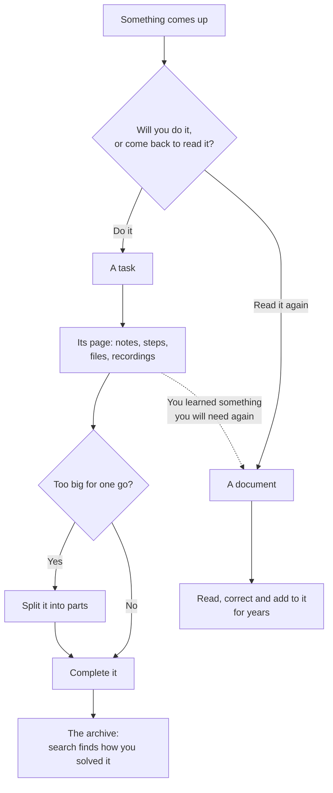

# Documents

Documents live beside the tasks, for reference material that has no date and never gets ticked. They are plain Markdown files, and search reads them too. A task can point at a document; a document never creates tasks.

For writing in one, see [[The Markdown editor|Markdown-Editor]]; for everything it can hold — callouts, tables, diagrams, math, widgets, code — see the [Tisty Markdown guide](https://markdown.tisty.app).

## A task or a document?

Tisty keeps two kinds of things, and telling them apart is most of using it well.

- **A task is something to do.** It ends, often soon: you complete it and it goes to the archive. But it does not go away. What you wrote on its page, its steps and its notes stay, and months later a search finds it and tells you how you solved it. A task is knowledge with a date.
- **A document is something to keep.** A manual, a recipe, the notes on a client or a machine, a year of minutes: it is read again and again, corrected and added to, and it grows for years. It rarely ends.

That is why a task has a page of its own: a task is also a document, one with an end. Take a **spike** — finding out how something can be done before doing it:

1. It starts as a task, «Find out how to sync with OneDrive». On its page you write what you read, what you tried and what you ruled out, section by section, and you go back and correct it as you learn. You attach what a single description could never hold: the recording of the meeting, a video of the fault, the code analysis, the PDF from the vendor.
2. When the way is clear, the work is split into **parts**: «Sign in», «Upload large files», «Resume a cut upload». Each one is a task with its own steps and notes.
3. The parts are completed one by one, and then the spike itself. It goes to the archive.
4. Nothing is lost. A year later, «how did we solve the OneDrive uploads?» finds it: its page, its parts and every step, as they were left.

Something you will do is a task. Something you will come back to is a document — a recipe is not a task with steps, and a to-do is not a document. When doing a task teaches you something you will need again beyond it — the fix for a fault that returns, how a supplier wants an order — put it in a document as well.

How a task's page, steps and parts work is in [[Tasks]]; what a closed one keeps, in [[The archive|Archive]].

## Making one

Go to Documents and use the **+** at the top: **New document**. The same button inside a folder makes it there. **New diagram** makes a document holding a diagram and opens the [[diagram window|Diagrams]]. **New folder** groups them, and a folder can hold folders of its own.

The first line of the document is its title — there is no name to fill in.

`Ctrl`/`⌘` + `X` and `V` move a document between folders.

## Folders

- **Every folder starts folded**, so a store with hundreds of documents is a handful of rows until you go looking.
- **Archive a whole folder** with the right button when work is over: it drops to the **Archived** shelf at the foot of the tree with its icon, subfolders and pages exactly as you left them. There it reads and exports, but nothing writes into it and nothing new goes in.
- **Bring it back** and it returns the same — including documents you had archived by hand in there, which stay archived.

## Tags

A document takes tags the way a task does: write `#contract` in the middle of a sentence and the document is filed under it. The tag lives in the sentence, not a hidden header, so taking the file to another editor takes the tag with it. A note brought from elsewhere with `tags:` in its [properties](https://markdown.tisty.app/properties) is filed under those too.

- The **Tags** screen shows the tasks under a tag and the documents beneath them. Pressing a tag inside a document opens exactly that.
- How a tag is written, which letters it takes and what does not count as one, is in the [Markdown guide](https://markdown.tisty.app/tags).

## Attachments

Drag a file into a document or onto a task to attach it — the photo from the vet, the insurance PDF, the recording of a meeting. A task takes files up to 650 MB, the same as a document. It is kept as itself, inside Tisty, and travels with the document when you export it.

An attachment is drawn as what it is: a picture as itself, a sound or a video with its player, an `.html` page live like a [widget](Widgets), and any other file as a card with its kind and size.

A sound or a video already on this computer plays from here, without touching your cloud. One that is still only in your cloud shows **Bring it from your cloud** with its size, and comes down only when you press it; once here, it stays. If it cannot come — no connection, or it never arrived — the player says why and offers **Try again**. A picture that cannot come says so the same way.

The **⋯** on a card saves a copy, shows a page as a file or draws it live again, turns the card into a plain link, or takes it off the page. On the card of a page, it can also make that page a document of its own.

## Pages

A long document in parts — a year of minutes, a book by chapters — is one document holding pages. See [Pages and PDF](Pages-and-PDF).

## Importing

**Import a document** in the tree takes a `.md`, `.markdown`, `.txt`, `.html`, `.htm` or Word `.docx` file and brings it in, one at a time. A web page or a Word document comes in as Tisty Markdown, with its headings, lists, links, tables and colours (a colour becomes the nearest pen of the palette), and a Word document's pictures come in with it as attachments. A `.tistyx` from another Tisty unpacks whole.

Word, HTML, Google Docs, rich text, plain text and Obsidian notes all come in as Markdown, with their pictures and files: [Convert to and from Markdown](Convert-to-and-from-Markdown) tells each way in.

Tasks have to be typed: there is no importer for another program's task list.

## Opening a Markdown file from outside

Tisty does not need to own a file to show it. Pick Tisty under **Open with** for a `.md` or `.markdown` file — it never takes over as the default program — or follow a `tisty://open?path=…` link, and the file opens **read only** in a window of its own, without coming into your store.

- **Contents and page** (`Ctrl`/`⌘` + `\`) opens a column with the file's headings, what the file is, and the width of the page: how wide it reads, and the paper of its PDF. **Sheets**, beside the paper, shows it on sheets, **Portrait** or **Landscape**, and its PDF comes out that way; the file does not change.
- **Reading** and **Markdown** switch between the drawn page and its text.
- **More** has **Find in the text**, larger and smaller text, **Copy as Markdown** (standard Markdown, as from a document), **Preview** of the PDF it would make — **← Back to the document** returns from it — **Export to PDF…**, **Export as HTML…**, **Export as Word…**, **Import without opening** and **Show in folder**.
- **Edit in Tisty** brings it in as a document and opens it; the original stays where it was.

A widget inside such a file is not run until you edit it in Tisty. A `tisty://open` link reaches only a readable text file on this computer.

### A document in a window of its own

A document of yours opens the same way: **Open in a window of its own**, under **Window** in its panel, shows it read only beside your work, with the same column, menu and preview. **Edit in Tisty** takes you back to it, and **Duplicate** makes a copy. Its PDF there carries who wrote it and when unless you untick **Signed** in the preview.

## Taking documents out

A document leaves whole — every conversion is in [Convert to and from Markdown](Convert-to-and-from-Markdown):

- **Copy as Markdown** — standard Markdown, ready for any other editor.
- **Write it out to a folder**, as standard Markdown files with its pages and attachments beside it; a link to one of its pages points at that page's file.
- **Markdown to HTML** — **Export as HTML…**, in the document's menu, makes one web page that travels alone.
- **Markdown to Word** — **Export as Word…** makes a `.docx` with its headings, lists, tables and pictures.
- **Export for Tisty** into a `.tistyx` file, which also carries what Markdown cannot say: folders with their order, icon and colour, which document each page hangs from, what is archived, and the alias it was signed with. It includes a `README.txt`, so whoever receives it can read the documents without Tisty.
- **Markdown to PDF** — see [Pages and PDF](Pages-and-PDF#tistys-own-pdf).

Exporting all of them asks who they are for: **open**, **to hand to somebody**, or **locked with six digits for another machine of your own** — which is what makes them arrive there as yours rather than as a stranger's. Either way, not one line of the history travels inside.

## Your alias

Write an alias in Settings — optional, and yours to choose — and every document is signed with it, while whatever arrives from somebody else keeps theirs. It travels with your sync and inside any parcel, so pick a name you are content for others to read. Your real name is never asked for.
