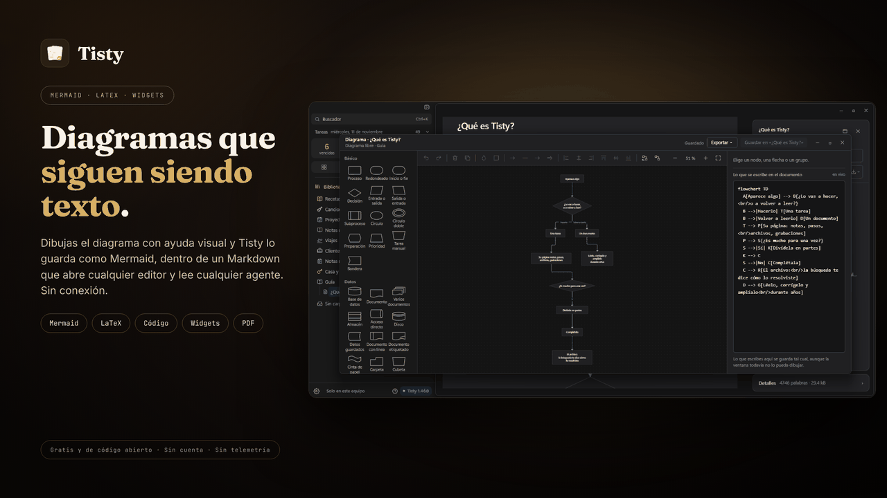

# El editor Markdown

Un documento en Tisty es texto tuyo, guardado como un archivo `.md` normal, que escribes aquí y puedes leer con cualquier otro programa. Si mañana borras Tisty, tus documentos siguen abriéndose en cualquier editor de texto, en GitHub o en otra app de notas.



## Escribir donde lees

Se escribe sobre la misma página que lees, la que dibuja Tisty. No hay un modo de edición aparte ni bloques que se abren: haces clic y escribes.

- **Haz clic donde quieras y escribe.** El cursor queda donde hiciste clic, y la página se vuelve a dibujar mientras escribes, igual a como se lee, se imprime y se comparte. Lo que escribes se guarda sobre la marcha.
- **Las marcas no se ven.** La negrita se ve en negrita y un título se ve como título. El Markdown sigue debajo, y la vista **Markdown** lo muestra tal cual.
- **La primera línea es el título.** No hay que ponerle nombre en ninguna parte: lo que escribas arriba es como se llama.
- **Enter empieza un párrafo nuevo, y `Shift` + `Enter` solo salta de línea.** En una lista, Enter empieza otro elemento del mismo tipo; en una cita, la cita sigue; en el código, salta de línea. Enter en un elemento vacío sale de la lista, o sube un nivel si estaba dentro de otro. Enter al inicio de un bloque abre una línea encima de él.
- **`Tab` mete un elemento de la lista bajo el de arriba, y `Shift` + `Tab` lo saca.** En el código, `Tab` sangra con dos espacios.
- **`Retroceso` al inicio de un elemento** quita primero su casilla y después su viñeta o su número, y la línea queda como texto.
- **Marca una casilla con un clic**, también la de una nota adhesiva. Una nota adhesiva se escribe por dentro y se arrastra desde su papel, su cinta o su chinche.
- **Un clic sobre una imagen o un diagrama lo abre en grande**, para acercarlo, moverlo y pasar al siguiente. Una imagen o un archivo que se ve en la página, como un PDF, un audio o un video, se quita con `Supr` justo antes o `Retroceso` justo después, o desde su clic derecho: **Eliminar imagen** o **Quitar de la página**. Si iba solo en su línea, la línea se va con él. Un diagrama trae su propia barra al pasar el puntero: **Exportar** y **Abrir en la ventana de diagramas**; un doble clic también lo abre en la [[ventana de diagramas|Diagramas]]. Su texto se cambia en la vista Markdown. Un widget trae **Ver código**, que lo abre en su [[ventana|Widgets-en-documentos]] con el código al lado de lo que dibuja, y **Abrir aparte**. Una fórmula se abre en esa misma ventana: la que va en su propio bloque con su **Ver código**, y la que va dentro de una línea con un clic. Lo que escribes se dibuja al lado y se guarda en su lugar. **Editar**, en las propiedades del panel, las abre igual.
- **El código se escribe tal cual.** Dentro de un bloque de código no hay formatos ni corrector, y la `/` es solo una barra. La etiqueta de su esquina, como «rust» o «yaml», abre la lista de lenguajes para elegir con qué colores se dibuja. Escribir `` ``` `` al empezar una línea abre un bloque de código que se cierra solo, y el nombre de un lenguaje escrito en su primera línea, como `rust`, pasa a ser su lenguaje con Enter.
- **Un salto de página no se escribe ni se mueve.** `Retroceso` al inicio del bloque que lo sigue, o `Supr` al final del que lo precede, lo quita, y el resto queda como estaba. Lo que escribes justo después de él empieza en una línea nueva debajo.
- **Una tabla, un código, una imagen, un diagrama, una sección plegable o un aviso no se pegan a lo que tienen al lado.** `Retroceso` al inicio del bloque que los sigue, o `Supr` al final del que los precede, no hace nada; para quitarlos está **Borrar bloque**, en su asa.
- **`Ctrl`/`⌘` + `Z` deshace** y `Ctrl`/`⌘` + `Shift` + `Z` rehace, solo en el documento que tienes delante. Lo que escribiste en la vista Markdown se deshace de una vez al volver.

## La barra de formato

Elige unas palabras y aparece encima una barra pequeña:

- **Negrita**, **cursiva**, **subrayado**, **tachado**, **código** y **enlace**.
- **Cuatro rotuladores**: amarillo, verde, azul y rosa.

Un formato envuelve las palabras elegidas, y si cruzan varias líneas, cada una lleva el suyo; pulsado sobre palabras que ya lo tienen, se lo quita. **Enlace** pide la dirección en un campo, y `Esc` lo cancela; una dirección como `tisty.app` recibe su `https://`, y sin palabras elegidas, la dirección queda como sus palabras. Dentro del código la barra no aparece.

Sin nada elegido, un formato pulsado con su atajo o desde el menú `/` empieza con la próxima tecla, y lo que escribes ya sale en negrita o en cursiva. Vuelve a pulsarlo para salir de él; un espacio al final de las palabras también queda fuera.

`Ctrl`/`⌘` + `B`, `I` y `U` ponen la negrita, la cursiva y el subrayado; `Ctrl`/`⌘` + `Shift` + `X`, el tachado; `Ctrl`/`⌘` + `Shift` + `C`, el código, y `Ctrl`/`⌘` + `K`, un enlace. El botón derecho sobre palabras elegidas las **corta** o las **copia** como Markdown de Tisty, listas para pegar en otro documento, y ofrece los mismos formatos.

## El menú `/`

Escribe `/` al empezar una línea, en una línea en blanco o después de un espacio, y sale el menú de lo que cabe; dentro de una palabra o de un código es solo una barra. `Ctrl`/`⌘` + `/` lo abre en cualquier punto, y también el **+** que aparece en el margen, a la altura del cursor. Sigue escribiendo para filtrar, ↑ ↓ para moverte, Enter para agregarlo, Esc para cerrarlo; si lo cierras sin elegir, la `/` queda escrita.

- Títulos, listas, etapas y citas.
- Los cinco avisos: Nota, Consejo, Importante, Aviso y Cuidado, y la nota adhesiva de Idea.
- Negrita, cursiva, subrayado, tachado, código, enlace y el rotulador.
- Un icono, buscado por lo que dibuja.
- Un diagrama nuevo, que abre la [[ventana de diagramas|Diagramas]], una copia de un diagrama existente o un bloque Mermaid como texto; una fórmula, un widget y un bloque de código. La fórmula, el widget y el bloque Mermaid llegan con un ejemplo ya dibujado, y lo que escribas después sigue en un renglón debajo.
- Una tabla, que se abre en su primer título.
- Una **sección plegable**: un título que pliega lo que tiene debajo.
- Un salto de página.
- Otro documento, un documento nuevo, una página que ya existe o una página nueva, dibujados como tarjeta. Escribe parte de su nombre, y Enter toma el primero que aparece.

## Mover bloques

- **El asa.** Al pasar el puntero junto a un bloque aparece un asa a su izquierda. Arrástrala para llevar el bloque a otro lugar; un título se lleva su sección entera.
- **Su menú.** Un clic en el asa ofrece **Subir bloque**, **Bajar bloque**, **Duplicar bloque** y **Borrar bloque**.
- **El teclado.** `Alt` + ↑ ↓ sube o baja el bloque donde está el cursor, o el elemento de la lista donde está.

## Enriquecido y Markdown

Un documento se ve de dos maneras, y las dos escriben el mismo archivo:

- **Enriquecido** es la página dibujada, la que se lee, se imprime y se comparte. Ahí se escribe casi todo.
- **Markdown** muestra el texto tal como está guardado, con todas sus marcas a la vista: los `**`, el `#`, el `>`, las rayas de una tabla. Sirve para los cambios que cruzan varios bloques y para escribir un diagrama como texto.

El **⋯** de la cinta, arriba del documento, cambia entre las dos, y `Ctrl`/`⌘` + `E` también. En una tarea, **Ver Markdown** en su columna hace lo mismo, y **Ver enriquecido** vuelve. Al bajar por un documento, la cinta también recuerda su título.

En la vista Markdown:

- **El menú `/`, una barra pequeña, los atajos y las etiquetas** funcionan igual que en la página.
- **Un elemento vacío termina la lista.** Enter en una viñeta, un número o una casilla vacíos sale de la lista con una línea en blanco.
- **Retroceso justo después de la marca de una línea** (el `#` de un título, una viñeta, el `>` de una cita) vuelve la línea a texto.

## Mientras escribes

- **Las etiquetas se ofrecen después de `#`.** Las que ya usas aparecen bajo el cursor, para que una etiqueta nunca se escriba de dos maneras. ↑ ↓ elige una y Tab o Enter la escribe; Esc cierra la lista, y Enter sin elegir sigue empezando un párrafo.
- **Adjunta un archivo** arrastrándolo a la página, pegándolo (también sirve una captura en el portapapeles) o eligiendo **Adjuntar un archivo** en el menú `/`. Queda después del bloque donde lo sueltas, o donde está el cursor, y se guarda dentro de Tisty con el documento, no como un enlace a una ruta de tu disco que se rompe cuando mueves el archivo.
- **Pega con su formato.** Lo que copias de una página web, un correo o un procesador de texto conserva sus títulos, listas, negritas, enlaces, tablas y palabras de color, escrito en el Markdown de Tisty: un color pasa al rotulador más cercano de la paleta. Un bloque pegado, como una lista o un título, empieza en su propia línea, y dentro de una cita sigue en la cita. El texto plano también conserva su forma: una tabla que una terminal dibujó con líneas (`┌ │ ├`) pasa a ser una tabla, y las líneas que se leen como código, copiadas de un editor de código o de una terminal, entran como bloque de código, salvo que el cursor ya esté dentro de uno.
- **Tab y Shift + Tab recorren las celdas de una tabla**, y Tab pasada la última empieza una fila nueva.
- **Arrastra el borde de una columna** de la tabla en la página para ensancharla o angostarla. El ancho se escribe como los guiones de su raya, diez píxeles cada uno.

| Atajo | Qué hace |
| :-- | :-- |
| `Ctrl`/`⌘` + `B` | Negrita |
| `Ctrl`/`⌘` + `I` | Cursiva |
| `Ctrl`/`⌘` + `U` | Subrayado |
| `Ctrl`/`⌘` + `Z` · `Ctrl`/`⌘` + `Shift` + `Z` | Deshacer · rehacer |
| `Enter` · `Shift` + `Enter` | Párrafo nuevo · salto de línea |
| `Ctrl`/`⌘` + `/` | Abrir el menú de bloques donde está el cursor |
| `Alt` + ↑ ↓ | Subir o bajar el bloque o el elemento donde está el cursor |
| `Tab` · `Shift` + `Tab` | Meter o sacar un elemento de la lista |
| `Ctrl`/`⌘` + `E` | Cambiar entre Enriquecido y Markdown |
| `Ctrl`/`⌘` + `Shift` + `X` · `Shift` + `C` · `K` | Tachado · código · enlace |
| `Ctrl`/`⌘` + `Enter` | Salto de página |

El texto va sobre una hoja iluminada. Cuando la ventana es lo bastante ancha, se abre una columna al lado con qué es el documento, sus etiquetas, su índice y el camino a su PDF.

## Tablas

Una tabla se escribe en la misma página:

- **Haz clic en una celda** para escribir en ella; Enter o un clic afuera la guarda, Esc la deja como estaba; Enter en la última fila sale de la tabla a una línea nueva debajo. Su título se escribe igual. La celda muestra sus palabras sin marcas, y una barra encima de la tabla pone o quita negrita, cursiva, subrayado, tachado, código o un rotulador a toda la celda. Una tabla creada desde el menú `/` se abre así de inmediato, en su primer título.
- **El menú `⋯` de una fila y de una columna** la mueve, duplica o quita una fila, inserta una columna a cada lado, le cambia el nombre y le da un **tipo**: número, dinero, porcentaje, fecha, duración, sí o no, opción, etiquetas, valoración, documento, dirección web, correo o teléfono. El dinero lleva su moneda, y una columna puede resumirse al pie: suma, promedio, mínimo o máximo en las de números, mínimo y máximo en las de fechas, y conteo en cualquiera. **Editar como Markdown** la abre como texto en su propia ventana, con la tabla dibujada al lado.
- **Arrastra una fila o una columna** por su asa para ponerla en otro lugar, y **Nueva fila** bajo la tabla añade una al final.
- **Una celda con tipo se escribe como su tipo pide**: un calendario para una fecha, donde también puedes escribir «el próximo viernes»; las opciones de la propia columna para una opción, cada una con su color; estrellas para una valoración; un clic para sí o no; un buscador para un documento.
- **Ordena y filtra desde el título de una columna.** Ese orden y esos filtros son solo en pantalla y no tocan el archivo; **Guardar este orden** escribe las filas en ese orden.
- **Un valor que no está escrito como pide su tipo**, como «pronto» en una columna de fechas, conserva lo que escribiste y se muestra con una línea ondulada debajo.
- **En la vista Markdown**, `Alt` + ↑ ↓ mueve la fila donde está el cursor y `Alt` + ← → su columna (`Ctrl` + `Alt` en un Mac), y el menú **Tabla** de la barra la ordena y le da un tipo a una columna.
- **Las filas copiadas de Excel, Numbers o Google Sheets**, o un CSV, entran como tabla al pegarlas.

Una tabla más ancha que la página se desplaza hacia el lado, y sus copias en PDF y Word conservan todas las columnas. Cómo se escribe un tipo en el archivo está en los [tipos de columna](https://markdown.tisty.app/es/tablas#tipos-de-columna) de la guía.

## Lo que cabe en un documento

Todo lo que lleva un documento, desde la negrita y las listas hasta los avisos, los rotuladores, los iconos, las tablas, los diagramas, las fórmulas, los widgets, el código y las páginas, es Markdown normal con unas pocas palabras cortas propias de Tisty, así que el archivo sobrevive sin Tisty. Cómo se escribe cada cosa, con sus ejemplos dibujados, está en la [guía de Markdown de Tisty](https://markdown.tisty.app/es/), que también se abre dentro de Tisty con `F1`. Nunca la necesitas para escribir: el menú `/` y la barra lo escriben todo por ti.

## Lo que Tisty no sabe decir

Algunas cosas de Markdown que vienen de otra parte (las etiquetas HTML) no tienen palabra en Tisty. Un documento que las lleva se abre, se edita y se guarda entero: no se corta nada. Esa parte simplemente se ve tal como está escrita mientras la editas. **Configuración › Mantenimiento** recorre todos los documentos y te lista los que llevan algo de eso. La lista completa está en la guía de Markdown de Tisty, en [lo que queda fuera del lenguaje](https://markdown.tisty.app/es/lo-que-queda-fuera-del-lenguaje).

## Cuando un documento se abre solo para leer

La barra al pie del documento dice por qué.

**Está en el archivo.** Archivar un documento, o la carpeta en que está, lo cierra a la escritura, tanto desde la ventana como desde un asistente. Desarchívalo y se vuelve a escribir.

**Una página suya está archivada, o lo está el documento que la contiene.** Mira [Páginas y PDF](Páginas-y-PDF).

## Sin conexión, siempre

Los diagramas, las fórmulas, el color del código y los widgets se dibujan con código que viaja dentro de Tisty. No se descarga nada, no se carga ninguna fuente de afuera y todo funciona con el cable desenchufado.
