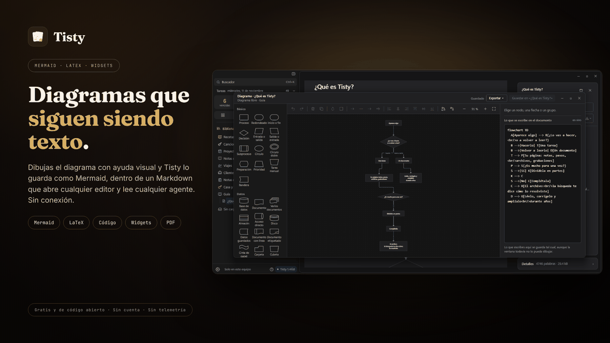

# El editor Markdown

Un documento en Tisty es texto tuyo, guardado como un archivo `.md` normal, que escribes aquí y puedes leer con cualquier otro programa. Si mañana borras Tisty, tus documentos siguen abriéndose en cualquier editor de texto, en GitHub o en otra app de notas.

## Escribir donde lees

Se escribe en la misma página, de a un bloque.

- **Haz clic en un bloque y se abre ahí mismo**, con el cursor donde hiciste clic. El resto de la página sigue como se lee. Un clic sobre una imagen o un diagrama, en cambio, lo abre en grande para acercarlo, moverlo y pasar al siguiente; para editarlo, usa el menú del bloque. Un diagrama trae su propia barra al pasar el puntero: **Exportar**, **Editar como Markdown**, que abre su texto ahí mismo, y **Abrir en la ventana de diagramas**; un doble clic también lo abre en la [[ventana de diagramas|Diagramas]].
- **Las marcas no se ven.** La negrita se ve en negrita y un título se ve como título; los `**` o el `#` solo aparecen cuando los pides, y seleccionar o borrar texto deja el formato entero. Si al borrar un espacio o al unir dos bloques una palabra queda pegada a un formato y lo desharía, la palabra entra en el formato, y volver a escribir el espacio enseguida lo deja como estaba. Un enlace es la única excepción: con el cursor en él ves su dirección, que puedes cambiar ahí.
- **Los títulos, las listas, las etapas, las citas y los avisos siempre se dibujan**, también mientras los escribes: una viñeta es una viñeta, una casilla es una casilla que puedes marcar, un aviso lleva su color y su nombre.
- **Esc, o un clic fuera, vuelve a la lectura.** Lo que escribes se guarda sobre la marcha, y el pie de la página te lo dice.
- **La primera línea es el título.** No hay que ponerle nombre en ninguna parte: lo que escribas arriba es como se llama. Enter te lleva de ahí al cuerpo.
- **Enter empieza un párrafo nuevo, y `Shift` + `Enter` solo salta de línea.** Las listas, las citas y el código conservan su propio Enter.
- **Las flechas siguen de un bloque al siguiente** en un documento, saltando una imagen, una tabla o un diagrama, que se abren con un clic. `Retroceso` al inicio de un bloque lo une con el anterior, y `Supr` al final une el siguiente.
- **`Ctrl`/`⌘` + `Shift` + `M` muestra todas las marcas** del bloque, para cuando quieres ver el Markdown tal cual. Vuelve a pulsarlo para ocultarlas.
- **`Ctrl`/`⌘` + `E` abre todo el documento** como un solo texto, con las marcas abriéndose donde está el cursor. Sirve para los cambios que cruzan varios bloques. Vuelve a pulsarlo, o pulsa Esc, para volver a leer. La página de una tarea siempre se escribe por bloques.

Una línea bajo el bloque deja las teclas a la vista: `/` para insertar, el atajo de todas las marcas y el de todo el documento.

## La barra

Mientras un bloque está abierto, espera en el margen a su lado un pequeño **Aa**, o encima de él en una ventana angosta, que se abre en la barra completa cuando seleccionas texto o lo pulsas. Abierta a mano, sigue abierta hasta que la pliegues, y dentro de una tabla queda abierta, porque lleva el menú de la tabla. La barra flota sobre el bloque (no dentro de un bloque de código ni de una fórmula `$$`, donde no escribiría nada):

- **El tipo de bloque**: Párrafo, Título, Subtítulo, Título pequeño, Lista con viñetas, Lista numerada, Etapas o Cita. Todas las líneas que tengas seleccionadas cambian de una vez. Dentro de una tabla dice **Tabla** y ofrece una fila arriba o abajo, una columna a cada lado, la alineación de la columna, y quitar una fila o una columna. Los guiones bajo el encabezado quedan como los dibujaste, y con ellos los anchos.
- **Negrita**, **cursiva**, **subrayado**, **tachado**, **código** y **enlace**.
- **Cuatro rotuladores**: amarillo, verde, azul y rosa.
- **Tabla**, que pone una tabla donde está el cursor y la abre en la página. Dentro de una tabla no aparece.
- **Diagrama**, en un documento: un diagrama nuevo de cada tipo o uno existente, como en el menú `/`.
- **/ Más**, que abre el menú `/`.
- **⤢**, que abre todo el documento, igual que `Ctrl`/`⌘` + `E`.

Con palabras seleccionadas, un formato las envuelve; pulsado sobre palabras que ya lo tienen, se lo quita. Los formatos nunca se cruzan: uno que alcanza a otro igual se junta con él en uno solo.

Sin nada seleccionado, el formato empieza justo donde está el cursor, y lo que escribes ya se ve en negrita, subrayado o amarillo. Vuelve a pulsarlo para salir de él, o pulsa otro rotulador para cambiar el color. Enter o una flecha también lo terminan.

## El menú `/`

Escribe `/` en cualquier punto y sale el menú de lo que cabe. Sigue escribiendo para filtrar, ↑ ↓ para moverte, Enter para agregarlo, Esc para cerrarlo.

- Títulos, listas, etapas y citas.
- Los cinco avisos: Nota, Consejo, Importante, Aviso y Cuidado, y la nota adhesiva de Idea.
- Negrita, cursiva, subrayado, tachado, código, enlace y el rotulador, con sus atajos al lado.
- Un icono, buscado por lo que dibuja.
- Un diagrama nuevo, que abre la [[ventana de diagramas|Diagramas]], una copia de un diagrama existente o un bloque Mermaid como texto; una fórmula, un widget y un bloque de código.
- Una tabla.
- Una **sección plegable**: un título que pliega lo que tiene debajo.
- Un salto de página.
- Otro documento, un documento nuevo, una página que ya existe o una página nueva, dibujados como tarjeta.

## Mientras escribes

- **Las etiquetas se ofrecen después de `#`.** Las que ya usas aparecen mientras escribes, para que una etiqueta nunca se escriba de dos maneras. Lo que escribiste queda primero, así que Enter guarda una etiqueta nueva tal como está.
- **Un elemento vacío termina la lista.** Enter en una viñeta, un número o una casilla vacíos sale de la lista con una línea en blanco, para que lo que escribas después no se pegue al último elemento.
- **Retroceso justo después de la marca de una línea** (el `#` de un título, una viñeta, el `>` de una cita) vuelve la línea a texto.
- **Inicio** te deja en las palabras, pasada la marca de la línea.
- **→** al final de las palabras de un enlace nuevo entra en su dirección.
- **Adjunta un archivo** arrastrándolo a la página, pegándolo (también sirve una captura en el portapapeles) o eligiendo **Adjuntar un archivo** en el menú `/`. Queda donde está el cursor, o después del bloque donde lo sueltas, y se guarda dentro de Tisty con el documento, no como un enlace a una ruta de tu disco que se rompe cuando mueves el archivo.
- **Pega con su formato.** Lo que copias de una página web, un correo o un procesador de texto conserva sus títulos, listas, negritas, enlaces, tablas y palabras de color, escrito en el Markdown de Tisty: un color pasa al rotulador más cercano de la paleta. El texto plano también conserva su forma: una tabla que una terminal dibujó con líneas (`┌ │ ├`) pasa a ser una tabla, y las líneas que se leen como código, copiadas de un editor de código o de una terminal, entran como bloque de código, salvo que el cursor ya esté dentro de uno.
- **Marca una casilla en la página** con un clic, sin abrir el bloque.
- **Tab y Shift + Tab recorren las celdas de una tabla**, y Tab pasada la última empieza una fila nueva.
- **Arrastra el borde de una columna** de la tabla en la página para ensancharla o angostarla. El ancho se escribe como los guiones de su raya, diez píxeles cada uno.

| Atajo | Qué hace |
| :-- | :-- |
| `Ctrl`/`⌘` + `B` | Negrita |
| `Ctrl`/`⌘` + `I` | Cursiva |
| `Ctrl`/`⌘` + `U` | Subrayado |
| `Ctrl`/`⌘` + `Shift` + `X` | Tachado |
| `Ctrl`/`⌘` + `Shift` + `C` | Código |
| `Ctrl`/`⌘` + `K` | Enlace |
| `Ctrl`/`⌘` + `Z` · `Ctrl`/`⌘` + `Shift` + `Z` | Deshacer · rehacer |
| `Enter` · `Shift` + `Enter` | Párrafo nuevo · salto de línea |
| `Ctrl`/`⌘` + `Shift` + `M` | Mostrar u ocultar todas las marcas |
| `Ctrl`/`⌘` + `E` | Abrir o dejar todo el documento |
| `Esc` | Volver a la lectura |

El texto va sobre una hoja iluminada. Cuando la ventana es lo bastante ancha, se abre una columna al lado con qué es el documento, sus etiquetas, su índice y el camino a su PDF.

## Tablas

Una tabla se escribe en la misma página, sin abrir su bloque:

- **Haz clic en una celda** para escribir en ella; Enter o un clic afuera la guarda, Esc la deja como estaba. Su título se escribe igual. La celda muestra sus palabras sin marcas, y una barra encima de la tabla pone o quita negrita, cursiva, subrayado, tachado, código o un rotulador a toda la celda. Una tabla creada desde el menú `/` se abre así de inmediato, en su primer título.
- **El menú `⋯` de una fila y de una columna** la mueve, duplica o quita una fila, inserta una columna a cada lado, le cambia el nombre y le da un **tipo**: número, dinero, porcentaje, fecha, duración, sí o no, opción, etiquetas, valoración, documento, dirección web, correo o teléfono. El dinero lleva su moneda, y una columna puede resumirse al pie: suma, promedio, mínimo o máximo en las de números, mínimo y máximo en las de fechas, y conteo en cualquiera. **Editar como Markdown** abre la tabla como texto.
- **Arrastra una fila o una columna** por su asa para ponerla en otro lugar, y **Nueva fila** bajo la tabla añade una al final.
- **Una celda con tipo se escribe como su tipo pide**: un calendario para una fecha, donde también puedes escribir «el próximo viernes»; las opciones de la propia columna para una opción, cada una con su color; estrellas para una valoración; un clic para sí o no; un buscador para un documento.
- **Ordena y filtra desde el título de una columna.** Ese orden y esos filtros son solo en pantalla y no tocan el archivo; **Guardar este orden** escribe las filas en ese orden.
- **Un valor que no está escrito como pide su tipo**, como «pronto» en una columna de fechas, conserva lo que escribiste y se muestra con una línea ondulada debajo.
- **En el texto**, con el bloque abierto, `Alt` + ↑ ↓ mueve la fila donde está el cursor y `Alt` + ← → su columna (`Ctrl` + `Alt` en un Mac), y el menú **Tabla** de la barra la ordena y le da un tipo a una columna.
- **Las filas copiadas de Excel, Numbers o Google Sheets**, o un CSV, entran como tabla al pegarlas.

Una tabla más ancha que la página se desplaza hacia el lado, y sus copias en PDF y Word conservan todas las columnas. Cómo se escribe un tipo en el archivo está en los [tipos de columna](https://markdown.tisty.app/es/tablas#tipos-de-columna) de la guía.

## Lo que cabe en un documento

Todo lo que lleva un documento, desde la negrita y las listas hasta los avisos, los rotuladores, los iconos, las tablas, los diagramas, las fórmulas, los widgets, el código y las páginas, es Markdown normal con unas pocas palabras cortas propias de Tisty, así que el archivo sobrevive sin Tisty. Cómo se escribe cada cosa, con sus ejemplos dibujados, está en la [guía de Markdown de Tisty](https://markdown.tisty.app/es/), que también se abre dentro de Tisty con `F1`. Nunca la necesitas para escribir: el menú `/` y la barra lo escriben todo por ti.

## Lo que Tisty no sabe decir

Algunas cosas de Markdown que vienen de otra parte (las etiquetas HTML) no tienen palabra en Tisty. Un documento que las lleva se abre, se edita y se guarda entero: no se corta nada. Esa parte simplemente se ve tal como está escrita mientras la editas. **Configuración › Mantenimiento** recorre todos los documentos y te lista los que llevan algo de eso. La lista completa está en la guía de Markdown de Tisty, en [lo que queda fuera del lenguaje](https://markdown.tisty.app/es/lo-que-queda-fuera-del-lenguaje).

## Cuando un documento se abre solo para leer

La barra al pie del documento dice por qué.

**Está en el archivo.** Archivar un documento, o la carpeta en que está, lo cierra a la escritura, tanto desde la ventana como desde un asistente. Desarchívalo y se vuelve a escribir.

**Una página suya está archivada, o lo está el documento que la contiene.** Mira [Páginas y PDF](Páginas-y-PDF).

## Sin conexión, siempre

Los diagramas, las fórmulas, el color del código y los widgets se dibujan con código que viaja dentro de Tisty. No se descarga nada, no se carga ninguna fuente de afuera y todo funciona con el cable desenchufado.
