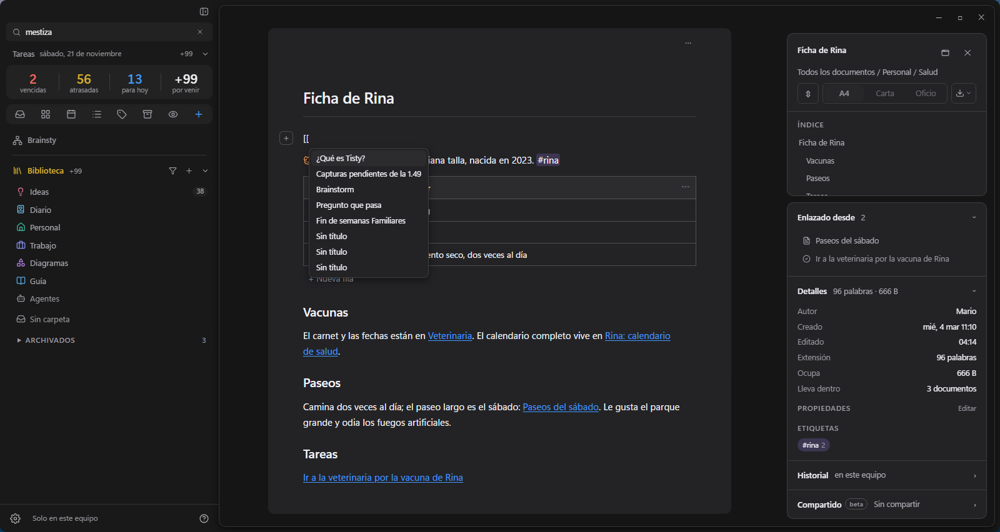
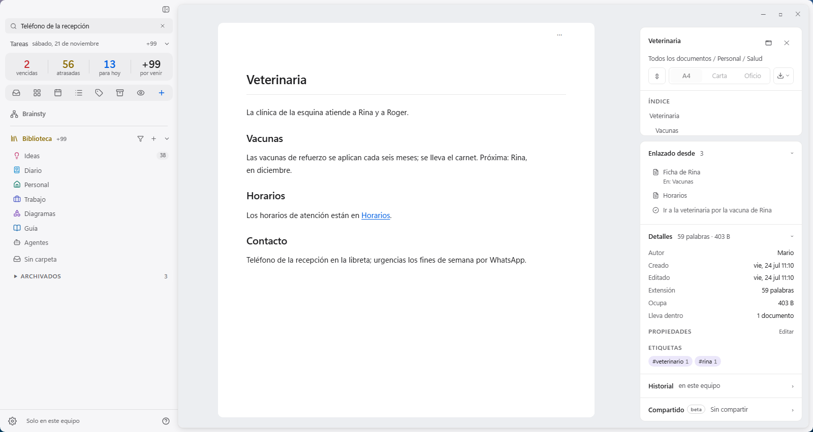

# Enlazar documentos

Durante años guardé lo que sabía en notas sueltas, y lo que más me costaba no era escribirlas: era volver a encontrarlas cuando una nota necesitaba a otra. La ficha del veterinario sabía el horario, la ficha de Rina sabía sus vacunas, y nada las unía. En Tisty, un documento nombra a otro con dos corchetes, y el otro sabe quién lo nombró.

Esta página cuenta cómo enlazar un documento con otro o con una sección de otro, cómo ver adónde lleva un enlace sin salir de donde estás, y cómo saber quién enlaza a un documento. Citar una tarea dentro de un documento, y crear una desde ahí, está en [[Tareas en documentos|Tareas-en-documentos]]. Todo lo que enlazas entra en [[la red de Brainsty|Red-de-Brainsty]].



## Cuándo te sirve

- **Un tema que se apoya en otro.** «Rina» nombra a «Veterinaria» cuando cuenta la vacuna anual; quien lee la ficha de Rina llega en un clic al horario de Marisol.
- **Un índice propio.** Un documento «Casa» que enlaza a «Seguro del auto», «Condominio» y «Recetas» es una puerta de entrada que tú armas.
- **Una decisión con su fuente.** Las actas del condominio enlazan a la sección del reglamento que se discutió, no al reglamento entero.
- **Saber qué se rompe si cambias algo.** Antes de reescribir «Veterinaria», **Enlazado desde** te dice qué documentos y qué tareas la nombran.

## Enlazar a otro documento

1. En un documento, donde quieras el enlace, escribe `[[`.
2. Sigue con unas palabras del título: `[[vete`. Tisty te ofrece hasta ocho documentos que calzan, cada uno con su carpeta al lado, sin mirar acentos ni mayúsculas: primero los que empiezan así y después los que escribiste hace poco. Con `[[` solo, te muestra los últimos que escribiste.
3. Elige uno con las flechas y `Enter`, o con un clic.

No se ofrecen el documento que estás escribiendo ni los archivados. Un documento en varios idiomas aparece una vez, en el idioma de la app.

Queda un enlace con el título del documento, así:

```markdown
[Veterinaria](tisty:doc/…)
```

Los `[[ ]]` no quedan escritos: eran solo la forma de pedirlo. El enlace apunta al documento, no a su nombre, así que si mañana lo renombras «Veterinaria de Rina y Roger», el enlace sigue llegando; el texto que se ve es el que había cuando lo escribiste, y lo cambias como cualquier otra palabra.

Funciona igual en la página que lees y escribes y en la vista **Markdown** (`Ctrl`/`⌘` + `E`), donde ves el enlace con todas sus marcas.

## Enlazar a una sección

Una sección es lo que hay bajo un título del documento. Para llegar justo ahí:

1. Escribe `[[`, unas palabras del título del documento y `#`: `[[Veterinaria#`.
2. Tisty te muestra los títulos de ese documento. Sigue escribiendo para acotar: `[[Veterinaria#hor`.
3. `Enter` deja un enlace como `[Veterinaria › Horarios](tisty:doc/…#horarios)`.

Un clic en ese enlace abre el documento en esa sección. Si la sección ya no existe porque cambiaste su título o la borraste, el enlace no se rompe: abre el documento al comienzo.

## Ver adónde lleva, sin irte

Deja el puntero sobre un enlace a otro documento y aparece su vista previa: las primeras líneas del documento o, si el enlace apunta a una sección, esa sección. Sirve para confirmar que es el que buscabas, o para leer un dato rápido sin perder el lugar donde estabas escribiendo.


Para abrirlo: en un documento que puedes escribir, un clic deja el cursor en el enlace, para que lo corrijas, y `Ctrl` + clic (`⌘` + clic en un Mac) lo abre; en uno que solo se lee, como una tarea cerrada o un documento archivado, basta un clic.

## Quién lo enlaza: Enlazado desde

El panel junto al documento tiene la fila **Enlazado desde**: cada documento y cada tarea que lo cita o lo menciona y, en un documento, bajo qué sección lo hace («En: Vacunas»). Un clic abre ese documento en esa sección.



- **Cuenta las dos formas.** Un enlace dentro de una frase es una mención; una tarjeta, sola en su párrafo, es una cita. Las dos aparecen aquí, y la página de una tarea tiene la misma fila.
- **Se arma en segundo plano.** Tisty lee cómo se enlazan tus documentos sin frenar lo que haces, así que un enlace recién escrito aparece a los pocos segundos. Mientras lee la primera vez, la fila dice «Tisty todavía está leyendo cómo se enlazan tus documentos»; cuando nadie enlaza ese documento, «Todavía ningún documento ni tarea enlaza aquí».
- **Doce a la vista.** Si muchos lo enlazan, ves los primeros doce y **Ver las…** muestra el resto.
- **Nunca se nombra a sí mismo.** Un documento que se enlaza a sí mismo no aparece en su propia fila.

## Un ejemplo: la ficha de Rina

Marisol, la veterinaria, cambió sus horarios, y quieres que la ficha de Rina lleve a ellos.

1. Abres «Rina». En la sección **Vacunas** escribes: «La anual toca en noviembre; los horarios de la consulta están en » y sigues con `[[Veterinaria#hor`.
2. `Enter`. La frase termina en el enlace **Veterinaria › Horarios**.
3. Dejas el puntero sobre el enlace: la vista previa muestra la tabla de horarios, y confirmas que el sábado abre hasta las 13:00.
4. Abres «Veterinaria». En el panel, **Enlazado desde** ya nombra «Rina», con «En: Vacunas».
5. Meses después renombras «Veterinaria» a «Veterinaria de Rina y Roger». El enlace de la ficha sigue llevando a la misma sección.

## Lo que conviene saber

- **`[[#2]]` es otra cosa.** Un número detrás de `#` sigue nombrando el segundo paso de la página de una tarea, o la segunda etapa de una lista de esa hoja, como siempre.
- **Dos corchetes con un nombre suelto.** `[[La cartilla de Rina]]` escrito tal cual, sin elegir del menú, queda como una ficha con ese nombre, sin enlazar. Si exactamente un documento lleva ese título, Brainsty lo cuenta igual como mención. Así llegan, por ejemplo, las notas que traes de Obsidian: mira [[Convertir a y desde Markdown|Convertir-a-y-desde-Markdown]].
- **En otro equipo.** El enlace viaja con el documento al sincronizar. Si el otro documento todavía no llega a ese equipo, el enlace queda escrito tal cual y abre en cuanto el documento llega.
- **Un documento archivado** sigue abriéndose desde un enlace que ya existía; se lee, pero no se escribe hasta que lo desarchivas. Para enlazarlo de nuevo con `[[`, desarchívalo primero.
- **Fuera de Tisty.** **Copiar como Markdown** y **Exportar como Markdown…** dejan un enlace a otro documento como su texto, porque `tisty:doc/…` no significa nada en otro editor. El PDF y Word muestran el texto del enlace.
- **Una tarjeta en vez de un enlace.** Para que otro documento se vea como tarjeta, con su título y sus primeras palabras, usa **Un documento** en el menú `/`, o deja el enlace solo en su párrafo. Mira [[Documentos]].
- **Lo que enlaza tu agente.** Cuando un agente nombra un documento por su título exacto entre comillas, Tisty lo enlaza al guardar, igual que si lo hubieras hecho tú: mira [[Cómo trabaja un agente|Cómo-trabaja-un-agente]].

## Para seguir

- [[Tareas en documentos|Tareas-en-documentos]]: citar una tarea como tarjeta viva y crear una con `/`.
- [[La red de Brainsty|Red-de-Brainsty]]: todos tus enlaces dibujados juntos.
- [[El editor|Editor-Markdown]]: el menú `/`, la barra y los atajos al escribir.
- [Enlaces](https://markdown.tisty.app/es/enlaces) y [referencias](https://markdown.tisty.app/es/referencias) en la guía de Markdown de Tisty ↗
