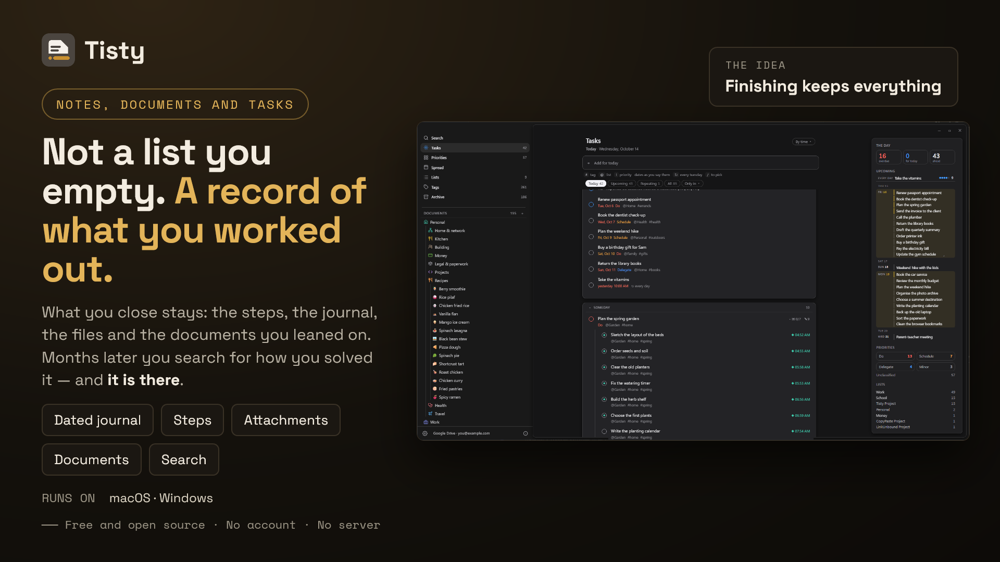

  

<h1 align="center">Tisty's help</h1>

<strong>Local memory for you and your AI agent: tasks, documents and notes in Markdown, on your own disk.</strong> No accounts. No subscriptions. No telemetry. No server.

<strong>English</strong> · <a href="Inicio">Español</a>

---

**A task list forgets the moment you tick the box. Your AI agent forgets the moment the session ends.** So everybody patches it: a `NOTES.md` behind `.gitignore`, a Markdown file per session, a `TASKS.md` nobody keeps up to date. They go stale, they get lost between branches, machines and projects, and the agent rereads all of it every session.

Tisty is the memory underneath. When you finish a task it moves to the archive with everything it gathered — the description, the journal, the steps, the files, the documents you leaned on — and search reaches all of it years later. *How did I solve that last time?* Tisty has it. Beside the tasks, **documents** keep what you know, one per subject, as plain Markdown any other editor reads.

And it is the memory of the AI agent you already use. Through a local **MCP server** — on your machine, with no account and no network — GitHub Copilot, Claude Code, Codex, Cursor or any MCP client asks what moved since last time, reads a document's outline and then only the section it needs, and writes down what it learned for the next session. You decide what it may do.

## Real problems, real fixes

- **A developer** explains the project to the agent again every session. With Tisty, the agent asks what moved, opens the task it was on with its ticked steps, and reads what it noted yesterday — *the webhook fails on old signatures; retrying ruled out* — and carries on from there.
- **A `NOTES.md` that grew to 256 KB** is reread whole every time. In Tisty it lives as documents split by subject, in pages, and the agent reads the outline and one section: about 95% less.
- **A PM** is asked, a month later, «why did we decide this?». One living document per subject keeps each decision dated with its why, and the agent finds it and quotes it.
- **A QA** sees the same screen break again. The archived regression task keeps last time's cases as steps, with what was seen in each.
- **A handover** to a PO or to the QA joining the project goes through Folio: the document encrypted on your machine, signed by you, gone on its own when unused. See [Sharing](Documents#sharing).
- **At home**, the bank paperwork that comes back every year: the archived task says how you did it last time.

How an agent works with all of it, and what it saves, is in [A day with your agent](Assistants-and-MCP#a-day-with-your-agent).

## A task or a document?

**Something you will do is a task. Something you will come back to is a document.** A task ends, often soon, and then stays in the archive as knowledge with a date: months later a search tells you how you solved it. A document — a manual, a recipe, the notes on a client or a machine, a year of minutes — is read again, corrected and added to for years.

A task is also a document, one with an end: that is why it has a page of its own, where a spike gathers what you read, tried and ruled out, the recording of the meeting and the vendor's PDF, before it is split into parts and done. [[The whole idea, with an example|Tasks#a-task-or-a-document]].

## Start here

- [[Installation]] — Microsoft Store, winget, Homebrew or a direct download.
- [First steps](Installation#the-first-time-it-opens) — what Tisty asks the first time, and the guide it writes for you.
- [[Keyboard shortcuts|Keyboard-Shortcuts]]

## Tasks and the archive

- [[Tasks]] — capture, views, the Eisenhower matrix, lists, tags, steps and parts.
- [[Natural language|Natural-Language]] — what the capture bar understands.
- [[The spread and reminders|Spread-and-Reminders]] — dealing work onto days.
- [[The archive|Archive]] — stories, routines and the trace.

## Memory for your AI agent, through MCP

Tisty has no AI inside, and none is coming. But it speaks [MCP](https://modelcontextprotocol.io), so the agent you already use — GitHub Copilot, Claude Code, Codex, Cursor, any MCP client — keeps its memory here: it files tasks with steps and a journal, writes documents, and picks up where it left off, on this machine, with no account and nothing over the network.

- [[Assistants and MCP|Assistants-and-MCP]] — connecting one, letting it in, a day with your agent and what it costs.
- [[What an assistant may do|MCP-Permissions]] — the limits, its word on your own tasks, and **To confirm**.
- [[MCP tools reference|MCP-Tools]] — every tool the server offers.

## Documents

Documents are a Markdown notebook beside the tasks: callouts, tables, diagrams, formulas, widgets, code and pages, all kept as plain `.md` files any other editor reads. How each one is written is in the Tisty Markdown guide; the pages here are about the app.

- [[Documents]] — folders, tags, several languages, attachments, import and export, and reading a Markdown file from outside.
- [[The editor|Markdown-Editor]] — writing where you read, the bar, the `/` menu, tables and shortcuts.
- [[Pages and PDF|Pages-and-PDF]] — a document in chapters, page breaks, and Tisty's own PDF.
- [[Diagrams]] — the diagram window: a mind map, a schema, a freeform diagram or a class diagram drawn by hand, and exported as an image.
- [[Widgets]] — a fixed view of HTML and CSS inside a document, and opening it apart.
- [Tisty Markdown guide ↗](https://markdown.tisty.app) — every mark a document can hold, with its examples drawn.

## Your data

- [[Sync and backup|Sync-and-Backup]] — two machines through a folder you already sync, or your Google Drive, OneDrive or WebDAV server directly, with what you keep there encrypted if you want.
- [[Privacy]] — what is stored, and the few requests Tisty ever makes.
- [[Command line|Command-Line]] — retired in 1.31; only `tisty mcp`, the assistant's door, remains.
- [[FAQ]]

---

Tisty is free and open source under the AGPL-3.0. The source, the issues and the releases are in the [main repository](https://github.com/rgdevment/Tisty), and its site is [www.tisty.app](https://www.tisty.app/). Everyone taking part — in issues, pull requests or discussions — follows the [Code of Conduct](https://github.com/rgdevment/Tisty/blob/main/CODE_OF_CONDUCT.md).
