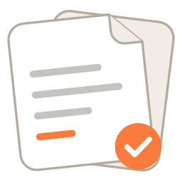
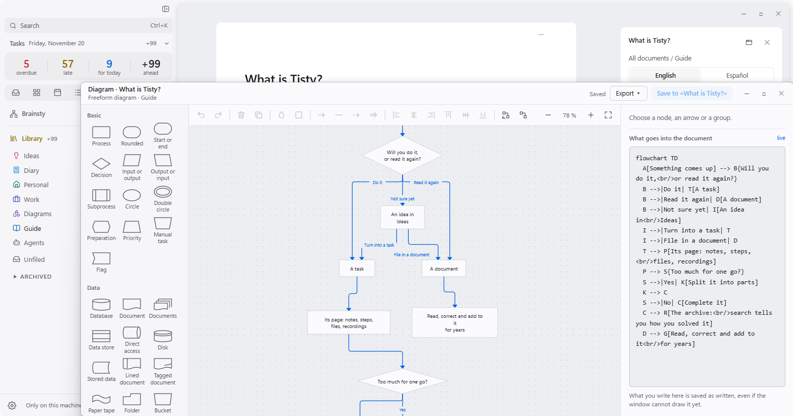
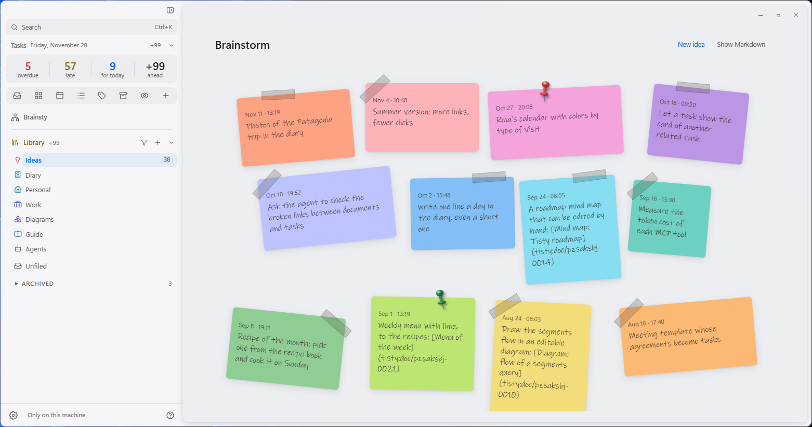
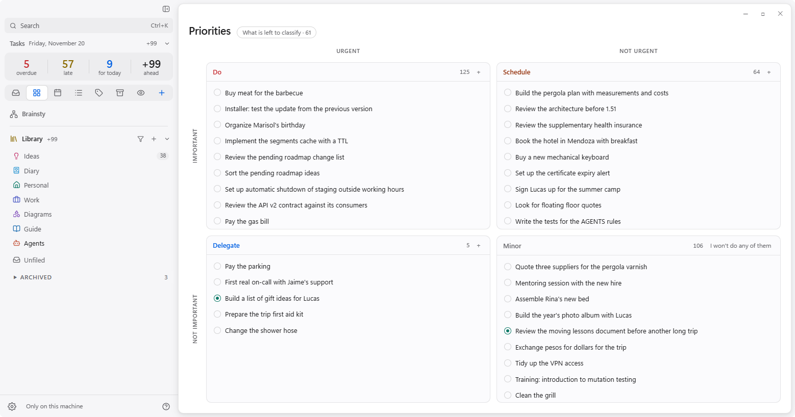

  

<h1 align="center">Tisty's help</h1>

<strong>Shared working memory for you and your AI agent: notes, documents and tasks in local Markdown.</strong> You see the whole. Your agent, every detail. One shared memory. It works without an agent too, the traditional way: your notes, documents and tasks, by hand and at your own pace. No accounts. No subscriptions. No telemetry. No server.

<strong>English</strong> · <a href="Inicio">Español</a>

---

I started building Tisty to solve a problem of my own, and little by little I saw it was not only mine: everyone ran into it, and each solved it their own way.

**You stop explaining. It stops starting over.** Your AI agent knows the details better than anyone, and forgets them the moment the session ends. So everybody patches it: a `NOTES.md` behind `.gitignore`, a Markdown file per session, a `TASKS.md` nobody keeps up to date, an `AGENTS.md` that only grows. They go stale, they get lost between branches, machines and projects, and the agent rereads all of it every session.

Tisty is a desktop app where you plan your tasks in natural language and keep what you know: steps, linked documents, ideas and a diary. Brainsty draws it all joined, as one network. You and your AI agent read and write in that same memory, on your disk, in Markdown. When you finish a task it moves to the archive with everything it gathered — the description, the journal, the steps, the files, the documents you leaned on — and search reaches all of it years later. *How did I solve that last time?* Tisty has it. Beside the tasks, **documents** keep what you know, one per subject, as plain Markdown any other editor reads.

And if you would rather work in a more personal way, with no agent, Tisty serves you just the same: your tasks, your documents, your ideas and your diary, in sight and joined in [Brainsty](Brainsty-Network). The agent is one way to use it, not a condition.

And it is the memory of the AI agent you already use. Through a local **MCP server** — on your machine, with no account and no network — GitHub Copilot, Claude Code, Codex, Cursor or any MCP client asks what moved since last time, reads a document's outline and then only the section it needs, and writes down what it learned for the next session. It works and tells you when something is done; you review it and close it, because nothing closes without you. You decide what it may do.

## Real problems, real fixes

- **A developer** explains the project to the agent again every session. **With Tisty:** the agent asks what moved, opens the task it was on with its ticked steps, and reads what it noted yesterday — *the webhook fails on old signatures; retrying ruled out* — and carries on from there.
- **A `NOTES.md` that grew to 256 KB** is reread whole every time. **With Tisty:** it lives as documents split by subject, in pages, and the agent reads the outline and one section: about 97% less.
- **A PM** is asked, a month later, «why did we decide this?». **With Tisty:** one living document per subject keeps each decision dated with its why, and the agent finds it and quotes it.
- **A QA** sees the same screen break again, and nobody remembers last time's cases. **With Tisty:** the archived regression task keeps them as steps, with what was seen in each.
- **A handover** to a PO or to the QA joining the project ends up pasted into a chat. **With Tisty:** it goes through Folio, the document encrypted on your machine, signed by you, gone on its own when unused. See [Sharing](Documents#sharing).
- **At home**, the bank paperwork comes back every year. **With Tisty:** the archived task says how you did it last time.

How an agent works with all of it, and what it saves, is in [A day with your agent](Assistants-and-MCP#a-day-with-your-agent).

## A task or a document?

**Something you will do is a task. Something you will come back to is a document.** A task ends, often soon, and then stays in the archive as knowledge with a date: months later a search tells you how you solved it. A document — a manual, a recipe, the notes on a client or a machine, a year of minutes — is read again, corrected and added to for years.

An idea is a thought caught on the fly, before you know whether it is something to do or something to keep: a few words, 140 at most, dated, on the Ideas sheet. It waits for you to sort it out: it becomes a task, goes into the document on its subject, or is set aside. A note is something else: the dated line in a task's journal.

A task is also a document, one with an end: that is why it has a page of its own, where a spike gathers what you read, tried and ruled out, the recording of the meeting and the vendor's PDF, before it is split into parts and done. [[The whole idea, with an example|Tasks#a-task-or-a-document]].

## Start here

- [[Installation]] — Microsoft Store, winget, Homebrew or a direct download.
- [First steps](Installation#the-first-time-it-opens) — what Tisty asks the first time, and the guide it writes for you.
- [[Settings]] — the Overview, the settings search and what each page holds.
- [[Keyboard shortcuts|Keyboard-Shortcuts]]

## Tasks and the archive

- [[Tasks]] — capture, views, the Eisenhower matrix, lists, tags, steps and parts.
- [[Natural language|Natural-Language]] — what the capture bar understands.
- [[The spread and reminders|Spread-and-Reminders]] — dealing work onto days, reminders that ring with Tisty closed, and saving a task to your calendar.
- [[The archive|Archive]] — stories, routines and the trace.

## Memory for your AI agent, through MCP

Tisty is not AI and has none inside, and that is not going to change. But it speaks [MCP](https://modelcontextprotocol.io), so the agent you already use — GitHub Copilot, Claude Code, Codex, Cursor, any MCP client — keeps its memory here: it files tasks with steps and a journal, writes documents, and picks up where it left off, on this machine, with no account and nothing over the network.

- [[Assistants and MCP|Assistants-and-MCP]] — connecting one, letting it in, a day with your agent and what it costs.
- [[What an assistant may do|MCP-Permissions]] — the limits, its word on your own tasks, and **To confirm**.
- [[MCP tools reference|MCP-Tools]] — every tool the server offers.
- [[Agents: your agents' rules, skills and memory|AGENTS-Folder]] — one folder for the files Claude Code, Codex, Copilot, Gemini and Cursor read. Bring copies them to read and arrange; Sync has Tisty write them, with backups.

## Documents

Documents are a Markdown notebook beside the tasks: callouts, tables, diagrams, formulas, widgets, code and pages, all kept as plain `.md` files any other editor reads. How each one is written is in the Tisty Markdown guide; the pages here are about the app.

- [[Documents]] — folders, tags, several languages, attachments, import and export, and reading a Markdown file from outside.
- [Ideas](Documents#ideas) — ideas of the moment as sticky notes, sorted out later into a task or a document.
- [Diary](Documents#diary) — what happened today, a book a year, kept from your agent until you open it.
- [Earlier versions](Documents#earlier-versions) — what a document said before a change, yours or your agent's, what changed and going back to it, on each computer.
- [A document's link](Documents#a-documents-link) — reaching it from a chat, your browser or your agent.
- [[The editor|Markdown-Editor]] — writing where you read, the bar, the `/` menu, tables and shortcuts.
- [[Pages and PDF|Pages-and-PDF]] — a document in chapters, page breaks, and Tisty's own PDF.
- [[Diagrams]] — the diagram window: a mind map, a schema, a freeform diagram or a class diagram drawn by hand, and exported as an image.
- [[Widgets]] — a fixed view of HTML and CSS inside a document, and opening it apart.
- [Tisty Markdown guide ↗](https://markdown.tisty.app) — every mark a document can hold, with its examples drawn.

## Brainsty: everything joined

What you keep was already joined: a document cites another, a task was born in some minutes, a book has pages. Brainsty makes those ties a single gesture to write, shows them as one network and serves them to your agent as an index it walks without reading everything.

- [[Linking documents|Linking-Documents]]: `[[` to link a document or one of its sections, the preview and **Linked from**.
- [[Tasks in documents|Tasks-in-Documents]]: citing a task as a live card, creating one with `/` without leaving the document, and **Born in**.
- [[The Brainsty network|Brainsty-Network]]: everything you keep drawn as a network, from afar and up close, with its search, its filters and the keyboard.
- [[How an agent works|How-an-Agent-Works]]: a real session, call by call: `brain`, a task's state, Tisty's questions and the hooks.

## Your data

- [[Sync and backup|Sync-and-Backup]] — two machines through a folder you already sync, or your Google Drive, OneDrive or WebDAV server directly, with what you keep there encrypted if you want.
- [[Privacy]] — what is stored, and the few requests Tisty ever makes.
- [[Command line|Command-Line]] — retired in 1.31; only what assistants use remains: `tisty mcp`, their door, and `tisty hook`.
- [[FAQ]]

---

Tisty is free and open source under the AGPL-3.0. The source, the issues and the releases are in the [main repository](https://github.com/rgdevment/Tisty), and its site is [www.tisty.app](https://www.tisty.app/). Everyone taking part — in issues, pull requests or discussions — follows the [Code of Conduct](https://github.com/rgdevment/Tisty/blob/main/CODE_OF_CONDUCT.md).
