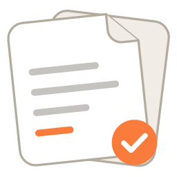
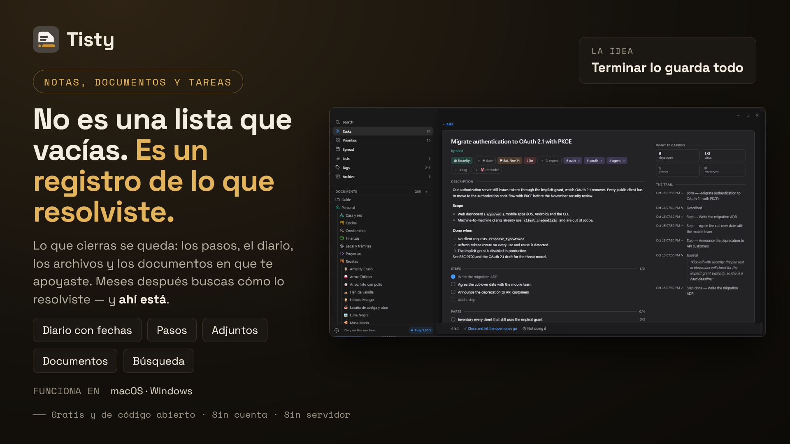

  

<h1 align="center">La ayuda de Tisty</h1>

<strong>Memoria y contexto locales para ti y tu agente de IA: tareas, documentos y notas en Markdown, en tu propio disco.</strong> Sin cuentas. Sin suscripciones. Sin telemetría. Sin servidor.

<a href="Home">English</a> · <strong>Español</strong>

---

**Una lista de tareas común olvida en cuanto marcas la casilla. Tu agente de IA olvida en cuanto termina la sesión.** Por eso cada quien lo parcha: un `NOTES.md` detrás de `.gitignore`, un Markdown por sesión, un `TASKS.md` que nadie mantiene al día. Se desactualizan, se pierden entre ramas, equipos y proyectos, y el agente los relee enteros en cada sesión.

Tisty es la memoria de fondo. Cuando terminas una tarea, pasa al archivo con todo lo que juntó: la descripción, la bitácora, los pasos, los archivos y los documentos en que te apoyaste. Y el buscador lo encuentra años después. *¿Cómo resolví eso la última vez?* Tisty lo tiene. Junto a las tareas, los **documentos** guardan lo que sabes, uno por tema, como Markdown normal que cualquier otro editor lee.

Y es la memoria del agente de IA que ya usas. Por un **servidor MCP** local, en tu equipo, sin cuenta y sin red, GitHub Copilot, Claude Code, Codex, Cursor o cualquier cliente MCP pregunta qué cambió desde la última vez, lee el índice de un documento y después solo la sección que necesita, y deja escrito lo que aprendió para la próxima sesión. Tú decides qué puede hacer.

## Problemas reales, soluciones reales

- **Quien desarrolla** le vuelve a explicar el proyecto al agente en cada sesión. **Con Tisty:** el agente pregunta qué cambió, abre la tarea en la que estaba con sus pasos marcados y lee lo que anotó ayer (*el webhook falla con firmas viejas; reintentar, descartado*), y sigue desde ahí.
- **Un `NOTES.md` que llegó a 256 KB** se relee entero cada vez. **Con Tisty:** vive como documentos separados por tema, en páginas, y el agente lee el índice y una sección: cerca de un 95 % menos.
- **A una PM** le preguntan, un mes después, «¿por qué decidimos esto?». **Con Tisty:** un documento vivo por tema guarda cada decisión fechada con su porqué, y el agente lo encuentra y lo cita.
- **Un QA** ve fallar otra vez la misma pantalla, y nadie recuerda los casos de la vez anterior. **Con Tisty:** la tarea de regresión archivada los guarda como pasos, con lo que se vio en cada uno.
- **Un traspaso** a un PO o al QA que llega al proyecto termina pegado en un chat. **Con Tisty:** va por Folio, el documento cifrado en tu equipo, firmado por ti, y se va solo cuando nadie lo usa. Mira [Compartir](Documentos#compartir).
- **En casa**, el trámite del banco vuelve cada año. **Con Tisty:** la tarea archivada dice cómo lo hiciste la vez anterior.

Cómo trabaja un agente con todo esto, y cuánto ahorra, está en [Un día con tu agente](Asistentes-y-MCP#un-día-con-tu-agente).

## ¿Tarea o documento?

**Lo que vas a hacer es una tarea. Lo que vas a volver a consultar es un documento.** Una tarea termina, muchas veces pronto, y después se queda en el archivo como conocimiento con fecha: meses más tarde una búsqueda te cuenta cómo lo resolviste. Un documento —un manual, una receta, las notas de un cliente o de una máquina, las actas de un año— se vuelve a leer, se corrige y se amplía durante años.

Una tarea también es un documento, uno que termina: por eso tiene una página propia, donde un spike reúne lo que leíste, probaste y descartaste, la grabación de la reunión y el PDF del proveedor, antes de dividirse en partes y completarse. [[La idea completa, con un ejemplo|Tareas#tarea-o-documento]].

## Para empezar

- [[Instalación]]: Microsoft Store, winget, Homebrew o descarga directa.
- [Primeros pasos](Instalación#la-primera-vez-que-se-abre): lo que Tisty pregunta la primera vez y la guía que te escribe.
- [[Atajos de teclado|Atajos-de-teclado]]

## Tareas y archivo

- [[Tareas]]: captura, vistas, la matriz de Eisenhower, listas, etiquetas, pasos y partes.
- [[Lenguaje natural|Lenguaje-natural]]: lo que entiende la barra de captura.
- [[Reparto y recordatorios|Reparto-y-recordatorios]]: repartir el trabajo en los días.
- [[El archivo|El-archivo]]: historias, rutinas y rastro.

## Memoria para tu agente de IA, por MCP

Tisty no tiene IA dentro, y no la va a tener. Pero habla [MCP](https://modelcontextprotocol.io), así que el agente que ya usas (GitHub Copilot, Claude Code, Codex, Cursor o cualquier cliente MCP) guarda aquí su memoria: anota tareas con pasos y bitácora, escribe documentos y retoma donde quedó, en este equipo, sin cuenta y sin pasar nada por la red.

- [[Asistentes y MCP|Asistentes-y-MCP]]: cómo conectar uno, dejarlo entrar, un día con tu agente y lo que cuesta.
- [[Qué puede hacer un asistente|Qué-puede-hacer-un-asistente]]: los límites, su palabra sobre tus tareas y **Por confirmar**.
- [[Herramientas MCP|Herramientas-MCP]]: cada herramienta que ofrece el servidor.

## Documentos

Los documentos son un cuaderno Markdown junto a las tareas: avisos, tablas, diagramas, fórmulas, widgets, código y páginas, todo guardado como archivos `.md` normales que cualquier otro editor lee. Cómo se escribe cada cosa está en la guía de Markdown de Tisty; las páginas de aquí tratan de la app.

- [[Documentos]]: carpetas, etiquetas, varios idiomas, adjuntos, importar y exportar, y leer un archivo Markdown de afuera.
- [[El editor|Editor-Markdown]]: escribir donde lees, la barra, el menú `/`, las tablas y los atajos.
- [[Páginas y PDF|Páginas-y-PDF]]: un documento por capítulos, saltos de página y el PDF propio de Tisty.
- [[Diagramas]]: la ventana de diagramas: un mapa mental, un esquema, un diagrama libre o un diagrama de clases dibujados a mano, y exportados como imagen.
- [[Widgets|Widgets-en-documentos]]: una vista fija de HTML y CSS dentro de un documento, y cómo abrirla aparte.
- [Guía de Markdown de Tisty ↗](https://markdown.tisty.app/es/): cada marca que puede llevar un documento, con sus ejemplos dibujados.

## Tus datos

- [[Sincronizar y respaldar|Sincronizar-y-respaldar]]: dos equipos a través de una carpeta que ya sincronizas, o directamente con tu Google Drive, tu OneDrive o tu servidor WebDAV, con lo que guardas ahí cifrado si quieres.
- [[Privacidad]]: qué se guarda y las pocas peticiones que Tisty hace.
- [[Línea de comandos|Línea-de-comandos]]: se retiró en la 1.31; solo queda `tisty mcp`, la puerta del asistente.
- [[Preguntas frecuentes|Preguntas-frecuentes]]

---

Tisty es libre y de código abierto bajo la AGPL-3.0. El código, los reportes y las versiones están en el [repositorio principal](https://github.com/rgdevment/Tisty), y su sitio es [www.tisty.app/es](https://www.tisty.app/es/). Quien participe —en reportes, pull requests o discusiones— sigue el [código de conducta](https://github.com/rgdevment/Tisty/blob/main/CODE_OF_CONDUCT.md), que está en inglés.
