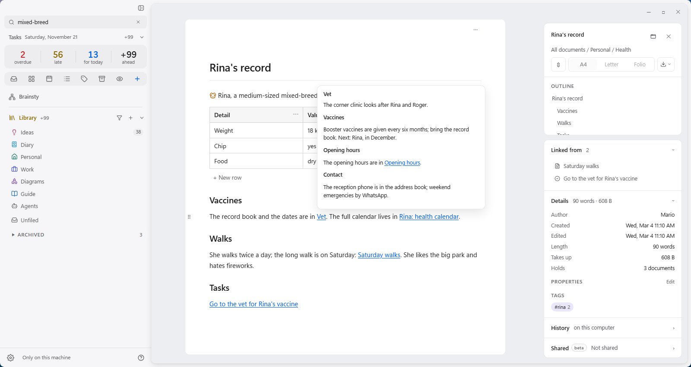
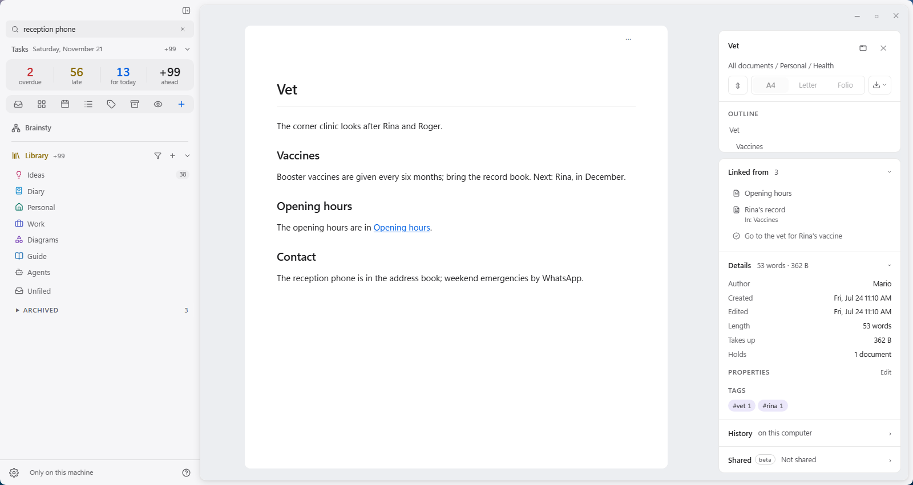

# Linking documents

For years I kept what I knew in loose notes, and the hard part was never writing them: it was finding them again when one note needed another. The vet's note knew the opening hours, Rina's note knew her vaccines, and nothing joined them. In Tisty, a document names another with two brackets, and the other one knows who named it.

This page covers linking a document to another one or to a section of another, seeing where a link goes without leaving your place, and knowing who links to a document. Citing a task inside a document, and creating one from there, is in [[Tasks in documents|Tasks-in-Documents]]. Everything you link shows up in [[the Brainsty network|Brainsty-Network]].

## When it helps

- **A subject that leans on another.** «Rina» names «Vet» where it tells about the yearly vaccine; whoever reads Rina's note is one click away from Marisol's opening hours.
- **An index of your own.** A «Home» document that links to «Car insurance», «Building rules» and «Recipes» is a way in that you build.
- **A decision with its source.** The building minutes link to the section of the rules that was discussed, not to the whole rules.
- **Knowing what breaks if you change something.** Before rewriting «Vet», **Linked from** tells you which documents and tasks name it.

## Linking to another document

1. In a document, where you want the link, type `[[`.
2. Go on with a few words of the title: `[[ve`. Tisty offers up to eight documents that match, each with its folder beside it, ignoring accents and capitals: first those that start that way, then those you wrote lately. With `[[` alone, it shows the last ones you wrote.
3. Pick one with the arrows and `Enter`, or with a click.

The document you are writing and the archived ones are not offered. A document in several languages shows up once, in the app's language.

What stays is a link with the document's title, like this:

```markdown
[Vet](tisty:doc/…)
```

The `[[ ]]` are not written: they were only the way to ask. The link points at the document, not at its name, so if tomorrow you rename it «Rina and Roger's vet», the link still gets there; the text you see is the one it had when you wrote it, and you change it like any other word.

It works the same in the page you read and write and in the **Markdown** view (`Ctrl`/`⌘` + `E`), where you see the link with all its marks.

## Linking to a section

A section is what sits under a heading of the document. To land right there:

1. Type `[[`, a few words of the document's title and `#`: `[[Vet#`.
2. Tisty shows that document's headings. Keep typing to narrow them: `[[Vet#ope`.
3. `Enter` leaves a link like `[Vet › Opening hours](tisty:doc/…#opening-hours)`.

Opened like any link (`Ctrl` + click, `⌘` + click on a Mac, or a plain click where the document is only read), it goes to that section. If the section is gone because you renamed or deleted its heading, the link does not break: it opens the document at the top.

## Seeing where it goes, without leaving

Rest the pointer on a link to another document and its preview appears: the first lines of the document or, if the link points at a section, that section. It confirms it is the one you meant, or lets you read a quick fact without losing the place you were writing in.



To open it: in a document you can write in, a click puts the caret in the link, so you can fix it, and `Ctrl` + click (`⌘` + click on a Mac) opens it; in one that is only read, like a closed task or an archived document, a click is enough.

## Who links to it: Linked from

The panel beside the document has a **Linked from** row: every document and every task that cites or mentions it and, in a document, under which section it does («In: Vaccines»). A click opens that document at that section.



- **Both kinds count.** A link inside a sentence is a mention; a card, alone in its paragraph, is a citation. Both show here, and a task's page has the same row.
- **It is built in the background.** Tisty reads how your documents link without slowing what you do, so a link you just wrote shows up a few seconds later. While it reads for the first time, the row says «Tisty is still reading how your documents link to each other»; when nothing links that document, «No document or task links here yet».
- **Twelve in view.** When many link to it, you see the first twelve and **See all…** shows the rest.
- **It never names itself.** A document that links to itself does not show in its own row.

## An example: Rina's note

Marisol, the vet, changed her opening hours, and you want Rina's note to lead to them.

1. You open «Rina». In the **Vaccines** section you write: «The yearly one is due in November; the practice's hours are in » and go on with `[[Vet#ope`.
2. `Enter`. The sentence ends in the link **Vet › Opening hours**.
3. You rest the pointer on the link: the preview shows the opening hours table, and you check that on Saturday it opens until 13:00.
4. You open «Vet». In the panel, **Linked from** already names «Rina», with «In: Vaccines».
5. Months later you rename «Vet» to «Rina and Roger's vet». The link in the note still leads to the same section.

## Good to know

- **`[[#2]]` is something else.** A number after `#` still names the second step of a task's page, or the second stage of a list on that sheet, as always.
- **Two brackets around a bare name.** `[[Rina's vet card]]` written as is, without picking from the menu, stays as a chip with that name, unlinked. If exactly one document carries that title, Brainsty still counts it as a mention. That is how notes you bring from Obsidian arrive, for example: see [[Convert to and from Markdown|Convert-to-and-from-Markdown]].
- **On another computer.** The link travels with the document when you sync. If the other document has not reached that computer yet, the link stays written as is and opens as soon as the document arrives.
- **An archived document** still opens from a link that was already there; it is read, but not written until you unarchive it. To link it again with `[[`, unarchive it first.
- **Outside Tisty.** **Copy as Markdown** and **Export as Markdown…** leave a link to another document as its text, because `tisty:doc/…` means nothing in another editor. The PDF and Word show the link's text.
- **A card instead of a link.** For another document to show as a card, with its title and first words, use **A document** in the `/` menu, or leave the link alone in its paragraph. See [[Documents]].
- **What your agent links.** When an agent names a document by its exact title between quotes, Tisty links it when saving, just as if you had: see [[How an agent works|How-an-Agent-Works]].

## Where next

- [[Tasks in documents|Tasks-in-Documents]]: citing a task as a live card and creating one with `/`.
- [[The Brainsty network|Brainsty-Network]]: all your links drawn together.
- [[The editor|Markdown-Editor]]: the `/` menu, the toolbar and the shortcuts while writing.
- [Links](https://markdown.tisty.app/links) and [references](https://markdown.tisty.app/references) in the Tisty Markdown guide ↗
