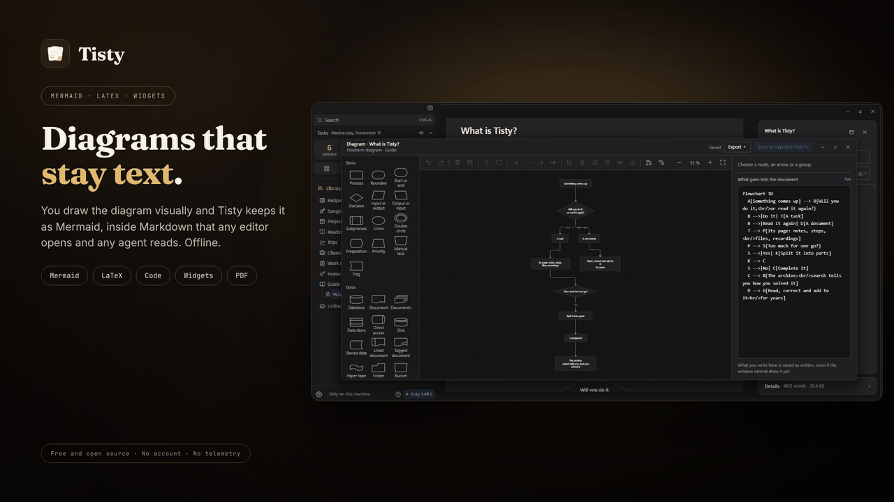

# The Markdown editor

A document in Tisty is text of yours, kept as a plain `.md` file, that you write here and can read with anything else. Delete Tisty tomorrow and your documents still open in any text editor, on GitHub, or in another notes app.

## Writing where you read

You write on the same page you read, the one Tisty draws. There is no separate editing mode and no block to open: you click and type.

- **Click wherever you like and type.** The caret lands where you clicked, and the page is drawn again as you write, the same as it reads, prints and is shared. What you write is saved as you go.
- **The marks stay out of sight.** Bold looks bold and a heading looks like a heading. The Markdown is still underneath, and the **Markdown** view shows it as it is.
- **The first line is the title.** There is no name to fill in anywhere: whatever you write at the top is what the document is called.
- **Enter starts a new paragraph, and `Shift` + `Enter` only breaks the line.** In a list, Enter starts another item of the same kind; in a quote, the quote goes on; in code, it breaks the line.
- **Tick a box with a click**, a sticky note's too. A sticky note is written inside and dragged by its paper, its tape or its pin.
- **A click on a picture or a diagram opens it large**, to zoom in, move it around and go to the next one. A diagram brings its own bar when the pointer is over it: **Export**, **Edit as Markdown**, which opens its text in the Markdown view, and **Open in the diagram window**; a double click also opens it in the [[diagram window|Diagrams]]. A widget brings **Show code**.
- **Code is written as it is.** Inside a code block there are no formats and no spell checker, and `/` is just a slash. The label in its corner, like «rust» or «yaml», opens the list of languages to choose the colours it is drawn with.
- **A page break is neither written in nor moved.** `Backspace` at the start of the block after it, or `Delete` at the end of the block before it, takes it away, and the rest stays as it was.
- **`Ctrl`/`⌘` + `Z` undoes** and `Ctrl`/`⌘` + `Shift` + `Z` redoes.

## The format bar

Select a few words and a small bar comes up above them:

- **Bold**, **italic**, **underline**, **strikethrough**, **code** and **link**.
- **Four pens**: yellow, green, blue and pink.

A format wraps the words selected; pressed on words that already have it, it takes it away. **Link** asks for the address in a field, and `Esc` cancels it. Inside code the bar does not come up.

`Ctrl`/`⌘` + `B`, `I` and `U` put on or take off bold, italic and underline without the bar. Right-click on selected words **cuts** or **copies** them as Tisty Markdown, ready to paste into another document, and offers the same formats.

## The `/` menu

Type `/` at the start of a line, on a blank line or after a space, and the menu of what fits comes up; inside a word or in code it is just a slash. `Ctrl`/`⌘` + `/` opens it anywhere, and so does the **+** that shows in the margin, level with the caret. Keep typing to narrow it down, ↑ ↓ to move, Enter to add it, Esc to close it; closed without a choice, the `/` stays written.

- Headings, lists, stages and quotes.
- The five callouts: Note, Tip, Important, Warning and Caution, and the Idea sticky note.
- An icon, looked up by what it draws.
- A new diagram, which opens the [[diagram window|Diagrams]], a copy of an existing diagram, or a Mermaid block as text; a formula, a widget and a code block. What is written as text, such as a formula or a widget, opens the Markdown view with the caret inside.
- A table, which opens on its first title.
- A **collapsible section**: a title that folds what is under it.
- A page break.
- Another document, a new document, a page that already exists or a new page, drawn as a card.

## Moving blocks

- **The handle.** With the pointer beside a block, a handle shows to its left. Drag it to take the block somewhere else; a heading takes its whole section with it.
- **Its menu.** A click on the handle offers **Move block up**, **Move block down**, **Duplicate block** and **Delete block**.
- **The keyboard.** `Alt` + ↑ ↓ moves the block the caret is in up or down, or the list item it is in.

## Rich text and Markdown

A document can be seen two ways, and both write the same file:

- **Rich text** is the page as drawn, the one that is read, printed and shared. Almost everything is written there.
- **Markdown** shows the text as it is kept, with every mark in view: the `**`, the `#`, the `>`, a table's rules. It is there for changes that run across blocks and for writing a formula, a widget or a diagram as text.

The **⋯** on the ribbon at the top of the document switches between them, and so does `Ctrl`/`⌘` + `E`. On a task, **Show Markdown** in its column does the same, and **Show rich text** goes back. As you scroll down a document, the ribbon also keeps its title in sight.

In the Markdown view:

- **The `/` menu and a small bar** offer what the page does.
- **Tags are offered after `#`.** The tags you already use come up as you type, so one tag is never spelled two ways. What you typed stays first, so Enter keeps a new tag as it is.
- **An empty item ends a list.** Enter on an empty bullet, number or box leaves the list with a blank line.
- **Backspace right after a line's mark** (a heading's `#`, a bullet, a quote's `>`) turns the line back into words.
- **More shortcuts:** `Ctrl`/`⌘` + `Shift` + `X` strikes through, `Ctrl`/`⌘` + `Shift` + `C` marks code, `Ctrl`/`⌘` + `K` adds a link and `Ctrl`/`⌘` + `Enter` writes a page break.

## While you type

- **Attach a file** by dragging it onto the page or picking **Attach a file** in the `/` menu; in the Markdown view it can be pasted too, a screenshot on the clipboard included. It lands after the block you drop it on, or where the caret is, and it is kept inside Tisty with the document, not linked to a place on your disk that breaks when the file moves.
- **Paste with its formatting.** Text copied from a web page, an email or a word processor keeps its headings, lists, bold, links, tables and coloured words, written in Tisty Markdown: a colour becomes the nearest pen of the palette. Plain text keeps its shape too: a table a terminal drew with box lines (`┌ │ ├`) becomes a table, and lines that read like code — from a code editor or a terminal — come in as a code block, unless the caret is already inside one.
- **Tab and Shift + Tab walk a table's cells**, and Tab past the last one starts a new row.
- **Drag the edge of a table's column** on the page to make it wider or narrower. The width is written as the dashes of its rule, ten pixels each.

| Shortcut | What it does |
| :-- | :-- |
| `Ctrl`/`⌘` + `B` | Bold |
| `Ctrl`/`⌘` + `I` | Italic |
| `Ctrl`/`⌘` + `U` | Underline |
| `Ctrl`/`⌘` + `Z` · `Ctrl`/`⌘` + `Shift` + `Z` | Undo · redo |
| `Enter` · `Shift` + `Enter` | New paragraph · line break |
| `Ctrl`/`⌘` + `/` | Open the blocks menu where the caret is |
| `Alt` + ↑ ↓ | Move the block or the item the caret is in up or down |
| `Ctrl`/`⌘` + `E` | Switch between Rich text and Markdown |
| `Ctrl`/`⌘` + `Shift` + `X` · `Shift` + `C` · `K` (in Markdown) | Strikethrough · code · link |
| `Ctrl`/`⌘` + `Enter` (in Markdown) | Page break |

The writing sits on a lit page. When the window is wide enough, a column opens beside it with what the document is, its tags, its outline and the way to its PDF.

## Tables

A table is written on the page itself:

- **Click a cell** to write in it; Enter or a click outside keeps it, Esc leaves it as it was. Its title is written the same way. The cell shows its words without marks, and a bar over the table puts bold, italic, underline, strikethrough, code or a pen on the whole cell, or takes it off. A table made from the `/` menu opens this way at once, on its first title.
- **A row's and a column's `⋯` menu** move it, duplicate or remove a row, insert a column on either side, rename it, and give it a **type**: number, money, percent, date, duration, yes or no, choice, tags, rating, document, web address, email or phone. Money takes its currency, and a column can sum itself up at the foot: sum, average, minimum or maximum for numbers, minimum and maximum for dates, and count for any. **Edit as Markdown** opens the table as text.
- **Drag a row or a column** by its handle to put it somewhere else, and **New row** under the table adds one at the end.
- **A typed cell is written as its type asks**: a calendar for a date, where you can also type «next Friday»; the column's own options for a choice, each with its colour; stars for a rating; a click for yes or no; a finder for a document.
- **Sort and filter from a column's head.** That order and those filters are on screen only and leave the file alone; **Save this order** writes the rows in that order.
- **A value not written as its type asks**, like «soon» in a date column, keeps what you wrote and shows a wavy line under it.
- **In the Markdown view**, `Alt` + ↑ ↓ moves the row the caret is on and `Alt` + ← → its column (`Ctrl` + `Alt` on a Mac), and the bar's **Table** menu sorts it and gives a column its type.
- **Rows copied from Excel, Numbers or Google Sheets** — or a CSV — come in as a table when you paste them.

A table wider than the page scrolls sideways, and its PDF and Word copies keep every column. How a type is written in the file is in the guide's [column types](https://markdown.tisty.app/tables#column-types).

## What a document can hold

Everything a document holds, from bold and lists to callouts, pens, icons, tables, diagrams, formulas, widgets, code and pages, is plain Markdown with a few short words of Tisty's own, so the file survives without Tisty. How each one is written, with its examples drawn, is in the [Tisty Markdown guide](https://markdown.tisty.app), which also opens inside Tisty with `F1`. You never need it to write: the `/` menu and the bar write it all for you.

## Markup Tisty has no words for

Some Markdown from elsewhere — HTML tags — has no word in Tisty. A document that holds it still opens, edits and saves whole: nothing is cut out. That part simply shows as it is written while you edit it. **Settings › Maintenance** goes through every document and lists the ones that hold some. The full list is in the Tisty Markdown guide, under [what is outside the language](https://markdown.tisty.app/what-is-outside-the-language).

## When a document opens read-only

The bar at the foot of the document says why.

**It is in the archive.** Archiving a document, or the folder it sits in, closes it to writing — from the window and from an assistant alike. Bring it back and it writes again.

**A page of it is archived, or the document that holds it is.** See [Pages and PDF](Pages-and-PDF).

## Offline, always

Diagrams, formulas, code colouring and widgets are all drawn by code that ships inside Tisty. Nothing is fetched, no font is loaded from anywhere, and it all works with the network unplugged.
