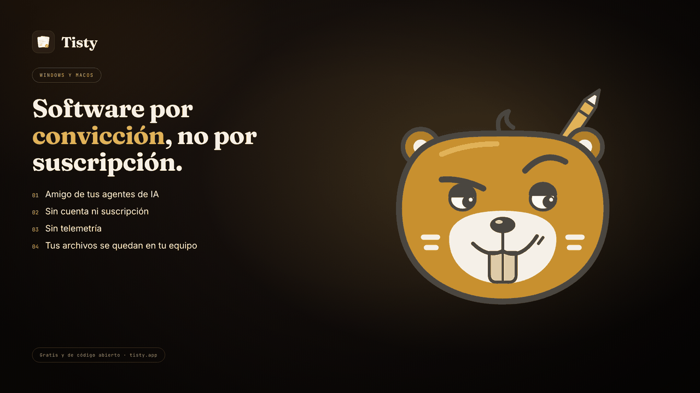

# Privacidad

Tisty no recoge nada y no guarda nada tuyo en un servidor. La única excepción la decides tú: un documento que compartes por link va, sellado, a [Folio](https://github.com/rgdevment/Folio-by-Tisty), un servicio aparte. Sin cuenta, sin telemetría, sin analítica, sin reportes de fallos. No es una promesa que tengas que creer: es una propiedad del código, que es [público](https://github.com/rgdevment/Tisty). Si quieres, pásale un monitor de red.

Esta página es un resumen. La política completa, incluidas las partes que no tranquilizan, está en [PRIVACY.md](https://github.com/rgdevment/Tisty/blob/main/PRIVACY.md) (en inglés), y el razonamiento de seguridad en [SECURITY.md](https://github.com/rgdevment/Tisty/blob/main/SECURITY.md).

## Qué se guarda

Todo vive en una carpeta de tu disco:

- **Tareas y eventos**: JSONL en texto plano, un registro que solo crece. Se lee con `cat`, se busca con `grep` y se procesa con `jq`.
- **Documentos**: archivos Markdown normales.
- **Adjuntos**: los archivos tal cual, sin modificar.
- **Configuración local**: incluye el identificador de este equipo y su clave de firma. La mitad privada de la clave nunca sale del equipo.
- **Tu frase, si creas una**: las 24 palabras que cifran tu nube, guardadas en el equipo donde la creaste, en el llavero del sistema en macOS o en un archivo sellado para tu usuario en Windows. Nunca se sincroniza, se respalda ni va en un paquete. Nadie de Tisty ni de Folio te la pedirá; si alguien te la pide, es un engaño.
- **Lo que compartes por link**: la llave de cada link y los tokens que lo administran o editan viven en el registro, para que tus otros equipos puedan manejarlo. Viajan con tu sincronización, así que quien pueda leer una copia sin cifrar puede abrir esos links. Cuando dejas de compartir un documento, los nombres de quienes lo editaron también se quedan en el registro, para que al volver a compartirlo se te recuerde quiénes fueron. Cuánto pidió esperar Folio a este equipo, y qué documentos compartió hoy por primera vez, se quedan en este equipo.
- **Una carpeta `private/`**: lo que pongas ahí nunca sale del equipo, por ningún camino.

Nada está ofuscado, y nada está en un formato que solo Tisty sepa leer.

**Nada de tu equipo está cifrado en reposo.** La protección son los permisos de tu sistema operativo. Es una decisión, no un descuido: el cifrado rompería la unión bloque a bloque de documentos de la que depende la sincronización. Lo que Tisty guarda en una nube con la que habla directo es otra cosa: desde la 1.36 lo puedes cifrar con tu frase ([cómo funciona](Sincronizar-y-respaldar#cifrar-tu-nube)). Una carpeta que otro programa mantiene al día nunca se cifra.

> [!WARNING]
> **Un registro que solo crece no olvida.** Si una contraseña termina en una tarea, borrar la tarea la quita de lo que ves, no de la historia que hay debajo; y si ya llegó a la carpeta compartida, está en cada equipo que la bajó, más el historial de versiones de tu proveedor. Deja los secretos fuera, o en `private/`.

## Quién puede alcanzar tus datos

| Eliges | Quién más puede alcanzarlos |
| :-- | :-- |
| **Solo local** (lo predeterminado) | Nadie |
| **Una carpeta que sincroniza tu cliente de nube** | Ese proveedor, según sus términos |
| **Google Drive, conectado desde Tisty** | Google, según sus términos. Tisty solo ve su propio espacio oculto ahí ([cómo funciona](Sincronizar-y-respaldar#sincronizar-con-google-drive-directamente)) |
| **OneDrive, conectado desde Tisty** | Microsoft, según sus términos ([cómo funciona](Sincronizar-y-respaldar#sincronizar-con-onedrive-directamente)) |
| **Tu propio servidor WebDAV, conectado desde Tisty** | Quien administre ese servidor ([cómo funciona](Sincronizar-y-respaldar#sincronizar-con-tu-propio-servidor-webdav)) |
| **Cualquiera de esos tres, cifrado con tu frase** | Nadie puede leer tus archivos sin tu frase o sin uno de tus equipos. El proveedor sigue viendo sus nombres, tamaños y cuántos equipos tienes, y puede guardar un tiempo versiones anteriores sin cifrar |
| **Una carpeta en hardware tuyo** (NAS, disco externo) | Quien pueda alcanzar ese hardware |
| **Un documento que compartes por link, con Folio** | Quien tenga el link. Folio lo guarda sellado y no puede leerlo, pero ve lo que [la política completa](https://github.com/rgdevment/Tisty/blob/main/PRIVACY.md#sharing-by-link) enumera |
| **Un zip de respaldo** | Donde lo pongas |
| **Un paquete `.tistyx` que le das a alguien** | Esa persona, y a quien se lo pase |
| **Un `.tistyx` cerrado con seis dígitos** | Quien tenga el archivo y el número |
| **Un asistente que dejas entrar** | El servicio con que hable ese asistente |

## Las peticiones de red que hace Tisty

**Por su cuenta:** al abrirse y una vez al día después, descarga un archivo pequeño para ver si hay una versión más nueva. No envía nada: ni identificador, ni tareas, ni nombre. Una copia de la Microsoft Store le pregunta a Windows qué tiene la Store, y lee el catálogo público de la Store para ver qué versión es: al abrirse, cada seis horas y cuando tú lo pides. Descarga ese mismo archivo solo si el catálogo no responde. Mientras sincronizas con Google Drive, OneDrive o un servidor WebDAV, además lee, como mucho una vez por hora, un archivo pequeño y firmado en GitHub que puede pausar la sincronización o bajar sus límites; no lleva nada tuyo.

**Solo cuando tú lo pides:**

- **Actualizar**, en *Acerca de*, descarga el archivo de la versión y el instalador, y Tisty rechaza cualquier cosa que no esté firmada con la clave que lleva tu copia.
- **Traer la vista previa** en una [tarjeta de enlace](https://markdown.tisty.app/es/enlaces) le pregunta a esa página una vez por su título y su imagen.
- **La ayuda** dentro de Tisty (el `?` al pie de la barra lateral) viene con tu versión y no pide nada. Su guía **Markdown de Tisty** (también `F1` mientras escribes) la lee desde [markdown.tisty.app](https://markdown.tisty.app/es/), así que siempre es la última; sin conexión, muestra la copia que trae tu versión. Sus imágenes se descargan desde GitHub solo cuando pulsas **Descargar** sobre la ayuda.
- **Mostrarlas**, en la línea sobre un archivo Markdown abierto desde afuera, le pide a cada dirección que nombra el archivo su imagen, una petición por imagen. No se trae nada hasta que lo pulsas, vuelve a preguntar cada vez que abres el archivo y rechaza una dirección de este equipo o de tu propia red. Es solo del visor: un documento de tu almacén no dibuja imágenes de internet.
- **Hacer clic en un enlace** abre tu navegador.
- **Compartir**, en un documento, lee un archivo firmado pequeño en GitHub para saber si [Folio](https://github.com/rgdevment/Folio-by-Tisty) está abierto. Lo que confirmes después va a Folio, cifrado en este equipo, igual que Sincronizar, Pausar, Dejar de compartir y abrir un link compartido. No se pide nada hasta que lo pulsas.
- **Google Drive**, **OneDrive** o **tu servidor WebDAV**, una vez que lo conectas desde la ventana, es adonde Tisty manda tus copias y de donde las trae. Los asistentes nunca tocan la red.
- **Revisar un servidor WebDAV**: solo cuando lo conectas, Tisty entra con lo que escribiste y mira su propia carpeta ahí, nada más. Solo se acepta `https://`, salvo hacia este mismo equipo, y la contraseña nunca viaja a otra dirección.
- **Revisar el camino a OneDrive** funciona igual que la revisión para Google Drive, más abajo, con una petición a `graph.microsoft.com` que no lleva nada tuyo.
- **Revisar el camino a Google Drive**: solo mientras conectas Google Drive o te mueves a él, Tisty manda una petición al servidor de la API de Google, `www.googleapis.com`, sin cuenta, sin token y sin nada tuyo. Espera como mucho 10 segundos y pasa por el proxy de tu sistema, nunca por fuera de él. Solo le sirve a Tisty para decirte si un proxy, un filtro de tu trabajo o un antivirus se interpone, o si Google mismo tiene problemas. Nunca corre mientras sincroniza. Cuando una ronda de sincronización no logra llegar a Google, Tisty lee la falla de la misma forma, sin mandar nada más, y guarda en este equipo solo una palabra para lo que se interpuso, cuántas rondas seguidas fallaron y desde cuándo, para avisarte cuando dura. Una conexión que se corta a medio traspaso no deja ninguna palabra.

Un [widget](Widgets-en-documentos) no ejecuta nada ni nombra nada fuera de sí mismo. Un archivo `.html` adjunto es solo un archivo: Tisty nunca lo ejecuta.

## Tu identidad al compartir

**Qué es.** Un par de llaves que Tisty crea en este computador. Una es secreta y nunca sale de tus computadores; la otra es pública y solo sirve para comprobar tu firma.

**Para qué sirve.** Tisty firma con ella cada documento que compartes. Quien lo abre ve una huella, una serie de números que siempre es la misma para ti: así sabe que dos documentos vienen de la misma persona y que nadie los alteró. Puedes firmar con un alias; no tiene que ser tu nombre.

**Qué ve Folio.** Tu documento se cifra en este computador antes de salir. La llave que lo abre viaja dentro del link, después del #, y esa parte nunca llega a Folio, así que Folio no puede leer el título ni lo que escribiste. Ve tu llave pública, para saber que dos documentos vienen de la misma persona, y nunca tu nombre ni tu correo.

**Tu frase de 24 palabras.** Es el respaldo de tu identidad: con ella, tus otros computadores firman como tú. Guárdala fuera de Tisty, en papel o en un PDF aparte. Si pierdes la frase y todos tus computadores, la identidad no se puede recuperar. Nadie de Tisty ni de Folio te la pedirá nunca.

**Si pierdes un computador.** Quítalo en Configuración › Tu identidad. Su llave deja de valer, y Folio avisa a quien lea lo que firmó después de eso.

## Sin IA

Tisty no usa IA ni aprendizaje automático sobre tus datos, y no le envía nada a ningún modelo. El lenguaje natural son reglas fijas en tu equipo.

Si conectas un asistente tuyo por [[MCP|Asistentes-y-MCP]], lo que lea se va adonde vaya ese asistente. Esa puerta viene abierta en una instalación nueva, y un clic en Configuración › Asistentes la cierra.
