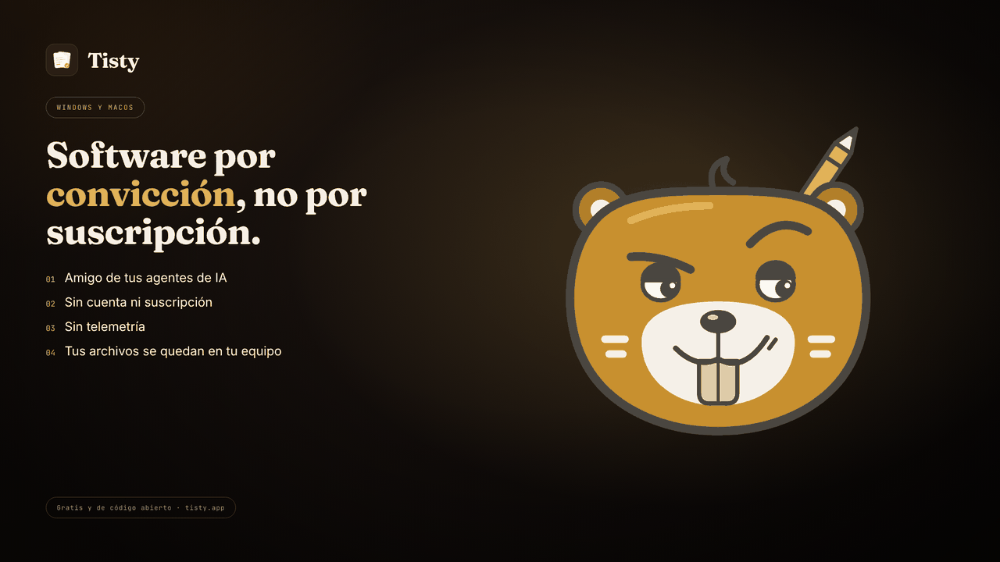

# Privacidad

Tisty no recoge nada y no guarda nada tuyo en un servidor. La única excepción la decides tú: un documento que compartes por link va, sellado, a [Folio](https://github.com/rgdevment/Folio-by-Tisty), un servicio aparte. Sin cuenta, sin telemetría, sin analítica, sin reportes de fallos. No es una promesa que tengas que creer: es una propiedad del código, que es [público](https://github.com/rgdevment/Tisty). Si quieres, pásale un monitor de red.

Esta página es un resumen. La política completa, incluidas las partes que no tranquilizan, está en [PRIVACY.md](https://github.com/rgdevment/Tisty/blob/main/PRIVACY.md) (en inglés), y el razonamiento de seguridad en [SECURITY.md](https://github.com/rgdevment/Tisty/blob/main/SECURITY.md).

## Qué se guarda

Todo vive en una carpeta de tu disco:

- **Tareas y eventos**: JSONL en texto plano, un registro que solo crece. Se lee con `cat`, se busca con `grep` y se procesa con `jq`.
- **Documentos**: archivos Markdown normales.
- **Agentes, si la usas**: las reglas, skills y memoria de tus asistentes, como documentos. Si la sincronizas, Tisty escribe además, fuera de esta carpeta, los archivos que lee cada asistente ([qué lee y cuándo](#tus-asistentes-en-agentes)).
- **Versiones anteriores de tus documentos**: Markdown como los documentos, en la carpeta `history`. Cada una se guarda 30 días desde que fue reemplazada, o lo que elijas en **Configuración › Tus datos**; la más reciente de cada documento, y lo que te devolvería **Volver a lo que decía antes**, no vencen. Se quedan en este equipo: nunca se sincronizan ni van en un paquete, pero sí en tus respaldos. [Cómo funcionan](Documentos#versiones-anteriores).
- **Tu diario**: Markdown como cualquier documento, un libro por año. Ningún agente lo ve hasta que lo abres desde el propio Diario, en Tisty 1.48 o más nuevo; nunca se comparte por link, y viaja con tu sincronización y tus respaldos como lo demás, y dentro de un paquete `.tistyx` cuando exportas todo.
- **Adjuntos**: los archivos tal cual, sin modificar.
- **La base de Brainsty**: cómo se unen tus cosas, las palabras de peso de cada documento y tarea y qué cosas se parecen, en la caché de este equipo. Se rehace sola con lo que guardas, así que no se sincroniza ni va en un paquete, a Folio o a una exportación. Tampoco va en tus respaldos. Las tareas ocultas y las descartadas, tu Diario y los documentos de Agentes no dejan ahí palabras, y de lo demás solo cuenta la prosa: ni el código, ni las rutas, ni las notas de avance de una tarea. [Cómo funciona](Red-de-Brainsty#parecidos).
- **La nota de un asistente sobre un documento**, la que deja con `sum_up` para el siguiente que lo lea: un evento más del registro, así que viaja a tus otros equipos con la sincronización, a tu nube y a tus respaldos. Nunca sale por Folio ni en un `.tistyx`, y la ventana no la muestra. [Qué hace cada herramienta](Herramientas-MCP#documentos).
- **Configuración local**: incluye el identificador de este equipo y su clave de firma. La mitad privada de la clave nunca sale del equipo.
- **Tu frase, si creas una**: las 24 palabras que cifran tu nube, guardadas en el equipo donde la creaste, en el llavero del sistema en macOS o en un archivo sellado para tu usuario en Windows. Nunca se sincroniza, se respalda ni va en un paquete. Nadie de Tisty ni de Folio te la pedirá; si alguien te la pide, es un engaño.
- **Lo que compartes por link**: la llave de cada link y los tokens que lo administran o editan viven en el registro, para que tus otros equipos puedan manejarlo. Viajan con tu sincronización, así que quien pueda leer una copia sin cifrar puede abrir esos links. Cuando dejas de compartir un documento, los nombres de quienes lo editaron también se quedan en el registro, para que al volver a compartirlo se te recuerde quiénes fueron. Cuánto pidió esperar Folio a este equipo, y qué documentos compartió hoy por primera vez, se quedan en este equipo.
- **Recordatorios agendados en el sistema**: la hora, el título de la tarea y su identificador, por cada recordatorio del próximo mes, se entregan a Windows o macOS para que suenen con Tisty cerrado. Se quedan en este equipo.
- **Una carpeta `private/`**: lo que pongas ahí nunca sale del equipo, por ningún camino.

Nada está ofuscado, y nada está en un formato que solo Tisty sepa leer.

**Nada de tu equipo está cifrado en reposo.** La protección son los permisos de tu sistema operativo. Es una decisión, no un descuido: el cifrado rompería la unión bloque a bloque de documentos de la que depende la sincronización. Lo que Tisty guarda en una nube con la que habla directo es otra cosa: desde la 1.36 lo puedes cifrar con tu frase ([cómo funciona](Sincronizar-y-respaldar#cifrar-tu-nube)). Una carpeta que otro programa mantiene al día nunca se cifra.

> [!WARNING]
> **Un registro que solo crece no olvida.** Si una contraseña termina en una tarea, borrar la tarea la quita de lo que ves, no de la historia que hay debajo; y si ya llegó a la carpeta compartida, está en cada equipo que la bajó, más el historial de versiones de tu proveedor. Deja los secretos fuera, o en `private/`.
>
> Un documento tampoco olvida enseguida: un texto que borras a propósito sigue en sus [versiones anteriores](Documentos#versiones-anteriores), en cada equipo que lo tenía cuando se reemplazó. Sale de ahí cuando la versión que lo tiene pasa su plazo y no es la más reciente ni lo que te devolvería **Volver a lo que decía antes**, o cuando vacías su historial o borras el documento. Los respaldos hechos entretanto lo conservan: los tuyos, y los últimos que Tisty escribe por su cuenta dentro de su carpeta privada antes de un cambio, como cambiar cómo sincronizas.

## Quién puede alcanzar tus datos

| Eliges | Quién más puede alcanzarlos |
| :-- | :-- |
| **Solo local** (lo predeterminado) | Nadie |
| **Una carpeta que sincroniza tu cliente de nube** | Ese proveedor, según sus términos |
| **Google Drive, conectado desde Tisty** | Google, según sus términos. Tisty solo ve su propio espacio oculto ahí ([cómo funciona](Sincronizar-y-respaldar#sincronizar-con-google-drive-directamente)) |
| **OneDrive, conectado desde Tisty** | Microsoft, según sus términos ([cómo funciona](Sincronizar-y-respaldar#sincronizar-con-onedrive-directamente)) |
| **Tu propio servidor WebDAV, conectado desde Tisty** | Quien administre ese servidor ([cómo funciona](Sincronizar-y-respaldar#sincronizar-con-tu-propio-servidor-webdav)) |
| **Cualquiera de esos tres, cifrado con tu frase** | Nadie puede leer tus archivos sin tu frase o sin uno de tus equipos. El proveedor sigue viendo sus nombres, tamaños y cuántos equipos tienes, y puede guardar un tiempo versiones anteriores sin cifrar |
| **Una carpeta en hardware tuyo** (NAS, disco externo) | Quien pueda alcanzar ese hardware |
| **Un documento que compartes por link, con Folio** | Quien tenga el link. Folio lo guarda sellado y no puede leerlo, pero ve lo que [la política completa](https://github.com/rgdevment/Tisty/blob/main/PRIVACY.md#sharing-by-link) enumera |
| **Un zip de respaldo** | Donde lo pongas |
| **Un paquete `.tistyx` que le das a alguien** | Esa persona, y a quien se lo pase |
| **Un `.tistyx` cerrado con seis dígitos** | Quien tenga el archivo y el número |
| **Un asistente que dejas entrar** | El servicio con que hable ese asistente |
| **Lo que guardas en Agentes** | Lo mismo que tus otros documentos y, si la sincronizas, además cada asistente que lee esos archivos y el servicio con que hable, aunque no lo dejes entrar |
| **Una tarea que guardas en tu calendario** | Google o Microsoft, según sus términos; con el Calendario de Apple, la app Calendario de tu Mac y aquello con lo que sincronice |

## Las peticiones de red que hace Tisty

**Por su cuenta:** al abrirse y una vez al día después, descarga un archivo pequeño para ver si hay una versión más nueva. No envía nada: ni identificador, ni tareas, ni nombre. Una copia de la Microsoft Store le pregunta a Windows qué tiene la Store, y lee el catálogo público de la Store para ver qué versión es: al abrirse, cada seis horas y cuando tú lo pides. Descarga ese mismo archivo solo si el catálogo no responde. Mientras sincronizas con Google Drive, OneDrive o un servidor WebDAV, además lee, como mucho una vez por hora, un archivo pequeño y firmado en GitHub que puede pausar la sincronización o bajar sus límites; no lleva nada tuyo. Y cuando abres un documento que compartiste y que tiene un idioma que conservaste de otra persona, le pregunta a Folio si ese idioma cambió, como mucho cada cuarto de hora.

**Solo cuando tú lo pides:**

- **Actualizar**, en *Acerca de*, descarga el archivo de la versión y el instalador, y Tisty rechaza cualquier cosa que no esté firmada con la clave que lleva tu copia.
- **Traer la vista previa** en una [tarjeta de enlace](https://markdown.tisty.app/es/enlaces) le pregunta a esa página una vez por su título y su imagen.
- **La ayuda** dentro de Tisty (el `?` al pie de la barra lateral) viene con tu versión y no pide nada. Su guía **Markdown de Tisty** (también `F1` mientras escribes) la lee desde [markdown.tisty.app](https://markdown.tisty.app/es/), así que siempre es la última; sin conexión, muestra la copia que trae tu versión. Sus imágenes se descargan desde GitHub solo cuando pulsas **Descargar** sobre la ayuda.
- **Mostrarlas**, en la línea sobre un archivo Markdown abierto desde afuera, le pide a cada dirección que nombra el archivo su imagen, una petición por imagen. No se trae nada hasta que lo pulsas, vuelve a preguntar cada vez que abres el archivo y rechaza una dirección de este equipo o de tu propia red. Es solo del visor: un documento de tu almacén no dibuja imágenes de internet.
- **Abrir un enlace**, con `Ctrl`/`⌘` + clic mientras escribes o con un clic mientras lees, abre tu navegador.
- **Guardar en mi calendario**, en una tarea, abre en tu navegador la página de Google Calendar u Outlook con el título, el día y la hora, y el enlace de la tarea en la dirección, y el evento queda en tu calendario solo si pulsas **Guardar** ahí. Tisty no hace esa petición: la hace tu navegador, y la dirección queda en su historial. Con el Calendario de Apple, Tisty deja un archivo `.ics` en su caché y lo abre la app Calendario. La descripción y las notas de la tarea nunca van.
- **Compartir**, en un documento, lee un archivo firmado pequeño en GitHub para saber si [Folio](https://github.com/rgdevment/Folio-by-Tisty) está abierto. Lo que confirmes después va a Folio, cifrado en este equipo, igual que Sincronizar, Pausar, Dejar de compartir y abrir un link compartido. No se pide nada hasta que lo pulsas.
- **Google Drive**, **OneDrive** o **tu servidor WebDAV**, una vez que lo conectas desde la ventana, es adonde Tisty manda tus copias y de donde las trae. Los asistentes nunca tocan la red.
- **Revisar un servidor WebDAV**: solo cuando lo conectas, Tisty entra con lo que escribiste y mira su propia carpeta ahí, nada más. Solo se acepta `https://`, salvo hacia este mismo equipo, y la contraseña nunca viaja a otra dirección.
- **Revisar el camino a OneDrive** funciona igual que la revisión para Google Drive, más abajo, con una petición a `graph.microsoft.com` que no lleva nada tuyo.
- **Revisar el camino a Google Drive**: solo mientras conectas Google Drive o te mueves a él, Tisty manda una petición al servidor de la API de Google, `www.googleapis.com`, sin cuenta, sin token y sin nada tuyo. Espera como mucho 10 segundos y pasa por el proxy de tu sistema, nunca por fuera de él. Solo le sirve a Tisty para decirte si un proxy, un filtro de tu trabajo o un antivirus se interpone, o si Google mismo tiene problemas. Nunca corre mientras sincroniza. Cuando una ronda de sincronización no logra llegar a Google, Tisty lee la falla de la misma forma, sin mandar nada más, y guarda en este equipo solo una palabra para lo que se interpuso, cuántas rondas seguidas fallaron y desde cuándo, para avisarte cuando dura. Una conexión que se corta a medio traspaso no deja ninguna palabra.

Un [widget](Widgets-en-documentos) no ejecuta nada ni nombra nada fuera de sí mismo. Un archivo `.html` adjunto es solo un archivo: Tisty nunca lo ejecuta.

## Tu identidad al compartir

**Qué es.** Un par de llaves que Tisty crea en este computador. Una es secreta y nunca sale de tus computadores; la otra es pública y solo sirve para comprobar tu firma.

**Para qué sirve.** Tisty firma con ella cada documento que compartes. Quien lo abre ve una huella, una serie de números que siempre es la misma para ti: así sabe que dos documentos vienen de la misma persona y que nadie los alteró. Puedes firmar con un alias; no tiene que ser tu nombre.

**Qué ve Folio.** Tu documento se cifra en este computador antes de salir. La llave que lo abre viaja dentro del link, después del #, y esa parte nunca llega a Folio, así que Folio no puede leer el título ni lo que escribiste. Ve tu llave pública, para saber que dos documentos vienen de la misma persona, y nunca tu nombre ni tu correo.

**Tu frase de 24 palabras.** Es el respaldo de tu identidad: con ella, tus otros computadores firman como tú. Guárdala fuera de Tisty, en papel o en un PDF aparte. Si pierdes la frase y todos tus computadores, la identidad no se puede recuperar. Nadie de Tisty ni de Folio te la pedirá nunca.

**Si pierdes un computador.** Quítalo en Configuración › Seguridad, en **Tu identidad**. Su llave deja de valer, y Folio avisa a quien lea lo que firmó después de eso.

## Tus asistentes en Agentes

En la carpeta **Agentes** guardas como documentos las reglas, las skills y la memoria de tus asistentes (Claude Code, Codex, GitHub Copilot, Gemini CLI y Cursor). Con **Traer** solo los copias a Tisty; con **Sincronizar**, Tisty escribe además por debajo los archivos que lee cada uno. Cómo se usa, archivo por archivo y asistente por asistente, está en [[Agentes|Carpeta-AGENTS]].

**Qué lee y cuándo**

- **Agentes en gris en la barra, y su tarjeta en Configuración › Asistentes** antes de traer nada, solo miran si existe la carpeta de cada asistente, como `~/.claude` o `~/.codex`, para decirte cuáles encontró. No miran nada de adentro.
- **Cuando haces clic en Agentes y se abre el aviso de la primera vez**, Tisty solo mira qué archivos hay en las carpetas de tus asistentes, con su nombre y su tamaño, para mostrarte la lista. No abre ninguno, y los que empiezan con un punto ni siquiera los lista. Cerrar el aviso con la X o `Esc` no lee nada más.
- **Al entrar en Agentes, también en un equipo que todavía no te dio permiso**, por ejemplo uno al que Agentes llegó traída desde otro equipo, Tisty hace esa misma lista, para saber si hay algo que preguntarte: solo nombres y tamaños, sin abrir ningún archivo. **Buscar de nuevo** en ese equipo hace la misma lista para mostrarte el aviso de la primera vez, y tampoco abre nada antes de tu **Traer** o tu **Traer y sincronizar**.
- **Con Traer o Traer y sincronizar**, abre solo los archivos que marcaste en esa lista y los trae como documentos. Ese permiso vale para este equipo: cada equipo tuyo pide el suyo.
- **Con Traer, Tisty no escribe en los archivos de tus agentes**, ni anota ninguno como escrito por él: quedan como están hasta que elijas Sincronizar. Para mostrarte qué hay para traer, como en **Traer otro archivo** o **Buscar de nuevo**, vuelve a mirar qué archivos hay, con su nombre y su tamaño. Crear en Agentes la subcarpeta de cada asistente que encuentra tampoco toca ningún archivo.
- **Después**, abre solo los archivos que corresponden a un documento de Agentes: para ver si cambiaron por fuera y, si sincroniza, para escribirlos. Un documento de **Global** se escribe en cada asistente que Tisty encuentra en este equipo, aunque no hayas marcado sus archivos. Un documento que llega de otro de tus equipos no se escribe hasta que pulsas **Aplicar aquí** en este, y solo llegan a un archivo las palabras que escribiste o aprobaste tú. Un cambio por fuera nunca se pisa: queda marcado hasta que tú decides. En `GEMINI.md` solo agrega una línea, `@tisty-rules.md`; el resto del archivo es de Gemini.
- **La memoria que escribe el propio asistente** se trae y se muestra, pero Tisty nunca la sobrescribe.

**Lo que Agentes nunca trae**

- `settings.json` y los demás archivos de ajustes de tus asistentes (`config.toml`, `hooks.json`, `mcp.json`…), salvo el que trae una skill dentro de su carpeta, y ningún archivo de credenciales (`.credentials.json`, `auth.json`, `.env`, llaves `.pem`, `.key` o `id_rsa`…). Los salta por su nombre, sin abrirlos. Y un documento de Agentes solo se escribe donde van las reglas, las skills y la memoria de cada asistente, nunca en sus archivos de ajustes o de credenciales.
- Un archivo que parece tener un token, una contraseña o una llave privada se revisa en este equipo y queda fuera, con un aviso. La revisión busca formas conocidas y puede no reconocerlas todas: deja los secretos fuera de las reglas de tus asistentes.
- Tampoco sigue enlaces simbólicos ni trae archivos de más de 512 kB.

**Qué viaja y qué se queda**

- **Tus documentos de Agentes viajan como los demás**: con tu sincronización, tu nube (cifrada, si la cifraste), tus respaldos y un paquete `.tistyx` que lo lleva todo. Un asistente que dejas entrar por MCP los lee como cualquier documento, pero no los cambia, no los mueve ni crea uno, ni le pone una línea `agent:` a ningún documento tuyo: solo puede proponerte un cambio, que espera aparte hasta que lo apruebas en la ficha ([cómo](Carpeta-AGENTS#una-propuesta-de-tu-agente)). La propuesta viaja con tus documentos, y nada de ella llega a tus asistentes antes de tu aprobación.
- **Sincronizando, lo que escribes en Agentes llega a tus asistentes**: cada uno lee su archivo y lo envía al servicio con que trabaja, aunque nunca lo conectes a Tisty. Que sincronice o no es de cada equipo, y no viaja.
- **Se queda en este equipo**, en `data/agents/` dentro de la carpeta de Tisty: el permiso de este equipo, si sincroniza, qué asistentes pausaste, qué documentos aplicaste o dejaste fuera en este equipo, una huella de cada archivo que escribió y los respaldos. Nada de eso viaja con la sincronización, los respaldos ni los paquetes.
- **Antes de sobrescribir** un archivo de tus asistentes, Tisty guarda la versión anterior. De cada archivo conserva el original, el respaldo n.º 1, que nunca se borra, y además las últimas 20, y no deja copias en las carpetas de tus asistentes.

**Dejar de sincronizar sin perder nada**

Con **Traer y sincronizar** o **Sincronizar**, la sincronización queda activa en este equipo, y puedes pausarla para un asistente o dejar de sincronizar toda la carpeta, con **Dejar de sincronizar** en su botón derecho o en Configuración › Asistentes: ningún archivo de tus asistentes se toca y ningún documento se borra. Sin sincronizar u oculta de la barra, Agentes no escribe ningún archivo de tus asistentes. En pausa, Tisty no abre ni escribe esos archivos por su cuenta: quedan como los dejó la última escritura, y tus documentos siguen en Tisty. La pausa es de este equipo. Si sacas una regla de Agentes mientras sincroniza, Tisty te pregunta si quitas también su archivo: solo lo borra si dices que sí, y antes guarda un respaldo en este equipo. Si sacas todos los documentos, primero te pregunta lo mismo por cada archivo, y después la carpeta desaparece de Tisty y Agentes vuelve a la barra en gris, sin traer; lo que elegiste dejar queda como estaba. Tisty nunca vacía un archivo de un asistente, y nunca borra uno sin preguntarte.

**Los hooks de tus asistentes**

- Agentes nunca toca los archivos de ajustes de tus asistentes. Los hooks sí, y solo cuando tú los pides: en **Configuración › Asistentes**, **Agregar** te dice qué archivo va a escribir y, con tu sí, pone ahí los hooks de Tisty, sin tocar el resto de ese archivo. **Quitar** los saca.
- Con los hooks puestos, al empezar una sesión el asistente recibe las tareas que dejó abiertas y lo que cambió. Después de cada edición y de cada llamada a Tisty queda una marca en la caché de este equipo, sin leer la conversación, para saber si un turno editó archivos sin escribir nada en Tisty. Esas marcas no se sincronizan ni salen del equipo.

## Sin IA

Tisty no usa IA ni aprendizaje automático sobre tus datos, y no le envía nada a ningún modelo. El lenguaje natural son reglas fijas en tu equipo.

Lo mismo vale para los parecidos de [Brainsty](Red-de-Brainsty#parecidos). Cuando une «Pagar la cuenta del agua» con «Pay the water bill», no entiende ni traduce nada: busca cada palabra en una lista fija de parejas español–inglés, *pagar ≈ pay*, *agua ≈ water*, y cuenta las que coinciden. Esa lista sale del [Open Multilingual Wordnet 2.0](https://github.com/omwn/omw-data), hecho por lingüistas, viene dentro del instalador y nunca sale de tu equipo ni se busca en internet. No aprende de lo que escribes: es la misma para todos y solo cambia con una versión nueva de Tisty. Sus autores y su licencia están en **Configuración › Acerca de › Avisos de terceros**.

Si conectas un asistente tuyo por [[MCP|Asistentes-y-MCP]], lo que lea se va adonde vaya ese asistente. Esa puerta viene abierta en una instalación nueva, y un clic en Configuración › Asistentes la cierra.
