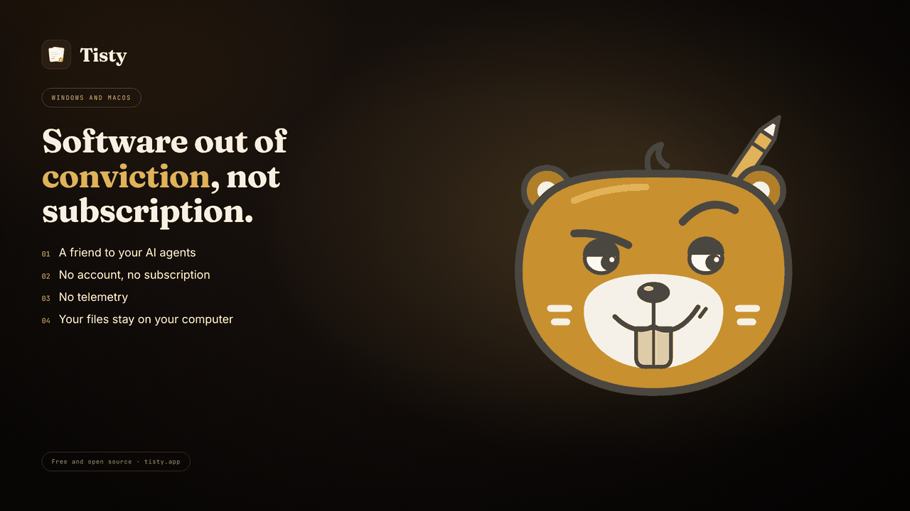

# Privacy

Tisty collects nothing and keeps nothing of yours on a server. The one exception is yours to make: a document you share by link goes, sealed, to [Folio](https://github.com/rgdevment/Folio-by-Tisty), a separate service. No account, no telemetry, no analytics, no crash reports. That is not a promise you have to take on trust — it is a property of the code, which is [public](https://github.com/rgdevment/Tisty). Run a network monitor against it if you like.

This page is a summary. The full policy, including the parts that are not reassuring, is [PRIVACY.md](https://github.com/rgdevment/Tisty/blob/main/PRIVACY.md), and the security reasoning is in [SECURITY.md](https://github.com/rgdevment/Tisty/blob/main/SECURITY.md).

## What is stored

Almost everything lives in one folder on your disk:

- **Tasks and events** — plain-text JSONL, an append-only log. Readable with `cat`, searchable with `grep`, parseable with `jq`.
- **Documents** — plain Markdown files.
- **Agents, if you use it** — your agents' rules, skills and memory, as documents. If you sync it, Tisty also writes, outside this folder, the files each agent reads ([what it reads and when](#your-agents-in-the-agents-folder)).
- **Earlier versions of your documents** — Markdown like the documents, in the `history` folder. Each is kept 30 days from when it was replaced, or what you choose in **Settings › Documents and signature › Keep earlier versions for**; the latest of each document, and what **Put back what it said before** would bring back, never run out. They stay on this computer: never synced or put in a parcel, but carried by your backups. [How they work](Documents#earlier-versions).
- **Words a save refused** — if a document got locked or too long while you were writing, or a table's change came after you left its page or while that same place was changing, Tisty keeps what it could not save in the window's own storage on this computer, until you put it back, discard it or delete the document in this window. It is never synced, backed up, put in a parcel or shared by link.
- **Your diary** — Markdown like any document, a book a year. No agent sees it until you open it from the Diary itself, on Tisty 1.48 or later; it is never shared by link, and it travels with your sync and your backups like the rest, and inside a `.tistyx` parcel when you export everything.
- **Attachments** — the files themselves, unmodified.
- **Brainsty's base** — how your things are tied, the weighty words of each document and task and which things are alike, in this computer's cache. It rebuilds itself from what you keep, so it is not synced and does not go in a parcel, to Folio or to an export. It does not go in your backups either. Hidden and dropped tasks, your diary and the documents in Agents leave no words there, and of the rest only the prose counts: not code, not paths, not a task's progress notes. [How it works](Brainsty-Network#alike).
- **An agent's note on a document**, the one it leaves with `sum_up` for the next reader: one more event in the log, so it travels to your other computers with sync, to your cloud and to your backups. It never leaves through Folio or in a `.tistyx`, and the window does not show it. [What each tool does](MCP-Tools#documents).
- **Local settings** — including this machine's identifier and signing key. The private half of the key never leaves the machine.
- **Your phrase, if you make one** — the 24 words that encrypt your cloud, kept on the computer where you made them, in the system keychain on macOS or a file sealed for your user on Windows. Never synced, backed up or put in a parcel. Nobody from Tisty or Folio will ever ask you for it; anyone who does is trying to trick you.
- **What you share by link**: each link's key and the tokens that manage or edit it live in the log, so your other computers can manage it. They travel with your sync, so whoever can read an unencrypted copy can open those links. Once you stop sharing a document, the names of whoever edited it stay in the log too, so sharing it again can remind you who they were. How long Folio asked this computer to wait, and which documents it shared for the first time today, stay on this computer.
- **Reminders booked with the system** — the hour, the task's title and its identifier, for each reminder of the coming month, are handed to Windows or macOS so they ring with Tisty closed. They stay on this computer.
- **A `private/` folder** — anything placed there never leaves the machine, by any route.

Nothing is obfuscated, and nothing is in a format only Tisty can read.

**Nothing on your computer is encrypted at rest.** Your operating system's permissions are the protection. That is a decision, not an oversight: encryption would break the block-by-block merge of documents that syncing depends on. What Tisty keeps in a cloud it reaches directly is another matter: since 1.36 you can encrypt it with your phrase ([how it works](Sync-and-Backup#encrypting-your-cloud)). A folder kept in step by another program is never encrypted.

> [!WARNING]
> **An append-only log does not forget.** If a password ends up in a task, deleting the task removes it from what you see, not from the history underneath — and if it already reached the shared folder, it is on every machine that pulled it, plus your provider's version history. Keep secrets out, or in `private/`.
>
> A document does not forget at once either: a text you delete on purpose stays in its [earlier versions](Documents#earlier-versions), on each computer that held it when it was replaced. It leaves them once the version that holds it is past its limit and neither the latest nor what **Put back what it said before** would bring back, or when you empty its history or delete the document. Backups made in the meantime keep it: yours, and the last few Tisty writes on its own inside its private folder before a change, such as changing how you sync.

## Who can reach your data

| You choose | Who else can reach it |
| :-- | :-- |
| **Local only** (the default) | Nobody |
| **A folder your cloud client syncs** | That provider, under their terms |
| **Google Drive, connected from Tisty** | Google, under its terms. Tisty sees only its own hidden space there ([how it works](Sync-and-Backup#syncing-through-google-drive-directly)) |
| **OneDrive, connected from Tisty** | Microsoft, under its terms ([how it works](Sync-and-Backup#syncing-through-onedrive-directly)) |
| **Your own WebDAV server, connected from Tisty** | Whoever runs that server ([how it works](Sync-and-Backup#syncing-through-your-own-webdav-server)) |
| **Any of those three, encrypted with your phrase** | Nobody can read your files without your phrase or one of your computers. The provider still sees their names, sizes and how many computers you have, and may keep earlier unencrypted versions for a while |
| **A folder on your own hardware** (NAS, external drive) | Whoever can reach that hardware |
| **A document you share by link, through Folio** | Whoever has the link. Folio holds it sealed and cannot read it, but sees what [the full policy](https://github.com/rgdevment/Tisty/blob/main/PRIVACY.md#sharing-by-link) lists |
| **A backup zip** | Wherever you put it |
| **A `.tistyx` parcel you hand to someone** | Them, and whoever they hand it to |
| **A `.tistyx` locked with six digits** | Whoever has both the file and the number |
| **An agent you let in** | Whatever service that agent talks to |
| **What you keep in Agents** | The same as your other documents and, if you sync it, also each agent that reads those files and whatever service it talks to, even if you never let it in |
| **A task you save to your calendar** | Google or Microsoft, under their terms; with Apple Calendar, the Calendar app on your Mac and whatever it syncs with |

## The network requests Tisty makes

**On its own:** when it opens and once a day after that, it downloads a small file to see whether a newer version exists. It sends nothing — no identifier, no task, no name. A Microsoft Store copy asks Windows what the Store has, and reads the Store's public catalog to see which version that is: when it opens, every six hours, and when you ask. It downloads that same file only if the catalog does not answer. While you sync with Google Drive, OneDrive or a WebDAV server, it also reads, at most once an hour, a small signed file on GitHub that can pause syncing or lower its limits; it carries nothing of yours. And when you open a document you shared that holds a language you kept from someone else, it asks Folio whether that language changed, at most every quarter of an hour.

**Only when you ask:**

- **Update** in **Settings › Help and about** downloads the release file and the installer, and Tisty refuses anything not signed with the key built into your copy.
- **Bring the preview** on a [link card](https://markdown.tisty.app/links) asks that page once for its title and picture.
- **The help** inside Tisty (the `?` at the foot of the sidebar) comes with your version and asks nothing. Its **Tisty's Markdown** guide (also `F1` while you write) reads it from [markdown.tisty.app](https://markdown.tisty.app), so it is always the latest; offline, it shows the copy that came with your version. Its pictures are downloaded from GitHub only when you press **Download** above the help.
- **Show them**, on the line above a Markdown file opened from outside, asks each address the file names for its picture, one request per picture. Nothing is fetched until you press it, it asks again each time you open the file, and it refuses an address on this computer or your own network. This is the viewer's alone: a document in your store draws no picture from the internet.
- **Opening a link**, with `Ctrl`/`⌘` + click while you write or a click while you read, opens your browser.
- **Save to my calendar**, on a task, opens Google Calendar's or Outlook's page in your browser with the title, the day and the hour, and the task's link in the address, and the event lands in your calendar only if you press **Save** there. Tisty does not make that request: your browser does, and the address stays in its history. With Apple Calendar, Tisty leaves a `.ics` file in its cache and the Calendar app opens it. The task's description and notes never go.
- **Share**, on a document, reads a small signed file on GitHub to learn whether [Folio](https://github.com/rgdevment/Folio-by-Tisty) is open. What you then confirm goes to Folio, encrypted on this computer, and so do Sync, Pause, Stop sharing and opening a shared link. Nothing is asked until you press.
- **Google Drive**, **OneDrive** or **your WebDAV server**, once you connect it from the window, is where Tisty sends and fetches your copies. Agents never touch the network.
- **Checking a WebDAV server** — only when you connect it: Tisty signs in with what you typed and looks at its own folder there, and nothing else. Only `https://` is accepted, except to this very computer, and the password never travels to any other address.
- **Checking the way to OneDrive** works the same as the check for Google Drive below, with one request to `graph.microsoft.com` that carries nothing of yours.
- **Checking the way to Google Drive** — only while you connect Google Drive or move to it, Tisty sends one request to Google's API host, `www.googleapis.com`, with no account, no token and nothing of yours in it. It waits at most 10 seconds and goes through your system's proxy, never around it. It only lets Tisty tell you whether a proxy, a filter at work or an antivirus is in the way, or Google itself is having trouble. It never runs while syncing. When a round of syncing cannot reach Google, Tisty reads the failure the same way, sending nothing more, and keeps on this computer only a word for what stood in the way, how many rounds in a row failed and since when, to warn you once it lasts. A connection cut halfway through a transfer leaves no word at all.

A [widget](Widgets) runs nothing and names nothing outside itself. An attached `.html` file is only a file: Tisty never runs it.

## Your identity when you share

**What it is.** A pair of keys Tisty makes on this computer. One is secret and never leaves your computers; the other is public and only serves to check your signature.

**What it is for.** Tisty signs each document you share with it. Whoever opens it sees a fingerprint, a row of numbers that is always the same for you: that is how they know two documents come from the same person and that nobody altered them. You can sign with an alias; it does not have to be your name.

**What Folio sees.** Your document is encrypted on this computer before it leaves. The key that opens it travels inside the link, after the #, and that part never reaches Folio, so Folio cannot read the title or what you wrote. It sees your public key, to tell that two documents come from the same person, and never your name or your email.

**Your 24-word phrase.** It is your identity's backup: with it, your other computers sign as you. Keep it outside Tisty, on paper or in a PDF apart. If you lose the phrase and all your computers, the identity cannot be recovered. Nobody from Tisty or Folio will ever ask you for it.

**If you lose a computer.** Remove it in **Settings › Security**, under **Your computers**, with **Remove**. Its key stops counting, and Folio tells whoever reads what it signed after that.

## Your agents in the Agents folder

In the **Agents** folder you keep your agents' rules, skills and memory as documents (Claude Code, Codex, GitHub Copilot, Gemini CLI and Cursor). With **Bring** you only copy them into Tisty; with **Sync**, Tisty also writes underneath the files each one reads. How to use it, file by file and agent by agent, is in [[Agents|AGENTS-Folder]].

**What it reads, and when**

- **Agents in grey in the sidebar, and its card in Settings › Agents › Agents folder** before anything is brought, only check whether each agent's folder exists, such as `~/.claude` or `~/.codex`, to tell you which ones it found. They look at nothing inside.
- **When you click Agents and the first-time notice opens**, Tisty only looks at which files are in your agents' folders, with their names and sizes, to show you the list. It opens none of them, and those starting with a dot it does not even list. Closing the notice with the X or `Esc` reads nothing more.
- **When you go into Agents, also on a computer that has not given permission yet**, for example one where Agents came in brought from another computer, Tisty makes that same list, to know whether there is anything to ask you: names and sizes only, opening no file. **Look again** on that computer makes the same list to show you the first-time notice, and opens nothing before your **Bring** or your **Bring and sync** either.
- **With Bring or Bring and sync**, it opens only the files you ticked in that list and brings them in as documents. That permission is this computer's: each of your computers asks for its own.
- **With Bring, Tisty does not write to your agents' files**, nor note any as written by it: they stay as they are until you choose Sync. To show you what there is to bring, as in **Bring another file** or **Look again**, it looks again at which files are there, with their names and sizes. Making in Agents the subfolder of each agent it finds touches no file either.
- **After that**, it opens only the files that belong to a document in Agents, to see whether they changed outside and, if it syncs, to write them; and, while it syncs, those it wrote for one that is gone, also the ones you chose to leave, to see whether they changed. A **Global** document is written to every agent Tisty finds on this computer, even one whose files you did not tick. A document that comes from another of your computers is not written until you press **Apply here** on this one, and only words you wrote or approved reach a file. A change made outside is never written over: it stays marked until you decide. In `GEMINI.md` it only adds one line, `@tisty-rules.md`; the rest of that file is Gemini's.
- **The memory an agent writes itself** is brought in and shown, but Tisty never writes over it.

**What Agents never brings in**

- `settings.json` and your agents' other settings files (`config.toml`, `hooks.json`, `mcp.json`…), except one a skill carries in its own folder, and no credentials file (`.credentials.json`, `auth.json`, `.env`, `.pem`, `.key` or `id_rsa` keys…). It skips them by name and never brings them in. For Agents and the skills, only Claude Code's `settings.json` is opened, with your yes to Agents or to Tisty's skills, to see whether the Tisty plugin is turned off, and nothing of it is kept. Connecting an agent and adding its hooks is something else, with a reading of its own, and [The agents you connect](#the-agents-you-connect) tells it. And a document in Agents is only written where each agent keeps its rules, skills and memory, never to its settings or credentials files.
- A file that looks like it holds a token, a password or a private key is checked on this computer and left out, with a notice. The check looks for known shapes and may not recognise them all: keep secrets out of your agents' rules.
- Nor does it follow symbolic links or bring in files over 512 kB.

**What travels and what stays**

- **Your documents in Agents travel like the rest**: with your sync, your cloud (encrypted, if you encrypted it), your backups and a `.tistyx` parcel that carries everything. An agent you let in through MCP reads them like any document, but does not change them, move them or make one, nor put an `agent:` line on any document of yours: it can only propose a change, which waits apart until you approve it on the card ([how](AGENTS-Folder#a-proposal-from-your-agent)). The proposal travels with your documents, and nothing of it reaches your agents before your approval.
- **While syncing, what you write in Agents reaches your agents**: each one reads its file and sends it to the service it works with, even if you never connect it to Tisty. Whether it syncs belongs to each computer, and does not travel.
- **Stays on this computer**, in `data/agents/` inside Tisty's folder: this computer's yes to Agents and its yes to Tisty's skills, whether it syncs, which agents you paused, which documents you applied or left out on this computer, a fingerprint of each file it wrote, which of those files you left with your agents when you deleted what wrote them, and the backups. None of that travels with sync, backups or parcels.
- **Before writing over** one of your agents' files, Tisty keeps the version that was there. Of each file it holds the original, backup #1, which is never deleted, and on top of it the last 20, and it leaves no copies in your agents' folders.

**Stopping sync without losing anything**

With **Bring and sync** or **Sync**, sync stays on for this computer, and you can pause it for one agent or stop syncing the whole folder, with **Stop syncing** on its right-click or in Settings › Agents › Agents folder: no agent file is touched and no document is deleted. Not synced or hidden from the sidebar, Agents writes none of your agents' files. Paused, Tisty neither opens nor writes those files on its own: they stay as the last write left them, and your documents stay in Tisty. A pause belongs to this computer. Deleting a rule or skill from Agents asks once, right then, whether to take it away from the agents Tisty wrote it for: **Take away too** deletes each file after a backup, and **Only from Tisty** leaves them and notes them on this computer, listed with **Review** in Settings › Agents › Agents folder. A copy changed outside, or one a paused agent reads, stays and is asked about apart; a file other rules still make up is written again without this one, after a backup. When a rule leaves Agents any other way, or is deleted on another computer, Tisty asks here before deleting its file. Short of those answers Tisty never empties or deletes an agent's file, apart from its own skills' copies, below.

**Your agents' hooks**

- Agents never touches your agents' settings files. Hooks do, and only when you ask: in **Settings › Agents › Connected**, turning **Tisty's hooks** on tells you which file it will write and, with your yes, puts Tisty's hooks there, leaving the rest of that file as it is; **Fix** changes which Tisty they call, and turning them off takes them out. When they are read is in [The agents you connect](#the-agents-you-connect).
- **Tisty's hooks.** Tisty comes with hooks you can turn on and off whenever you like and in the agent you choose. Each one helps your agents in its own way, like reminding them to finish tasks, update documents or leave in Tisty what someone else will read. For that they look, on your computer, at what the agent does and where; they do not read the conversation or keep what it does, and they only leave marks, which are deleted once seven days have passed, when a session starts. What they hand the agent, such as the titles of your open tasks, goes where that agent goes.

**Tisty's own skills**

Tisty ships three skills, `tisty`, `consolidate` and `writing-for-the-next-agent`, that live inside the app, not in your store: they never sync, never go into a backup, a parcel or your cloud, and no agent can name or change them through the MCP. Only the bytes of the installed release are written, checked against a fingerprint built into the app. How they are used is in [[Hooks and skills|Hooks-and-Skills]].

- **They have their own yes, on this computer.** **Turn on here**, on their card in **Settings › Agents › Connected**, is that yes, and so is **Yes, connect** with their tick on, which says the same before you press it, **Turn on skills**, or **Add hooks and turn on skills**, in the **Hooks and skills for your agents** box, which says the same before you press it. It needs no Agents folder, and a record copied from another computer does not count.
- **Before that yes, and with no yes to Agents either, their card opens nothing** inside your agents' folders: it looks only at which agents' folders exist and whether the copies Tisty wrote before are still there. With the yes to Agents alone, it reads the plugin's records, named below, and any copy Tisty wrote before, to tell whether it changed.
- **With it, Tisty reads and writes only this:** one folder per skill in each agent's skills folder on this computer (such as `~/.claude/skills/tisty`, `~/.cursor/skills/tisty` and the shared `~/.agents/skills/tisty`); the other files already in those folders, to leave alone any skill that is not Tisty's; and, for Claude Code, `plugins/installed_plugins.json` and `settings.json`, only to tell whether the Tisty plugin already brings them. Nothing else in those files is kept, copied or shown, and no rule, memory or other file of your agents is opened.
- **Pausing Agents does not reach them.** A pause, for one agent or for the whole folder, holds only your own documents; the skills follow their own switch.
- **They never write over your files.** A skill folder holding a file Tisty did not write, or a copy you changed, is left as it is. The one exception: a folder holding exactly the files of this release, byte for byte and nothing else, counts as Tisty's copy, so it updates and goes when you turn them off. They update by themselves when you open a newer Tisty.
- **Turning them off** takes out of your agents' folders only the copies still as Tisty wrote them, after a backup kept in `data/agents/`; the skills stay in Tisty, ready to turn on again, and are never deleted. A copy you changed is left for you to take away from the same card. No file is ever taken away on its own or through the MCP.

## The agents you connect

**Settings › Agents › Connected** writes Tisty into your agents' settings, and its hooks if you ask for them. For that Tisty reads settings files of your agents, on this computer and sending nothing. Which ones, when and what for:

- **When Tisty's window opens and when Settings opens, with the door open**, it reads, of each agent it finds on this computer, the file where it connects, such as `~/.claude.json`, `~/.codex/config.toml`, `~/.copilot/mcp-config.json` or `~/.cursor/mcp.json`, and the one with the hooks in those that have them: `~/.claude/settings.json`, `~/.cursor/hooks.json`, `~/.gemini/settings.json` and `~/.copilot/hooks/tisty.json`. It looks only for its own entry and its own hooks, and at whether the program they name is there and is this Tisty. **It writes nothing in them until you click.** It never reads a WSL distro's this way: those, only when you press **Look in…** or, once you looked in it, the **Connected** tab.
- **With the door closed**, that reading does not happen. The ones that were already there do: **Settings › Agents** reads the same files each time you open it, to show you how each one stands, and, until you answer the offer to connect your agents, Tisty looks at them when it opens and when you come back to its window, with the door open or closed, to know whether to offer it.
- **With your yes to Agents or to Tisty's skills**, it also reads Claude Code's plugin records, the ones below, when the app opens, when something changes in your data while it is open and when it shows its skills, even turned off, to tell whether the plugin already brings the skills. For hooks, it uses them only in **Settings › Agents** or when you press the button. It keeps nothing of them.
- **When you add or fix Claude Code's hooks**, even if you gave neither of those two yeses, and without them only then, that is, when you press **Yes, connect** with its hooks, **Add them**, **Add hooks**, **Fix**, **Fix all** or **Yes, fix** and that writes them, or removes them because the Tisty plugin already brings them, it first reads `plugins/installed_plugins.json` in its folder (`~/.claude`, or the one `CLAUDE_CONFIG_DIR` says; in WSL, that distro's) and, only if the Tisty plugin is there, looks at `settings.json` to know whether it is turned off. That way it does not write hooks the plugin already brings, nor remove the ones it no longer does. If it brings them it writes none, if they cannot be read it neither writes nor removes, and either way it tells you. Nothing of those two files is kept this way; that the plugin brings them is remembered in memory until the window closes, or until it sees that it no longer does.
- **When you press Connect, Add, Fix or Remove**, it reads the file again and changes only its own entry or its own hooks. If it changed since it was shown to you for fixing, could not be read or Tisty would not know how to change it without spoiling it, it does not write.
- **What stays.** Beside each file it changes, two copies: the first it ever saw, ending in `.before-tisty`, and the one from just before, ending in `.before-tisty-last`. And in the window's own storage, on this computer: which agents were already offered to you and, if you press **Not now** on a notice, which agent it was and the path it pointed at, so as not to repeat it, until it finds Tisty again. None of that is synced or goes in a backup, a parcel or a link.

## No AI

Tisty does not use AI or machine learning on your data, and sends nothing to any model. The natural language is deterministic rules on your machine.

The same holds for what [Brainsty](Brainsty-Network#alike) thinks is alike. When it ties «Pagar la cuenta del agua» to «Pay the water bill», it understands and translates nothing: it looks each word up in a fixed list of Spanish–English pairs, *pagar ≈ pay*, *agua ≈ water*, and counts the ones that match. That list comes from the [Open Multilingual Wordnet 2.0](https://github.com/omwn/omw-data), made by linguists, comes inside the installer and never leaves your computer or is looked up online. It learns nothing from what you write: it is the same for everyone and changes only with a new version of Tisty. Its authors and its licence are under **Settings › Help and about › Third-party notices**.

If you connect an agent of your own through [[MCP|Agents-and-MCP]], whatever it reads goes wherever that agent goes. That door comes open on a new install, and **Stop it**, in Settings › Agents › Door, closes it.
