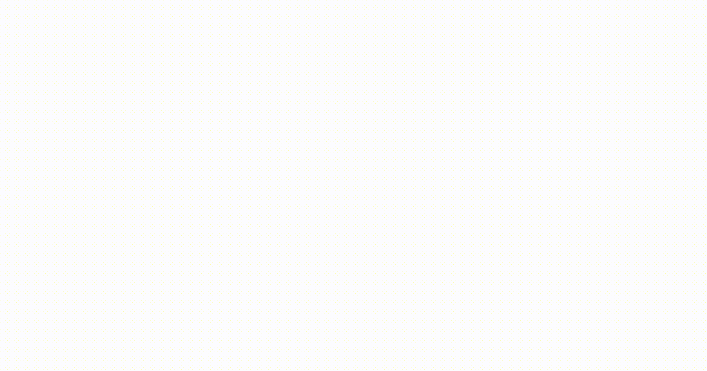

# La red de Brainsty

Llevaba años guardando cosas en Tisty y no tenía forma de verlas juntas. Sabía que «Rina» citaba la tarea de su vacuna y que el acta del condominio había creado tres tareas, pero cada relación vivía dentro de su archivo. Brainsty dibuja todo lo que guardas, con lo que lo une, como una sola red: de lejos, un mapa de tus proyectos; de cerca, cada documento y cada tarea con sus vecinos.

Esta página cuenta cómo abrirla, qué significa cada forma y cada línea, cómo moverte por ella y cómo filtrarla. Las uniones que dibuja las haces tú al escribir: [[Enlazar documentos|Enlazar-documentos]] y [[Tareas en documentos|Tareas-en-documentos]]. Tu agente lee la misma red como un índice: [[Cómo trabaja un agente|Cómo-trabaja-un-agente]].

## Cuándo te sirve

- **Volver a un proyecto después de semanas.** Abres la red, buscas el proyecto y ves de un vistazo sus documentos, sus tareas abiertas y las que ya cerraste.
- **Encontrar lo que quedó suelto.** Un documento sin líneas es uno que nada nombra: quizás le falta un enlace, o ya no sirve.
- **Ver qué toca una etiqueta.** Filtra por `#rina` y quedan sus vacunas, sus paseos, el veterinario y las tareas de este mes.
- **Ver lo último que tocaste.** El filtro **Tocado** con **Últimos 7 días** deja solo lo que se movió esta semana.

## Abrirla y cerrarla

- **Brainsty**, en la barra lateral bajo las vistas de tareas, abre la red sobre toda la ventana. Con la barra plegada, es el icono de la red en el riel.
- Arranca centrada en el documento o la tarea en que estabas; si no estabas en ninguno, en lo último que escribiste.
- La primera vez los nodos se acomodan unos segundos, como si se soltaran; la ventana sigue respondiendo mientras tanto, y el acomodo se detiene solo en unos cuatro segundos.
- Arriba, la cuenta: «589 nodos · 1252 conexiones».
- `Esc` o **Volver** la cierran, y la ventana queda exactamente como estaba: la misma vista, la misma tarea abierta, el mismo lugar del documento.

## Qué es cada cosa

| En la red | Es | Cómo se ve |
| :-- | :-- | :-- |
| Cuadrado | un documento o una página de un libro | del color de su carpeta; una página, más pequeña junto a su documento |
| Círculo | una tarea | del color de su lista; en curso, viva; terminada, más tenue; descartada o archivada, tenue y pequeña |
| Punto morado | una etiqueta | unido a todo lo que la lleva |
| Punto gris | una imagen o un archivo | unido a lo que lo usa; de cerca, con su miniatura |

Las listas y las carpetas no son nodos: son el color y la zona donde se juntan sus cosas. Si fueran nodos, todo quedaría unido a «Casa» o a la bandeja y la red no diría nada.

| Línea | Une | Cuándo existe |
| :-- | :-- | :-- |
| Sólida | una cita | una tarjeta de otro documento o de una tarea, sola en su párrafo |
| Punteada | una mención | un enlace dentro de una frase a otro documento o a una tarea |
| Fina | la estructura | una página y su libro, una parte y su tarea, una tarea y el documento donde nació, una idea y su documento |
| Fina y tenue | una etiqueta | lo que lleva `#etiqueta` y su punto |
| Fina, hacia un archivo | un uso | lo que muestra una imagen o adjunta un archivo |

Brainsty une solo lo que está escrito, y cada línea se puede explicar: nunca adivina relaciones por parecido.

## De lejos y de cerca

La red cambia lo que muestra según la distancia, y cada detalle aparece de a poco al acercarte:

- **De lejos**, con la rueda hacia atrás: los nodos y sus uniones forman la silueta de un cerebro visto de lado, sin títulos y con líneas tenues. Sirve para ver dónde hay mucho y dónde hay poco.
- **A media distancia**, como se abre: cada carpeta y cada lista tiñen su zona, y llevan título solo los nodos más conectados.
- **De cerca**: todos los títulos, cada tipo de línea, las etiquetas como `#etiqueta` y, junto a cada imagen, su miniatura.

Con la rueda acercas y alejas; arrastrando te mueves. Al primer toque la red deja de seguir el punto donde arrancó.

## Elegir, ver y abrir

- **Un clic en un nodo** lo resalta junto con sus vecinos, atenúa el resto y abre su vista previa: las primeras palabras de un documento, o la tarjeta de una tarea con sus pasos, la misma que dibuja un documento que la cita.
- **Abrir**, en la vista previa, o **un doble clic** en el nodo, lo abren: un documento en la Biblioteca, una tarea junto a su lista, una etiqueta en su vista. La red se cierra y te deja ahí.
- **Cerrar la vista previa**, o `Esc`, suelta el nodo y la red vuelve a verse entera.

## Buscar

El buscador está arriba a la izquierda, **Buscar en la red**; `/` lo enfoca desde cualquier parte de la red. Escribe parte de un título: no importan los acentos ni las mayúsculas. Debajo aparece la lista de lo que calza, cada uno con lo que es («Documento», «Tarea», «Etiqueta»…): primero lo que empieza igual, después lo que tiene una palabra que empieza así y al final lo demás. `Enter` elige el primero, o un clic el que quieras: la red se centra en él y abre su vista previa. Si nada se llama así, dice «Nada con ese nombre».

## Filtrar

El embudo junto al buscador, **Filtros**, abre lo que se puede dejar fuera. Cada opción es un botón que se enciende y se apaga, y la red se redibuja con lo que queda:

- **Mostrar**: **Documentos**, **Páginas**, **Tareas**, **Etiquetas** y **Archivos**.
- El estado de las tareas: **En curso**, **Terminadas** y **Archivadas**.
- **Tocado**: **Cuando sea**, **Últimos 7 días**, **Últimos 30 días** o **Último año**, según el último día en que cambió cada cosa.
- **Etiqueta**: elige una de la lista y deja solo lo que la lleva; **Cualquier etiqueta** la quita.

Con algún filtro puesto, el embudo se tiñe y aparece **Mostrar todo**, que devuelve la red entera.

## Con el teclado

| Tecla | Qué hace |
| :-- | :-- |
| Flechas | elegir un nodo y caminar: primero a un vecino en esa dirección, si no, al más cercano |
| `Enter` | abrir el nodo elegido |
| `/` | buscar |
| `Esc` | soltar por capas: primero la búsqueda, después el nodo y al final la red |

Mientras la red está abierta, los atajos de la ventana no actúan sobre lo que queda debajo.

## Un ejemplo: volver a lo de Rina

Hace un mes que no tocas nada de Rina y quieres saber cómo va.

1. **Brainsty** en la barra lateral. La red se abre en lo último que escribiste, el acta del condominio.
2. `/`, `rina`, `Enter`. La red se centra en «Rina», la ficha de la carpeta **Mascotas**, y su vista previa muestra sus primeras líneas.
3. Te acercas con la rueda: aparecen sus vecinos con título, «Veterinaria» unida por una línea punteada (la mencionas en una frase), la tarjeta sólida de «Vacuna anual de Rina» y la foto del paseo con su miniatura.
4. Un clic en «Vacuna anual de Rina»: la vista previa muestra su tarjeta, «1 de 3 pasos», vence el viernes. **Abrir** te lleva a la tarea junto a su lista.
5. De vuelta en la red, **Filtros**, **Etiqueta** `rina` y **Tocado** **Últimos 30 días**: quedan sus dos documentos y las tareas en curso que se movieron este mes.
6. **Mostrar todo** y `Esc`: vuelves a la ventana tal como la dejaste.

## Lo que conviene saber

- **Se arma sola, en este equipo.** Tisty lee cómo se unen tus cosas en segundo plano, sin frenar lo que haces. Un enlace recién escrito llega a la red a los pocos segundos.
- **Recién instalado**, mientras lee todo por primera vez, la red dice «Brainsty todavía está leyendo lo que guardas. Vuelve a abrirlo en un momento.». Con nada guardado: «Todavía no hay nada que dibujar: escribe un documento o una tarea y aparecerá aquí.».
- **Hasta 12.000 nodos y 40.000 conexiones.** Más allá, la red guarda lo último que tocaste, sus vecinos, tus documentos y las tareas en curso, y dice cuánto quedó fuera.
- **Lo oculto no aparece.** Una tarea que ocultaste no se dibuja, ni como nodo ni como punta de una línea, y una etiqueta o un archivo que solo ella llevaba se va con ella. Una tarea descartada sí aparece, tenue y pequeña.
- **Nada sale del equipo.** La red se calcula en cada equipo y se rehace sola: no se sincroniza, ni va a Folio, a un `.tistyx` o a una exportación. Lo que viaja son tus documentos y tareas, y cada equipo vuelve a dibujarla.
- **El tema y el idioma** de la ventana valen también aquí: en oscuro, la red toma los colores oscuros.
- **Sin tarjeta gráfica dedicada** la red se dibuja igual; acercarse y alejarse cuesta un poco más.

## Para seguir

- [[Enlazar documentos|Enlazar-documentos]]: las líneas punteadas y sólidas entre documentos.
- [[Tareas en documentos|Tareas-en-documentos]]: las líneas entre un documento y sus tareas.
- [[Cómo trabaja un agente|Cómo-trabaja-un-agente]]: la misma red, leída por tu agente.
- [[Documentos]]: carpetas y etiquetas, que dan los colores y las zonas.
