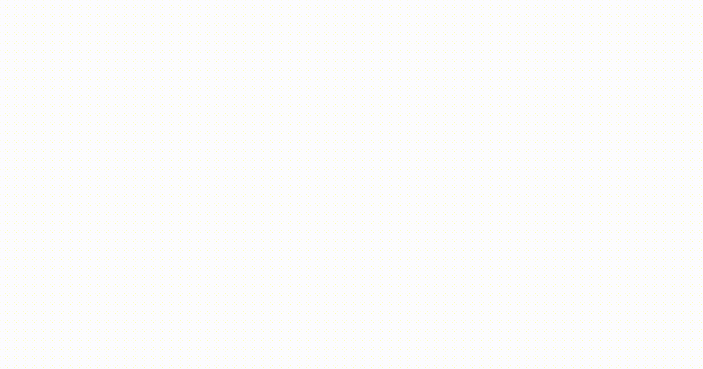

# Tareas en documentos

Lo que sé de un tema vive en su documento; el trabajo que hice sobre ese tema, en sus tareas. Durante mucho tiempo esos dos mundos no se tocaban: abría «Auto» para ver cuándo cambié los neumáticos y la respuesta estaba en una tarea cerrada que tenía que ir a buscar aparte. Ahora el documento cita la tarea, y la tarea recuerda el documento donde nació.

Esta página cuenta tres cosas: citar una tarea en un documento como una tarjeta que se mantiene al día sola, crear una tarea nueva sin salir del documento que estás escribiendo, y volver desde la tarea al lugar donde nació. Enlazar un documento con otro está en [[Enlazar documentos|Enlazar-documentos]].

## Cuándo te sirve

- **El historial de una cosa.** «Auto» cita «Cambiar los neumáticos», cerrada en marzo, y «Renovar el seguro», abierta: el documento cuenta qué se hizo y qué falta.
- **Un plan que se cumple.** Un documento «Viaje al sur» con una sección por día, y en cada una la tarea que la hace realidad: «Reservar el alojamiento en Puerto Varas», «Arrendar el auto».
- **Las actas de una reunión.** En el acta del condominio aparece «hay que pedir presupuesto para la reja»: lo anotas como tarea ahí mismo, y la tarea queda citada en el acta.
- **Una tarea grande con su documento.** El documento de diseño cita cada parte de la tarea, así lees en un solo lugar cómo va.

## Citar una tarea que ya existe

1. En un documento, en una línea vacía, escribe `/`.
2. Elige **Una tarea** y sigue con unas palabras de su título: `neumáticos`. Tisty busca entre las abiertas y las archivadas.
3. `Enter` deja la tarjeta sola en su párrafo. En Markdown queda como ``.

La tarjeta lee la tarea cada vez que se dibuja, así que nunca se queda vieja:

| Si la tarea… | La tarjeta muestra |
| :-- | :-- |
| está abierta | su título, su lista y sus fechas («Auto · hoy · vence mié, 25 nov 18:30»), el círculo para marcarla y «2 de 5 pasos» |
| tiene partes | cuántas están cerradas: «1 de 3 partes» |
| se completó | «Hecha» y «cerrada el 14 de marzo de 2026» |
| se descartó con **No lo haré** | «No se hará» |
| se borró, o todavía no llega a este equipo | las palabras con que la citaste y «Esa tarea no está en esta máquina» |

## Trabajar desde la tarjeta

- **Un clic la abre**, también si está archivada.
- **El círculo la marca hecha** mientras sigue abierta. Una rutina con días sin hacer se abre en su lista, donde eliges qué días hiciste.
- **El contador de pasos los despliega**: marca uno ahí mismo y en la página de la tarea aparece marcado. Los pasos siguen desplegados aunque la tarjeta se vuelva a dibujar.
- **Una tarea cerrada se lee, pero no cambia** desde el documento: ni se reabre ni se desmarca un paso. Eso se hace en su página.

## Crear una tarea sin salir del documento

1. En el documento, donde va la tarea, escribe `/` y elige **Una tarea nueva**. Va primero en el menú, así que `/tarea` y `Enter` la abren.
2. Se abre el mismo campo de la captura rápida, en ese lugar. Escribe la tarea como la dirías: `Pedir presupuesto de la reja el lunes #condominio !planificar @Casa`. Las marcas se pintan mientras escribes, y `/` dentro del campo ofrece lo mismo que en la captura: una fecha, una lista, una prioridad.
3. `Enter` crea la tarea, con su fecha, su lista, sus etiquetas y su prioridad, y deja su tarjeta en ese lugar del documento.

- **`Esc` la deja ir** sin crear nada. `Enter` en una línea vacía no crea nada: el campo dice «Hace falta un título» y sigue abierto.
- **Un segundo `Enter`** mientras se está creando no crea otra.
- **Deshacer** en el documento quita la tarjeta, pero no la tarea: borrarla sigue siendo decisión tuya.
- **Las reglas son las de siempre**: `@lista`, `#etiqueta`, `!prioridad`, fechas y repeticiones en palabras. Están en [[Lenguaje natural|Lenguaje-natural]].

## De dónde nació: Nació en

Una tarea creada desde un documento recuerda el documento y la sección donde la escribiste. Junto a su página, la fila **Nació en** los nombra, y un clic abre ese documento. Una tarea que salió de una idea de la Lluvia de ideas muestra lo mismo.

En la misma fila está **Enlazado desde**: los documentos y las tareas que citan o mencionan esta, con la sección donde lo hacen. Si son muchos, ves doce y **Ver las…** trae el resto. Lo cuenta [[Enlazar documentos|Enlazar-documentos#quién-lo-enlaza-enlazado-desde]].

## En la página de una tarea: una parte

La página de una tarea también es un documento. Ahí, **Una tarea nueva** no crea una tarea suelta: crea una **parte** de esa tarea, colgada de ella y en su misma lista, salvo que en la frase nombres otra con `@`. Su tarjeta queda donde la escribiste, igual que cuando conviertes un paso en parte con **↗**.

No se ofrece en la página de una parte (una parte no tiene partes) ni en la de una rutina. Cómo funcionan las partes está en [[Tareas|Tareas#pasos-y-partes]].

## Un ejemplo: el acta del condominio

Es martes y escribes el acta de la reunión del condominio, con Jaime y Yisset.

1. En la sección **Reja del estacionamiento** escribes lo que se habló. Llega el «hay que…»: `/tarea` y `Enter`.
2. Escribes `Pedir presupuesto de la reja el lunes #condominio !planificar` y `Enter`. Queda la tarjeta en el acta; en **Próximo** aparece la tarea para el lunes.
3. Más abajo, en **Jardines**, citas una tarea del año pasado: `/`, **Una tarea**, `poda`, y eliges «Contratar la poda de los árboles», archivada. Su tarjeta dice «cerrada el 12 de septiembre de 2026».
4. El lunes abres la tarea desde **Hoy**. Junto a su página, **Nació en** nombra el acta y la sección **Reja del estacionamiento**. Un clic y estás leyendo lo que se habló.
5. Cuando pides los tres presupuestos, marcas los pasos desde la tarjeta del acta, sin abrir la tarea, y el acta muestra «3 de 3 pasos».

## Lo que conviene saber

- **Fuera de Tisty queda solo la frase.** Folio, el PDF, Word, la página web y el Markdown estándar dejan de la tarjeta solo las palabras con que la citaste: nada de la tarea sale con el documento. El visor liviano, el que abre un `.md` sin traerlo, muestra la tarea como esas palabras y los documentos como tarjetas.
- **Lo oculto queda fuera de la red.** Una tarea que ocultaste no aparece en la red de Brainsty ni llega a tus agentes, aunque un documento la cite; en el documento, su tarjeta sigue ahí para ti.
- **Dos tareas de la misma sección** nacen las dos ahí, y las dos lo dicen en **Nació en**.
- **Una tarjeta en otro equipo** muestra la tarea en cuanto la tarea llega a ese equipo; antes dice que no está en esta máquina.
- **Tu agente también cita.** Cuando un agente escribe el id de una tarea solo en su párrafo, Tisty lo vuelve la tarjeta de esa tarea. Mira [[Cómo trabaja un agente|Cómo-trabaja-un-agente]].

## Para seguir

- [[Enlazar documentos|Enlazar-documentos]]: `[[`, secciones, vista previa y **Enlazado desde**.
- [[La red de Brainsty|Red-de-Brainsty]]: cada cita es una línea sólida entre el documento y la tarea.
- [[Tareas]]: la página de una tarea, sus pasos y sus partes.
- [Otros documentos y páginas en la guía de Markdown de Tisty ↗](https://markdown.tisty.app/es/otros-documentos-y-paginas)
