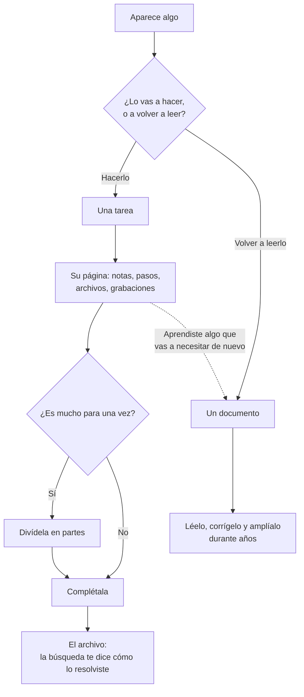

# Tareas

Una tarea en Tisty no es una línea que tachas. Es un pequeño árbol: su página, los pasos, las partes, los archivos y los documentos que crecieron a su alrededor mientras trabajabas. Terminarla no la poda: se va entera al [[archivo|El-archivo]].

## ¿Tarea o documento?

Tisty guarda dos tipos de cosas, y distinguirlas es buena parte de usarlo bien.

- **Una tarea es algo por hacer.** Termina, muchas veces pronto: la completas y pasa al archivo. Pero no desaparece. Lo que escribiste en su página, sus pasos y sus notas se quedan, y meses después una búsqueda la encuentra y te cuenta cómo lo resolviste. Una tarea es conocimiento con fecha.
- **Un documento es algo para guardar.** Un manual, una receta, las notas de un cliente o de una máquina, las actas de un año: se lee una y otra vez, se corrige y se amplía, y crece durante años. Rara vez termina.

Por eso una tarea tiene una página propia: una tarea también es un documento, uno que termina. Piensa en un **spike**, una investigación para saber cómo se puede hacer algo antes de hacerlo:

1. Empieza como una tarea, «Averiguar cómo sincronizar con OneDrive». En su página escribes lo que leíste, lo que probaste y lo que descartaste, sección por sección, y vuelves a corregirlo a medida que aprendes. Adjuntas lo que una descripción fija nunca podría contener: la grabación de la reunión, un video de la falla, el análisis del código, el PDF del proveedor.
2. Cuando el camino está claro, el trabajo se divide en **partes**: «Iniciar sesión», «Subir archivos grandes», «Retomar una subida cortada». Cada una es una tarea con sus propios pasos y notas.
3. Las partes se completan una a una, y después el spike. Pasa al archivo.
4. No se pierde nada. Un año después, «¿cómo resolvimos las subidas a OneDrive?» lo encuentra: su página, sus partes y cada paso, tal como quedaron.

Lo que vas a hacer es una tarea. Lo que vas a volver a consultar es un documento: una receta no es una tarea con pasos, y un pendiente no es un documento. Cuando hacer una tarea te enseña algo que vas a necesitar de nuevo más allá de ella —el arreglo de una falla que vuelve, cómo quiere un proveedor que le pidan— guárdalo también en un documento.

Lo que guarda una tarea cerrada, y cómo la encuentra el buscador, está en [[El archivo|El-archivo]].

## Captura: escribe como hablas

No hay formulario que rellenar. Escribe la frase entera en la barra de arriba y Tisty va separando el día, la lista y la prioridad mientras escribes, y te muestra lo que entendió **antes** de guardar nada, como etiquetas que corriges con un clic.

| Escribes | Entiende |
| :-- | :-- |
| `mañana 10am` | un día y una hora |
| `el viernes` | el próximo que venga |
| `cada martes` | algo que vuelve solo |
| `#casa` | una etiqueta: de qué va |
| `@trabajo` | una lista: dónde ocurre |
| `!planificar` | un cuadrante: hacer, planificar, delegar o prescindible |

Si una parte no se colorea, se queda en el título. Lo que Tisty no sabe leer lo deja tranquilo en vez de adivinar. La referencia completa está en [[Lenguaje natural|Lenguaje-natural]].

Prueba con:

- `Vacuna de Rina el 3 de octubre !hacer #salud`
- `Sacar a Rina cada mañana`
- `Revisar el informe el viernes @trabajo`

## Captura rápida desde cualquier parte

Presiona `Ctrl` + `Shift` + `Space` desde donde estés y se abre una ventanita para una tarea. `Enter` la guarda, `Esc` la cierra y sigues con lo tuyo. Si ese atajo ya lo usa otro programa, Tisty toma otro y te dice cuál en Configuración.

## Las vistas

- **Hoy**: lo que pide el día, lo más urgente primero: **Vencidas** (pasó su límite, en rojo), **Por vencer** (faltan tres días o menos para su límite), **Atrasadas** (pasó el día que planeaste, en ámbar), **Para hoy** y **En curso** (empezó y aún no llega a su límite), plegado para que un proyecto largo no llene la lista todos los días. Cada fila dice cuándo vence («vence en 3 días», «vence mañana») o, si está atrasada, desde cuándo.
- **Próximo**: lo que viene.
- **Se repiten**: lo que vuelve por su cuenta.
- **Todas**: todo lo abierto, sin filtro.

No hay premios por vaciar la lista.

La ventana tiene tres columnas como máximo: lo que estás mirando, la lista y la tarea que abriste. Cuando la ventana es lo bastante ancha, una columna te cuenta el día (lo vencido, lo atrasado, lo de hoy, lo que viene, los cuatro cuadrantes con sus cuentas, las listas y etiquetas en uso), contando todo tu almacén, y cada cifra es una entrada.

## Prioridades: la matriz de Eisenhower

Dos preguntas, cuatro casillas: si corre prisa y si importa.

| Cuadrante | Qué significa | Se escribe |
| :-- | :-- | :-- |
| **Hacer** | urgente e importante: hoy | `!hacer` |
| **Planificar** | importante, sin prisa: ponle fecha antes de que se vuelva urgente | `!planificar` (o `!decidir`) |
| **Delegar** | corre, pero no es tuyo | `!delegar` |
| **Prescindible** | ni corre ni importa; su botón «No haré ninguna» las descarta todas cuando estés seguro | `!prescindible` |

Arrastra una tarea a su cuadrante, o escríbelo. Cada cuadrante tiene un **+** que abre la captura rápida con ese cuadrante ya puesto. Lo que nadie ha clasificado espera en la bandeja de al lado, sin regañarte.

Los cuadrantes no son una escala, así que `!1` no significa nada y se queda en el título. `!urgente` solo tampoco es un cuadrante: sirve tanto para *hacer* como para *delegar*.

## Listas y etiquetas

Dos formas de ordenar que no compiten:

- Una **lista** dice dónde ocurre: `@casa`, `@trabajo`. Una tarea está en una sola.
- Una **etiqueta** dice de qué va: `#salud`, `#compras`. Una tarea lleva las que quieras.

Las etiquetas se comparten con los [[documentos|Documentos]]: la pantalla de Etiquetas muestra las tareas bajo una etiqueta y, debajo, los documentos.

## Lo que guarda una tarea

Una tarea se abre al lado de la lista, no encima: arriba sus fechas, lista, etiquetas y prioridad, y debajo **su página**, un documento en Markdown como cualquier otro. La página nace con secciones para llenar, cada una con una pista en gris que se va al escribir: **Descripción**, **Para estar lista**, **Pasos**, **Notas** y **Al cerrarla**. Puedes agregar, renombrar o quitar secciones; el trayecto cuenta cada cambio.

Debajo de la página se pliega el **Historial**: lo que la tarea traía escrito de antes y lo que un asistente anota en ella. Abierta a página completa, la tarea gana una columna con su propio trayecto: cuánto lleva abierta, cuánto está hecho y cada cambio por el que pasó.

Una **fecha límite** no es lo mismo que un plan: `antes de` y `hasta` abren una. Mira [Lenguaje natural](Lenguaje-natural#fecha-o-fecha-límite).

## Pasos y partes

Cada casilla que escribes en la página, `- [ ]`, es uno de sus pasos: se marca ahí mismo y el trayecto guarda cuándo nació y cuándo se marcó. Un paso es una línea; el registro guarda sus primeros cien caracteres.

Cuando un paso necesita más, pasa el mouse sobre su casilla abierta y aprieta **↗**: se vuelve una tarea propia, una **parte** de esta, y en su lugar queda su tarjeta con los pasos que lleva y su fecha. Un clic en la tarjeta la abre.

- Una tarea con partes muestra **▣ 3/7** donde contaría sus pasos, y sus partes se pliegan debajo. Las despliega en cualquier vista; las que esa vista deja fuera esperan plegadas bajo «3 más fuera de esta vista» hasta que las pidas.
- Una tarea con fecha, fecha límite y partes muestra una barra fina: cuánto de su plazo pasó, contra cuántas de sus partes están cerradas. Dice **Va al día**, **Va lenta** o **No llega**, y el tramo plegado **En curso** cuenta las que se están quedando atrás.
- En otras vistas, cada parte nombra a su tarea con **⌂**.
- Junto a la página, **Partes** recibe una nueva en su propia línea, y **Es parte de otra…** busca por nombre la tarea a la que pertenece. **Soltarla** la separa.
- El trayecto de las dos cuenta cuándo se sumó una parte y cuándo se soltó.
- Cerrar una tarea con partes abiertas te pide soltarlas en el mismo gesto, y deshacer las devuelve.

## Desde un calendario

Un archivo de calendario (`.ics` o `.ical`) trae sus citas y pendientes como tareas. Arrástralo a la ventana, fuera de un documento —mientras lo arrastras, la ventana te dice dónde soltarlo—, o ábrelo con Tisty. **Desde el calendario** muestra cada uno con cuándo, dónde, cómo se repite y su recordatorio, y crea como tareas los que elijas, en la lista que elijas.

- Respeta la zona horaria de cada evento, también las de Outlook, y las repeticiones simples; una serie que empezó hace tiempo entra en su próxima vez.
- Si el evento trae su propia alarma, esa es el recordatorio; si no, media hora antes de una cita con hora, o la víspera a las 18:00 de un día completo.
- Lo cancelado, lo ya hecho y lo que ya importaste se muestran, pero no se vuelven a crear.
- Para que un `.ics` se abra con Tisty con doble clic, elígelo tú: en Windows, clic derecho → Abrir con → Elegir otra aplicación → Tisty, con «Usar siempre»; en el Mac, Obtener información → Abrir con → Tisty → Cambiar todo.

## Rutinas

Una rutina tiene una sola página para todas sus vueltas, con **Para qué**, **Cada vuelta** y **Esta vez**. Las casillas de **Cada vuelta** se desmarcan solas al completar una vuelta, y la fecha avanza a la siguiente.

Lo que escribas en **Esta vez** es de la vuelta que corre. Al completarla se guarda en **Vueltas**, plegado bajo la página, con cuántos pasos marcaste y cuándo se cerró, y la sección queda en blanco para la próxima.

## Terminar y descartar

- `Ctrl`/`⌘` + `Enter` termina la tarea en que estás. Se va al [[archivo|El-archivo]] con todo lo que tiene.
- **Cerrar con resumen** te pide dos líneas de cómo salió antes de terminarla. Van primero en **Al cerrarla**; en una rutina, quedan con su vuelta.
- **Descartar** la aparta sin hacerla: también llega al archivo.
- Al cerrarla, su página se guarda con ella: se lee pero ya no se escribe, ni tú ni un asistente. Si la reabres, vuelve.

Las tareas que un asistente da por hechas esperan en **Por confirmar**: mira [[Qué puede hacer un asistente|Qué-puede-hacer-un-asistente]].

## Tisto

Tisto es el castor de Tisty, el del lápiz detrás de la oreja. Te acompaña en tres lugares:

- **Al escribir una tarea:** cuando llevas unos cuantos caracteres en la barra, se asoma sobre ella y mira lo que escribes.
- **En la captura rápida:** queda en una esquina de la ventanita.
- **Al terminar una tarea:** levanta el pulgar junto a **Hecha**. Solo con tareas principales que terminas tú: no con sus partes, no con las que se repiten y no con lo que cierra un asistente.

Nunca tapa nada y se va solo. Para trabajar sin él, apaga **Que Tisto se asome** en Configuración → General.
