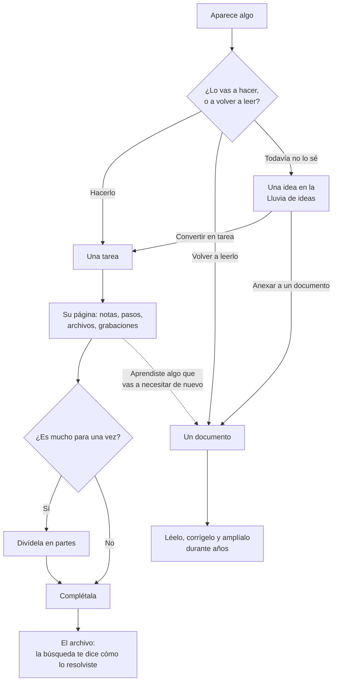
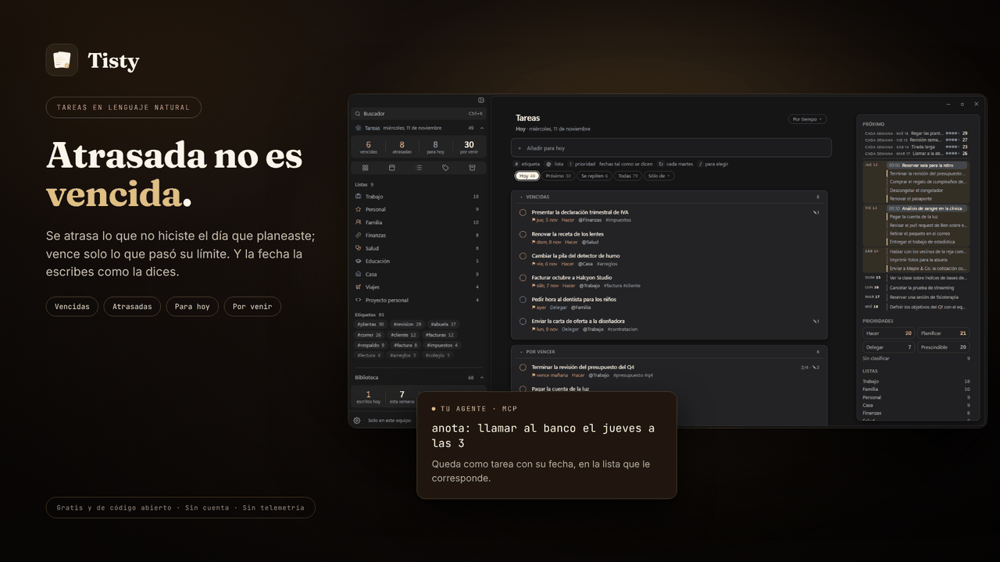
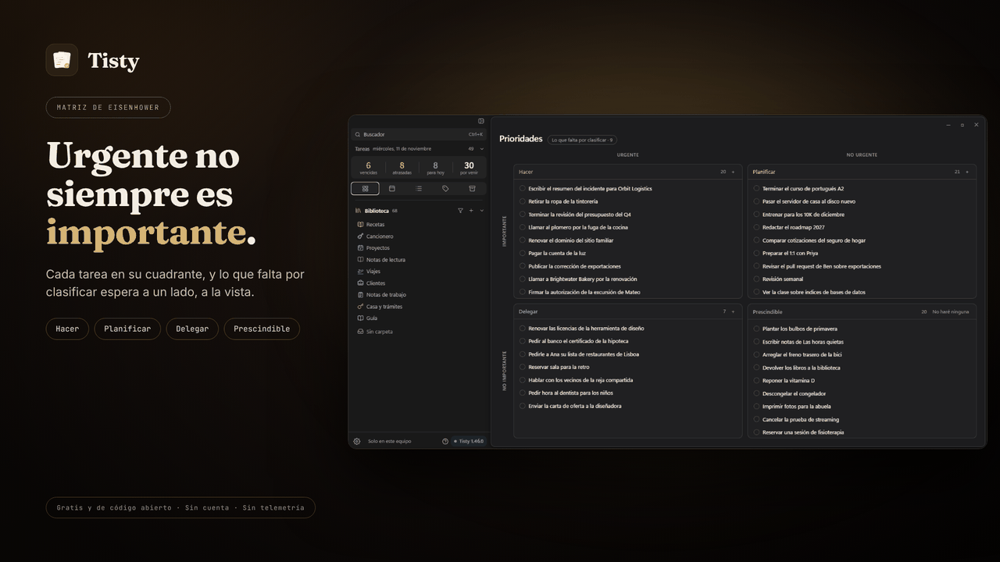

# Tareas

Una tarea en Tisty no es una línea que tachas. Es un pequeño árbol: su página, los pasos, las partes, los archivos y los documentos que crecieron a su alrededor mientras trabajabas. Terminarla no la poda: se va entera al [[archivo|El-archivo]].

## ¿Tarea o documento?

Tisty guarda dos tipos de cosas, y distinguirlas es buena parte de usarlo bien.

- **Una tarea es algo por hacer.** Termina, muchas veces pronto: la completas y pasa al archivo. Pero no desaparece. Lo que escribiste en su página, sus pasos y sus notas se quedan, y meses después una búsqueda la encuentra y te cuenta cómo lo resolviste. Una tarea es conocimiento con fecha.
- **Un documento es algo para guardar.** Un manual, una receta, las notas de un cliente o de una máquina, las actas de un año: se lee una y otra vez, se corrige y se amplía, y crece durante años. Rara vez termina.

Por eso una tarea tiene una página propia: una tarea también es un documento, uno que termina. Piensa en un **spike**, una investigación para saber cómo se puede hacer algo antes de hacerlo:

1. Empieza como una tarea, «Averiguar cómo sincronizar con OneDrive». En su página escribes lo que leíste, lo que probaste y lo que descartaste, sección por sección, y vuelves a corregirlo a medida que aprendes. Adjuntas lo que una descripción fija nunca podría contener: la grabación de la reunión, un video de la falla, el análisis del código, el PDF del proveedor.
2. Cuando el camino está claro, el trabajo se divide en **partes**: «Iniciar sesión», «Subir archivos grandes», «Retomar una subida cortada». Cada una es una tarea con sus propios pasos y notas.
3. Las partes se completan una a una, y después el spike. Pasa al archivo.
4. No se pierde nada. Un año después, «¿cómo resolvimos las subidas a OneDrive?» lo encuentra: su página, sus partes y cada paso, tal como quedaron.

Lo que vas a hacer es una tarea. Lo que vas a volver a consultar es un documento: una receta no es una tarea con pasos, y un pendiente no es un documento. Cuando hacer una tarea te enseña algo que vas a necesitar de nuevo más allá de ella —el arreglo de una falla que vuelve, cómo quiere un proveedor que le pidan— guárdalo también en un documento.

**Antes de las dos, muchas veces hay una idea.** Una idea es un pensamiento atrapado al vuelo, antes de saber si es algo que hacer o algo que guardar: pocas palabras, 140 como máximo, con fecha, en la hoja Lluvia de ideas. Espera a que la ordenes: se vuelve tarea, va al documento de su tema o se aparta. Una nota es otra cosa: la línea fechada en la bitácora de una tarea.

Lo que guarda una tarea cerrada, y cómo la encuentra el buscador, está en [[El archivo|El-archivo]].

## Captura: escribe como hablas

No hay formulario que rellenar. Escribe la frase entera en la barra de arriba y Tisty va separando el día, la lista y la prioridad mientras escribes, y te muestra lo que entendió **antes** de guardar nada, como etiquetas que corriges con un clic.

| Escribes | Entiende |
| :-- | :-- |
| `mañana 10am` | un día y una hora |
| `el viernes` | el próximo que venga |
| `cada martes` | algo que vuelve solo |
| `#casa` | una etiqueta: de qué va |
| `@trabajo` | una lista: dónde ocurre |
| `!planificar` | un cuadrante: hacer, planificar, delegar o prescindible |

Si una parte no se colorea, se queda en el título. Lo que Tisty no sabe leer lo deja tranquilo en vez de adivinar. La referencia completa está en [[Lenguaje natural|Lenguaje-natural]].

Prueba con:

- `Vacuna de Rina el 3 de octubre !hacer #salud`
- `Sacar a Rina cada mañana`
- `Revisar el informe el viernes @trabajo`

## Captura rápida desde cualquier parte

Presiona `Ctrl` + `Shift` + `Space` desde donde estés y se abre una ventanita para una tarea. `Enter` la guarda, `Esc` la cierra y sigues con lo tuyo. `Tab` la cambia a **Idea**, para la [Lluvia de ideas](Documentos#lluvia-de-ideas), o a **Diario**, que escribe en hoy en el [Diario](Documentos#diario). Si ese atajo ya lo usa otro programa, Tisty toma otro y te dice cuál en Configuración.

## Las vistas

- **Hoy**: lo que pide el día, lo más urgente primero: **Vencidas** (pasó su límite, en rojo), **Por vencer** (faltan tres días o menos para su límite), **Atrasadas** (pasó el día que planeaste, en ámbar), **Para hoy** y **En curso** (empezó y aún no llega a su límite), plegado para que un proyecto largo no llene la lista todos los días. Cada fila dice cuándo vence («vence en 3 días», «vence mañana») o, si está atrasada, desde cuándo.
- **Próximo**: lo que viene.
- **Se repiten**: lo que vuelve por su cuenta.
- **Todas**: todo lo abierto, sin filtro. El primer icono de la fila de vistas en la barra lateral, **Todas las tareas**, la abre sobre todas las listas.
- **Vencidas** y **Atrasadas**: solo lo vencido, o solo lo atrasado. Cada una se abre desde su cuenta entre las cuatro del día, arriba en la barra lateral, y mientras estás en ella aparece junto a Hoy. Las otras dos cuentas, **para hoy** y **por venir**, abren Hoy y Próximo. Una cuenta siempre se abre sobre todas las listas, aunque hubieras filtrado la vista a algunas. Pasado 99, una cuenta dice **+99**, y el número completo aparece al pasar el puntero.

No hay premios por vaciar la lista.

La ventana tiene tres columnas como máximo: lo que estás mirando, la lista y la tarea que abriste. Cuando la ventana es lo bastante ancha, una columna te cuenta el resto del día (lo que viene en la semana, los cuatro cuadrantes con sus cuentas, las listas en uso), contando todo tu almacén, y cada cifra es una entrada. Las cuatro cuentas del día quedan arriba en la barra lateral.

## Prioridades: la matriz de Eisenhower

Dos preguntas, cuatro casillas: si corre prisa y si importa.

| Cuadrante | Qué significa | Se escribe |
| :-- | :-- | :-- |
| **Hacer** | urgente e importante: hoy | `!hacer` |
| **Planificar** | importante, sin prisa: ponle fecha antes de que se vuelva urgente | `!planificar` (o `!decidir`) |
| **Delegar** | corre, pero no es tuyo | `!delegar` |
| **Prescindible** | ni corre ni importa; su botón «No haré ninguna» las descarta todas cuando estés seguro | `!prescindible` |

Arrastra una tarea a su cuadrante, o escríbelo. Cada cuadrante tiene un **+** que abre la captura rápida con ese cuadrante ya puesto. Lo que nadie ha clasificado espera en la bandeja de al lado, sin regañarte.

Los cuadrantes no son una escala, así que `!1` no significa nada y se queda en el título. `!urgente` solo tampoco es un cuadrante: sirve tanto para *hacer* como para *delegar*.

## Listas y etiquetas

Dos formas de ordenar que no compiten:

- Una **lista** dice dónde ocurre: `@casa`, `@trabajo`. Una tarea está en una sola.
- Una **etiqueta** dice de qué va: `#salud`, `#compras`. Una tarea lleva las que quieras.

Con clic derecho sobre una lista en la barra lateral cambias su nombre, icono o color, la archivas cuando queda vacía o la eliminas.

Las etiquetas se comparten con los [[documentos|Documentos]]: la pantalla de Etiquetas muestra las tareas bajo una etiqueta y, debajo, los documentos.

## Lo que guarda una tarea

Una tarea se abre al lado de la lista, no encima: arriba sus fechas, lista, etiquetas y prioridad, y debajo **su página**, un documento en Markdown como cualquier otro. La página nace con secciones para llenar, cada una con una pista en gris que se va al escribir: **Descripción**, **Para estar lista**, **Pasos**, **Notas** y **Al cerrarla**. Se escribe como cualquier documento ([[El editor Markdown|Editor-Markdown]]). Para agregar, renombrar o quitar secciones, pulsa **Secciones**: los títulos se pueden escribir, **Agregar una sección** suma una al final y el botón junto a cada título la quita sin borrar lo escrito en ella; **Listo** vuelve a la página. Fuera de ahí los títulos no se escriben: el menú `/` no ofrece títulos y un `#` escrito queda como texto. **Ver Markdown**, en la columna de la tarea, muestra el texto con sus marcas, y **Ver enriquecido** vuelve. El trayecto cuenta cada cambio. En la fila de arriba también se pone un recordatorio —**⏰ recordatorio**, eliges cuándo y **Recuérdamelo**— y, en una tarea con fecha o fecha límite, está **Guardar en mi calendario**: mira [Reparto y recordatorios](Reparto-y-recordatorios#recordatorios).

Debajo de la página se pliega el **Historial**: lo que la tarea traía escrito de antes y lo que un asistente anota en ella. Abierta a página completa, la tarea gana una columna con su propio trayecto: cuánto lleva abierta, cuánto está hecho y cada cambio por el que pasó.

Una **fecha límite** no es lo mismo que un plan: `antes de` y `hasta` abren una. Mira [Lenguaje natural](Lenguaje-natural#fecha-o-fecha-límite).

## Pasos y partes

Cada casilla que escribes en la página, `- [ ]`, es uno de sus pasos: se marca ahí mismo y el trayecto guarda cuándo nació y cuándo se marcó. Un paso es una línea; el registro guarda sus primeros cien caracteres. **Agregar un paso**, bajo la lista, suma otro, y un paso que dejas vacío se quita solo.

Cuando un paso necesita más, pasa el puntero sobre su casilla abierta y pulsa **↗**: se vuelve una tarea propia, una **parte** de esta, y en su lugar queda su tarjeta con los pasos que lleva y su fecha. Un clic en la tarjeta la abre, y su círculo la marca hecha. Esa misma tarjeta cita una tarea en cualquier documento: mira [Citar una tarea](Documentos#citar-una-tarea). En la página, `/` y **Una tarea nueva** crean una parte escrita como en la captura rápida, y su tarjeta queda donde la escribiste.

- Una tarea con partes muestra **▣ 3/7** donde contaría sus pasos, y sus partes se pliegan debajo. Las despliega en cualquier vista; las que esa vista deja fuera esperan plegadas bajo «3 más fuera de esta vista» hasta que las pidas.
- Una tarea con fecha, fecha límite y partes muestra una barra fina: cuánto de su plazo pasó, contra cuántas de sus partes están cerradas. Dice **Va al día**, **Va lenta** o **No llega**, y el tramo plegado **En curso** cuenta las que se están quedando atrás.
- En otras vistas, cada parte nombra a su tarea con **⌂**.
- Junto a la página, **Partes** recibe una nueva en su propia línea, y **Es parte de otra…** busca por nombre la tarea a la que pertenece. **Soltarla** la separa.
- El trayecto de las dos cuenta cuándo se sumó una parte y cuándo se soltó.
- Cerrar una tarea con partes abiertas te pide soltarlas en el mismo gesto, y deshacer las devuelve.
- Junto a la página, **Enlazado desde** dice qué documentos y qué otras tareas citan o mencionan esta. Mira [[Tareas en documentos|Tareas-en-documentos]].
- Una tarea creada desde un documento, o desde una idea de la Lluvia de ideas, muestra junto a su página **Nació en**: un clic abre ese documento.

## Desde un calendario

Un archivo de calendario (`.ics` o `.ical`) trae sus citas y pendientes como tareas. Arrástralo a la ventana, fuera de un documento —mientras lo arrastras, la ventana te dice dónde soltarlo—, o ábrelo con Tisty. **Desde el calendario** muestra cada uno con cuándo, dónde, cómo se repite y su recordatorio, y crea como tareas los que elijas, en la lista que elijas.

- Respeta la zona horaria de cada evento, también las de Outlook, y las repeticiones simples; una serie que empezó hace tiempo entra en su próxima vez.
- Si el evento trae su propia alarma, esa es el recordatorio; si no, media hora antes de una cita con hora, o la víspera a las 18:00 de un día completo.
- Lo cancelado, lo ya hecho y lo que ya importaste se muestran, pero no se vuelven a crear.
- Para que un `.ics` se abra con Tisty con doble clic, elígelo tú: en Windows, clic derecho → Abrir con → Elegir otra aplicación → Tisty, con «Usar siempre»; en el Mac, Obtener información → Abrir con → Tisty → Cambiar todo.

## Rutinas

Una rutina tiene una sola página para todas sus vueltas, con **Para qué**, **Cada vuelta** y **Esta vez**. Las casillas de **Cada vuelta** se desmarcan solas al completar una vuelta, y la fecha avanza a la siguiente.

Lo que escribas en **Esta vez** es de la vuelta que corre. Al completarla se guarda en **Vueltas**, plegado bajo la página, con cuántos pasos marcaste y cuándo se cerró, y la sección queda en blanco para la próxima.

## Revisión semanal

Sin un repaso cada tanto, lo capturado se acumula sin decidir. **Revisión semanal**, en la fila de vistas de la barra lateral, junta en una página lo que conviene mirar una vez por semana, en tres paradas. Cada parada se marca ✓ cuando ya no espera nada:

1. **Por decidir**: las tareas sin lista, con **Abrir** para darles lista o fecha, **Completar** y **No la haré**. Y si quedan ideas, **Abrir la Lluvia de ideas**, que es donde se ordenan.
2. **Marcados como pasados**: los documentos que un agente marcó, con su motivo. **Archivar**, **Borrarlo** o **Quitar la marca**.
3. **Hace tiempo que no abres**: los mismos de la Biblioteca, sin abrir en este equipo ni escribir en 60 días, para **Abrir** o **Archivar**.

- **Avisarme cada semana** crea una tarea normal, **Revisión semanal**, en la lista que elijas, que se repite cada semana y suena el día y la hora que digas: el viernes a las 17:00 si no cambias nada. Suena aunque Tisty esté cerrado, como cualquier recordatorio. Tisty la reconoce por su etiqueta **#revisión-semanal**, así que puedes cambiarle el nombre.
- **Terminar la revisión** completa la vuelta de esta semana, y la siguiente nace con su aviso.
- **Con tu agente**: el día que toca, tu agente se entera al ponerse al día y puede ofrecerte recorrerla contigo. Solo cuenta lo que espera en cada parada y ayuda en lo que le pidas; no archiva, borra ni cierra nada por su cuenta.

## Terminar y descartar

- `Ctrl`/`⌘` + `Enter`, sobre la fila de la tarea en la lista, la termina. Se va al [[archivo|El-archivo]] con todo lo que tiene. Mientras escribes en su página, esas teclas ponen un salto de página.
- **Cerrar con resumen** te pide dos líneas de cómo salió antes de terminarla. Van primero en **Al cerrarla**; en una rutina, quedan con su vuelta.
- **No lo haré** la descarta: la aparta sin hacerla, y también llega al archivo.
- Al cerrarla, su página se guarda con ella: se lee pero ya no se escribe, ni tú ni un asistente. Si la reabres, vuelve.

Las tareas que un asistente da por hechas esperan en **Por confirmar**: mira [[Qué puede hacer un asistente|Qué-puede-hacer-un-asistente]].

## Con tu agente

La misma tarea que guarda tu trabajo es la memoria del agente de IA que conectas por [[MCP|Asistentes-y-MCP]].

- **Lo que anota es suyo para mantenerlo al día.** Describe la tarea, planifica los pasos, marca cada uno al terminarlo, anota en la bitácora lo que aprende y reparte un trabajo grande en partes.
- **Lo que la cierra sigue siendo tuyo.** En una tarea que escribiste tú, el agente trabaja como en un documento (la descripción, la página, los pasos abiertos, el título y la lista), pero un paso que da por listo espera a que lo marques, el día sigue siendo tuyo y cerrar siempre es tuyo.
- **La página le dice cuándo parar.** *Para estar lista* dice cuándo termina la tarea, y los pasos sin marcar dicen qué falta, así la próxima sesión empieza ahí.
- **La bitácora evita que se repita.** Lo que se probó y se descartó queda con fecha, y la próxima sesión, u otro agente, lo lee antes de volver a intentarlo.
- **Un ticket, una tarea.** Anotada con su origen (un ticket, un hilo), el mismo trabajo nunca se anota dos veces.
- **El archivo responde primero.** Antes de proponer nada, el agente busca en las tareas cerradas, y «¿cómo resolvimos esto?» vuelve con la línea que lo dice.

Más en [Un día con tu agente](Asistentes-y-MCP#un-día-con-tu-agente).

## Tisto

Tisto es el castor de Tisty, el del lápiz detrás de la oreja. Cuando llevas unos cuantos caracteres en la barra para escribir una tarea, se asoma sobre ella y mira lo que escribes. Nunca tapa nada y se va solo. Para trabajar sin él, apaga **Que Tisto se asome** en Configuración → General.

Al terminar una tarea, un aviso dice que queda en el archivo y ofrece **Deshacer**, que la reabre. Sale con las tareas principales que terminas tú, no con sus partes ni con las que se repiten, solo para la última que terminaste, y aunque Tisto no se asome.
