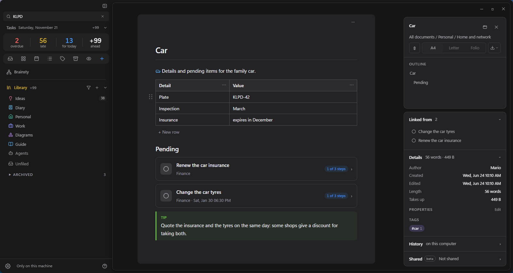
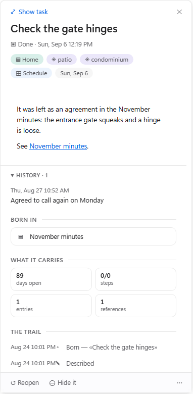

# Tasks in documents

What I know about a subject lives in its document; the work I did on it, in its tasks. For a long time those two worlds never touched: I opened «Car» to see when I changed the tyres, and the answer was in a closed task I had to go and find on its own. Now the document cites the task, and the task remembers the document it was born in.

This page covers three things: citing a task in a document as a card that keeps itself up to date, creating a new task without leaving the document you are writing, and getting from the task back to the place it was born. Linking one document to another is in [[Linking documents|Linking-Documents]].

## When it helps

- **The history of a thing.** «Car» cites «Change the tyres», closed in March, and «Renew the car insurance», still open: the document tells what was done and what is left.
- **A plan coming true.** A «Trip south» document with a section per day, and in each the task that makes it happen: «Book the lodge in Puerto Varas», «Rent a car for the south».
- **Meeting minutes.** In the building minutes a «we need to get quotes for the gate» comes up: you note it as a task right there, and the task stays cited in the minutes.
- **A big task with its document.** The design document cites every part of the task, so you read in one place how it is going.

## Citing a task that already exists

1. In a document, on an empty line, type `/`.
2. Under **Task**, pick **A task** and go on with a few words of its title: `tyres`. Tisty searches the open ones and the archived ones.
3. `Enter` leaves the card alone in its paragraph. In Markdown it is ``.

The card reads the task every time it is drawn, so it never goes stale:

| If the task… | The card shows |
| :-- | :-- |
| is open | its title, its list and its dates («Car · today · due Wed, 25 Nov 18:30»), the circle to mark it and «2 of 5 steps» |
| has a step an agent says it did | counts it apart, until you [take its word](MCP-Permissions#its-word-on-your-own-tasks): «1 of 3 steps · 1 to confirm» |
| has parts | how many are closed: «1 of 3 parts» |
| was completed | «Done» and «closed on March 14, 2026» |
| was dropped with **Not doing it** | «Not doing» |
| was deleted, or has not reached this computer yet | the words you cited it with and «That task is not on this machine» |

## Working from the card

- **A click opens it**, archived or not.
- **The circle marks it done** while it is still open. A routine with days not done opens in its list, where you pick which days you did.
- **The step count unfolds the steps**: tick one right there and it shows ticked on the task's page. The steps stay unfolded even when the card is drawn again.
- **A closed task is read, but does not change** from the document: it is not reopened and no step is unticked. That happens on its page.

## Creating a task without leaving the document

1. In the document, where the task goes, type `/`, then **Task** › **A new task**. Or type `/new task`: `Enter` opens **Task** on it, and `Enter` again opens the field.
2. The quick capture's own field opens in that place. Write the task the way you would say it: `Get a quote for the gate on Monday #building !schedule @Home`. The marks are painted as you type, and `/` inside the field offers what it offers in the quick capture: a date, a list, a priority.
3. `Enter` creates the task, with its date, its list, its tags and its priority, and leaves its card in that place of the document.

- **`Esc` lets it go** without creating anything. `Enter` on an empty line creates nothing: the field says «A title is required» and stays open.
- **A second `Enter`** while it is being made does not make another.
- **Undo** in the document takes the card away, but not the task: deleting it is still your call.
- **The rules are the usual ones**: `@list`, `#tag`, `!priority`, dates and repeats in words. They are in [[Natural language|Natural-Language]].

## Where it was born: Born in

A task created from a document remembers the document and the section you wrote it in. Beside its page, the **Born in** row names them, and a click opens that document. A task that came from an idea in Ideas shows the same.

The same row holds **Linked from**: the documents and tasks that cite or mention this one, with the section they do it in. When there are many, you see twelve and **See all…** brings the rest. [[Linking documents|Linking-Documents#who-links-to-it-linked-from]] tells it.

## On a task's page: a part

A task's page is a document too. There, **A new task** does not create a loose task: it creates a **part** of that task, hung under it and in its same list, unless your sentence names another with `@`. Its card stays where you wrote it, just as when you turn a step into a part with **↗**.

It is not offered on a part's page (a part has no parts) nor on a routine's. How parts work is in [[Tasks|Tasks#steps-and-parts]].

## An example: the building minutes

It is Tuesday and you are writing the minutes of the building meeting, with Jaime and Yisset.

1. In the **Parking gate** section you write what was said. The «we need to…» comes: `/new task` and `Enter` twice.
2. You write `Get a quote for the gate on Monday #building !schedule` and `Enter`. The card stays in the minutes; the task shows in **Upcoming** for Monday.
3. Further down, in **Gardens**, you cite last year's task: `/`, **Task**, **A task**, `pruning`, and pick «Hire the tree pruning», archived. Its card says «closed on September 12, 2026».
4. On Monday you open the task from **Today**. Beside its page, **Born in** names the minutes and the **Parking gate** section. One click and you are reading what was said.
5. As you get the three quotes, you tick the steps from the card in the minutes, without opening the task, and the minutes show «3 of 3 steps».

## Good to know

- **Outside Tisty only the sentence stays.** Folio, the PDF, Word, the web page and standard Markdown keep only the words you cited the card with: nothing of the task leaves with the document. The light viewer, the one that opens an `.md` without bringing it in, shows the task as those words and documents as cards.
- **What is hidden stays out of the network.** A task you hid or dropped does not show in the Brainsty network, with the pages hung under it, and never reaches your agents, even if a document cites it, except that one you dropped they see as your decision not to do it, with its title, day and the reason noted; in the document, its card is still there for you. Your agent, where you cited either, reads only «a task out of sight», and if it rewrites the document your citation comes back intact. See [[Good to know|Brainsty-Network#good-to-know]] and [[How an agent works|How-an-Agent-Works]].
- **Two tasks from the same section** are both born there, and both say so in **Born in**.
- **A card on another computer** shows the task as soon as the task reaches that computer; before that it says it is not on this machine.
- **Your agent cites too.** When an agent writes a task's id alone in its paragraph, Tisty turns it into that task's card. See [[How an agent works|How-an-Agent-Works]].

## Where next

- [[Linking documents|Linking-Documents]]: `[[`, sections, preview and **Linked from**.
- [[The Brainsty network|Brainsty-Network]]: each citation is a solid line between the document and the task.
- [[Tasks]]: a task's page, its steps and its parts.
- [Other documents and pages in the Tisty Markdown guide ↗](https://markdown.tisty.app/other-documents-and-pages)
