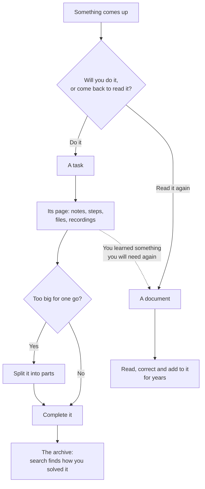

# Tasks

A task in Tisty is not a line you cross out. It is a small tree: its page, the steps, the parts, the files and the documents that grew around it while you worked. Finishing it does not prune it — it goes to the [[archive|Archive]] whole.

## A task or a document?

Tisty keeps two kinds of things, and telling them apart is most of using it well.

- **A task is something to do.** It ends, often soon: you complete it and it goes to the archive. But it does not go away. What you wrote on its page, its steps and its notes stay, and months later a search finds it and tells you how you solved it. A task is knowledge with a date.
- **A document is something to keep.** A manual, a recipe, the notes on a client or a machine, a year of minutes: it is read again and again, corrected and added to, and it grows for years. It rarely ends.

That is why a task has a page of its own: a task is also a document, one with an end. Take a **spike** — finding out how something can be done before doing it:

1. It starts as a task, «Find out how to sync with OneDrive». On its page you write what you read, what you tried and what you ruled out, section by section, and you go back and correct it as you learn. You attach what a single description could never hold: the recording of the meeting, a video of the fault, the code analysis, the PDF from the vendor.
2. When the way is clear, the work is split into **parts**: «Sign in», «Upload large files», «Resume a cut upload». Each one is a task with its own steps and notes.
3. The parts are completed one by one, and then the spike itself. It goes to the archive.
4. Nothing is lost. A year later, «how did we solve the OneDrive uploads?» finds it: its page, its parts and every step, as they were left.

Something you will do is a task. Something you will come back to is a document — a recipe is not a task with steps, and a to-do is not a document. When doing a task teaches you something you will need again beyond it — the fix for a fault that returns, how a supplier wants an order — put it in a document as well.

What a closed task keeps, and how search finds it, is in [[The archive|Archive]].

## Capture: write it the way you would say it

There is no form to fill in. Type the whole sentence in the bar at the top, and Tisty pulls the day, the list and the priority out of it as you go — and shows you what it understood **before** anything is saved, as chips you can correct with one click.

| You write | It understands |
| :-- | :-- |
| `tomorrow 10am` | a day and a time |
| `on friday` | the next one coming |
| `every tuesday` | something that comes back |
| `#home` | a tag: what it is about |
| `@work` | a list: where it happens |
| `!schedule` | a quadrant: do, schedule, delegate or minor |

If a part stays plain, it belongs to the title. What Tisty cannot read it leaves alone rather than guess. The full reference is in [[Natural language|Natural-Language]].

Try:

- `Rina's booster 3 october !do #health`
- `Walk Rina every morning`
- `Go through the report on friday @work`

## Quick capture from anywhere

Press `Ctrl` + `Shift` + `Space` wherever you are, and a small window opens for one task. `Enter` files it, `Esc` closes it, and you carry on with what you were doing. If another program already holds that shortcut, Tisty takes another one and tells you which in Settings.

## The views

- **Today** — what the day asks for, most urgent first: **Overdue** (its deadline passed, in red), **Due soon** (three days or less before its deadline), **Late** (the day you planned passed, in amber), **For today**, and **Underway** (started and still before its deadline), folded so a long project does not fill the list every day.
- **Upcoming** — what is coming.
- **Repeating** — what comes back on its own.
- **All** — everything open, unfiltered.

There is no prize for emptying the list.

The window has three columns at most: what you are looking at, the list, and the task you opened. Where the window is wide enough, a column tells you the day — overdue, late, today, ahead, the four quadrants with their counts, the lists and tags in use — counting your whole store, and every figure is a way in.

## Priorities: the Eisenhower matrix

Two questions, four boxes: whether it is pressing, and whether it matters.

| Quadrant | Meaning | Type |
| :-- | :-- | :-- |
| **Do** | urgent and important — today | `!do` |
| **Schedule** | important, no rush — give it a date before it turns urgent | `!schedule` (or `!decide`, its old name) |
| **Delegate** | pressing, but not yours to carry | `!delegate` |
| **Minor** | neither — one button drops the lot when you are sure | `!minor` |

Drag a task into its quadrant, or type it. Each quadrant has a **+** that opens the quick capture with that quadrant already set. Whatever nobody has placed waits in a tray beside them, without nagging.

The quadrants are not a scale, so `!1` means nothing and stays in the title. `!urgent` alone is not a quadrant either — it fits both *do* and *delegate*.

## Lists and tags

Two ways of sorting that do not compete:

- A **list** says where it happens: `@home`, `@work`. A task belongs to one.
- A **tag** says what it is about: `#health`, `#shopping`. A task carries as many as you like.

Tags are shared with [[documents|Documents]]: the Tags screen shows the tasks under a tag and the documents beneath them.

## What a task keeps

A task opens beside the list, not on top of it: its dates, list, tags and priority at the top, and below them **its page**, a Markdown document like any other. The page starts with sections to fill in, each with a grey hint that goes away as you write: **Description**, **Done when**, **Steps**, **Notes** and **When it closes**. You can add, rename or take off sections; the trail tells each change.

Under the page, **History** folds away: what the task had written from before, and what an assistant notes on it. Opened to the whole page, the task gains a column with its own trail — how long it has been open, how much is done, and every change it has been through.

A **deadline** is different from a plan: `before`, `due`, `by` and `until` open one. See [Natural language](Natural-Language#date-versus-deadline).

## Steps and parts

Every box you write on the page, `- [ ]`, is one of its steps: you tick it right there, and the trail keeps when it was added and when it was ticked. A step is a line; the log keeps its first hundred characters.

When a step needs more, hover over its open box and press **↗**: it becomes a task of its own, a **part** of this one, and its card stays in its place with the steps it has done and its date. A click on the card opens it.

- A task with parts shows **▣ 3/7** where its steps would count, and its parts fold beneath it.
- Elsewhere, each part names its whole with **⌂**.
- Beside the page, **Parts** takes a new one on its own line, and **Part of another…** finds the task it belongs to by name. **Let it go** detaches a part.
- The trail of both tells when a part joined and when it was let go.
- Closing a task with parts still open asks you to let them go in the same breath, and undo brings them back.

## From a calendar

A calendar file (`.ics` or `.ical`) brings its events and to-dos in as tasks. Drag it onto the window, away from a document — while you drag it, the window tells you where to drop it — or open it with Tisty. **From the calendar** shows each one with when, where, how it repeats and its reminder, and makes the ones you pick into tasks, in the list you pick.

- It keeps each event's time zone, Outlook's included, and simple repeats; a series that began long ago comes in at its next turn.
- If the event brings its own alarm, that is the reminder; otherwise half an hour before a timed event, or the evening before at 18:00 for a whole day.
- What was cancelled, is already done or was brought in before is shown, but never made again.
- For an `.ics` to open in Tisty with a double click, choose it yourself: on Windows, right-click → Open with → Choose another app → Tisty, with «Always use»; on a Mac, Get Info → Open with → Tisty → Change All.

## Routines

A routine has one page for all its rounds, with **What for**, **Every round** and **This time**. The boxes under **Every round** clear on their own when a round is completed, and the date moves on to the next one.

What you write under **This time** belongs to the round under way. Completing it keeps it in **Rounds**, folded under the page, with how many steps you ticked and when it closed, and the section is blank again for the next one.

## Completing and dropping

- `Ctrl`/`⌘` + `Enter` completes the task you are on. It goes to the [[archive|Archive]] with everything it holds.
- **Close with a summary** asks for two lines on how it went before completing it. They go first under **When it closes**; in a routine, they stay with its round.
- **Dropping** puts it aside without doing it: it lands in the archive too.
- Once it closes, its page is put away with it: it reads but takes no more writing, from you or an assistant. Reopen it and it comes back.

Tasks an assistant claims are done wait under **To confirm** — see [[What an assistant may do|MCP-Permissions]].

## Tisto

Tisto is Tisty's beaver, the one with a pencil behind its ear. It keeps you company in three places:

- **Writing a task:** once you have typed a few characters in the bar, it peeks over it and looks at what you write.
- **Quick capture:** it sits in a corner of the small window.
- **Finishing a task:** it gives you a thumbs up beside **Done**. Only for whole tasks you finish yourself: not for parts, not for tasks that repeat, and not for what an assistant closes.

It never covers anything, and it leaves on its own. To work without it, turn off **Let Tisto peek in** in Settings → General.
