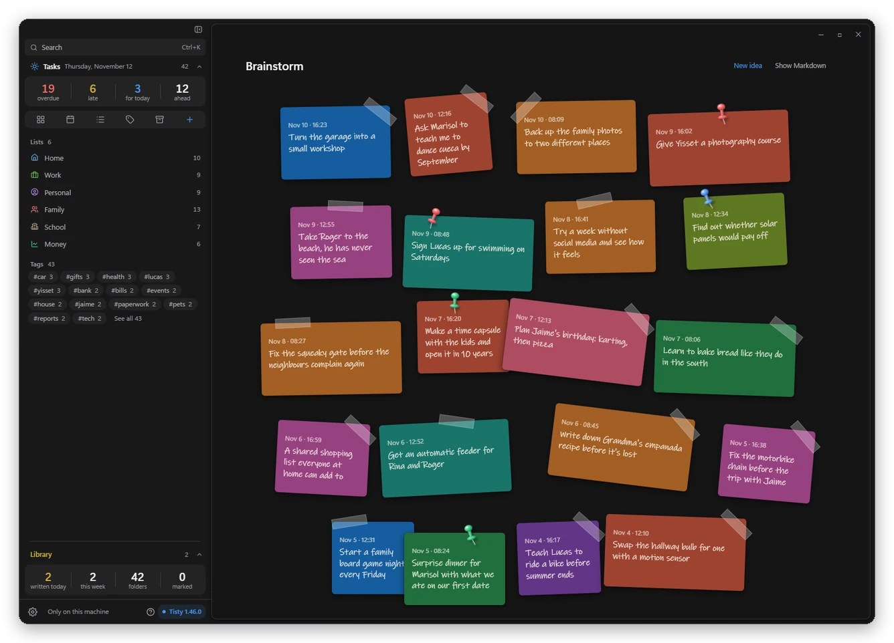

# A brainstorm at hand, and your AI agent picks up where it left off

Tisty 1.47 adds a place for the ideas that are not tasks yet, and teaches your AI agent to start each session where the last one ended. Both aim at the same thing: that nothing you or your agent thought of gets lost between one day and the next.

## A brainstorm at hand

Some thoughts are not tasks. They are ideas you want to keep without deciding anything about them yet. Open the quick capture, press Tab to switch from task to idea and type it: it waits as a sticky note of up to 140 characters on the Brainstorm sheet, pinned atop your library. Ideas have a shortcut of their own, keep their colour, and you reorder them by dragging.

When an idea grows up, you file it in a document or turn it into a task, and the library counts the ones still waiting for you.

## Your AI agent sorts your ideas

Ask your agent for a brainstorm and it jots the ideas you keep straight onto the sheet. Ask it to sort them and it proposes which ideas belong together, which should become a task and which belong in a document. It never throws one away: an old idea only gets a mark, and you decide whether it goes or stays.

## It picks up right where it left off

When a session starts, your agent sees what changed since the last one, who changed it and which task it was working on. If that task was closed in the meantime, or it had already said it was done, it tells you so instead of quietly starting something else.

## It tidies without losing a thing

Agents fold long notes into a digest to keep a task readable. Now you can ask it to put those notes back exactly as they were, even after you ticked steps, and it never writes over what you noted yourself. A document that had its day is marked with the reason, and you delete it, archive it or take the mark off. When your agent joins two copies of a document, it tells you which translations and links are left to move.

## Picking up costs less

A long task reaches your agent in parts, with its digest and its latest note first, so starting again does not mean reading everything again. Searches put what was marked as old at the end, and a decision that changes is struck through and dated instead of erased, so the reason it changed stays on the page.
