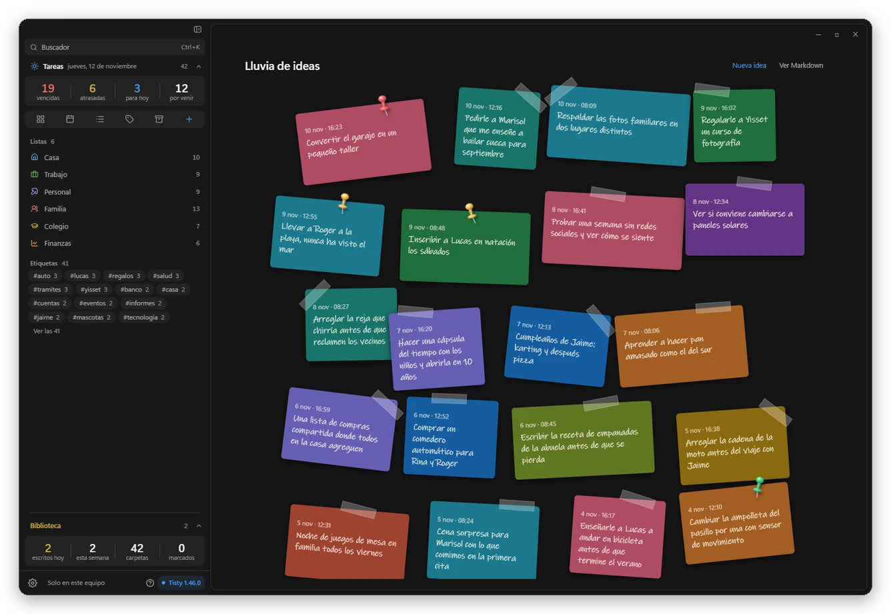

# Una lluvia de ideas a mano, y tu agente de IA retoma donde quedó

Tisty 1.47 suma un lugar para las ideas que todavía no son tareas, y le enseña a tu agente de IA a empezar cada sesión donde terminó la anterior. Las dos cosas apuntan a lo mismo: que nada de lo que pensaste tú o tu agente se pierda de un día para otro.

## Una lluvia de ideas a mano

Hay ocurrencias que no son tareas. Son ideas que quieres guardar sin decidir nada todavía. Abre la captura rápida, pulsa Tab para pasar de tarea a idea y escríbela: queda como una nota adhesiva de hasta 140 caracteres en la Lluvia de ideas, fija arriba de tu biblioteca. Las ideas tienen su propio atajo, conservan su color y las ordenas arrastrándolas.

Cuando una idea madura, la anexas a un documento o la conviertes en tarea, y la biblioteca cuenta las que siguen esperándote.

## Tu agente de IA ordena tus ideas

Pídele a tu agente una lluvia de ideas y anota directo en la hoja las que te quedas. Pídele que las ordene y te propone cuáles van juntas, cuáles se vuelven tarea y cuáles van a un documento. Nunca descarta una: a una idea vieja solo le pone una marca, y tú decides si se va o se queda.

## Retoma justo donde quedó

Al empezar una sesión, tu agente ve qué cambió desde la anterior, quién lo cambió y en qué tarea estaba. Si esa tarea se cerró mientras tanto, o ya la había dado por hecha, te lo dice en vez de empezar otra cosa sin avisar.

## Ordena sin perder nada

Los agentes juntan las notas largas en un resumen para que la tarea se lea fácil. Ahora puedes pedirle que las devuelva tal como estaban, aunque después hayas marcado pasos, y nunca escribe encima de lo que anotaste tú. Un documento que ya cumplió su vida queda marcado con el motivo, y tú lo borras, lo archivas o le quitas la marca. Cuando tu agente junta dos copias de un documento, te dice qué traducciones y enlaces quedan por mover.

## Retomar le cuesta menos

Una tarea larga le llega a tu agente por partes, con su resumen y su última nota primero, así que retomar no significa leerlo todo de nuevo. Las búsquedas dejan al final lo que se marcó como viejo, y una decisión que cambia se tacha y se fecha en vez de borrarse, para que el motivo del cambio quede en la página.
